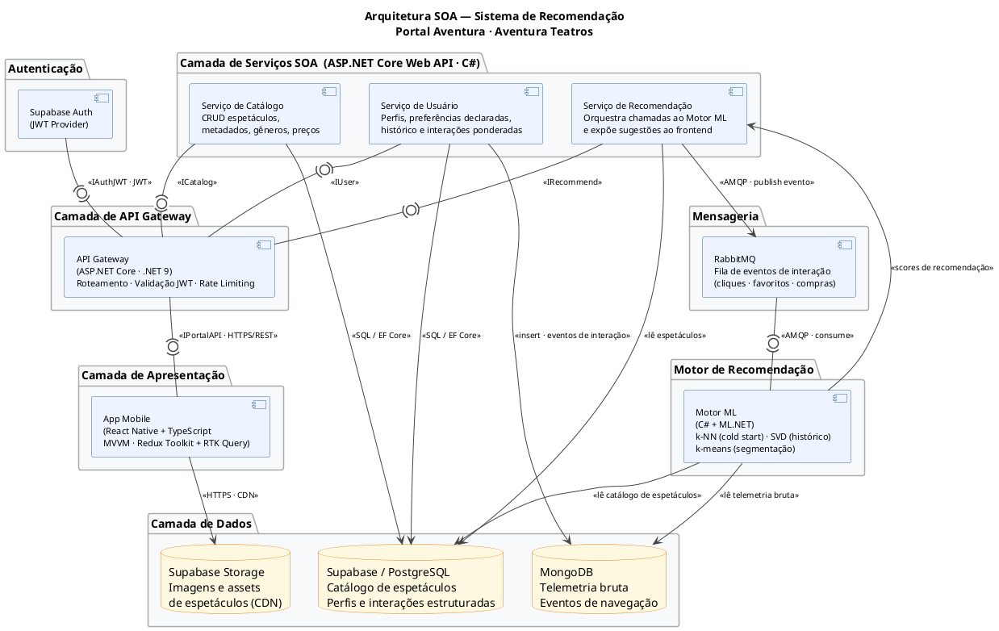
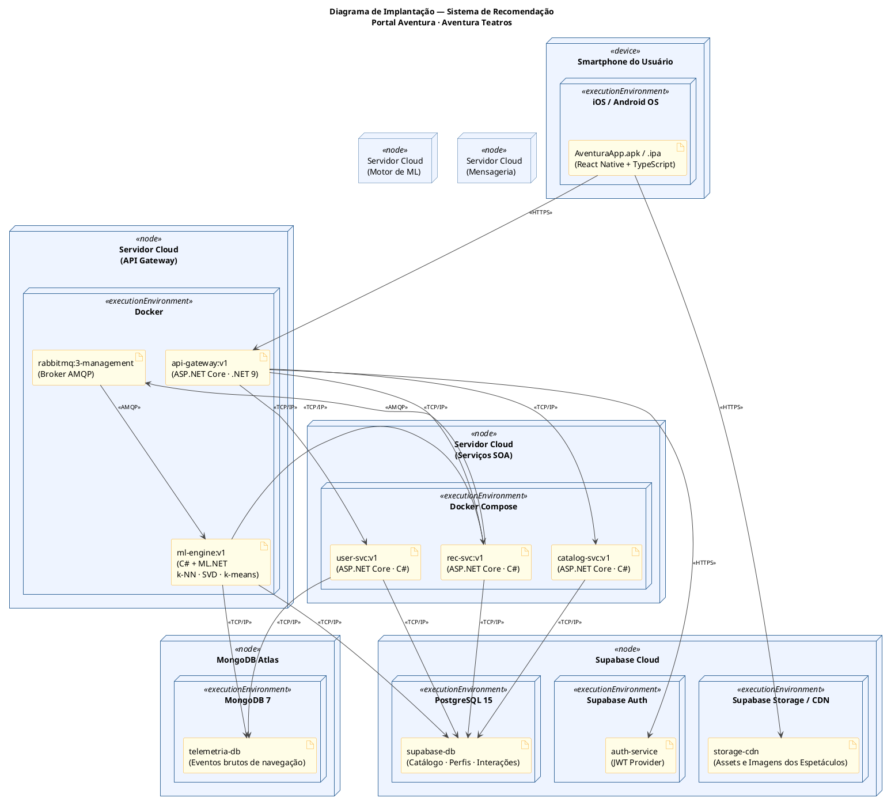

# Ponderada realizada em sala: Design Arquitetural SOA e Requisitos Não Funcionais

**Projeto:** Sistema de Recomendação para o Portal Aventura  
**Aluno:** Celso Rodrigues Rocha Júnior  
**Módulo:** 6

---

## Sumário

1. [Diagrama de Componentes SOA](#1-diagrama-de-componentes-soa)
2. [Justificativa Arquitetural](#2-justificativa-arquitetural)
3. [Diagrama de Implantação (Deployment)](#3-diagrama-de-implantação-deployment)
4. [Requisitos Não Funcionais](#4-requisitos-não-funcionais)

---

## 1. Diagrama de Componentes SOA

O diagrama abaixo representa a arquitetura orientada a serviços do sistema, com os módulos internos, seus contratos de interface (notação ball-and-socket) e as integrações com serviços externos.

---

## 2. Justificativa Arquitetural

**App Mobile (React Native + TypeScript · MVVM · Redux Toolkit + RTK Query):** frontend multiplataforma para Android e iOS com base de código única. O padrão MVVM isola as ViewModels da camada de UI, tornando-as testáveis de forma independente. O RTK Query gerencia o cache declarativo das requisições ao Gateway, reduzindo chamadas redundantes à API.

**API Gateway (ASP.NET Core · .NET 9):** ponto único de entrada que centraliza a validação do JWT emitido pelo Supabase Auth, o roteamento e o rate limiting antes que qualquer requisição alcance os serviços internos. Implementa os princípios SOA de *Abstraction* (o cliente desconhece os serviços internos) e *Discoverability* (único endpoint público).

**Três serviços SOA independentes (ASP.NET Core Web API · C#):** cada serviço encapsula uma responsabilidade de negócio exclusiva — catálogo, usuário e recomendação — comunicando-se com o Gateway apenas pelo contrato REST (*Service Contract* e *Loose Coupling*). Alterações internas em um serviço não propagam impacto aos demais. O C# obrigatório da stack é atendido nativamente.

**RabbitMQ como barramento assíncrono:** cada interação do usuário gera um evento publicado pelo Serviço de Recomendação na fila. O Motor ML consome esses eventos de forma assíncrona via AMQP, sem bloquear a resposta ao usuário. Esse desacoplamento temporal suporta os picos de tráfego em lançamentos de temporadas da Aventura Teatros e garante *Statelessness* no serviço de recomendação.

**Motor ML isolado (C# + ML.NET · k-NN / SVD / k-means):** serviço separado e escalável de forma independente. Os três algoritmos cobrem diferentes maturidades de perfil: k-NN para cold start (onboarding de gêneros), SVD para usuários com histórico de interações, e k-means para segmentação em clusters comportamentais (Famílias, Musical Adulto, Ballet Clássico, Experimental). O ML.NET elimina dependências Python, mantendo a stack C# pura.

**PostgreSQL (Supabase) + MongoDB — dados por finalidade:** o PostgreSQL armazena dados transacionais que exigem consistência relacional (catálogo, perfis, interações estruturadas). O MongoDB armazena a telemetria bruta de navegação, de alta frequência de gravação e schema variável, sem onerar o banco relacional. Cada serviço controla seu próprio acesso a dados (*Autonomy*).

**Supabase Storage (CDN):** imagens e assets dos espetáculos são servidos diretamente ao App via CDN, sem atravessar o Gateway ou os serviços de negócio, eliminando latência desnecessária na carga de mídia.

> **⭐ Conexão com escalabilidade do parceiro:** a arquitetura permite escalar o Motor ML e o Serviço de Recomendação de forma independente nos picos de lançamento de temporadas, sem redeploy dos serviços de Catálogo ou Usuário — aplicando diretamente o princípio SOA de *Autonomy* às demandas de crescimento do Portal Aventura.

---

## 3. Diagrama de Implantação (Deployment)

O diagrama abaixo descreve **onde** cada artefato do sistema é executado, seguindo a notação UML de Deployment: nodes físicos, execution environments, artifacts e communication paths com estereótipos de protocolo. A leitura é de fora para dentro: servidor → ambiente de execução → artefato binário → componente que ele manifesta.

### Leitura do diagrama de implantação

| Node (físico) | Execution Environment | Artefato | Componente que manifesta |
|---|---|---|---|
| Smartphone do usuário | iOS / Android OS | `AventuraApp.apk/.ipa` | App Mobile (React Native) |
| Servidor Cloud (API Gateway) | Docker | `api-gateway:v1` | API Gateway (ASP.NET Core) |
| Servidor Cloud (Serviços SOA) | Docker Compose | `catalog-svc:v1`, `user-svc:v1`, `rec-svc:v1` | Serviços de Catálogo, Usuário e Recomendação |
| Servidor Cloud (Motor de ML) | Docker | `ml-engine:v1` | Motor ML (C# + ML.NET) |
| Servidor Cloud (Mensageria) | Docker | `rabbitmq:3-management` | Broker RabbitMQ |
| Supabase Cloud | PostgreSQL 15 | `supabase-db` | Banco relacional (catálogo, perfis) |
| Supabase Cloud | Supabase Auth | `auth-service` | Provedor JWT |
| Supabase Cloud | Supabase Storage / CDN | `storage-cdn` | Assets de espetáculos |
| MongoDB Atlas | MongoDB 7 | `telemetria-db` | Banco de telemetria bruta |

---

## 4. Requisitos Não Funcionais

### Tabela de RNFs

| # | Requisito Não Funcional | Categoria ISO/IEC 25010 | SLA Mensurável | Componente Responsável | Justificativa + Relação com SOA |
|---|---|---|---|---|---|
| RNF-01 | **Desempenho — Latência da rota `/recomendar`** | Eficiência de Desempenho → Comportamento Temporal | p99 da rota `/recomendar` < 300 ms com 200 req/s | `Serviço de Recomendação` + `Motor ML` (via RabbitMQ) | O Serviço de Recomendação responde ao frontend com recomendações já computadas de forma assíncrona pelo Motor ML. O desacoplamento via RabbitMQ garante que a latência percebida pelo usuário não dependa do tempo de inferência do modelo. Usuários em cold start recebem recomendações k-NN sobre gêneros do onboarding; usuários com histórico recebem scores SVD pré-computados. Em SOA, o Motor ML pode ser escalado horizontalmente de forma independente sem impactar o Serviço de Catálogo ou de Usuário. |
| RNF-02 | **Disponibilidade do sistema** | Confiabilidade → Disponibilidade | Uptime ≥ 99,5% (downtime máximo ≈ 3,65 h/mês); health checks a cada 30 s em todos os serviços | `API Gateway` + todos os serviços SOA | O Portal Aventura comercializa ingressos com picos intensos em lançamentos de temporadas — indisponibilidade implica perda direta de receita. Na arquitetura SOA, cada serviço pode ser reiniciado ou substituído de forma independente sem derrubar os demais. O API Gateway absorve o roteamento para instâncias saudáveis. Uma falha no Motor ML não derruba o Serviço de Catálogo, isolando a falha localmente (*Autonomy*). |
| RNF-03 | **Segurança — Autenticação e proteção de dados** | Segurança → Autenticidade + Confidencialidade | 100% dos endpoints autenticados via JWT com expiração ≤ 1 h; OWASP Top-10 mitigado no Gateway; dados pessoais criptografados em repouso (AES-256) conforme LGPD | `API Gateway` + `Supabase Auth` + `Serviço de Usuário` | O Portal armazena preferências culturais e histórico de compra dos usuários — dados sensíveis sob a LGPD. O Supabase Auth emite o JWT; o Gateway valida o token antes de qualquer roteamento, centralizando o controle de acesso na fronteira da arquitetura SOA. O Serviço de Usuário usa `anon_user_id` no MVP, separando identidade de comportamento e evitando exposição de PII. |
| RNF-04 | **Manutenibilidade — Modularidade e testabilidade** | Manutenibilidade → Modularidade + Testabilidade | Cobertura de testes unitários ≥ 80% por serviço; cada serviço implantável de forma independente (zero-downtime deploy) | Todos os serviços SOA (contratos `ICatalog`, `IUser`, `IRecommend`) | A equipe de 7 pessoas trabalha em paralelo em serviços distintos. O baixo acoplamento SOA garante que alterações no Serviço de Catálogo não quebrem o Motor ML. O padrão MVVM no frontend separa ViewModels testáveis da camada de UI. A cobertura mínima de 80% captura regressões antes do merge, reduzindo tempo de debug em sprints posteriores. |
| RNF-05 | **Compatibilidade — Interoperabilidade com o Portal Aventura** | Compatibilidade → Interoperabilidade | API RESTful com contrato OpenAPI 3.0 publicado; respostas em JSON; integração validada com o Portal Aventura existente em ≤ 2 semanas de onboarding técnico | `API Gateway` + `Serviço de Recomendação` | O sistema precisa ser integrado ao Portal Aventura já existente sem reescrever a plataforma atual. A exposição de uma API REST com contrato OpenAPI 3.0 pelo Gateway garante que qualquer cliente HTTP — incluindo o portal web da Aventura — consuma as recomendações sem depender de SDKs proprietários ou da stack interna C#. Implementa diretamente o princípio SOA de *Service Contract* e viabiliza adoção incremental pelo parceiro. |

### Referência cruzada: ISO/IEC 25010 × Diagrama

| Eixo ISO/IEC 25010 | RNF | Componente no Diagrama de Componentes | Artefato no Diagrama de Deployment |
|---|---|---|---|
| 2. Performance Efficiency | RNF-01 | Serviço de Recomendação + Motor ML | `rec-svc:v1` + `ml-engine:v1` |
| 5. Reliability | RNF-02 | API Gateway + todos os serviços SOA | `api-gateway:v1` + serviços SOA |
| 6. Security | RNF-03 | API Gateway + Supabase Auth + Serviço de Usuário | `api-gateway:v1` + `auth-service` + `user-svc:v1` |
| 7. Maintainability | RNF-04 | Todos os serviços SOA | `catalog-svc:v1`, `user-svc:v1`, `rec-svc:v1` |
| 3. Compatibility | RNF-05 | API Gateway + Serviço de Recomendação | `api-gateway:v1` + `rec-svc:v1` |
