<p align="center">
  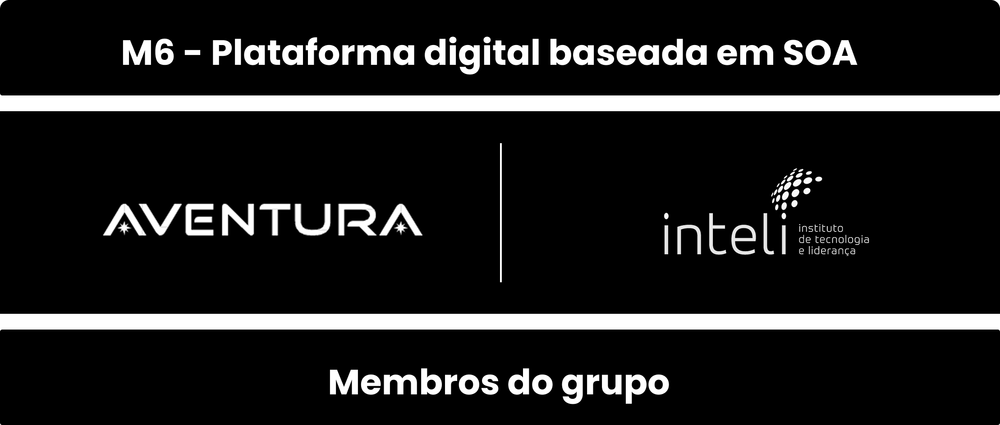
</p>

<table align="center" style="border: none; border-collapse: collapse;">
  <tr>
    <td align="center" style="border: none; padding: 5px;">
      <a href="https://www.linkedin.com/in/celsojwnior/">
        
      </a>
    </td>
    <td align="center" style="border: none; padding: 5px;">
      <a href="https://www.linkedin.com/in/jaimeandradedealmeida/">
        
      </a>
    </td>
    <td align="center" style="border: none; padding: 5px;">
      <a href="https://www.linkedin.com/in/leonardoramosvieira/">
        
      </a>
    </td>
    <td align="center" style="border: none; padding: 5px;">
      <a href="https://www.linkedin.com/in/marianalacerdareis/">
        
      </a>
    </td>
    <td align="center" style="border: none; padding: 5px;">
      <a href="https://www.linkedin.com/in/mariana-pereira-de-souza1/">
        
      </a>
    </td>
    <td align="center" style="border: none; padding: 5px;">
      <a href="https://www.linkedin.com/in/rafael-figueiredo-campos-72131735b/">
        
      </a>
    </td>
    <td align="center" style="border: none; padding: 5px;">
      <a href="https://www.linkedin.com/in/vitor-ribeiro-ms/">
        
      </a>
    </td>
  </tr>
</table>

<br>

<p align="center">
  
</p>

<table align="center" style="border: none; border-collapse: collapse;">
  <tr>
    <td align="center" style="border: none; padding: 5px;">
      <a href="https://www.linkedin.com/in/vanunes/">
        
      </a>
    </td>
    <td align="center" style="border: none; padding: 5px;">
      <a href="https://www.linkedin.com/in/afonsolelis/">
        
      </a>
    </td>
    <td align="center" style="border: none; padding: 5px;">
      <a href="https://www.linkedin.com/in/hermano-peixoto-1091796/">
        
      </a>
    </td>
    <td align="center" style="border: none; padding: 5px;">
      <a href="https://www.linkedin.com/in/luciano-galdino-26191b36/">
        
      </a>
    </td>
    <td align="center" style="border: none; padding: 5px;">
      <a href="https://www.linkedin.com/in/rafael-jacomossi-6135b0a1/">
        
      </a>
    </td>
    <td align="center" style="border: none; padding: 5px;">
      <a href="https://www.linkedin.com/in/francisco-escobar/">
        
      </a>
    </td>
    <td align="center" style="border: none; padding: 5px;">
      <a href="https://www.linkedin.com/in/filipe-gon%C3%A7alves-08a55015b/">
        
      </a>
    </td>
  </tr>
</table>

<br>

<p align="center">
  
</p>

# Spotlight

## Dora

## Integrantes:

- <a href="https://www.linkedin.com/in/celsojwnior/">Celso Rodrigues</a>
- <a href="https://www.linkedin.com/in/jaimeandradedealmeida/">Jaime Almeida</a>
- <a href="https://www.linkedin.com/in/leonardoramosvieira/">Leonardo Ramos</a>
- <a href="https://www.linkedin.com/in/marianalacerdareis/">Mariana Lacerda</a>
- <a href="https://www.linkedin.com/in/mariana-pereira-de-souza1/">Mariana Pereira</a>
- <a href="https://www.linkedin.com/in/rafael-figueiredo-campos-72131735b/">Rafael Campos</a>
- <a href="https://www.linkedin.com/in/vitor-ribeiro-ms/">Vitor Ribeiro</a>

# Sumário

- [1. Introdução](#1-introdução)
  - [1.1 Termos e Abreviações](#11-termos-e-abreviações)
  - [1.2 Objetivo do Documento](#12-objetivo-do-documento)
- [2. Entendimento do Projeto e do Negócio](#2-entendimento-do-projeto-e-do-negócio)
  - [2.1 Contexto da Indústria do Parceiro](#21-contexto-da-indústria-do-parceiro)
  - [2.2 Problema](#22-problema)
  - [2.3 Visão do Projeto e do Produto](#23-visão-do-projeto-e-do-produto)
    - [2.3.1 Visão do Produto](#231-visão-do-produto)
    - [2.3.2 Proposta de Valor](#232-proposta-de-valor)
    - [2.3.3 O que o Produto Faz e Não Faz](#233-o-que-o-produto-faz-e-não-faz)
    - [2.3.4 Objetivos Estratégicos e Mensuráveis](#234-objetivos-estratégicos-e-mensuráveis)
    - [2.3.5 Impacto e Abrangência](#235-impacto-e-abrangência)
    - [2.3.6 Ownership e Accountability Estratégico](#236-ownership-e-accountability-estratégico)
    - [2.3.7 Alinhamento com o Problema](#237-alinhamento-com-o-problema)
  - [2.4 Personas e Jornada do Usuário](#24-personas-e-jornada-do-usuário)
  - [2.5 Modelagem do Fluxo de Negócio](#25-modelagem-do-fluxo-de-negócio)
    - [2.5.1 Cadeia de Valor](#251-cadeia-de-valor)
    - [2.5.2 Fluxo de Negócio Proposto (AS-IS e TO-BE)](#252-fluxo-de-negócio-proposto-as-is-e-to-be)
  - [2.6 Matriz de Risco do Projeto](#26-matriz-de-risco-do-projeto)
  - [2.7 Brainstorm de Features](#27-brainstorm-de-features)
  - [2.8 Business Model Canvas](#28-business-model-canvas)
- [3. Requisitos do Projeto](#3-requisitos-do-projeto)
  - [3.1 Requisitos Funcionais (RFs)](#31-requisitos-funcionais-rfs)
  - [3.2 Requisitos Não Funcionais (RNFs)](#32-requisitos-não-funcionais-rnfs)
  - [3.3 Correlação RFs e RNFs](#33-correlação-rfs-e-rnfs)
  - [3.4 Casos de Uso e Comparação com Requisitos Funcionais](#34-casos-de-uso-e-comparação-com-requisitos-funcionais)
  - [3.5 Diagrama de Casos de Uso](#35-diagrama-de-casos-de-uso)
- [4. Modelagem de Dados](#4-modelagem-de-dados)
  - [4.1 Especificação da Base de Dados para Modelo de Recomendação](#41-especificação-da-base-de-dados-para-modelo-de-recomendação)
  - [4.2 Modelo Conceitual de Dados](#42-modelo-conceitual-de-dados)
  - [4.3 Modelo Lógico de Dados](#43-modelo-lógico-de-dados)
    - [4.3.3 Dicionário de Dados](#433-dicionário-de-dados)
    - [4.3.4 Normalização do Modelo Relacional](#434-normalização-do-modelo-relacional)
    - [4.3.5 Tabelas Associativas dos Relacionamentos N:N](#435-tabelas-associativas-dos-relacionamentos-nn)
  - [4.4 Modelo Físico de Dados](#44-modelo-físico-de-dados)
- [5. Solução Técnica (Design)](#5-solução-técnica-design)
  - [5.1 Diagrama de Classes](#51-diagrama-de-classes)
  - [5.2 Diagrama de Componentes da UML](#52-diagrama-de-componentes-da-uml)
  - [5.3 Justificativas das escolhas tecnológicas](#54-justificativa-das-escolhas-tecnológicas)
  - [5.4 Diagramas de Sequência da UML](#53-diagramas-de-sequência-da-uml)
- [6. Mapeamento Técnico de Infraestrutura e Implantação](#6-mapeamento-técnico-de-infraestrutura-e-implantação)
  - [6.1 Diagrama de Implantação da UML](#61-diagrama-de-implantação-da-uml)
  - [6.2 Justificativa das escolhas de implantação](#62-justificativa-das-escolhas-de-implantação)
- [7. Projeto Visual da Solução](#7-projeto-visual-da-solução)
  - [7.1 Desenvolvimento de Wireframes](#71-desenvolvimento-de-wireframes)
  - [7.2 Desenvolvimento de Mockups](#72-desenvolvimento-de-mockups)
  - [7.3 Guia Visual](#73-guia-visual)
- [8. Desenvolvimento do Projeto](#8-desenvolvimento-do-projeto)
  - [8.1 Arquitetura de Codificação e Estrutura de Diretórios](#81-arquitetura-de-codificação-e-estrutura-de-diretórios)
    - [8.1.3 Composição da Tela de Catálogo no Frontend](#813-composição-da-tela-de-catálogo-no-frontend)
  - [8.2 Modelo de Recomendação](#82-modelo-de-recomendação)
  - [8.3 Desenvolvimento de Features](#83-desenvolvimento-de-features)
    - [8.3.1 Sprint 3](#831-sprint-3)
    - [8.3.2 Sprint 4](#832-sprint-4)
    - [8.3.3 Sprint 5](#833-sprint-5)
  - [8.4 Testes Unitários e de Integração](#84-testes-unitários-e-de-integração)
  - [8.5 Documentações automáticas (Swagger)](#85-documentações-automáticas-swagger)
- [9. Planejamento e Execução de Testes](#9-planejamento-e-execução-de-testes)
  - [9.1 Testes Funcionais](#91-testes-funcionais)
    - [9.1.1 Planejamento](#911-planejamento)
    - [9.1.2 Resultados](#912-resultados)
  - [9.2 Testes de RNFs](#92-testes-de-rnfs)
    - [9.2.1 Planejamento](#921-planejamento)
    - [9.2.2 Resultados](#922-resultados)
  - [9.3 Testes de Usabilidade](#93-testes-de-usabilidade)
    - [9.3.1 Planejamento](#931-planejamento)
    - [9.3.2 Resultados](#932-resultados)
  - [9.4 Testes de Integração](#94-testes-de-integração)
    - [9.4.1 Planejamento](#941-planejamento)
      - [Abrangência dos Testes de Integração](#abrangência-dos-testes-de-integração)
    - [9.4.2 Resultados](#942-resultados)
- [10. Procedimentos de Implantação](#10-procedimentos-de-implantação)
  - [10.1 Implantação e Configuração do Banco de Dados](#101-implantação-e-configuração-do-banco-de-dados)
  - [10.2 Implantação do Protótipo para uso por equipe de desenvolvimento](#102-implantação-do-protótipo-para-uso-por-equipe-de-desenvolvimento)
    - [10.2.1 Modo de desenvolvimento para demonstração](#1021-modo-de-desenvolvimento-para-demonstração)
    - [10.2.2 Problemas comuns em execução local](#1022-problemas-comuns-em-execução-local)
- [Referências](#referências)

# 1. Introdução

&emsp;Este documento foi elaborado com o objetivo de servir como um guia completo para o leitor, 
fornecendo uma visão ampla de todas as etapas e aspectos do projeto desenvolvido em parceria 
com a Aventura Teatros. Nele, são apresentadas desde a descrição do parceiro envolvido e o 
problema proposto, até as decisões estratégicas tomadas, as análises de negócio realizadas e 
a documentação técnica relacionada à solução desenvolvida.

## 1.1 Termos e Abreviações

Abreviações utilizadas na elaboração desta documentação:

| Abreviação | Significado |
|---|---|
| API | Application Programming Interface (Interface de Programação de Aplicação) |
| MVP | Minimum Viable Product (Produto Mínimo Viável) |
| UI | User Interface (Interface do Usuário) |
| UX | User Experience (Experiência do Usuário) |
| RF | Requisito Funcional |
| RNF | Requisito Não Funcional |
| REST | Representational State Transfer (Transferência de Estado Representacional) |
| RACI | Responsible, Accountable, Consulted, Informed |
| Sprint | Ciclo de desenvolvimento ágil |
| SOA | Service-Oriented Architecture (Arquitetura Orientada a Serviços) |
| Portal | Plataforma digital da Aventura Teatros voltada ao público externo |

## 1.2 Objetivo do Documento

&emsp;Este documento tem como objetivo apresentar o escopo e o propósito do projeto voltado ao 
desenvolvimento de uma solução de recomendação de espetáculos no Portal Aventura. A principal 
função da solução é sugerir, de forma inteligente, espetáculos, conteúdos e experiências 
culturais alinhados ao interesse do usuário, estimulando a navegação dentro do portal e 
aumentando o potencial de conversão em vendas de ingressos. A proposta visa contribuir para 
a melhoria da experiência do usuário, o aumento do engajamento com o ecossistema da produtora 
e o fortalecimento da presença digital da Aventura Teatros como plataforma cultural completa.

# 2. Entendimento do Projeto e do Negócio

&emsp;O projeto consiste no desenvolvimento de uma solução digital de recomendação inteligente 
integrada ao Portal Aventura, com o objetivo de conectar o usuário a espetáculos, conteúdos 
e experiências culturais relevantes ao seu perfil de interesse. A iniciativa responde a uma 
lacuna identificada na jornada digital do usuário, que atualmente não recebe sugestões ao 
navegar pelo portal, o que reduz as oportunidades de descoberta de novos conteúdos e de 
conversão em vendas. A solução proposta permitirá a geração de recomendações contextualizadas 
ao comportamento e às preferências do usuário, criando uma jornada mais fluida e conectada 
entre as produções da Aventura.

## 2.1 Contexto da Indústria do Parceiro

A Aventura Teatros, fundada em 2008, é referência na produção de espetáculos de teatro musical no Brasil e uma das principais forças da economia criativa nacional. Liderada por Aniela Jordan, Luiz Calainho e Giulia Jordan, a empresa evoluiu de produtora de espetáculos para uma plataforma cultural completa, atuando na realização de festivais, na gestão de equipamentos culturais e na construção de parcerias estratégicas com marcas de grande expressão. Ao longo de sua trajetória, acumula mais de 50 produções, mais de 5 mil apresentações e um público superior a 5 milhões de espectadores, consolidando-se também como a maior gestora de naming rights em equipamentos culturais do país.

Inserida nesse contexto, a Aventura atua em um setor que vem se fortalecendo nos últimos anos. O mercado de entretenimento cultural e produção de espetáculos no Brasil, especialmente no segmento de teatro musical e experiências ao vivo, tem apresentado crescimento impulsionado pela retomada do público no período pós-pandemia, pela valorização de experiências presenciais e pelo aumento do consumo de cultura como forma de lazer. Esse cenário reforça o papel estratégico de empresas que conseguem integrar produção artística de qualidade com gestão eficiente e posicionamento de mercado.

Apesar desse crescimento, o setor enfrenta desafios relevantes relacionados à digitalização da experiência do usuário. Diferentemente de plataformas de streaming, que utilizam algoritmos avançados para recomendação de conteúdo, muitos portais de espetáculos ainda operam de forma estática, limitando a descoberta de novas experiências e reduzindo o potencial de engajamento e conversão. Para uma empresa com o porte e a diversidade de portfólio da Aventura, essa lacuna representa uma oportunidade estratégica clara de aprimorar a jornada do usuário e potencializar resultados de negócio por meio de soluções inteligentes de recomendação.

Nesse contexto, a análise do setor por meio do modelo das 5 Forças de Porter permite compreender de forma estruturada a dinâmica competitiva e os desafios enfrentados pela empresa.

1. Rivalidade entre concorrentes existentes (Alta):
O mercado de entretenimento é altamente competitivo, envolvendo não apenas outras produtoras de teatro, mas também cinemas, shows, plataformas de streaming e eventos ao vivo. Além disso, empresas que oferecem experiências digitais, como Netflix e Spotify, disputam diretamente o tempo e a atenção do consumidor. Isso exige que empresas como a Aventura invistam em diferenciação e em estratégias que aumentem o engajamento do público dentro de seus próprios canais.

2. Poder de barganha dos clientes (Alto):
Os consumidores possuem ampla variedade de opções de entretenimento e baixo custo de troca entre elas. A decisão de compra é fortemente influenciada por preço, conveniência e relevância do conteúdo. A ausência de recomendações personalizadas reduz a capacidade de retenção do usuário, tornando essencial a criação de experiências digitais mais inteligentes e direcionadas.

3. Ameaça de novos entrantes (Moderada):
Embora a produção de espetáculos envolva altos custos e barreiras operacionais, a entrada de novas plataformas digitais e iniciativas independentes de divulgação cultural tem reduzido essas barreiras. Startups e plataformas online podem atuar como intermediárias na descoberta de conteúdo, diminuindo o controle das produtoras sobre a jornada do usuário.

4. Poder de barganha dos fornecedores (Moderado):
Os principais fornecedores incluem artistas, produtores, teatros e parceiros comerciais. Como esses recursos são limitados e altamente especializados, eles possuem certo poder de negociação. Além disso, parcerias com marcas e patrocinadores são fundamentais para viabilizar grandes produções, influenciando diretamente a oferta de conteúdo.

5. Ameaça de produtos substitutos (Alta):
O principal substituto dos espetáculos presenciais são as plataformas digitais de entretenimento, como streaming de vídeo, redes sociais e jogos online. Essas alternativas oferecem conveniência e, muitas vezes, menor custo, competindo diretamente com o teatro pelo tempo do consumidor.

Diante desse cenário, observa-se que o setor exige cada vez mais a integração entre experiência presencial e digital. A capacidade de recomendar conteúdos de forma personalizada torna-se um diferencial competitivo essencial, permitindo que empresas como a Aventura ampliem o engajamento do público, fortaleçam seu ecossistema de produções e aumentem a conversão de vendas. Assim, a adoção de soluções tecnológicas, como sistemas de recomendação, não é apenas uma inovação, mas uma necessidade estratégica para se manter relevante em um mercado altamente competitivo e em constante transformação.

## 2.2 Problema

&emsp;O Portal Aventura, principal canal digital da Aventura Teatros, não conta com um sistema 
estruturado de recomendação de espetáculos e conteúdos. Atualmente, um usuário que acessa 
a página de um espetáculo específico encerra sua jornada naquele ponto, sem receber sugestões 
de outras produções, sem ser conduzido a experiências relacionadas e sem estímulo para 
explorar o ecossistema cultural que a Aventura oferece. Isso representa uma ruptura 
significativa na jornada do usuário e uma oportunidade de conversão desperdiçada.

&emsp;A relevância desse problema se amplifica quando considerado o porte da empresa: com mais de 
50 produções e uma plataforma cultural diversificada, a Aventura possui um catálogo rico e 
variado, porém subaproveitado digitalmente. A ausência de recomendações impede que esse 
catálogo trabalhe de forma ativa na geração de novas descobertas e vendas.

&emsp;Os principais desafios associados ao problema incluem a heterogeneidade do público, que 
abrange desde frequentadores assíduos de teatro até visitantes casuais sem histórico no 
portal, a potencial escassez de dados comportamentais estruturados sobre os usuários e a 
necessidade de que as recomendações sejam relevantes tanto para quem compra para si quanto 
para quem adquire ingressos para terceiros.

&emsp;Um sistema de recomendação bem construído pode aumentar o tempo de permanência no portal, 
fortalecer o engajamento com o ecossistema Aventura, criar uma jornada mais fluida entre 
produções e impulsionar a venda de ingressos, uma prioridade estratégica declarada pela 
empresa. Além disso, o projeto se insere em um momento de rebranding da Aventura, tornando-se 
uma ferramenta com potencial de reforçar a identidade da produtora como plataforma cultural 
completa.

## 2.3 Visão do Projeto e do Produto

Este tópico apresenta a visão estratégica do produto proposto, bem como seus objetivos mensuráveis, alinhando a solução ao problema identificado, às necessidades do negócio da Aventura e ao valor esperado para os usuários. A definição desses elementos é fundamental para orientar o desenvolvimento da solução, garantir coerência nas decisões de produto e estabelecer critérios claros de sucesso com base em resultados mensuráveis.

A partir desse direcionamento, busca-se não apenas descrever o que será desenvolvido, mas explicitar o papel estratégico do produto dentro do ecossistema digital da Aventura, evidenciando seu impacto potencial em engajamento, descoberta de conteúdo e conversão:

### 2.3.1 Visão do Produto

A visão do produto é transformar o Portal Aventura de uma plataforma estática de navegação em um ambiente digital inteligente, personalizado e orientado à descoberta, capaz de conectar usuários a experiências culturais relevantes de forma contínua, contextualizada e escalável.

Atualmente, a experiência do portal é fragmentada e limitada à navegação direta por páginas específicas, sem mecanismos que incentivem a exploração ou ampliem a jornada do usuário. O produto propõe uma reengenharia dessa dinâmica, introduzindo um sistema de recomendação que atua como uma camada estratégica de curadoria, responsável por guiar o usuário ao longo de uma experiência mais fluida, conectada e orientada à decisão.

A solução conceitualmente funciona como uma camada de inteligência sobre o conteúdo existente, estruturando e relacionando espetáculos, conteúdos e experiências com base em critérios de relevância, contexto e comportamento. Ao fazer isso, transforma a navegação em uma jornada progressiva de descoberta, reduzindo fricções e ampliando oportunidades de engajamento.

Mais do que melhorar a navegação, o produto reposiciona o Portal Aventura como um hub digital de experiências culturais, fortalecendo seu papel dentro do ecossistema da empresa e aumentando sua capacidade de gerar valor tanto para usuários quanto para o negócio.

---

### 2.3.2 Proposta de Valor

O produto entrega valor ao:

- Reduzir o esforço do usuário na descoberta de experiências culturais  
- Aumentar a relevância do conteúdo apresentado  
- Expandir a jornada de navegação dentro do portal  
- Potencializar a exposição de todo o portfólio da Aventura  
- Converter engajamento em oportunidades reais de negócio  

A proposta central é transformar atenção em descoberta e descoberta em conversão.

---

### 2.3.3 O que o Produto Faz e Não Faz
## O que o produto faz

O produto implementa um sistema de recomendação focado na descoberta de espetáculos dentro do Portal Aventura, com aplicação direta nas telas em que a recomendação agrega valor à navegação:

- Na `Tela principal de descoberta`, exibe listas e carrosséis de espetáculos recomendados, organizados por relações com o perfil e o comportamento do usuário.
- Na `Sub-tela de cada espetáculo`, apresenta um carrossel de sugestões como `Espetáculos similares` ou `Você também pode gostar`, ampliando a exploração de conteúdos relacionados.
- No `Login/Cadastro` e `Seleção de tags`, evita o cold start com coleta mínima de informações e preferências iniciais, sem sobrecarregar essas etapas com recomendações, porém garantindo que o usuário tenha acesso à peças que se encaixem nos gêneros escolhidos.

As recomendações seguem esta ordem de prioridade no MVP:

1. Filtragem colaborativa, baseada em similaridade entre usuários e regras inspiradas em SVD.
2. Sinais de navegação, considerando tempo de permanência nas páginas e cliques.
3. Histórico de interações, reforçando conteúdos já acessados pelo usuário.

Além disso, o produto disponibiliza um protótipo navegável com fluxo de descoberta entre a tela principal e as páginas de espetáculo, permitindo validar a experiência e o comportamento das recomendações.

## O que o produto não faz

- Não cobre, neste MVP, processos transacionais, operacionais ou administrativos que extrapolem a jornada de descoberta de espetáculos.
- Não entrega, nesta etapa, uma solução completa de gestão, análise ou automação do ecossistema do portal.
- Não pretende substituir integralmente a curadoria humana nem eliminar a necessidade de revisão manual das recomendações quando necessário.

---

### 2.3.4 Objetivos Estratégicos e Mensuráveis

O sucesso do produto será medido por indicadores de impacto real no comportamento do usuário e nos resultados de negócio.

Esses objetivos refletem não apenas melhorias na experiência do usuário, mas também impactos diretos nos resultados de negócio, especialmente em engajamento, retenção e conversão de vendas:

#### Engajamento e Experiência

- Aumentar em **20%** o tempo médio de sessão  
- Aumentar em **25%** o número de páginas por sessão  
- Aumentar a taxa de interação com recomendações  

#### Descoberta de Conteúdo

- Aumentar em **30%** a navegação entre diferentes espetáculos  
- Aumentar a diversidade de conteúdos acessados por usuário  
- Reduzir a dependência de acessos concentrados em poucos conteúdos  

#### Conversão e Valor de Negócio

- Aumentar em **10% a 15%** a taxa de conversão associada a recomendações  
- Aumentar o número de sessões que evoluem para intenção de compra  
- Estimular a venda cruzada entre espetáculos  

#### Retenção e Recorrência

- Aumentar a taxa de retorno de usuários ao portal  
- Melhorar a continuidade da jornada entre sessões  

---

### 2.3.5 Impacto e Abrangência

A solução foi concebida para atender uma base ampla e heterogênea de usuários, com diferentes níveis de familiaridade, objetivos e contextos de uso.

Ao introduzir recomendações contextualizadas, o produto:
- Reduz barreiras de entrada para novos usuários  
- Amplia a relevância para usuários recorrentes  
- Adapta a experiência a diferentes momentos de navegação  
- Garante acessibilidade e clareza na exploração de conteúdos  
- Atende à diversidade de perfis de usuários e suas diferentes expectativas  

Isso amplia significativamente o alcance e o impacto do portal como plataforma digital.

---

### 2.3.6 Ownership e Accountability Estratégico

A responsabilidade estratégica do produto é compartilhada em duas camadas:

**Stakeholders da Aventura:**
- Validam alinhamento com objetivos de negócio  
- Aprovam mudanças de escopo relevantes  
- Avaliam impacto em métricas de negócio  

**Equipe do Projeto:**
- Define e prioriza funcionalidades dentro do MVP  
- Traduz objetivos estratégicos em decisões de produto  
- Documenta trade-offs e decisões técnicas  
- Conduz validação da solução proposta  

**Tomada de decisão:**
- Estratégia e escopo macro -> Stakeholders Aventura  
- Execução e priorização -> Equipe do projeto  
- Validação de valor -> Compartilhada  

Essa estrutura garante alinhamento com o negócio sem comprometer a agilidade de execução.

---

### 2.3.7 Alinhamento com o Problema

O produto responde diretamente à ausência de um sistema estruturado de recomendação no Portal Aventura, que atualmente limita:

- A descoberta de novos conteúdos  
- O engajamento contínuo do usuário  
- O potencial de conversão  

A solução resolve esse cenário ao introduzir inteligência, conexão e orientação na jornada do usuário.

---

O produto posiciona o Portal Aventura como uma plataforma orientada à descoberta, capaz de transformar a forma como usuários exploram experiências culturais.

Ao conectar inteligência de recomendação com objetivos de negócio, a solução não apenas melhora a experiência do usuário, mas também cria impacto direto em engajamento, retenção e conversão, consolidando o portal como um ativo estratégico da Aventura.

---

## 2.4 Personas e Jornada do Usuário

## 2.4.2 Jornada do Usuário

  A seguir, são apresentadas as jornadas do usuário desenvolvidas para as personas do projeto. As jornadas foram construídas com o objetivo de mapear a experiência dos usuários durante o processo de descoberta, análise e decisão de consumo de apresentações teatrais dentro da plataforma.

  As jornadas permitem identificar pontos de fricção, dificuldades na busca por informações e oportunidades de melhoria relacionadas à recomendação de conteúdo, organização das informações e tomada de decisão. Além disso, evidenciam como diferentes perfis de usuários interagem com o sistema, considerando seus níveis de familiaridade tecnológica, objetivos e comportamentos.

---

### 2.4.2.1 Ana Clara Amaral

Abaixo a imagem da jornada da persona Ana Clara Amaral (usuária jovem interessada em teatro):

### Figura X – Jornada do Usuário (Ana Clara Amaral)


Fonte: Material produzido pelos autores (2026).

  Durante sua jornada, Ana Clara demonstra um comportamento exploratório e dinâmico, navegando rapidamente pela plataforma em busca de conteúdos que estejam alinhados aos seus interesses. Suas principais dificuldades estão relacionadas à descoberta de peças relevantes e à necessidade de compreender rapidamente as informações para compartilhar com amigos ou familiares.

  A experiência da usuária é fortemente impactada pela qualidade das recomendações e pela clareza das descrições dos espetáculos, sendo esses fatores determinantes para seu engajamento e tomada de decisão.

---

### 2.4.2.2 Mariana Lacerda Souza

Abaixo a imagem da jornada da persona Mariana Lacerda Souza (usuária familiar):

### Figura X – Jornada do Usuário (Mariana Lacerda Souza)


Fonte: Material produzido pelos autores (2026).

  Ao longo de sua jornada, Mariana apresenta um comportamento mais cauteloso e orientado à decisão segura, priorizando informações claras e confiáveis sobre as apresentações infantis. Suas principais dificuldades estão relacionadas à identificação rápida de conteúdos adequados para crianças e à falta de informações objetivas que garantam segurança na escolha.

  Nesse contexto, elementos como avaliações, classificação etária e organização das informações desempenham papel essencial para aumentar sua confiança e facilitar o planejamento de atividades culturais em família.

### 2.4.2.3 Ronaldo Benito Soares

Abaixo a imagem da jornada da persona Ronaldo Benito Soares (turista cultural):

### Figura X – Jornada do Usuário (Ronaldo Benito Soares)


Fonte: Material produzido pelos autores (2026).

  Durante sua jornada, Ronaldo busca praticidade e clareza na navegação, apresentando menor tolerância a interfaces complexas. Seu principal objetivo é encontrar rapidamente apresentações culturais alinhadas ao seu perfil e disponíveis durante sua estadia.

  Suas dificuldades estão relacionadas à sobrecarga de informações e à falta de direcionamento claro, o que pode comprometer sua experiência. Assim, a organização da plataforma e a relevância das recomendações são fatores essenciais para garantir uma navegação eficiente e satisfatória.

### 2.4.2.4 Pedro Henrique Lima

Abaixo a imagem da jornada da persona Pedro Henrique Lima (jovem universitário iniciante em teatro):

### Figura X – Jornada do Usuário (Pedro Henrique Lima)


Fonte: Material produzido pelos autores (2026).

  Durante sua jornada, Pedro apresenta um comportamento exploratório e orientado por recomendações, buscando referências que o ajudem a tomar sua primeira decisão dentro do universo teatral. Por nunca ter tido contato com esse tipo de experiência, ele depende fortemente de validações externas, como avaliações e indicações da própria plataforma.

  Suas principais dificuldades estão relacionadas à falta de direcionamento para iniciantes, ao excesso de opções disponíveis e à insegurança em escolher uma peça adequada para sua primeira experiência. O receio de não gostar impacta diretamente sua tomada de decisão.

  Nesse contexto, a qualidade das recomendações, a presença de categorias específicas para iniciantes e a validação social são fatores determinantes para aumentar sua confiança, engajamento e satisfação com a plataforma.

### 2.4.2.5 Cintia Araújo Sena

Abaixo a imagem da jornada da persona Cintia Araújo Sena (administradora da plataforma):

### Figura X – Jornada do Usuário (Cintia Araújo Sena)


Fonte: Material produzido pelos autores (2026).

  Ao longo de sua jornada, Cintia demonstra um comportamento analítico e orientado a dados, focado em compreender o desempenho da plataforma e o impacto das recomendações no comportamento dos usuários. Sua navegação é objetiva, priorizando acesso rápido a métricas e informações estratégicas.

  Suas principais dificuldades estão relacionadas à falta de clareza e organização dos dados apresentados, à dificuldade em mensurar o impacto real das recomendações na conversão e à ausência de insights diretos que apoiem a tomada de decisão.

  Dessa forma, a experiência da administradora depende diretamente da qualidade dos dashboards, da visualização clara dos indicadores-chave e da capacidade da plataforma em gerar insights acionáveis, permitindo decisões mais assertivas e eficientes.

### 2.4.2.6 Carlos Nóbrega

Abaixo a imagem da jornada da persona Carlos Nóbrega (usuário idoso interessado em teatro):

### Figura X – Jornada do Usuário (Carlos Nóbrega)


Fonte: Material produzido pelos autores (2026).

  Durante sua jornada, Carlos apresenta um comportamento cauteloso e mais lento na navegação, priorizando simplicidade e clareza em cada etapa do processo. Mesmo tendo interesse por teatro, sua baixa familiaridade com tecnologia faz com que ele evite explorar muitas opções e busque caminhos mais diretos.

  Suas principais dificuldades estão relacionadas ao excesso de informações, à complexidade da interface e à insegurança durante o processo de escolha e compra. O medo de cometer erros pode comprometer sua experiência e até impedir a finalização da ação.

  Nesse cenário, uma interface simples, informações objetivas e um fluxo de compra reduzido são essenciais para garantir uma experiência positiva, aumentando sua confiança e permitindo que ele conclua suas ações com segurança e satisfação.

---

  Considerando a diversidade de públicos que consomem apresentações culturais e utilizam plataformas digitais para descoberta de eventos, foram desenvolvidas diferentes personas para o projeto. Essas personas representam perfis variados de usuários, permitindo compreender comportamentos, necessidades, dificuldades e expectativas relacionadas ao processo de descoberta e escolha de apresentações teatrais.

  A construção das personas teve como objetivo auxiliar nas decisões de experiência do usuário, personalização das recomendações e definição das funcionalidades da plataforma. Além disso, os perfis desenvolvidos ajudam a identificar diferentes níveis de familiaridade tecnológica e padrões de navegação, garantindo que o sistema seja acessível e relevante para públicos distintos.

  Dessa forma, as personas representam usuários reais em potencial da plataforma, contribuindo para o desenvolvimento de uma experiência mais intuitiva, personalizada e alinhada às necessidades do público-alvo do projeto.

---

### 2.4.1.1 Ana Clara Amaral – Estudante e interessada em teatro

  Ana Clara Amaral foi desenvolvida como uma das principais personas do projeto, representando um perfil jovem, conectado digitalmente e interessado em arte e teatro. Estudante do segundo ano do ensino médio e aluna de uma escola de teatro, Ana Clara já teve contato com apresentações culturais anteriormente, mas ainda enfrenta dificuldades para encontrar espetáculos alinhados aos seus gostos pessoais.

  Por estar constantemente conectada às redes sociais, especialmente por meio do celular, Ana Clara possui alta familiaridade com ambientes digitais e espera experiências rápidas, intuitivas e visualmente atrativas. Seu comportamento é fortemente influenciado por tendências culturais, indicações de amigos e conteúdos compartilhados online. Apesar disso, sente frustração ao precisar procurar informações em diferentes plataformas ou descobrir peças interessantes apenas após saírem de cartaz.

  Outro fator importante em seu perfil é a dependência de amigos ou familiares para frequentar apresentações. Dessa forma, Ana Clara valoriza descrições claras, avaliações e informações objetivas sobre os espetáculos, pois frequentemente precisa convencer outras pessoas a acompanhá-la. Isso faz com que a confiança nas recomendações e a facilidade de compartilhamento sejam aspectos fundamentais em sua experiência.

  Assim, a plataforma busca atender diretamente às necessidades dessa persona ao centralizar informações culturais, oferecer recomendações personalizadas com base em seus interesses e facilitar a descoberta de novas apresentações de maneira dinâmica e acessível. Dessa forma, o sistema contribui para aumentar o engajamento cultural da usuária e tornar o processo de escolha de peças mais simples, rápido e alinhado ao seu perfil.

<div align="center">

### Figura X – Persona 1 – Ana Clara Amaral – Estudante e interessada em teatro


Fonte: Material produzido pelos autores (2026).

</div>

### 2.4.1.2 Mariana Lacerda Souza – Mãe em busca de experiências culturais infantis

  Mariana Lacerda Souza foi desenvolvida como uma persona que representa responsáveis que desejam proporcionar experiências culturais para seus filhos, mas que possuem pouco hábito de frequentar teatros e apresentações culturais. Com 34 anos, Mariana trabalha em período integral e busca atividades de lazer que possam ser aproveitadas em família durante os finais de semana.

  Apesar de utilizar aplicativos e plataformas digitais no cotidiano, Mariana prefere experiências simples, organizadas e objetivas. Sua principal dificuldade está em encontrar apresentações infantis adequadas para a idade do filho, com informações claras sobre classificação etária, duração, localização e proposta educativa do espetáculo. Muitas vezes, sente insegurança durante o processo de escolha por não conhecer previamente as peças ou não encontrar avaliações confiáveis de outros pais.

  Seu comportamento de navegação é mais analítico e cauteloso, já que costuma comparar opções antes de tomar uma decisão. Mariana valoriza principalmente recomendações confiáveis, avaliações positivas e descrições claras que ajudem a identificar rapidamente se a experiência será apropriada e interessante para a criança.

  Dessa forma, a plataforma busca atender às necessidades dessa persona ao centralizar informações relevantes sobre peças infantis e oferecer recomendações personalizadas com base em faixa etária, preferências familiares e popularidade entre outros responsáveis. Além disso, a organização intuitiva das informações contribui para tornar o processo de descoberta e decisão mais rápido, seguro e confortável para usuários familiares.

<div align="center">

### Figura X – Persona 2 – Mariana Lacerda Souza – Mãe e usuária familiar


Fonte: Material produzido pelos autores (2026).

</div>

### 2.4.1.3 Ronaldo Benito Soares – Turista cultural interessado em teatro

  Ronaldo Benito Soares foi desenvolvido como uma persona que representa usuários interessados em experiências culturais durante viagens e períodos de turismo. Aos 36 anos, Ronaldo possui grande interesse por arte, teatro e atividades culturais, enxergando essas experiências como uma forma de conhecer melhor os locais que visita e enriquecer sua vivência turística.

  Apesar de seu forte interesse cultural, Ronaldo possui baixa familiaridade com plataformas digitais mais complexas. Utiliza aplicativos básicos no cotidiano, mas demonstra dificuldade e insegurança diante de interfaces com excesso de informações, muitos passos ou navegação pouco intuitiva. Por esse motivo, tende a abandonar rapidamente plataformas que dificultam a busca por informações relevantes.

  Durante suas viagens, Ronaldo procura apresentações alinhadas aos seus gostos pessoais, como peças dramáticas, clássicas e produções culturalmente reconhecidas. Seu processo de decisão é fortemente influenciado por descrições claras, avaliações de outros usuários e recomendações que demonstrem relevância cultural. Além disso, valoriza praticidade ao organizar seus passeios, buscando opções compatíveis com sua localização e disponibilidade de tempo.

  Dessa forma, a plataforma busca atender às necessidades dessa persona ao oferecer recomendações personalizadas com base em preferências culturais, localização e disponibilidade de sessões. A organização simplificada das informações e a facilidade de navegação contribuem para que Ronaldo consiga descobrir apresentações relevantes de maneira rápida e segura, melhorando sua experiência turística e cultural na cidade.

<div align="center">

### Figura X – Persona 3 – Ronaldo Benito Soares – Turista cultural interessado em teatro

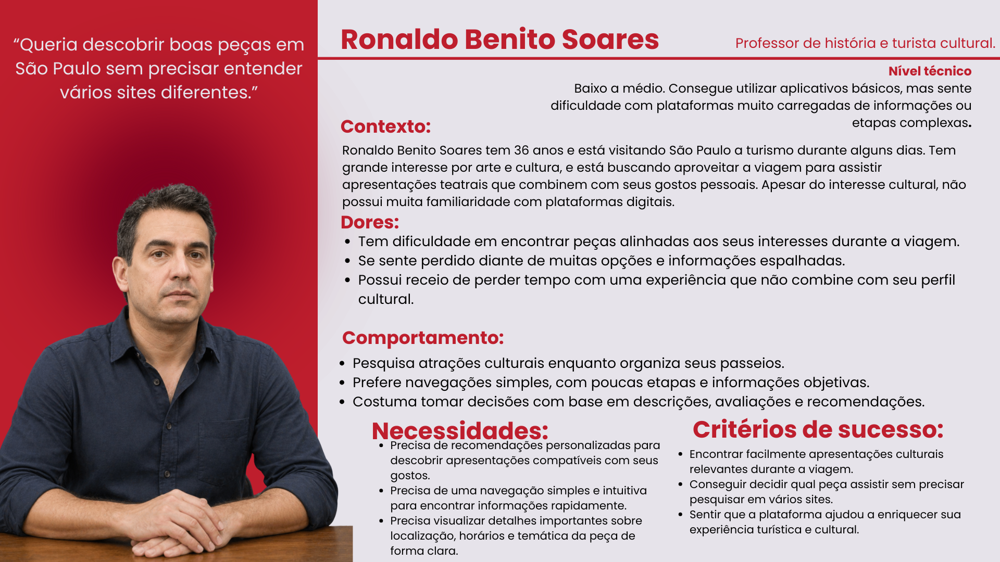

Fonte: Material produzido pelos autores (2026).

</div>

### 2.4.1.4 Pedro Henrique Lima – Universitário iniciante no teatro

  Pedro Henrique Lima foi desenvolvido como uma persona que representa jovens universitários com alto nível de familiaridade digital, mas que ainda não possuem experiência prévia com o universo teatral. Com 21 anos e estudante de Engenharia de Software no Inteli, Pedro está constantemente inserido em ambientes tecnológicos e acostumado a consumir conteúdo digital de forma rápida e objetiva.

  Apesar de já ter recebido indicações de amigos sobre peças teatrais como forma de estimular a criatividade, Pedro encontra dificuldades em dar o primeiro passo nesse universo. Sua principal barreira está na ausência de direcionamento claro e na dificuldade em identificar quais espetáculos são mais adequados para iniciantes. O excesso de opções disponíveis, sem uma curadoria eficiente, gera indecisão e insegurança, aumentando o receio de ter uma primeira experiência negativa.

  Seu comportamento de navegação é dinâmico e superficial, priorizando conteúdos visuais, objetivos e de fácil compreensão. Pedro raramente consome textos longos e tende a tomar decisões com base em validação social, como avaliações, लोकप्रियidade e recomendações de outros usuários.

  Dessa forma, a plataforma busca atender às necessidades dessa persona ao oferecer recomendações personalizadas com base em seus interesses — como tecnologia, criatividade e humor — além de apresentar uma curadoria específica para iniciantes. A disponibilização de informações rápidas, objetivas e com forte validação social contribui para aumentar sua confiança na escolha e incentivar sua entrada no universo teatral.

<div align="center">

### Figura X – Persona 4 – Pedro Henrique Lima – Universitário iniciante no teatro


Fonte: Material produzido pelos autores (2026).

</div>

### 2.4.1.5 Cintia Araújo Sena – Administradora da plataforma

  Cintia Araújo Sena foi desenvolvida como uma persona que representa o perfil administrativo responsável pela gestão e análise de desempenho da plataforma Aventura. Atuando como administradora do sistema, Cintia tem como principal objetivo avaliar se as recomendações oferecidas estão impactando positivamente na conversão de vendas e na descoberta de novos espetáculos pelos usuários.

  Com nível técnico médio a alto, Cintia possui familiaridade com ferramentas digitais e análise de dados, utilizando métricas e relatórios com frequência para embasar suas decisões. No entanto, enfrenta dificuldades relacionadas à falta de clareza e organização dessas informações, o que dificulta a visualização do impacto real das recomendações e do comportamento dos usuários dentro da plataforma.

  Seu comportamento é orientado por dados, priorizando dashboards objetivos, diretos e de fácil interpretação. Cintia valoriza especialmente a agilidade na obtenção de insights, pois isso influencia diretamente sua capacidade de tomada de decisão estratégica.

  Dessa forma, a plataforma busca atender às necessidades dessa persona ao oferecer dashboards claros, com métricas bem definidas e visualizações intuitivas. A disponibilização de indicadores de conversão, engajamento e ეფექტividade das recomendações permite que Cintia acompanhe o desempenho do sistema de forma eficiente, identifique oportunidades de melhoria e valide o impacto das funcionalidades implementadas.

<div align="center">

### Figura X – Persona 5 – Cintia Araújo Sena – Administradora da plataforma

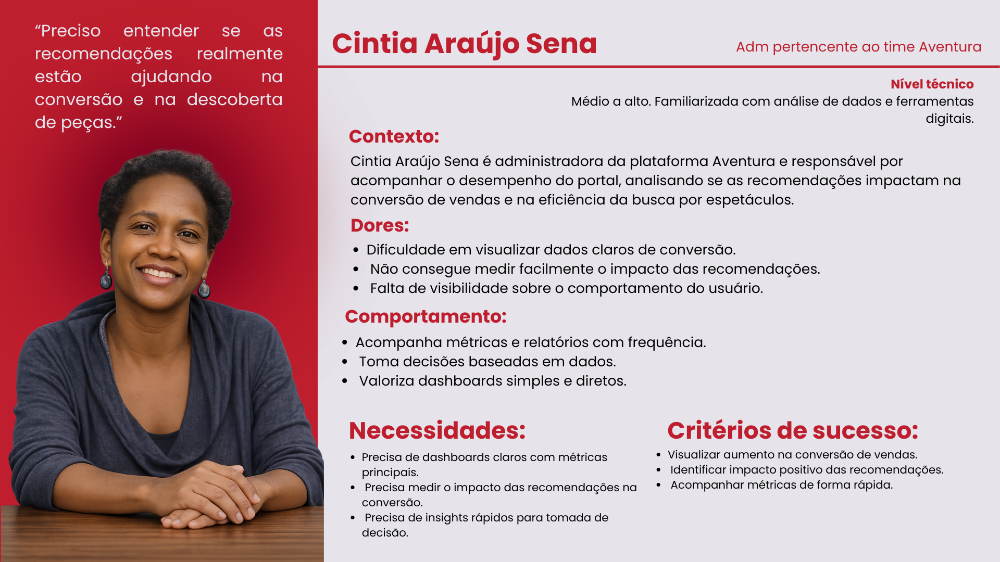

Fonte: Material produzido pelos autores (2026).

</div>

### 2.4.1.6 Carlos Nóbrega – Idoso interessado em teatro

  Carlos Nóbrega foi desenvolvido como uma persona que representa usuários idosos interessados em atividades culturais, especialmente teatro, mas que possuem baixa familiaridade com tecnologias digitais mais complexas. Aos 67 anos e já aposentado, Carlos valoriza experiências culturais, porém prefere soluções práticas que facilitem o acesso a essas atividades.

  Embora reconheça a conveniência das plataformas online para compra de ingressos, Carlos enfrenta dificuldades ao lidar com interfaces confusas, excesso de informações e fluxos de navegação complexos. Esse cenário gera insegurança, principalmente no momento da escolha do espetáculo e da finalização da compra, aumentando o receio de cometer erros.

  Seu comportamento de navegação é mais cauteloso e gradual, priorizando clareza, simplicidade e organização. Carlos tende a evitar explorar muitas opções e prefere tomar decisões com base em informações diretas e fáceis de compreender.

  Dessa forma, a plataforma busca atender às necessidades dessa persona ao oferecer uma experiência simplificada, com navegação intuitiva, recomendações claras e informações objetivas sobre os espetáculos. A redução da complexidade e o foco na acessibilidade contribuem para que Carlos consiga encontrar uma peça com segurança e concluir sua jornada de compra de maneira tranquila e eficiente.

<div align="center">

### Figura X – Persona 6 – Carlos Nóbrega – Idoso interessado em teatro

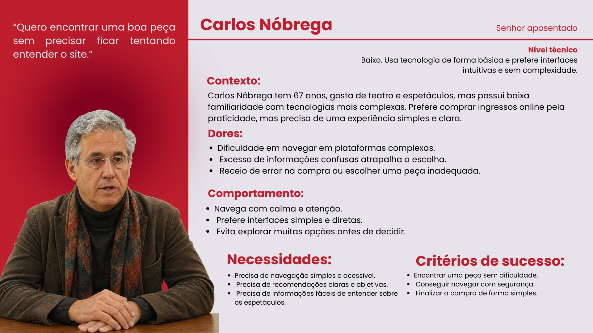

Fonte: Material produzido pelos autores (2026).

</div>

## 2.5 Modelagem do Fluxo de Negócio BPMN

Este documento descreve o **fluxo de negócio** modelado em **BPMN 2.0** para o sistema **Spotlight**, solução de **recomendação inteligente de espetáculos** desenvolvida para o **Portal Aventura**. O diagrama é composto por três pools que representam os três atores principais do processo: o **Cliente**, o **Sistema de Recomendação** e os **Gestores de Dados**.
O fluxo modela a jornada completa, desde o primeiro acesso ao portal até a compra do ingresso ou avaliação do evento, integrando o **motor de ML** e o pipeline de dados que sustenta as recomendações.

---

### 2.5.1. Análise As Is / To Be — Antes e Depois do Spotlight

Esta seção descreve como o processo de navegação e descoberta de espetáculos funciona **hoje** no Portal Aventura (As Is) e como ele passará a funcionar **após a implementação do Spotlight** (To Be). A comparação justifica a existência do projeto e fundamenta as decisões de design do fluxo modelado no BPMN.

---

#### 2.5.1.1 As Is — Como o processo funciona hoje

O Portal Aventura, em seu estado atual, não possui qualquer mecanismo estruturado de recomendação ou personalização. A jornada do usuário é inteiramente linear e passiva: o visitante acessa o portal, busca ou encontra um espetáculo específico por conta própria, visualiza sua página e decide — de forma isolada e sem apoio contextual — se compra o ingresso ou abandona o portal.

**Fluxo atual (As Is):**

```
Usuário acessa o portal
        ↓
Busca ou navega manualmente pelo catálogo
        ↓
Encontra (ou não) um espetáculo de interesse
        ↓
Visualiza a página do espetáculo
        ↓
Decide sozinho: compra o ingresso ou sai do portal
```

**Problemas identificados no processo atual:**

| Problema | Impacto para a Aventura |
|---|---|
| Ausência de recomendações personalizadas | O usuário vê apenas o que buscou e não descobre outros espetáculos do catálogo |
| Nenhuma coleta estruturada de preferências | A Aventura não sabe quais gêneros ou faixas de preço interessam a cada usuário |
| Interações não são registradas nem aproveitadas | Cliques, visualizações e compras não geram inteligência sobre o comportamento do público |
| Catálogo sem metadados para recomendação | Espetáculos não possuem tags, similaridades ou scores que permitam comparações automáticas |
| Jornada encerra sem reengajamento | Após ver um espetáculo, o usuário não recebe estímulo para explorar outros e sai do portal |
| Sem segmentação de público | A equipe de marketing não tem visibilidade sobre perfis distintos de espectadores |
| Baixo tempo de permanência | Sem descoberta guiada, as sessões são curtas e a taxa de conversão em vendas é reduzida |

---

#### 2.5.1.2 To Be — Como o processo funcionará com o Spotlight

Com a implementação do Spotlight, o Portal Aventura passa a operar com um sistema inteligente de recomendação que transforma a navegação passiva em uma **jornada de descoberta cultural contínua e personalizada**. O processo deixa de ser linear e passa a ser orientado a dados, com três atores integrados — Cliente, Sistema de Recomendação e Gestores de Dados — operando de forma coordenada.

**Fluxo futuro (To Be) — representado no diagrama BPMN:**

```
Usuário acessa o portal
        ↓
Realiza cadastro (se necessário) e efetua login
        ↓
Declara preferências de gênero e faixa de preço
        ↓
Recebe recomendações personalizadas geradas pelo motor de ML
        ↓
Interage com as sugestões (clique, favorito, avaliação)
        ↓
Cada interação retroalimenta o modelo → recomendações ficam mais precisas
        ↓
Compra ingresso ou avalia o evento
```

**Melhorias entregues pelo Spotlight (To Be):**

| Dimensão | As Is (hoje) | To Be (com Spotlight) |
|---|---|---|
| **Descoberta de espetáculos** | Manual, sem sugestões | Personalizada, baseada em perfil e histórico do usuário |
| **Coleta de preferências** | Inexistente | Onboarding estruturado: gênero favorito e faixa de preço |
| **Uso de dados comportamentais** | Não coletados | Cliques, avaliações e compras alimentam o motor de ML continuamente |
| **Jornada no portal** | Linear e curta | Contínua — o sistema sugere o próximo espetáculo, aumentando o tempo de permanência |
| **Apoio à decisão de compra** | Nenhum | Recomendações contextuais com justificativa ("Porque você gosta de musicais") |
| **Catálogo de espetáculos** | Sem metadados para recomendação | Enriquecido com tags, scores de popularidade e atributos de similaridade |
| **Segmentação de público** | Sem visibilidade | k-means agrupa automaticamente o público em clusters (Famílias, Musical Adulto, etc.) |
| **Reengajamento pós-visita** | Inexistente | Avaliações retroalimentam o modelo e sustentam o ciclo de melhoria contínua |
| **Inteligência de marketing** | Sem dados estruturados | Relatórios de segmentos entregues à equipe de marketing para campanhas direcionadas |

---

#### 2.5.1.3 Síntese da Transformação

O processo **As Is** representa uma navegação passiva onde o usuário é o único responsável pela descoberta de conteúdo. A Aventura não participa ativamente dessa jornada e perde oportunidades de venda a cada sessão encerrada sem conversão.

O processo **To Be**, modelado no diagrama BPMN do Spotlight, inverte essa lógica: o sistema passa a guiar ativamente o usuário, conectando preferências declaradas, comportamento real e catálogo estruturado para entregar recomendações que aumentam o engajamento, o tempo de permanência e a conversão em vendas de ingressos, transformando cada acesso ao portal em uma oportunidade de descoberta cultural.

---

### 2.5.2. Fluxo de Negócios BPMN

Este documento descreve o fluxo de negócio modelado em BPMN 2.0 para o sistema **Spotlight**, solução de recomendação inteligente de espetáculos desenvolvida para o Portal Aventura. O diagrama é composto por **três pools** que representam os três atores principais do processo: o **Cliente**, o **Sistema de Recomendação** e os **Gestores de Dados**.

O fluxo modela a jornada completa, desde o primeiro acesso ao portal até a compra do ingresso ou avaliação do evento, integrando o motor de ML e o pipeline de dados que sustenta as recomendações.

Para visualizar o diagrama completo, basta acessar o [Diagrama BPMN](./img/BPMN.pdf) no repositório.

---

#### 2.5.2.1 Pools

| Pool | Ator | Responsabilidade |
|---|---|---|
| **Pool 1** | Cliente | Representa toda a jornada do usuário no portal: cadastro, preferências, visualização de recomendações e interação com os espetáculos |
| **Pool 2** | Sistema de Recomendação | Motor de ML responsável por capturar interações, analisar o perfil do usuário, gerar e exibir recomendações personalizadas |
| **Pool 3** | Gestores de Dados | Equipe interna responsável por coletar dados de novos espetáculos, popular o banco de dados e disponibilizar o catálogo atualizado para o motor |

---

#### 2.5.2.2. Descrição Detalhada dos Fluxos

#### Pool 1 — Cliente

Este pool representa a experiência do usuário no Portal Aventura. O fluxo é iniciado quando o usuário acessa o portal e segue até uma das três ações finais possíveis: compra de ingresso, avaliação do evento ou encerramento da sessão sem engajamento.

<div align="center">

<sub>Figura X - Cliente </sub><br>
 
  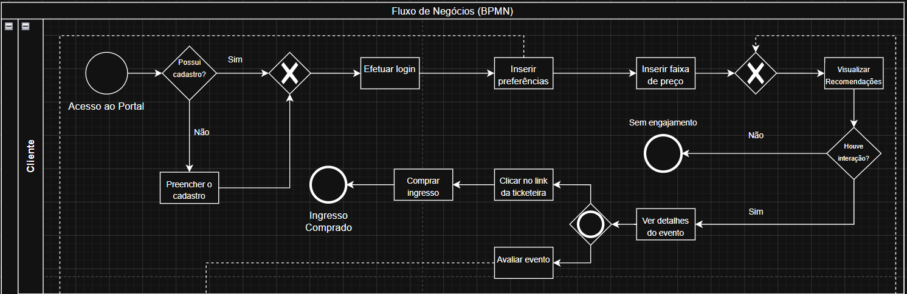<br>

  <sup>Fonte: Material produzido pelos autores, 2026.</sup>
</div>

**Passo a passo:**

**1. Acesso ao Portal**
O processo tem início com um evento de start representando o momento em que o usuário acessa o Portal Aventura. Este é o ponto de entrada de toda a jornada.

**2. Gateway — Possui cadastro?**
Imediatamente após o acesso, um gateway XOR verifica se o usuário já possui cadastro na plataforma:
- **Sim** → o usuário segue diretamente para a etapa de login.
- **Não** → o usuário é direcionado para preencher o cadastro, retornando ao fluxo principal após a conclusão.

**3. Efetuar Login**
Usuários já cadastrados realizam o login na plataforma para ter acesso ao ambiente personalizado e às recomendações vinculadas ao seu perfil.

**4. Inserir Preferências**
Após autenticado, o usuário declara suas preferências culturais, como gêneros de espetáculo de interesse. Essa etapa é fundamental para o motor de recomendação, especialmente para usuários que ainda não possuem histórico de interações (cold start).

**5. Inserir Faixa de Preço**
O usuário informa a faixa de preço que está disposto a pagar pelos ingressos. Esse filtro é utilizado pelo sistema para calibrar as recomendações geradas, garantindo que apenas espetáculos dentro do orçamento declarado sejam sugeridos.

**6. Visualizar Recomendações**
Com o perfil declarado completo, o sistema exibe as recomendações personalizadas na tela de descoberta, em formato de carrossel, com a justificativa de cada sugestão para tornar o sistema transparente ao usuário.

**7. Gateway — Houve interação?**
Um segundo gateway XOR avalia se o usuário interagiu com alguma recomendação exibida:
- **Não** → a sessão é encerrada sem engajamento.
- **Sim** → o usuário é direcionado para a tela de detalhes do evento.

**8. Ver Detalhes do Evento**
O usuário acessa a página descritiva do espetáculo selecionado, contendo informações como sinopse, elenco, datas, local e preço do ingresso.

**9. Gateway Inclusivo**
Um terceiro gateway inclusivo captura a decisão do usuário após visualizar os detalhes do evento:
- **Clicar no link da ticketeira** → o usuário é redirecionado para a plataforma de venda de ingressos, onde finaliza a compra. O fluxo termina com o evento de end "Ingresso Comprado".
- **Avaliar evento** → o usuário registra uma avaliação do espetáculo, que retroalimenta o sistema de recomendação com dados de satisfação.

---

#### Pool 2 — Sistema de Recomendação

Este pool representa o motor de ML do Spotlight. Ele é ativado pelas interações do usuário no Pool 1 e é responsável por transformar dados de comportamento e perfil em recomendações personalizadas.

<div align="center">

<sub>Figura X - Sistema de Recomendação</sub><br>

  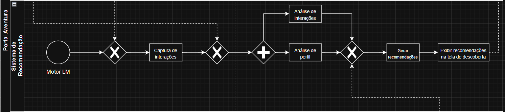<br>

  <sup>Fonte: Material produzido pelos autores, 2026.</sup>
</div>

**Passo a passo:**

**1. Motor ML (Start)**
O fluxo do sistema é iniciado pelo evento de start "Motor LM", acionado quando o usuário conclui o preenchimento de suas preferências e dados de perfil no Pool 1.

**2. Captura de Interações**
O sistema captura e registra todos os eventos de comportamento do usuário: visualizações de espetáculos, cliques, tempo de permanência na página, avaliações e compras. Cada tipo de interação contribui para a construção do perfil comportamental do usuário.

**3. Análise de Interações**
Os eventos capturados são processados e classificados por tipo e relevância. Essa etapa transforma os dados brutos de comportamento em sinais estruturados que alimentam a etapa seguinte de análise de perfil.

**4. Análise de Perfil**
Com base nas interações processadas e nas preferências declaradas, o sistema constrói ou atualiza o perfil do usuário. Para novos usuários (sem histórico), a análise utiliza as preferências declaradas. Para usuários recorrentes, o perfil é enriquecido com dados comportamentais acumulados ao longo das sessões.

**5. Gerar Recomendações**
Com o perfil consolidado, o motor gera uma lista rankeada de recomendações personalizadas, acompanhada da justificativa de cada sugestão para tornar o sistema explicável ao usuário.

**6. Exibir Recomendações na Tela de Descoberta**
As recomendações geradas são entregues ao Pool 1 (tela "Visualizar Recomendações"), exibidas na interface do portal. O fluxo retorna ao controle do usuário a partir deste ponto.

---

#### Pool 3 — Gestores de Dados

Este pool representa o processo interno da equipe de gestão de dados da Aventura, responsável por manter o catálogo de espetáculos atualizado e disponível para o motor de recomendação.

<div align="center">

<sub>Figura X - Gestores de Dados</sub><br>

  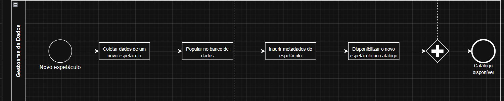<br>

  <sup>Fonte: Material produzido pelos autores, 2026.</sup>
</div>

**Passo a passo:**

**1. Novo Espetáculo**
O fluxo é iniciado pelo evento de start "Novo espetáculo", acionado sempre que um novo espetáculo é produzido ou anunciado pela Aventura Teatros.

**2. Coletar Dados de um Novo Espetáculo**
A equipe realiza a coleta de todas as informações relevantes sobre o espetáculo: título, gênero, sinopse, elenco, teatro, datas de apresentação, faixa de preço e classificação etária.

**3. Popular no Banco de Dados**
Os dados coletados são inseridos e organizados no banco de dados relacional, respeitando o modelo de entidades do sistema.

**4. Inserir Metadados do Espetáculo**
Além dos dados básicos, são inseridos os metadados que alimentam o motor de recomendação: tags de categoria, palavras-chave, score de popularidade inicial e atributos de similaridade com outros espetáculos do catálogo.

**5. Disponibilizar o Novo Espetáculo no Catálogo**
O espetáculo é publicado e disponibilizado no catálogo ativo do portal. A partir deste momento, ele passa a ser elegível para aparecer nas recomendações geradas pelo motor de ML.

**6. Catálogo Disponível (End)**
O fluxo encerra com o evento de end "Catálogo disponível", sinalizando que o novo espetáculo está pronto para ser consumido pelo Pool 2.

---

#### 2.5.2.3. Eventos de Início e Fim

| Pool | Evento de Start | Evento(s) de End |
|---|---|---|
| Cliente | Acesso ao Portal | Ingresso Comprado (fim positivo) / Sem engajamento (fim sem conversão) |
| Sistema de Recomendação | Motor LM | Exibição de recomendações na tela de descoberta (entrega ao Pool 1) |
| Gestores de Dados | Novo evento | Catálogo disponível (fim de processo interno) |

---

#### 2.5.2.4. Conexões Entre Pools 

As conexões entre pools representam a troca de informações entre atores distintos do processo. Na notação BPMN 2.0, essas conexões são representadas por linhas tracejadas (message flows) e nunca por sequence flows, que são exclusivos de cada pool.

| Origem | Destino | Informação Trafegada |
|---|---|---|
| Pool 1 — Cliente | Pool 2 — Sistema | Preferências declaradas e faixa de preço do usuário |
| Pool 1 — Cliente | Pool 2 — Sistema | Eventos de interação (clique, avaliação, tempo de permanência) |
| Pool 2 — Sistema | Pool 1 — Cliente | Lista de recomendações personalizadas com justificativas |
| Pool 3 — Gestores de Dados | Pool 2 — Sistema | Notificação de novo espetáculo disponível no catálogo |

---

#### 2.5.2.5. Dados e Armazenamento

| Dado | Origem | Utilização |
|---|---|---|
| Preferências declaradas | Pool 1 — Usuário | Alimenta a análise de perfil para usuários sem histórico (cold start) |
| Faixa de preço | Pool 1 — Usuário | Filtro aplicado antes da geração das recomendações |
| Interações comportamentais | Pool 1 — Usuário | Alimenta a análise de interações e enriquece o perfil do usuário |
| Avaliações dos eventos | Pool 1 — Usuário | Retroalimenta o modelo de recomendação com dados de satisfação |
| Metadados dos espetáculos | Pool 3 — Gestores de Dados | Base do catálogo consumida pelo motor de ML para gerar recomendações |

---

#### 2.5.2.6. Observações Finais

- O diagrama segue a notação BPMN 2.0 com uso correto de **pools separados por ator**, **gateways XOR para decisões exclusivas** e **eventos de start e end** distintos por pool.
- O Pool 2 apresenta uma separação clara entre **captura**, **análise de interações**, **análise de perfil** e **geração de recomendações**, o que demonstra maturidade no design do fluxo e facilita a implementação modular do motor de ML.
- O **Pool 3 opera de forma assíncrona** em relação aos outros dois: ele é acionado sempre que há um novo espetáculo, independentemente do fluxo de navegação do usuário no portal.
- O diagrama representa o **fluxo principal (happy path)** do sistema. Fluxos de exceção podem ser detalhados em subprocessos futuros.
- A etapa de **Avaliar evento** no Pool 1 cria um ciclo virtuoso de retroalimentação: as avaliações dos usuários enriquecem o modelo de recomendação ao longo do tempo, tornando as sugestões progressivamente mais precisas e relevantes.

---

## 2.6 Matriz de Risco do Projeto
_conteúdo_

## 2.7 Brainstorm de Features

Esta seção detalha as principais telas da aplicação, desde Login/Cadastro, Seleção de Tags (onboarding), Tela Principal estilo Netflix, Calendário, até a página descritiva do espetáculo, além dos fluxos para usuários finais e administradores, justificando cada uma pela redução de rejeição, personalização e aumento de conversão. Em paralelo, explica a arquitetura do algoritmo de recomendação organizado em camadas de prioridade: alta, média e baixa, com o objetivo de entregar recomendações relevantes, viáveis e comercialmente eficazes.

<div align="center">

<sub>Figura X - Brainstorm de Features</sub><br>

  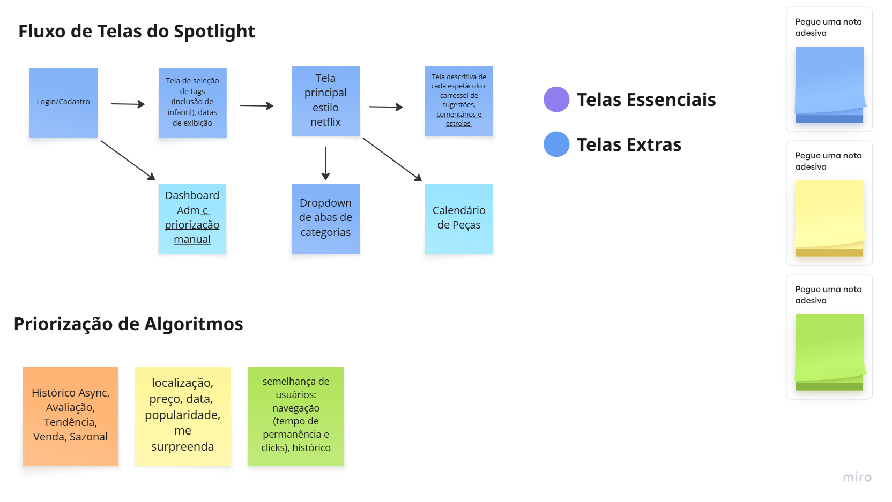<br>

  <sup>Fonte: Material produzido pelos autores, 2026.</sup>

</div>

### 2.7.1 Definição de Telas da Aplicação

Com base no mapeamento (post-its azuis), a interface foi dividida em módulos que guiam o usuário desde a aquisição (onboarding) até a conversão (descoberta e aprofundamento).

#### 2.7.1.1 Inventário de Telas (Post-its Azuis)

1. **Login/Cadastro**  
   Ponto de entrada da plataforma.

2. **Tela de Seleção de Tags & Datas**  
   Interface de onboarding inicial para captar interesses.

3. **Dashboard Administrativo**  
   Tela voltada para administradores da plataforma.

4. **Tela Principal (Estilo Netflix)**  
   Hub central de navegação, organizando os espetáculos em trilhas horizontais categorizadas.

5. **Dropdown de Abas de Categorias**  
   Menu de navegação secundária para filtragem rápida por gêneros ou temas.

6. **Calendário de Peças**  
   Visão em grade ou lista organizada cronologicamente para facilitar o planejamento.

7. **Tela Descritiva do Espetáculo**  
   Página de detalhes de uma peça específica, contendo avaliações, comentários e um carrossel inferior com sugestões de peças similares.

#### 2.7.1.2 Fluxo das telas

#### Visão do Usuário Final

**Login/Cadastro** → **Seleção de Tags (Cold Start)** → **Tela Principal (Estilo Netflix)**

A partir da Tela Principal, o usuário pode explorar usando o **Dropdown de Categorias** ou o **Calendário de Peças**, culminando no clique que o leva à **Tela Descritiva do Espetáculo** para tomada de decisão.

#### Visão do Administrador

**Login** → **Dashboard Adm** (onde regras de negócio pontuais podem sobrescrever temporariamente os algoritmos em campanhas específicas).

### Justificativas das escolhas de telas

- **Login/Cadastro & Seleção de Tags**  

  **Por que é necessária?** Sistemas de recomendação sofrem com o problema de **"Cold Start"**.  
  **Contribuição UX:** Coletar preferências diretas logo no início permite que a Tela Principal já seja povoada com relevância no primeiro acesso, reduzindo a taxa de rejeição.

- **Tela Principal (Estilo Netflix) & Dropdown**  

  **Por que é necessária?** Reduz a carga cognitiva do usuário.  
  **Contribuição UX:** O formato de carrosséis horizontais é um modelo mental já consolidado no mercado. Permite descoberta passiva de conteúdo. O dropdown atende usuários com intenção de busca mais ativa.

- **Tela Descritiva com Carrossel de Sugestões** 

  **Por que é necessária?** É o momento decisivo de conversão (venda do ingresso/interesse).  
  **Contribuição UX:** Estrelas e comentários fornecem prova social. O carrossel de sugestões é vital: mantém o usuário navegando mesmo se não se interessar pela peça atual.

- **Dashboard Adm**  

  **Por que é necessária?** Garante controle de negócios. Algoritmos não preveem contratos comerciais fechados pela produtora que exijam destaque na página inicial.

---

# 2.7.2 Fatores de Recomendação e Priorização de Algoritmos

O motor de recomendação do Spotlight foi desenhado considerando múltiplas camadas de dados. A ordem de prioridade de execução e peso no modelo segue:

### 🟢 Prioridade Alta: Filtragem Colaborativa e Comportamento Implícito

- **Fatores:** Semelhança de usuários, Navegação (tempo de permanência e cliques), Histórico.
- **Categoria:** Comportamento do Usuário & Filtragem Colaborativa (User-to-User / Item-to-Item).
- **Peso Relativo:** Alto (espinha dorsal do modelo).

**Justificativa:**  
O que o usuário *faz* (comportamento implícito) tem muito mais valor do que o que ele diz que gosta. A similaridade entre usuários permite recomendações hiper-personalizadas.

---

### 🟡 Prioridade Média: Contexto, Heurísticas e Serendipidade

- **Fatores:** Localização, Preço, Data, Popularidade, "Me Surpreenda".
- **Categoria:** Regras de Contexto & Diversificação.
- **Peso Relativo:** Médio.

**Justificativa:**  
Espetáculos teatrais são eventos físicos e temporais. Esses fatores garantem viabilidade da recomendação. O "Me Surpreenda" introduz serendipidade e ajuda a romper a bolha de filtro.

---

### 🟠 Prioridade Baixa/Complementar: Tendências e Feedback Explícito

- **Fatores:** Histórico Async, Avaliação, Tendência, Vendas, Sazonalidade.
- **Categoria:** Dados Globais & Qualidade do Item.
- **Peso Relativo:** Baixo (ajuste fino/multiplicadores).

**Justificativa:**  
Avaliações e volume de vendas indicam qualidade intrínseca. Tendências e sazonalidade capturam o momento cultural. Esses fatores ajudam a desempatar itens com afinidade similar.

## 2.8 Business Model Canvas

Esta seção detalha o modelo de negócios desenvolvido para o **Spotlight**, **sistema inteligente de recomendação** no **Portal Aventura**. A solução atua em duas frentes: aprimorar a experiência do usuário final e fornecer inteligência de dados para a equipe interna.

<div align="center">

<sub>Figura X - Business Model Canvas</sub><br>

  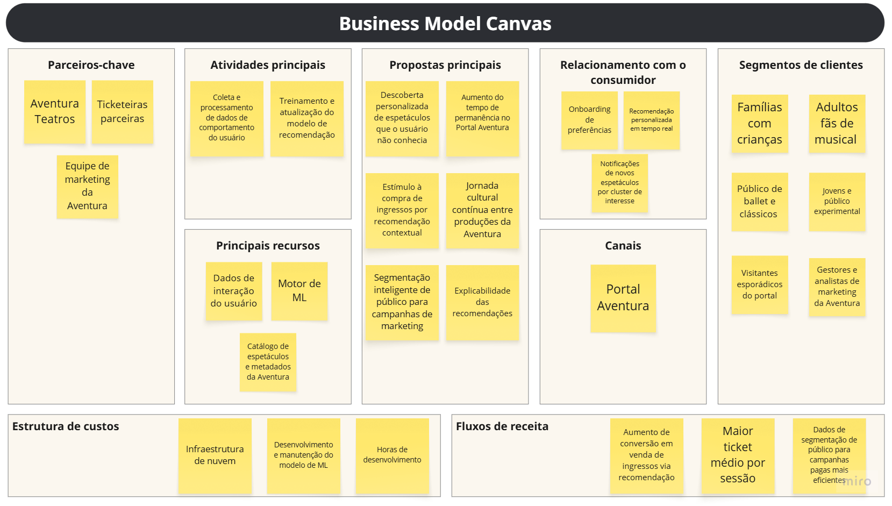<br>

  <sup>Source: Material produzido pelos autores, 2026.</sup>

</div>


### 2.8.1 Parceiros-Chave 

Os parceiros estratégicos essenciais para a operação, fornecimento de dados e viabilidade do projeto:

- **Aventura Teatros**: A parceira principal e dona do ecossistema. Fornece o portal, o catálogo de espetáculos e o direcionamento de negócios.
- **Ticketeiras parceiras**: Plataformas parceiras de emissão de ingressos.
- **Equipe de Marketing da Aventura**: Parceiro interno vital para a validação das campanhas. Atuam tanto como co-criadores das regras de negócio quanto como validadores da eficácia da segmentação gerada pelo sistema.

---

### 2.8.2 Atividades Principais

As ações técnicas e operacionais contínuas que o sistema e a equipe devem executar para entregar a proposta de valor:

- **Coleta e processamento de dados de comportamento do usuário**: Criação de pipelines de dados para capturar cliques, tempo de tela, buscas e histórico de compras. Envolve processos de ETL e higienização dos dados para garantir a qualidade das entradas.
- **Treinamento e atualização do modelo de recomendação**: Rotinas de MLOps para retreinar os algoritmos de Machine Learning periodicamente, garantindo que as recomendações não fiquem defasadas e se adaptem a novos espetáculos e tendências de consumo.

---

### 2.8.3 Principais Recursos 

Os ativos tecnológicos e de informação indispensáveis para o funcionamento da plataforma:

- **Dados de interação do usuário**: O principal combustível do motor de recomendação. Sem um volume adequado de dados comportamentais (logs, sessões, cliques), o modelo não consegue inferir preferências.
- **Motor de ML (Machine Learning)**: A infraestrutura de algoritmos (como filtragem colaborativa ou baseada em conteúdo) responsável por calcular a similaridade entre usuários e espetáculos, gerando as predições.
- **Catálogo de espetáculos e metadados da Aventura**: O banco de dados estruturado contendo descrições, gêneros, elenco, datas, classificação indicativa e tags de cada peça teatral.

---

### 2.8.4 Propostas Principais 

O valor entregue para os diferentes segmentos de clientes (espectadores e equipe interna):

- **Descoberta personalizada de espetáculos**: Supera o problema da "página em branco", sugerindo peças que o usuário não procuraria ativamente, mas que se alinham perfeitamente ao seu gosto.
- **Aumento do tempo de permanência no Portal Aventura**: Ao oferecer um feed contínuo e relevante, o usuário consome mais conteúdo sobre as produções antes de decidir.
- **Estímulo à compra de ingressos por recomendação contextual**: Inserção de "gatilhos" de compra no momento exato de maior interesse, aumentando a taxa de conversão.
- **Jornada cultural contínua**: Transforma uma compra isolada em um ciclo de consumo recorrente, fidelizando o cliente ao selo Aventura.
- **Segmentação inteligente de público**: Permite que o marketing abandone o anúncios genéricos e faça campanhas ultra-segmentadas baseadas nos clusters gerados pelo ML.
- **Explicabilidade das recomendações**: Transparência para o usuário ("Recomendado porque você assistiu X") e para os gestores, aumentando a confiança nas predições do sistema.

---

### 2.8.5 Relacionamento com o Consumidor

Como o sistema interage e cria laços com os usuários para melhorar a coleta de dados e a experiência:

- **Onboarding de preferências**: Um formulário rápido e gamificado no primeiro acesso ou criação de conta para mitigar o problema de Cold Start.
- **Recomendação personalizada em tempo real**: A interface do portal se molda dinamicamente conforme o usuário navega, gerando uma sensação de atendimento exclusivo.
- **Notificações de novos espetáculos por cluster**: Engajamento ativo informando aos usuários que uma peça do seu nicho de interesse entrou em cartaz.

---

### 2.8.6 Canais 

- **Portal Aventura**: O ponto de contato exclusivo e centralizado. Toda a inteligência do motor de recomendação será exposta no front-end deste portal, seja na home page, páginas de detalhes de peças ou no carrinho de compras.

---

### 2.8.7 Segmentos de Clientes 

Os grupos de pessoas que a solução visa atender, divididos em perfis de consumo e usuários internos:

### Consumidores Finais

- Famílias com crianças (buscam classificação livre e horários diurnos).
- Adultos fãs de musical (ticket médio maior, alta recorrência).
- Público de ballet e clássicos (nicho específico e tradicional).
- Jovens e público experimental (abertos a novas linguagens teatrais).
- Visitantes esporádicos do portal (usuários não logados que precisam ser convertidos rapidamente).

### Clientes Internos 

- Gestores e analistas de marketing da Aventura.

---

### 2.8.8 Estrutura de Custos 

Os principais direcionadores de despesas para manter o projeto rodando:

- **Infraestrutura de nuvem**: Custos com servidores para hospedar o portal, bancos de dados para armazenar logs massivos e instâncias de computação otimizadas para treinar os modelos de Machine Learning.
- **Desenvolvimento e manutenção do modelo de ML**: Esforço contínuo para refinar algoritmos, evitar degradação do modelo e realizar testes A/B.
- **Horas de desenvolvimento**: Custo da equipe de engenharia de software envolvida na criação de APIs, integração com o Sympla, estruturação de banco de dados e rotinas de deploy.

---

### 2.8.9 Fluxos de Receita

Como a solução gera valor financeiro ou reduz custos, justificando o investimento:

- **Aumento de conversão em venda de ingressos**: O impacto direto das recomendações personalizadas na jornada, diminuindo a taxa de abandono do carrinho.
- **Maior ticket médio por sessão**: Consequência de cross-sell e up-sell bem-sucedidos.
- **Campanhas pagas eficientes**: Redução do Custo de Aquisição de Clientes e aumento do Retorno sobre Investimento em mídias pagas, utilizando os dados de segmentação para criar públicos personalizados e mais assertivos.

--

# 3. Requisitos do Projeto
_conteúdo_

## 3.1 Requisitos Funcionais (RFs)

 &emsp; Os requisitos funcionais representam as funcionalidades que o sistema deverá oferecer para atender os objetivos e necessidades dos usuários da plataforma de recomendação de espetáculos da Aventura. Cada requisito define uma funcionalidade essencial do sistema, considerando tanto a experiência do usuário quanto os mecanismos de recomendação e gestão administrativa. Os testes descritos incluem pré-condição, procedimento, resultado esperado e pós-condição, garantindo a validação das funcionalidades implementadas.

<div align="center"> <sub>Tabela X - Requisitos funcionais</sub>

## Requisitos Funcionais

### Autenticação e Perfil

| RF | Requisito Funcional | Pré-condição | Procedimento de Teste | Resultado Esperado | Pós-condição |
|----|---------------------|--------------|------------------------|---------------------|---------------|
| RF01 | Como usuário, eu quero me cadastrar na plataforma informando meus dados pessoais (como nome, email e senha) para acessar funcionalidades personalizadas e utilizar o sistema de recomendação. | Usuário não autenticado. | Inserir dados válidos e inválidos e submeter cadastro. | Usuário cadastrado com sucesso quando dados são válidos; mensagens de erro exibidas para campos inválidos. | Usuário registrado no sistema. |
| RF02 | Como usuário, eu quero realizar login informando meu email e senha para acessar minha conta e meus dados personalizados. | Usuário previamente cadastrado. | Inserir credenciais válidas e inválidas. | Acesso permitido com credenciais válidas; erro exibido para dados incorretos. | Sessão autenticada iniciada. |
| RF03 | Como usuário, eu quero definir minhas preferências (como gênero, faixa de preço e localização) para receber recomendações mais relevantes e alinhadas ao meu perfil. | Usuário autenticado. | Selecionar preferências e salvar. | Preferências armazenadas corretamente no sistema. | Perfil do usuário atualizado. |

---

### Exploração e Navegação

| RF | Requisito Funcional | Pré-condição | Procedimento de Teste | Resultado Esperado | Pós-condição |
|----|---------------------|--------------|------------------------|---------------------|---------------|
| RF04 | Como usuário, eu quero visualizar recomendações personalizadas com base no meu perfil e comportamento na plataforma para descobrir espetáculos alinhados aos meus interesses. | Usuário autenticado com ou sem histórico de interações. | Acessar tela inicial do sistema. | Lista com no mínimo 5 recomendações exibida, ordenada por relevância, contendo título, categoria, data e indicação de personalização (ex: “baseado nas suas preferências”). | Recomendações exibidas ao usuário. |
| RF05 | Como usuário, eu quero pesquisar espetáculos por nome ou palavra-chave para encontrar conteúdos específicos. | Base de espetáculos disponível. | Inserir termo de busca válido e inválido. | Lista de resultados correspondente ao termo pesquisado ou mensagem de “nenhum resultado encontrado”. | Lista filtrada exibida. |
| RF06 | Como usuário, eu quero filtrar espetáculos por categoria, data e faixa de preço para refinar minha busca. | Lista de espetáculos carregada. | Aplicar diferentes combinações de filtros. | Lista atualizada conforme filtros selecionados. | Lista refinada exibida ao usuário. |

---

### Conteúdo

| RF | Requisito Funcional | Pré-condição | Procedimento de Teste | Resultado Esperado | Pós-condição |
|----|---------------------|--------------|------------------------|---------------------|---------------|
| RF07 | Como usuário, eu quero visualizar detalhes completos de um espetáculo para avaliar se tenho interesse em assisti-lo. | Espetáculo disponível no sistema. | Acessar página de detalhes do espetáculo. | Exibição de informações completas como descrição, categoria, data, horário, preço e local. | Dados apresentados ao usuário. |
| RF08 | Como usuário, eu quero visualizar avaliações de outros usuários para apoiar minha decisão sobre assistir ou não a um espetáculo. | Avaliações cadastradas para o espetáculo. | Acessar seção de avaliações. | Lista de avaliações exibida corretamente, contendo nota e comentário. | Avaliações visíveis ao usuário. |

---

### Engajamento

| RF | Requisito Funcional | Pré-condição | Procedimento de Teste | Resultado Esperado | Pós-condição |
|----|---------------------|--------------|------------------------|---------------------|---------------|
| RF09 | Como usuário, eu quero avaliar espetáculos atribuindo uma nota para expressar minha opinião e contribuir com o sistema. | Usuário autenticado. | Inserir nota válida e submeter. | Avaliação registrada corretamente no sistema. | Avaliação armazenada. |
| RF10 | Como usuário, eu quero comentar sobre espetáculos para compartilhar minha experiência com outros usuários. | Usuário autenticado. | Inserir comentário válido e enviar. | Comentário exibido corretamente na página do espetáculo. | Comentário registrado no sistema. |

---

### Coleta de Dados

| RF | Requisito Funcional | Pré-condição | Procedimento de Teste | Resultado Esperado | Pós-condição |
|----|---------------------|--------------|------------------------|---------------------|---------------|
| RF11 | Como sistema, eu quero registrar interações dos usuários (como cliques, buscas, visualizações e avaliações) para alimentar e melhorar continuamente o algoritmo de recomendação. | Usuário interagindo com a plataforma. | Realizar diferentes tipos de interação no sistema. | Registro contendo ID do usuário, ID do espetáculo, tipo de ação e timestamp, sem impacto perceptível na navegação. | Dados armazenados para uso no algoritmo. |

---

### Recomendação

| RF | Requisito Funcional | Pré-condição | Procedimento de Teste | Resultado Esperado | Pós-condição |
|----|---------------------|--------------|------------------------|---------------------|---------------|
| RF12 | Como sistema, eu quero gerar recomendações personalizadas com base nas preferências declaradas e no histórico de interações do usuário para oferecer sugestões relevantes e contextualizadas. | Dados de preferências e histórico disponíveis. | Gerar recomendações para usuário com histórico. | Lista de recomendações personalizada exibida corretamente. | Recomendações geradas. |
| RF13 | Como sistema, eu quero atualizar as recomendações após novas interações do usuário para tornar as sugestões progressivamente mais precisas ao longo do uso. | Novas interações registradas. | Realizar nova interação e atualizar recomendações. | Recomendações ajustadas conforme comportamento recente do usuário. | Recomendações atualizadas. |
| RF14 | Como sistema, eu quero recomendar conteúdos com base em usuários com perfis e comportamentos semelhantes (filtragem colaborativa). | Base de usuários com interações registrada. | Comparar perfis e gerar recomendações. | Itens recomendados com base na similaridade entre usuários. | Recomendações exibidas. |
| RF15 | Como sistema, eu quero recomendar conteúdos populares para usuários com pouco ou nenhum histórico de interação. | Usuário novo ou com baixa interação. | Acessar sistema com usuário sem histórico. | Lista de recomendações baseada em popularidade exibida. | Recomendações exibidas ao usuário. |

---

### Administração

| RF | Requisito Funcional | Pré-condição | Procedimento de Teste | Resultado Esperado | Pós-condição |
|----|---------------------|--------------|------------------------|---------------------|---------------|
| RF16 | Como administrador, eu quero gerenciar conteúdos da plataforma (espetáculos, categorias e avaliações) para garantir a atualização, consistência e qualidade das informações exibidas aos usuários. | Administrador autenticado. | Criar, editar e remover conteúdos no sistema. | Alterações refletidas corretamente na plataforma. | Sistema atualizado. |
</div>

## 3.2 Requisitos Não Funcionais (RNFs)

 &emsp; Os requisitos não funcionais do sistema desempenham um papel fundamental na definição das características de qualidade da plataforma de recomendação de espetáculos da Aventura. Esses requisitos garantem que o sistema apresente desempenho adequado, segurança, escalabilidade e uma experiência de uso consistente para diferentes perfis de usuários. A seguir, são apresentados os requisitos não funcionais identificados:

<div align="center"> <sub>Tabela X - Requisitos não funcionais</sub>

# Requisitos Não Funcionais

| RNF   | Requisito Não Funcional | Pré-condição | Procedimento de Teste | Resultado Esperado | Pós-condição | Aspecto de Qualidade |
| ----- | ---------------------- | ------------ | ---------------------- | ------------------ | ------------ | -------------------- |
| RNF01 | O sistema deve carregar todas as telas principais (home, detalhes de espetáculo, categorias e calendário) em no máximo **2 segundos** em dispositivos mobile com conexão 4G (mínimo 20 Mbps de download), sendo este o cenário de referência prioritário. Em desktop, o limite se mantém. | Sistema disponível em produção, testado prioritariamente em dispositivo mobile físico (Android ou iOS) com conexão 4G ativa. | Utilizar ferramenta de medição de performance (ex: Lighthouse no modo mobile) para acessar cada tela principal e registrar FCP e TTI. Repetir o teste **5 vezes por tela** em horários distintos. | Todas as telas carregam completamente em até **2 segundos em 100% das execuções** no cenário mobile 4G. | Métricas de performance mobile registradas. | Desempenho |
| RNF02 | O sistema deve gerar e exibir recomendações personalizadas em no máximo **2 segundos** após interação do usuário em dispositivo mobile com conexão 4G. | Usuário logado com histórico e preferências configurados. | Registrar timestamp da interação e da exibição da recomendação. Executar com **3 perfis de usuário** e repetir **10 vezes por perfil**. | Diferença entre timestamps ≤ **2 segundos em 100% das execuções**. Spinner exibido em caso de atraso. | Tempo registrado em logs. | Desempenho |
| RNF03 | O sistema deve estar disponível no mínimo **99% do tempo mensal**, equivalente a no máximo **7h18min de indisponibilidade**. | Sistema em produção com monitoramento ativo. | Executar monitoramento com ping a cada **5 minutos durante 30 dias**. | Disponibilidade ≥ **99%** com incidentes registrados. | Relatório mensal gerado. | Confiabilidade |
| RNF04 | O sistema deve seguir abordagem mobile first com elementos de interface com tamanho mínimo de **44x44px** para interação por toque. | Sistema acessado em dispositivos mobile físicos. | Validar interface em dispositivos Android e iOS e verificar dimensões dos elementos. | 100% dos elementos interativos com no mínimo **44x44px** e funcionamento completo em mobile. | Experiência mobile validada. | Usabilidade |
| RNF05 | O sistema deve garantir segurança com autenticação JWT, senhas com bcrypt (custo ≥ **10**) e uso obrigatório de HTTPS (**100% das requisições**). | Sistema com autenticação implementada. | Testar requisições HTTP, acesso sem token e armazenamento de senha. | 100% das requisições via HTTPS, 0 senhas em texto plano e acesso inválido retorna **HTTP 401**. | Dados protegidos. | Segurança |
| RNF06 | O sistema deve suportar no mínimo **200 usuários simultâneos** com tempo médio de resposta ≤ **3 segundos** e taxa de erro ≤ **1%**. | Ambiente com ferramenta de carga configurada. | Simular **200 usuários simultâneos** por **10 minutos contínuos**. | Tempo médio ≤ **3s**, erro ≤ **1%**, sem falhas críticas. | Relatório de carga gerado. | Escalabilidade |
| RNF07 | O sistema deve gerar logs estruturados em até **1 segundo** após cada evento, contendo no mínimo **5 campos obrigatórios** (timestamp, nível, serviço, sessão, dispositivo). | Sistema com logging configurado. | Executar ações e validar logs gerados. | 100% dos logs registrados em até **1s** com todos os campos obrigatórios. | Logs armazenados. | Manutenibilidade |
| RNF08 | Cada serviço SOA deve ser atualizado de forma independente com no máximo **5 minutos de indisponibilidade** por serviço. | Pipeline de CI/CD configurado. | Executar deploy de um serviço isolado. | Instabilidade ≤ **5 minutos** e 100% dos demais serviços operacionais. | Serviço atualizado. | Manutenibilidade |
| RNF09 | O sistema deve processar eventos de forma assíncrona sem aumentar o tempo de resposta em mais de **500ms** e com taxa de processamento ≥ **100 eventos/segundo**. | Sistema com fila configurada. | Simular **100 eventos simultâneos** e medir impacto na resposta. | Aumento de tempo ≤ **500ms** e processamento de ≥ **100 eventos/segundo** sem perda. | Sistema estável. | Desempenho |
| RNF10 | O sistema deve permitir execução das ações principais em no máximo **3 toques** com taxa de sucesso ≥ **85%** em testes com usuários. | Sistema disponível para testes de usabilidade. | Testar com **mínimo 5 usuários reais**. | ≥ **85% de sucesso** e ≤ **3 toques** por tarefa. | Relatório gerado. | Usabilidade |
| RNF11 | O sistema deve operar corretamente em **Android 10+ e iOS 15+** com taxa de erro ≤ **1%** nos fluxos principais. | Sistema acessado em dispositivos físicos. | Executar fluxo completo em **2 dispositivos por plataforma**. | Funcionalidades com ≤ **1% de erro**. | Sistema validado. | Compatibilidade |
| RNF12 | Cada serviço deve executar em container Docker com tempo de reinicialização ≤ **30 segundos** após falha. | Ambiente Docker configurado. | Derrubar container e medir tempo de recuperação. | Reinicialização ≤ **30s** e 100% dos serviços isolados. | Infraestrutura documentada. | Manutenibilidade |
</div>

## 3.3 Correlação RFs e RNFs

A seguir, apresenta-se a tabela que relaciona os requisitos não funcionais (RNFs) com os requisitos funcionais (RFs) que possuem dependência direta ou impacto relevante.

| ID RNF | Requisito Não Funcional | RFs Associados | Relação |
|--------|--------------------------|----------------|----------|
| RNF01 | Tempo de carregamento das telas em até 2 segundos | RF04, RF05, RF06, RF07, RF08 | A experiência de navegação e acesso às funcionalidades principais depende diretamente da performance das telas. |
| RNF02 | Geração de recomendações em até 3 segundos | RF04, RF12, RF13, RF14, RF15 | A exibição e atualização das recomendações depende do tempo de processamento do sistema de recomendação. |
| RNF03 | Disponibilidade mínima de 99% | RF01, RF02, RF04, RF05, RF06, RF07, RF08 | Todas as funcionalidades do sistema dependem da disponibilidade contínua da aplicação. |
| RNF04 | Abordagem mobile first | RF03, RF04, RF05, RF06, RF07, RF08, RF09, RF10 | A definição de preferências, navegação, visualização e interação são impactadas pela experiência mobile. |
| RNF05 | Segurança com JWT, bcrypt e HTTPS | RF01, RF02, RF09, RF10, RF11 | Cadastro, autenticação e interações do usuário dependem da proteção de dados e controle de acesso seguro. |
| RNF06 | Suporte a 200 usuários simultâneos | RF04, RF05, RF06, RF07, RF12 | Funcionalidades de navegação e recomendação devem permanecer estáveis sob carga. |
| RNF07 | Registro de logs estruturados | RF11, RF12, RF13 | A coleta de dados e funcionamento do algoritmo dependem de rastreabilidade e monitoramento das interações. |
| RNF08 | Deploy independente de serviços SOA | RF04, RF05, RF06, RF12 | Funcionalidades devem permanecer disponíveis mesmo durante atualizações de partes do sistema. |
| RNF09 | Processamento assíncrono com fila | RF11, RF12, RF13, RF14 | A coleta e processamento de dados para recomendação dependem de comunicação assíncrona entre serviços. |
| RNF10 | Usabilidade (máx. 3 toques) | RF04, RF05, RF06, RF07 | A descoberta de conteúdos e navegação depende da facilidade de uso da interface. |
| RNF11 | Compatibilidade com dispositivos mobile | RF01, RF02, RF04, RF05, RF06, RF07, RF08, RF09, RF10 | Todas as funcionalidades devem operar corretamente nos dispositivos alvo. |
| RNF12 | Execução em containers Docker | RF01, RF02, RF03, RF04, RF05, RF06, RF07, RF08, RF09, RF10, RF11, RF12, RF13, RF14, RF15, RF16 | Requisito transversal que impacta toda a arquitetura e execução do sistema. |
</div>

## 3.4 Casos de Uso e Comparação com Requisitos Funcionais

A seção de casos de uso tem como objetivo representar as principais funcionalidades do Sistema de Recomendação para a Aventura a partir da perspectiva dos atores envolvidos no sistema, estabelecendo a relação entre as necessidades dos usuários e os requisitos funcionais definidos para a plataforma. Por meio dessa modelagem, é possível visualizar como usuários, administradores e o sistema de recomendação interagem com o ambiente, garantindo maior clareza sobre os comportamentos esperados, as responsabilidades de cada ator e o funcionamento geral das funcionalidades propostas.

### 3.4.1 Atores do Sistema

| Ator | Tipo | Descrição |
|------|------|-----------|
| Usuário | Externo | Usuário com conta criada e sessão ativa, com acesso a funcionalidades personalizadas como preferências, avaliações e comentários. |
| Administrador | Externo | Usuário interno da Aventura com permissões para gerenciar o catálogo de espetáculos, categorias e avaliações da plataforma. |
| Sistema de Recomendação | Interno | Componente automatizado responsável por coletar interações, gerar e atualizar recomendações sem ação direta do usuário. |

---

### 3.4.2. Casos de Uso Definidos

| Nome do Caso de Uso | User Story | RF(s) Associado(s) |
|---------------------|------------|--------------------|
| Cadastrar-se na plataforma | Como usuário, quero me cadastrar na plataforma Portal Aventura, para que eu possa acessar funcionalidades personalizadas como recomendações, avaliações e comentários. | RF01 |
| Realizar login | Como usuário, quero realizar login na plataforma Portal Aventura, para que eu possa acessar minha conta e usufruir das funcionalidades personalizadas disponíveis. | RF02 |
| Definir preferências de perfil | Como usuário, quero definir minhas preferências de perfil na plataforma, para que o sistema de recomendação possa sugerir espetáculos mais alinhados aos meus gostos desde o início. | RF03 |
| Visualizar recomendações personalizadas | Como usuário, quero visualizar recomendações personalizadas de espetáculos no portal, para que eu possa descobrir apresentações relevantes ao meu perfil de forma prática e eficiente. | RF04 |
| Pesquisar espetáculos | Como usuário, quero pesquisar espetáculos dentro da plataforma Portal Aventura, para que eu possa encontrar apresentações de meu interesse de forma rápida e direta. | RF05 |
| Filtrar espetáculos | Como usuário, quero filtrar os espetáculos disponíveis na plataforma por critérios como categoria, data e avaliação, para que eu possa refinar minha busca e encontrar apresentações mais adequadas às minhas preferências. | RF06 |
| Visualizar detalhes de espetáculo | Como usuário, quero visualizar os detalhes de um espetáculo no portal, para que eu possa obter informações completas sobre a apresentação antes de tomar minha decisão de compra. | RF07 |
| Visualizar avaliações de espetáculos | Como usuário, quero visualizar as avaliações de outros usuários sobre os espetáculos disponíveis, para que eu possa embasar minha escolha com base na experiência da comunidade do portal. | RF08 |
| Avaliar espetáculos | Como usuário, quero avaliar os espetáculos da companhia Aventura, para que minhas recomendações futuras sejam cada vez mais assertivas. | RF09 |
| Comentar sobre espetáculos | Como usuário, quero ter a possibilidade de apresentar um feedback sobre as apresentações teatrais das quais eu frequentei, para que saibam minha opinião real sobre o espetáculo. | RF10 |
| Registrar interações do usuário | Como Sistema de Recomendação, quero registrar as interações de todos os usuários da plataforma, para que seja possível disponibilizar recomendações precisas entre usuários ou por item. | RF11 |
| Gerar recomendações personalizadas | Como Sistema de Recomendação, quero gerar recomendações com base nas interações do usuário no portal, para oferecer conteúdos relevantes e reduzir a ociosidade de assentos. | RF12 |
| Atualizar recomendações com base em novas interações | Como Sistema de Recomendação, quero atualizar recomendações com base nas novas interações do usuário, para que seja possível garantir a personalização assídua das especificidades de apreciação do mesmo. | RF13 |
| Recomendar por filtragem colaborativa | Como Sistema de Recomendação, quero disseminar conteúdos através da filtragem colaborativa, para que o comportamento similar de usuários possa refletir em acertos na recomendação entre eles de forma bilateral. | RF14 |
| Recomendar conteúdos populares para novos usuários | Como Sistema de Recomendação, quero indicar os conteúdos mais populares entre a comunidade do Portal Aventura, para que usuários em cold start possam ter acesso a conteúdos de interesse mesmo sem interações prévias com a plataforma. | RF15 |
| Gerenciar conteúdos da plataforma | Como Administrador, quero que seja possível realizar o gerenciamento de conteúdos dentro da plataforma, para que haja garantia de concordância dos conteúdos disponibilizados. | RF16 |

## 3.5. Diagrama de Casos de Uso

O diagrama de casos de uso a seguir representa as interações entre os atores do sistema — **Usuário**, **Administrador** e **Sistema de Recomendação** — e as funcionalidades disponíveis na plataforma Portal Aventura. Ele oferece uma visão estruturada dos requisitos funcionais do sistema, evidenciando as responsabilidades de cada ator e os fluxos de interação previstos para o MVP do projeto.

<div align="center">

<sub>Figura X - Diagrama de Casos de Uso 1 </sub><br>

  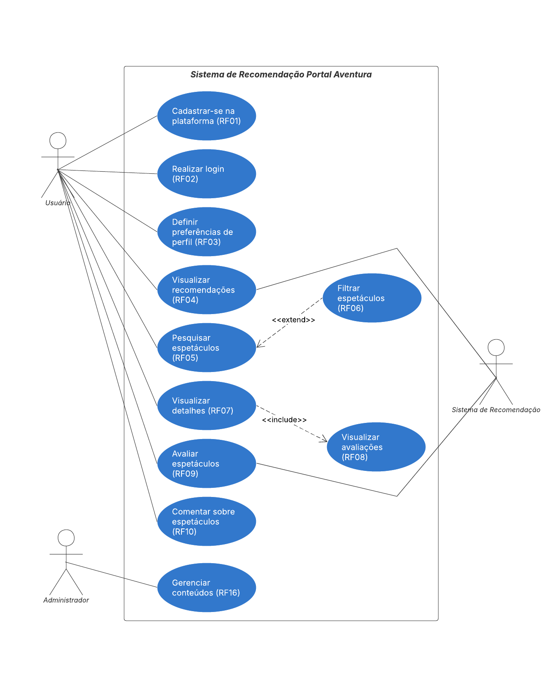<br>

  <sup>Source: Material produzido pelos autores, 2026.</sup>

</div>

<div align="center">

<sub>Figura X - Diagrama de Casos de Uso 2 </sub><br>

  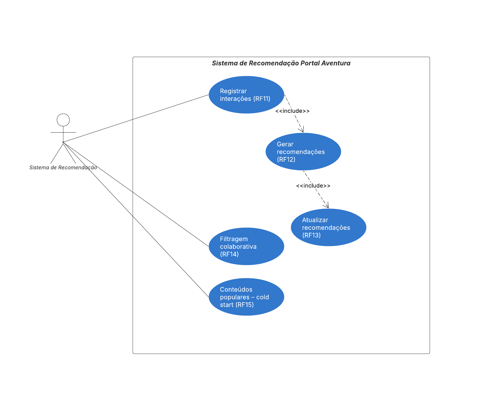<br>

  <sup>Source: Material produzido pelos autores, 2026.</sup>

</div>

# 4. Modelagem de Dados
_conteúdo_

## 4.1 Especificação da Base de Dados para Modelo de Recomendação
Este item reaproveita e formaliza as fontes de dados necessárias para o MVP de recomendações (apenas telas essenciais).

Tabelas mínimas propostas:

- `espetaculos` (catálogo):
  - `id` (PK), `titulo`, `genero`, `regiao`, `tipo_producao`, `descricao_curta`, `datas_exibicao`, `imagens`, `tags` (campo para keywords/metadados).
- `interacoes` (eventos de navegação):
  - `event_id` (PK), `anon_user_id` (quando houver), `session_id`, `espetaculo_id` (FK), `evento` (view/click), `duracao` (segundos), `timestamp`.
- `preferencias_iniciais` (onboarding):
  - `anon_user_id`, `tag`, `peso` — registro das escolhas na tela de seleção de tags.
- `agregados_item` (materialized/denormalized, apoio ao read):
  - `espetaculo_id`, `views_total`, `avg_duracao`, `ultimo_update`.

Notas de pré-processamento e uso (Sprint 1):

- ETL em batch para consolidar logs de navegação e popular `interacoes` e `agregados_item` (rotina diária ou conforme necessidade).
- Normalização de títulos e tags; extração de tokens para matching por similaridade de conteúdo.
- Geração de matriz esparsa usuário×item (ou item×item) a partir de `interacoes` e `preferencias_iniciais` para cálculo de similaridade; aplicar SVD leve ou heurísticas de similaridade conforme escopo.
- Privacidade: usar `anon_user_id` e evitar PII no MVP.

Artefatos entregáveis nesta Sprint:

- Scripts SQL de criação e carga inicial: [src/database/01_create_database.sql](../src/database/01_create_database.sql) e [src/database/02_initial_data.sql](../src/database/02_initial_data.sql).
- Script/notebook de pré-processamento para geração de agregados e matrizes de similaridade.

Esta especificação está alinhada com o escopo mínimo definido para as telas essenciais; melhorias (analytics, pipelines ML, integrações transacionais) ficam para fases posteriores.

## 4.2 Modelo Conceitual de Dados

O modelo conceitual de dados representa as entidades e seus relacionamentos de forma abstrata, descrevendo os elementos do domínio do negócio e como eles se conectam dentro do sistema Spotlight. Ele serve como base para o desenvolvimento do modelo lógico e a implementação do banco de dados, garantindo que a estrutura de dados atenda aos requisitos do projeto e suporte a evolução do sistema de recomendação de espetáculos da Aventura.

O modelo é composto por oito entidades principais — Usuário, Espetáculo, Teatro, Sessão, Categoria, Interação, Recomendação e Ator — e onze relacionamentos que traduzem as regras de negócio do portal em estruturas de dados coerentes. As decisões de modelagem refletem também a arquitetura de dados do sistema, que distribui informações entre um banco relacional (Supabase/PostgreSQL), responsável por dados estruturados e transacionais, e um banco não relacional (MongoDB), utilizado para o registro de interações comportamentais que alimentam o motor de recomendação.

### 4.2.1. Diagrama Conceitual

<div align="center">

<sub>Figura X - Diagrama Conceitual</sub><br>

  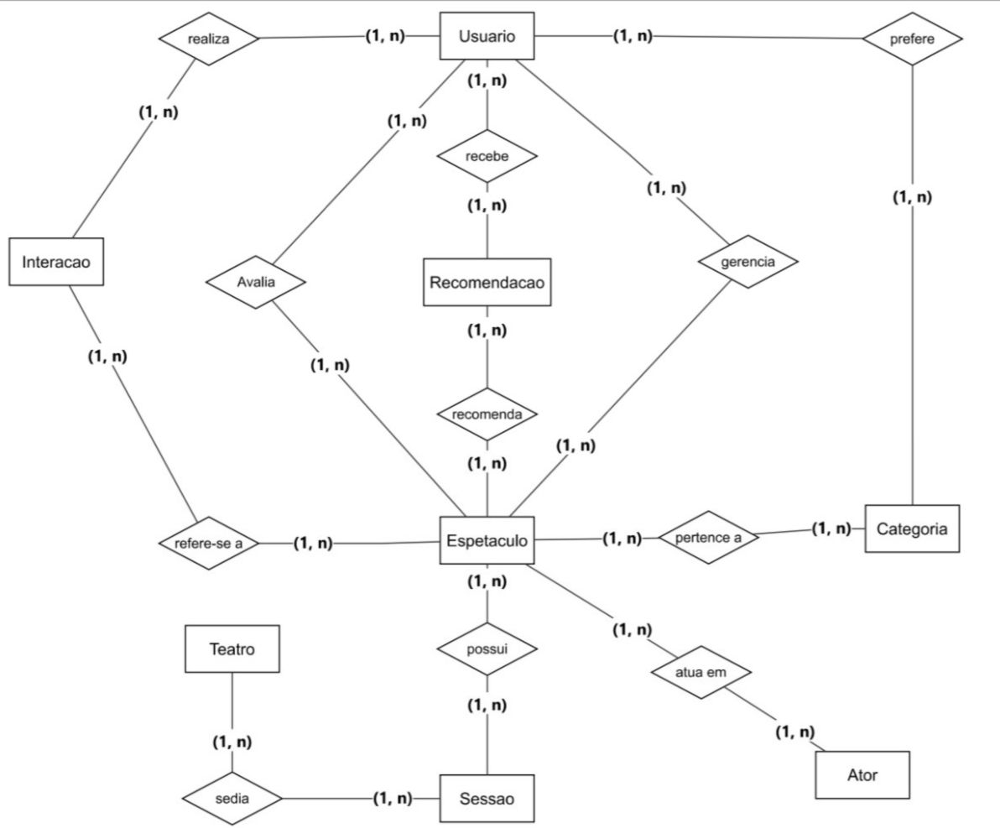<br>

  <sup>Source: Material produzido pelos autores, 2026.</sup>

</div>

### 4.2.2. Descrição Textual de Entidades e Atributos

### Entidade: Usuário

#### Descrição da entidade
A entidade Usuário representa as pessoas que utilizam a plataforma de recomendação de espetáculos.

#### Importância no contexto do projeto
Essa entidade permite identificar os usuários da plataforma, registrar preferências e armazenar informações necessárias para recomendações personalizadas.

### Tabela x - Tabela de atributos Usuário

| Atributo | Descrição |
|---|---|
| id_usuario | Identificador único do usuário. |
| nome | Nome completo do usuário. |
| email | E-mail utilizado para acesso à plataforma. |
| senha | Senha de autenticação do usuário. |
| data_nascimento | Data de nascimento do usuário. |
| localizacao | Localização do usuário. |
| perfil_preferencias | Preferências de categorias e conteúdos. |
| data_cadastro | Data de criação da conta. |
| tipo_usuario | Define o tipo do usuário (visitante, cadastrado ou administrador). |

Fonte: material elaborado pelos autores (2025).


---

### Entidade: Espetáculo

#### Descrição da entidade
A entidade Espetáculo representa os eventos e apresentações disponíveis na plataforma.

#### Importância no contexto do projeto
Essa é a principal entidade do sistema, responsável por armazenar as informações dos espetáculos que serão exibidos e recomendados aos usuários.

### Tabela x - Tabela de atributos Espetáculo

| Atributo | Descrição |
|---|---|
| id_espetaculo | Identificador único do espetáculo. |
| titulo | Nome do espetáculo. |
| descricao | Descrição do espetáculo. |
| genero | Gênero da apresentação. |
| faixa_etaria | Faixa etária recomendada. |
| duracao | Tempo de duração do espetáculo. |
| classificacao_indicativa | Classificação indicativa oficial. |
| elenco | Artistas participantes da apresentação. |
| produtora | Empresa responsável pela produção. |
| status | Situação atual do espetáculo (em cartaz, em breve ou encerrado). |
| popularidade | Indicador de popularidade do espetáculo. |
| nota_media | Média das avaliações recebidas. |

Fonte: material elaborado pelos autores (2025).


---

### Entidade: Teatro

#### Descrição da entidade
A entidade Teatro representa os locais físicos onde os espetáculos acontecem.

#### Importância no contexto do projeto
Ela permite armazenar informações sobre os espaços culturais utilizados para realização das sessões.

### Tabela x - Tabela de atributos Teatro

| Atributo | Descrição |
|---|---|
| id_teatro | Identificador único do teatro. |
| nome | Nome do teatro. |
| endereco | Endereço completo do teatro. |
| cidade | Cidade onde o teatro está localizado. |
| estado | Estado onde o teatro está localizado. |
| capacidade | Quantidade máxima de espectadores. |
| acessibilidade | Recursos de acessibilidade disponíveis. |
| parceiro_naming_rights | Empresa parceira vinculada ao naming rights do teatro. |

Fonte: material elaborado pelos autores (2025).


---

### Entidade: Sessão

#### Descrição da entidade
A entidade Sessão representa uma apresentação específica de um espetáculo em determinada data e horário.

#### Importância no contexto do projeto
Ela organiza as apresentações disponíveis para compra e consulta pelos usuários.

### Tabela x - Tabela de atributos Sessão

| Atributo | Descrição |
|---|---|
| id_sessao | Identificador único da sessão. |
| data | Data da apresentação. |
| horario | Horário da sessão. |
| preco_minimo | Menor valor disponível para ingresso. |
| preco_maximo | Maior valor disponível para ingresso. |
| disponibilidade | Quantidade de ingressos disponíveis. |
| link_compra | Link para compra de ingressos. |

Fonte: material elaborado pelos autores (2025).

---

### Entidade: Categoria

#### Descrição da entidade
A entidade Categoria representa a classificação temática dos espetáculos.

#### Importância no contexto do projeto
Ela auxilia na organização dos espetáculos e na personalização das recomendações feitas aos usuários.

### Tabela x - Tabela de atributos Categoria

| Atributo | Descrição |
|---|---|
| id_categoria | Identificador único da categoria. |
| nome | Nome da categoria. |
| descricao | Descrição da categoria. |

Fonte: material elaborado pelos autores (2025).

---

### Entidade: Interação

#### Descrição da entidade
A entidade Interação representa as ações comportamentais realizadas pelos usuários na plataforma em relação aos espetáculos.

#### Importância no contexto do projeto
Essa entidade centraliza os dados comportamentais utilizados pelo sistema de recomendação, permitindo analisar preferências e padrões de navegação dos usuários.

### Tabela x - Tabela de atributos Interação

| Atributo | Descrição |
|---|---|
| id_interacao | Identificador único da interação. |
| id_usuario | Usuário responsável pela interação. |
| id_espetaculo | Espetáculo relacionado à interação. |
| tipo_interacao | Tipo de interação realizada. |
| data_hora | Data e horário da interação. |
| tempo_permanencia | Tempo de permanência do usuário no conteúdo. |

Fonte: material elaborado pelos autores (2025).

---

### Entidade: Recomendação

#### Descrição da entidade
A entidade Recomendação representa as sugestões de espetáculos geradas para os usuários.

#### Importância no contexto do projeto
Ela armazena os resultados produzidos pelos algoritmos de recomendação da plataforma.

### Tabela x - Tabela de atributos Recomendação

| Atributo | Descrição |
|---|---|
| id_recomendacao | Identificador único da recomendação. |
| id_usuario | Usuário que recebeu a recomendação. |
| id_espetaculo | Espetáculo recomendado. |
| tipo_algoritmo | Algoritmo utilizado para gerar a recomendação. |
| score_recomendacao | Pontuação de relevância da recomendação. |
| motivo_recomendacao | Justificativa da recomendação. |
| data_geracao | Data de geração da recomendação. |
| prioridade_manual | Indica se houve priorização manual. |

Fonte: material elaborado pelos autores (2025).

---

### Entidade: Ator

#### Descrição da entidade
A entidade Ator representa os profissionais responsáveis pela atuação nos espetáculos cadastrados na plataforma.

#### Importância no contexto do projeto
Essa entidade permite registrar informações sobre os integrantes do elenco, possibilitando relacionar atores aos espetáculos em que atuam e organizar os dados artísticos da plataforma.

### Tabela x - Tabela de atributos Ator

| Atributo | Descrição |
|---|---|
| id_ator | Identificador único do ator. |
| nome | Nome completo do ator. |
| biografia | Texto descritivo com informações sobre a trajetória profissional do ator. |
| created_at | Data e horário de criação do registro do ator. |

Fonte: material elaborado pelos autores (2025).

### 4.2.3. Descrição Textual dos Relacionamentos entre Entidades

A tabela a seguir descreve os relacionamentos entre as entidades do modelo, especificando os atores envolvidos, a cardinalidade e a semântica de cada associação.

| Nº | Relacionamento | Entidade 1 | Entidade 2 | Cardinalidade | Descrição |
|---|---|---|---|---|---|
| 1 | Realiza | Usuário | Interação | 1:N | Um usuário pode realizar várias interações ao longo do tempo (visualizações, cliques, favoritos, etc.), mas cada interação pertence a exatamente um único usuário. |
| 2 | Refere-se a | Interação | Espetáculo | N:1 | Várias interações podem se referir ao mesmo espetáculo, mas cada interação está associada a exatamente um espetáculo. |
| 3 | Avalia | Usuário | Espetáculo | N:N | Um usuário pode avaliar vários espetáculos e um espetáculo pode receber avaliações de vários usuários. Este relacionamento é distinto da Interação pois representa uma nota explícita atribuída pelo usuário, armazenada no banco relacional e utilizada para o cálculo da média do espetáculo. |
| 4 | Recebe | Usuário | Recomendação | 1:N | Um usuário pode receber várias recomendações geradas pelo sistema ao longo da sua jornada, mas cada recomendação é direcionada a um único usuário. |
| 5 | Recomenda | Recomendação | Espetáculo | N:1 | Um mesmo espetáculo pode ser recomendado a múltiplos usuários em recomendações distintas, mas cada recomendação aponta para um único espetáculo. |
| 6 | Possui | Espetáculo | Sessão | 1:N | Um espetáculo pode ter várias sessões em datas, horários e teatros diferentes, mas cada sessão pertence a um único espetáculo. |
| 7 | Sedia | Teatro | Sessão | 1:N | Um teatro pode sediar várias sessões de diferentes espetáculos, mas cada sessão ocorre em um único teatro. |
| 8 | Pertence a | Espetáculo | Categoria | N:1 | Vários espetáculos podem pertencer a uma mesma categoria, mas cada espetáculo está classificado sob uma única categoria principal. |
| 9 | Prefere | Usuário | Categoria | N:1 | Vários usuários podem preferir a mesma categoria cultural, mas cada usuário possui uma única categoria de preferência principal registrada. |
| 10 | Gerencia | Usuário | Espetáculo | 1:N | Um usuário com perfil administrador pode gerenciar vários espetáculos na plataforma, sendo responsável por cadastrar, editar e controlar o status de cada produção. Cada espetáculo está sob responsabilidade de um único usuário administrador. |
| 11 | Atua em | Espetáculo | Ator | N:N | Um espetáculo conta com vários atores em seu elenco e um ator pode participar de vários espetáculos ao longo de sua carreira. Este relacionamento é implementado por meio de uma tabela associativa no modelo lógico. |

---

### 4.2.4. Detalhamento

Este modelo conceitual descreve a estrutura de dados do sistema Spotlight, contemplando as oito entidades centrais do domínio — Usuário, Espetáculo, Teatro, Sessão, Categoria, Interação, Recomendação e Ator — e os onze relacionamentos que as conectam. A modelagem foi construída com base nos requisitos do projeto e nas particularidades do negócio da Aventura Teatros, garantindo que cada decisão estrutural tenha correspondência direta com uma necessidade funcional do sistema.

Dois pontos de destaque merecem atenção especial. O primeiro é a separação entre os relacionamentos **Realiza** e **Avalia**: enquanto o relacionamento Realiza captura interações implícitas do usuário com os espetáculos — como visualizações, cliques e favoritos, armazenadas no banco NoSQL para alimentar o motor de recomendação —, o relacionamento Avalia representa a nota explícita atribuída pelo usuário, persistida no banco relacional e utilizada para o cálculo da média de avaliação de cada espetáculo. Essa distinção reflete a arquitetura de dados do sistema e garante que os dois tipos de sinal sejam tratados com a precisão adequada. O segundo destaque é a incorporação do papel de administrador diretamente na entidade Usuário, por meio do atributo `tipo_usuario`, eliminando a redundância de uma entidade separada e centralizando as regras de controle de acesso em um único ponto do modelo.

Na implementação, cada entidade será mapeada para uma tabela relacional no Supabase (PostgreSQL), com os relacionamentos representados por chaves estrangeiras que respeitam as cardinalidades definidas. O relacionamento N:N entre Espetáculo e Ator será resolvido por uma tabela associativa `espetaculo_ator`. O sistema permitirá:

- Cadastro e autenticação de usuários com diferentes níveis de acesso;
- Registro contínuo de interações implícitas para alimentar o motor de recomendação;
- Registro de avaliações explícitas e atualização automática da nota média dos espetáculos;
- Geração automática de recomendações personalizadas com rastreabilidade de algoritmo e score;
- Gerenciamento do catálogo de espetáculos, sessões e elencos por usuários administradores;
- Filtragem e descoberta de produções por categoria e localização geográfica.

## 4.3 Modelo Lógico de Dados

A modelagem lógica de dados é uma etapa fundamental na arquitetura do Spotlight, atuando como a ponte entre os requisitos de negócio e a implementação física no banco de dados. Seu objetivo principal é estruturar as informações de forma que garantam a integridade, evitem redundâncias e otimizem as consultas, independentemente das limitações específicas de um Sistema de Gerenciamento de Banco de Dados em particular.

Nesta arquitetura, a modelagem lógica foi desenhada para suportar um ecossistema de alta performance e escalabilidade. Isso significa que diferentes tipos de dados são armazenados em tecnologias distintas, escolhidas de acordo com a natureza e o volume das informações.

Para suportar tanto a integridade dos dados do catálogo quanto a alta volumetria de eventos gerados pelos usuários, a arquitetura de dados foi desenhada em um modelo híbrido.

O núcleo transacional reside em um banco de dados relacional (**PostgreSQL**), responsável por gerenciar usuários, espetáculos, teatros e sessões. Paralelamente, os dados comportamentais (interações) foram delegados a um banco de dados não-relacional (**MongoDB**), otimizando a performance do motor de recomendação.

---

### 4.3.1. Core Relacional (PostgreSQL)

O modelo lógico no PostgreSQL foi projetado com foco em normalização, integridade referencial e eficiência em consultas estruturadas. Abaixo, detalhamos as principais escolhas arquiteturais.

<div align="center">

<sub>Figura 1 - Modelo lógico de dados</sub><br>

  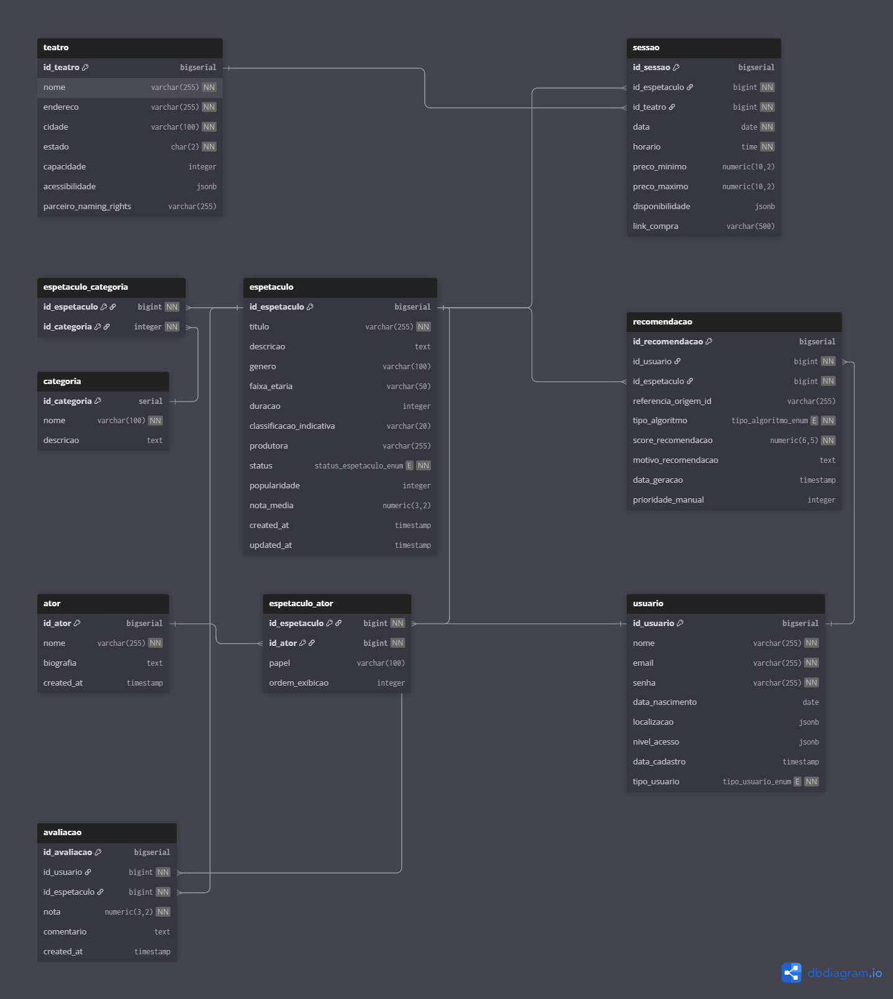<br>

  <sup>Fonte: Material produzido pelos autores, 2026.</sup>

</div>

#### 4.3.1.1. Gestão de Usuários e Acessos

A tabela `usuario` centraliza todos os perfis de acesso, diferenciados pelo enum `tipo_usuario_enum`.

A escolha de unificar os perfis em uma única tabela evita a complexidade de múltiplos sistemas de autenticação. O campo `nivel_acesso` (tipo `jsonb`) confere flexibilidade para definir permissões granulares para administradores sem a necessidade de criar tabelas complexas de controle de acesso neste momento inicial.

---

#### 4.3.1.2. Catálogo de Espetáculos e Elenco

A tabela `espetaculo` armazena os metadados das peças teatrais. Uma decisão crucial nesta versão final foi a remoção do campo `elenco` (anteriormente um `jsonb`) em favor de uma estrutura relacional dedicada.

Foram criadas as tabelas `ator` e a associativa `espetaculo_ator`.

Esta modelagem permite:

- **Buscas Eficientes:** Consultar rapidamente todos os espetáculos de um ator específico.

- **Integridade:** Evitar duplicidade de nomes e garantir que o histórico do ator seja mantido de forma centralizada.

- **Riqueza de Detalhes:** A tabela associativa `espetaculo_ator` permite registrar o papel específico e a `ordem_exibicao` do ator em cada peça, essencial para a interface do usuário.

Os campos `popularidade` e `nota_media` na tabela `espetaculo` funcionam como um cache de leitura. Eles não são calculados em tempo real no PostgreSQL, mas sim atualizados periodicamente por **Workers** que processam os dados brutos armazenados no MongoDB.

---

#### 4.3.1.3. Teatros, Sessões e Categorias 

A infraestrutura física e a agenda são gerenciadas pelas tabelas `teatro` e `sessao`.

A tabela `sessao` atua como o elo temporal e espacial, conectando um `espetaculo` a um `teatro` em uma data e horário específicos. O campo `disponibilidade` (`jsonb`) atua como um cache rápido para a interface, enquanto a venda real pode ser delegada a um sistema parceiro via `link_compra`.

A categorização dos espetáculos é feita através de uma relação N:M clássica (`categoria` e `espetaculo_categoria`), permitindo que uma peça pertença a múltiplos gêneros ou coleções.

---

#### 4.3.1.4. Recomendações

A tabela `recomendacao` armazena o resultado final dos algoritmos de Machine Learning.

Ela cruza um `usuario` com um `espetaculo` sugerido, registrando o `score_recomendacao` e o `tipo_algoritmo` utilizado.

O campo `referencia_origem_id` é um elo vital com o mundo NoSQL. Ele armazena o identificador da interação que serviu de gatilho para aquela recomendação, permitindo rastreabilidade e auditoria da qualidade do modelo.

---

### 4.3.2. Dados Comportamentais (MongoDB)

A decisão de remover a tabela de `interacao` do PostgreSQL e movê-la para o MongoDB é o pilar da escalabilidade do Spotlight.

#### 4.3.2.1. O Problema do Relacional para Eventos

Sistemas de recomendação dependem de um volume massivo de dados implícitos (visualizações, cliques, tempo de tela).

Se cada clique gerasse um `INSERT` no PostgreSQL, o banco sofreria com gargalos de I/O e o crescimento exponencial das tabelas degradaria a performance das consultas do catálogo.

---

#### 4.3.2.2. A Solução NoSQL

O MongoDB, sendo um banco de dados orientado a documentos, é ideal para cargas de trabalho **append-only** em alta velocidade.

#### Benefícios da abordagem

- **Flexibilidade de Schema:**  
  Diferentes tipos de interação podem ter atributos distintos.

  No MongoDB, esses eventos podem coexistir na mesma coleção sem a necessidade de colunas nulas ou tabelas separadas.

- **Escalabilidade Horizontal:**  
  O MongoDB permite distribuir os dados de interações em múltiplos servidores de forma nativa, suportando picos de tráfego sem impactar o banco principal.

- **Alimentação do ML:**  
  Os pipelines de Machine Learning podem consumir os dados do MongoDB de forma muito mais eficiente para treinar os modelos de filtragem colaborativa ou baseados em conteúdo.

---

O PostgreSQL garante a consistência e a riqueza relacional do catálogo e do elenco, enquanto o MongoDB absorve o impacto da alta volumetria de eventos comportamentais.

Essa separação de responsabilidades assegura que o sistema seja performático, escalável e otimizado para alimentar os algoritmos de recomendação.

### 4.3.3 Dicionário de Dados

&emsp;O dicionário de dados descreve em detalhe cada tabela do banco relacional PostgreSQL, especificando o tipo de dado, as restrições e o significado semântico de cada coluna. As informações são derivadas diretamente do script `src/database/01_create_database.sql` e estão alinhadas ao modelo lógico apresentado nas seções anteriores.

As abreviações utilizadas nas colunas de restrição são:

| Abreviação | Significado |
|---|---|
| PK | Primary Key — chave primária, identifica unicamente cada linha |
| FK | Foreign Key — chave estrangeira, referencia outra tabela |
| NN | Not Null — valor obrigatório |
| UQ | Unique — valor único na tabela |
| CK | Check — constraint de validação de domínio |
| DF | Default — valor padrão quando não informado |

---

#### Tabela: `usuario`

Armazena os dados dos usuários cadastrados na plataforma, integrada ao sistema de autenticação do Supabase Auth via chave primária. O controle de acesso a linhas é feito por Row Level Security (RLS), garantindo que cada usuário só leia e edite o próprio perfil.

| Coluna | Tipo | Restrições | Descrição |
|---|---|---|---|
| `id_usuario` | `UUID` | PK, FK → `auth.users(id)` ON DELETE CASCADE, NN | Identificador único do usuário, espelhado do Supabase Auth. Gerado automaticamente pelo trigger `on_auth_user_created` no cadastro. |
| `nome` | `VARCHAR(150)` | NN | Nome completo ou nome de exibição do usuário. Preenchido automaticamente pelo trigger a partir dos metadados do cadastro. |
| `email` | `VARCHAR(255)` | NN, UQ, CK (`email ~* '^[^@\s]+@[^@\s]+\.[^@\s]+$'`) | E-mail do usuário. Deve ter formato válido. Único na tabela. |
| `data_nascimento` | `DATE` | — | Data de nascimento. Opcional; utilizada para filtros de faixa etária em recomendações. |
| `localizacao` | `JSONB` | — | Localização consentida do usuário, incluindo endereço normalizado, coordenadas, identificador do provedor e origem da geocodificação. Utilizada como sinal de contexto para recomendações baseadas em localização. |
| `data_cadastro` | `TIMESTAMP` | NN, DF `NOW()` | Data e hora de criação do registro. Preenchida automaticamente pelo banco. |
| `tipo_usuario` | `tipo_usuario_enum` | NN, DF `'cadastrado'` | Papel do usuário: `'visitante'`, `'cadastrado'` ou `'administrador'`. Controla o acesso a funcionalidades administrativas. |
| `nivel_acesso` | `JSONB` | NN, DF `'{}'` | Permissões granulares em formato JSON. Permite definir capacidades específicas dentro do papel sem criar tabelas de controle adicionais. |
| `perfil_preferencias` | `JSONB` | NN, DF `'{}'` | Preferências declaradas pelo usuário (gêneros, faixa de preço, etc.). Alimenta o motor de recomendação no cold start. |

---

#### Tabela: `categoria`

Classifica os espetáculos por gênero ou tema. Um espetáculo pode pertencer a múltiplas categorias através da tabela associativa `espetaculo_categoria`.

| Coluna | Tipo | Restrições | Descrição |
|---|---|---|---|
| `id_categoria` | `SERIAL` | PK, NN | Identificador único da categoria, gerado automaticamente. |
| `nome` | `VARCHAR(100)` | NN, UQ | Nome da categoria (ex: "Musical", "Infantil", "Drama"). Único na tabela para evitar duplicidade. |
| `descricao` | `TEXT` | — | Descrição textual do escopo da categoria. Opcional. |

---

#### Tabela: `ator`

Representa os artistas do elenco dos espetáculos. Substituiu o campo textual `elenco` da tabela `espetaculo`, permitindo consultas estruturadas por artista e exibição ordenada dos créditos.

| Coluna | Tipo | Restrições | Descrição |
|---|---|---|---|
| `id_ator` | `SERIAL` | PK, NN | Identificador único do ator, gerado automaticamente. |
| `nome` | `VARCHAR(150)` | NN | Nome artístico ou completo do ator. |
| `biografia` | `TEXT` | — | Texto descritivo com a trajetória profissional do ator. Opcional. |
| `created_at` | `TIMESTAMP` | NN, DF `NOW()` | Data e hora de criação do registro. Preenchida automaticamente. |

---

#### Tabela: `espetaculo`

Tabela central do catálogo, armazena os metadados de cada peça teatral disponível na plataforma. Os campos `popularidade` e `nota_media` funcionam como cache de leitura, atualizados periodicamente por Workers que consomem dados do MongoDB.

| Coluna | Tipo | Restrições | Descrição |
|---|---|---|---|
| `id_espetaculo` | `SERIAL` | PK, NN | Identificador único do espetáculo, gerado automaticamente. |
| `titulo` | `VARCHAR(200)` | NN | Nome do espetáculo. Obrigatório. |
| `descricao` | `TEXT` | — | Sinopse ou descrição detalhada do conteúdo. Opcional. |
| `genero` | `VARCHAR(100)` | — | Gênero artístico principal (ex: "Musical", "Drama", "Dança"). Complementado pela relação com `categoria`. |
| `faixa_etaria` | `VARCHAR(50)` | — | Faixa etária recomendada (ex: "Livre", "12 anos"). Exibida na interface para filtro de conteúdo. |
| `duracao` | `INTEGER` | CK `(duracao > 0)` | Duração em minutos. Deve ser positivo quando informado. |
| `classificacao_indicativa` | `VARCHAR(20)` | — | Classificação indicativa oficial (ex: "L", "10", "14", "18"). |
| `produtora` | `VARCHAR(150)` | — | Nome da produtora responsável. Pode ser utilizado em filtros administrativos. |
| `status` | `status_espetaculo_enum` | NN, DF `'em_breve'` | Situação atual: `'em_cartaz'`, `'em_breve'` ou `'encerrado'`. Indexado para filtragem rápida. |
| `popularidade` | `NUMERIC(10,4)` | NN, DF `0` | Indicador de popularidade calculado a partir das interações no MongoDB. Cache de leitura atualizado por Workers. |
| `nota_media` | `NUMERIC(4,2)` | NN, DF `0`, CK `BETWEEN 0 AND 5` | Média das avaliações recebidas. Valor entre 0 e 5. Cache atualizado ao registrar novas avaliações. |
| `id_admin` | `UUID` | FK → `usuario(id_usuario)` ON DELETE SET NULL | Administrador responsável pelo cadastro e gestão do espetáculo. Nulo quando o administrador é removido. |
| `created_at` | `TIMESTAMP` | NN, DF `NOW()` | Data de inserção do registro. |
| `updated_at` | `TIMESTAMP` | NN, DF `NOW()` | Data da última atualização. Deve ser mantida pelo aplicativo ou por trigger ao editar. |

**Índices:** `idx_espetaculo_status`, `idx_espetaculo_nota_media` (DESC), `idx_espetaculo_popularidade` (DESC).

---

#### Tabela: `espetaculo_categoria`

Tabela associativa que implementa o relacionamento N:M entre espetáculos e categorias. Permite que uma peça seja classificada em múltiplos gêneros ou coleções temáticas.

| Coluna | Tipo | Restrições | Descrição |
|---|---|---|---|
| `id_espetaculo` | `INTEGER` | PK (composta), FK → `espetaculo(id_espetaculo)` ON DELETE CASCADE, NN | Referência ao espetáculo. Removido em cascata se o espetáculo for excluído. |
| `id_categoria` | `INTEGER` | PK (composta), FK → `categoria(id_categoria)` ON DELETE CASCADE, NN | Referência à categoria. Removido em cascata se a categoria for excluída. |

**Chave Primária:** composta por `(id_espetaculo, id_categoria)`.

---

#### Tabela: `espetaculo_ator`

Tabela associativa com atributos que implementa o relacionamento N:M entre espetáculos e atores. Registra o papel desempenhado e a ordem de exibição nos créditos de cada produção.

| Coluna | Tipo | Restrições | Descrição |
|---|---|---|---|
| `id_espetaculo` | `INTEGER` | PK (composta), FK → `espetaculo(id_espetaculo)` ON DELETE CASCADE, NN | Referência ao espetáculo. Removido em cascata se o espetáculo for excluído. |
| `id_ator` | `INTEGER` | PK (composta), FK → `ator(id_ator)` ON DELETE CASCADE, NN | Referência ao ator. Removido em cascata se o ator for excluído. |
| `papel` | `VARCHAR(150)` | — | Personagem ou função desempenhada pelo ator no espetáculo. |
| `ordem_exibicao` | `INTEGER` | CK `(ordem_exibicao > 0)` | Ordem do ator na listagem de créditos. Deve ser positivo quando informado. |

**Chave Primária:** composta por `(id_espetaculo, id_ator)`. **Índice:** `idx_espetaculo_ator_ator` em `id_ator` para buscas por ator.

---

#### Tabela: `teatro`

Armazena os dados dos espaços físicos onde os espetáculos são realizados.

| Coluna | Tipo | Restrições | Descrição |
|---|---|---|---|
| `id_teatro` | `SERIAL` | PK, NN | Identificador único do teatro, gerado automaticamente. |
| `nome` | `VARCHAR(200)` | NN | Nome oficial do teatro (pode incluir o nome do parceiro de naming rights). |
| `endereco` | `VARCHAR(300)` | NN | Endereço completo (rua, número, bairro). |
| `cidade` | `VARCHAR(100)` | NN | Cidade onde o teatro está localizado. Utilizada em filtros de localização. |
| `estado` | `CHAR(2)` | NN | Sigla do estado (UF), dois caracteres (ex: "SP", "RJ"). |
| `capacidade` | `INTEGER` | CK `(capacidade > 0)` | Número máximo de espectadores. Deve ser positivo quando informado. |
| `acessibilidade` | `BOOLEAN` | NN, DF `FALSE` | Indica se o teatro possui recursos de acessibilidade (rampa, elevador, etc.). |
| `parceiro_naming_rights` | `VARCHAR(200)` | — | Nome da empresa parceira vinculada ao naming rights do teatro. |
| `created_at` | `TIMESTAMP` | NN, DF `NOW()` | Data de inserção do registro. |

---

#### Tabela: `sessao`

Representa uma apresentação específica de um espetáculo em um teatro, em data e horário determinados. É o elo temporal e espacial do catálogo.

| Coluna | Tipo | Restrições | Descrição |
|---|---|---|---|
| `id_sessao` | `SERIAL` | PK, NN | Identificador único da sessão, gerado automaticamente. |
| `id_espetaculo` | `INTEGER` | FK → `espetaculo(id_espetaculo)` ON DELETE CASCADE, NN | Espetáculo ao qual a sessão pertence. Removida em cascata se o espetáculo for excluído. |
| `id_teatro` | `INTEGER` | FK → `teatro(id_teatro)` ON DELETE RESTRICT, NN | Teatro onde a sessão ocorre. Não pode ser excluído enquanto houver sessões vinculadas. |
| `data` | `DATE` | NN | Data da apresentação. |
| `horario` | `TIME` | NN | Horário de início da apresentação. |
| `preco_minimo` | `NUMERIC(10,2)` | CK `(preco_minimo >= 0)` | Menor valor de ingresso disponível. Deve ser não-negativo. |
| `preco_maximo` | `NUMERIC(10,2)` | CK `(preco_maximo >= 0)`, CK `(preco_maximo >= preco_minimo)` | Maior valor de ingresso disponível. Deve ser maior ou igual ao preço mínimo quando ambos informados. |
| `disponibilidade` | `INTEGER` | NN, DF `0`, CK `(disponibilidade >= 0)` | Quantidade de ingressos disponíveis. Cache atualizado por integração com a ticketeira. |
| `link_compra` | `TEXT` | — | URL externa para compra de ingressos na plataforma parceira (Sympla, Blueticket, etc.). |
| `created_at` | `TIMESTAMP` | NN, DF `NOW()` | Data de inserção do registro. |

**Índices:** `idx_sessao_espetaculo`, `idx_sessao_data`, `idx_sessao_teatro`.

---

#### Tabela: `avaliacao`

Registra as notas e comentários explícitos de usuários sobre espetáculos. Cada usuário pode avaliar um espetáculo apenas uma vez (constraint UNIQUE). Os dados desta tabela alimentam o cálculo da `nota_media` em `espetaculo`.

| Coluna | Tipo | Restrições | Descrição |
|---|---|---|---|
| `id_avaliacao` | `SERIAL` | PK, NN | Identificador único da avaliação, gerado automaticamente. |
| `id_usuario` | `UUID` | FK → `usuario(id_usuario)` ON DELETE CASCADE, NN | Usuário que realizou a avaliação. Removida em cascata se o usuário for excluído. |
| `id_espetaculo` | `INTEGER` | FK → `espetaculo(id_espetaculo)` ON DELETE CASCADE, NN | Espetáculo avaliado. Removida em cascata se o espetáculo for excluído. |
| `nota` | `NUMERIC(4,2)` | NN, CK `BETWEEN 0 AND 5` | Nota atribuída pelo usuário, entre 0 e 5. |
| `comentario` | `TEXT` | — | Comentário textual opcional do usuário sobre o espetáculo. |
| `created_at` | `TIMESTAMP` | NN, DF `NOW()` | Data e hora de registro da avaliação. |

**Chave Única:** `(id_usuario, id_espetaculo)` — impede avaliações duplicadas do mesmo usuário para o mesmo espetáculo. **Índice:** `idx_avaliacao_espetaculo`.

---

#### Tabela: `recomendacao`

Armazena os resultados gerados pelos algoritmos de Machine Learning para cada usuário. O campo `referencia_origem_id` vincula a recomendação ao evento de telemetria do MongoDB que a originou, garantindo rastreabilidade e auditabilidade do modelo.

| Coluna | Tipo | Restrições | Descrição |
|---|---|---|---|
| `id_recomendacao` | `SERIAL` | PK, NN | Identificador único da recomendação, gerado automaticamente. |
| `id_usuario` | `UUID` | FK → `usuario(id_usuario)` ON DELETE CASCADE, NN | Usuário para quem a recomendação foi gerada. Removida em cascata se o usuário for excluído. |
| `id_espetaculo` | `INTEGER` | FK → `espetaculo(id_espetaculo)` ON DELETE CASCADE, NN | Espetáculo recomendado. Removida em cascata se o espetáculo for excluído. |
| `tipo_algoritmo` | `VARCHAR(50)` | NN, CK `IN ('k-NN', 'SVD', 'k-means')` | Algoritmo utilizado para gerar a recomendação. Valores aceitos: `'k-NN'`, `'SVD'` ou `'k-means'`. |
| `score_recomendacao` | `NUMERIC(8,6)` | NN, CK `(score_recomendacao >= 0)` | Pontuação de relevância calculada pelo algoritmo. Valor não-negativo; quanto maior, mais relevante. |
| `motivo_recomendacao` | `TEXT` | — | Justificativa textual da recomendação exibida ao usuário (ex: "Porque você gostou de musicais"). |
| `data_geracao` | `TIMESTAMP` | NN, DF `NOW()` | Data e hora em que a recomendação foi gerada. |
| `prioridade_manual` | `BOOLEAN` | NN, DF `FALSE` | Indica se um administrador sobrescreveu a prioridade gerada pelo algoritmo para fins de campanha. |
| `referencia_origem_id` | `VARCHAR(50)` | — | ID do documento no MongoDB (`interacoes`) que serviu de gatilho para esta recomendação. Permite rastrear qual evento comportamental originou a sugestão. |

**Índices:** `idx_recomendacao_usuario`, `idx_recomendacao_score` (por `id_usuario`, `score_recomendacao DESC` — otimiza a exibição das recomendações ordenadas por relevância).

---

#### ENUMs Customizados

| Tipo | Valores | Utilização |
|---|---|---|
| `tipo_usuario_enum` | `'visitante'`, `'cadastrado'`, `'administrador'` | Campo `tipo_usuario` da tabela `usuario` |
| `status_espetaculo_enum` | `'em_cartaz'`, `'em_breve'`, `'encerrado'` | Campo `status` da tabela `espetaculo` |

---

#### Visão Geral das Chaves Estrangeiras

| Tabela | Coluna | Referencia | Comportamento |
|---|---|---|---|
| `usuario` | `id_usuario` | `auth.users(id)` | CASCADE DELETE |
| `espetaculo` | `id_admin` | `usuario(id_usuario)` | SET NULL |
| `espetaculo_categoria` | `id_espetaculo` | `espetaculo(id_espetaculo)` | CASCADE DELETE |
| `espetaculo_categoria` | `id_categoria` | `categoria(id_categoria)` | CASCADE DELETE |
| `espetaculo_ator` | `id_espetaculo` | `espetaculo(id_espetaculo)` | CASCADE DELETE |
| `espetaculo_ator` | `id_ator` | `ator(id_ator)` | CASCADE DELETE |
| `sessao` | `id_espetaculo` | `espetaculo(id_espetaculo)` | CASCADE DELETE |
| `sessao` | `id_teatro` | `teatro(id_teatro)` | RESTRICT DELETE |
| `avaliacao` | `id_usuario` | `usuario(id_usuario)` | CASCADE DELETE |
| `avaliacao` | `id_espetaculo` | `espetaculo(id_espetaculo)` | CASCADE DELETE |
| `recomendacao` | `id_usuario` | `usuario(id_usuario)` | CASCADE DELETE |
| `recomendacao` | `id_espetaculo` | `espetaculo(id_espetaculo)` | CASCADE DELETE |

---

### 4.3.4 Normalização do Modelo Relacional

&emsp;A normalização é o processo de organizar as tabelas de um banco de dados relacional de forma a reduzir redundâncias, evitar anomalias de inserção, atualização e exclusão, e garantir a integridade dos dados. O modelo lógico do Spotlight foi projetado seguindo as três primeiras formas normais (1FN, 2FN e 3FN), cujas aplicações são detalhadas abaixo com exemplos reais das tabelas do projeto.

---

#### 4.3.4.1 Primeira Forma Normal (1FN)

**Definição:** Uma tabela está na 1FN quando todos os seus atributos contêm apenas valores atômicos (indivisíveis) e não há grupos repetitivos de colunas.

**Violação típica:** armazenar múltiplos valores em uma única coluna, como uma lista de categorias separada por vírgulas no campo `genero` da tabela `espetaculo`, ou um campo `elenco TEXT` com vários nomes concatenados.

**Aplicação no Spotlight:**

A decisão mais representativa da 1FN no projeto foi a **eliminação do campo `elenco TEXT`** da tabela `espetaculo`. Em uma modelagem sem normalização, esse campo poderia conter valores como `"João Silva, Maria Souza, Pedro Lima"` — um único atributo com múltiplos valores embutidos, violando diretamente a 1FN. A solução adotada foi criar a entidade `ator` e a tabela associativa `espetaculo_ator`, garantindo que cada célula da tabela contenha exatamente um valor atômico:

| Antes (viola 1FN) | Depois (1FN atendida) |
|---|---|
| `espetaculo.elenco = 'João Silva, Maria Souza'` | `espetaculo_ator(id_espetaculo=1, id_ator=10, papel='Protagonista')` |
| Não é possível filtrar por ator específico | `SELECT * FROM espetaculo_ator WHERE id_ator = 10` funciona diretamente |

O mesmo raciocínio se aplica às **categorias**: em vez de armazenar `genero = 'Musical, Infantil'` na tabela `espetaculo`, foi criada a tabela associativa `espetaculo_categoria`, permitindo que cada linha represente exatamente uma relação espetáculo–categoria.

Quanto ao campo `perfil_preferencias JSONB` da tabela `usuario`, sua natureza semiestruturada é intencional e justificada: preferências do usuário são dinâmicas e evoluem sem esquema fixo. O uso de `JSONB` é um padrão reconhecido no PostgreSQL para dados flexíveis, e não constitui violação da 1FN, pois o campo em si é atômico do ponto de vista da tabela relacional — o conteúdo interno é tratado como um documento opaco com estrutura gerenciada pela aplicação.

---

#### 4.3.4.2 Segunda Forma Normal (2FN)

**Definição:** Uma tabela está na 2FN quando está na 1FN e todos os seus atributos não-chave dependem **completamente** da chave primária. A 2FN é relevante apenas para tabelas com **chave primária composta**: se algum atributo depende apenas de parte da chave, há dependência parcial, caracterizando violação da forma normal.

**Violação típica:** em uma tabela com PK `(id_espetaculo, id_ator)`, incluir uma coluna `titulo_espetaculo` — que depende somente de `id_espetaculo`, não da combinação completa.

**Aplicação no Spotlight:**

As duas tabelas com chaves primárias compostas no projeto são `espetaculo_categoria` e `espetaculo_ator`. Ambas foram analisadas para garantir ausência de dependências parciais:

**Tabela `espetaculo_ator` — PK `(id_espetaculo, id_ator)`:**

| Atributo | Depende de `id_espetaculo` sozinho? | Depende de `id_ator` sozinho? | Depende da PK completa? |
|---|---|---|---|
| `papel` | Não — o mesmo espetáculo pode ter vários papéis | Não — o mesmo ator pode ter papéis diferentes em peças distintas | **Sim** — o papel é específico ao vínculo espetáculo+ator |
| `ordem_exibicao` | Não | Não | **Sim** — a ordem nos créditos é específica a cada par |

Nenhuma informação sobre o espetáculo (como `titulo` ou `status`) foi incluída nesta tabela. Da mesma forma, nenhuma informação sobre o ator (como `biografia`) foi duplicada aqui — ambas residem em suas respectivas tabelas de origem, eliminando qualquer dependência parcial.

**Tabela `espetaculo_categoria` — PK `(id_espetaculo, id_categoria)`:**

Esta tabela não possui atributos além das chaves estrangeiras que formam a PK, portanto está trivialmente na 2FN. A relação apenas registra a existência do vínculo; qualquer detalhe adicional pertence às tabelas `espetaculo` ou `categoria`.

Para as demais tabelas com chaves primárias simples (`usuario`, `espetaculo`, `teatro`, `sessao`, `avaliacao`, `recomendacao`, `ator`, `categoria`), a 2FN é automaticamente satisfeita, pois chaves simples não podem gerar dependências parciais.

---

#### 4.3.4.3 Terceira Forma Normal (3FN)

**Definição:** Uma tabela está na 3FN quando está na 2FN e nenhum atributo não-chave depende de outro atributo não-chave (ausência de **dependências transitivas**). Uma dependência transitiva ocorre quando o atributo A determina B, e B determina C — sendo C transitivamente dependente de A via B, em vez de ser diretamente dependente da chave primária.

**Violação típica:** incluir `cidade_teatro` e `estado_teatro` na tabela `sessao`. Esses atributos dependeriam de `id_teatro`, não de `id_sessao`, criando uma cadeia: `id_sessao → id_teatro → cidade_teatro`.

**Aplicação no Spotlight:**

**Separação de `teatro` e `sessao`:**

A decisão de manter `teatro` como entidade independente elimina a principal fonte potencial de dependência transitiva no projeto. Se os dados do teatro fossem desnormalizados em `sessao`, campos como `endereco`, `cidade` e `acessibilidade` dependeriam de `id_teatro` (que por sua vez depende de `id_sessao`), não da chave da sessão diretamente. Ao referenciar o teatro via FK `id_teatro`, cada atributo de localização do teatro permanece em sua tabela de origem, onde depende diretamente de `id_teatro`:

```
sessao.id_sessao → sessao.id_teatro → teatro.cidade  ← dependência transitiva se cidade estivesse em sessao
sessao.id_sessao → sessao.id_teatro                   ← correto: apenas a FK fica em sessao
teatro.id_teatro → teatro.cidade                      ← correto: cidade depende diretamente de id_teatro
```

**Separação de `ator` e `espetaculo_ator`:**

Sem a entidade `ator`, a tabela `espetaculo_ator` poderia conter `nome_ator` e `biografia_ator` diretamente. Esses campos dependeriam de `id_ator` (não da PK composta da tabela associativa), criando dependência transitiva. A solução adotada mantém todos os atributos do ator na tabela `ator`, onde dependem diretamente de `id_ator`.

**Campos `popularidade` e `nota_media` em `espetaculo`:**

Esses dois campos merecem atenção especial. Na lógica estrita de normalização, `nota_media` poderia ser considerado um valor derivado das linhas de `avaliacao` — calculável a partir de `AVG(nota) WHERE id_espetaculo = X`. No entanto, a equipe optou por mantê-los desnormalizados intencionalmente, pois representam um **cache de leitura** atualizado periodicamente por Workers que processam dados do MongoDB. Essa decisão é uma **desnormalização controlada e justificada**, padrão reconhecido em sistemas de alta leitura para evitar agregações custosas em tempo real. O trade-off é explícito: aceita-se eventual inconsistência temporal (cache ligeiramente desatualizado) em troca de consultas ao catálogo extremamente rápidas sem JOINs de agregação.

**Atributo `referencia_origem_id` em `recomendacao`:**

Este campo armazena o ID de um documento no MongoDB que originou a recomendação. Ele não depende de nenhum outro campo não-chave da tabela `recomendacao` — depende exclusivamente da chave `id_recomendacao`. Não há, portanto, dependência transitiva.

**Campo `tipo_algoritmo` em `recomendacao`:**

Este campo usa `VARCHAR(50)` com `CHECK IN ('k-NN', 'SVD', 'k-means')` em vez de um tipo ENUM customizado, seguindo padrão diferente dos campos `tipo_usuario` e `status_espetaculo`. A decisão é intencional: algoritmos de recomendação têm ciclo de atualização frequente ao longo do projeto, e adicionar um novo valor a um ENUM em PostgreSQL exige uma migration `ALTER TYPE`, operação que bloqueia a tabela brevemente. O `VARCHAR+CHECK` permite estender os valores aceitos com um simples `ALTER TABLE ... DROP CONSTRAINT ... / ADD CONSTRAINT ...`, sem impacto em produção. O trade-off aceito é a perda da garantia semântica de tipo nativo do banco.

---

#### Síntese

| Forma Normal | Decisão de Modelagem | Exemplo no Projeto |
|---|---|---|
| **1FN** | Eliminação de listas e grupos repetitivos | Tabelas `ator` + `espetaculo_ator` substituem campo `elenco TEXT`; `espetaculo_categoria` substitui `genero` com múltiplos valores |
| **2FN** | Eliminação de dependências parciais em chaves compostas | `espetaculo_ator.papel` depende do par `(id_espetaculo, id_ator)`, nunca de apenas um dos dois |
| **3FN** | Eliminação de dependências transitivas | Dados de `teatro` (cidade, endereço) não são copiados em `sessao`; dados de `ator` não são duplicados em `espetaculo_ator` |

&emsp;O modelo relacional do Spotlight atende integralmente às três primeiras formas normais nas tabelas transacionais do PostgreSQL. A única exceção deliberada — os campos de cache `popularidade` e `nota_media` em `espetaculo` — é uma desnormalização justificada por critérios de desempenho, documentada como decisão arquitetural consciente e não como descuido de modelagem.

---

### 4.3.5 Tabelas Associativas dos Relacionamentos N:N

&emsp;Relacionamentos muitos-para-muitos (N:N) não podem ser representados diretamente em um banco relacional. A solução padrão é introduzir uma **tabela associativa** (também chamada de tabela de junção ou tabela pivot) que resolve o relacionamento em dois relacionamentos 1:N, um para cada entidade participante. Cada linha da tabela associativa representa exatamente uma combinação válida entre os dois lados do relacionamento.

&emsp;O modelo lógico do Spotlight possui dois relacionamentos N:N, ambos implementados com tabelas associativas no PostgreSQL: `espetaculo_categoria` e `espetaculo_ator`. Ambas utilizam **chave primária composta** formada pelas duas chaves estrangeiras, garantindo que a mesma combinação não seja registrada mais de uma vez.

---

#### 4.3.5.1 `espetaculo_categoria`

**Relacionamento representado:** Um espetáculo pode pertencer a múltiplas categorias e uma categoria pode classificar múltiplos espetáculos.

**Motivação:** O campo `genero VARCHAR` da tabela `espetaculo` poderia conter apenas um gênero por espetáculo. Para que uma peça como "O Rei Leão" seja simultaneamente classificada como "Musical" e "Infantil", é necessária uma estrutura relacional separada que permita múltiplos vínculos sem repetição de linhas na tabela principal.

**Estrutura:**

```
espetaculo_categoria
┌─────────────────────┬─────────────────────┐
│  id_espetaculo (FK) │  id_categoria (FK)  │
│  INTEGER  NOT NULL  │  INTEGER  NOT NULL  │
│  PK ─────────────── ┼ ─────────────── PK  │
└──────────┬──────────┴──────────┬──────────┘
           │                     │
           ▼                     ▼
    espetaculo(id_espetaculo)  categoria(id_categoria)
```

**Definição SQL:**

```sql
CREATE TABLE espetaculo_categoria (
    id_espetaculo  INTEGER  NOT NULL REFERENCES espetaculo(id_espetaculo) ON DELETE CASCADE,
    id_categoria   INTEGER  NOT NULL REFERENCES categoria(id_categoria)   ON DELETE CASCADE,
    PRIMARY KEY (id_espetaculo, id_categoria)
);
```

**Chave Primária Composta:** `(id_espetaculo, id_categoria)`
A PK composta impede que o mesmo espetáculo seja vinculado à mesma categoria mais de uma vez. Inserir uma segunda linha com `(1, 3)` quando já existe `(1, 3)` resultará em violação de unicidade.

**Chaves Estrangeiras e Comportamentos:**

| Coluna | Referencia | ON DELETE |
|---|---|---|
| `id_espetaculo` | `espetaculo(id_espetaculo)` | `CASCADE` — ao excluir um espetáculo, todos os seus vínculos de categoria são removidos automaticamente |
| `id_categoria` | `categoria(id_categoria)` | `CASCADE` — ao excluir uma categoria, todos os vínculos com espetáculos são removidos automaticamente |

**Atributos adicionais:** nenhum. A tabela registra apenas a existência do vínculo; qualquer informação descritiva pertence às tabelas `espetaculo` ou `categoria`.

**Exemplos de uso:**

```sql
-- Classificar um espetáculo em múltiplas categorias
INSERT INTO espetaculo_categoria VALUES (1, 2); -- Musical
INSERT INTO espetaculo_categoria VALUES (1, 5); -- Infantil

-- Buscar todas as categorias de um espetáculo
SELECT c.nome
FROM categoria c
JOIN espetaculo_categoria ec ON ec.id_categoria = c.id_categoria
WHERE ec.id_espetaculo = 1;

-- Buscar todos os espetáculos de uma categoria
SELECT e.titulo
FROM espetaculo e
JOIN espetaculo_categoria ec ON ec.id_espetaculo = e.id_espetaculo
WHERE ec.id_categoria = 2;
```

**Consistência com o modelo conceitual:** corresponde ao relacionamento "Pertence a" (N:M) entre `Espetáculo` e `Categoria` descrito na seção 4.2.3, relacionamento nº 8.

---

#### 4.3.5.2 `espetaculo_ator`

**Relacionamento representado:** Um espetáculo conta com múltiplos atores em seu elenco e um ator pode participar de múltiplos espetáculos ao longo da carreira.

**Motivação:** Além de resolver o N:N entre `espetaculo` e `ator`, esta tabela é uma **classe associativa** — ela carrega atributos próprios que descrevem o contexto específico da participação de um ator em uma determinada peça. Esses atributos (`papel` e `ordem_exibicao`) não pertencem nem ao espetáculo nem ao ator isoladamente; eles só fazem sentido no contexto da combinação dos dois.

**Estrutura:**

```
espetaculo_ator
┌─────────────────────┬─────────────────────┬──────────────┬──────────────────┐
│  id_espetaculo (FK) │    id_ator (FK)     │    papel     │  ordem_exibicao  │
│  INTEGER  NOT NULL  │  INTEGER  NOT NULL  │ VARCHAR(150) │     INTEGER      │
│  PK ─────────────── ┼ ─────────────── PK  │   opcional   │   CK > 0         │
└──────────┬──────────┴──────────┬──────────┴──────────────┴──────────────────┘
           │                     │
           ▼                     ▼
    espetaculo(id_espetaculo)  ator(id_ator)
```

**Definição SQL:**

```sql
CREATE TABLE espetaculo_ator (
    id_espetaculo  INTEGER      NOT NULL REFERENCES espetaculo(id_espetaculo) ON DELETE CASCADE,
    id_ator        INTEGER      NOT NULL REFERENCES ator(id_ator)             ON DELETE CASCADE,
    papel          VARCHAR(150),
    ordem_exibicao INTEGER      CHECK (ordem_exibicao > 0),
    PRIMARY KEY (id_espetaculo, id_ator)
);
```

**Chave Primária Composta:** `(id_espetaculo, id_ator)`
A PK composta garante que um ator apareça no elenco de um dado espetáculo no máximo uma vez. Para representar um ator em múltiplos papéis na mesma peça, a modelagem exigiria uma extensão futura com um terceiro componente na chave.

**Chaves Estrangeiras e Comportamentos:**

| Coluna | Referencia | ON DELETE |
|---|---|---|
| `id_espetaculo` | `espetaculo(id_espetaculo)` | `CASCADE` — ao excluir um espetáculo, todo o elenco vinculado é removido |
| `id_ator` | `ator(id_ator)` | `CASCADE` — ao excluir um ator, seus vínculos com todos os espetáculos são removidos |

**Atributos da classe associativa:**

| Coluna | Tipo | Restrição | Descrição |
|---|---|---|---|
| `papel` | `VARCHAR(150)` | Opcional | Personagem ou função do ator neste espetáculo específico (ex: "Protagonista", "Simba", "Ensemble"). Varia por espetáculo — não pode residir na tabela `ator`. |
| `ordem_exibicao` | `INTEGER` | `CHECK > 0`, opcional | Posição do ator na listagem de créditos deste espetáculo. Determina a ordem de exibição na interface. Deve ser positivo quando informado. |

**Índice:** `idx_espetaculo_ator_ator` em `id_ator` — permite buscar todos os espetáculos de um ator com eficiência sem varrer a tabela inteira.

**Exemplos de uso:**

```sql
-- Montar o elenco de um espetáculo ordenado pelos créditos
SELECT a.nome, ea.papel, ea.ordem_exibicao
FROM ator a
JOIN espetaculo_ator ea ON ea.id_ator = a.id_ator
WHERE ea.id_espetaculo = 1
ORDER BY ea.ordem_exibicao;

-- Buscar todos os espetáculos de um ator específico
SELECT e.titulo, ea.papel
FROM espetaculo e
JOIN espetaculo_ator ea ON ea.id_espetaculo = e.id_espetaculo
WHERE ea.id_ator = 7;
```

**Consistência com o modelo conceitual:** corresponde ao relacionamento "Atua em" (N:M) entre `Espetáculo` e `Ator` descrito na seção 4.2.3, relacionamento nº 11. A existência de atributos próprios (`papel`, `ordem_exibicao`) é exatamente o que justifica a modelagem como **classe associativa** no diagrama de classes (seção 5.1.3).

---

#### Comparativo entre as duas tabelas associativas

| Característica | `espetaculo_categoria` | `espetaculo_ator` |
|---|---|---|
| **Entidades relacionadas** | `espetaculo` ↔ `categoria` | `espetaculo` ↔ `ator` |
| **Chave primária** | `(id_espetaculo, id_categoria)` | `(id_espetaculo, id_ator)` |
| **Atributos próprios** | Nenhum | `papel`, `ordem_exibicao` |
| **Tipo no diagrama de classes** | Associação simples | Classe associativa |
| **ON DELETE FK esquerda** | CASCADE | CASCADE |
| **ON DELETE FK direita** | CASCADE | CASCADE |
| **Índice adicional** | Nenhum | `idx_espetaculo_ator_ator` |
| **Relacionamento no conceitual** | Nº 8 — "Pertence a" | Nº 11 — "Atua em" |

---

## 4.4 Modelo Físico de Dados

&emsp;O modelo físico de dados descreve como a estrutura lógica definida na seção 4.3 foi concretizada em tecnologias específicas de armazenamento, incluindo tipos de dados nativos do SGBD, mecanismos de segurança em nível de linha, índices de performance, triggers e a organização dos scripts de provisionamento. A documentação técnica completa do banco, incluindo instruções de instalação, rollback e dicionário detalhado, está disponível em [`src/database/README.md`](../src/database/README.md).

---

### 4.4.1 Tecnologias de Persistência

O Spotlight adota uma estratégia de **persistência poliglota**, utilizando dois SGBDs com responsabilidades complementares:

| SGBD | Versão | Provisionamento | Responsabilidade |
|---|---|---|---|
| **PostgreSQL** | 15+ | Supabase (cloud ou self-hosted via Docker) | Dados transacionais e estruturados: catálogo, perfis, avaliações e recomendações processadas |
| **MongoDB** | 7+ | Container Docker independente | Eventos de telemetria comportamental em alta volumetria (cliques, tempo de tela) |

A separação é justificada pela diferença de padrão de acesso: o PostgreSQL serve consultas relacionais complexas com JOINs e filtros compostos, enquanto o MongoDB absorve escritas massivas e contínuas sem impactar o banco principal.

---

### 4.4.2 Scripts SQL de Provisionamento

Todos os scripts estão em `src/database/` e devem ser executados na ordem indicada:

| Arquivo | Função | Ordem |
|---|---|---|
| [`01_create_database.sql`](../src/database/01_create_database.sql) | Cria os tipos ENUM, as 10 tabelas, as políticas de RLS, os 10 índices e o trigger de integração com o Supabase Auth | 1º |
| [`02_initial_data.sql`](../src/database/02_initial_data.sql) | Insere dados de seed (categorias, teatros, atores, espetáculos e sessões iniciais) | 2º |
| [`03_rollback.sql`](../src/database/03_rollback.sql) | Desfaz completamente o `01_create_database.sql` — destrutivo, uso exclusivo em desenvolvimento | — |

**Execução via SQL Editor do Supabase:**
1. Acesse o Supabase Dashboard → SQL Editor → New Query
2. Cole e execute `01_create_database.sql`
3. Cole e execute `02_initial_data.sql`

**Execução via `psql`:**
```bash
export PGPASSWORD=<senha>
psql -h <host> -p <porta> -U postgres -d postgres -f src/database/01_create_database.sql
psql -h <host> -p <porta> -U postgres -d postgres -f src/database/02_initial_data.sql
```

---

### 4.4.3 Implementação Física no PostgreSQL

#### Tipos Enumerados (ENUMs)

Dois tipos customizados são criados antes das tabelas e utilizados como domínio restrito de valores:

| Tipo | Valores | Tabela que utiliza |
|---|---|---|
| `tipo_usuario_enum` | `'visitante'`, `'cadastrado'`, `'administrador'` | `usuario.tipo_usuario` |
| `status_espetaculo_enum` | `'em_cartaz'`, `'em_breve'`, `'encerrado'` | `espetaculo.status` |

O uso de ENUMs em vez de `VARCHAR` com CHECK garante que o banco rejeite valores inválidos sem a necessidade de manter a lógica de validação duplicada na aplicação.

#### Integração com Supabase Auth via Trigger

A tabela `usuario` não armazena senhas. A autenticação é delegada integralmente ao Supabase Auth, cujo estado reside na tabela `auth.users` (schema gerenciado). A sincronização entre o cadastro de um novo usuário no Supabase Auth e a criação do perfil no schema público é feita automaticamente por um trigger:

```sql
-- Função executada após INSERT em auth.users
CREATE OR REPLACE FUNCTION public.handle_new_user()
RETURNS TRIGGER LANGUAGE plpgsql SECURITY DEFINER AS $$
BEGIN
    INSERT INTO public.usuario (id_usuario, nome, email)
    VALUES (
        NEW.id,
        COALESCE(NEW.raw_user_meta_data->>'nome', split_part(NEW.email, '@', 1)),
        NEW.email
    );
    RETURN NEW;
END;
$$;

CREATE TRIGGER on_auth_user_created
    AFTER INSERT ON auth.users
    FOR EACH ROW EXECUTE FUNCTION public.handle_new_user();
```

Isso garante que toda conta criada via Supabase Auth resulte automaticamente em um perfil na tabela `usuario`, sem necessidade de chamada explícita pela aplicação.

#### Row Level Security (RLS)

Todas as 10 tabelas têm RLS habilitado. As políticas implementadas seguem dois padrões:

| Padrão | Tabelas | Regra |
|---|---|---|
| **Leitura pública** | `categoria`, `ator`, `teatro`, `espetaculo`, `espetaculo_categoria`, `espetaculo_ator`, `sessao`, `avaliacao` | `USING (true)` — qualquer requisição pode ler |
| **Acesso restrito ao próprio usuário** | `usuario`, `avaliacao` (INSERT/DELETE), `recomendacao` | `USING (auth.uid() = id_usuario)` — apenas o titular acessa |

O RLS é a camada de segurança de dados mais próxima do banco. Mesmo que um token com permissões elevadas chegue ao banco, as políticas garantem que cada usuário só enxerga e modifica seus próprios registros onde aplicável.

#### Índices de Performance

10 índices explícitos foram criados para otimizar os padrões de consulta mais frequentes da aplicação:

| Índice | Tabela | Colunas | Consulta otimizada |
|---|---|---|---|
| `idx_espetaculo_status` | `espetaculo` | `status` | Filtrar espetáculos em cartaz |
| `idx_espetaculo_nota_media` | `espetaculo` | `nota_media DESC` | Ranking por avaliação |
| `idx_espetaculo_popularidade` | `espetaculo` | `popularidade DESC` | Ranking por popularidade |
| `idx_sessao_espetaculo` | `sessao` | `id_espetaculo` | Sessões de um espetáculo |
| `idx_sessao_data` | `sessao` | `data` | Sessões por data |
| `idx_sessao_teatro` | `sessao` | `id_teatro` | Sessões de um teatro |
| `idx_recomendacao_usuario` | `recomendacao` | `id_usuario` | Recomendações de um usuário |
| `idx_recomendacao_score` | `recomendacao` | `id_usuario, score_recomendacao DESC` | Top recomendações por usuário |
| `idx_avaliacao_espetaculo` | `avaliacao` | `id_espetaculo` | Avaliações de um espetáculo |
| `idx_espetaculo_ator_ator` | `espetaculo_ator` | `id_ator` | Espetáculos de um ator |

Além desses, o PostgreSQL cria automaticamente índices para todas as chaves primárias e constraints UNIQUE.

---

### 4.4.4 Implementação Física no MongoDB

O MongoDB armazena os eventos de telemetria comportamental gerados pelos usuários durante a navegação. A estrutura física é composta por uma única coleção principal:

**Coleção: `interacoes`**

Cada documento representa um evento de comportamento de um usuário em relação a um espetáculo:

```json
{
  "_id": "ObjectId(...)",
  "user_id": "uuid-do-usuario",
  "espetaculo_id": 42,
  "tipo_interacao": "visualizacao",
  "timestamp": "2026-05-26T14:32:00.000Z",
  "tempo_permanencia": 87,
  "session_id": "sess_abc123",
  "dispositivo": "mobile"
}
```

| Campo | Tipo | Obrigatório | Descrição |
|---|---|---|---|
| `_id` | `ObjectId` | Sim (automático) | Identificador único gerado pelo MongoDB |
| `user_id` | `String` (UUID) | Sim | ID do usuário — corresponde a `usuario.id_usuario` no PostgreSQL |
| `espetaculo_id` | `Integer` | Sim | ID do espetáculo — corresponde a `espetaculo.id_espetaculo` |
| `tipo_interacao` | `String` | Sim | Tipo do evento: `"visualizacao"`, `"clique"`, `"favorito"` |
| `timestamp` | `Date` | Sim | Momento do evento em ISO 8601 |
| `tempo_permanencia` | `Integer` | Não | Segundos de permanência na página do espetáculo |
| `session_id` | `String` | Não | Identificador da sessão de navegação |
| `dispositivo` | `String` | Não | Plataforma de origem: `"mobile"`, `"web"` |

Os Workers do ML Engine consomem esta coleção em lote, calculam os scores de recomendação e escrevem os resultados processados de volta na tabela `recomendacao` do PostgreSQL, completando o ciclo de dados do sistema.

---

### 4.4.5 Implantação Local com Docker

Para desenvolvimento local, o banco PostgreSQL é provisionado via Docker usando a imagem oficial do Supabase:

```yaml
services:
  db:
    image: supabase/postgres:15.1.0.147
    restart: unless-stopped
    ports:
      - "5432:5432"
    environment:
      POSTGRES_PASSWORD: ${POSTGRES_PASSWORD}
    volumes:
      - db_data:/var/lib/postgresql/data
      - ./src/database/01_create_database.sql:/docker-entrypoint-initdb.d/01_create.sql
      - ./src/database/02_initial_data.sql:/docker-entrypoint-initdb.d/02_seed.sql
```

Os scripts mapeados em `docker-entrypoint-initdb.d/` são executados automaticamente na **primeira inicialização** do container, em ordem alfabética. Em reinicializações subsequentes, o volume já contém os dados e os scripts não são reexecutados.

Para instruções completas de execução, variáveis de ambiente necessárias e procedimentos de rollback, consulte [`src/database/README.md`](../src/database/README.md).

# 5. Solução Técnica (Design)
_conteúdo_

## 5.1 Diagrama de Classes

&nbsp;&nbsp;&nbsp;Os diagramas de classes apresentados nesta seção representam a modelagem estrutural do sistema de recomendação de espetáculos teatrais desenvolvido para a plataforma TAPI. A modelagem foi elaborada com base nos princípios da orientação a objetos, permitindo representar entidades, atributos, métodos e relacionamentos envolvidos no funcionamento da solução.

&nbsp;&nbsp;&nbsp;O sistema possui diferentes responsabilidades distribuídas entre módulos específicos, como gerenciamento de usuários, catálogo de espetáculos, sessões, teatros e motor de recomendação. Dessa forma, os diagramas foram organizados em três domínios separados para facilitar a leitura, reduzir a complexidade visual e tornar a documentação mais compreensível.

---

### 5.1.1 Visão Geral do Sistema

&nbsp;&nbsp;&nbsp;O diagrama geral apresenta uma visão consolidada das principais entidades do sistema e de seus relacionamentos. Ele demonstra como usuários interagem com espetáculos, como sessões são organizadas em teatros e como o motor de recomendação utiliza interações e avaliações para gerar sugestões personalizadas.

<br>

<div align="center">
<sub>Figura XX - Diagrama Geral de Classes</sub>
<br><br>

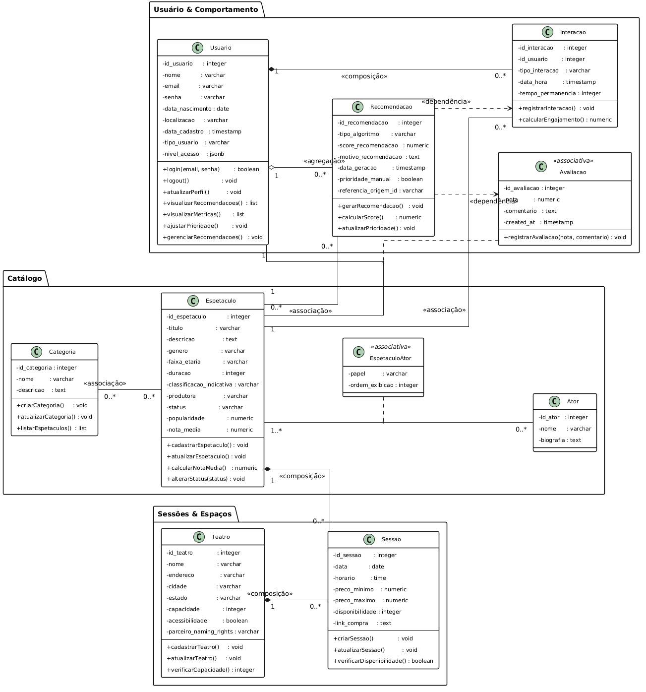

<br><br>
<sup>Fonte: Material produzido pelos autores (2026)</sup>
</div>

<br>

&nbsp;&nbsp;&nbsp;A estrutura do sistema é organizada em três pacotes principais: **Usuário & Comportamento**, **Catálogo** e **Sessões & Espaços**. O pacote de usuários concentra as classes `Usuario`, `Interacao`, `Avaliacao` e `Recomendacao`, que registram o comportamento e as preferências dos usuários na plataforma. O pacote de catálogo organiza as classes `Espetaculo`, `Categoria`, `Ator` e a classe associativa `EspetaculoAtor`, responsáveis pelo acervo cultural disponível. O pacote de sessões e espaços contém `Teatro` e `Sessao`, que operacionalizam as apresentações físicas.

---

### 5.1.2 Domínio: Usuário & Comportamento

&nbsp;&nbsp;&nbsp;Este domínio concentra as funcionalidades relacionadas ao cadastro, autenticação, comportamento e personalização da experiência dos usuários na plataforma. A classe `Usuario` representa tanto o público geral quanto usuários com permissões administrativas, eliminando a necessidade de herança para controle de papéis. As classes `Interacao`, `Avaliacao` e `Recomendacao` capturam respectivamente o comportamento implícito, o julgamento explícito e as sugestões personalizadas geradas pelo sistema.

<br>

<div align="center">
<sub>Figura XX - Domínio Usuário & Comportamento</sub>
<br><br>

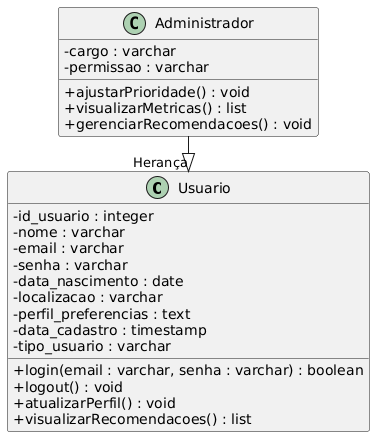

<br><br>
<sup>Fonte: Material produzido pelos autores (2026)</sup>
</div>

<br>

### Descrição das Classes

---

**Usuario**

&nbsp;&nbsp;&nbsp;Representa todos os usuários cadastrados na plataforma. O controle de papéis administrativos é feito pelos atributos `tipo_usuario` e `nivel_acesso`, eliminando o uso de herança forçada. Essa decisão de modelagem reflete melhor a realidade do banco de dados relacional e permite granularidade no controle de permissões sem criar uma hierarquia artificial de classes.

| Atributo | Tipo | Descrição |
|---|---|---|
| `id_usuario` | `integer` | Identificador único do usuário |
| `nome` | `varchar` | Nome completo do usuário |
| `email` | `varchar` | E-mail utilizado para autenticação |
| `senha` | `varchar` | Senha criptografada |
| `data_nascimento` | `date` | Data de nascimento |
| `localizacao` | `jsonb` | Localização consentida do usuário, com endereço normalizado, coordenadas e provedor |
| `data_cadastro` | `timestamp` | Data de criação da conta |
| `tipo_usuario` | `varchar` | Papel do usuário no sistema (ex: `comum`, `admin`) |
| `nivel_acesso` | `jsonb` | Permissões granulares em formato JSON |

| Método | Retorno | Descrição |
|---|---|---|
| `login(email, senha)` | `boolean` | Realiza autenticação do usuário |
| `logout()` | `void` | Encerra a sessão do usuário |
| `atualizarPerfil()` | `void` | Atualiza informações do perfil |
| `visualizarRecomendacoes()` | `list` | Exibe recomendações disponíveis |
| `visualizarMetricas()` | `list` | Exibe métricas da plataforma (restrito por `nivel_acesso`) |
| `ajustarPrioridade()` | `void` | Ajusta prioridades das recomendações (restrito por `nivel_acesso`) |
| `gerenciarRecomendacoes()` | `void` | Gerencia recomendações geradas (restrito por `nivel_acesso`) |

---

**Interacao**

&nbsp;&nbsp;&nbsp;Representa ações implícitas realizadas pelos usuários dentro da plataforma, como cliques, visualizações e tempo de permanência em um espetáculo. O atributo `id_usuario` garante rastreabilidade direta entre a interação e o usuário que a realizou, essencial para que o motor de recomendação consulte eventos de comportamento de forma independente. Os dados de interação também alimentam o MongoDB como telemetria bruta, conforme descrito na seção 5.3.2.

| Atributo | Tipo | Descrição |
|---|---|---|
| `id_interacao` | `integer` | Identificador único da interação |
| `id_usuario` | `integer` | Referência ao usuário que realizou a interação |
| `tipo_interacao` | `varchar` | Tipo de ação realizada (ex: clique, visualização) |
| `data_hora` | `timestamp` | Momento em que a interação ocorreu |
| `tempo_permanencia` | `integer` | Duração da interação em segundos |

| Método | Retorno | Descrição |
|---|---|---|
| `registrarInteracao()` | `void` | Registra o evento de interação |
| `calcularEngajamento()` | `numeric` | Calcula índice de engajamento do usuário |

---

**Avaliacao** *(classe associativa)*

&nbsp;&nbsp;&nbsp;Representa o julgamento explícito de um usuário sobre um espetáculo. É modelada como classe associativa entre `Usuario` e `Espetaculo`, pois possui atributos e comportamento próprios que vão além de uma simples tabela de junção. Um usuário pode avaliar múltiplos espetáculos (`0..*`), e um espetáculo pode receber avaliações de múltiplos usuários (`0..*`).

| Atributo | Tipo | Descrição |
|---|---|---|
| `id_avaliacao` | `integer` | Identificador único da avaliação |
| `nota` | `numeric` | Nota atribuída ao espetáculo |
| `comentario` | `text` | Comentário textual do usuário |
| `created_at` | `timestamp` | Data e hora do registro da avaliação |

| Método | Retorno | Descrição |
|---|---|---|
| `registrarAvaliacao(nota, comentario)` | `void` | Registra a avaliação do usuário para o espetáculo |

---

**Recomendacao**

&nbsp;&nbsp;&nbsp;Representa sugestões de espetáculos geradas pelo motor de ML para um usuário específico. O atributo `referencia_origem_id` permite rastrear qual interação ou avaliação deu origem a cada recomendação, garantindo explicabilidade e auditabilidade do sistema. A classe depende de `Interacao` e `Avaliacao` para compor seus dados de entrada, e é agregada ao `Usuario` que a recebe.

| Atributo | Tipo | Descrição |
|---|---|---|
| `id_recomendacao` | `integer` | Identificador único da recomendação |
| `tipo_algoritmo` | `varchar` | Algoritmo utilizado (k-NN, SVD, k-means) |
| `score_recomendacao` | `numeric` | Pontuação de relevância calculada |
| `motivo_recomendacao` | `text` | Justificativa textual da recomendação |
| `data_geracao` | `timestamp` | Data e hora de geração |
| `prioridade_manual` | `boolean` | Indica se a prioridade foi ajustada manualmente |
| `referencia_origem_id` | `varchar` | ID da interação ou avaliação que originou a recomendação |

| Método | Retorno | Descrição |
|---|---|---|
| `gerarRecomendacao()` | `void` | Aciona o motor de ML para gerar a recomendação |
| `calcularScore()` | `numeric` | Calcula o score de relevância da recomendação |
| `atualizarPrioridade()` | `void` | Atualiza a prioridade da recomendação manualmente |

---

### Relacionamentos UML — Domínio Usuário & Comportamento

| Relação | Tipo | Multiplicidade | Descrição |
|---|---|---|---|
| `Usuario → Interacao` | Composição | 1 para 0..* | Interações pertencem ao ciclo de vida do usuário |
| `Usuario → Recomendacao` | Agregação | 1 para 0..* | Usuários recebem recomendações geradas pelo sistema |
| `Usuario ↔ Espetaculo` via `Avaliacao` | Classe Associativa | 1 para 0..* (ambos) | Um usuário pode avaliar múltiplos espetáculos e vice-versa |
| `Recomendacao → Interacao` | Dependência | — | O motor usa dados de interação para gerar recomendações |
| `Recomendacao → Avaliacao` | Dependência | — | O motor usa avaliações para calibrar as recomendações |

---

### 5.1.3 Domínio: Catálogo

&nbsp;&nbsp;&nbsp;O domínio de catálogo organiza as informações relacionadas ao acervo cultural da plataforma. Neste módulo estão representados os espetáculos disponíveis, suas categorias temáticas, os atores envolvidos e o relacionamento entre elenco e peças. A separação do elenco em uma entidade própria (`Ator`) com classe associativa (`EspetaculoAtor`) permite modelar com precisão o relacionamento N:M entre espetáculos e artistas, com atributos contextuais como papel desempenhado e ordem de exibição nos créditos.

<br>

<div align="center">
<sub>Figura XX - Domínio Catálogo</sub>
<br><br>

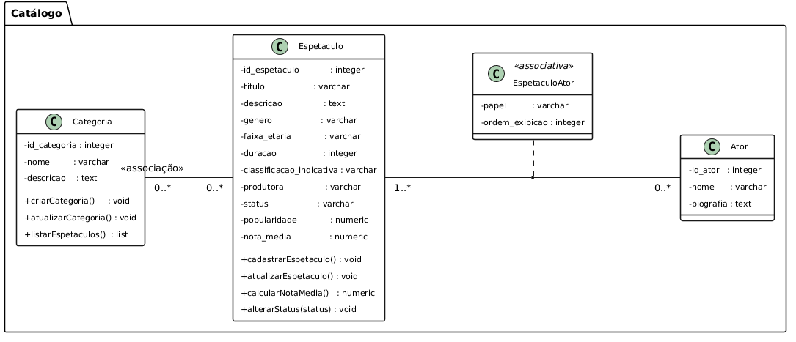

<br><br>
<sup>Fonte: Material produzido pelos autores (2026)</sup>
</div>

<br>

### Descrição das Classes

---

**Espetaculo**

&nbsp;&nbsp;&nbsp;Representa os espetáculos disponíveis na plataforma, contendo informações utilizadas tanto para exibição ao usuário quanto para alimentar o sistema de recomendação. O atributo `elenco : text` foi removido desta classe na versão atualizada do modelo, sendo substituído pelo relacionamento N:M com `Ator` via `EspetaculoAtor`, o que proporciona maior riqueza estrutural e possibilidade de consultas segmentadas por artista.

| Atributo | Tipo | Descrição |
|---|---|---|
| `id_espetaculo` | `integer` | Identificador único do espetáculo |
| `titulo` | `varchar` | Nome do espetáculo |
| `descricao` | `text` | Descrição detalhada do conteúdo |
| `genero` | `varchar` | Gênero artístico (ex: drama, musical, dança) |
| `faixa_etaria` | `varchar` | Faixa etária recomendada |
| `duracao` | `integer` | Duração em minutos |
| `classificacao_indicativa` | `varchar` | Classificação indicativa oficial |
| `produtora` | `varchar` | Produtora responsável pelo espetáculo |
| `status` | `varchar` | Situação atual (ex: em cartaz, encerrado) |
| `popularidade` | `numeric` | Indicador de popularidade baseado em interações |
| `nota_media` | `numeric` | Média das avaliações recebidas |

| Método | Retorno | Descrição |
|---|---|---|
| `cadastrarEspetaculo()` | `void` | Registra um novo espetáculo no catálogo |
| `atualizarEspetaculo()` | `void` | Atualiza informações do espetáculo |
| `calcularNotaMedia()` | `numeric` | Recalcula a média das avaliações recebidas |
| `alterarStatus(status)` | `void` | Atualiza o status de exibição do espetáculo |

---

**Categoria**

&nbsp;&nbsp;&nbsp;Representa as categorias temáticas utilizadas para classificação dos espetáculos. Um espetáculo pode pertencer a múltiplas categorias, e uma categoria pode conter múltiplos espetáculos, configurando um relacionamento N:M de associação simples.

| Atributo | Tipo | Descrição |
|---|---|---|
| `id_categoria` | `integer` | Identificador único da categoria |
| `nome` | `varchar` | Nome da categoria (ex: Teatro Adulto, Infantil) |
| `descricao` | `text` | Descrição do escopo da categoria |

| Método | Retorno | Descrição |
|---|---|---|
| `criarCategoria()` | `void` | Cria uma nova categoria no sistema |
| `atualizarCategoria()` | `void` | Atualiza informações da categoria |
| `listarEspetaculos()` | `list` | Lista todos os espetáculos associados à categoria |

---

**Ator**

&nbsp;&nbsp;&nbsp;Representa os artistas que compõem o elenco dos espetáculos. É uma entidade de domínio sem comportamento próprio, criada para substituir o atributo textual `elenco` da classe `Espetaculo`, permitindo buscas, filtros e recomendações por artista de forma estruturada.

| Atributo | Tipo | Descrição |
|---|---|---|
| `id_ator` | `integer` | Identificador único do ator |
| `nome` | `varchar` | Nome artístico ou completo |
| `biografia` | `text` | Biografia e histórico do artista |

---

**EspetaculoAtor** *(classe associativa)*

&nbsp;&nbsp;&nbsp;Representa o vínculo entre um espetáculo e um ator, modelando o relacionamento N:M com atributos contextuais. Um ator pode participar de múltiplos espetáculos em diferentes papéis, e um espetáculo pode ter múltiplos atores com diferentes funções no elenco.

| Atributo | Tipo | Descrição |
|---|---|---|
| `papel` | `varchar` | Papel ou personagem interpretado pelo ator |
| `ordem_exibicao` | `integer` | Ordem de exibição nos créditos do espetáculo |

---

### Relacionamentos UML — Domínio Catálogo

| Relação | Tipo | Multiplicidade | Descrição |
|---|---|---|---|
| `Categoria ↔ Espetaculo` | Associação | 0..* para 0..* | Categorias classificam espetáculos tematicamente |
| `Espetaculo ↔ Interacao` | Associação | 1 para 0..* | Interações estão associadas a espetáculos específicos |
| `Espetaculo ↔ Ator` via `EspetaculoAtor` | Classe Associativa | 1..* para 0..* | Um espetáculo tem um ou mais atores; atores participam de múltiplos espetáculos |

---

### 5.1.4 Domínio: Sessões & Espaços

&nbsp;&nbsp;&nbsp;O domínio de sessões e espaços organiza as apresentações físicas dos espetáculos em teatros parceiros da plataforma. Permite controlar datas, horários, disponibilidade de ingressos e links de compra. A composição forte entre `Espetaculo` e `Sessao`, e entre `Teatro` e `Sessao`, expressa que sessões não existem independentemente dessas entidades — são partes integrantes do seu ciclo de vida.

<br>

<div align="center">
<sub>Figura XX - Domínio Sessões & Espaços</sub>
<br><br>

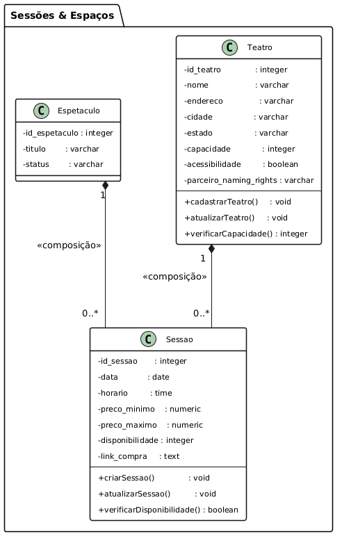

<br><br>
<sup>Fonte: Material produzido pelos autores (2026)</sup>
</div>

<br>

### Descrição das Classes

---

**Teatro**

&nbsp;&nbsp;&nbsp;Representa os teatros parceiros da plataforma TAPI, incluindo suas características físicas e informações de localização. O atributo `parceiro_naming_rights` registra eventuais vínculos comerciais de nomenclatura do espaço.

| Atributo | Tipo | Descrição |
|---|---|---|
| `id_teatro` | `integer` | Identificador único do teatro |
| `nome` | `varchar` | Nome do teatro |
| `endereco` | `varchar` | Endereço completo |
| `cidade` | `varchar` | Cidade onde está localizado |
| `estado` | `varchar` | Estado onde está localizado |
| `capacidade` | `integer` | Capacidade total de público |
| `acessibilidade` | `boolean` | Indica presença de recursos de acessibilidade |
| `parceiro_naming_rights` | `varchar` | Parceiro comercial associado ao nome do teatro |

| Método | Retorno | Descrição |
|---|---|---|
| `cadastrarTeatro()` | `void` | Registra um novo teatro parceiro |
| `atualizarTeatro()` | `void` | Atualiza informações do teatro |
| `verificarCapacidade()` | `integer` | Retorna a capacidade disponível para uma sessão |

---

**Sessao**

&nbsp;&nbsp;&nbsp;Representa uma apresentação específica de um espetáculo em um teatro, em data e horário determinados. O atributo `link_compra` conecta a plataforma a sistemas externos de venda de ingressos sem que a TAPI precise gerenciar transações diretamente.

| Atributo | Tipo | Descrição |
|---|---|---|
| `id_sessao` | `integer` | Identificador único da sessão |
| `data` | `date` | Data da apresentação |
| `horario` | `time` | Horário de início da apresentação |
| `preco_minimo` | `numeric` | Menor preço de ingresso disponível |
| `preco_maximo` | `numeric` | Maior preço de ingresso disponível |
| `disponibilidade` | `integer` | Quantidade de ingressos disponíveis |
| `link_compra` | `text` | URL para compra de ingressos em plataforma externa |

| Método | Retorno | Descrição |
|---|---|---|
| `criarSessao()` | `void` | Registra uma nova sessão de apresentação |
| `atualizarSessao()` | `void` | Atualiza informações de uma sessão existente |
| `verificarDisponibilidade()` | `boolean` | Verifica se há ingressos disponíveis |

---

### Relacionamentos UML — Domínio Sessões & Espaços

| Relação | Tipo | Multiplicidade | Descrição |
|---|---|---|---|
| `Espetaculo → Sessao` | Composição | 1 para 0..* | Um espetáculo pode ter múltiplas sessões; sessões não existem sem o espetáculo |
| `Teatro → Sessao` | Composição | 1 para 0..* | Um teatro pode sediar múltiplas sessões; sessões não existem sem o teatro |

---

### 5.1.5 Justificativa da Modelagem

&nbsp;&nbsp;&nbsp;A modelagem proposta foi estruturada para representar de forma modular os principais elementos necessários ao funcionamento da plataforma de recomendação de espetáculos. A separação em três domínios — Usuário & Comportamento, Catálogo e Sessões & Espaços — reduz acoplamento, melhora a organização arquitetural e facilita futuras evoluções do sistema.

&nbsp;&nbsp;&nbsp;Três decisões de modelagem merecem destaque por impactar diretamente a qualidade técnica da solução:

&nbsp;&nbsp;&nbsp;**Eliminação da herança para controle de papéis:** A classe `Administrador` foi removida e suas responsabilidades absorvidas pela classe `Usuario` por meio dos atributos `tipo_usuario : varchar` e `nivel_acesso : jsonb`. Herança baseada em papel é um antipadrão em modelagem de domínio: papéis mudam ao longo do tempo, e uma hierarquia de classes não reflete bem essa dinamicidade. O uso de JSONB permite granularidade de permissões sem rigidez estrutural, alinhando o modelo ao banco PostgreSQL provisionado pelo Supabase.

&nbsp;&nbsp;&nbsp;**Separação de Avaliacao e Interacao em classes distintas:** As avaliações explícitas (nota e comentário) foram separadas das interações implícitas (cliques, tempo de permanência). Essa distinção é fundamental para o motor de ML: interações alimentam o MongoDB como telemetria bruta de alta frequência, enquanto avaliações compõem o sinal de feedback qualitativo de menor volume, usado para calibrar e validar os algoritmos SVD e k-NN. Manter os dois conceitos na mesma classe comprometeria tanto a semântica do modelo quanto o desempenho do pipeline de dados.

&nbsp;&nbsp;&nbsp;**Modelagem do elenco com classe associativa:** A substituição do atributo textual `elenco : text` pelo relacionamento N:M entre `Espetaculo` e `Ator` via `EspetaculoAtor` permite que a plataforma implemente funcionalidades de busca e recomendação por artista, e que os créditos sejam exibidos com ordenação e papéis específicos. Essa decisão amplia o potencial do catálogo sem aumentar a complexidade do domínio central.

&nbsp;&nbsp;&nbsp;Essa estrutura contribui para uma arquitetura clara, escalável e alinhada aos princípios de orientação a objetos, facilitando a manutenção, o entendimento e a evolução futura da solução.

---


## 5.2 Diagrama de Componentes UML

Um diagrama de componentes é um modelo arquitetural da UML que representa os principais módulos de um sistema, suas responsabilidades e a forma como eles se comunicam entre si. Ele é importante para o Spotlight porque permite visualizar claramente a separação entre frontend, APIs, motor de recomendação, mensageria e bancos de dados, facilitando o entendimento da arquitetura, a escalabilidade e a manutenção do sistema. Além disso, o diagrama evidencia como os serviços trabalham de forma desacoplada, especialmente o uso do RabbitMQ e do ML Engine, garantindo maior desempenho, organização e evolução contínua da plataforma de recomendação inteligente do Portal Aventura.

<div align="center">

<sub>Figura X - Diagrama de componentes UML</sub><br>

  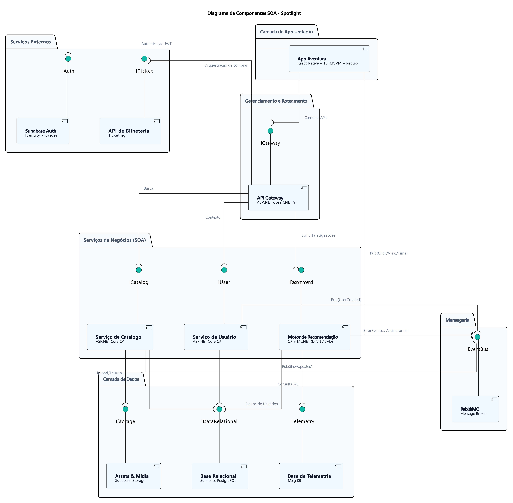<br>

  <sup>Source: Material produzido pelos autores, 2026.</sup>

</div>

### Camada de Apresentação

Contém o **Spotlight App**, responsável pela interface com o usuário final e captura de interações (telemetria).

### Serviços Externos

Engloba a infraestrutura de identidade (**Supabase Auth**), a API das Ticketeiras e a **OpenStreetMap/Nominatim API**, utilizada para apoio à geolocalização e ao cálculo de proximidade no MVP sem dependência de billing proprietário.

### API Gateway

Atua como a fronteira de segurança, roteador central e orquestrador das requisições provenientes do frontend.

### Serviços de Negócios (SOA)
Camada central de processamento contendo:

- Serviço do Usuário
- Serviço do Catálogo
- Serviço de Recomendação
- Serviço de Geolocalização

Cada domínio gerencia sua própria regra de negócio isoladamente.

### Motor de Recomendação

O **ML Engine**, componente especializado e isolado, responsável por processar os modelos matemáticos e gerar os vetores de afinidade.

### Mensageria

O **RabbitMQ**, atuando como *message broker* para o desacoplamento de eventos transacionais e comportamentais.

### Camada de Dados

Infraestrutura de persistência segregada por perfil de carga, contendo:

- **Supabase DB (PostgreSQL)** — banco relacional
- **MongoDB** — banco não relacional/documental

---

### 5.2.1 Componentes e Responsabilidades

| Componente | Função | Tecnologia |
|---|---|---|
| **Spotlight App** | Interface do usuário, onboarding de preferências e coleta contínua de telemetria. | React Native + TypeScript |
| **API Gateway** | Ponto único de entrada (BFF/Gateway), roteamento, terminação SSL e validação de autenticação JWT. | ASP.NET Core (.NET 9) |
| **Serviço de Catálogo** | Gerenciamento de domínio de espetáculos, teatros, gêneros e precificação. | ASP.NET Core Web API |
| **Serviço de Usuário** | Gestão de perfis, preferências explícitas e histórico de consumo. | ASP.NET Core Web API |
| **Serviço de Recomendação** | Orquestração do fluxo de sugestões, consultando predições pré-processadas pelo Motor de ML. | ASP.NET Core Web API |
| **Serviço de Geolocalização** | Normalização de localização, consulta de proximidade e integração com OpenStreetMap/Nominatim para apoiar recomendações contextuais. | ASP.NET Core Web API |
| **Motor de ML** | Processamento de algoritmos de filtragem colaborativa (k-NN, SVD) para geração de recomendações. | C# + ML.NET |
| **RabbitMQ** | Message Broker dedicado ao enfileiramento de eventos assíncronos de telemetria e interações. | RabbitMQ |
| **Supabase Auth** | Provedor de Identidade, responsável por autenticação e emissão de tokens JWT. | Supabase Auth |
| **OpenStreetMap/Nominatim API** | API externa para geocodificação e geocodificação reversa entre localização do usuário e endereços normalizados. | OpenStreetMap/Nominatim |
| **Supabase DB (PostgreSQL)** | Banco de dados relacional primário para perfis, catálogo e metadados transacionais. | PostgreSQL via Supabase |
| **MongoDB** | Repositório de alto volume para armazenamento de logs comportamentais e eventos de telemetria brutos. | MongoDB |

---

## 5.2.2 Infraestrutura de Dados

A arquitetura de dados segue o princípio da **persistência poliglota**, adequando a tecnologia ao padrão de leitura/escrita do domínio.

### Supabase DB (PostgreSQL)

Utilizado pelas APIs de Negócios:

- Serviço de Usuário
- Serviço de Catálogo
- Serviço de Recomendação
- ML Engine via interface SQL


### MongoDB

Utilizado para o armazenamento de telemetria.

A interface NoSQL reflete sua capacidade de ingerir dados não estruturados de:

- Cliques
- Tempo de tela
- Interações do usuário

Tudo isso sem onerar o banco relacional principal.

---

## 5.2.3 Interfaces e Protocolos de Comunicação

O diagrama estabelece portas e interfaces estritas (conectores e receptores) entre as camadas.

| Interface | Responsabilidade |
|---|---|
| **ISpotlightAPI** | Interface de consumo central exposta ao App (REST/GraphQL). |
| **IAuth** | Interface de comunicação direta com o Supabase Auth para delegação de credenciais. |
| **ITickets** | Integração de saída para APIs de terceiros (Ticketeiras). |
| **IGeocoding** | Integração de saída do Serviço de Geolocalização com OpenStreetMap/Nominatim. |
| **IUserPrefs** | Contrato interno roteado pelo Gateway para o Serviço do Usuário. |
| **ICatalog** | Contrato interno roteado pelo Gateway para o Serviço de Catálogo. |
| **IRecommendation** | Contrato interno roteado pelo Gateway para o Serviço de Recomendação. |
| **IGeolocation** | Contrato interno roteado pelo Gateway para o Serviço de Geolocalização. |
| **IEvents** | Contrato de publicação de mensagens (*Producer*) em tópicos/filas do RabbitMQ. |
| **Worker** | Interface de consumo (*Consumer*) onde o ML Engine extrai lotes de eventos do RabbitMQ continuamente e de forma desacoplada. |
| **SQL / NoSQL** | Abstrações de conexão de persistência (Npgsql/ADO.NET — SQL puro, sem ORM / MongoDB Driver). |

---

## 5.2.4 Lógica de Inteligência do Motor de ML

O **ML Engine**, construído sobre **ML.NET**, atua como o cérebro do Spotlight.

Para garantir sugestões relevantes de teatros e musicais, o sistema implementa algoritmos de recomendação baseados em **Filtragem Colaborativa Baseada em Itens (Item-based Collaborative Filtering)**.

### k-NN (k-Nearest Neighbors)

Agrupa:

- Usuários com gostos similares
- Espetáculos com perfis de público parecidos

Isso facilita o descobrimento de nichos específicos e conteúdos correlacionados.

### SVD (Singular Value Decomposition)

Utiliza fatoração de matrizes para lidar com a esparsidade dos dados, especialmente em cenários onde usuários avaliaram poucos espetáculos.

O algoritmo extrai características latentes, como:

- Preferência implícita por musicais longos
- Interesse em peças infantis interativas
- Afinidade com determinados gêneros teatrais

---

## 5.2.5 Considerações Técnicas

### API Gateway como Orquestrador

Todo o tráfego externo passa pelo Gateway, o que blinda a camada SOA contra acessos não autorizados.

Responsabilidades centrais:

- Validação de JWT emitido pelo Supabase
- Roteamento inteligente
- Centralização de autenticação
- Redução de responsabilidades dos microserviços

Isso evita validações repetitivas de token em cada serviço interno.

### Desacoplamento de Telemetria via RabbitMQ

Aplicações mobile geram grande volume de eventos e telemetria.

O uso do RabbitMQ (`IEvents → Worker`) garante:

- Resposta imediata ao frontend
- Processamento assíncrono
- Treinamento contínuo do ML Engine
- Redução de gargalos transacionais
- Maior resiliência operacional

### Separação entre Transacional e Analítico

O uso combinado de PostgreSQL e MongoDB separa claramente cargas transacionais e analíticas.

### PostgreSQL

Responsável pelos dados estruturados essenciais:

- Usuários
- Catálogo
- Preferências
- Regras de negócio

### MongoDB

Responsável pela ingestão massiva de documentos JSON flexíveis oriundos da telemetria.

Essa abordagem preserva:

- Performance
- Escalabilidade
- Estabilidade operacional do Portal Aventura

## 5.3 Justificativa das escolhas tecnológicas

Esta seção apresenta o stack tecnológico escolhido para o desenvolvimento do projeto, destacando as principais ferramentas, frameworks e serviços utilizados em cada camada da aplicação.

O foco está em justificar as escolhas técnicas com base em requisitos do projeto, como performance, manutenibilidade, escalabilidade, integração entre serviços e obrigatoriedade de determinadas tecnologias.

### 5.3.1 Autenticação, Banco de Dados e Armazenamento: Supabase

O Supabase é utilizado nos três eixos principais da infraestrutura de dados:

- **Autenticação**: Supabase Auth fornece JWT nativamente, integrado ao fluxo de login do app. O token é validado no API Gateway antes de qualquer roteamento de requisição.
- **Banco de Dados Relacional**: PostgreSQL provisionado pelo Supabase. Armazena catálogo de espetáculos, perfis de usuários.
- **Armazenamento**: Supabase Storage gerencia imagens e assets dos espetáculos, servindo as URLs diretamente ao frontend via CDN interno.

### 5.3.2 Banco de Dados Não Relacional: MongoDB

O MongoDB foi adotado como banco de dados NoSQL orientado a documentos para armazenar o alto volume de eventos de telemetria gerados pelos usuários, com foco especial no registro de cliques e tempo de tela em cada espetáculo.

Diferente dos dados transacionais armazenados no PostgreSQL, os dados comportamentais geram uma carga de escrita constante e massiva. O MongoDB foi escolhido por sua alta performance de gravação e escalabilidade horizontal, suportando picos de tráfego sem onerar o banco principal. Além disso, a flexibilidade de schema do formato JSON/BSON permite evoluir os dados capturados sem a necessidade de migrações complexas. Esses dados representam o "interesse implícito" do usuário e formam a base de ingestão bruta que alimenta e calibra os algoritmos do motor de Machine Learning.

### 5.3.3 Backend de APIs: ASP.NET Core Web API (C#, .NET 9)

A API de negócio é organizada em três serviços independentes, seguindo a arquitetura orientada a serviços (**SOA**):

| Serviço                | Responsabilidade |
|------------------------|------------------|
| **Serviço de catálogo**    | CRUD de espetáculos, metadados, gêneros e faixas de preço |
| **Serviço do usuário**       | Preferências declaradas, histórico e registro ponderado de interações |
| **Serviço de recomendação** | Recebe requisições do frontend e orquestra chamadas ao motor de ML |

O **ASP.NET Core Web API** foi escolhido por ser o framework mais maduro do ecossistema .NET para APIs RESTful, com suporte robusto a middleware de autenticação JWT, injeção de dependência nativa e compatibilidade total com .NET 9. O .NET 10 foi descartado por ainda estar em preview no período de desenvolvimento.

Um **API Gateway** centraliza o roteamento entre os três serviços, valida o JWT emitido pelo Supabase Auth e aplica rate limiting.

> **Contratos de API:** a especificação completa das rotas — método, path, finalidade, schemas de request/response por status code e exemplos de payload em JSON — está em [`src/backend/contracts/api-contracts.md`](../src/backend/contracts/api-contracts.md). Esse documento é a **fonte da verdade** para a implementação das features do backend e para a documentação Swagger.

### 5.3.4 Frontend: React Native + TypeScript

O React Native foi adotado como framework de desenvolvimento mobile por permitir base de código única para Android e iOS, reduzindo o esforço de manutenção sem abrir mão de performance nativa. 

TypeScript adiciona tipagem estática, especialmente relevante num contexto com múltiplas interfaces de serviços distintos. O padrão arquitetural **MVVM** (Model-View-ViewModel) separa a lógica de apresentação da lógica de negócio, facilitando testes unitários de ViewModels de forma isolada.

O gerenciamento de estado é feito com **Redux Toolkit** e **RTK Query**, que eliminam boilerplate e tratam o caching de requisições de forma declarativa.

### 5.3.5 Comunicação Assíncrona: RabbitMQ

A comunicação entre os serviços de negócio e o motor de recomendação é feita via fila de mensagens com **RabbitMQ**. Cada interação do usuário (clique, favorito, compra) gera um evento publicado na fila. O motor de ML consome esses eventos de forma assíncrona, atualizando os modelos incrementalmente sem bloquear a resposta ao usuário.

Essa abordagem garante desacoplamento temporal entre os serviços e suporta picos de carga sem degradação.

### 5.3.6 Motor de Recomendação: C# + ML.NET

O motor de recomendação é implementado como um serviço C# separado utilizando **ML.NET**, a biblioteca oficial da Microsoft para machine learning em .NET. Três algoritmos são empregados conforme a maturidade do perfil do usuário:

- **k-NN**: para cold start (usuários sem histórico suficiente). A similaridade é calculada sobre os gêneros declarados no onboarding e a popularidade dos espetáculos.
- **SVD**: para usuários com histórico. Fatora a matriz usuário × espetáculo e gera predições de afinidade latente.
- **k-means**: para segmentação de público. Agrupa espectadores em clusters comportamentais (ex.: Famílias, Musical Adulto, Ballet Clássico, Experimental), alimentando relatórios de marketing.

A escolha do ML.NET em vez de Python se deve à obrigatoriedade da stack C# e à capacidade de rodar os três algoritmos de forma nativa, sem dependências externas. O serviço expõe uma API interna consumida pelo serviço de recomendação via RabbitMQ.

### 5.3.7 Tabela de Stacks

| Camada              | Tecnologia                          | Justificativa principal |
|---------------------|-------------------------------------|--------------------------|
| Frontend            | React Native + TypeScript           | Multiplataforma · MVVM · Redux |
| Autenticação        | Supabase Auth                       | JWT nativo · integração direta com o app |
| Banco de dados relacional     | Supabase (PostgreSQL)               | Provisionamento local via Docker |
| Banco de Dados NoSQL          | MongoDB                             | Alta performance de gravação e schema flexível para armazenar a telemetria que alimenta o motor de ML |
| Armazenamento       | Supabase Storage                    | Assets de espetáculos via CDN |
| API Gateway         | ASP.NET Core (.NET 9)               | Roteamento · validação JWT · rate limiting |
| Serviços SOA        | ASP.NET Core Web API (C#)           | Obrigatoriedade · maturidade · DI nativa |
| Mensageria          | RabbitMQ                            | Desacoplamento assíncrono entre serviços |
| Motor de ML         | C# + ML.NET                         | Obrigatoriedade C# · k-NN, SVD, k-means nativos |

## 5.4 Diagramas de Sequência da UML
_conteúdo_

# 6. Mapeamento Técnico de Infraestrutura e Implantação
_conteúdo_

## 6.1 Diagrama de Implantação da UML
_conteúdo_

## 6.2 Justificativa das Escolhas de Implantação
_conteúdo_

## 6.3 Autenticação e Segurança

Esta seção apresenta uma análise detalhada sobre o Supabase Auth e sua integração de forma robusta e otimizada, abordando diretamente as preocupações sobre hospedagem, infraestrutura e comparação com o Auth0, serviço de autenticação anteriormente utilizado em outro projeto do Inteli.

---

### 6.3.1 Supabase Auth vs. Auth0

Abaixo está um comparativo focado em infraestrutura, custos e facilidade de deploy:

| Critério | Auth0 | Supabase Auth |
|---|---|---|
| **Limite Grátis (MAUs)** | Até 7.000 ou 10.000 usuários ativos mensais (varia conforme a política recente). | Até 50.000 usuários ativos mensais. |
| **Exigência de Domínio Pago** | Sim/Recomendado. Exige domínio customizado configurado (`auth.suaempresa.com`) para evitar bloqueio de cookies de terceiros e garantir callbacks estáveis. | Não. O Supabase fornece um subdomínio padrão gratuito (`https://xyz.supabase.co`) funcionando diretamente em produção. |
| **Uso em Mobile (React Native)** | Exige integração com WebViews ou Browser do sistema para login social e callbacks OIDC complexos. | Permite chamadas diretas via API REST ou SDK nativo sem obrigatoriedade de Browser pop-ups. |
| **Integração com Banco de Dados** | Dados residem nos servidores do Auth0. Sincronização exige Webhooks ou Actions. | Integração nativa com PostgreSQL. Usuários ficam na tabela `auth.users`. |
| **Vendor Lock-in** | Alto. Exportar hashes e credenciais é complexo. | Baixo. O banco é PostgreSQL padrão e pode ser migrado livremente. |
| **Row Level Security (RLS)** | Não possui suporte nativo. | Suporte nativo integrado ao PostgreSQL. |

---

### 6.3.2 Domínio no Supabase

No Auth0, a dependência de um domínio customizado ocorre principalmente devido a duas restrições:

#### Segurança e Cookies de Terceiros

Navegadores modernos bloqueiam cookies de sites diferentes do domínio principal do app.

Nesse cenário, os cookies podem ser tratados como cookies de terceiros e bloqueados.

#### Redirect URIs

O fluxo do Auth0 depende fortemente de redirecionamentos seguros entre domínios.

---

### 6.3.3 Por que no Supabase Auth + React Native isso não é um problema?

#### Mobile não usa cookies

Em aplicativos React Native (iOS/Android), não existe o conceito tradicional de cookies de terceiros como no navegador web.

A autenticação funciona via:

```http
Authorization: Bearer <TOKEN>
```

#### Endpoints Nativos

O SDK do Supabase no React Native realiza requisições HTTPS normais de autenticação para os endpoints REST do Supabase Auth. A URL base do serviço segue o padrão:

```text
https://<PROJECT_REF>.supabase.co/auth/v1
```

Os endpoints relevantes para o fluxo do Spotlight estão detalhados abaixo. Em chamadas públicas, o header `apikey` recebe a chave anônima do projeto (`SUPABASE_ANON_KEY`) e o header `Authorization` pode usar a mesma chave no formato `Bearer <SUPABASE_ANON_KEY>`. Em chamadas autenticadas, o header `Authorization` recebe o `access_token` do usuário no formato `Bearer <ACCESS_TOKEN>`.

| Operação | Método e endpoint | Headers principais | Body da requisição | Exemplo de resposta |
|---|---|---|---|---|
| Cadastro de usuário | `POST /signup` | `apikey: <SUPABASE_ANON_KEY>`<br>`Authorization: Bearer <SUPABASE_ANON_KEY>`<br>`Content-Type: application/json` | `{ "email": "ana@email.com", "password": "REDACTED_FOR_PUBLIC_RELEASE", "data": { "nome": "Ana" } }` | `{ "user": { "id": "uuid", "email": "ana@email.com" }, "session": { "access_token": "jwt", "refresh_token": "token" } }` |
| Login com e-mail e senha | `POST /token?grant_type=password` | `apikey: <SUPABASE_ANON_KEY>`<br>`Authorization: Bearer <SUPABASE_ANON_KEY>`<br>`Content-Type: application/json` | `{ "email": "ana@email.com", "password": "REDACTED_FOR_PUBLIC_RELEASE" }` | `{ "access_token": "jwt", "token_type": "bearer", "expires_in": 3600, "refresh_token": "token", "user": { "id": "uuid" } }` |
| Renovação de sessão | `POST /token?grant_type=refresh_token` | `apikey: <SUPABASE_ANON_KEY>`<br>`Authorization: Bearer <SUPABASE_ANON_KEY>`<br>`Content-Type: application/json` | `{ "refresh_token": "token" }` | `{ "access_token": "novo-jwt", "token_type": "bearer", "expires_in": 3600, "refresh_token": "novo-token" }` |
| Consulta do usuário autenticado | `GET /user` | `apikey: <SUPABASE_ANON_KEY>`<br>`Authorization: Bearer <ACCESS_TOKEN>` | Não possui body | `{ "id": "uuid", "email": "ana@email.com", "aud": "authenticated", "role": "authenticated" }` |
| Atualização de dados do usuário | `PUT /user` | `apikey: <SUPABASE_ANON_KEY>`<br>`Authorization: Bearer <ACCESS_TOKEN>`<br>`Content-Type: application/json` | `{ "data": { "nome": "Ana Clara" } }` | `{ "id": "uuid", "email": "ana@email.com", "user_metadata": { "nome": "Ana Clara" } }` |
| Logout | `POST /logout` | `apikey: <SUPABASE_ANON_KEY>`<br>`Authorization: Bearer <ACCESS_TOKEN>` | Não possui body | `{}` |

No backend do Spotlight, as rotas protegidas do API Gateway e dos serviços ASP.NET Core não recebem o `refresh_token`. Elas recebem apenas o JWT de acesso emitido pelo Supabase Auth:

```http
Authorization: Bearer <ACCESS_TOKEN>
```

Quando a sessão expira, o aplicativo React Native usa o `refresh_token` diretamente contra o Supabase Auth para obter um novo `access_token`, sem expor esse token de renovação aos serviços internos.

Isso funciona perfeitamente em produção, independentemente do ambiente utilizado:

- Aplicações publicadas na App Store
- Aplicações publicadas na Google Play
- Backend hospedado em VPS simples

---

#### Hospedagem Flexível

O Supabase fornece o endpoint HTTPS de forma totalmente gratuita e gerenciada na própria infraestrutura da plataforma.

Também é possível utilizar o Supabase em modo self-hosted, executando os serviços via Docker em uma VPS própria utilizando:

- IP público
- DuckDNS
- No-IP
- Outros serviços gratuitos de DNS dinâmico

Com isso, nenhum domínio próprio pago é necessário para colocar o sistema em produção.

---

### 6.3.4 Como funciona o Supabase Auth na prática?

O fluxo operacional no ecossistema do Spotlight funcionará conforme ilustrado abaixo.

<div align="center">

<sub>Figura X - Fluxo Supabase Auth</sub><br>

  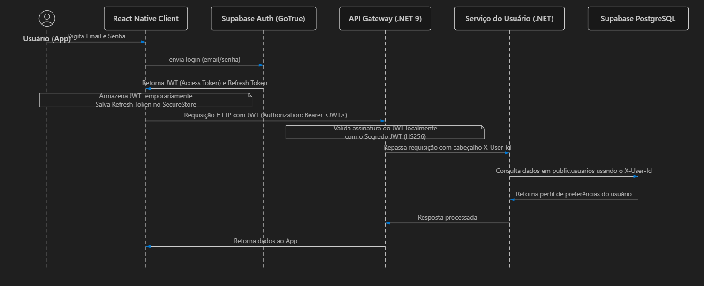<br>

  <sup>Source: Material produzido pelos autores, 2026.</sup>

</div>

---

### 6.3.5 Variáveis de Ambiente e Configuração

As variáveis de ambiente separam configuração de código-fonte e evitam que chaves sensíveis sejam versionadas no repositório. A tabela abaixo descreve quais variáveis são necessárias, onde cada uma é consumida e como configurá-las por camada.

| Variável | Camada que consome | Finalidade | Como configurar |
|---|---|---|---|
| `EXPO_PUBLIC_SUPABASE_URL` | React Native | URL pública do projeto Supabase, usada pelo SDK no app mobile. | Definir no `.env` do app Expo com o valor `https://<PROJECT_REF>.supabase.co`. |
| `EXPO_PUBLIC_SUPABASE_ANON_KEY` | React Native | Chave pública anônima usada para chamadas públicas ao Supabase Auth e para iniciar sessões. | Definir no `.env` do app Expo. Por ser pública, pode ir para o bundle mobile, mas deve ser combinada com RLS no banco. |
| `SUPABASE_URL` | API Gateway e serviços ASP.NET Core | URL do projeto Supabase para integrações server-side. | Definir como variável de ambiente do processo .NET ou em `appsettings.Development.json` apenas no ambiente local. |
| `SUPABASE_JWT_SECRET` | API Gateway ASP.NET Core | Chave usada para validar localmente a assinatura dos JWTs emitidos pelo Supabase Auth. | Definir somente no backend. Em produção, armazenar no provedor de secrets da hospedagem e nunca expor ao frontend. |
| `SUPABASE_SERVICE_ROLE_KEY` | Serviços ASP.NET Core autorizados | Chave administrativa para operações server-side que precisam ignorar RLS em rotinas internas controladas. | Definir apenas nos serviços que realmente precisam dessa permissão. Não usar no React Native. |
| `POSTGRES_CONNECTION_STRING` | Serviços ASP.NET Core e rotinas de migração | String de conexão com o PostgreSQL provisionado pelo Supabase. | Definir no formato `Host=<host>;Port=5432;Database=postgres;Username=<user>;Password=<password>;SSL Mode=Require;Trust Server Certificate=true`. |
| `POSTGRES_DB`, `POSTGRES_USER` e `POSTGRES_PASSWORD` | PostgreSQL local/self-hosted | Configuração do banco quando o Supabase é executado localmente ou via Docker. | Definir no arquivo `.env` usado pelo `docker compose` da infraestrutura local. |

Exemplo de configuração local do React Native:

```env
EXPO_PUBLIC_SUPABASE_URL=https://<PROJECT_REF>.supabase.co
EXPO_PUBLIC_SUPABASE_ANON_KEY=<supabase-anon-key>
```

Exemplo de configuração local do API Gateway em ASP.NET Core:

```env
SUPABASE_URL=https://<PROJECT_REF>.supabase.co
SUPABASE_JWT_SECRET=<supabase-jwt-secret>
SUPABASE_SERVICE_ROLE_KEY=<supabase-service-role-key>
POSTGRES_CONNECTION_STRING=Host=<host>;Port=5432;Database=postgres;Username=<user>;Password=<password>;SSL Mode=Require;Trust Server Certificate=true
```

Exemplo de configuração local do PostgreSQL em ambiente self-hosted:

```env
POSTGRES_DB=postgres
POSTGRES_USER=postgres
POSTGRES_PASSWORD=<senha-forte>
```

A configuração em produção deve seguir três regras: o frontend recebe apenas URL pública e chave anônima; o backend recebe segredos de autenticação e conexão por meio do ambiente de execução; e o PostgreSQL recebe credenciais apenas na infraestrutura, sem exposição ao aplicativo mobile.

---

### 6.3.6 Componentes Chave

#### Access Token (JWT)

Token de curta duração (geralmente 1 hora).

Contém informações codificadas e assinadas como:

- ID do usuário (`sub`)
- Email
- Permissões (`role`)

---

#### Refresh Token

Token de longa duração armazenado de forma segura no dispositivo.

Responsável por solicitar automaticamente um novo JWT sem exigir que o usuário faça login novamente.

---

#### Validação Local

O API Gateway em ASP.NET Core não precisa realizar requisições HTTP ao Supabase para verificar a validade do token.

O processo consiste apenas em:

- Decodificar o JWT
- Validar sua assinatura criptográfica utilizando a chave secreta compartilhada (`JWT Secret`)

#### Benefícios

- Validação instantânea
- Sem latência de rede
- Menor custo operacional

#### Row Level Security

O Supabase expõe funções especiais diretamente no PostgreSQL, como:

```sql
auth.uid()
```

Caso o backend realize consultas "em nome do usuário" utilizando o JWT na conexão, o próprio PostgreSQL aplica automaticamente as regras de acesso.

#### Benefícios do RLS

- O banco impede acessos indevidos automaticamente
- Segurança centralizada na camada de dados
- Redução de lógica manual no backend
- Melhor isolamento entre usuários

# 7. Projeto Visual da Solução
_conteúdo_

## 7.1 Desenvolvimento de Wireframes
_conteúdo_

## 7.2 Desenvolvimento de Mockups
_conteúdo_

## 7.3 Guia Visual
_conteúdo_

# 8. Desenvolvimento do Projeto
_conteúdo_

## 8.1 Arquitetura de Codificação e Estrutura de Diretórios

&emsp;A solução foi organizada para separar a aplicação Expo do restante do ecossistema do projeto. A raiz concentra os arquivos de configuração do app e os ativos estáticos, enquanto `src/` reúne as camadas de código-fonte. Essa divisão segue dois objetivos principais: manter o frontend em uma estrutura MVVM clara e manter o backend como uma composição SOA explícita, com contratos, serviços e integração externa separados por responsabilidade.

### Estrutura de diretórios

```text
g04/
├─ app.json
├─ babel.config.js
├─ expo-env.d.ts
├─ package.json
├─ tsconfig.json
├─ README.md
├─ assets/
├─ documentos/
│  ├─ Projeto.md
│  ├─ ProjetoVisual.md
│  ├─ GestaoProjeto.md
│  └─ Manual-instalacao.md
└─ src/
  ├─ backend/
  │  ├─ api-gateway/
  │  ├─ contracts/
  │  │  ├─ dtos/
  │  │  └─ events/
  │  ├─ services/
  │  │  ├─ catalogo/
  │  │  ├─ recomendacao/
  │  │  └─ usuario/
  │  └─ ml-engine/
  │     ├─ data-preparation/
  │     ├─ inference/
  │     └─ training/
  ├─ frontend/
  │  ├─ components/
  │  ├─ screens/
  │  ├─ viewmodels/
  │  ├─ models/
  │  ├─ repositories/
  │  ├─ theme/
  │  └─ types/
  ├─ aad/
  ├─ database/
  ├─ dataset/
  └─ models/
```

### Representação visual da arquitetura

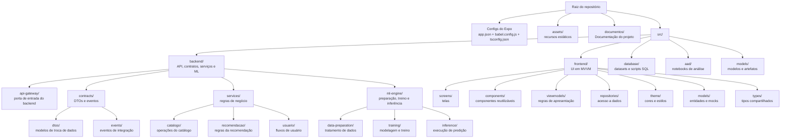

### Critérios de organização

- `assets/` guarda imagens e recursos estáticos consumidos pelo app; isso evita misturar conteúdo visual com código e facilita manutenção do pacote do Expo.
- `documentos/` reúne a documentação do artefato e das entregas do projeto; centralizar isso melhora rastreabilidade e revisão.
- `src/aad/` concentra notebooks e análises exploratórias; manter essa pasta separada impede que código de estudo se confunda com a aplicação principal.
- `src/database/` contém scripts SQL de criação e carga inicial; isso torna o banco reproduzível.
- `src/dataset/` armazena dados de apoio e amostras do projeto; separar os dados do código facilita reprocessamento e versionamento.
- `src/models/` guarda notebooks e artefatos de modelagem; isso isola experimentos de ML do restante da aplicação.
- `src/frontend/` concentra a interface e segue o padrão MVVM. `screens/` representam a visão, `viewmodels/` concentram a lógica de apresentação, `repositories/` isolam o acesso a dados, `components/` reaproveitam UI, `models/` guardam entidades e mocks de apoio, `types/` concentram contratos compartilhados e `theme/` padroniza cores, tipografia e estilos.
- `src/backend/` é organizado segundo SOA. `api-gateway/` funciona como porta de entrada das requisições, `contracts/` define os contratos compartilhados, `services/` contém a regra de negócio por domínio e `ml-engine/` isola o ciclo de dados e modelo.
- `src/backend/contracts/dtos/` define os objetos de transferência usados nas fronteiras dos serviços; `events/` registra mensagens e eventos de integração entre módulos. Essa separação evita acoplamento entre emissores e consumidores.
- `src/backend/services/catalogo/`, `recomendacao/` e `usuario/` separam responsabilidades por domínio, reduzindo acoplamento e facilitando testes e manutenção. Em cada serviço, `application/` orquestra casos de uso, `domain/` guarda entidades e value objects, `infrastructure/` implementa persistência e integrações, e `presentation/` expõe controllers ou adaptadores de entrada.
- `src/backend/services/*/application/dtos/` reúne os dados de entrada e saída dos casos de uso; isso protege o domínio de formatos externos.
- `src/backend/services/*/application/usecases/` concentra as regras de aplicação; aqui fica a coordenação das operações do domínio.
- `src/backend/services/*/domain/entities/` guarda as entidades centrais do negócio; `value-objects/` mantém valores imutáveis e validados. Essa camada é importante porque preserva as regras críticas do domínio independentemente da interface ou da persistência.
- `src/backend/services/*/infrastructure/persistence/` implementa o acesso a dados; separar isso permite trocar a tecnologia de armazenamento sem alterar o domínio.
- `src/backend/services/*/presentation/controllers/` expõe os pontos de entrada de cada serviço; essa camada adapta requisições externas para os casos de uso internos.
- `src/backend/ml-engine/data-preparation/`, `training/` e `inference/` organizam o ciclo de dados e modelo de forma independente, permitindo evoluir o motor de recomendação sem misturar preparo, treino e predição.

As pastas vazias preservadas com `.gitkeep` existem para manter essa estrutura visível no Git até que os arquivos reais sejam implementados.

### Justificativa da arquitetura

&emsp;A organização adotada favorece a evolução incremental da solução. No frontend, o MVVM facilita a separação entre interface e regra de apresentação, deixando as telas mais simples e os comportamentos reutilizáveis em ViewModels. No backend, a abordagem SOA permite expor serviços com fronteiras claras, usar contratos estáveis entre componentes e isolar o motor de recomendação em uma camada própria de ML. Isso reduz acoplamento, melhora a testabilidade e facilita a manutenção por sprint, pois cada parte do sistema pode evoluir sem exigir alterações em toda a base.

### 8.1.2 Arquitetura de Codificação — Spotlight

&emsp;Representação visual e descritiva da arquitetura de codificação da solução, evidenciando camadas, componentes principais, fluxo de dados e responsabilidades de cada parte do sistema.

<div align="center">

### Figura X – Arquitetura de Codificação do Spotlight


Fonte: Material produzido pelos autores (2026).

</div>

#### Descrição das Camadas

##### 1. Camada de Apresentação

&emsp;Contém o Spotlight App, responsável pela interface com o usuário final e pela captura contínua de interações (telemetria).

| Componente | Tecnologia | Responsabilidade |
|---|---|---|
| Spotlight App | React Native + TypeScript | Interface do usuário, onboarding de preferências, coleta de telemetria (cliques, tempo de tela, navegação) |

Regras desta camada:

- Toda comunicação com o backend passa exclusivamente pelo API Gateway via HTTPS.
- Tokens JWT armazenados de forma segura (Keychain no iOS, Keystore no Android).
- Estado local mínimo; dados persistentes vivem no backend.

##### 2. Serviços Externos

&emsp;Infraestrutura de identidade, inventário de ingressos e geolocalização, consumida pelo app, pelo Gateway e pelos serviços internos autorizados.

| Componente | Tecnologia | Responsabilidade |
|---|---|---|
| Supabase Auth | Supabase Auth | Provedor de identidade: autenticação, emissão e validação de tokens JWT, OAuth |
| API das Ticketeiras | API externa | Inventário de ingressos, emissão e validação |
| OpenStreetMap/Nominatim API | OpenStreetMap/Nominatim | Geocodificação, geocodificação reversa e normalização de localização para recomendações contextuais |

Interfaces: `IAuth` · `ITickets` · `IGeocoding`

##### 3. API Gateway

&emsp;Ponto único de entrada para todas as requisições do frontend. Nenhum serviço SOA é acessível diretamente pelo app.

| Componente | Tecnologia | Responsabilidade |
|---|---|---|
| API Gateway | ASP.NET Core (.NET 9) | BFF/Gateway: roteamento, terminação SSL, validação de JWT, rate limiting, orquestração de chamadas aos serviços SOA |

Interface exposta: `ISpotlightAPI`

Responsabilidades detalhadas:

- Valida o token emitido pelo Supabase Auth antes de rotear qualquer requisição.
- Publica eventos de telemetria de forma assíncrona no RabbitMQ via interface `IEvents`.
- Roteia para o serviço SOA correto com base no recurso solicitado.

##### 4. Serviços de Negócio (SOA)

&emsp;Cada serviço encapsula um domínio de negócio isolado. Implementados como ASP.NET Core Web APIs.

**Serviço do Usuário (`IUserPrefs`)**

- Gestão de perfis de usuário.
- Preferências explícitas selecionadas na onboarding (tags e categorias).
- Histórico de consumo (espetáculos visualizados, avaliados, favoritados).
- Persiste no Supabase DB (PostgreSQL).

**Serviço do Catálogo (`ICatalog`)**

- Domínio de espetáculos: criação, edição, publicação e remoção.
- Gestão de teatros, gêneros e precificação.
- Persiste no Supabase DB (PostgreSQL).

**Serviço de Recomendação (`IRecommendation`)**

- Orquestra o fluxo de sugestões personalizadas para o usuário.
- Consulta predições pré-processadas pelo ML Engine via interface `Worker`.
- Consulta o Serviço de Geolocalização quando a recomendação utiliza contexto geográfico.
- Persiste resultados no Supabase DB (PostgreSQL).

**Serviço de Geolocalização (`IGeolocation`)**

- Normaliza dados de localização consentidos pelo usuário.
- Consulta OpenStreetMap/Nominatim via interface `IGeocoding`.
- Retorna informações de proximidade para apoiar recomendações contextuais e geográficas.

##### 5. Infraestrutura de Processamento

**ML Engine**

| Componente | Tecnologia | Responsabilidade |
|---|---|---|
| ML Engine | C# + ML.NET | Algoritmos de filtragem colaborativa (k-NN, SVD), geração de vetores de afinidade, predições pré-processadas consumidas pelo Serviço de Recomendação |

- Lê dados estruturados do Supabase DB (PostgreSQL) via interface SQL.
- Componente isolado — não exposto diretamente ao Gateway.

**RabbitMQ**

| Componente | Tecnologia | Responsabilidade |
|---|---|---|
| RabbitMQ | RabbitMQ | Message broker para enfileiramento de eventos assíncronos de telemetria e interações comportamentais |

- Recebe eventos publicados pelo API Gateway (interface `IEvents`).
- Descarrega o banco relacional de escritas de alto volume.
- Eventos consumidos são persistidos no MongoDB.

##### 6. Camada de Dados (Persistência Poliglota)

&emsp;A arquitetura segue o princípio da persistência poliglota — tecnologia adequada ao perfil de carga de cada domínio.

| Componente | Tecnologia | Responsabilidade |
|---|---|---|
| Supabase DB | PostgreSQL via Supabase | Banco relacional principal: perfis, catálogo, recomendações, metadados transacionais |
| MongoDB | MongoDB | Repositório de alto volume: logs comportamentais brutos, telemetria, cliques, tempo de tela |

Supabase DB é utilizado por: Serviço do Usuário, Serviço do Catálogo, Serviço de Recomendação e ML Engine (leitura via SQL).

MongoDB é utilizado por: Consumer do RabbitMQ (escrita de telemetria bruta).

#### Interfaces do Sistema

| Interface | Entre | Descrição |
|---|---|---|
| `ISpotlightAPI` | App → API Gateway | Contrato REST do frontend com o backend |
| `IAuth` | App → Supabase Auth | Autenticação e emissão de JWT |
| `ITickets` | Gateway → API Ticketeiras | Consulta e emissão de ingressos |
| `IGeocoding` | Serv. Geolocalização → OpenStreetMap/Nominatim | Consulta de geocodificação e geocodificação reversa |
| `IUserPrefs` | Gateway → Serv. Usuário | Perfis e preferências |
| `ICatalog` | Gateway → Serv. Catálogo | Espetáculos e metadados |
| `IRecommendation` | Gateway → Serv. Recomendação | Sugestões personalizadas |
| `IGeolocation` | Gateway / Serv. Recomendação → Serv. Geolocalização | Contexto geográfico e proximidade |
| `Worker` | Serv. Recomendação → ML Engine | Predições e vetores de afinidade |
| `IEvents` | Gateway → RabbitMQ | Publicação assíncrona de eventos de telemetria |
| `SQL` | Serviços SOA + ML Engine → PostgreSQL | Leitura/escrita relacional |
| `NoSQL` | RabbitMQ consumer → MongoDB | Ingestão de telemetria bruta |

#### Fluxo de Dados — Exemplos

**Busca de Recomendações**

```
1. Usuário abre tela de descoberta no Spotlight App
2. App → HTTPS GET /recomendacoes → API Gateway (ISpotlightAPI)
3. Gateway valida JWT com Supabase Auth
4. Gateway → Serviço de Recomendação (IRecommendation)
5. Serviço de Recomendação → ML Engine (Worker): solicita predições
6. Quando há localização consentida, Serviço de Recomendação → Serviço de Geolocalização (IGeolocation)
7. Serviço de Geolocalização → OpenStreetMap/Nominatim (IGeocoding): normaliza localização
8. ML Engine consulta PostgreSQL (vetores de afinidade pré-calculados)
9. Serviço de Recomendação combina afinidade e contexto geográfico
10. Serviço de Recomendação retorna lista ranqueada ao Gateway → App
11. App registra interação do usuário (clique, tempo de tela)
12. Gateway publica evento no RabbitMQ (IEvents) — assíncrono
13. Consumer do RabbitMQ persiste evento no MongoDB
```

**Consulta de Geolocalização**

<div align="center">

### Figura X – Fluxo de Geolocalização com OpenStreetMap/Nominatim

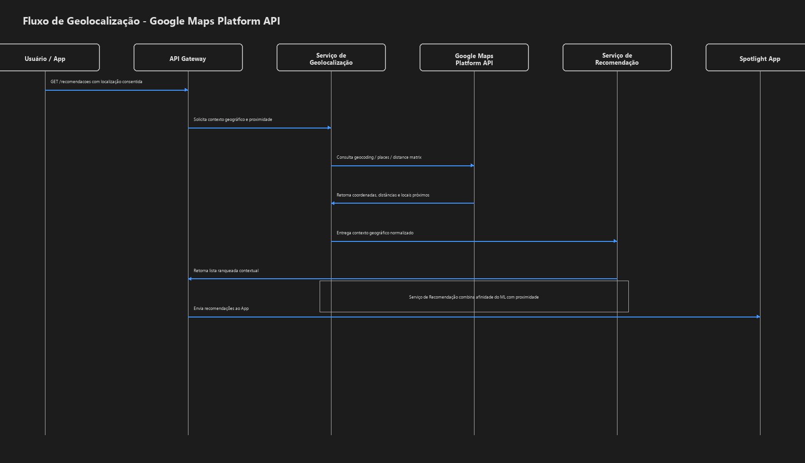

Fonte: Material produzido pelos autores (2026).

</div>

```
1. Usuário autoriza compartilhamento de localização no Spotlight App
2. App → API Gateway com requisição protegida por JWT
3. Gateway → Serviço de Geolocalização (IGeolocation)
4. Serviço de Geolocalização → OpenStreetMap/Nominatim (IGeocoding)
5. OpenStreetMap/Nominatim retorna endereço normalizado e coordenadas
6. Serviço de Geolocalização normaliza o retorno
7. Serviço de Recomendação utiliza o contexto geográfico na ordenação das sugestões
8. Gateway retorna recomendações contextuais ao App
```

**Compra de Ingresso**

```
1. Usuário seleciona sessão e clica em "Comprar"
2. App → HTTPS POST /ingressos → API Gateway
3. Gateway valida JWT → roteia para Serviço do Catálogo
4. Serviço do Catálogo consulta disponibilidade no PostgreSQL
5. Serviço do Catálogo aciona API das Ticketeiras (ITickets)
6. Confirmação → ingresso gravado no PostgreSQL
7. Gateway publica evento de compra no RabbitMQ
8. Consumer persiste log no MongoDB
9. Resposta de sucesso retorna ao App
```

#### Padrões e Decisões de Projeto

| Decisão | Escolha | Justificativa |
|---|---|---|
| Protocolo cliente–backend | REST (HTTPS) | Simplicidade, compatibilidade com React Native |
| Autenticação | JWT + Supabase Auth | Stateless, escalável, OAuth integrado |
| Geolocalização | OpenStreetMap/Nominatim | Apoia recomendações contextuais no MVP sem dependência de billing proprietário, sem alterar a lógica principal do ML |
| Controle de acesso | RBAC (usuario, admin) | Separação clara entre perfis de uso |
| Banco relacional | PostgreSQL via Supabase | Dados estruturados, integridade referencial |
| Banco de telemetria | MongoDB | Alto volume, esquema flexível, sem onerar o relacional |
| Mensageria | RabbitMQ | Desacoplamento de eventos, resiliência a picos |
| Motor de ML | ML.NET | Ecossistema .NET, integração nativa com os serviços SOA |
| Containerização | Docker + Docker Compose | Portabilidade entre ambientes dev/prod |

### 8.1.3 Composição da Tela de Catálogo no Frontend

&emsp;A tela de catálogo é o principal exemplo de composição do frontend no MVP. Ela é montada em camadas para manter a responsabilidade de cada componente bem delimitada, facilitar testes visuais e permitir evolução incremental sem acoplamento entre a renderização e os dados.

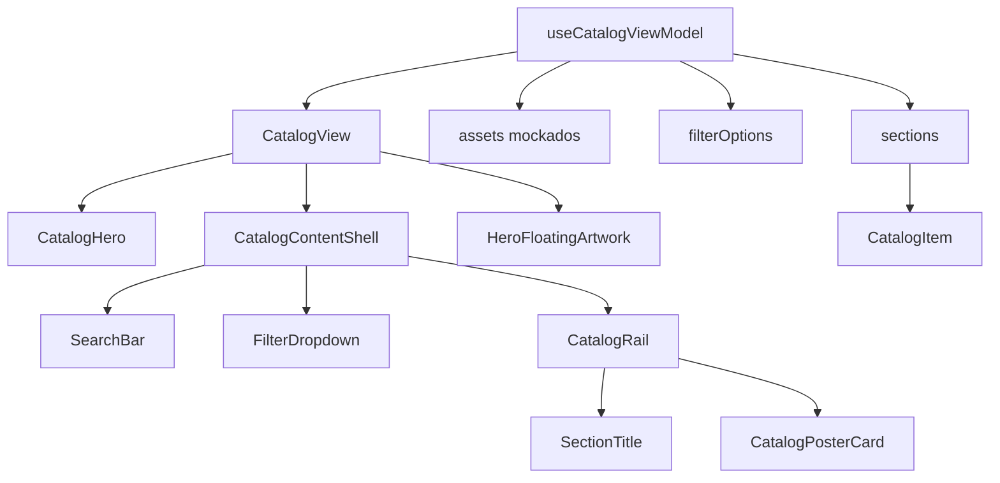

| Componente | Responsabilidade | Observação |
|---|---|---|
| `CatalogView` | Orquestra a tela e distribui os blocos visuais | Ponto de composição da página de catálogo |
| `useCatalogViewModel` | Fornece estado de tela, assets, filtros e seções | Mantém a tela desacoplada da origem dos dados |
| `CatalogHero` | Renderiza o topo do catálogo com imagem em destaque, saudação e CTA | Usa a imagem principal do espetáculo como foco visual |
| `HeroFloatingArtwork` | Exibe o elemento artístico sobreposto ao topo | Funciona como camada flutuante acima do shell |
| `CatalogContentShell` | Agrupa fundo branco, curva superior, logotipo e conteúdo | Define a área principal de leitura do catálogo |
| `SearchBar` | Entrada de busca rápida | Permite refinar o catálogo por texto |
| `FilterDropdown` | Filtro por categoria | Organiza a descoberta por tipo de espetáculo |
| `CatalogRail` | Renderiza cada seção com carrossel horizontal | Reutiliza a mesma estrutura para múltiplas trilhas |
| `SectionTitle` | Exibe o título de cada seção | Padroniza a hierarquia visual das seções |
| `CatalogPosterCard` | Exibe o card visual do espetáculo | Usa imagem, overlay e área clicável |

&emsp;Essa composição mantém a tela aderente ao padrão MVVM adotado no frontend: a View apenas orquestra componentes, o ViewModel fornece dados e a camada de apresentação mantém a lógica de exibição separada da origem das informações. Na Sprint 3, a implementação foi integrada com dados mockados, o que permitiu validar a experiência visual antes da integração definitiva com o backend.

## 8.2 Modelo de Recomendação
_conteúdo_

## 8.3 Desenvolvimento de Features
_conteúdo_

**Nota:** Insira uma explicação de entregas em cada Sprint.

## 8.3.1 Sprint 3

A Sprint 3 entregou o **esqueleto da arquitetura SOA** e as primeiras features
ponta-a-ponta do produto: o usuário consegue se cadastrar, escolher
preferências, navegar pelo catálogo, abrir os detalhes de um espetáculo,
consultar recomendações e, no painel administrativo, gerir o catálogo. O
backend foi estruturado em quatro microsserviços por trás de um API Gateway,
com contratos JSON consolidados em OpenAPI 3.0.3.

### Arquitetura entregue

- **API Gateway** (YARP, porta 5000): ponto único de entrada, configurado para
  encaminhar `/catalogo/*`, `/usuario/*`, `/recomendacao/*` e
  `/geolocalizacao/*` para os serviços de negócio.
- **Quatro serviços .NET 9 / ASP.NET Core** (portas 5001–5004), organizados em
  camadas `presentation` / `application` / `domain` / `infrastructure`.
- **PostgreSQL via Supabase**, acessado com **Npgsql (SQL puro)** — sem ORM,
  por decisão de transparência sobre o SQL executado e por aproveitar Row
  Level Security do Supabase Auth.
- **Autenticação JWT do Supabase** com três níveis (`visitante`, `cadastrado`,
  `administrador`) e checagem de permissão por rota.
- **Swagger UI** ativo em todos os serviços durante o ambiente de
  desenvolvimento; especificação consolidada em
  [`src/backend/contracts/openapi.json`](../src/backend/contracts/openapi.json)
  e descrita em
  [`src/backend/contracts/api-contracts.md`](../src/backend/contracts/api-contracts.md).
- **Health checks** em todos os serviços: `/health` (liveness) e
  `/health/ready` (readiness que testa a conexão com o Postgres).

### Features de backend

#### Serviço de Catálogo (11 rotas)

Espinha dorsal de leitura/escrita do catálogo. Implementa as operações
públicas de descoberta (espetáculos, categorias, teatros, sessões e
avaliações) e as operações de gestão restritas ao administrador.

| Método | Rota | Acesso |
|---|---|---|
| GET    | `/catalogo/espetaculos`                       | Público |
| GET    | `/catalogo/espetaculos/{id}`                  | Público |
| POST   | `/catalogo/espetaculos`                       | Administrador |
| PUT    | `/catalogo/espetaculos/{id}`                  | Administrador |
| DELETE | `/catalogo/espetaculos/{id}`                  | Administrador |
| GET    | `/catalogo/espetaculos/{id}/sessoes`          | Público |
| GET    | `/catalogo/espetaculos/{id}/avaliacoes`       | Público |
| POST   | `/catalogo/espetaculos/{id}/avaliacoes`       | Cadastrado |
| GET    | `/catalogo/categorias`                        | Público |
| GET    | `/catalogo/teatros`  · `GET /catalogo/teatros/{id}` | Público |

#### Serviço de Usuário (6 rotas)

Gestão do perfil próprio do usuário autenticado: dados básicos, preferências
declaradas (alimentadas pelo onboarding) e histórico de avaliações. Inclui a
rota de atualização de localização consentida, integrada à geolocalização.

| Método | Rota | Acesso |
|---|---|---|
| GET    | `/usuario/me`                | Cadastrado |
| PUT    | `/usuario/me`                | Cadastrado |
| PUT    | `/usuario/me/localizacao`    | Cadastrado |
| GET    | `/usuario/me/preferencias`   | Cadastrado |
| PUT    | `/usuario/me/preferencias`   | Cadastrado |
| GET    | `/usuario/me/avaliacoes`     | Cadastrado |

#### Serviço de Geolocalização (2 rotas)

Consome o **OpenStreetMap/Nominatim** para geocodificação direta e reversa.
Suporta o consentimento de localização do usuário (rota `PUT /usuario/me/localizacao`)
e habilita filtros geográficos sem dependência de billing proprietário.

| Método | Rota | Acesso |
|---|---|---|
| GET | `/geolocalizacao/geocoding`         | Público |
| GET | `/geolocalizacao/geocoding/reverse` | Público |

#### Serviço de Recomendação (2 rotas)

Lê predições pré-processadas pelo Motor de ML. A rota `/me` retorna
sugestões personalizadas do usuário autenticado (tabela `recomendacao`,
protegida por RLS), e a rota `/similares` retorna similaridade item-item
global a partir da tabela `similaridade_item` (leitura pública, populada em
batch pelo k-NN).

| Método | Rota | Acesso |
|---|---|---|
| GET | `/recomendacao/me`                                | Cadastrado |
| GET | `/recomendacao/espetaculos/{id}/similares`        | Público |

### Features de frontend (React Native)

O aplicativo foi estruturado seguindo **MVVM** (Model · View · ViewModel),
com os ViewModels expostos como hooks (`useXxxViewModel`).

| Tela | Arquivo | Estado |
|---|---|---|
| Login                          | `LoginView.tsx`                   | Integrada com `/usuario` |
| Cadastro                       | `CadastroView.tsx`                | Integrada com `/usuario` |
| Carregamento (splash)          | `CarregamentoView.tsx`            | Standalone |
| Seleção de preferências        | `PreferenceSelectionScreen.tsx`   | Integrada com `/usuario/me/preferencias` |
| Catálogo                       | `CatalogView.tsx`                 | Implementada (dados mockados) |
| Detalhes do espetáculo         | `DetalhesView.tsx`                | Integrada com `/catalogo/espetaculos/{id}` |
| Dashboard do administrador     | `AdminDashboardScreen.tsx`        | Integrada com `/catalogo` (admin) |

#### Entrega incremental da tela de catálogo

&emsp;A tela de catálogo foi implementada como uma composição de componentes reutilizáveis em React Native, organizada para manter o alinhamento com o padrão MVVM. O componente `CatalogView` atua como orquestrador da tela e consome os dados produzidos por `useCatalogViewModel`, que centraliza os assets mockados, as opções de filtro, os blocos de seções e o nome do usuário exibido no cabeçalho.

&emsp;O topo da tela é composto por `CatalogHero`, que exibe a imagem principal do espetáculo, a saudação com o perfil e o CTA de compra. Sobre ele, `HeroFloatingArtwork` mantém o elemento visual flutuante do banner. A área principal de conteúdo é encapsulada em `CatalogContentShell`, que organiza o fundo branco, a curva superior, o logotipo da marca e o restante da hierarquia da página.

&emsp;Abaixo do shell, a interface expõe `SearchBar` e `FilterDropdown` como controles de refinamento. As trilhas de conteúdo são apresentadas por `CatalogRail`, que reutiliza `SectionTitle` e `CatalogPosterCard` para cada conjunto de espetáculos. Esse arranjo reduz duplicação e facilita a expansão da tela para novas seções sem alterar a estrutura principal.

### Banco de dados

Schema relacional com **12 tabelas** (`usuario`, `espetaculo`, `categoria`,
`ator`, `teatro`, `sessao`, `avaliacao`, `recomendacao`,
`similaridade_item`, `espetaculo_categoria`, `espetaculo_ator` e
`auth.users` do Supabase). RLS habilitada em todas as tabelas com políticas
de leitura pública (catálogo) ou por dono (`auth.uid() = id_usuario`, para
`usuario` e `recomendacao`). Dataset semeado em `02_initial_data.sql` cobre
o catálogo completo do MVP, avaliações simuladas, recomendações e
similaridade item-item suficientes para validar as rotas de leitura.

### Desvios do plano (escopo migrado para a Sprint 4)

- **Integração da tela de catálogo com o backend:** o `CatalogView` já está
  roteado no `App.js` e renderiza os componentes finais, mas ainda consome
  dados do `useCatalogViewModel` em formato mockado. O consumo real das
  rotas `/catalogo/espetaculos` (com filtros e paginação) entra na Sprint 4.
- **Testes unitários por UseCase/Service:** a Sprint 3 entregou apenas
  testes de **integração do esqueleto** (`HealthEndpointsTests` em cada
  serviço, validando que sobem, respondem `/health` e tratam ausência de
  banco). A cobertura unitária dos UseCases — necessária para regressões
  finas — entra na Sprint 4.
- **Pipeline real de ML para popular `similaridade_item`:** a tabela e a
  rota `/similares` já estão funcionais lendo de seed estático; o batch
  k-NN do **Motor de ML** que repopulará a tabela em produção é entrega da
  Sprint 4.
- **Rate limiting e validação completa de JWT no Gateway:** o YARP está
  encaminhando, mas as políticas de limite por usuário e o cache de chaves
  públicas do Supabase ficam para a Sprint 4.

## 8.3.2 Sprint 4
_conteúdo_

## 8.3.3 Sprint 5
_conteúdo_

## 8.4 Testes Unitários e de Integração

&emsp;Na Sprint 4, a cobertura automatizada do backend foi ampliada com testes unitários focados nos Services/UseCases entregues na Sprint 3. A motivação principal foi proteger a lógica de negócio contra regressões sem depender de banco de dados, rede, variáveis de ambiente ou serviços externos. Essa decisão torna a execução mais rápida, reproduzível e adequada à abordagem TDD, pois cada regra pode ser validada de forma isolada antes de sua integração com infraestrutura real.

&emsp;A estratégia adotada foi isolar as dependências externas por meio de fakes locais para repositórios, contexto de usuário, `HttpMessageHandler` e cache em memória. Assim, os testes exercitam diretamente validações, normalização de parâmetros, mapeamento de DTOs, paginação, tratamento de erros e cenários de borda. Esse recorte é importante porque os UseCases concentram as regras de aplicação do backend; controllers e repositórios ficam em camadas diferentes e devem ser complementados por testes de integração.

&emsp;A suíte foi organizada por microserviço dentro de `src/backend/tests/`, mantendo um projeto de testes para cada service. O módulo de Catálogo cobre listagem, obtenção, criação, atualização e exclusão de espetáculos, avaliações, sessões, categorias e teatros, incluindo cenários positivos, negativos e de borda. O módulo de Usuário cobre perfil autenticado, preferências, histórico de avaliações e validações da atualização de localização. O módulo de Recomendação cobre normalização de limites e mapeamento de recomendações e similares. O módulo de Geolocalização cobre validação de endereço/coordenadas, uso de cache, resposta vazia, falha HTTP e conversão da resposta do Nominatim.

&emsp;Os testes usam xUnit e são executados pela solution .NET com o comando:

```bash
dotnet test src/backend/Spotlight.sln
```

&emsp;Para gerar métricas de cobertura, os projetos de teste foram configurados com `coverlet.collector`. A execução com coleta de cobertura é feita com:

```bash
dotnet test src/backend/Spotlight.sln --collect:"XPlat Code Coverage"
```

&emsp;Esse comando gera arquivos `coverage.cobertura.xml` dentro das pastas `TestResults/` de cada projeto de teste. A pasta `TestResults/` é ignorada pelo Git porque representa artefatos locais de execução, não código-fonte do produto.

&emsp;A última execução local da suíte resultou em 60 testes aprovados e 0 falhas, distribuídos entre testes unitários dos Services/UseCases e testes de health endpoints já existentes. A cobertura geral do backend ficou em 43,16% de linhas, considerando todo o assembly medido pelo Coverlet. Esse percentual inclui `Program.cs`, controllers, middlewares, autenticação, repositórios SQL, DTOs e infraestrutura. Por isso, ele é útil como indicador global, mas não deve ser lido isoladamente como medida da qualidade dos testes unitários de regra de negócio.

| Projeto de teste | Cobertura de linhas geral | Cobertura de branches geral |
|---|---:|---:|
| `Spotlight.Catalogo.Tests` | 37,97% | 19,53% |
| `Spotlight.Usuario.Tests` | 49,33% | 36,75% |
| `Spotlight.Recomendacao.Tests` | 44,51% | 29,87% |
| `Spotlight.Geolocalizacao.Tests` | 43,00% | 53,70% |
| `Spotlight.Gateway.Tests` | 76,36% | 100,00% |
| **Total ponderado por linhas** | **43,16%** | - |

&emsp;O lado positivo das métricas aparece quando a análise é feita sobre o recorte correto para testes unitários: a camada `Application.UseCases`. Nessa camada, que concentra os Services e regras de aplicação desenvolvidos na Sprint 3, a cobertura de linhas é alta em todos os serviços.

| Camada analisada | Cobertura de linhas dos UseCases |
|---|---:|
| `Catalogo.Application.UseCases` | 94,44% |
| `Usuario.Application.UseCases` | 89,71% |
| `Recomendacao.Application.UseCases` | 100,00% |
| `Geolocalizacao.Application.UseCases` | 96,25% |

&emsp;Esses resultados indicam que os testes unitários cumprem bem o objetivo definido para os Services do backend: cobrem os fluxos principais, erros esperados e limites de entrada das regras de negócio. A diferença entre a cobertura geral e a cobertura dos UseCases é esperada, pois a suíte unitária substitui repositórios e integrações por fakes; consequentemente, código de infraestrutura, autenticação, controllers e persistência não são exercitados de forma significativa por esse tipo de teste.

&emsp;Para ampliar a cobertura da estrutura completa do backend, o próximo passo é complementar essa base com testes de integração para controllers, middlewares, autenticação e repositórios conectados a um banco controlado. Dessa forma, a cobertura unitária continua protegendo a lógica de negócio, enquanto os testes de integração passam a validar as fronteiras reais da aplicação.

## 8.5 Documentações automáticas (Swagger)

O backend expõe **documentação Swagger/OpenAPI 3.0** gerada automaticamente
a partir do código (anotações `[ProducesResponseType]`, contratos de DTO e
XML comments). A UI é interativa — permite executar requisições direto do
navegador com **"Try it out"** — e cobre todas as rotas implementadas
descritas na seção 8.3.

### Framework

Swashbuckle.AspNetCore 7.2.0 em todos os projetos `.NET 9` do backend (4
serviços + gateway). Cada `Spotlight.<Servico>.csproj` tem
`<GenerateDocumentationFile>true</GenerateDocumentationFile>`, e o
`Program.cs` faz `IncludeXmlComments(...)` no `AddSwaggerGen` para enriquecer
a UI com os `<summary>` das ações e DTOs.

### Documentação unificada (recomendado)

Subindo o backend localmente (`src/backend/run-all.ps1`), a UI agregada fica em:

> **http://localhost:5000/swagger**

O dropdown "Select a definition" no canto superior direito alterna entre:

| Definição | Fonte | Rotas |
|---|---|---|
| Gateway | gateway próprio | — |
| Catálogo | proxy YARP → `/catalogo/swagger/v1/swagger.json` | 11 |
| Usuário | proxy YARP → `/usuario/swagger/v1/swagger.json` | 6 |
| Recomendação | proxy YARP → `/recomendacao/swagger/v1/swagger.json` | 2 |
| Geolocalização | proxy YARP → `/geolocalizacao/swagger/v1/swagger.json` | 2 |

Como o gateway proxia os `swagger.json` dos serviços, **não há problemas de
CORS no navegador** — todas as requisições saem da mesma origem.

### Documentação por serviço (acesso direto)

Para depuração isolada (sem passar pelo gateway), cada serviço também expõe
sua própria UI:

| Serviço | URL local |
|---|---|
| Catálogo       | http://localhost:5001/swagger |
| Usuário        | http://localhost:5002/swagger |
| Recomendação   | http://localhost:5003/swagger |
| Geolocalização | http://localhost:5004/swagger |

### Como acessar

1. Subir o backend completo: `pwsh src/backend/run-all.ps1` (ou `dotnet run`
   em cada `Spotlight.<Servico>.csproj`).
2. Abrir **http://localhost:5000/swagger** no navegador.
3. Escolher o serviço no dropdown.
4. Clicar em uma rota → **"Try it out"** → preencher parâmetros → **"Execute"**.

> Para rotas que exigem JWT (`cadastrado` ou `administrador`), clique em
> **"Authorize"** no topo da UI e cole o token no formato
> `Bearer <token-jwt>`.

### Especificação OpenAPI escrita à mão

Em paralelo à documentação auto-gerada, o repositório versiona um contrato
**fonte da verdade** consolidado em
[`src/backend/contracts/openapi.json`](../src/backend/contracts/openapi.json)
(narrativa em
[`src/backend/contracts/api-contracts.md`](../src/backend/contracts/api-contracts.md)).
Esse arquivo serve para revisão humana, geração de clientes e validação de
divergências entre o contrato negociado e o que está implementado.

# 9. Planejamento e Execução de Testes
_conteúdo_

## 9.1 Testes Funcionais

&emsp;Os testes funcionais têm como objetivo verificar se cada funcionalidade do Spotlight se comporta conforme o especificado nos Requisitos Funcionais (RF01 a RF16) descritos na seção [3.1 Requisitos Funcionais](#31-requisitos-funcionais-rfs). Diferentemente dos testes de integração — que validam fronteiras entre componentes — e dos testes de RNFs — focados em qualidades transversais como desempenho, segurança e usabilidade —, os testes funcionais validam o **comportamento de cada caso de uso** sob a perspectiva do ator que o executa: o consumidor (Ana Clara, Mariana, Ronaldo, Pedro, Carlos), o administrador (Cintia) e o próprio Sistema de Recomendação.

&emsp;O planejamento desta seção evolui o esforço iniciado em sprints anteriores. Para cada requisito, são detalhados: propósito do teste, instruções de execução, pré-condições, cenários positivos, cenários negativos, pós-condições e, ao final da seção, uma discussão sobre a abrangência da bateria.

## 9.1.1 Planejamento

#### Estratégia Geral

&emsp;A estratégia de testes funcionais combina três abordagens complementares, distribuídas conforme a natureza do RF:

| Camada | Abordagem | Ferramentas | Quando se aplica |
|---|---|---|---|
| Backend (APIs SOA) | Testes automatizados de contrato e comportamento sobre `WebApplicationFactory`, exercitando o pipeline real de middlewares, autorização e persistência | `xUnit`, `Microsoft.AspNetCore.Mvc.Testing`, `FluentAssertions`, `Bogus`, `Respawn` (reset de DB entre testes) | RFs com lógica de negócio ou regras de domínio (RF01, RF02, RF03, RF09, RF10, RF11, RF12, RF13, RF14, RF15, RF16) |
| Frontend Mobile (React Native) | Testes E2E automatizados em emuladores/dispositivos físicos cobrindo o fluxo do usuário tela a tela | `Detox` (E2E), `React Native Testing Library` (componentes), `MSW` (mock de rede para componentes) | RFs com forte componente de interface (RF04, RF05, RF06, RF07, RF08) |
| Exploratório assistido | Roteiro manual por persona, executado por 2 avaliadores independentes em planilha estruturada | Roteiro em Google Sheets, gravação de tela via `scrcpy` (Android) e `QuickTime` (iOS) | RFs com critério subjetivo: relevância de recomendação (RF12, RF14, RF15), legibilidade de detalhes (RF07) |

&emsp;A bateria completa é executada em três momentos: (i) **localmente**, antes de cada *push* pelo autor da mudança; (ii) **automaticamente**, no pipeline de CI da GitLab para todo *merge request* tocando o backend ou frontend; (iii) **manualmente**, em sessão de QA semanal antes do encerramento da sprint, focando os roteiros exploratórios.

&emsp;Cada caso de teste possui código no formato **TF-RFXX-{P\|N}YY**, em que `TF` indica Teste Funcional, `RFXX` referencia o requisito funcional, `P` ou `N` distingue cenário positivo ou negativo, e `YY` é o número sequencial dentro do cenário.

#### Ambiente e Pré-condições Comuns

&emsp;As pré-condições abaixo são compartilhadas por toda a bateria e, portanto, não são repetidas em cada caso de teste:

- Containers Docker do stack provisionados via `docker compose up -d` (PostgreSQL, MongoDB, RabbitMQ, ML Engine — ver seção [4.4.5 Implantação Local com Docker](#445-implantação-local-com-docker))
- Massa de dados seed carregada (script `dotnet run --project src/backend/seed`) garantindo: 20 espetáculos em 4+ categorias (drama, comédia, infantil, musical), 5 teatros em São Paulo, 50 sessões nos próximos 60 dias, 30 usuários sintéticos com histórico de interações
- Três usuários de teste cadastrados no Supabase Auth:
  - `usuario.comum@spotlighttest.com` — `tipo_usuario=comum`, com histórico de 10+ interações
  - `usuario.novo@spotlighttest.com` — `tipo_usuario=comum`, sem histórico (cenário cold start)
  - `admin.test@spotlighttest.com` — `tipo_usuario=admin`
- Aplicativo mobile instalado em pelo menos um dispositivo físico Android (≥ 10) e um iOS (≥ 15) ou em emuladores equivalentes
- Variáveis de ambiente `SUPABASE_URL`, `SUPABASE_ANON_KEY`, `SUPABASE_JWT_SECRET`, `POSTGRES_CONNECTION_STRING`, `MONGO_CONNECTION_STRING`, `RABBITMQ_URL` definidas no arquivo `.env.test`

#### Instruções de Execução Globais

```bash
# Backend — bateria completa de testes funcionais
dotnet test src/backend.sln --filter "Category=Functional" \
  --logger "trx;LogFileName=tf-results.trx" \
  --collect:"XPlat Code Coverage"

# Frontend — testes E2E com Detox em Android
cd src/frontend
detox build --configuration android.emu.release
detox test --configuration android.emu.release --record-logs all

# Frontend — testes E2E em iOS
detox build --configuration ios.sim.release
detox test --configuration ios.sim.release

# Geração de relatório consolidado HTML
dotnet tool run reportgenerator \
  -reports:**/tf-results.trx \
  -targetdir:./TestReports/Functional \
  -reporttypes:Html
```

---

### Grupo 1 — Autenticação e Perfil (RF01, RF02, RF03)

#### TF-RF01 — Cadastro de Usuário

**Propósito:** Verificar que o fluxo de cadastro registra corretamente um novo usuário no Supabase Auth e dispara, via trigger, a criação da linha correspondente na tabela `usuario` do PostgreSQL. Cobrir validações de campos obrigatórios, formato de email, força de senha e proteção contra cadastros duplicados.

**Pré-condições específicas:**

- Aplicativo aberto na tela "Criar conta"
- Email `novo.usuario@spotlighttest.com` NÃO previamente cadastrado
- `AsyncStorage` do app limpo (`detox.cleanup` executado antes de cada caso)

**Instruções de execução:**
```bash
dotnet test src/backend/usuario-service --filter "Category=Functional&RF=RF01"
detox test --testNamePattern "RF01"
```

**Cenários Positivos:**

| ID | Cenário | Procedimento | Resultado Esperado | Pós-condição |
|---|---|---|---|---|
| TF-RF01-P01 | Cadastro com dados válidos | Preencher nome="Ana Costa", email="novo.usuario@spotlighttest.com", senha="Senh@Forte123" e confirmação idêntica; tocar "Cadastrar" | HTTP 201 do endpoint `POST /auth/signup`; tela de definição de preferências (RF03) é exibida; toast "Cadastro realizado" aparece por 3 s | Linha inserida em `auth.users` e replicada em `public.usuario` via trigger `on_auth_user_created` |
| TF-RF01-P02 | Senha com caracteres especiais aceita | Cadastrar com senha "P@ssw0rd!#$%" | HTTP 201; redirecionamento idêntico ao P01 | Hash bcrypt persistido com custo ≥ 10 conforme RNF05 |
| TF-RF01-P03 | Mensagem de erro some após correção | Submeter com email inválido, observar erro inline; corrigir e submeter | Mensagem some assim que o campo recebe valor válido; cadastro conclui com sucesso | Estado de erro do formulário é limpo |

**Cenários Negativos:**

| ID | Cenário | Procedimento | Resultado Esperado | Pós-condição |
|---|---|---|---|---|
| TF-RF01-N01 | Email malformado | Inserir email="naoemail"; submeter | Mensagem "Email inválido" abaixo do campo; botão "Cadastrar" desabilitado; nenhuma chamada de rede emitida | Nenhum registro criado |
| TF-RF01-N02 | Senha fraca (< 8 caracteres) | Inserir senha="abc123"; submeter | Mensagem "Senha deve ter pelo menos 8 caracteres" | Nenhum registro criado |
| TF-RF01-N03 | Senhas divergentes | Senha="Senh@Forte123", confirmação="Senh@Forte124" | Mensagem "Senhas não conferem"; foco volta ao campo de confirmação | Nenhum registro criado |
| TF-RF01-N04 | Email já cadastrado | Inserir email="usuario.comum@spotlighttest.com" | HTTP 422; mensagem "Email já cadastrado" exibida | Nenhum registro criado; tentativa registrada em log |
| TF-RF01-N05 | Campo obrigatório vazio | Submeter sem informar nome | Mensagem "Nome é obrigatório"; botão "Cadastrar" desabilitado | Nenhum registro criado |

**Pós-condições gerais:** Usuário cadastrado fica imediatamente apto a realizar login (RF02). Em falha, o formulário preserva os valores válidos preenchidos para evitar retrabalho.

---

#### TF-RF02 — Login

**Propósito:** Verificar que usuários previamente cadastrados conseguem autenticar-se com email e senha, recebem um `access_token` JWT válido (com `sub` igual ao `user.id` e expiração de 3600 s) e um `refresh_token`, e que tentativas inválidas são rejeitadas sem vazar informação sobre a existência do email.

**Pré-condições específicas:**

- Aplicativo aberto na tela "Entrar"
- Usuário `usuario.comum@spotlighttest.com` cadastrado com senha "Senh@Forte123"
- Nenhuma sessão ativa em `AsyncStorage`

**Instruções de execução:**
```bash
dotnet test src/backend/usuario-service --filter "Category=Functional&RF=RF02"
detox test --testNamePattern "RF02"
```

**Cenários Positivos:**

| ID | Cenário | Procedimento | Resultado Esperado | Pós-condição |
|---|---|---|---|---|
| TF-RF02-P01 | Login com credenciais corretas | Inserir email e senha válidos; tocar "Entrar" | HTTP 200; `access_token` e `refresh_token` armazenados em `SecureStore`; navegação para Home (RF04) | Sessão registrada em `auth.sessions`; última atividade atualizada |
| TF-RF02-P02 | Manter sessão entre aberturas do app | Fazer login, fechar o app, reabrir | App restaura sessão a partir do `refresh_token`; Home exibida sem nova solicitação de credenciais | Sessão renovada silenciosamente |
| TF-RF02-P03 | Logout encerra sessão | A partir do perfil, tocar "Sair" | Token removido de `SecureStore`; app retorna à tela de login | `auth.sessions` registra logout |

**Cenários Negativos:**

| ID | Cenário | Procedimento | Resultado Esperado | Pós-condição |
|---|---|---|---|---|
| TF-RF02-N01 | Senha incorreta | Inserir email válido, senha errada | HTTP 400; mensagem genérica "Email ou senha inválidos" (sem revelar qual está errado) | Sessão não criada; tentativa registrada |
| TF-RF02-N02 | Email não cadastrado | Inserir email="inexistente@spotlighttest.com" | HTTP 400; mesma mensagem genérica do N01 (evita user enumeration) | Nenhuma sessão criada |
| TF-RF02-N03 | Campos vazios | Tocar "Entrar" sem preencher | Mensagens "Email é obrigatório" e "Senha é obrigatória"; botão desabilitado | Nenhuma chamada emitida |
| TF-RF02-N04 | Após 5 tentativas falhas seguidas | Inserir senha errada 5x em < 1 minuto | A partir da 6ª tentativa, mensagem "Muitas tentativas, aguarde 60 s" | Bloqueio temporário em cache; demais usuários não afetados |

**Pós-condições gerais:** Após login bem-sucedido, todas as próximas chamadas ao API Gateway são enviadas com o header `Authorization: Bearer <access_token>`. Sessões expiradas disparam tela de login.

---

#### TF-RF03 — Definir Preferências de Perfil

**Propósito:** Verificar que o usuário consegue declarar suas preferências (gêneros, faixa de preço, localização), que as escolhas são persistidas em `usuario_preferencia` e que essas preferências passam a influenciar as recomendações (validado indiretamente em RF04 e RF12).

**Pré-condições específicas:**

- Usuário autenticado (RF02)
- Categorias cadastradas: drama, comédia, infantil, musical
- Localização: usuário em São Paulo/SP (com permissão de geolocalização concedida ou inserida manualmente)

**Instruções de execução:**
```bash
dotnet test src/backend/usuario-service --filter "Category=Functional&RF=RF03"
detox test --testNamePattern "RF03"
```

**Cenários Positivos:**

| ID | Cenário | Procedimento | Resultado Esperado | Pós-condição |
|---|---|---|---|---|
| TF-RF03-P01 | Selecionar múltiplos gêneros | Marcar "drama" e "musical"; faixa de preço R$ 50–R$ 150; cidade "São Paulo"; salvar | HTTP 200; mensagem "Preferências salvas" | Linhas em `usuario_preferencia` para cada categoria |
| TF-RF03-P02 | Editar preferências existentes | Em "Meu perfil", alterar gêneros para "comédia" apenas; salvar | HTTP 200; tela mostra apenas "comédia" marcada na próxima visita | Linhas antigas removidas, nova inserida |
| TF-RF03-P03 | Pular definição inicial (skip) | Tocar "Pular" na tela pós-cadastro | Usuário direcionado para Home; recomendações usam fallback de popularidade (RF15) | Nenhuma preferência registrada; `onboarding_completed=true` |

**Cenários Negativos:**

| ID | Cenário | Procedimento | Resultado Esperado | Pós-condição |
|---|---|---|---|---|
| TF-RF03-N01 | Faixa de preço inválida (mínimo > máximo) | Preço mínimo R$ 200, máximo R$ 50; salvar | Mensagem "Preço mínimo deve ser menor que o máximo" | Preferências não salvas |
| TF-RF03-N02 | Tentativa de salvar sem autenticação | Forjar chamada `PUT /api/usuario/preferencias` sem JWT | HTTP 401 | Nenhuma alteração |
| TF-RF03-N03 | Categoria inexistente | Forjar chamada com `categoria_id=99999` | HTTP 400; mensagem "Categoria inválida" | Nenhuma alteração |

**Pós-condições gerais:** Após salvar, o evento `user_preferences_updated` é publicado em RabbitMQ para que o ML Engine recalcule recomendações sob demanda (RF13).

---

### Grupo 2 — Exploração e Navegação (RF04, RF05, RF06)

#### TF-RF04 — Visualizar Recomendações Personalizadas

**Propósito:** Verificar que a Home exibe ao menos 5 recomendações ordenadas por relevância, cada uma com título, categoria, data, miniatura e indicação de personalização (ex.: "baseado nas suas preferências"), e que a lista é distinta para usuários com históricos diferentes.

**Pré-condições específicas:**

- Usuário `usuario.comum@spotlighttest.com` autenticado com 10+ interações registradas
- ML Engine respondendo em `http://ml-engine:5000/api/recomendacao`

**Instruções de execução:**
```bash
dotnet test src/backend/recomendacao-service --filter "Category=Functional&RF=RF04"
detox test --testNamePattern "RF04"
```

**Cenários Positivos:**

| ID | Cenário | Procedimento | Resultado Esperado | Pós-condição |
|---|---|---|---|---|
| TF-RF04-P01 | Home exibe ≥ 5 recomendações | Acessar Home após login | Lista com 5+ cards visíveis; cada card contém título, categoria, data, preço, label "Recomendado para você" | Evento `home_view` registrado |
| TF-RF04-P02 | Personalização visível ao usuário | Acessar Home | Texto "Baseado nas suas preferências" presente em cabeçalho da seção | — |
| TF-RF04-P03 | Histórico distinto gera lista distinta | Login com 2 usuários diferentes em sequência | As listas exibidas têm interseção < 80 % | — |

**Cenários Negativos:**

| ID | Cenário | Procedimento | Resultado Esperado | Pós-condição |
|---|---|---|---|---|
| TF-RF04-N01 | ML Engine indisponível | Derrubar container `ml-engine`; acessar Home | Lista de fallback baseada em popularidade exibida (RF15); banner "Carregando recomendações personalizadas..." | Erro registrado em log; nenhuma quebra de interface |
| TF-RF04-N02 | Usuário sem preferências e sem histórico | Login com `usuario.novo@spotlighttest.com` | Lista de cold start (RF15); label "Mais populares" no lugar de "Recomendado para você" | — |
| TF-RF04-N03 | Resposta vazia do ML Engine | Forjar resposta vazia | Mensagem "Estamos preparando recomendações para você"; CTA "Explorar catálogo" | — |

**Pós-condições gerais:** O `id` de cada recomendação exibida é registrado em `recomendacao_exibida` para futura análise de CTR.

---

#### TF-RF05 — Pesquisar Espetáculos

**Propósito:** Verificar que a busca textual retorna resultados consistentes com o termo, com matching case-insensitive, suporte a termos parciais e tratamento adequado para resultados vazios.

**Pré-condições específicas:**

- Catálogo com pelo menos os espetáculos: "Hamlet", "Hamlet em Cordel", "A Megera Domada", "Cinderela — o Musical"
- Usuário autenticado

**Instruções de execução:**
```bash
dotnet test src/backend/catalogo-service --filter "Category=Functional&RF=RF05"
detox test --testNamePattern "RF05"
```

**Cenários Positivos:**

| ID | Cenário | Procedimento | Resultado Esperado | Pós-condição |
|---|---|---|---|---|
| TF-RF05-P01 | Busca exata | Digitar "Hamlet"; aguardar | Lista exibe "Hamlet" e "Hamlet em Cordel" ordenados por relevância | Evento `search_executed` com `query=Hamlet` |
| TF-RF05-P02 | Busca case-insensitive | Digitar "hamlet" | Mesmo resultado de P01 | — |
| TF-RF05-P03 | Busca parcial | Digitar "Cind" | "Cinderela — o Musical" exibida | — |
| TF-RF05-P04 | Debounce reduz chamadas | Digitar "Hamlet" letra a letra rapidamente | Apenas 1 chamada de rede emitida após 300 ms de inatividade | — |

**Cenários Negativos:**

| ID | Cenário | Procedimento | Resultado Esperado | Pós-condição |
|---|---|---|---|---|
| TF-RF05-N01 | Termo sem resultados | Digitar "xyz123" | Mensagem "Nenhum resultado encontrado para 'xyz123'"; CTA "Limpar busca" | — |
| TF-RF05-N02 | Termo vazio | Limpar campo de busca | Lista volta ao estado inicial (catálogo sem filtro) | — |
| TF-RF05-N03 | SQL injection no termo | Digitar `' OR 1=1 --` | Busca textual segura; nenhum resultado anômalo; nenhum erro 500 | Nenhuma exposição de schema |

**Pós-condições gerais:** Cada busca é registrada em telemetria (RF11) para análise futura de termos mais buscados.

---

#### TF-RF06 — Filtrar Espetáculos

**Propósito:** Verificar que filtros por categoria, data e faixa de preço atualizam corretamente a lista exibida, podem ser combinados e podem ser limpos individual ou totalmente.

**Pré-condições específicas:**

- Lista de espetáculos carregada
- Pelo menos 3 categorias com 5+ espetáculos cada
- Espetáculos com datas distribuídas em janelas de "Hoje", "Esta semana", "Este mês"

**Instruções de execução:**
```bash
dotnet test src/backend/catalogo-service --filter "Category=Functional&RF=RF06"
detox test --testNamePattern "RF06"
```

**Cenários Positivos:**

| ID | Cenário | Procedimento | Resultado Esperado | Pós-condição |
|---|---|---|---|---|
| TF-RF06-P01 | Filtro por categoria | Selecionar categoria "drama"; aplicar | Lista exibe apenas espetáculos com `categoria_id=drama` | URL/estado contém `?categoria=drama` |
| TF-RF06-P02 | Filtros combinados | "drama" + "Esta semana" + R$ 50–R$ 200; aplicar | Lista exibe apenas espetáculos que satisfazem as 3 condições simultaneamente | — |
| TF-RF06-P03 | Limpar filtros | Tocar "Limpar tudo" | Lista volta ao estado sem filtro; chips de filtros desaparecem | — |

**Cenários Negativos:**

| ID | Cenário | Procedimento | Resultado Esperado | Pós-condição |
|---|---|---|---|---|
| TF-RF06-N01 | Combinação sem resultados | Categoria "infantil" + preço R$ 0–R$ 5 | Mensagem "Nenhum espetáculo encontrado com esses filtros"; CTA "Limpar filtros" | — |
| TF-RF06-N02 | Faixa de preço inválida | Mínimo > máximo na UI | Slider impede inversão; valores trocam automaticamente | — |
| TF-RF06-N03 | Data passada selecionada | Selecionar data anterior a hoje | Date picker bloqueia datas no passado | — |

**Pós-condições gerais:** Filtros aplicados persistem ao navegar para detalhes e voltar (RF07). Eventos de filtro são telemetrados (RF11).

---

### Grupo 3 — Conteúdo (RF07, RF08)

#### TF-RF07 — Visualizar Detalhes do Espetáculo

**Propósito:** Verificar que a tela de detalhes apresenta informações completas e corretas do espetáculo (descrição, categoria, data, horário, preço, local, elenco) e que dados ausentes são tratados sem quebrar a interface.

**Pré-condições específicas:**

- Espetáculo "Hamlet" cadastrado com todos os campos preenchidos
- Espetáculo "Em Cartaz" cadastrado com `descricao=NULL` (campo opcional)

**Instruções de execução:**
```bash
dotnet test src/backend/catalogo-service --filter "Category=Functional&RF=RF07"
detox test --testNamePattern "RF07"
```

**Cenários Positivos:**

| ID | Cenário | Procedimento | Resultado Esperado | Pós-condição |
|---|---|---|---|---|
| TF-RF07-P01 | Detalhes completos | Tocar card "Hamlet" na Home | Tela exibe título, sinopse, categoria, próxima sessão, faixa de preço, teatro, mapa, elenco e CTA "Comprar" (coberto em IT-06 — testes de integração) | Evento `detail_view` registrado para o espetáculo |
| TF-RF07-P02 | Múltiplas sessões | Espetáculo com 3 sessões agendadas | Carrossel de sessões exibe todas com data/horário/disponibilidade | — |
| TF-RF07-P03 | Compartilhamento | Tocar ícone de compartilhar | Sheet nativa do SO abre com link `spotlight://espetaculo/<id>` | — |

**Cenários Negativos:**

| ID | Cenário | Procedimento | Resultado Esperado | Pós-condição |
|---|---|---|---|---|
| TF-RF07-N01 | Descrição ausente | Tocar card "Em Cartaz" | Tela carrega; bloco "Sinopse" é omitido sem quebrar layout | — |
| TF-RF07-N02 | Espetáculo inexistente | Acessar deep link `spotlight://espetaculo/00000000-0000-0000-0000-000000000000` | Tela "Espetáculo não encontrado" com CTA "Voltar à Home" | — |
| TF-RF07-N03 | Sem sessões futuras | Espetáculo com todas as sessões no passado | Bloco "Sessões" exibe mensagem "Sem sessões agendadas" e CTA "Avisar quando voltar" | — |

**Pós-condições gerais:** Toda visualização de detalhe é registrada em telemetria (RF11) e influencia recomendações futuras (RF13).

---

#### TF-RF08 — Visualizar Avaliações de Outros Usuários

**Propósito:** Verificar que avaliações cadastradas para o espetáculo aparecem com nota, comentário, autor (com privacidade respeitada) e data, e que a média é calculada corretamente.

**Pré-condições específicas:**

- Espetáculo "Hamlet" com 5 avaliações de notas distintas (1, 3, 4, 5, 5)
- Espetáculo "Estreia" sem avaliações

**Instruções de execução:**
```bash
dotnet test src/backend/catalogo-service --filter "Category=Functional&RF=RF08"
detox test --testNamePattern "RF08"
```

**Cenários Positivos:**

| ID | Cenário | Procedimento | Resultado Esperado | Pós-condição |
|---|---|---|---|---|
| TF-RF08-P01 | Lista de avaliações | Acessar detalhes de "Hamlet"; rolar até "Avaliações" | 5 avaliações exibidas com nota (estrelas), nome do autor (primeiro nome + inicial do sobrenome), data e comentário; média 3,6 ★ visível | — |
| TF-RF08-P02 | Ordenação por data | Padrão é mais recente primeiro | Avaliações ordenadas por `data_avaliacao DESC` | — |
| TF-RF08-P03 | Paginação | Espetáculo com 30 avaliações | Primeiras 10 exibidas; CTA "Ver mais" carrega próximas 10 | — |

**Cenários Negativos:**

| ID | Cenário | Procedimento | Resultado Esperado | Pós-condição |
|---|---|---|---|---|
| TF-RF08-N01 | Espetáculo sem avaliações | Acessar detalhes de "Estreia" | Mensagem "Seja o primeiro a avaliar"; CTA leva a RF09 | — |
| TF-RF08-N02 | Avaliação reportada/moderada | Avaliação com `status=moderada` | Não aparece na lista; média recalculada sem ela | — |
| TF-RF08-N03 | Privacidade do autor | Avaliação de usuário com `perfil_publico=false` | Autor exibido como "Anônimo" | — |

**Pós-condições gerais:** Acesso à seção de avaliações é telemetrado (RF11).

---

### Grupo 4 — Engajamento (RF09, RF10)

#### TF-RF09 — Avaliar Espetáculo

**Propósito:** Verificar que usuários autenticados conseguem submeter uma nota (1 a 5 estrelas), que apenas uma avaliação por usuário por espetáculo é permitida (com edição posterior), e que a média do espetáculo atualiza imediatamente.

**Pré-condições específicas:**

- Usuário autenticado
- Espetáculo "Hamlet" disponível
- Usuário ainda NÃO avaliou "Hamlet"

**Instruções de execução:**
```bash
dotnet test src/backend/usuario-service --filter "Category=Functional&RF=RF09"
detox test --testNamePattern "RF09"
```

**Cenários Positivos:**

| ID | Cenário | Procedimento | Resultado Esperado | Pós-condição |
|---|---|---|---|---|
| TF-RF09-P01 | Submeter nota | Em detalhes de "Hamlet", tocar 4 estrelas; confirmar | HTTP 201; toast "Avaliação registrada"; estrelas exibidas como "Sua avaliação: 4 ★" | Linha em `avaliacao` com `usuario_id`, `espetaculo_id`, `nota=4` |
| TF-RF09-P02 | Editar avaliação | Após P01, voltar e alterar para 5 estrelas | HTTP 200; "Sua avaliação: 5 ★"; média recalculada | Linha atualizada (não duplicada) |
| TF-RF09-P03 | Avaliação atualiza média na hora | Submeter nota e verificar média | Média do espetáculo recalculada e exibida em ≤ 2 s | Evento `rating_submitted` publicado em RabbitMQ |

**Cenários Negativos:**

| ID | Cenário | Procedimento | Resultado Esperado | Pós-condição |
|---|---|---|---|---|
| TF-RF09-N01 | Nota fora do intervalo | Forjar chamada `POST /api/avaliacao` com `nota=6` | HTTP 400; mensagem "Nota deve estar entre 1 e 5" | Nenhuma alteração |
| TF-RF09-N02 | Sem autenticação | Forjar chamada sem JWT | HTTP 401 | Nenhuma alteração |
| TF-RF09-N03 | Espetáculo inexistente | `espetaculo_id` inválido | HTTP 404 | — |

**Pós-condições gerais:** Avaliação é considerada sinal forte para o ML Engine recalcular recomendações (RF13).

---

#### TF-RF10 — Comentar Espetáculo

**Propósito:** Verificar que comentários são submetidos com sucesso, que conteúdo malicioso (XSS, HTML) é sanitizado, que tamanho máximo é respeitado e que o comentário aparece imediatamente na lista de avaliações (RF08).

**Pré-condições específicas:**

- Usuário autenticado
- Espetáculo "Hamlet" com tela de avaliações aberta

**Instruções de execução:**
```bash
dotnet test src/backend/usuario-service --filter "Category=Functional&RF=RF10"
detox test --testNamePattern "RF10"
```

**Cenários Positivos:**

| ID | Cenário | Procedimento | Resultado Esperado | Pós-condição |
|---|---|---|---|---|
| TF-RF10-P01 | Comentário simples | Digitar "Excelente atuação do elenco!" e enviar | HTTP 201; comentário aparece no topo da lista | Linha em `avaliacao` com `comentario` preenchido |
| TF-RF10-P02 | Comentário acompanha nota | P01 combinado com TF-RF09-P01 | Comentário e nota persistidos na mesma linha | — |
| TF-RF10-P03 | Editar próprio comentário | Tocar "Editar" em comentário próprio; alterar texto | HTTP 200; texto atualizado; selo "Editado" exibido | — |

**Cenários Negativos:**

| ID | Cenário | Procedimento | Resultado Esperado | Pós-condição |
|---|---|---|---|---|
| TF-RF10-N01 | Comentário vazio | Tocar enviar com campo vazio | Botão "Enviar" desabilitado | — |
| TF-RF10-N02 | Comentário excede 500 caracteres | Digitar 501 caracteres | Contador fica vermelho; envio bloqueado | — |
| TF-RF10-N03 | Tentativa de XSS | Digitar `<script>alert(1)</script>` | Comentário salvo, mas renderizado como texto literal; alert não dispara | Sanitização aplicada no backend |
| TF-RF10-N04 | Excluir comentário de outro usuário | Forjar chamada `DELETE /api/avaliacao/<id>` de outro usuário | HTTP 403 | Nenhuma alteração |

**Pós-condições gerais:** Comentários ficam imediatamente visíveis em RF08 e contam para o motor de recomendação como sinal de engajamento.

---

### Grupo 5 — Coleta de Dados (RF11)

#### TF-RF11 — Registrar Interações do Usuário

**Propósito:** Verificar que toda interação significativa (clique em card, busca, visualização de detalhe, avaliação, scroll prolongado) gera um documento na coleção `interacoes` do MongoDB com `usuario_id`, `espetaculo_id` (quando aplicável), `tipo_acao`, `timestamp` e contexto. Confirmar que o registro acontece de forma assíncrona, sem impactar a UX.

**Pré-condições específicas:**

- Usuário autenticado
- MongoDB acessível em `mongodb://localhost:27017`
- RabbitMQ funcional para envio assíncrono
- Coleção `interacoes` vazia ou com snapshot conhecido

**Instruções de execução:**
```bash
dotnet test src/backend/telemetria-service --filter "Category=Functional&RF=RF11"
detox test --testNamePattern "RF11"
# Conferência manual
mongosh "mongodb://localhost:27017/spotlight" --eval "db.interacoes.find().sort({timestamp:-1}).limit(20)"
```

**Cenários Positivos:**

| ID | Cenário | Procedimento | Resultado Esperado | Pós-condição |
|---|---|---|---|---|
| TF-RF11-P01 | Clique em card é registrado | Tocar um card de espetáculo na Home | Documento `{tipo_acao:'click_card', espetaculo_id, usuario_id, timestamp, contexto:'home'}` aparece em ≤ 1 s | — |
| TF-RF11-P02 | Busca é registrada | Executar busca por "Hamlet" | Documento `{tipo_acao:'search', query:'Hamlet', resultados:N}` | — |
| TF-RF11-P03 | Visualização de detalhe é registrada | Acessar detalhes de espetáculo | Documento `{tipo_acao:'view_detail', espetaculo_id, dwell_time_ms}` | — |
| TF-RF11-P04 | Avaliação é registrada como evento | Submeter avaliação | Além da linha em `avaliacao`, documento `{tipo_acao:'rate', nota:4}` em MongoDB | — |
| TF-RF11-P05 | Registro não bloqueia UX | Tocar card e observar tempo até abrir detalhes | Tempo de abertura idêntico ao de cenário sem telemetria (variação ≤ 50 ms) | RNF02 preservado |

**Cenários Negativos:**

| ID | Cenário | Procedimento | Resultado Esperado | Pós-condição |
|---|---|---|---|---|
| TF-RF11-N01 | MongoDB indisponível | Derrubar container MongoDB; gerar interação | Evento empilha em RabbitMQ; UX permanece fluida; processamento retoma após MongoDB voltar | Nenhum evento perdido (DLQ ativa) |
| TF-RF11-N02 | Usuário sem sessão | Forjar evento sem JWT | Evento descartado em camada de coleta; HTTP 401 | Nenhum documento inserido |
| TF-RF11-N03 | Volume burst (1 000 cliques/s) | Simular com `k6` | Sistema processa sem perda; backpressure ativa | Métricas confirmam ≥ 100 eventos/s (RNF09) |

**Pós-condições gerais:** Documentos persistidos alimentam a base de dados comportamental que o ML Engine usa para recomputar recomendações (RF13, RF14).

---

### Grupo 6 — Recomendação (RF12, RF13, RF14, RF15)

#### TF-RF12 — Gerar Recomendações Personalizadas

**Propósito:** Verificar que, dado um usuário com preferências e histórico, o ML Engine retorna uma lista ranqueada de espetáculos coerente com o perfil declarado, em ≤ 2 s (RNF02).

**Pré-condições específicas:**

- `usuario.comum@spotlighttest.com` com preferência por "drama" e histórico de 5+ interações com peças de drama
- ML Engine carregado com modelo treinado
- Catálogo com 15+ espetáculos em "drama" e 5+ em "comédia"

**Instruções de execução:**
```bash
dotnet test src/backend/recomendacao-service --filter "Category=Functional&RF=RF12"
# Validação subjetiva via roteiro exploratório
```

**Cenários Positivos:**

| ID | Cenário | Procedimento | Resultado Esperado | Pós-condição |
|---|---|---|---|---|
| TF-RF12-P01 | Lista ranqueada | `GET /api/recomendacao` para usuário | HTTP 200; lista com ≥ 5 itens; primeiros 3 são de "drama" | Tempo de resposta ≤ 2 s |
| TF-RF12-P02 | Coerência com preferência | Usuário declara "infantil"; gerar recomendação | Lista predominantemente "infantil" (≥ 60 %) | — |
| TF-RF12-P03 | Diversidade mínima | Lista de 10 itens | Pelo menos 2 categorias distintas representadas | Evita filter bubble |

**Cenários Negativos:**

| ID | Cenário | Procedimento | Resultado Esperado | Pós-condição |
|---|---|---|---|---|
| TF-RF12-N01 | Catálogo insuficiente | Catálogo com apenas 3 espetáculos | Lista contém todos os 3 + mensagem "Voltaremos com mais" | — |
| TF-RF12-N02 | Modelo de ML não carregado | Reiniciar ML Engine sem modelo | Fallback para popularidade (RF15); log de degradação registrado | Banner discreto "Recomendações em manutenção" |
| TF-RF12-N03 | Timeout do ML Engine | Forçar latência > 5 s | API Gateway responde com fallback de popularidade após 3 s | RNF02 não violado para o usuário final |

**Pós-condições gerais:** Itens recomendados são gravados em `recomendacao_exibida` para fechar o ciclo de feedback.

---

#### TF-RF13 — Atualizar Recomendações Após Novas Interações

**Propósito:** Verificar que, após o usuário realizar novas interações relevantes (clique, avaliação, visualização longa), a próxima chamada de recomendação reflete essas mudanças.

**Pré-condições específicas:**

- Usuário com histórico inicial conhecido
- Snapshot da lista de recomendações atual armazenado (`L0`)

**Instruções de execução:**
```bash
dotnet test src/backend/recomendacao-service --filter "Category=Functional&RF=RF13"
```

**Cenários Positivos:**

| ID | Cenário | Procedimento | Resultado Esperado | Pós-condição |
|---|---|---|---|---|
| TF-RF13-P01 | Avaliação positiva ajusta lista | Avaliar com 5 ★ um espetáculo de "musical" (categoria pouco presente em `L0`); requisitar recomendação | Nova lista `L1` contém ≥ 2 espetáculos de "musical" a mais que `L0` | — |
| TF-RF13-P02 | Comportamento de longo prazo prevalece | Após P01, voltar a interagir com "drama" por 5 ciclos | Lista volta a priorizar "drama" sem ignorar o sinal recente de "musical" | — |
| TF-RF13-P03 | Atualização propaga em ≤ 1 min | Avaliar e requisitar recomendação após 60 s | Mudança refletida | Evento processado via RabbitMQ |

**Cenários Negativos:**

| ID | Cenário | Procedimento | Resultado Esperado | Pós-condição |
|---|---|---|---|---|
| TF-RF13-N01 | Interação irrelevante não distorce | Apenas scroll sem clique | `L1 ≈ L0` (Jaccard ≥ 0,8) | — |
| TF-RF13-N02 | Avaliação 1★ reduz exposição | Avaliar com 1★ um espetáculo presente em `L0` | Item removido da próxima `L1` | — |
| TF-RF13-N03 | Falha de fila RabbitMQ | Derrubar fila; interagir | Evento bufferizado; após restabelecimento, recomendação se atualiza | Nenhum evento perdido |

**Pós-condições gerais:** Recomputo é assíncrono e não impacta a latência da requisição original.

---

#### TF-RF14 — Recomendação por Filtragem Colaborativa

**Propósito:** Verificar que, para um usuário com perfil similar a outros usuários (medido por interações em comum), o sistema sugere itens que esses usuários similares avaliaram positivamente mas que o usuário-alvo ainda não consumiu (item-based / user-based CF).

**Pré-condições específicas:**

- Pelo menos 10 usuários no banco com matriz de interações que produza pelo menos 3 vizinhos com similaridade ≥ 0,6 com o usuário-alvo
- Modelo k-NN treinado

**Instruções de execução:**
```bash
dotnet test src/backend/recomendacao-service --filter "Category=Functional&RF=RF14"
```

**Cenários Positivos:**

| ID | Cenário | Procedimento | Resultado Esperado | Pós-condição |
|---|---|---|---|---|
| TF-RF14-P01 | Recomendação vinda de vizinhos | Solicitar recomendação para usuário-alvo | Lista contém ≥ 2 itens consumidos por vizinhos (similaridade ≥ 0,6) e não pelo usuário-alvo | Trace do ML Engine confirma origem CF |
| TF-RF14-P02 | Diversidade entre vizinhos | Solicitar recomendação para o usuário-alvo e inspecionar o trace do ML Engine para identificar os vizinhos de origem de cada item retornado | Itens vêm de ≥ 2 vizinhos distintos | Evita over-fit a um vizinho único |

**Cenários Negativos:**

| ID | Cenário | Procedimento | Resultado Esperado | Pós-condição |
|---|---|---|---|---|
| TF-RF14-N01 | Sem vizinhos suficientes | Usuário com perfil único | Fallback para conteúdo + popularidade (RF15) | Sem erro ao usuário |
| TF-RF14-N02 | Item já consumido pelo alvo | Verificar que itens com interação prévia do alvo não aparecem | Lista não contém itens já em `interacoes` do usuário | — |

**Pós-condições gerais:** Justificativa "Quem gostou disso também gostou de..." pode ser exibida (a critério da UX).

---

#### TF-RF15 — Recomendar Conteúdos Populares (Cold Start)

**Propósito:** Verificar que usuários novos ou com baixo histórico recebem recomendações baseadas em popularidade (espetáculos mais vistos, mais avaliados ou em alta nos últimos 7 dias).

**Pré-condições específicas:**

- `usuario.novo@spotlighttest.com` sem histórico
- Catálogo com métricas de popularidade calculadas (job batch executado)

**Instruções de execução:**
```bash
dotnet test src/backend/recomendacao-service --filter "Category=Functional&RF=RF15"
```

**Cenários Positivos:**

| ID | Cenário | Procedimento | Resultado Esperado | Pós-condição |
|---|---|---|---|---|
| TF-RF15-P01 | Cold start usa popularidade | Login com usuário novo; acessar Home | Lista exibida ordenada por `popularidade_score DESC` | Label "Mais populares" visível |
| TF-RF15-P02 | Preferência declarada filtra | Usuário novo declara "infantil" antes do primeiro uso | Lista de cold start filtrada por "infantil" | — |
| TF-RF15-P03 | Atualização semanal | Verificar refresh do ranking | Métrica calculada com janela móvel de 7 dias | — |

**Cenários Negativos:**

| ID | Cenário | Procedimento | Resultado Esperado | Pós-condição |
|---|---|---|---|---|
| TF-RF15-N01 | Catálogo vazio | Limpar catálogo | Mensagem "Em breve, novos espetáculos"; nenhuma quebra | — |
| TF-RF15-N02 | Job de popularidade não executado | Métricas com `updated_at` > 24 h | Fallback para `data_estreia DESC`; alerta gerado para SRE | — |

**Pós-condições gerais:** Assim que o usuário acumular ≥ 3 interações, a lógica passa para RF12 (personalizada) automaticamente.

---

### Grupo 7 — Administração (RF16)

#### TF-RF16 — Gerenciar Conteúdos da Plataforma

**Propósito:** Verificar que administradores conseguem criar, editar e remover espetáculos, categorias e moderar avaliações, e que apenas usuários com `tipo_usuario=admin` têm acesso a essas operações.

**Pré-condições específicas:**

- `admin.test@spotlighttest.com` autenticado com `tipo_usuario=admin`
- `usuario.comum@spotlighttest.com` autenticado como controle negativo
- Painel administrativo (web) acessível em `https://admin.spotlight.local`

**Instruções de execução:**
```bash
dotnet test src/backend/admin-service --filter "Category=Functional&RF=RF16"
# Painel web — testes E2E
cd src/admin-web && npx playwright test --grep "RF16"
```

**Cenários Positivos:**

| ID | Cenário | Procedimento | Resultado Esperado | Pós-condição |
|---|---|---|---|---|
| TF-RF16-P01 | Criar espetáculo | Painel → "Novo espetáculo"; preencher campos obrigatórios; salvar | HTTP 201; espetáculo aparece no catálogo do app mobile em ≤ 30 s | Linha em `espetaculo`; evento `catalog_updated` em RabbitMQ |
| TF-RF16-P02 | Editar espetáculo | Alterar título e salvar | HTTP 200; mudança visível no catálogo após refresh | Histórico de alteração em `audit_log` |
| TF-RF16-P03 | Remover espetáculo | Excluir espetáculo sem sessões futuras | HTTP 204; espetáculo some do catálogo | Soft delete (`deleted_at` preenchido) |
| TF-RF16-P04 | Criar categoria | Adicionar "dança contemporânea" | HTTP 201; disponível como filtro (RF06) | — |
| TF-RF16-P05 | Moderar avaliação | Marcar avaliação ofensiva como `status=moderada` | HTTP 200; avaliação some da lista pública (RF08) | — |

**Cenários Negativos:**

| ID | Cenário | Procedimento | Resultado Esperado | Pós-condição |
|---|---|---|---|---|
| TF-RF16-N01 | Usuário comum tenta criar espetáculo | `POST /api/admin/espetaculo` com JWT comum | HTTP 403; mensagem "Permissão insuficiente" | Nenhuma alteração; tentativa registrada |
| TF-RF16-N02 | Remover espetáculo com sessões futuras | Tentar excluir espetáculo com sessões agendadas | HTTP 409; mensagem "Cancele as sessões antes de excluir" | Nenhuma alteração |
| TF-RF16-N03 | Criar espetáculo com campos obrigatórios faltando | Submeter sem título | HTTP 400; mensagem detalhando campos faltantes | Nenhuma alteração |
| TF-RF16-N04 | Duplicidade de categoria | Criar categoria com nome existente | HTTP 422; mensagem "Categoria já existe" | Nenhuma alteração |

**Pós-condições gerais:** Toda operação administrativa é registrada em `audit_log` com `admin_id`, `acao`, `entidade_id`, `payload_antes`, `payload_depois` e `timestamp`, atendendo ao RNF07.

---

### Discussão da Abrangência dos Testes Funcionais

#### O que está coberto

&emsp;A bateria descrita acima cobre integralmente os 16 RFs definidos na seção 3.1, em três dimensões complementares:

| Dimensão | Cobertura |
|---|---|
| **Cobertura por requisito** | 16 / 16 RFs com pelo menos 3 cenários positivos e 2 cenários negativos cada (média: 3,1 positivos e 3,4 negativos por RF, totalizando ≈ 104 casos de teste) |
| **Cobertura por persona** | Cada uma das 6 personas (seção 2.4) executa, no roteiro exploratório, ao menos um fluxo principal — Ana Clara/RF04+RF09, Mariana/RF06+RF07, Ronaldo/RF05+RF07, Pedro/RF03+RF15, Carlos/RF02+RF04 (com foco em acessibilidade), Cintia/RF16 |
| **Cobertura por caso de uso** | Os 16 casos de uso da seção 3.4.2 são exercitados ao menos uma vez na bateria positiva |
| **Cobertura por ator** | Os 3 atores (Usuário, Administrador, Sistema de Recomendação) têm cenários dedicados |
| **Cobertura por camada técnica** | Backend (xUnit), Frontend mobile (Detox), Painel admin web (Playwright) e exploratório manual |

#### O que NÃO está coberto e por quê

| Item fora de escopo | Justificativa |
|---|---|
| Conformidade visual pixel-perfect com o protótipo Figma | Coberto por testes de regressão visual separados (não funcional); RNF10 cobre a usabilidade efetiva |
| Acessibilidade total (WCAG 2.1 AA) | Será objeto de avaliação específica futura com `axe-core` e usuários com deficiência; cenário Carlos toca pontos críticos (contraste, tamanho de toque) mas não é exaustivo |
| Internacionalização (i18n) além de pt-BR | MVP atende apenas ao mercado brasileiro; testes em outros idiomas seriam prematuros |
| Compra efetiva de ingressos | O Spotlight redireciona para a API parceira (coberto em IT-06 nos testes de integração); o fluxo de checkout pertence à ticketeira |
| Modos offline completos | O MVP exige conexão; cenários de degradação parcial estão cobertos em RF04-N01 e RF11-N01, mas funcionalidade offline plena não é requisito |
| Migração de dados de produção | Não aplicável em sprints atuais; será coberto por playbook dedicado em fase de implantação |
| Recomendação baseada em deep learning (modelos avançados) | Fora do escopo do MVP; o motor atual usa k-NN + SVD conforme seção 5.2.4 |

#### Justificativa da abordagem positiva + negativa

&emsp;A separação explícita entre cenários positivos e negativos para cada RF deriva de três premissas:

1. **Sistemas reais falham mais do que sucedem.** Em produção, a maioria dos bugs reportados vêm de entradas inesperadas (campo vazio, formato errado, fila cheia, serviço indisponível). Por isso, cada RF tem pelo menos 2 cenários negativos cobrindo: (i) validação de entrada, (ii) autorização/autenticação e (iii) falha de infraestrutura adjacente.
2. **Cenários negativos validam mensagens de erro.** A qualidade percebida pelo usuário depende tanto do que funciona quanto da clareza das mensagens quando algo dá errado. Os cenários N validam textos, códigos HTTP e ausência de vazamento de informação sensível (ex.: TF-RF02-N02 contra user enumeration).
3. **Cobertura cruzada com RNFs.** Cenários como TF-RF11-N03 (volume burst) e TF-RF12-N03 (timeout) tocam diretamente os RNFs de desempenho e disponibilidade (RNF01, RNF02, RNF03, RNF09), economizando esforço de teste sem comprometer rigor.

#### Limitações conhecidas e plano de mitigação

| Limitação | Mitigação adotada |
|---|---|
| Cenários subjetivos de relevância (RF12, RF14) não têm pass/fail binário | Avaliação dupla por dois avaliadores independentes no roteiro exploratório, com critério "concordância ≥ 80 %"; métrica complementar de NDCG@5 calculada offline |
| Detox pode produzir flakiness em pipelines de CI | Política de retry x3 com quarentena automática de testes intermitentes; reporte semanal de flakiness |
| Massa de dados seed precisa ser determinística | Script `seed` aceita `--seed=<int>` para reprodutibilidade entre runs |
| Roteiro exploratório consome tempo manual | Limitado a 1 sessão por sprint, focado nos RFs com critério subjetivo (RF12, RF14, RF15, RF08); automatização adicional planejada conforme maturidade de bibliotecas de testes visuais |

## 9.1.2 Resultados
_conteúdo_

## 9.2 Testes de RNFs
_conteúdo_

## 9.2.1 Planejamento
_conteúdo_

## 9.2.2 Resultados
_conteúdo_

## 9.3 Testes de Usabilidade
_conteúdo_

## 9.3.1 Planejamento
_conteúdo_

## 9.3.2 Resultados
_conteúdo_

## 9.4 Testes de Integração

&emsp;Os testes de integração têm como objetivo validar as interações entre os componentes internos do Spotlight e os sistemas externos com os quais ele se comunica. Enquanto os testes unitários verificam o comportamento isolado de cada módulo, os testes de integração verificam que as fronteiras entre serviços, bancos de dados, filas de mensagens e APIs externas funcionam corretamente em conjunto.

&emsp;A arquitetura SOA do Spotlight introduz múltiplos pontos de integração críticos: o API Gateway valida tokens com o Supabase Auth, os serviços de negócio persistem dados no PostgreSQL e no MongoDB, o RabbitMQ transporta eventos de telemetria até o ML Engine e o aplicativo mobile redireciona o usuário para a API da ticketeira parceira. Cada uma dessas fronteiras é um ponto potencial de falha e, portanto, deve ser coberta por cenários de teste positivos e negativos.

### 9.4.1 Planejamento

#### Módulo VHS — Mecanismo de Caching de Respostas de API Externa

&emsp;Todos os testes de integração que envolvem chamadas a sistemas externos (Supabase Auth e API da Ticketeira) fazem uso obrigatório do módulo **VHS** (*Virtual HTTP Server*). O VHS é um mecanismo de caching que intercepta as chamadas HTTP realizadas pelo `HttpClient`, armazena a resposta real em memória (ou em arquivo `.json` no diretório `tests/cassettes/`), e a repete nas execuções seguintes até que o TTL expire ou o cassete seja invalidado manualmente.

**Funcionamento do VHS:**

```
Primeira execução:                         Execuções subsequentes (TTL válido):
┌────────────────┐   HTTP real    ┌──────────────────┐     ┌────────────────┐   cache hit    ┌──────────────────┐
│  Serviço .NET  │ ─────────────► │  API Externa     │     │  Serviço .NET  │ ─────────────► │  VHS Cache Layer │
│                │ ◄───────────── │  (Supabase Auth  │     │                │ ◄───────────── │  (resposta       │
│                │  resposta real │   / Ticketeira)  │     │                │  cached JSON   │   armazenada)    │
└────────────────┘                └──────────────────┘     └────────────────┘                └──────────────────┘
         │                                                                                            │
         └──────────────────── armazena em tests/cassettes/<nome_do_teste>.json ────────────────────►┘
```

**Implementação como `DelegatingHandler` no ASP.NET Core:**

```csharp
// src/backend/contracts/vhs/VhsCachingHandler.cs
public class VhsCachingHandler : DelegatingHandler
{
    private readonly IMemoryCache _cache;
    private readonly VhsOptions _options;

    public VhsCachingHandler(IMemoryCache cache, VhsOptions options)
    {
        _cache = cache;
        _options = options;
    }

    protected override async Task<HttpResponseMessage> SendAsync(
        HttpRequestMessage request, CancellationToken cancellationToken)
    {
        var cacheKey = $"vhs:{request.Method}:{request.RequestUri}";

        if (_cache.TryGetValue(cacheKey, out string cachedBody))
        {
            var cachedResponse = new HttpResponseMessage(HttpStatusCode.OK)
            {
                Content = new StringContent(cachedBody, Encoding.UTF8, "application/json")
            };
            return cachedResponse;
        }

        var response = await base.SendAsync(request, cancellationToken);
        var body = await response.Content.ReadAsStringAsync(cancellationToken);

        _cache.Set(cacheKey, body, TimeSpan.FromSeconds(_options.TtlSeconds));

        return response;
    }
}

public class VhsOptions
{
    public int TtlSeconds { get; set; } = 300; // 5 minutos por padrão
    public string CassettesDirectory { get; set; } = "tests/cassettes";
}
```

**Registro no `Program.cs` dos serviços:**

```csharp
builder.Services.AddMemoryCache();
builder.Services.AddSingleton(new VhsOptions { TtlSeconds = 300 });
builder.Services.AddTransient<VhsCachingHandler>();

builder.Services.AddHttpClient("supabase-auth")
    .AddHttpMessageHandler<VhsCachingHandler>();

builder.Services.AddHttpClient("ticketeira")
    .AddHttpMessageHandler<VhsCachingHandler>();
```

**Configuração do TTL por ambiente:**

| Ambiente | TTL padrão | Observação |
|---|---|---|
| `Development` | 300 s (5 min) | Permite iteração rápida sem chamar a API real |
| `Testing` | 0 s (desabilitado) | Cassetes pré-gravados são usados via arquivo |
| `Production` | Não usar | VHS não deve ser ativado em produção |

---

#### Escopo dos Testes de Integração

Os testes cobrem seis fronteiras de integração definidas pela arquitetura do Spotlight:

| ID | Fronteira | Tipo | Usa VHS |
|---|---|---|---|
| IT-01 | App Mobile → API Gateway (autenticação JWT) | Interno | Não |
| IT-02 | API Gateway → Supabase Auth (validação de token) | Externo | **Sim** |
| IT-03 | Serviços SOA → Supabase PostgreSQL | Interno | Não |
| IT-04 | Serviços SOA → MongoDB (telemetria) | Interno | Não |
| IT-05 | Serviços SOA → RabbitMQ → ML Engine | Interno | Não |
| IT-06 | App Mobile → API Ticketeira (link de compra) | Externo | **Sim** |

---

#### IT-01 — API Gateway: Validação de JWT e Roteamento para Serviços SOA

**Descrição:** Valida que o API Gateway aceita requisições com JWT válido, rejeita requisições inválidas e roteia corretamente para os três serviços internos (catálogo, usuário e recomendação).

**Ferramentas utilizadas:**
- `xUnit` — framework de testes do .NET
- `Microsoft.AspNetCore.Mvc.Testing` — servidor de teste integrado (`WebApplicationFactory`)
- `Bogus` — geração de dados fictícios para usuários e tokens

**Instruções de execução:**
```bash
# a partir da raiz do repositório
dotnet test src/backend/api-gateway --filter "Category=Integration" --logger "console;verbosity=detailed"
```

---

**Pré-condições:**

- Ambiente Docker em execução com todos os containers (`docker compose up -d`)
- Variáveis de ambiente configuradas: `SUPABASE_JWT_SECRET`, `SUPABASE_URL`, `POSTGRES_CONNECTION_STRING`
- Pelo menos um usuário registrado no Supabase Auth com `tipo_usuario=comum`
- Pelo menos um usuário administrador com `tipo_usuario=admin`
- Os três serviços internos (catálogo, usuário, recomendação) estão em execução e respondendo em suas portas configuradas
- Nenhum rate-limit ativo que possa interferir nas chamadas sequenciais dos testes

---

**Cenários Positivos:**

| ID | Cenário | Procedimento | Resultado Esperado | Pós-condição |
|---|---|---|---|---|
| IT-01-P01 | Requisição autenticada roteia para Serviço de Catálogo | Enviar `GET /api/catalogo/espetaculos` com header `Authorization: Bearer <JWT_VALIDO>` | HTTP 200 com lista de espetáculos; header `X-Routed-To: catalogo` presente na resposta | Nenhuma alteração de estado; log de acesso registrado |
| IT-01-P02 | Requisição autenticada roteia para Serviço de Usuário | Enviar `GET /api/usuario/perfil` com header `Authorization: Bearer <JWT_VALIDO>` | HTTP 200 com dados do perfil do usuário autenticado | Nenhuma alteração de estado |
| IT-01-P03 | Requisição autenticada roteia para Serviço de Recomendação | Enviar `GET /api/recomendacao` com header `Authorization: Bearer <JWT_VALIDO>` | HTTP 200 com lista de recomendações | Nenhuma alteração de estado |
| IT-01-P04 | Administrador acessa rota protegida por papel | Enviar `POST /api/admin/espetaculos` com JWT de usuário `tipo_usuario=admin` e body JSON válido | HTTP 201 com espetáculo criado; campo `id` presente no body de resposta | Espetáculo persiste no banco PostgreSQL |
| IT-01-P05 | Token renovado (refresh) é aceito normalmente | Obter novo `access_token` via `POST /auth/token?grant_type=refresh_token`; usar o novo token em `GET /api/catalogo/espetaculos` | HTTP 200; novo token aceito sem erros | Sessão permanece ativa |

**Cenários Negativos:**

| ID | Cenário | Procedimento | Resultado Esperado | Pós-condição |
|---|---|---|---|---|
| IT-01-N01 | Requisição sem header de autorização | Enviar `GET /api/catalogo/espetaculos` sem header `Authorization` | HTTP 401; body `{ "error": "token_missing" }` | Nenhuma alteração de estado; log de erro registrado |
| IT-01-N02 | JWT com assinatura inválida | Enviar `GET /api/usuario/perfil` com token adulterado (último caractere alterado) | HTTP 401; body `{ "error": "invalid_token" }` | Nenhuma alteração de estado |
| IT-01-N03 | JWT expirado | Gerar JWT com `exp` definido no passado (ex: `DateTimeOffset.UtcNow.AddHours(-1).ToUnixTimeSeconds()`) assinado com `SUPABASE_JWT_SECRET`; enviar em `GET /api/usuario/perfil` | HTTP 401; body `{ "error": "token_expired" }` | Nenhuma alteração de estado |
| IT-01-N04 | Usuário comum acessa rota exclusiva de administrador | Enviar `POST /api/admin/espetaculos` com JWT de `tipo_usuario=comum` | HTTP 403; body `{ "error": "insufficient_permissions" }` | Nenhuma alteração de estado |
| IT-01-N05 | Serviço interno indisponível | Derrubar o container do Serviço de Catálogo e enviar `GET /api/catalogo/espetaculos` com JWT válido | HTTP 503; body `{ "error": "service_unavailable", "service": "catalogo" }` | Gateway registra erro em log; outros serviços permanecem funcionais |

**Pós-condições gerais:** Todos os acessos — bem-sucedidos e rejeitados — são registrados nos logs estruturados do API Gateway com os cinco campos obrigatórios definidos no RNF07 (timestamp, nível, serviço, sessão, dispositivo).

**Método de validação dos resultados:**
1. Verificar código HTTP retornado contra o esperado
2. Validar estrutura do body de resposta via `JsonSchema`
3. Inspecionar logs do container do API Gateway com `docker logs api-gateway | grep ERROR`
4. Confirmar que nenhum token inválido passou para os serviços internos via análise dos logs dos serviços

---

#### IT-02 — API Gateway ↔ Supabase Auth: Validação de Token (com VHS)

**Descrição:** Valida a integração entre o API Gateway e o Supabase Auth para os fluxos de cadastro, login e renovação de sessão. O módulo VHS é ativado para armazenar as respostas do Supabase Auth, evitando dependência de conectividade com o serviço remoto durante a bateria de testes.

**Ferramentas utilizadas:**
- `xUnit` com `Microsoft.AspNetCore.Mvc.Testing`
- **Módulo VHS** com TTL de 300 segundos e cassetes pré-gravados em `tests/cassettes/supabase/`
- `Supabase.Client` — SDK oficial para chamadas diretas quando necessário gravar novos cassetes
- `FluentAssertions` — validação expressiva de respostas HTTP

**Instruções de execução:**
```bash
# Gravar cassetes novos (requer conectividade com Supabase):
VHS_MODE=record dotnet test src/backend/api-gateway --filter "Category=Integration&Tag=Supabase"

# Executar com cassetes gravados (modo padrão, sem conectividade):
dotnet test src/backend/api-gateway --filter "Category=Integration&Tag=Supabase"

# Inspecionar cassetes gerados:
ls tests/cassettes/supabase/
```

---

**Pré-condições:**

- Módulo VHS configurado no pipeline do `HttpClient` para o cliente nomeado `"supabase-auth"` (conforme código em `VhsCachingHandler.cs`)
- Cassetes pré-gravados em `tests/cassettes/supabase/` para cada cenário (gerados com `VHS_MODE=record` em ambiente com conectividade)
- Variável `SUPABASE_JWT_SECRET` definida no ambiente de teste para validação local de assinatura
- Email `ana.test@spotlighttest.com` disponível no projeto Supabase (não cadastrado previamente)
- Email `usuario.existente@spotlighttest.com` cadastrado previamente no projeto Supabase

---

**Cenários Positivos:**

| ID | Cenário | Procedimento | Resultado Esperado | Pós-condição |
|---|---|---|---|---|
| IT-02-P01 | Cadastro de novo usuário com dados válidos | Enviar `POST /auth/signup` com `{ "email": "ana.test@spotlighttest.com", "password": "Senh@Forte123", "data": { "nome": "Ana Teste" } }`; VHS retorna cassete `signup_success.json` | HTTP 200; body contém `user.id` (UUID), `session.access_token` e `session.refresh_token`; `access_token` é JWT válido com `sub` igual ao `user.id` | VHS registra resposta em cache com TTL de 300 s; usuário persiste no Supabase (ou cassete simula isso) |
| IT-02-P02 | Login com credenciais válidas | Enviar `POST /auth/token?grant_type=password` com `{ "email": "usuario.existente@spotlighttest.com", "password": "Senh@Forte123" }`; VHS retorna cassete `login_success.json` | HTTP 200; `access_token` presente e assinado com `SUPABASE_JWT_SECRET`; `expires_in` = 3600 | Token em cache no VHS por 300 s; log de autenticação bem-sucedida registrado |
| IT-02-P03 | Renovação de sessão com refresh_token válido | Enviar `POST /auth/token?grant_type=refresh_token` com `{ "refresh_token": "<TOKEN_VALIDO>" }`; VHS retorna cassete `refresh_success.json` | HTTP 200; novo `access_token` gerado; `refresh_token` atualizado; TTL do novo token = 3600 s | VHS invalida cache anterior e armazena nova resposta |
| IT-02-P04 | Cache VHS é utilizado na segunda chamada idêntica | Realizar `POST /auth/token?grant_type=password` duas vezes com os mesmos dados dentro do TTL | Segunda chamada não gera tráfego real para o Supabase; resposta idêntica à primeira; latência < 5 ms na segunda chamada | Contador de cache hit incrementado; log VHS registra `cache_hit=true` |

**Cenários Negativos:**

| ID | Cenário | Procedimento | Resultado Esperado | Pós-condição |
|---|---|---|---|---|
| IT-02-N01 | Login com senha incorreta | Enviar `POST /auth/token?grant_type=password` com senha errada; VHS retorna cassete `login_wrong_password.json` | HTTP 400; body `{ "error": "invalid_grant", "error_description": "Invalid login credentials" }` | VHS armazena resposta de erro em cache; nenhuma sessão criada |
| IT-02-N02 | Cadastro com email já registrado | Enviar `POST /auth/signup` com email `usuario.existente@spotlighttest.com`; VHS retorna cassete `signup_duplicate.json` | HTTP 422; body `{ "error": "User already registered" }` | Nenhuma alteração de estado; erro registrado em log |
| IT-02-N03 | Cadastro com senha fraca (menos de 8 caracteres) | Enviar `POST /auth/signup` com `"password": "abc"` | HTTP 422; body contém mensagem de validação de senha | Nenhum usuário criado |
| IT-02-N04 | Renovação com refresh_token expirado | Enviar `POST /auth/token?grant_type=refresh_token` com token expirado; VHS retorna cassete `refresh_expired.json` | HTTP 400; body `{ "error": "invalid_grant" }` | Cache VHS invalidado; usuário deve fazer login novamente |
| IT-02-N05 | Supabase Auth indisponível e VHS cache expirado | Definir `VhsOptions.TtlSeconds=0` e simular indisponibilidade do Supabase; enviar `POST /auth/token?grant_type=password` | HTTP 503; body `{ "error": "auth_service_unavailable" }`; fallback de retry não excede 3 tentativas com backoff exponencial | Erro crítico registrado em log estruturado; nenhum dado sensível exposto na resposta |

**Pós-condições gerais:** O VHS persiste cassetes em `tests/cassettes/supabase/` somente quando `VHS_MODE=record`; em modo padrão, nenhuma chamada real é feita ao Supabase durante a execução dos testes.

**Método de validação dos resultados:**
1. Verificar se `VhsCachingHandler` foi invocado inspecionando logs com `[VHS]` no prefixo
2. Confirmar que `cache_hit=true` aparece nos logs da segunda requisição idêntica (IT-02-P04)
3. Validar assinatura do JWT retornado com `jose-jwt` ou `System.IdentityModel.Tokens.Jwt`
4. Comparar body de resposta com o cassete JSON armazenado usando `DeepEqual`

---

#### IT-03 — Serviços SOA ↔ Supabase PostgreSQL: Persistência e Leitura

**Descrição:** Valida que os três serviços de negócio (catálogo, usuário e recomendação) leem e escrevem corretamente no banco PostgreSQL provisionado via Supabase, respeitando as constraints definidas no modelo físico.

**Ferramentas utilizadas:**
- `xUnit` com `Testcontainers.PostgreSql` — instância isolada do PostgreSQL em container Docker para testes
- `Entity Framework Core` — ORM utilizado pelos serviços
- `Respawn` — reset do banco entre os testes para garantir isolamento
- Scripts SQL de criação de schema: `src/database/01_create_database.sql` e `src/database/02_initial_data.sql`

**Instruções de execução:**
```bash
# Requer Docker em execução
dotnet test src/backend/services --filter "Category=Integration&Tag=PostgreSQL" \
  --logger "trx;LogFileName=integration-postgres.trx"
```

---

**Pré-condições:**

- Docker disponível no ambiente de execução para criação do container PostgreSQL via `Testcontainers`
- Scripts SQL `01_create_database.sql` e `02_initial_data.sql` executados com sucesso no banco de teste
- Variáveis de ambiente de teste isoladas (`POSTGRES_CONNECTION_STRING` apontando para o container efêmero do `Testcontainers`)
- Dados de seed carregados: mínimo de 5 espetáculos, 3 usuários, 2 categorias e 1 teatro

---

**Cenários Positivos:**

| ID | Cenário | Procedimento | Resultado Esperado | Pós-condição |
|---|---|---|---|---|
| IT-03-P01 | Cadastro de espetáculo persiste no banco | Chamar `POST /api/catalogo/espetaculos` com payload completo e válido | Registro inserido na tabela `espetaculo` com `id` gerado; `status='em_cartaz'`; `popularidade=0.0`; `nota_media=0.0` | Linha verificada via `SELECT` direto no banco de teste |
| IT-03-P02 | Atualização de preferências do usuário | Chamar `PUT /api/usuario/preferencias` com array de categorias e faixa de preço | Campo `perfil_preferencias` do usuário atualizado no PostgreSQL com as novas preferências em JSON | Campo verificado via query `SELECT perfil_preferencias FROM usuario WHERE id=$1` |
| IT-03-P03 | Geração de recomendação persiste resultado | ML Engine publica resultado via RabbitMQ; Serviço de Recomendação consome e persiste | Registro na tabela `recomendacao` com `score_recomendacao > 0`, `tipo_algoritmo` preenchido e `referencia_origem_id` vinculando ao evento de telemetria | Linha verificada via `SELECT` com JOIN em `usuario` e `espetaculo` |
| IT-03-P04 | Avaliação registrada atualiza nota_media do espetáculo | Inserir avaliação com nota 4.5; verificar `nota_media` do espetáculo antes e depois | `nota_media` do espetáculo atualizado para refletir a nova avaliação (média recalculada pelo Worker) | Campo `nota_media` verificado na tabela `espetaculo` após processamento |
| IT-03-P05 | Consulta com filtros retorna subset correto | Chamar `GET /api/catalogo/espetaculos?categoria=musical&preco_max=100` | Apenas espetáculos da categoria "musical" com `preco_minimo ≤ 100` são retornados; nenhum espetáculo fora do filtro presente na lista | Nenhuma alteração de estado no banco |

**Cenários Negativos:**

| ID | Cenário | Procedimento | Resultado Esperado | Pós-condição |
|---|---|---|---|---|
| IT-03-N01 | Violação de constraint NOT NULL | Tentar inserir espetáculo sem campo obrigatório `titulo` | HTTP 400; body `{ "error": "validation_failed", "field": "titulo" }`; nenhum registro inserido | Banco permanece consistente; rollback confirmado |
| IT-03-N02 | Violação de chave estrangeira | Tentar inserir sessão com `espetaculo_id` inexistente | HTTP 400; body `{ "error": "foreign_key_violation" }`; nenhum registro inserido | Banco permanece consistente |
| IT-03-N03 | Consulta com ID inexistente | Chamar `GET /api/catalogo/espetaculos/99999999` | HTTP 404; body `{ "error": "not_found", "resource": "espetaculo" }` | Nenhuma alteração de estado |
| IT-03-N04 | Falha de conexão com banco | Forçar queda do container PostgreSQL e executar `GET /api/catalogo/espetaculos` | HTTP 503; mensagem de erro genérica (sem detalhes de infraestrutura); log interno com detalhe completo da exceção | Serviço tenta reconectar após 5 s; demais serviços permanecem operacionais |
| IT-03-N05 | Inserção duplicada com email já cadastrado | Tentar registrar usuário com `email` já existente no banco | HTTP 409; body `{ "error": "conflict", "field": "email" }` | Nenhum registro duplicado inserido; constraint UNIQUE mantida |

**Pós-condições gerais:** `Respawn` reseta todas as tabelas após cada teste; o container `Testcontainers` é destruído ao final da suite, sem resíduos em disco.

**Método de validação dos resultados:**
1. Verificar retorno HTTP e estrutura do body
2. Executar `SELECT` direto no banco de teste via conexão de inspeção do `Testcontainers`
3. Validar que constraints do banco (NOT NULL, FK, UNIQUE) foram aplicadas corretamente
4. Conferir que nenhum dado de teste persiste após `Respawn`

---

#### IT-04 — Serviços SOA ↔ MongoDB: Registro de Telemetria Comportamental

**Descrição:** Valida que os eventos de comportamento do usuário (cliques, visualizações, tempo de permanência) são registrados corretamente no MongoDB e que o ML Engine consegue lê-los para alimentar os algoritmos de recomendação.

**Ferramentas utilizadas:**
- `xUnit` com `Testcontainers.MongoDb` — instância isolada do MongoDB em container Docker
- `MongoDB.Driver` — driver oficial C# para verificações diretas na coleção
- `FluentAssertions` — validações expressivas em documentos BSON

**Instruções de execução:**
```bash
dotnet test src/backend/services/usuario --filter "Category=Integration&Tag=MongoDB" \
  --logger "console;verbosity=normal"
```

---

**Pré-condições:**

- Docker disponível para instanciar o container MongoDB via `Testcontainers`
- Coleção `interacoes` vazia no banco de teste (garantido por `IAsyncLifetime.InitializeAsync`)
- `user_id` de teste disponível (`"user_test_001"`)
- `espetaculo_id` de teste disponível (`"espetaculo_test_001"`)
- Pelo menos 3 tipos de interação definidos no enum: `visualizacao`, `clique`, `favorito`

---

**Cenários Positivos:**

| ID | Cenário | Procedimento | Resultado Esperado | Pós-condição |
|---|---|---|---|---|
| IT-04-P01 | Evento de visualização é persistido corretamente | O Serviço de Usuário recebe evento de visualização e chama repositório MongoDB | Documento inserido na coleção `interacoes` com campos: `user_id`, `espetaculo_id`, `tipo_interacao="visualizacao"`, `timestamp` (ISO 8601), `tempo_permanencia` | Documento verificado via `collection.FindAsync(filter)` |
| IT-04-P02 | Múltiplos eventos do mesmo usuário são registrados independentemente | Enviar 10 eventos de clique para o mesmo espetáculo em sequência rápida | 10 documentos distintos inseridos na coleção `interacoes`; cada um com `timestamp` diferente | Count verificado via `collection.CountDocumentsAsync` |
| IT-04-P03 | ML Engine lê últimas interações de um usuário | ML Engine consulta `interacoes` do `user_test_001` para gerar recomendação | Consulta retorna documentos ordenados por `timestamp DESC`; campos `espetaculo_id` e `tipo_interacao` presentes em todos | Nenhuma alteração de estado na coleção |
| IT-04-P04 | Agregação de interações por espetáculo | Consultar total de visualizações do `espetaculo_test_001` | Pipeline de agregação MongoDB retorna contagem correta; resultado coerente com os documentos inseridos | Nenhuma alteração de estado |

**Cenários Negativos:**

| ID | Cenário | Procedimento | Resultado Esperado | Pós-condição |
|---|---|---|---|---|
| IT-04-N01 | Evento com `espetaculo_id` nulo | Tentar inserir documento com `espetaculo_id: null` | Documento rejeitado pela validação do repositório antes de chegar ao MongoDB; HTTP 400 retornado ao chamador | Nenhum documento inserido; log de erro registrado |
| IT-04-N02 | MongoDB indisponível durante escrita | Derrubar container MongoDB e enviar evento de interação | Evento enfileirado no RabbitMQ como fallback; HTTP 202 retornado ao frontend; evento será reprocessado quando MongoDB voltar | Evento persistido na fila RabbitMQ; log de aviso registrado |
| IT-04-N03 | Consulta com `user_id` sem histórico | ML Engine solicita interações de usuário sem nenhum evento registrado | Array vazio retornado `[]`; serviço trata cold start ativando algoritmo k-NN baseado em popularidade | Nenhuma exceção lançada; fallback de cold start ativado |

**Pós-condições gerais:** Container MongoDB destruído ao final da suite via `IAsyncLifetime.DisposeAsync`.

**Método de validação dos resultados:**
1. Verificar documentos inseridos via `FindAsync` com filtro exato
2. Comparar `timestamp` dos documentos para garantir ordenação correta
3. Confirmar que dados com campos inválidos não chegam à coleção MongoDB

---

#### IT-05 — Serviços SOA ↔ RabbitMQ ↔ ML Engine: Pipeline de Eventos Assíncronos

**Descrição:** Valida o fluxo completo de publicação e consumo de eventos de telemetria via RabbitMQ, desde o Serviço de Usuário (publisher) até o ML Engine (consumer), incluindo o processamento do evento e a geração de recomendação resultante.

**Ferramentas utilizadas:**
- `xUnit` com `Testcontainers.RabbitMq` — instância isolada do RabbitMQ em container Docker
- `RabbitMQ.Client` — SDK oficial para verificações diretas nas filas
- `MassTransit.Testing` — utilitários de teste para publicação e consumo de mensagens
- Pausa estratégica com `Task.Delay` para aguardar processamento assíncrono (máx. 5 s)

**Instruções de execução:**
```bash
dotnet test src/backend/services --filter "Category=Integration&Tag=RabbitMQ" \
  --timeout 30000
```

---

**Pré-condições:**

- Docker disponível para instanciar o container RabbitMQ via `Testcontainers`
- Exchange `spotlight.telemetry` e filas `q.interacoes` e `q.recomendacoes` criadas no broker de teste
- ML Engine configurado para consumir `q.interacoes` no ambiente de teste
- Banco PostgreSQL de teste disponível para persistência do resultado da recomendação
- Banco MongoDB de teste disponível para registro do evento de interação
- Pelo menos 1 usuário e 5 espetáculos no banco de teste para que o algoritmo produza resultado

---

**Cenários Positivos:**

| ID | Cenário | Procedimento | Resultado Esperado | Pós-condição |
|---|---|---|---|---|
| IT-05-P01 | Evento de interação publicado chega ao ML Engine | Serviço de Usuário publica `InteracaoEvent { user_id, espetaculo_id, tipo="clique" }` na exchange `spotlight.telemetry`; aguardar até 5 s | ML Engine consome o evento da fila `q.interacoes`; evento registrado no MongoDB; recomendação gerada e publicada em `q.recomendacoes` | Coleção `interacoes` no MongoDB contém o documento; tabela `recomendacao` no PostgreSQL contém novo registro |
| IT-05-P02 | Múltiplos eventos processados sem perda | Publicar 50 eventos em burst na exchange; aguardar 10 s | Todos os 50 eventos consumidos; 0 mensagens na fila após processamento; contagem no MongoDB = 50 | Todas as mensagens processadas e removidas da fila; verificado via Management API do RabbitMQ |
| IT-05-P03 | Recomendação publicada pelo ML Engine é consumida pelo Serviço de Recomendação | ML Engine publica `RecomendacaoEvent` em `q.recomendacoes`; Serviço de Recomendação consome | Registro na tabela `recomendacao` com `score > 0` e `tipo_algoritmo` preenchido | Linha verificada no PostgreSQL de teste |
| IT-05-P04 | Mensagem com dead-letter move para DLQ após 3 falhas | Configurar consumer para falhar intencionalmente; publicar 1 mensagem | Após 3 tentativas de reentrega, mensagem movida para `q.interacoes.dlq`; erro registrado em log | Mensagem disponível na DLQ para inspeção; sistema continua processando demais mensagens |

**Cenários Negativos:**

| ID | Cenário | Procedimento | Resultado Esperado | Pós-condição |
|---|---|---|---|---|
| IT-05-N01 | RabbitMQ indisponível durante publicação | Derrubar container RabbitMQ e tentar publicar evento de interação | Serviço de Usuário retorna HTTP 202 ao frontend (aceita o evento); evento é salvo em buffer local (arquivo ou memória) para reenvio | Buffer de retry ativo; log de aviso `[RABBITMQ] broker_unavailable` registrado |
| IT-05-N02 | Mensagem com schema inválido no payload | Publicar mensagem com `user_id` ausente na fila `q.interacoes` | ML Engine rejeita a mensagem; mensagem movida para DLQ; nenhuma recomendação gerada | DLQ contém a mensagem inválida; log de erro registrado com detalhes do schema |
| IT-05-N03 | ML Engine indisponível | Parar o container do ML Engine e publicar 5 eventos | Mensagens acumuladas na fila `q.interacoes` (não processadas); ao reiniciar o ML Engine, mensagens são consumidas sem perda | Fila verificada via Management API durante a pausa; processamento retomado sem perda de dados |

**Pós-condições gerais:** Containers RabbitMQ, PostgreSQL e MongoDB destruídos ao final da suite; nenhuma fila ou binding persiste entre execuções.

**Método de validação dos resultados:**
1. Verificar mensagens remanescentes na fila via RabbitMQ Management API (`GET /api/queues/%2F/q.interacoes`)
2. Confirmar documentos no MongoDB via `CountDocumentsAsync`
3. Confirmar registros no PostgreSQL via `SELECT count(*) FROM recomendacao WHERE data_geracao > now() - interval '1 minute'`
4. Verificar DLQ após cenários negativos

---

#### IT-06 — App Mobile ↔ API Ticketeira: Redirecionamento para Compra de Ingressos (com VHS)

**Descrição:** Valida que o link de compra de ingressos (`link_compra`) retornado pelo Serviço de Catálogo é válido, acessível e redireciona corretamente para a plataforma parceira de ticketing. O módulo VHS armazena as respostas da API da ticketeira para evitar chamadas reais durante os testes.

**Ferramentas utilizadas:**
- `xUnit` com `Microsoft.AspNetCore.Mvc.Testing`
- **Módulo VHS** com cassetes em `tests/cassettes/ticketeira/`
- `HttpClient` com seguimento de redirecionamentos desabilitado (`AllowAutoRedirect=false`) para verificar o `Location` header
- `FluentAssertions` para validação de URLs e códigos HTTP

**Instruções de execução:**
```bash
# Gravar cassetes (requer conectividade com a ticketeira):
VHS_MODE=record dotnet test src/backend/services/catalogo \
  --filter "Category=Integration&Tag=Ticketeira"

# Executar com cassetes:
dotnet test src/backend/services/catalogo \
  --filter "Category=Integration&Tag=Ticketeira"
```

---

**Pré-condições:**

- Módulo VHS configurado no cliente HTTP nomeado `"ticketeira"` com TTL de 300 s
- Cassete `ticketeira_sessao_disponivel.json` pré-gravado com resposta de disponibilidade válida
- Cassete `ticketeira_sessao_indisponivel.json` pré-gravado com resposta de esgotamento
- Espetáculo com sessão ativa e `link_compra` preenchido disponível no banco de teste
- Espetáculo com sessão sem ingressos (`disponibilidade=0`) disponível no banco de teste

---

**Cenários Positivos:**

| ID | Cenário | Procedimento | Resultado Esperado | Pós-condição |
|---|---|---|---|---|
| IT-06-P01 | Link de compra retornado é URL válida e acessível | Chamar `GET /api/catalogo/espetaculos/{id}/sessoes` e obter `link_compra`; fazer `HEAD` na URL com `AllowAutoRedirect=false`; VHS retorna cassete `ticketeira_sessao_disponivel.json` | HTTP 301 ou 302 no `HEAD`; header `Location` aponta para domínio da ticketeira parceira; URL bem formada (https, sem espaços) | VHS armazena resposta por 300 s; log `[VHS] cache_miss, storing response` registrado na primeira chamada |
| IT-06-P02 | Campo `disponibilidade` reflete dados da ticketeira | Consultar disponibilidade via VHS cassete; verificar campo `disponibilidade` na resposta do catálogo | Campo `disponibilidade` > 0 quando cassete indica ingressos disponíveis; campo = 0 quando cassete indica esgotamento | Nenhuma alteração de estado no banco |
| IT-06-P03 | VHS serve resposta em cache na segunda chamada idêntica | Chamar `GET /api/catalogo/espetaculos/{id}/sessoes` duas vezes com mesmo ID dentro do TTL | Segunda chamada usa cache VHS; log `[VHS] cache_hit=true` na segunda chamada; latência < 5 ms na segunda chamada | Cache válido por TTL restante |

**Cenários Negativos:**

| ID | Cenário | Procedimento | Resultado Esperado | Pós-condição |
|---|---|---|---|---|
| IT-06-N01 | API da Ticketeira retorna erro 500 | VHS retorna cassete `ticketeira_error_500.json` com resposta de falha interna | Serviço de Catálogo retorna HTTP 200 para o frontend com `disponibilidade=null` e `link_compra` preservado (não invalida o link pelo erro da ticketeira); log de warning registrado | Nenhuma alteração no catálogo; usuário pode tentar acessar o link diretamente |
| IT-06-N02 | TTL do VHS expira e API da Ticketeira está indisponível | Configurar `VhsOptions.TtlSeconds=1`; aguardar expiração; ticketeira simulada como indisponível; nova chamada | HTTP 503; body `{ "error": "ticketeira_unavailable" }`; log de erro registrado | Nenhuma alteração no catálogo; erro exposto apenas no log interno, não ao usuário final |
| IT-06-N03 | `link_compra` ausente no banco para uma sessão | Consultar sessão onde `link_compra IS NULL` no banco | HTTP 200 com campo `link_compra: null` na resposta; frontend deve exibir mensagem "venda não disponível online" | Nenhuma chamada à API da Ticketeira realizada; VHS não invocado |

**Pós-condições gerais:** Cassetes VHS não são sobrescritos em modo padrão (apenas com `VHS_MODE=record`); nenhuma chamada real à API da ticketeira é feita durante a execução padrão.

**Método de validação dos resultados:**
1. Verificar se logs contêm `[VHS] cache_hit=true` na segunda chamada idêntica (IT-06-P03)
2. Confirmar que URL no campo `link_compra` passa na validação de formato `Uri.IsWellFormedUriString`
3. Verificar header `Location` no `HEAD` da URL com regex `^https://[a-zA-Z0-9.-]+\.(sympla|blueticket|ingresso)\.com\.br`
4. Confirmar que nenhuma chamada HTTP real foi gerada para a ticketeira nos logs de rede (exceto quando `VHS_MODE=record`)

---

#### Abrangência dos Testes de Integração

##### O que está coberto

&emsp;O planejamento cobre as **seis fronteiras de integração críticas** da arquitetura do Spotlight, escolhidas com base na análise de risco e no mapeamento dos componentes definidos no Diagrama de Componentes UML (seção 5.2). A tabela abaixo correlaciona cada fronteira com os Requisitos Funcionais e Não Funcionais que ela valida diretamente:

| Fronteira | RFs Cobertos | RNFs Cobertos | Justificativa |
|---|---|---|---|
| IT-01: API Gateway ↔ Serviços SOA | RF01, RF02, RF04, RF05, RF06, RF07, RF16 | RNF05 (segurança JWT), RNF08 (deploy independente) | Toda a comunicação do app passa pelo Gateway; falha aqui interrompe 100% das funcionalidades |
| IT-02: API Gateway ↔ Supabase Auth | RF01, RF02 | RNF05 (JWT, HTTPS), RNF03 (disponibilidade) | Autenticação é pré-requisito para todas as funcionalidades personalizadas; VHS garante isolamento do teste |
| IT-03: Serviços SOA ↔ PostgreSQL | RF03, RF04, RF07, RF08, RF09, RF10, RF12, RF16 | RNF01 (tempo de carregamento), RNF06 (200 usuários) | Banco relacional é a fonte de verdade para catálogo, usuários e recomendações |
| IT-04: Serviços SOA ↔ MongoDB | RF11, RF12, RF13, RF14 | RNF09 (processamento assíncrono), RNF07 (logs) | Telemetria comportamental alimenta o motor de ML; perda de eventos degrada a qualidade das recomendações ao longo do tempo |
| IT-05: RabbitMQ ↔ ML Engine | RF12, RF13, RF14, RF15 | RNF09 (100 eventos/s), RNF02 (recomendações em 2 s) | Desacoplamento assíncrono é o pilar de escalabilidade; falha aqui impede a geração de recomendações personalizadas |
| IT-06: Serviço de Catálogo ↔ Ticketeira | RF07 | RNF01, RNF03 | Redirecionamento para compra é o ponto final da conversão; VHS isola a dependência externa |

&emsp;Em termos de **cobertura de requisitos**, os testes de integração planejados cobrem diretamente 15 dos 16 Requisitos Funcionais (RF01–RF15 integralmente; RF16 parcialmente via IT-01-P04) e 8 dos 12 Requisitos Não Funcionais (RNF01, RNF02, RNF03, RNF05, RNF06, RNF07, RNF08, RNF09).

&emsp;Em termos de **cobertura de cenários de falha**, cada fronteira possui pelo menos 3 cenários negativos, totalizando 22 cenários de falha planejados, endereçando as categorias: indisponibilidade de serviço externo, dados inválidos, violações de constraint, tokens expirados/adulterados e expiração de cache VHS.

---

##### O que não está coberto e por quê

| Exclusão | Justificativa |
|---|---|
| Testes de integração ponta a ponta (E2E) com o app mobile | Cobertos pelos Testes Funcionais (seção 9.1), que já validam o fluxo completo da UI ao banco |
| Performance sob carga das integrações (stress/soak) | Cobertos pelos Testes de RNFs (seção 9.2), especificamente RNF06 e RNF09, com ferramentas dedicadas (k6, JMeter) |
| Integração com o Supabase Storage (imagens dos espetáculos) | Fora do escopo do MVP: leitura de assets estáticos não representa risco de falha sistêmica para as recomendações |
| Integração com sistemas de analytics externos | Não implementado no MVP; planejado para fase posterior |
| Validação da interface gráfica nas integrações | Responsabilidade dos Testes de Usabilidade (seção 9.3) |
| Integração entre frontend React Native e API Gateway em dispositivos físicos | Validado pelos Testes Funcionais (seção 9.1) e Testes de Compatibilidade (RNF11) |

---

##### Justificativa do uso do módulo VHS

&emsp;O VHS é obrigatório nas fronteiras IT-02 e IT-06 por três razões técnicas:

1. **Determinismo:** Chamadas reais ao Supabase Auth ou à API da Ticketeira retornam dados não determinísticos (tokens com `exp` variável, disponibilidade de ingressos dinâmica). O VHS garante que o mesmo cassete produza o mesmo resultado em toda execução, tornando os testes reproduzíveis em CI/CD.

2. **Isolamento:** A suite de integração não deve depender de conectividade externa ou de estado de serviços de terceiros. Um teste que falha por instabilidade da rede não é um teste de integração — é um teste de infraestrutura. O VHS elimina essa dependência.

3. **Velocidade:** Chamadas reais ao Supabase Auth levam entre 200 ms e 800 ms por requisição. Com o VHS em cache-hit, a latência cai para menos de 5 ms, permitindo executar a suite completa em CI em menos de 60 segundos.

&emsp;Para as fronteiras internas (IT-01, IT-03, IT-04, IT-05), o VHS não é utilizado porque os serviços são instanciados via `Testcontainers` no próprio ambiente de teste, garantindo isolamento e determinismo sem a necessidade de interceptar chamadas HTTP externas.

---

### 9.4.2 Resultados

_Seção a ser preenchida após a execução dos testes planejados. Incluir: data de execução, versão do código testado, tabela de resultados por cenário (passou/falhou/bloqueado), evidências (logs e capturas de tela), defeitos encontrados e status de resolução._

---

# 10. Procedimentos de Implantação

&emsp;Esta seção descreve o procedimento utilizado para executar a solução em ambiente local de desenvolvimento e demonstração. Na Sprint 3, o backend foi validado localmente por meio do API Gateway e dos serviços independentes, enquanto o aplicativo mobile foi executado via Expo Go em dispositivo físico. O ambiente Docker existente no projeto ainda é utilizado principalmente para apoio ao banco local; a containerização completa dos serviços backend permanece como evolução planejada para implantação.

## 10.1 Implantação e Configuração do Banco de Dados

&emsp;O banco principal da solução utiliza PostgreSQL/Supabase. Para execução local integrada ao ambiente remoto do Supabase, as variáveis sensíveis devem ser configuradas no arquivo `.env` da raiz do projeto. Esse arquivo não deve ser versionado.

Variáveis utilizadas no ambiente local:

```env
EXPO_PUBLIC_SUPABASE_URL=https://SEU_PROJETO.supabase.co
EXPO_PUBLIC_SUPABASE_ANON_KEY=SUA_CHAVE_PUBLICA
EXPO_PUBLIC_API_BASE_URL=http://IP_DO_COMPUTADOR:5000
EXPO_PUBLIC_AUTH_REDIRECT_URL=exp://IP_DO_COMPUTADOR:8081/--/email-confirmado
DATABASE_CONNECTION_STRING="Host=HOST;Port=5432;Database=postgres;Username=USUARIO;Password=SENHA;SSL Mode=Require;Trust Server Certificate=true"
SUPABASE_JWT_SECRET=SEU_LEGACY_JWT_SECRET
NOMINATIM_BASE_URL=https://nominatim.openstreetmap.org
NOMINATIM_USER_AGENT=spotlight-inteli-g04/1.0
```

&emsp;O campo `EXPO_PUBLIC_API_BASE_URL` deve apontar para o IP local da máquina que executa o backend, pois o aplicativo mobile roda em outro dispositivo. No Windows, o IP pode ser localizado com:

```powershell
ipconfig
```

&emsp;Deve-se utilizar o valor de `Endereço IPv4` da rede em que o celular e o computador estejam conectados. Sempre que o IP mudar, o `.env` deve ser atualizado e o Expo reiniciado.

&emsp;Os scripts de schema e seed do banco permanecem documentados na seção 4.4.2, com execução via SQL Editor do Supabase ou `psql`. Para a Sprint 3, a coluna `localizacao` foi padronizada como `JSONB`, permitindo armazenar endereço formatado, latitude, longitude, identificador do local e provedor de geocodificação.

## 10.2 Implantação do Protótipo para uso por equipe de desenvolvimento

&emsp;Para executar o backend localmente, deve-se abrir um terminal na pasta `src/backend` e executar:

```powershell
cd C:\Users\MarianaReis\OneDrive\Documentos\GitLab\g04\src\backend
.\run-all.ps1
```

&emsp;O script inicializa os serviços em janelas separadas do PowerShell:

| Serviço | Porta | Finalidade |
|---|---:|---|
| API Gateway | 5000 | Entrada única do frontend para os serviços backend |
| Catálogo | 5001 | Consulta de espetáculos e dados de catálogo |
| Usuário | 5002 | Perfil, preferências, autenticação autorizada e localização do usuário |
| Recomendação | 5003 | Serviços relacionados ao motor de recomendação |
| Geolocalização | 5004 | Geocodificação e geocodificação reversa via OpenStreetMap/Nominatim |

&emsp;A verificação básica do backend é feita pelo gateway:

```txt
http://localhost:5000/usuario/health
http://localhost:5000/geolocalizacao/health
```

&emsp;O retorno esperado para serviços saudáveis é:

```txt
Healthy
```

&emsp;Com o backend ativo, o aplicativo mobile deve ser executado em outro terminal, na raiz do projeto:

```powershell
cd C:\Users\MarianaReis\OneDrive\Documentos\GitLab\g04
npx expo start --lan --clear
```

&emsp;O QR Code gerado pelo Expo deve ser aberto no Expo Go, com o celular conectado à mesma rede do computador. O fluxo esperado para validação é:

1. Abrir o aplicativo.
2. Realizar login ou acessar cadastro.
3. Concluir cadastro ou autenticação.
4. Selecionar preferências.
5. Acessar o catálogo.
6. Tocar em um card para abrir detalhes do espetáculo.

### 10.2.1 Modo de desenvolvimento para demonstração

&emsp;A tela de Login possui um botão discreto de **Modo dev**. Esse acesso foi incluído apenas como apoio de demonstração, permitindo que professores e avaliadores naveguem pelo protótipo caso alguma dependência local esteja indisponível no momento da apresentação, como backend, Supabase, rede do celular ou serviço de geolocalização.

&emsp;O modo de desenvolvimento não substitui o fluxo oficial de autenticação e não deve ser usado para validar integração com banco, login real ou persistência de dados. Sua função é reduzir risco operacional durante demonstrações presenciais, mantendo o protótipo navegável mesmo diante de instabilidade de ambiente.

### 10.2.2 Problemas comuns em execução local

| Erro | Causa provável | Ação recomendada |
|---|---|---|
| `Network request failed` | IP incorreto no `.env`, celular em outra rede ou gateway desligado | Conferir `EXPO_PUBLIC_API_BASE_URL`, executar `ipconfig` e reiniciar o Expo |
| `HTTP ERROR 502` | Gateway ativo, mas serviço interno fora do ar | Conferir se as portas 5001, 5002, 5003 e 5004 estão abertas |
| `JSON Parse error: Unexpected end of input` | Resposta vazia ou erro intermediário em rota local | Verificar `/usuario/health` e `/geolocalizacao/health` pelo gateway |
| Falha ao resolver localização | Serviço de geolocalização indisponível ou bloqueio de rede externa | Prosseguir com o fluxo; a localização é tratada como recurso opcional na demonstração |

&emsp;Na Sprint 3, a geolocalização foi implementada como integração adicional via OpenStreetMap/Nominatim. Para evitar que instabilidades externas ou bloqueios locais interrompam o fluxo principal de autenticação, a aplicação mobile trata a localização como recurso opcional: quando ela falha, o erro é registrado em console, mas login e cadastro continuam funcionando.

# Referências
_conteúdo_
