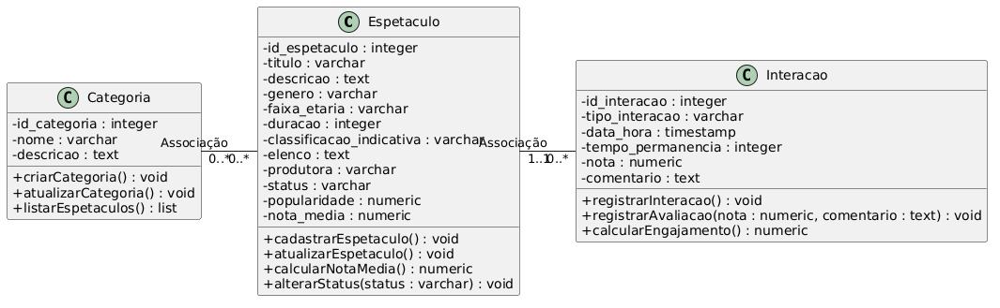
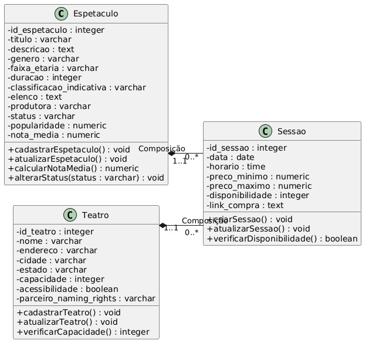
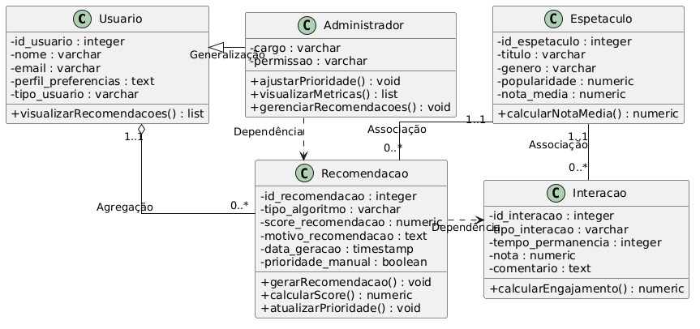

<Table>
  <tr>
    <td><a href= "https://www.btgpactual.com/"></td>
    <td>
      <a href= "https://www.inteli.edu.br/"></a>
    </td>
  </tr>
</table>

# Nome do Projeto: <nome do projeto>

## Nome do Grupo: <nome do grupo>

## Integrantes:

- <a href="https://www.linkedin.com/in/username/">Nome</a>
- <a href="https://www.linkedin.com/in/username/">Nome</a>
- <a href="https://www.linkedin.com/in/username/">Nome</a>
- <a href="https://www.linkedin.com/in/username/">Nome</a>
- <a href="https://www.linkedin.com/in/username/">Nome</a>
- <a href="https://www.linkedin.com/in/username/">Nome</a>
- <a href="https://www.linkedin.com/in/username/">Nome</a>
- <a href="https://www.linkedin.com/in/username/">Nome</a>

# Sumário

- [1. Introdução](#1-introdução)
  - [1.1 Termos e Abreviações](#11-termos-e-abreviações)
  - [1.2 Objetivo do Documento](#12-objetivo-do-documento)
- [2. Entendimento do Projeto e do Negócio](#2-entendimento-do-projeto-e-do-negócio)
  - [2.1 Contexto da Indústria do Parceiro](#21-contexto-da-indústria-do-parceiro)
  - [2.2 Problema](#22-problema)
  - [2.3 Visão do Projeto e do Produto](#23-visão-do-projeto-e-do-produto)
    - [2.3.1 Visão do Produto](#231-visão-do-produto)
    - [2.3.2 Proposta de Valor](#232-proposta-de-valor)
    - [2.3.3 O que o Produto Faz e Não Faz](#233-o-que-o-produto-faz-e-não-faz)
    - [2.3.4 Objetivos Estratégicos e Mensuráveis](#234-objetivos-estratégicos-e-mensuráveis)
    - [2.3.5 Impacto e Abrangência](#235-impacto-e-abrangência)
    - [2.3.6 Ownership e Accountability Estratégico](#236-ownership-e-accountability-estratégico)
    - [2.3.7 Alinhamento com o Problema](#237-alinhamento-com-o-problema)
  - [2.4 Personas e Jornada do Usuário](#24-personas-e-jornada-do-usuário)
  - [2.5 Modelagem do Fluxo de Negócio](#25-modelagem-do-fluxo-de-negócio)
    - [2.5.1 Cadeia de Valor](#251-cadeia-de-valor)
    - [2.5.2 Fluxo de Negócio Proposto (AS-IS e TO-BE)](#252-fluxo-de-negócio-proposto-as-is-e-to-be)
  - [2.6 Matriz de Risco do Projeto](#26-matriz-de-risco-do-projeto)
  - [2.7 Brainstorm de Features](#27-brainstorm-de-features)
  - [2.8 Business Model Canvas](#28-business-model-canvas)
- [3. Requisitos do Projeto](#3-requisitos-do-projeto)
  - [3.1 Requisitos Funcionais (RFs)](#31-requisitos-funcionais-rfs)
  - [3.2 Requisitos Não Funcionais (RNFs)](#32-requisitos-não-funcionais-rnfs)
  - [3.3 Correlação RFs e RNFs](#33-correlação-rfs-e-rnfs)
  - [3.4 Casos de Uso](#34-casos-de-uso)
  - [3.5 Casos de Uso x Requisitos Funcionais](#35-casos-de-uso-x-requisitos-funcionais)
- [4. Modelagem de Dados](#4-modelagem-de-dados)
  - [4.1 Especificação da Base de Dados para Modelo de Recomendação](#41-especificação-da-base-de-dados-para-modelo-de-recomendação)
  - [4.2 Modelo Conceitual de Dados](#42-modelo-conceitual-de-dados)
  - [4.3 Modelo Lógico de Dados](#43-modelo-lógico-de-dados)
  - [4.4 Modelo Físico de Dados](#44-modelo-físico-de-dados)
- [5. Solução Técnica (Design)](#5-solução-técnica-design)
  - [5.1 Diagrama de Classes](#51-diagrama-de-classes)
  - [5.2 Diagrama de Componentes da UML](#52-diagrama-de-componentes-da-uml)
  - [5.3 Justificativas das escolhas tecnológicas](#54-justificativa-das-escolhas-tecnológicas)
  - [5.4 Diagramas de Sequência da UML](#53-diagramas-de-sequência-da-uml)
- [6. Mapeamento Técnico de Infraestrutura e Implantação](#6-mapeamento-técnico-de-infraestrutura-e-implantação)
  - [6.1 Diagrama de Implantação da UML](#61-diagrama-de-implantação-da-uml)
  - [6.2 Justificativa das escolhas de implantação](#62-justificativa-das-escolhas-de-implantação)
- [7. Projeto Visual da Solução](#7-projeto-visual-da-solução)
  - [7.1 Desenvolvimento de Wireframes](#71-desenvolvimento-de-wireframes)
  - [7.2 Desenvolvimento de Mockups](#72-desenvolvimento-de-mockups)
  - [7.3 Guia Visual](#73-guia-visual)
- [8. Desenvolvimento do Projeto](#8-desenvolvimento-do-projeto)
  - [8.1 Arquitetura de Codificação e Estrutura de Diretórios](#81-arquitetura-de-codificação-e-estrutura-de-diretórios)
  - [8.2 Modelo de Recomendação](#82-modelo-de-recomendação)
  - [8.3 Desenvolvimento de Features](#83-desenvolvimento-de-features)
    - [8.3.1 Sprint 3](#831-sprint-3)
    - [8.3.2 Sprint 4](#832-sprint-4)
    - [8.3.3 Sprint 5](#833-sprint-5)
  - [8.4 Testes Unitários e de Integração](#84-testes-unitários-e-de-integração)
  - [8.5 Documentações automáticas](#85-documentações-automáticas)
- [9. Planejamento e Execução de Testes](#9-planejamento-e-execução-de-testes)
  - [9.1 Testes Funcionais](#91-testes-funcionais)
    - [9.1.1 Planejamento](#911-planejamento)
    - [9.1.2 Resultados](#912-resultados)
  - [9.2 Testes de RNFs](#92-testes-de-rnfs)
    - [9.2.1 Planejamento](#921-planejamento)
    - [9.2.2 Resultados](#922-resultados)
  - [9.3 Testes de Usabilidade](#93-testes-de-usabilidade)
    - [9.3.1 Planejamento](#931-planejamento)
    - [9.3.2 Resultados](#932-resultados)
- [10. Procedimentos de Implantação](#10-procedimentos-de-implantação)
  - [10.1 Implantação e Configuração do Banco de Dados](#101-implantação-e-configuração-do-banco-de-dados)
  - [10.2 Implantação do Protótipo para uso por equipe de desenvolvimento](#102-implantação-do-protótipo-para-uso-por-equipe-de-desenvolvimento)
- [Referências](#referências)

# 1. Introdução

&emsp;Este documento foi elaborado com o objetivo de servir como um guia completo para o leitor, 
fornecendo uma visão ampla de todas as etapas e aspectos do projeto desenvolvido em parceria 
com a Aventura Teatros. Nele, são apresentadas desde a descrição do parceiro envolvido e o 
problema proposto, até as decisões estratégicas tomadas, as análises de negócio realizadas e 
a documentação técnica relacionada à solução desenvolvida.

## 1.1 Termos e Abreviações

Abreviações utilizadas na elaboração desta documentação:

| Abreviação | Significado |
|---|---|
| API | Application Programming Interface (Interface de Programação de Aplicação) |
| MVP | Minimum Viable Product (Produto Mínimo Viável) |
| UI | User Interface (Interface do Usuário) |
| UX | User Experience (Experiência do Usuário) |
| RF | Requisito Funcional |
| RNF | Requisito Não Funcional |
| REST | Representational State Transfer (Transferência de Estado Representacional) |
| RACI | Responsible, Accountable, Consulted, Informed |
| Sprint | Ciclo de desenvolvimento ágil |
| SOA | Service-Oriented Architecture (Arquitetura Orientada a Serviços) |
| Portal | Plataforma digital da Aventura Teatros voltada ao público externo |

## 1.2 Objetivo do Documento

&emsp;Este documento tem como objetivo apresentar o escopo e o propósito do projeto voltado ao 
desenvolvimento de uma solução de recomendação de espetáculos no Portal Aventura. A principal 
função da solução é sugerir, de forma inteligente, espetáculos, conteúdos e experiências 
culturais alinhados ao interesse do usuário, estimulando a navegação dentro do portal e 
aumentando o potencial de conversão em vendas de ingressos. A proposta visa contribuir para 
a melhoria da experiência do usuário, o aumento do engajamento com o ecossistema da produtora 
e o fortalecimento da presença digital da Aventura Teatros como plataforma cultural completa.

# 2. Entendimento do Projeto e do Negócio

&emsp;O projeto consiste no desenvolvimento de uma solução digital de recomendação inteligente 
integrada ao Portal Aventura, com o objetivo de conectar o usuário a espetáculos, conteúdos 
e experiências culturais relevantes ao seu perfil de interesse. A iniciativa responde a uma 
lacuna identificada na jornada digital do usuário, que atualmente não recebe sugestões ao 
navegar pelo portal, o que reduz as oportunidades de descoberta de novos conteúdos e de 
conversão em vendas. A solução proposta permitirá a geração de recomendações contextualizadas 
ao comportamento e às preferências do usuário, criando uma jornada mais fluida e conectada 
entre as produções da Aventura.

## 2.1 Contexto da Indústria do Parceiro

A Aventura Teatros, fundada em 2008, é referência na produção de espetáculos de teatro musical no Brasil e uma das principais forças da economia criativa nacional. Liderada por Aniela Jordan, Luiz Calainho e Giulia Jordan, a empresa evoluiu de produtora de espetáculos para uma plataforma cultural completa, atuando na realização de festivais, na gestão de equipamentos culturais e na construção de parcerias estratégicas com marcas de grande expressão. Ao longo de sua trajetória, acumula mais de 50 produções, mais de 5 mil apresentações e um público superior a 5 milhões de espectadores, consolidando-se também como a maior gestora de naming rights em equipamentos culturais do país.

Inserida nesse contexto, a Aventura atua em um setor que vem se fortalecendo nos últimos anos. O mercado de entretenimento cultural e produção de espetáculos no Brasil, especialmente no segmento de teatro musical e experiências ao vivo, tem apresentado crescimento impulsionado pela retomada do público no período pós-pandemia, pela valorização de experiências presenciais e pelo aumento do consumo de cultura como forma de lazer. Esse cenário reforça o papel estratégico de empresas que conseguem integrar produção artística de qualidade com gestão eficiente e posicionamento de mercado.

Apesar desse crescimento, o setor enfrenta desafios relevantes relacionados à digitalização da experiência do usuário. Diferentemente de plataformas de streaming, que utilizam algoritmos avançados para recomendação de conteúdo, muitos portais de espetáculos ainda operam de forma estática, limitando a descoberta de novas experiências e reduzindo o potencial de engajamento e conversão. Para uma empresa com o porte e a diversidade de portfólio da Aventura, essa lacuna representa uma oportunidade estratégica clara de aprimorar a jornada do usuário e potencializar resultados de negócio por meio de soluções inteligentes de recomendação.

Nesse contexto, a análise do setor por meio do modelo das 5 Forças de Porter permite compreender de forma estruturada a dinâmica competitiva e os desafios enfrentados pela empresa.

1. Rivalidade entre concorrentes existentes (Alta):
O mercado de entretenimento é altamente competitivo, envolvendo não apenas outras produtoras de teatro, mas também cinemas, shows, plataformas de streaming e eventos ao vivo. Além disso, empresas que oferecem experiências digitais, como Netflix e Spotify, disputam diretamente o tempo e a atenção do consumidor. Isso exige que empresas como a Aventura invistam em diferenciação e em estratégias que aumentem o engajamento do público dentro de seus próprios canais.

2. Poder de barganha dos clientes (Alto):
Os consumidores possuem ampla variedade de opções de entretenimento e baixo custo de troca entre elas. A decisão de compra é fortemente influenciada por preço, conveniência e relevância do conteúdo. A ausência de recomendações personalizadas reduz a capacidade de retenção do usuário, tornando essencial a criação de experiências digitais mais inteligentes e direcionadas.

3. Ameaça de novos entrantes (Moderada):
Embora a produção de espetáculos envolva altos custos e barreiras operacionais, a entrada de novas plataformas digitais e iniciativas independentes de divulgação cultural tem reduzido essas barreiras. Startups e plataformas online podem atuar como intermediárias na descoberta de conteúdo, diminuindo o controle das produtoras sobre a jornada do usuário.

4. Poder de barganha dos fornecedores (Moderado):
Os principais fornecedores incluem artistas, produtores, teatros e parceiros comerciais. Como esses recursos são limitados e altamente especializados, eles possuem certo poder de negociação. Além disso, parcerias com marcas e patrocinadores são fundamentais para viabilizar grandes produções, influenciando diretamente a oferta de conteúdo.

5. Ameaça de produtos substitutos (Alta):
O principal substituto dos espetáculos presenciais são as plataformas digitais de entretenimento, como streaming de vídeo, redes sociais e jogos online. Essas alternativas oferecem conveniência e, muitas vezes, menor custo, competindo diretamente com o teatro pelo tempo do consumidor.

Diante desse cenário, observa-se que o setor exige cada vez mais a integração entre experiência presencial e digital. A capacidade de recomendar conteúdos de forma personalizada torna-se um diferencial competitivo essencial, permitindo que empresas como a Aventura ampliem o engajamento do público, fortaleçam seu ecossistema de produções e aumentem a conversão de vendas. Assim, a adoção de soluções tecnológicas, como sistemas de recomendação, não é apenas uma inovação, mas uma necessidade estratégica para se manter relevante em um mercado altamente competitivo e em constante transformação.

## 2.2 Problema

&emsp;O Portal Aventura, principal canal digital da Aventura Teatros, não conta com um sistema 
estruturado de recomendação de espetáculos e conteúdos. Atualmente, um usuário que acessa 
a página de um espetáculo específico encerra sua jornada naquele ponto, sem receber sugestões 
de outras produções, sem ser conduzido a experiências relacionadas e sem estímulo para 
explorar o ecossistema cultural que a Aventura oferece. Isso representa uma ruptura 
significativa na jornada do usuário e uma oportunidade de conversão desperdiçada.

&emsp;A relevância desse problema se amplifica quando considerado o porte da empresa: com mais de 
50 produções e uma plataforma cultural diversificada, a Aventura possui um catálogo rico e 
variado, porém subaproveitado digitalmente. A ausência de recomendações impede que esse 
catálogo trabalhe de forma ativa na geração de novas descobertas e vendas.

&emsp;Os principais desafios associados ao problema incluem a heterogeneidade do público, que 
abrange desde frequentadores assíduos de teatro até visitantes casuais sem histórico no 
portal, a potencial escassez de dados comportamentais estruturados sobre os usuários e a 
necessidade de que as recomendações sejam relevantes tanto para quem compra para si quanto 
para quem adquire ingressos para terceiros.

&emsp;Um sistema de recomendação bem construído pode aumentar o tempo de permanência no portal, 
fortalecer o engajamento com o ecossistema Aventura, criar uma jornada mais fluida entre 
produções e impulsionar a venda de ingressos, uma prioridade estratégica declarada pela 
empresa. Além disso, o projeto se insere em um momento de rebranding da Aventura, tornando-se 
uma ferramenta com potencial de reforçar a identidade da produtora como plataforma cultural 
completa.

## 2.3 Visão do Projeto e do Produto

Este tópico apresenta a visão estratégica do produto proposto, bem como seus objetivos mensuráveis, alinhando a solução ao problema identificado, às necessidades do negócio da Aventura e ao valor esperado para os usuários. A definição desses elementos é fundamental para orientar o desenvolvimento da solução, garantir coerência nas decisões de produto e estabelecer critérios claros de sucesso com base em resultados mensuráveis.

A partir desse direcionamento, busca-se não apenas descrever o que será desenvolvido, mas explicitar o papel estratégico do produto dentro do ecossistema digital da Aventura, evidenciando seu impacto potencial em engajamento, descoberta de conteúdo e conversão:

### 2.3.1 Visão do Produto

A visão do produto é transformar o Portal Aventura de uma plataforma estática de navegação em um ambiente digital inteligente, personalizado e orientado à descoberta, capaz de conectar usuários a experiências culturais relevantes de forma contínua, contextualizada e escalável.

Atualmente, a experiência do portal é fragmentada e limitada à navegação direta por páginas específicas, sem mecanismos que incentivem a exploração ou ampliem a jornada do usuário. O produto propõe uma reengenharia dessa dinâmica, introduzindo um sistema de recomendação que atua como uma camada estratégica de curadoria, responsável por guiar o usuário ao longo de uma experiência mais fluida, conectada e orientada à decisão.

A solução conceitualmente funciona como uma camada de inteligência sobre o conteúdo existente, estruturando e relacionando espetáculos, conteúdos e experiências com base em critérios de relevância, contexto e comportamento. Ao fazer isso, transforma a navegação em uma jornada progressiva de descoberta, reduzindo fricções e ampliando oportunidades de engajamento.

Mais do que melhorar a navegação, o produto reposiciona o Portal Aventura como um hub digital de experiências culturais, fortalecendo seu papel dentro do ecossistema da empresa e aumentando sua capacidade de gerar valor tanto para usuários quanto para o negócio.

---

### 2.3.2 Proposta de Valor

O produto entrega valor ao:

- Reduzir o esforço do usuário na descoberta de experiências culturais  
- Aumentar a relevância do conteúdo apresentado  
- Expandir a jornada de navegação dentro do portal  
- Potencializar a exposição de todo o portfólio da Aventura  
- Converter engajamento em oportunidades reais de negócio  

A proposta central é transformar atenção em descoberta e descoberta em conversão.

---

### 2.3.3 O que o Produto Faz e Não Faz
## O que o produto faz

O produto implementa um sistema de recomendação focado na descoberta de espetáculos dentro do Portal Aventura, com aplicação direta nas telas em que a recomendação agrega valor à navegação:

- Na `Tela principal de descoberta`, exibe listas e carrosséis de espetáculos recomendados, organizados por relações com o perfil e o comportamento do usuário.
- Na `Sub-tela de cada espetáculo`, apresenta um carrossel de sugestões como `Espetáculos similares` ou `Você também pode gostar`, ampliando a exploração de conteúdos relacionados.
- No `Login/Cadastro` e `Seleção de tags`, evita o cold start com coleta mínima de informações e preferências iniciais, sem sobrecarregar essas etapas com recomendações, porém garantindo que o usuário tenha acesso à peças que se encaixem nos gêneros escolhidos.

As recomendações seguem esta ordem de prioridade no MVP:

1. Filtragem colaborativa, baseada em similaridade entre usuários e regras inspiradas em SVD.
2. Sinais de navegação, considerando tempo de permanência nas páginas e cliques.
3. Histórico de interações, reforçando conteúdos já acessados pelo usuário.

Além disso, o produto disponibiliza um protótipo navegável com fluxo de descoberta entre a tela principal e as páginas de espetáculo, permitindo validar a experiência e o comportamento das recomendações.

## O que o produto não faz

- Não cobre, neste MVP, processos transacionais, operacionais ou administrativos que extrapolem a jornada de descoberta de espetáculos.
- Não entrega, nesta etapa, uma solução completa de gestão, análise ou automação do ecossistema do portal.
- Não pretende substituir integralmente a curadoria humana nem eliminar a necessidade de revisão manual das recomendações quando necessário.

---

### 2.3.4 Objetivos Estratégicos e Mensuráveis

O sucesso do produto será medido por indicadores de impacto real no comportamento do usuário e nos resultados de negócio.

Esses objetivos refletem não apenas melhorias na experiência do usuário, mas também impactos diretos nos resultados de negócio, especialmente em engajamento, retenção e conversão de vendas:

#### Engajamento e Experiência

- Aumentar em **20%** o tempo médio de sessão  
- Aumentar em **25%** o número de páginas por sessão  
- Aumentar a taxa de interação com recomendações  

#### Descoberta de Conteúdo

- Aumentar em **30%** a navegação entre diferentes espetáculos  
- Aumentar a diversidade de conteúdos acessados por usuário  
- Reduzir a dependência de acessos concentrados em poucos conteúdos  

#### Conversão e Valor de Negócio

- Aumentar em **10% a 15%** a taxa de conversão associada a recomendações  
- Aumentar o número de sessões que evoluem para intenção de compra  
- Estimular a venda cruzada entre espetáculos  

#### Retenção e Recorrência

- Aumentar a taxa de retorno de usuários ao portal  
- Melhorar a continuidade da jornada entre sessões  

---

### 2.3.5 Impacto e Abrangência

A solução foi concebida para atender uma base ampla e heterogênea de usuários, com diferentes níveis de familiaridade, objetivos e contextos de uso.

Ao introduzir recomendações contextualizadas, o produto:
- Reduz barreiras de entrada para novos usuários  
- Amplia a relevância para usuários recorrentes  
- Adapta a experiência a diferentes momentos de navegação  
- Garante acessibilidade e clareza na exploração de conteúdos  
- Atende à diversidade de perfis de usuários e suas diferentes expectativas  

Isso amplia significativamente o alcance e o impacto do portal como plataforma digital.

---

### 2.3.6 Ownership e Accountability Estratégico

A responsabilidade estratégica do produto é compartilhada em duas camadas:

**Stakeholders da Aventura:**
- Validam alinhamento com objetivos de negócio  
- Aprovam mudanças de escopo relevantes  
- Avaliam impacto em métricas de negócio  

**Equipe do Projeto:**
- Define e prioriza funcionalidades dentro do MVP  
- Traduz objetivos estratégicos em decisões de produto  
- Documenta trade-offs e decisões técnicas  
- Conduz validação da solução proposta  

**Tomada de decisão:**
- Estratégia e escopo macro -> Stakeholders Aventura  
- Execução e priorização -> Equipe do projeto  
- Validação de valor -> Compartilhada  

Essa estrutura garante alinhamento com o negócio sem comprometer a agilidade de execução.

---

### 2.3.7 Alinhamento com o Problema

O produto responde diretamente à ausência de um sistema estruturado de recomendação no Portal Aventura, que atualmente limita:

- A descoberta de novos conteúdos  
- O engajamento contínuo do usuário  
- O potencial de conversão  

A solução resolve esse cenário ao introduzir inteligência, conexão e orientação na jornada do usuário.

---

O produto posiciona o Portal Aventura como uma plataforma orientada à descoberta, capaz de transformar a forma como usuários exploram experiências culturais.

Ao conectar inteligência de recomendação com objetivos de negócio, a solução não apenas melhora a experiência do usuário, mas também cria impacto direto em engajamento, retenção e conversão, consolidando o portal como um ativo estratégico da Aventura.

---

## 2.4 Personas e Jornada do Usuário

## 2.4.2 Jornada do Usuário

  A seguir, são apresentadas as jornadas do usuário desenvolvidas para as personas do projeto. As jornadas foram construídas com o objetivo de mapear a experiência dos usuários durante o processo de descoberta, análise e decisão de consumo de apresentações teatrais dentro da plataforma.

  As jornadas permitem identificar pontos de fricção, dificuldades na busca por informações e oportunidades de melhoria relacionadas à recomendação de conteúdo, organização das informações e tomada de decisão. Além disso, evidenciam como diferentes perfis de usuários interagem com o sistema, considerando seus níveis de familiaridade tecnológica, objetivos e comportamentos.

---

### 2.4.2.1 Ana Clara Amaral

Abaixo a imagem da jornada da persona Ana Clara Amaral (usuária jovem interessada em teatro):

### Figura X – Jornada do Usuário (Ana Clara Amaral)


Fonte: Material produzido pelos autores (2026).

  Durante sua jornada, Ana Clara demonstra um comportamento exploratório e dinâmico, navegando rapidamente pela plataforma em busca de conteúdos que estejam alinhados aos seus interesses. Suas principais dificuldades estão relacionadas à descoberta de peças relevantes e à necessidade de compreender rapidamente as informações para compartilhar com amigos ou familiares.

  A experiência da usuária é fortemente impactada pela qualidade das recomendações e pela clareza das descrições dos espetáculos, sendo esses fatores determinantes para seu engajamento e tomada de decisão.

---

### 2.4.2.2 Mariana Lacerda Souza

Abaixo a imagem da jornada da persona Mariana Lacerda Souza (usuária familiar):

### Figura X – Jornada do Usuário (Mariana Lacerda Souza)


Fonte: Material produzido pelos autores (2026).

  Ao longo de sua jornada, Mariana apresenta um comportamento mais cauteloso e orientado à decisão segura, priorizando informações claras e confiáveis sobre as apresentações infantis. Suas principais dificuldades estão relacionadas à identificação rápida de conteúdos adequados para crianças e à falta de informações objetivas que garantam segurança na escolha.

  Nesse contexto, elementos como avaliações, classificação etária e organização das informações desempenham papel essencial para aumentar sua confiança e facilitar o planejamento de atividades culturais em família.

### 2.4.2.3 Ronaldo Benito Soares

Abaixo a imagem da jornada da persona Ronaldo Benito Soares (turista cultural):

### Figura X – Jornada do Usuário (Ronaldo Benito Soares)


Fonte: Material produzido pelos autores (2026).

  Durante sua jornada, Ronaldo busca praticidade e clareza na navegação, apresentando menor tolerância a interfaces complexas. Seu principal objetivo é encontrar rapidamente apresentações culturais alinhadas ao seu perfil e disponíveis durante sua estadia.

  Suas dificuldades estão relacionadas à sobrecarga de informações e à falta de direcionamento claro, o que pode comprometer sua experiência. Assim, a organização da plataforma e a relevância das recomendações são fatores essenciais para garantir uma navegação eficiente e satisfatória.

### 2.4.2.4 Pedro Henrique Lima

Abaixo a imagem da jornada da persona Pedro Henrique Lima (jovem universitário iniciante em teatro):

### Figura X – Jornada do Usuário (Pedro Henrique Lima)


Fonte: Material produzido pelos autores (2026).

  Durante sua jornada, Pedro apresenta um comportamento exploratório e orientado por recomendações, buscando referências que o ajudem a tomar sua primeira decisão dentro do universo teatral. Por nunca ter tido contato com esse tipo de experiência, ele depende fortemente de validações externas, como avaliações e indicações da própria plataforma.

  Suas principais dificuldades estão relacionadas à falta de direcionamento para iniciantes, ao excesso de opções disponíveis e à insegurança em escolher uma peça adequada para sua primeira experiência. O receio de não gostar impacta diretamente sua tomada de decisão.

  Nesse contexto, a qualidade das recomendações, a presença de categorias específicas para iniciantes e a validação social são fatores determinantes para aumentar sua confiança, engajamento e satisfação com a plataforma.

### 2.4.2.5 Cintia Araújo Sena

Abaixo a imagem da jornada da persona Cintia Araújo Sena (administradora da plataforma):

### Figura X – Jornada do Usuário (Cintia Araújo Sena)


Fonte: Material produzido pelos autores (2026).

  Ao longo de sua jornada, Cintia demonstra um comportamento analítico e orientado a dados, focado em compreender o desempenho da plataforma e o impacto das recomendações no comportamento dos usuários. Sua navegação é objetiva, priorizando acesso rápido a métricas e informações estratégicas.

  Suas principais dificuldades estão relacionadas à falta de clareza e organização dos dados apresentados, à dificuldade em mensurar o impacto real das recomendações na conversão e à ausência de insights diretos que apoiem a tomada de decisão.

  Dessa forma, a experiência da administradora depende diretamente da qualidade dos dashboards, da visualização clara dos indicadores-chave e da capacidade da plataforma em gerar insights acionáveis, permitindo decisões mais assertivas e eficientes.

### 2.4.2.6 Carlos Nóbrega

Abaixo a imagem da jornada da persona Carlos Nóbrega (usuário idoso interessado em teatro):

### Figura X – Jornada do Usuário (Carlos Nóbrega)


Fonte: Material produzido pelos autores (2026).

  Durante sua jornada, Carlos apresenta um comportamento cauteloso e mais lento na navegação, priorizando simplicidade e clareza em cada etapa do processo. Mesmo tendo interesse por teatro, sua baixa familiaridade com tecnologia faz com que ele evite explorar muitas opções e busque caminhos mais diretos.

  Suas principais dificuldades estão relacionadas ao excesso de informações, à complexidade da interface e à insegurança durante o processo de escolha e compra. O medo de cometer erros pode comprometer sua experiência e até impedir a finalização da ação.

  Nesse cenário, uma interface simples, informações objetivas e um fluxo de compra reduzido são essenciais para garantir uma experiência positiva, aumentando sua confiança e permitindo que ele conclua suas ações com segurança e satisfação.

---

  Considerando a diversidade de públicos que consomem apresentações culturais e utilizam plataformas digitais para descoberta de eventos, foram desenvolvidas diferentes personas para o projeto. Essas personas representam perfis variados de usuários, permitindo compreender comportamentos, necessidades, dificuldades e expectativas relacionadas ao processo de descoberta e escolha de apresentações teatrais.

  A construção das personas teve como objetivo auxiliar nas decisões de experiência do usuário, personalização das recomendações e definição das funcionalidades da plataforma. Além disso, os perfis desenvolvidos ajudam a identificar diferentes níveis de familiaridade tecnológica e padrões de navegação, garantindo que o sistema seja acessível e relevante para públicos distintos.

  Dessa forma, as personas representam usuários reais em potencial da plataforma, contribuindo para o desenvolvimento de uma experiência mais intuitiva, personalizada e alinhada às necessidades do público-alvo do projeto.

---

### 2.4.1.1 Ana Clara Amaral – Estudante e interessada em teatro

  Ana Clara Amaral foi desenvolvida como uma das principais personas do projeto, representando um perfil jovem, conectado digitalmente e interessado em arte e teatro. Estudante do segundo ano do ensino médio e aluna de uma escola de teatro, Ana Clara já teve contato com apresentações culturais anteriormente, mas ainda enfrenta dificuldades para encontrar espetáculos alinhados aos seus gostos pessoais.

  Por estar constantemente conectada às redes sociais, especialmente por meio do celular, Ana Clara possui alta familiaridade com ambientes digitais e espera experiências rápidas, intuitivas e visualmente atrativas. Seu comportamento é fortemente influenciado por tendências culturais, indicações de amigos e conteúdos compartilhados online. Apesar disso, sente frustração ao precisar procurar informações em diferentes plataformas ou descobrir peças interessantes apenas após saírem de cartaz.

  Outro fator importante em seu perfil é a dependência de amigos ou familiares para frequentar apresentações. Dessa forma, Ana Clara valoriza descrições claras, avaliações e informações objetivas sobre os espetáculos, pois frequentemente precisa convencer outras pessoas a acompanhá-la. Isso faz com que a confiança nas recomendações e a facilidade de compartilhamento sejam aspectos fundamentais em sua experiência.

  Assim, a plataforma busca atender diretamente às necessidades dessa persona ao centralizar informações culturais, oferecer recomendações personalizadas com base em seus interesses e facilitar a descoberta de novas apresentações de maneira dinâmica e acessível. Dessa forma, o sistema contribui para aumentar o engajamento cultural da usuária e tornar o processo de escolha de peças mais simples, rápido e alinhado ao seu perfil.

<div align="center">

### Figura X – Persona 1 – Ana Clara Amaral – Estudante e interessada em teatro


Fonte: Material produzido pelos autores (2026).

</div>

### 2.4.1.2 Mariana Lacerda Souza – Mãe em busca de experiências culturais infantis

  Mariana Lacerda Souza foi desenvolvida como uma persona que representa responsáveis que desejam proporcionar experiências culturais para seus filhos, mas que possuem pouco hábito de frequentar teatros e apresentações culturais. Com 34 anos, Mariana trabalha em período integral e busca atividades de lazer que possam ser aproveitadas em família durante os finais de semana.

  Apesar de utilizar aplicativos e plataformas digitais no cotidiano, Mariana prefere experiências simples, organizadas e objetivas. Sua principal dificuldade está em encontrar apresentações infantis adequadas para a idade do filho, com informações claras sobre classificação etária, duração, localização e proposta educativa do espetáculo. Muitas vezes, sente insegurança durante o processo de escolha por não conhecer previamente as peças ou não encontrar avaliações confiáveis de outros pais.

  Seu comportamento de navegação é mais analítico e cauteloso, já que costuma comparar opções antes de tomar uma decisão. Mariana valoriza principalmente recomendações confiáveis, avaliações positivas e descrições claras que ajudem a identificar rapidamente se a experiência será apropriada e interessante para a criança.

  Dessa forma, a plataforma busca atender às necessidades dessa persona ao centralizar informações relevantes sobre peças infantis e oferecer recomendações personalizadas com base em faixa etária, preferências familiares e popularidade entre outros responsáveis. Além disso, a organização intuitiva das informações contribui para tornar o processo de descoberta e decisão mais rápido, seguro e confortável para usuários familiares.

<div align="center">

### Figura X – Persona 2 – Mariana Lacerda Souza – Mãe e usuária familiar


Fonte: Material produzido pelos autores (2026).

</div>

### 2.4.1.3 Ronaldo Benito Soares – Turista cultural interessado em teatro

  Ronaldo Benito Soares foi desenvolvido como uma persona que representa usuários interessados em experiências culturais durante viagens e períodos de turismo. Aos 36 anos, Ronaldo possui grande interesse por arte, teatro e atividades culturais, enxergando essas experiências como uma forma de conhecer melhor os locais que visita e enriquecer sua vivência turística.

  Apesar de seu forte interesse cultural, Ronaldo possui baixa familiaridade com plataformas digitais mais complexas. Utiliza aplicativos básicos no cotidiano, mas demonstra dificuldade e insegurança diante de interfaces com excesso de informações, muitos passos ou navegação pouco intuitiva. Por esse motivo, tende a abandonar rapidamente plataformas que dificultam a busca por informações relevantes.

  Durante suas viagens, Ronaldo procura apresentações alinhadas aos seus gostos pessoais, como peças dramáticas, clássicas e produções culturalmente reconhecidas. Seu processo de decisão é fortemente influenciado por descrições claras, avaliações de outros usuários e recomendações que demonstrem relevância cultural. Além disso, valoriza praticidade ao organizar seus passeios, buscando opções compatíveis com sua localização e disponibilidade de tempo.

  Dessa forma, a plataforma busca atender às necessidades dessa persona ao oferecer recomendações personalizadas com base em preferências culturais, localização e disponibilidade de sessões. A organização simplificada das informações e a facilidade de navegação contribuem para que Ronaldo consiga descobrir apresentações relevantes de maneira rápida e segura, melhorando sua experiência turística e cultural na cidade.

<div align="center">

### Figura X – Persona 3 – Ronaldo Benito Soares – Turista cultural interessado em teatro


Fonte: Material produzido pelos autores (2026).

</div>

### 2.4.1.4 Pedro Henrique Lima – Universitário iniciante no teatro

  Pedro Henrique Lima foi desenvolvido como uma persona que representa jovens universitários com alto nível de familiaridade digital, mas que ainda não possuem experiência prévia com o universo teatral. Com 21 anos e estudante de Engenharia de Software no Inteli, Pedro está constantemente inserido em ambientes tecnológicos e acostumado a consumir conteúdo digital de forma rápida e objetiva.

  Apesar de já ter recebido indicações de amigos sobre peças teatrais como forma de estimular a criatividade, Pedro encontra dificuldades em dar o primeiro passo nesse universo. Sua principal barreira está na ausência de direcionamento claro e na dificuldade em identificar quais espetáculos são mais adequados para iniciantes. O excesso de opções disponíveis, sem uma curadoria eficiente, gera indecisão e insegurança, aumentando o receio de ter uma primeira experiência negativa.

  Seu comportamento de navegação é dinâmico e superficial, priorizando conteúdos visuais, objetivos e de fácil compreensão. Pedro raramente consome textos longos e tende a tomar decisões com base em validação social, como avaliações, लोकप्रियidade e recomendações de outros usuários.

  Dessa forma, a plataforma busca atender às necessidades dessa persona ao oferecer recomendações personalizadas com base em seus interesses — como tecnologia, criatividade e humor — além de apresentar uma curadoria específica para iniciantes. A disponibilização de informações rápidas, objetivas e com forte validação social contribui para aumentar sua confiança na escolha e incentivar sua entrada no universo teatral.

<div align="center">

### Figura X – Persona 4 – Pedro Henrique Lima – Universitário iniciante no teatro


Fonte: Material produzido pelos autores (2026).

</div>

### 2.4.1.5 Cintia Araújo Sena – Administradora da plataforma

  Cintia Araújo Sena foi desenvolvida como uma persona que representa o perfil administrativo responsável pela gestão e análise de desempenho da plataforma Aventura. Atuando como administradora do sistema, Cintia tem como principal objetivo avaliar se as recomendações oferecidas estão impactando positivamente na conversão de vendas e na descoberta de novos espetáculos pelos usuários.

  Com nível técnico médio a alto, Cintia possui familiaridade com ferramentas digitais e análise de dados, utilizando métricas e relatórios com frequência para embasar suas decisões. No entanto, enfrenta dificuldades relacionadas à falta de clareza e organização dessas informações, o que dificulta a visualização do impacto real das recomendações e do comportamento dos usuários dentro da plataforma.

  Seu comportamento é orientado por dados, priorizando dashboards objetivos, diretos e de fácil interpretação. Cintia valoriza especialmente a agilidade na obtenção de insights, pois isso influencia diretamente sua capacidade de tomada de decisão estratégica.

  Dessa forma, a plataforma busca atender às necessidades dessa persona ao oferecer dashboards claros, com métricas bem definidas e visualizações intuitivas. A disponibilização de indicadores de conversão, engajamento e ეფექტividade das recomendações permite que Cintia acompanhe o desempenho do sistema de forma eficiente, identifique oportunidades de melhoria e valide o impacto das funcionalidades implementadas.

<div align="center">

### Figura X – Persona 5 – Cintia Araújo Sena – Administradora da plataforma


Fonte: Material produzido pelos autores (2026).

</div>

### 2.4.1.6 Carlos Nóbrega – Idoso interessado em teatro

  Carlos Nóbrega foi desenvolvido como uma persona que representa usuários idosos interessados em atividades culturais, especialmente teatro, mas que possuem baixa familiaridade com tecnologias digitais mais complexas. Aos 67 anos e já aposentado, Carlos valoriza experiências culturais, porém prefere soluções práticas que facilitem o acesso a essas atividades.

  Embora reconheça a conveniência das plataformas online para compra de ingressos, Carlos enfrenta dificuldades ao lidar com interfaces confusas, excesso de informações e fluxos de navegação complexos. Esse cenário gera insegurança, principalmente no momento da escolha do espetáculo e da finalização da compra, aumentando o receio de cometer erros.

  Seu comportamento de navegação é mais cauteloso e gradual, priorizando clareza, simplicidade e organização. Carlos tende a evitar explorar muitas opções e prefere tomar decisões com base em informações diretas e fáceis de compreender.

  Dessa forma, a plataforma busca atender às necessidades dessa persona ao oferecer uma experiência simplificada, com navegação intuitiva, recomendações claras e informações objetivas sobre os espetáculos. A redução da complexidade e o foco na acessibilidade contribuem para que Carlos consiga encontrar uma peça com segurança e concluir sua jornada de compra de maneira tranquila e eficiente.

<div align="center">

### Figura X – Persona 6 – Carlos Nóbrega – Idoso interessado em teatro


Fonte: Material produzido pelos autores (2026).

</div>

## 2.5 Modelagem do Fluxo de Negócio BPMN

Este documento descreve o **fluxo de negócio** modelado em **BPMN 2.0** para o sistema **Spotlight**, solução de **recomendação inteligente de espetáculos** desenvolvida para o **Portal Aventura**. O diagrama é composto por três pools que representam os três atores principais do processo: o **Cliente**, o **Sistema de Recomendação** e os **Gestores de Dados**.
O fluxo modela a jornada completa, desde o primeiro acesso ao portal até a compra do ingresso ou avaliação do evento, integrando o **motor de ML** e o pipeline de dados que sustenta as recomendações.

---

### 2.5.1. Análise As Is / To Be — Antes e Depois do Spotlight

Esta seção descreve como o processo de navegação e descoberta de espetáculos funciona **hoje** no Portal Aventura (As Is) e como ele passará a funcionar **após a implementação do Spotlight** (To Be). A comparação justifica a existência do projeto e fundamenta as decisões de design do fluxo modelado no BPMN.

---

#### 2.5.1.1 As Is — Como o processo funciona hoje

O Portal Aventura, em seu estado atual, não possui qualquer mecanismo estruturado de recomendação ou personalização. A jornada do usuário é inteiramente linear e passiva: o visitante acessa o portal, busca ou encontra um espetáculo específico por conta própria, visualiza sua página e decide — de forma isolada e sem apoio contextual — se compra o ingresso ou abandona o portal.

**Fluxo atual (As Is):**

```
Usuário acessa o portal
        ↓
Busca ou navega manualmente pelo catálogo
        ↓
Encontra (ou não) um espetáculo de interesse
        ↓
Visualiza a página do espetáculo
        ↓
Decide sozinho: compra o ingresso ou sai do portal
```

**Problemas identificados no processo atual:**

| Problema | Impacto para a Aventura |
|---|---|
| Ausência de recomendações personalizadas | O usuário vê apenas o que buscou e não descobre outros espetáculos do catálogo |
| Nenhuma coleta estruturada de preferências | A Aventura não sabe quais gêneros ou faixas de preço interessam a cada usuário |
| Interações não são registradas nem aproveitadas | Cliques, visualizações e compras não geram inteligência sobre o comportamento do público |
| Catálogo sem metadados para recomendação | Espetáculos não possuem tags, similaridades ou scores que permitam comparações automáticas |
| Jornada encerra sem reengajamento | Após ver um espetáculo, o usuário não recebe estímulo para explorar outros e sai do portal |
| Sem segmentação de público | A equipe de marketing não tem visibilidade sobre perfis distintos de espectadores |
| Baixo tempo de permanência | Sem descoberta guiada, as sessões são curtas e a taxa de conversão em vendas é reduzida |

---

#### 2.5.1.2 To Be — Como o processo funcionará com o Spotlight

Com a implementação do Spotlight, o Portal Aventura passa a operar com um sistema inteligente de recomendação que transforma a navegação passiva em uma **jornada de descoberta cultural contínua e personalizada**. O processo deixa de ser linear e passa a ser orientado a dados, com três atores integrados — Cliente, Sistema de Recomendação e Gestores de Dados — operando de forma coordenada.

**Fluxo futuro (To Be) — representado no diagrama BPMN:**

```
Usuário acessa o portal
        ↓
Realiza cadastro (se necessário) e efetua login
        ↓
Declara preferências de gênero e faixa de preço
        ↓
Recebe recomendações personalizadas geradas pelo motor de ML
        ↓
Interage com as sugestões (clique, favorito, avaliação)
        ↓
Cada interação retroalimenta o modelo → recomendações ficam mais precisas
        ↓
Compra ingresso ou avalia o evento
```

**Melhorias entregues pelo Spotlight (To Be):**

| Dimensão | As Is (hoje) | To Be (com Spotlight) |
|---|---|---|
| **Descoberta de espetáculos** | Manual, sem sugestões | Personalizada, baseada em perfil e histórico do usuário |
| **Coleta de preferências** | Inexistente | Onboarding estruturado: gênero favorito e faixa de preço |
| **Uso de dados comportamentais** | Não coletados | Cliques, avaliações e compras alimentam o motor de ML continuamente |
| **Jornada no portal** | Linear e curta | Contínua — o sistema sugere o próximo espetáculo, aumentando o tempo de permanência |
| **Apoio à decisão de compra** | Nenhum | Recomendações contextuais com justificativa ("Porque você gosta de musicais") |
| **Catálogo de espetáculos** | Sem metadados para recomendação | Enriquecido com tags, scores de popularidade e atributos de similaridade |
| **Segmentação de público** | Sem visibilidade | k-means agrupa automaticamente o público em clusters (Famílias, Musical Adulto, etc.) |
| **Reengajamento pós-visita** | Inexistente | Avaliações retroalimentam o modelo e sustentam o ciclo de melhoria contínua |
| **Inteligência de marketing** | Sem dados estruturados | Relatórios de segmentos entregues à equipe de marketing para campanhas direcionadas |

---

#### 2.5.1.3 Síntese da Transformação

O processo **As Is** representa uma navegação passiva onde o usuário é o único responsável pela descoberta de conteúdo. A Aventura não participa ativamente dessa jornada e perde oportunidades de venda a cada sessão encerrada sem conversão.

O processo **To Be**, modelado no diagrama BPMN do Spotlight, inverte essa lógica: o sistema passa a guiar ativamente o usuário, conectando preferências declaradas, comportamento real e catálogo estruturado para entregar recomendações que aumentam o engajamento, o tempo de permanência e a conversão em vendas de ingressos, transformando cada acesso ao portal em uma oportunidade de descoberta cultural.

---

### 2.5.2. Fluxo de Negócios BPMN

Este documento descreve o fluxo de negócio modelado em BPMN 2.0 para o sistema **Spotlight**, solução de recomendação inteligente de espetáculos desenvolvida para o Portal Aventura. O diagrama é composto por **três pools** que representam os três atores principais do processo: o **Cliente**, o **Sistema de Recomendação** e os **Gestores de Dados**.

O fluxo modela a jornada completa, desde o primeiro acesso ao portal até a compra do ingresso ou avaliação do evento, integrando o motor de ML e o pipeline de dados que sustenta as recomendações.

Para visualizar o diagrama completo, basta acessar o [Diagrama BPMN](../documentos/img/BPMN.pdf) no repositório.

---

#### 2.5.2.1 Pools

| Pool | Ator | Responsabilidade |
|---|---|---|
| **Pool 1** | Cliente | Representa toda a jornada do usuário no portal: cadastro, preferências, visualização de recomendações e interação com os espetáculos |
| **Pool 2** | Sistema de Recomendação | Motor de ML responsável por capturar interações, analisar o perfil do usuário, gerar e exibir recomendações personalizadas |
| **Pool 3** | Gestores de Dados | Equipe interna responsável por coletar dados de novos espetáculos, popular o banco de dados e disponibilizar o catálogo atualizado para o motor |

---

#### 2.5.2.2. Descrição Detalhada dos Fluxos

#### Pool 1 — Cliente

Este pool representa a experiência do usuário no Portal Aventura. O fluxo é iniciado quando o usuário acessa o portal e segue até uma das três ações finais possíveis: compra de ingresso, avaliação do evento ou encerramento da sessão sem engajamento.

<div align="center">

<sub>Figura X - Cliente </sub><br>
 
  <br>

  <sup>Fonte: Material produzido pelos autores, 2026.</sup>
</div>

**Passo a passo:**

**1. Acesso ao Portal**
O processo tem início com um evento de start representando o momento em que o usuário acessa o Portal Aventura. Este é o ponto de entrada de toda a jornada.

**2. Gateway — Possui cadastro?**
Imediatamente após o acesso, um gateway XOR verifica se o usuário já possui cadastro na plataforma:
- **Sim** → o usuário segue diretamente para a etapa de login.
- **Não** → o usuário é direcionado para preencher o cadastro, retornando ao fluxo principal após a conclusão.

**3. Efetuar Login**
Usuários já cadastrados realizam o login na plataforma para ter acesso ao ambiente personalizado e às recomendações vinculadas ao seu perfil.

**4. Inserir Preferências**
Após autenticado, o usuário declara suas preferências culturais, como gêneros de espetáculo de interesse. Essa etapa é fundamental para o motor de recomendação, especialmente para usuários que ainda não possuem histórico de interações (cold start).

**5. Inserir Faixa de Preço**
O usuário informa a faixa de preço que está disposto a pagar pelos ingressos. Esse filtro é utilizado pelo sistema para calibrar as recomendações geradas, garantindo que apenas espetáculos dentro do orçamento declarado sejam sugeridos.

**6. Visualizar Recomendações**
Com o perfil declarado completo, o sistema exibe as recomendações personalizadas na tela de descoberta, em formato de carrossel, com a justificativa de cada sugestão para tornar o sistema transparente ao usuário.

**7. Gateway — Houve interação?**
Um segundo gateway XOR avalia se o usuário interagiu com alguma recomendação exibida:
- **Não** → a sessão é encerrada sem engajamento.
- **Sim** → o usuário é direcionado para a tela de detalhes do evento.

**8. Ver Detalhes do Evento**
O usuário acessa a página descritiva do espetáculo selecionado, contendo informações como sinopse, elenco, datas, local e preço do ingresso.

**9. Gateway Inclusivo**
Um terceiro gateway inclusivo captura a decisão do usuário após visualizar os detalhes do evento:
- **Clicar no link da ticketeira** → o usuário é redirecionado para a plataforma de venda de ingressos, onde finaliza a compra. O fluxo termina com o evento de end "Ingresso Comprado".
- **Avaliar evento** → o usuário registra uma avaliação do espetáculo, que retroalimenta o sistema de recomendação com dados de satisfação.

---

#### Pool 2 — Sistema de Recomendação

Este pool representa o motor de ML do Spotlight. Ele é ativado pelas interações do usuário no Pool 1 e é responsável por transformar dados de comportamento e perfil em recomendações personalizadas.

<div align="center">

<sub>Figura X - Sistema de Recomendação</sub><br>

  <br>

  <sup>Fonte: Material produzido pelos autores, 2026.</sup>
</div>

**Passo a passo:**

**1. Motor ML (Start)**
O fluxo do sistema é iniciado pelo evento de start "Motor LM", acionado quando o usuário conclui o preenchimento de suas preferências e dados de perfil no Pool 1.

**2. Captura de Interações**
O sistema captura e registra todos os eventos de comportamento do usuário: visualizações de espetáculos, cliques, tempo de permanência na página, avaliações e compras. Cada tipo de interação contribui para a construção do perfil comportamental do usuário.

**3. Análise de Interações**
Os eventos capturados são processados e classificados por tipo e relevância. Essa etapa transforma os dados brutos de comportamento em sinais estruturados que alimentam a etapa seguinte de análise de perfil.

**4. Análise de Perfil**
Com base nas interações processadas e nas preferências declaradas, o sistema constrói ou atualiza o perfil do usuário. Para novos usuários (sem histórico), a análise utiliza as preferências declaradas. Para usuários recorrentes, o perfil é enriquecido com dados comportamentais acumulados ao longo das sessões.

**5. Gerar Recomendações**
Com o perfil consolidado, o motor gera uma lista rankeada de recomendações personalizadas, acompanhada da justificativa de cada sugestão para tornar o sistema explicável ao usuário.

**6. Exibir Recomendações na Tela de Descoberta**
As recomendações geradas são entregues ao Pool 1 (tela "Visualizar Recomendações"), exibidas na interface do portal. O fluxo retorna ao controle do usuário a partir deste ponto.

---

#### Pool 3 — Gestores de Dados

Este pool representa o processo interno da equipe de gestão de dados da Aventura, responsável por manter o catálogo de espetáculos atualizado e disponível para o motor de recomendação.

<div align="center">

<sub>Figura X - Gestores de Dados</sub><br>

  <br>

  <sup>Fonte: Material produzido pelos autores, 2026.</sup>
</div>

**Passo a passo:**

**1. Novo Espetáculo**
O fluxo é iniciado pelo evento de start "Novo espetáculo", acionado sempre que um novo espetáculo é produzido ou anunciado pela Aventura Teatros.

**2. Coletar Dados de um Novo Espetáculo**
A equipe realiza a coleta de todas as informações relevantes sobre o espetáculo: título, gênero, sinopse, elenco, teatro, datas de apresentação, faixa de preço e classificação etária.

**3. Popular no Banco de Dados**
Os dados coletados são inseridos e organizados no banco de dados relacional, respeitando o modelo de entidades do sistema.

**4. Inserir Metadados do Espetáculo**
Além dos dados básicos, são inseridos os metadados que alimentam o motor de recomendação: tags de categoria, palavras-chave, score de popularidade inicial e atributos de similaridade com outros espetáculos do catálogo.

**5. Disponibilizar o Novo Espetáculo no Catálogo**
O espetáculo é publicado e disponibilizado no catálogo ativo do portal. A partir deste momento, ele passa a ser elegível para aparecer nas recomendações geradas pelo motor de ML.

**6. Catálogo Disponível (End)**
O fluxo encerra com o evento de end "Catálogo disponível", sinalizando que o novo espetáculo está pronto para ser consumido pelo Pool 2.

---

#### 2.5.2.3. Eventos de Início e Fim

| Pool | Evento de Start | Evento(s) de End |
|---|---|---|
| Cliente | Acesso ao Portal | Ingresso Comprado (fim positivo) / Sem engajamento (fim sem conversão) |
| Sistema de Recomendação | Motor LM | Exibição de recomendações na tela de descoberta (entrega ao Pool 1) |
| Gestores de Dados | Novo evento | Catálogo disponível (fim de processo interno) |

---

#### 2.5.2.4. Conexões Entre Pools 

As conexões entre pools representam a troca de informações entre atores distintos do processo. Na notação BPMN 2.0, essas conexões são representadas por linhas tracejadas (message flows) e nunca por sequence flows, que são exclusivos de cada pool.

| Origem | Destino | Informação Trafegada |
|---|---|---|
| Pool 1 — Cliente | Pool 2 — Sistema | Preferências declaradas e faixa de preço do usuário |
| Pool 1 — Cliente | Pool 2 — Sistema | Eventos de interação (clique, avaliação, tempo de permanência) |
| Pool 2 — Sistema | Pool 1 — Cliente | Lista de recomendações personalizadas com justificativas |
| Pool 3 — Gestores de Dados | Pool 2 — Sistema | Notificação de novo espetáculo disponível no catálogo |

---

#### 2.5.2.5. Dados e Armazenamento

| Dado | Origem | Utilização |
|---|---|---|
| Preferências declaradas | Pool 1 — Usuário | Alimenta a análise de perfil para usuários sem histórico (cold start) |
| Faixa de preço | Pool 1 — Usuário | Filtro aplicado antes da geração das recomendações |
| Interações comportamentais | Pool 1 — Usuário | Alimenta a análise de interações e enriquece o perfil do usuário |
| Avaliações dos eventos | Pool 1 — Usuário | Retroalimenta o modelo de recomendação com dados de satisfação |
| Metadados dos espetáculos | Pool 3 — Gestores de Dados | Base do catálogo consumida pelo motor de ML para gerar recomendações |

---

#### 2.5.2.6. Observações Finais

- O diagrama segue a notação BPMN 2.0 com uso correto de **pools separados por ator**, **gateways XOR para decisões exclusivas** e **eventos de start e end** distintos por pool.
- O Pool 2 apresenta uma separação clara entre **captura**, **análise de interações**, **análise de perfil** e **geração de recomendações**, o que demonstra maturidade no design do fluxo e facilita a implementação modular do motor de ML.
- O **Pool 3 opera de forma assíncrona** em relação aos outros dois: ele é acionado sempre que há um novo espetáculo, independentemente do fluxo de navegação do usuário no portal.
- O diagrama representa o **fluxo principal (happy path)** do sistema. Fluxos de exceção podem ser detalhados em subprocessos futuros.
- A etapa de **Avaliar evento** no Pool 1 cria um ciclo virtuoso de retroalimentação: as avaliações dos usuários enriquecem o modelo de recomendação ao longo do tempo, tornando as sugestões progressivamente mais precisas e relevantes.

---

## 2.6 Matriz de Risco do Projeto
_conteúdo_

## 2.7 Brainstorm de Features

Esta seção detalha as principais telas da aplicação, desde Login/Cadastro, Seleção de Tags (onboarding), Tela Principal estilo Netflix, Calendário, até a página descritiva do espetáculo, além dos fluxos para usuários finais e administradores, justificando cada uma pela redução de rejeição, personalização e aumento de conversão. Em paralelo, explica a arquitetura do algoritmo de recomendação organizado em camadas de prioridade: alta, média e baixa, com o objetivo de entregar recomendações relevantes, viáveis e comercialmente eficazes.

<div align="center">

<sub>Figura X - Brainstorm de Features</sub><br>

  <br>

  <sup>Fonte: Material produzido pelos autores, 2026.</sup>

</div>

### 2.7.1 Definição de Telas da Aplicação

Com base no mapeamento (post-its azuis), a interface foi dividida em módulos que guiam o usuário desde a aquisição (onboarding) até a conversão (descoberta e aprofundamento).

#### 2.7.1.1 Inventário de Telas (Post-its Azuis)

1. **Login/Cadastro**  
   Ponto de entrada da plataforma.

2. **Tela de Seleção de Tags & Datas**  
   Interface de onboarding inicial para captar interesses.

3. **Dashboard Administrativo**  
   Tela voltada para administradores da plataforma.

4. **Tela Principal (Estilo Netflix)**  
   Hub central de navegação, organizando os espetáculos em trilhas horizontais categorizadas.

5. **Dropdown de Abas de Categorias**  
   Menu de navegação secundária para filtragem rápida por gêneros ou temas.

6. **Calendário de Peças**  
   Visão em grade ou lista organizada cronologicamente para facilitar o planejamento.

7. **Tela Descritiva do Espetáculo**  
   Página de detalhes de uma peça específica, contendo avaliações, comentários e um carrossel inferior com sugestões de peças similares.

#### 2.7.1.2 Fluxo das telas

#### Visão do Usuário Final

**Login/Cadastro** → **Seleção de Tags (Cold Start)** → **Tela Principal (Estilo Netflix)**

A partir da Tela Principal, o usuário pode explorar usando o **Dropdown de Categorias** ou o **Calendário de Peças**, culminando no clique que o leva à **Tela Descritiva do Espetáculo** para tomada de decisão.

#### Visão do Administrador

**Login** → **Dashboard Adm** (onde regras de negócio pontuais podem sobrescrever temporariamente os algoritmos em campanhas específicas).

### Justificativas das escolhas de telas

- **Login/Cadastro & Seleção de Tags**  

  **Por que é necessária?** Sistemas de recomendação sofrem com o problema de **"Cold Start"**.  
  **Contribuição UX:** Coletar preferências diretas logo no início permite que a Tela Principal já seja povoada com relevância no primeiro acesso, reduzindo a taxa de rejeição.

- **Tela Principal (Estilo Netflix) & Dropdown**  

  **Por que é necessária?** Reduz a carga cognitiva do usuário.  
  **Contribuição UX:** O formato de carrosséis horizontais é um modelo mental já consolidado no mercado. Permite descoberta passiva de conteúdo. O dropdown atende usuários com intenção de busca mais ativa.

- **Tela Descritiva com Carrossel de Sugestões** 

  **Por que é necessária?** É o momento decisivo de conversão (venda do ingresso/interesse).  
  **Contribuição UX:** Estrelas e comentários fornecem prova social. O carrossel de sugestões é vital: mantém o usuário navegando mesmo se não se interessar pela peça atual.

- **Dashboard Adm**  

  **Por que é necessária?** Garante controle de negócios. Algoritmos não preveem contratos comerciais fechados pela produtora que exijam destaque na página inicial.

---

# 2.7.2 Fatores de Recomendação e Priorização de Algoritmos

O motor de recomendação do Spotlight foi desenhado considerando múltiplas camadas de dados. A ordem de prioridade de execução e peso no modelo segue:

### 🟢 Prioridade Alta: Filtragem Colaborativa e Comportamento Implícito

- **Fatores:** Semelhança de usuários, Navegação (tempo de permanência e cliques), Histórico.
- **Categoria:** Comportamento do Usuário & Filtragem Colaborativa (User-to-User / Item-to-Item).
- **Peso Relativo:** Alto (espinha dorsal do modelo).

**Justificativa:**  
O que o usuário *faz* (comportamento implícito) tem muito mais valor do que o que ele diz que gosta. A similaridade entre usuários permite recomendações hiper-personalizadas.

---

### 🟡 Prioridade Média: Contexto, Heurísticas e Serendipidade

- **Fatores:** Localização, Preço, Data, Popularidade, "Me Surpreenda".
- **Categoria:** Regras de Contexto & Diversificação.
- **Peso Relativo:** Médio.

**Justificativa:**  
Espetáculos teatrais são eventos físicos e temporais. Esses fatores garantem viabilidade da recomendação. O "Me Surpreenda" introduz serendipidade e ajuda a romper a bolha de filtro.

---

### 🟠 Prioridade Baixa/Complementar: Tendências e Feedback Explícito

- **Fatores:** Histórico Async, Avaliação, Tendência, Vendas, Sazonalidade.
- **Categoria:** Dados Globais & Qualidade do Item.
- **Peso Relativo:** Baixo (ajuste fino/multiplicadores).

**Justificativa:**  
Avaliações e volume de vendas indicam qualidade intrínseca. Tendências e sazonalidade capturam o momento cultural. Esses fatores ajudam a desempatar itens com afinidade similar.

## 2.8 Business Model Canvas

Esta seção detalha o modelo de negócios desenvolvido para o **Spotlight**, **sistema inteligente de recomendação** no **Portal Aventura**. A solução atua em duas frentes: aprimorar a experiência do usuário final e fornecer inteligência de dados para a equipe interna.

<div align="center">

<sub>Figura X - Business Model Canvas</sub><br>

  <br>

  <sup>Source: Material produzido pelos autores, 2026.</sup>

</div>


### 2.8.1 Parceiros-Chave 

Os parceiros estratégicos essenciais para a operação, fornecimento de dados e viabilidade do projeto:

- **Aventura Teatros**: A parceira principal e dona do ecossistema. Fornece o portal, o catálogo de espetáculos e o direcionamento de negócios.
- **Ticketeiras parceiras**: Plataformas parceiras de emissão de ingressos.
- **Equipe de Marketing da Aventura**: Parceiro interno vital para a validação das campanhas. Atuam tanto como co-criadores das regras de negócio quanto como validadores da eficácia da segmentação gerada pelo sistema.

---

### 2.8.2 Atividades Principais

As ações técnicas e operacionais contínuas que o sistema e a equipe devem executar para entregar a proposta de valor:

- **Coleta e processamento de dados de comportamento do usuário**: Criação de pipelines de dados para capturar cliques, tempo de tela, buscas e histórico de compras. Envolve processos de ETL e higienização dos dados para garantir a qualidade das entradas.
- **Treinamento e atualização do modelo de recomendação**: Rotinas de MLOps para retreinar os algoritmos de Machine Learning periodicamente, garantindo que as recomendações não fiquem defasadas e se adaptem a novos espetáculos e tendências de consumo.

---

### 2.8.3 Principais Recursos 

Os ativos tecnológicos e de informação indispensáveis para o funcionamento da plataforma:

- **Dados de interação do usuário**: O principal combustível do motor de recomendação. Sem um volume adequado de dados comportamentais (logs, sessões, cliques), o modelo não consegue inferir preferências.
- **Motor de ML (Machine Learning)**: A infraestrutura de algoritmos (como filtragem colaborativa ou baseada em conteúdo) responsável por calcular a similaridade entre usuários e espetáculos, gerando as predições.
- **Catálogo de espetáculos e metadados da Aventura**: O banco de dados estruturado contendo descrições, gêneros, elenco, datas, classificação indicativa e tags de cada peça teatral.

---

### 2.8.4 Propostas Principais 

O valor entregue para os diferentes segmentos de clientes (espectadores e equipe interna):

- **Descoberta personalizada de espetáculos**: Supera o problema da "página em branco", sugerindo peças que o usuário não procuraria ativamente, mas que se alinham perfeitamente ao seu gosto.
- **Aumento do tempo de permanência no Portal Aventura**: Ao oferecer um feed contínuo e relevante, o usuário consome mais conteúdo sobre as produções antes de decidir.
- **Estímulo à compra de ingressos por recomendação contextual**: Inserção de "gatilhos" de compra no momento exato de maior interesse, aumentando a taxa de conversão.
- **Jornada cultural contínua**: Transforma uma compra isolada em um ciclo de consumo recorrente, fidelizando o cliente ao selo Aventura.
- **Segmentação inteligente de público**: Permite que o marketing abandone o anúncios genéricos e faça campanhas ultra-segmentadas baseadas nos clusters gerados pelo ML.
- **Explicabilidade das recomendações**: Transparência para o usuário ("Recomendado porque você assistiu X") e para os gestores, aumentando a confiança nas predições do sistema.

---

### 2.8.5 Relacionamento com o Consumidor

Como o sistema interage e cria laços com os usuários para melhorar a coleta de dados e a experiência:

- **Onboarding de preferências**: Um formulário rápido e gamificado no primeiro acesso ou criação de conta para mitigar o problema de Cold Start.
- **Recomendação personalizada em tempo real**: A interface do portal se molda dinamicamente conforme o usuário navega, gerando uma sensação de atendimento exclusivo.
- **Notificações de novos espetáculos por cluster**: Engajamento ativo informando aos usuários que uma peça do seu nicho de interesse entrou em cartaz.

---

### 2.8.6 Canais 

- **Portal Aventura**: O ponto de contato exclusivo e centralizado. Toda a inteligência do motor de recomendação será exposta no front-end deste portal, seja na home page, páginas de detalhes de peças ou no carrinho de compras.

---

### 2.8.7 Segmentos de Clientes 

Os grupos de pessoas que a solução visa atender, divididos em perfis de consumo e usuários internos:

### Consumidores Finais

- Famílias com crianças (buscam classificação livre e horários diurnos).
- Adultos fãs de musical (ticket médio maior, alta recorrência).
- Público de ballet e clássicos (nicho específico e tradicional).
- Jovens e público experimental (abertos a novas linguagens teatrais).
- Visitantes esporádicos do portal (usuários não logados que precisam ser convertidos rapidamente).

### Clientes Internos 

- Gestores e analistas de marketing da Aventura.

---

### 2.8.8 Estrutura de Custos 

Os principais direcionadores de despesas para manter o projeto rodando:

- **Infraestrutura de nuvem**: Custos com servidores para hospedar o portal, bancos de dados para armazenar logs massivos e instâncias de computação otimizadas para treinar os modelos de Machine Learning.
- **Desenvolvimento e manutenção do modelo de ML**: Esforço contínuo para refinar algoritmos, evitar degradação do modelo e realizar testes A/B.
- **Horas de desenvolvimento**: Custo da equipe de engenharia de software envolvida na criação de APIs, integração com o Sympla, estruturação de banco de dados e rotinas de deploy.

---

### 2.8.9 Fluxos de Receita

Como a solução gera valor financeiro ou reduz custos, justificando o investimento:

- **Aumento de conversão em venda de ingressos**: O impacto direto das recomendações personalizadas na jornada, diminuindo a taxa de abandono do carrinho.
- **Maior ticket médio por sessão**: Consequência de cross-sell e up-sell bem-sucedidos.
- **Campanhas pagas eficientes**: Redução do Custo de Aquisição de Clientes e aumento do Retorno sobre Investimento em mídias pagas, utilizando os dados de segmentação para criar públicos personalizados e mais assertivos.

--

# 3. Requisitos do Projeto
_conteúdo_

## 3.1 Requisitos Funcionais (RFs)

 &emsp; Os requisitos funcionais representam as funcionalidades que o sistema deverá oferecer para atender os objetivos e necessidades dos usuários da plataforma de recomendação de espetáculos da Aventura. Cada requisito define uma funcionalidade essencial do sistema, considerando tanto a experiência do usuário quanto os mecanismos de recomendação e gestão administrativa. Os testes descritos incluem pré-condição, procedimento, resultado esperado e pós-condição, garantindo a validação das funcionalidades implementadas.

<div align="center"> <sub>Tabela X - Requisitos funcionais</sub>

## Requisitos Funcionais

### Autenticação e Perfil

| RF | Requisito Funcional | Pré-condição | Procedimento de Teste | Resultado Esperado | Pós-condição |
|----|---------------------|--------------|------------------------|---------------------|---------------|
| RF01 | Como usuário, eu quero me cadastrar na plataforma informando meus dados pessoais (como nome, email e senha) para acessar funcionalidades personalizadas e utilizar o sistema de recomendação. | Usuário não autenticado. | Inserir dados válidos e inválidos e submeter cadastro. | Usuário cadastrado com sucesso quando dados são válidos; mensagens de erro exibidas para campos inválidos. | Usuário registrado no sistema. |
| RF02 | Como usuário, eu quero realizar login informando meu email e senha para acessar minha conta e meus dados personalizados. | Usuário previamente cadastrado. | Inserir credenciais válidas e inválidas. | Acesso permitido com credenciais válidas; erro exibido para dados incorretos. | Sessão autenticada iniciada. |
| RF03 | Como usuário, eu quero definir minhas preferências (como gênero, faixa de preço e localização) para receber recomendações mais relevantes e alinhadas ao meu perfil. | Usuário autenticado. | Selecionar preferências e salvar. | Preferências armazenadas corretamente no sistema. | Perfil do usuário atualizado. |

---

### Exploração e Navegação

| RF | Requisito Funcional | Pré-condição | Procedimento de Teste | Resultado Esperado | Pós-condição |
|----|---------------------|--------------|------------------------|---------------------|---------------|
| RF04 | Como usuário, eu quero visualizar recomendações personalizadas com base no meu perfil e comportamento na plataforma para descobrir espetáculos alinhados aos meus interesses. | Usuário autenticado com ou sem histórico de interações. | Acessar tela inicial do sistema. | Lista com no mínimo 5 recomendações exibida, ordenada por relevância, contendo título, categoria, data e indicação de personalização (ex: “baseado nas suas preferências”). | Recomendações exibidas ao usuário. |
| RF05 | Como usuário, eu quero pesquisar espetáculos por nome ou palavra-chave para encontrar conteúdos específicos. | Base de espetáculos disponível. | Inserir termo de busca válido e inválido. | Lista de resultados correspondente ao termo pesquisado ou mensagem de “nenhum resultado encontrado”. | Lista filtrada exibida. |
| RF06 | Como usuário, eu quero filtrar espetáculos por categoria, data e faixa de preço para refinar minha busca. | Lista de espetáculos carregada. | Aplicar diferentes combinações de filtros. | Lista atualizada conforme filtros selecionados. | Lista refinada exibida ao usuário. |

---

### Conteúdo

| RF | Requisito Funcional | Pré-condição | Procedimento de Teste | Resultado Esperado | Pós-condição |
|----|---------------------|--------------|------------------------|---------------------|---------------|
| RF07 | Como usuário, eu quero visualizar detalhes completos de um espetáculo para avaliar se tenho interesse em assisti-lo. | Espetáculo disponível no sistema. | Acessar página de detalhes do espetáculo. | Exibição de informações completas como descrição, categoria, data, horário, preço e local. | Dados apresentados ao usuário. |
| RF08 | Como usuário, eu quero visualizar avaliações de outros usuários para apoiar minha decisão sobre assistir ou não a um espetáculo. | Avaliações cadastradas para o espetáculo. | Acessar seção de avaliações. | Lista de avaliações exibida corretamente, contendo nota e comentário. | Avaliações visíveis ao usuário. |

---

### Engajamento

| RF | Requisito Funcional | Pré-condição | Procedimento de Teste | Resultado Esperado | Pós-condição |
|----|---------------------|--------------|------------------------|---------------------|---------------|
| RF09 | Como usuário, eu quero avaliar espetáculos atribuindo uma nota para expressar minha opinião e contribuir com o sistema. | Usuário autenticado. | Inserir nota válida e submeter. | Avaliação registrada corretamente no sistema. | Avaliação armazenada. |
| RF10 | Como usuário, eu quero comentar sobre espetáculos para compartilhar minha experiência com outros usuários. | Usuário autenticado. | Inserir comentário válido e enviar. | Comentário exibido corretamente na página do espetáculo. | Comentário registrado no sistema. |

---

### Coleta de Dados

| RF | Requisito Funcional | Pré-condição | Procedimento de Teste | Resultado Esperado | Pós-condição |
|----|---------------------|--------------|------------------------|---------------------|---------------|
| RF11 | Como sistema, eu quero registrar interações dos usuários (como cliques, buscas, visualizações e avaliações) para alimentar e melhorar continuamente o algoritmo de recomendação. | Usuário interagindo com a plataforma. | Realizar diferentes tipos de interação no sistema. | Registro contendo ID do usuário, ID do espetáculo, tipo de ação e timestamp, sem impacto perceptível na navegação. | Dados armazenados para uso no algoritmo. |

---

### Recomendação

| RF | Requisito Funcional | Pré-condição | Procedimento de Teste | Resultado Esperado | Pós-condição |
|----|---------------------|--------------|------------------------|---------------------|---------------|
| RF12 | Como sistema, eu quero gerar recomendações personalizadas com base nas preferências declaradas e no histórico de interações do usuário para oferecer sugestões relevantes e contextualizadas. | Dados de preferências e histórico disponíveis. | Gerar recomendações para usuário com histórico. | Lista de recomendações personalizada exibida corretamente. | Recomendações geradas. |
| RF13 | Como sistema, eu quero atualizar as recomendações após novas interações do usuário para tornar as sugestões progressivamente mais precisas ao longo do uso. | Novas interações registradas. | Realizar nova interação e atualizar recomendações. | Recomendações ajustadas conforme comportamento recente do usuário. | Recomendações atualizadas. |
| RF14 | Como sistema, eu quero recomendar conteúdos com base em usuários com perfis e comportamentos semelhantes (filtragem colaborativa). | Base de usuários com interações registrada. | Comparar perfis e gerar recomendações. | Itens recomendados com base na similaridade entre usuários. | Recomendações exibidas. |
| RF15 | Como sistema, eu quero recomendar conteúdos populares para usuários com pouco ou nenhum histórico de interação. | Usuário novo ou com baixa interação. | Acessar sistema com usuário sem histórico. | Lista de recomendações baseada em popularidade exibida. | Recomendações exibidas ao usuário. |

---

### Administração

| RF | Requisito Funcional | Pré-condição | Procedimento de Teste | Resultado Esperado | Pós-condição |
|----|---------------------|--------------|------------------------|---------------------|---------------|
| RF16 | Como administrador, eu quero gerenciar conteúdos da plataforma (espetáculos, categorias e avaliações) para garantir a atualização, consistência e qualidade das informações exibidas aos usuários. | Administrador autenticado. | Criar, editar e remover conteúdos no sistema. | Alterações refletidas corretamente na plataforma. | Sistema atualizado. |
</div>

## 3.2 Requisitos Não Funcionais (RNFs)

 &emsp; Os requisitos não funcionais do sistema desempenham um papel fundamental na definição das características de qualidade da plataforma de recomendação de espetáculos da Aventura. Esses requisitos garantem que o sistema apresente desempenho adequado, segurança, escalabilidade e uma experiência de uso consistente para diferentes perfis de usuários. A seguir, são apresentados os requisitos não funcionais identificados:

<div align="center"> <sub>Tabela X - Requisitos não funcionais</sub>

# Requisitos Não Funcionais

| RNF   | Requisito Não Funcional | Pré-condição | Procedimento de Teste | Resultado Esperado | Pós-condição | Aspecto de Qualidade |
| ----- | ---------------------- | ------------ | ---------------------- | ------------------ | ------------ | -------------------- |
| RNF01 | O sistema deve carregar todas as telas principais (home, detalhes de espetáculo, categorias e calendário) em no máximo **2 segundos** em dispositivos mobile com conexão 4G (mínimo 20 Mbps de download), sendo este o cenário de referência prioritário. Em desktop, o limite se mantém. | Sistema disponível em produção, testado prioritariamente em dispositivo mobile físico (Android ou iOS) com conexão 4G ativa. | Utilizar ferramenta de medição de performance (ex: Lighthouse no modo mobile) para acessar cada tela principal e registrar FCP e TTI. Repetir o teste **5 vezes por tela** em horários distintos. | Todas as telas carregam completamente em até **2 segundos em 100% das execuções** no cenário mobile 4G. | Métricas de performance mobile registradas. | Desempenho |
| RNF02 | O sistema deve gerar e exibir recomendações personalizadas em no máximo **2 segundos** após interação do usuário em dispositivo mobile com conexão 4G. | Usuário logado com histórico e preferências configurados. | Registrar timestamp da interação e da exibição da recomendação. Executar com **3 perfis de usuário** e repetir **10 vezes por perfil**. | Diferença entre timestamps ≤ **2 segundos em 100% das execuções**. Spinner exibido em caso de atraso. | Tempo registrado em logs. | Desempenho |
| RNF03 | O sistema deve estar disponível no mínimo **99% do tempo mensal**, equivalente a no máximo **7h18min de indisponibilidade**. | Sistema em produção com monitoramento ativo. | Executar monitoramento com ping a cada **5 minutos durante 30 dias**. | Disponibilidade ≥ **99%** com incidentes registrados. | Relatório mensal gerado. | Confiabilidade |
| RNF04 | O sistema deve seguir abordagem mobile first com elementos de interface com tamanho mínimo de **44x44px** para interação por toque. | Sistema acessado em dispositivos mobile físicos. | Validar interface em dispositivos Android e iOS e verificar dimensões dos elementos. | 100% dos elementos interativos com no mínimo **44x44px** e funcionamento completo em mobile. | Experiência mobile validada. | Usabilidade |
| RNF05 | O sistema deve garantir segurança com autenticação JWT, senhas com bcrypt (custo ≥ **10**) e uso obrigatório de HTTPS (**100% das requisições**). | Sistema com autenticação implementada. | Testar requisições HTTP, acesso sem token e armazenamento de senha. | 100% das requisições via HTTPS, 0 senhas em texto plano e acesso inválido retorna **HTTP 401**. | Dados protegidos. | Segurança |
| RNF06 | O sistema deve suportar no mínimo **200 usuários simultâneos** com tempo médio de resposta ≤ **3 segundos** e taxa de erro ≤ **1%**. | Ambiente com ferramenta de carga configurada. | Simular **200 usuários simultâneos** por **10 minutos contínuos**. | Tempo médio ≤ **3s**, erro ≤ **1%**, sem falhas críticas. | Relatório de carga gerado. | Escalabilidade |
| RNF07 | O sistema deve gerar logs estruturados em até **1 segundo** após cada evento, contendo no mínimo **5 campos obrigatórios** (timestamp, nível, serviço, sessão, dispositivo). | Sistema com logging configurado. | Executar ações e validar logs gerados. | 100% dos logs registrados em até **1s** com todos os campos obrigatórios. | Logs armazenados. | Manutenibilidade |
| RNF08 | Cada serviço SOA deve ser atualizado de forma independente com no máximo **5 minutos de indisponibilidade** por serviço. | Pipeline de CI/CD configurado. | Executar deploy de um serviço isolado. | Instabilidade ≤ **5 minutos** e 100% dos demais serviços operacionais. | Serviço atualizado. | Manutenibilidade |
| RNF09 | O sistema deve processar eventos de forma assíncrona sem aumentar o tempo de resposta em mais de **500ms** e com taxa de processamento ≥ **100 eventos/segundo**. | Sistema com fila configurada. | Simular **100 eventos simultâneos** e medir impacto na resposta. | Aumento de tempo ≤ **500ms** e processamento de ≥ **100 eventos/segundo** sem perda. | Sistema estável. | Desempenho |
| RNF10 | O sistema deve permitir execução das ações principais em no máximo **3 toques** com taxa de sucesso ≥ **85%** em testes com usuários. | Sistema disponível para testes de usabilidade. | Testar com **mínimo 5 usuários reais**. | ≥ **85% de sucesso** e ≤ **3 toques** por tarefa. | Relatório gerado. | Usabilidade |
| RNF11 | O sistema deve operar corretamente em **Android 10+ e iOS 15+** com taxa de erro ≤ **1%** nos fluxos principais. | Sistema acessado em dispositivos físicos. | Executar fluxo completo em **2 dispositivos por plataforma**. | Funcionalidades com ≤ **1% de erro**. | Sistema validado. | Compatibilidade |
| RNF12 | Cada serviço deve executar em container Docker com tempo de reinicialização ≤ **30 segundos** após falha. | Ambiente Docker configurado. | Derrubar container e medir tempo de recuperação. | Reinicialização ≤ **30s** e 100% dos serviços isolados. | Infraestrutura documentada. | Manutenibilidade |
</div>

## 3.3 Correlação RFs e RNFs

A seguir, apresenta-se a tabela que relaciona os requisitos não funcionais (RNFs) com os requisitos funcionais (RFs) que possuem dependência direta ou impacto relevante.

| ID RNF | Requisito Não Funcional | RFs Associados | Relação |
|--------|--------------------------|----------------|----------|
| RNF01 | Tempo de carregamento das telas em até 2 segundos | RF04, RF05, RF06, RF07, RF08 | A experiência de navegação e acesso às funcionalidades principais depende diretamente da performance das telas. |
| RNF02 | Geração de recomendações em até 3 segundos | RF04, RF12, RF13, RF14, RF15 | A exibição e atualização das recomendações depende do tempo de processamento do sistema de recomendação. |
| RNF03 | Disponibilidade mínima de 99% | RF01, RF02, RF04, RF05, RF06, RF07, RF08 | Todas as funcionalidades do sistema dependem da disponibilidade contínua da aplicação. |
| RNF04 | Abordagem mobile first | RF03, RF04, RF05, RF06, RF07, RF08, RF09, RF10 | A definição de preferências, navegação, visualização e interação são impactadas pela experiência mobile. |
| RNF05 | Segurança com JWT, bcrypt e HTTPS | RF01, RF02, RF09, RF10, RF11 | Cadastro, autenticação e interações do usuário dependem da proteção de dados e controle de acesso seguro. |
| RNF06 | Suporte a 200 usuários simultâneos | RF04, RF05, RF06, RF07, RF12 | Funcionalidades de navegação e recomendação devem permanecer estáveis sob carga. |
| RNF07 | Registro de logs estruturados | RF11, RF12, RF13 | A coleta de dados e funcionamento do algoritmo dependem de rastreabilidade e monitoramento das interações. |
| RNF08 | Deploy independente de serviços SOA | RF04, RF05, RF06, RF12 | Funcionalidades devem permanecer disponíveis mesmo durante atualizações de partes do sistema. |
| RNF09 | Processamento assíncrono com fila | RF11, RF12, RF13, RF14 | A coleta e processamento de dados para recomendação dependem de comunicação assíncrona entre serviços. |
| RNF10 | Usabilidade (máx. 3 toques) | RF04, RF05, RF06, RF07 | A descoberta de conteúdos e navegação depende da facilidade de uso da interface. |
| RNF11 | Compatibilidade com dispositivos mobile | RF01, RF02, RF04, RF05, RF06, RF07, RF08, RF09, RF10 | Todas as funcionalidades devem operar corretamente nos dispositivos alvo. |
| RNF12 | Execução em containers Docker | RF01, RF02, RF03, RF04, RF05, RF06, RF07, RF08, RF09, RF10, RF11, RF12, RF13, RF14, RF15, RF16 | Requisito transversal que impacta toda a arquitetura e execução do sistema. |
</div>

## 3.4 Casos de Uso
_conteúdo_

## 3.5 Casos de Uso x Requisitos Funcionais
_conteúdo_

# 4. Modelagem de Dados
_conteúdo_

## 4.1 Especificação da Base de Dados para Modelo de Recomendação
Este item reaproveita e formaliza as fontes de dados necessárias para o MVP de recomendações (apenas telas essenciais).

Tabelas mínimas propostas:

- `espetaculos` (catálogo):
  - `id` (PK), `titulo`, `genero`, `regiao`, `tipo_producao`, `descricao_curta`, `datas_exibicao`, `imagens`, `tags` (campo para keywords/metadados).
- `interacoes` (eventos de navegação):
  - `event_id` (PK), `anon_user_id` (quando houver), `session_id`, `espetaculo_id` (FK), `evento` (view/click), `duracao` (segundos), `timestamp`.
- `preferencias_iniciais` (onboarding):
  - `anon_user_id`, `tag`, `peso` — registro das escolhas na tela de seleção de tags.
- `agregados_item` (materialized/denormalized, apoio ao read):
  - `espetaculo_id`, `views_total`, `avg_duracao`, `ultimo_update`.

Notas de pré-processamento e uso (Sprint 1):

- ETL em batch para consolidar logs de navegação e popular `interacoes` e `agregados_item` (rotina diária ou conforme necessidade).
- Normalização de títulos e tags; extração de tokens para matching por similaridade de conteúdo.
- Geração de matriz esparsa usuário×item (ou item×item) a partir de `interacoes` e `preferencias_iniciais` para cálculo de similaridade; aplicar SVD leve ou heurísticas de similaridade conforme escopo.
- Privacidade: usar `anon_user_id` e evitar PII no MVP.

Artefatos entregáveis nesta Sprint:

- Scripts SQL de criação e carga inicial: [database/01_create_database.sql](database/01_create_database.sql) e [database/02_initial_data.sql](database/02_initial_data.sql).
- Script/notebook de pré-processamento para geração de agregados e matrizes de similaridade.

Esta especificação está alinhada com o escopo mínimo definido para as telas essenciais; melhorias (analytics, pipelines ML, integrações transacionais) ficam para fases posteriores.

## 4.2 Modelo Conceitual de Dados

O modelo conceitual de dados representa as entidades e seus relacionamentos de forma abstrata, descrevendo os elementos do domínio do negócio e como eles se conectam dentro do sistema Spotlight. Ele serve como base para o desenvolvimento do modelo lógico e a implementação do banco de dados, garantindo que a estrutura de dados atenda aos requisitos do projeto e suporte a evolução do sistema de recomendação de espetáculos da Aventura.

O modelo é composto por oito entidades principais — Usuário, Espetáculo, Teatro, Sessão, Categoria, Interação, Recomendação e Ator — e onze relacionamentos que traduzem as regras de negócio do portal em estruturas de dados coerentes. As decisões de modelagem refletem também a arquitetura de dados do sistema, que distribui informações entre um banco relacional (Supabase/PostgreSQL), responsável por dados estruturados e transacionais, e um banco não relacional (MongoDB), utilizado para o registro de interações comportamentais que alimentam o motor de recomendação.

### 4.2.1. Diagrama Conceitual

<div align="center">

<sub>Figura X - Diagrama Conceitual</sub><br>

  <br>

  <sup>Source: Material produzido pelos autores, 2026.</sup>

</div>

### 4.2.2. Descrição Textual de Entidades e Atributos

### Entidade: Usuário

#### Descrição da entidade
A entidade Usuário representa as pessoas que utilizam a plataforma de recomendação de espetáculos.

#### Importância no contexto do projeto
Essa entidade permite identificar os usuários da plataforma, registrar preferências e armazenar informações necessárias para recomendações personalizadas.

### Tabela x - Tabela de atributos Usuário

| Atributo | Descrição |
|---|---|
| id_usuario | Identificador único do usuário. |
| nome | Nome completo do usuário. |
| email | E-mail utilizado para acesso à plataforma. |
| senha | Senha de autenticação do usuário. |
| data_nascimento | Data de nascimento do usuário. |
| localizacao | Localização do usuário. |
| perfil_preferencias | Preferências de categorias e conteúdos. |
| data_cadastro | Data de criação da conta. |
| tipo_usuario | Define o tipo do usuário (visitante, cadastrado ou administrador). |

Fonte: material elaborado pelos autores (2025).


---

### Entidade: Espetáculo

#### Descrição da entidade
A entidade Espetáculo representa os eventos e apresentações disponíveis na plataforma.

#### Importância no contexto do projeto
Essa é a principal entidade do sistema, responsável por armazenar as informações dos espetáculos que serão exibidos e recomendados aos usuários.

### Tabela x - Tabela de atributos Espetáculo

| Atributo | Descrição |
|---|---|
| id_espetaculo | Identificador único do espetáculo. |
| titulo | Nome do espetáculo. |
| descricao | Descrição do espetáculo. |
| genero | Gênero da apresentação. |
| faixa_etaria | Faixa etária recomendada. |
| duracao | Tempo de duração do espetáculo. |
| classificacao_indicativa | Classificação indicativa oficial. |
| elenco | Artistas participantes da apresentação. |
| produtora | Empresa responsável pela produção. |
| status | Situação atual do espetáculo (em cartaz, em breve ou encerrado). |
| popularidade | Indicador de popularidade do espetáculo. |
| nota_media | Média das avaliações recebidas. |

Fonte: material elaborado pelos autores (2025).


---

### Entidade: Teatro

#### Descrição da entidade
A entidade Teatro representa os locais físicos onde os espetáculos acontecem.

#### Importância no contexto do projeto
Ela permite armazenar informações sobre os espaços culturais utilizados para realização das sessões.

### Tabela x - Tabela de atributos Teatro

| Atributo | Descrição |
|---|---|
| id_teatro | Identificador único do teatro. |
| nome | Nome do teatro. |
| endereco | Endereço completo do teatro. |
| cidade | Cidade onde o teatro está localizado. |
| estado | Estado onde o teatro está localizado. |
| capacidade | Quantidade máxima de espectadores. |
| acessibilidade | Recursos de acessibilidade disponíveis. |
| parceiro_naming_rights | Empresa parceira vinculada ao naming rights do teatro. |

Fonte: material elaborado pelos autores (2025).


---

### Entidade: Sessão

#### Descrição da entidade
A entidade Sessão representa uma apresentação específica de um espetáculo em determinada data e horário.

#### Importância no contexto do projeto
Ela organiza as apresentações disponíveis para compra e consulta pelos usuários.

### Tabela x - Tabela de atributos Sessão

| Atributo | Descrição |
|---|---|
| id_sessao | Identificador único da sessão. |
| data | Data da apresentação. |
| horario | Horário da sessão. |
| preco_minimo | Menor valor disponível para ingresso. |
| preco_maximo | Maior valor disponível para ingresso. |
| disponibilidade | Quantidade de ingressos disponíveis. |
| link_compra | Link para compra de ingressos. |

Fonte: material elaborado pelos autores (2025).

---


### 4.2.3. Descrição Textual dos Relacionamentos entre Entidades

A tabela a seguir descreve os relacionamentos entre as entidades do modelo, especificando os atores envolvidos, a cardinalidade e a semântica de cada associação.

| Nº | Relacionamento | Entidade 1 | Entidade 2 | Cardinalidade | Descrição |
|---|---|---|---|---|---|
| 1 | Realiza | Usuário | Interação | 1:N | Um usuário pode realizar várias interações ao longo do tempo (visualizações, cliques, favoritos, etc.), mas cada interação pertence a exatamente um único usuário. |
| 2 | Refere-se a | Interação | Espetáculo | N:1 | Várias interações podem se referir ao mesmo espetáculo, mas cada interação está associada a exatamente um espetáculo. |
| 3 | Avalia | Usuário | Espetáculo | N:N | Um usuário pode avaliar vários espetáculos e um espetáculo pode receber avaliações de vários usuários. Este relacionamento é distinto da Interação pois representa uma nota explícita atribuída pelo usuário, armazenada no banco relacional e utilizada para o cálculo da média do espetáculo. |
| 4 | Recebe | Usuário | Recomendação | 1:N | Um usuário pode receber várias recomendações geradas pelo sistema ao longo da sua jornada, mas cada recomendação é direcionada a um único usuário. |
| 5 | Recomenda | Recomendação | Espetáculo | N:1 | Um mesmo espetáculo pode ser recomendado a múltiplos usuários em recomendações distintas, mas cada recomendação aponta para um único espetáculo. |
| 6 | Possui | Espetáculo | Sessão | 1:N | Um espetáculo pode ter várias sessões em datas, horários e teatros diferentes, mas cada sessão pertence a um único espetáculo. |
| 7 | Sedia | Teatro | Sessão | 1:N | Um teatro pode sediar várias sessões de diferentes espetáculos, mas cada sessão ocorre em um único teatro. |
| 8 | Pertence a | Espetáculo | Categoria | N:1 | Vários espetáculos podem pertencer a uma mesma categoria, mas cada espetáculo está classificado sob uma única categoria principal. |
| 9 | Prefere | Usuário | Categoria | N:1 | Vários usuários podem preferir a mesma categoria cultural, mas cada usuário possui uma única categoria de preferência principal registrada. |
| 10 | Gerencia | Usuário | Espetáculo | 1:N | Um usuário com perfil administrador pode gerenciar vários espetáculos na plataforma, sendo responsável por cadastrar, editar e controlar o status de cada produção. Cada espetáculo está sob responsabilidade de um único usuário administrador. |
| 11 | Atua em | Espetáculo | Ator | N:N | Um espetáculo conta com vários atores em seu elenco e um ator pode participar de vários espetáculos ao longo de sua carreira. Este relacionamento é implementado por meio de uma tabela associativa no modelo lógico. |

---

### 4.2.4. Detalhamento

Este modelo conceitual descreve a estrutura de dados do sistema Spotlight, contemplando as oito entidades centrais do domínio — Usuário, Espetáculo, Teatro, Sessão, Categoria, Interação, Recomendação e Ator — e os onze relacionamentos que as conectam. A modelagem foi construída com base nos requisitos do projeto e nas particularidades do negócio da Aventura Teatros, garantindo que cada decisão estrutural tenha correspondência direta com uma necessidade funcional do sistema.

Dois pontos de destaque merecem atenção especial. O primeiro é a separação entre os relacionamentos **Realiza** e **Avalia**: enquanto o relacionamento Realiza captura interações implícitas do usuário com os espetáculos — como visualizações, cliques e favoritos, armazenadas no banco NoSQL para alimentar o motor de recomendação —, o relacionamento Avalia representa a nota explícita atribuída pelo usuário, persistida no banco relacional e utilizada para o cálculo da média de avaliação de cada espetáculo. Essa distinção reflete a arquitetura de dados do sistema e garante que os dois tipos de sinal sejam tratados com a precisão adequada. O segundo destaque é a incorporação do papel de administrador diretamente na entidade Usuário, por meio do atributo `tipo_usuario`, eliminando a redundância de uma entidade separada e centralizando as regras de controle de acesso em um único ponto do modelo.

Na implementação, cada entidade será mapeada para uma tabela relacional no Supabase (PostgreSQL), com os relacionamentos representados por chaves estrangeiras que respeitam as cardinalidades definidas. O relacionamento N:N entre Espetáculo e Ator será resolvido por uma tabela associativa `espetaculo_ator`. O sistema permitirá:

- Cadastro e autenticação de usuários com diferentes níveis de acesso;
- Registro contínuo de interações implícitas para alimentar o motor de recomendação;
- Registro de avaliações explícitas e atualização automática da nota média dos espetáculos;
- Geração automática de recomendações personalizadas com rastreabilidade de algoritmo e score;
- Gerenciamento do catálogo de espetáculos, sessões e elencos por usuários administradores;
- Filtragem e descoberta de produções por categoria e localização geográfica.

## 4.3 Modelo Lógico de Dados
_conteúdo_

## 4.4 Modelo Físico de Dados
_conteúdo_

**Nota:** Insira uma explicação e direcionamento para o readme.md da pasta database.

# 5. Solução Técnica (Design)
_conteúdo_

## 5.1 Diagrama de Classes


&nbsp;&nbsp;&nbsp;Os diagramas de classes apresentados nesta seção representam a modelagem estrutural do sistema de recomendação de espetáculos teatrais desenvolvido para a plataforma TAPI. A modelagem foi elaborada com base nos princípios da orientação a objetos, permitindo representar entidades, atributos, métodos e relacionamentos envolvidos no funcionamento da solução.

&nbsp;&nbsp;&nbsp;O sistema possui diferentes responsabilidades distribuídas entre módulos específicos, como gerenciamento de usuários, catálogo de espetáculos, sessões, teatros e motor de recomendação. Dessa forma, os diagramas foram organizados em domínios separados para facilitar a leitura, reduzir a complexidade visual e tornar a documentação mais compreensível.

---

### 5.1.1 Visão Geral do Sistema

&nbsp;&nbsp;&nbsp;O diagrama geral apresenta uma visão consolidada das principais entidades do sistema e de seus relacionamentos. Ele demonstra como usuários interagem com espetáculos, como sessões são organizadas em teatros e como o motor de recomendação utiliza interações e preferências para gerar sugestões personalizadas.

<br>

<div align="center">
<sub>Figura XX - Diagrama Geral de Classes</sub>
<br><br>


<br><br>
<sup>Fonte: Material produzido pelos autores (2026)</sup>
</div>

<br>

&nbsp;&nbsp;&nbsp;A estrutura central do sistema é composta pelas classes `Usuario`, `Espetaculo`, `Sessao`, `Teatro`, `Interacao` e `Recomendacao`. Essas entidades permitem organizar os dados do catálogo cultural, registrar o comportamento dos usuários e gerar recomendações personalizadas com base em algoritmos de recomendação.

---

### 5.1.2 Domínio de Gestão de Usuários

&nbsp;&nbsp;&nbsp;O domínio de gestão de usuários concentra as funcionalidades relacionadas ao cadastro, autenticação, administração e gerenciamento de perfis da plataforma. Nesse módulo, a classe `Usuario` representa o público geral da aplicação, enquanto a classe `Administrador` representa usuários com permissões elevadas para gerenciamento do sistema.

<br>

<div align="center">
<sub>Figura XX - Diagrama de Classes do Domínio de Gestão de Usuários</sub>
<br><br>


<br><br>
<sup>Fonte: Material produzido pelos autores (2026)</sup>
</div>

<br>

### Descrição das Classes

---

**Usuario**

&nbsp;&nbsp;&nbsp;Representa os usuários cadastrados na plataforma, responsáveis por acessar espetáculos, interagir com conteúdos e receber recomendações personalizadas.

| Atributo | Tipo | Descrição |
|---|---|---|
| `id_usuario` | `integer` | Identificador único do usuário |
| `nome` | `varchar` | Nome completo do usuário |
| `email` | `varchar` | E-mail utilizado para autenticação |
| `senha` | `varchar` | Senha criptografada |
| `data_nascimento` | `date` | Data de nascimento |
| `localizacao` | `varchar` | Cidade ou região do usuário |
| `perfil_preferencias` | `text` | Preferências culturais do usuário |
| `data_cadastro` | `timestamp` | Data de criação da conta |
| `tipo_usuario` | `varchar` | Tipo de usuário dentro do sistema |

| Método | Retorno | Descrição |
|---|---|---|
| `login(email, senha)` | `boolean` | Realiza autenticação do usuário |
| `logout()` | `void` | Encerra a sessão do usuário |
| `atualizarPerfil()` | `void` | Atualiza informações do perfil |
| `visualizarRecomendacoes()` | `list` | Exibe recomendações disponíveis |

---

**Administrador**

&nbsp;&nbsp;&nbsp;Representa usuários com privilégios administrativos dentro da plataforma. Essa classe herda os atributos e métodos da classe `Usuario`, adicionando funcionalidades relacionadas ao gerenciamento do sistema.

| Atributo | Tipo | Descrição |
|---|---|---|
| `cargo` | `varchar` | Cargo administrativo |
| `permissao` | `varchar` | Nível de permissão do administrador |

| Método | Retorno | Descrição |
|---|---|---|
| `ajustarPrioridade()` | `void` | Ajusta prioridades das recomendações |
| `visualizarMetricas()` | `list` | Exibe métricas da plataforma |
| `gerenciarRecomendacoes()` | `void` | Gerencia recomendações geradas |

---

## Relacionamentos UML

| Relação | Tipo | Descrição |
|---|---|---|
| `Administrador → Usuario` | Generalização | Administrador herda características da classe Usuario |

---

## 5.1.3 Domínio de Gestão de Espetáculos

&nbsp;&nbsp;&nbsp;O domínio de gestão de espetáculos organiza as informações relacionadas ao catálogo cultural da plataforma. Esse módulo permite cadastrar espetáculos, classificá-los em categorias e registrar interações realizadas pelos usuários.

<br>

<div align="center">
<sub>Figura XX - Diagrama de Classes do Domínio de Gestão de Espetáculos</sub>
<br><br>



<br><br>
<sup>Fonte: Material produzido pelos autores (2026)</sup>
</div>

<br>

## Descrição das Classes

---

## **Espetaculo**

&nbsp;&nbsp;&nbsp;Representa os espetáculos disponíveis na plataforma, contendo informações utilizadas tanto para exibição ao usuário quanto para alimentar o sistema de recomendação.

| Atributo | Tipo | Descrição |
|---|---|---|
| `id_espetaculo` | `integer` | Identificador único do espetáculo |
| `titulo` | `varchar` | Nome do espetáculo |
| `descricao` | `text` | Descrição detalhada |
| `genero` | `varchar` | Gênero artístico |
| `faixa_etaria` | `varchar` | Faixa etária recomendada |
| `duracao` | `integer` | Duração em minutos |
| `classificacao_indicativa` | `varchar` | Classificação indicativa |
| `elenco` | `text` | Informações do elenco |
| `produtora` | `varchar` | Produtora responsável |
| `status` | `varchar` | Situação atual do espetáculo |
| `popularidade` | `numeric` | Indicador de popularidade |
| `nota_media` | `numeric` | Média das avaliações recebidas |

| Método | Retorno | Descrição |
|---|---|---|
| `cadastrarEspetaculo()` | `void` | Registra um novo espetáculo |
| `atualizarEspetaculo()` | `void` | Atualiza informações do espetáculo |
| `calcularNotaMedia()` | `numeric` | Calcula média das avaliações |
| `alterarStatus(status)` | `void` | Atualiza status do espetáculo |

---

## **Categoria**

&nbsp;&nbsp;&nbsp;Representa categorias utilizadas para classificação temática dos espetáculos.

| Atributo | Tipo | Descrição |
|---|---|---|
| `id_categoria` | `integer` | Identificador da categoria |
| `nome` | `varchar` | Nome da categoria |
| `descricao` | `text` | Descrição da categoria |

| Método | Retorno | Descrição |
|---|---|---|
| `criarCategoria()` | `void` | Cria uma categoria |
| `atualizarCategoria()` | `void` | Atualiza categoria |
| `listarEspetaculos()` | `list` | Lista espetáculos associados |

---

## **Interacao**

&nbsp;&nbsp;&nbsp;Representa ações realizadas pelos usuários dentro da plataforma, como avaliações, comentários e tempo de permanência.

| Atributo | Tipo | Descrição |
|---|---|---|
| `id_interacao` | `integer` | Identificador da interação |
| `tipo_interacao` | `varchar` | Tipo de interação realizada |
| `data_hora` | `timestamp` | Momento da interação |
| `tempo_permanencia` | `integer` | Tempo de permanência |
| `nota` | `numeric` | Nota atribuída |
| `comentario` | `text` | Comentário do usuário |

| Método | Retorno | Descrição |
|---|---|---|
| `registrarInteracao()` | `void` | Registra interação |
| `registrarAvaliacao()` | `void` | Registra avaliação do usuário |
| `calcularEngajamento()` | `numeric` | Calcula engajamento do usuário |

---

## Relacionamentos UML

| Relação | Tipo | Descrição |
|---|---|---|
| `Categoria ↔ Espetaculo` | Associação | Categorias classificam espetáculos |
| `Espetaculo ↔ Interacao` | Associação | Interações estão relacionadas aos espetáculos |

---

## 5.1.4 Domínio de Sessões e Teatros

&nbsp;&nbsp;&nbsp;O domínio de sessões e teatros organiza as apresentações dos espetáculos em locais físicos específicos, permitindo controlar datas, horários, disponibilidade e informações de compra.

<br>

<div align="center">
<sub>Figura XX - Diagrama de Classes do Domínio de Sessões e Teatros</sub>
<br><br>



<br><br>
<sup>Fonte: Material produzido pelos autores (2026)</sup>
</div>

<br>

## Descrição das Classes

---

## **Teatro**

&nbsp;&nbsp;&nbsp;Representa os teatros parceiros da plataforma.

| Atributo | Tipo | Descrição |
|---|---|---|
| `id_teatro` | `integer` | Identificador do teatro |
| `nome` | `varchar` | Nome do teatro |
| `endereco` | `varchar` | Endereço completo |
| `cidade` | `varchar` | Cidade do teatro |
| `estado` | `varchar` | Estado do teatro |
| `capacidade` | `integer` | Capacidade total |
| `acessibilidade` | `boolean` | Recursos de acessibilidade |
| `parceiro_naming_rights` | `varchar` | Parceiro associado |

| Método | Retorno | Descrição |
|---|---|---|
| `cadastrarTeatro()` | `void` | Cadastra teatro |
| `atualizarTeatro()` | `void` | Atualiza informações |
| `verificarCapacidade()` | `integer` | Verifica capacidade disponível |

---

## **Sessao**

&nbsp;&nbsp;&nbsp;Representa uma apresentação específica de um espetáculo.

| Atributo | Tipo | Descrição |
|---|---|---|
| `id_sessao` | `integer` | Identificador da sessão |
| `data` | `date` | Data da sessão |
| `horario` | `time` | Horário da sessão |
| `preco_minimo` | `numeric` | Menor preço disponível |
| `preco_maximo` | `numeric` | Maior preço disponível |
| `disponibilidade` | `integer` | Quantidade de ingressos |
| `link_compra` | `text` | Link de compra |

| Método | Retorno | Descrição |
|---|---|---|
| `criarSessao()` | `void` | Cria nova sessão |
| `atualizarSessao()` | `void` | Atualiza sessão |
| `verificarDisponibilidade()` | `boolean` | Verifica disponibilidade |

---

## Relacionamentos UML

| Relação | Tipo | Descrição |
|---|---|---|
| `Espetaculo → Sessao` | Composição | Um espetáculo pode possuir várias sessões |
| `Teatro → Sessao` | Composição | Um teatro pode possuir várias sessões |

---

## 5.1.5 Domínio do Motor de Recomendação

&nbsp;&nbsp;&nbsp;O motor de recomendação representa a camada inteligente do sistema, responsável por analisar interações, preferências e dados dos espetáculos para gerar recomendações personalizadas aos usuários.

<br>

<div align="center">
<sub>Figura XX - Diagrama de Classes do Motor de Recomendação</sub>
<br><br>



<br><br>
<sup>Fonte: Material produzido pelos autores (2026)</sup>
</div>

<br>

## Descrição das Classes

---

## **Recomendacao**

&nbsp;&nbsp;&nbsp;Representa recomendações geradas pelo sistema para os usuários da plataforma.

| Atributo | Tipo | Descrição |
|---|---|---|
| `id_recomendacao` | `integer` | Identificador da recomendação |
| `tipo_algoritmo` | `varchar` | Algoritmo utilizado |
| `score_recomendacao` | `numeric` | Pontuação da recomendação |
| `motivo_recomendacao` | `text` | Justificativa da recomendação |
| `data_geracao` | `timestamp` | Data de geração |
| `prioridade_manual` | `boolean` | Indica prioridade manual |

| Método | Retorno | Descrição |
|---|---|---|
| `gerarRecomendacao()` | `void` | Gera recomendação |
| `calcularScore()` | `numeric` | Calcula score |
| `atualizarPrioridade()` | `void` | Atualiza prioridade |

---

## Relacionamentos UML

| Relação | Tipo | Descrição |
|---|---|---|
| `Usuario → Recomendacao` | Agregação | Usuários recebem recomendações |
| `Espetaculo ↔ Recomendacao` | Associação | Espetáculos aparecem em recomendações |
| `Administrador → Recomendacao` | Dependência | Administradores gerenciam recomendações |
| `Recomendacao → Interacao` | Dependência | Recomendações utilizam dados de interação |

---

## 5.1.6 Justificativa da Modelagem

&nbsp;&nbsp;&nbsp;A modelagem proposta foi estruturada para representar de forma modular os principais elementos necessários ao funcionamento da plataforma de recomendação de espetáculos. A separação em domínios permite reduzir acoplamento, melhorar organização arquitetural e facilitar futuras evoluções do sistema.

&nbsp;&nbsp;&nbsp;O domínio de usuários concentra autenticação, perfis e permissões administrativas. O domínio de espetáculos organiza o catálogo cultural e registra o comportamento do usuário por meio das interações. O domínio de sessões e teatros representa a operacionalização das apresentações em locais físicos e datas específicas. Por fim, o domínio do motor de recomendação integra as informações coletadas para gerar sugestões personalizadas baseadas em preferências, avaliações e engajamento dos usuários.

&nbsp;&nbsp;&nbsp;Essa estrutura contribui para uma arquitetura mais clara, escalável e alinhada aos princípios de orientação a objetos, além de facilitar manutenção, entendimento e evolução futura da solução.


## 5.2 Diagrama de Componentes da UML
_conteúdo_

## 5.3 Justificativa das escolhas tecnológicas

Esta seção apresenta o stack tecnológico escolhido para o desenvolvimento do projeto, destacando as principais ferramentas, frameworks e serviços utilizados em cada camada da aplicação.

O foco está em justificar as escolhas técnicas com base em requisitos do projeto, como performance, manutenibilidade, escalabilidade, integração entre serviços e obrigatoriedade de determinadas tecnologias.

### 5.3.1 Autenticação, Banco de Dados e Armazenamento: Supabase

O Supabase é utilizado nos três eixos principais da infraestrutura de dados:

- **Autenticação**: Supabase Auth fornece JWT nativamente, integrado ao fluxo de login do app. O token é validado no API Gateway antes de qualquer roteamento de requisição.
- **Banco de Dados Relacional**: PostgreSQL provisionado pelo Supabase. Armazena catálogo de espetáculos, perfis de usuários.
- **Armazenamento**: Supabase Storage gerencia imagens e assets dos espetáculos, servindo as URLs diretamente ao frontend via CDN interno.

### 5.3.2 Banco de Dados Não Relacional: MongoDB

O MongoDB foi adotado como banco de dados NoSQL orientado a documentos para armazenar o alto volume de eventos de telemetria gerados pelos usuários, com foco especial no registro de cliques e tempo de tela em cada espetáculo.

Diferente dos dados transacionais armazenados no PostgreSQL, os dados comportamentais geram uma carga de escrita constante e massiva. O MongoDB foi escolhido por sua alta performance de gravação e escalabilidade horizontal, suportando picos de tráfego sem onerar o banco principal. Além disso, a flexibilidade de schema do formato JSON/BSON permite evoluir os dados capturados sem a necessidade de migrações complexas. Esses dados representam o "interesse implícito" do usuário e formam a base de ingestão bruta que alimenta e calibra os algoritmos do motor de Machine Learning.

### 5.3.3 Backend de APIs: ASP.NET Core Web API (C#, .NET 9)

A API de negócio é organizada em três serviços independentes, seguindo a arquitetura orientada a serviços (**SOA**):

| Serviço                | Responsabilidade |
|------------------------|------------------|
| **Serviço de catálogo**    | CRUD de espetáculos, metadados, gêneros e faixas de preço |
| **Serviço do usuário**       | Preferências declaradas, histórico e registro ponderado de interações |
| **Serviço de recomendação** | Recebe requisições do frontend e orquestra chamadas ao motor de ML |

O **ASP.NET Core Web API** foi escolhido por ser o framework mais maduro do ecossistema .NET para APIs RESTful, com suporte robusto a middleware de autenticação JWT, injeção de dependência nativa e compatibilidade total com .NET 9. O .NET 10 foi descartado por ainda estar em preview no período de desenvolvimento.

Um **API Gateway** centraliza o roteamento entre os três serviços, valida o JWT emitido pelo Supabase Auth e aplica rate limiting.

### 5.3.4 Frontend: React Native + TypeScript

O React Native foi adotado como framework de desenvolvimento mobile por permitir base de código única para Android e iOS, reduzindo o esforço de manutenção sem abrir mão de performance nativa. 

TypeScript adiciona tipagem estática, especialmente relevante num contexto com múltiplas interfaces de serviços distintos. O padrão arquitetural **MVVM** (Model-View-ViewModel) separa a lógica de apresentação da lógica de negócio, facilitando testes unitários de ViewModels de forma isolada.

O gerenciamento de estado é feito com **Redux Toolkit** e **RTK Query**, que eliminam boilerplate e tratam o caching de requisições de forma declarativa.

### 5.3.5 Comunicação Assíncrona: RabbitMQ

A comunicação entre os serviços de negócio e o motor de recomendação é feita via fila de mensagens com **RabbitMQ**. Cada interação do usuário (clique, favorito, compra) gera um evento publicado na fila. O motor de ML consome esses eventos de forma assíncrona, atualizando os modelos incrementalmente sem bloquear a resposta ao usuário.

Essa abordagem garante desacoplamento temporal entre os serviços e suporta picos de carga sem degradação.

### 5.3.6 Motor de Recomendação: C# + ML.NET

O motor de recomendação é implementado como um serviço C# separado utilizando **ML.NET**, a biblioteca oficial da Microsoft para machine learning em .NET. Três algoritmos são empregados conforme a maturidade do perfil do usuário:

- **k-NN**: para cold start (usuários sem histórico suficiente). A similaridade é calculada sobre os gêneros declarados no onboarding e a popularidade dos espetáculos.
- **SVD**: para usuários com histórico. Fatora a matriz usuário × espetáculo e gera predições de afinidade latente.
- **k-means**: para segmentação de público. Agrupa espectadores em clusters comportamentais (ex.: Famílias, Musical Adulto, Ballet Clássico, Experimental), alimentando relatórios de marketing.

A escolha do ML.NET em vez de Python se deve à obrigatoriedade da stack C# e à capacidade de rodar os três algoritmos de forma nativa, sem dependências externas. O serviço expõe uma API interna consumida pelo serviço de recomendação via RabbitMQ.

### 5.3.7 Tabela de Stacks

| Camada              | Tecnologia                          | Justificativa principal |
|---------------------|-------------------------------------|--------------------------|
| Frontend            | React Native + TypeScript           | Multiplataforma · MVVM · Redux |
| Autenticação        | Supabase Auth                       | JWT nativo · integração direta com o app |
| Banco de dados relacional     | Supabase (PostgreSQL)               | Provisionamento local via Docker |
| Banco de Dados NoSQL          | MongoDB                             | Alta performance de gravação e schema flexível para armazenar a telemetria que alimenta o motor de ML |
| Armazenamento       | Supabase Storage                    | Assets de espetáculos via CDN |
| API Gateway         | ASP.NET Core (.NET 9)               | Roteamento · validação JWT · rate limiting |
| Serviços SOA        | ASP.NET Core Web API (C#)           | Obrigatoriedade · maturidade · DI nativa |
| Mensageria          | RabbitMQ                            | Desacoplamento assíncrono entre serviços |
| Motor de ML         | C# + ML.NET                         | Obrigatoriedade C# · k-NN, SVD, k-means nativos |

## 5.4 Diagramas de Sequência da UML
_conteúdo_

# 6. Mapeamento Técnico de Infraestrutura e Implantação
_conteúdo_

## 6.1 Diagrama de Implantação da UML
_conteúdo_

## 6.2 Justificativa das Escolhas de Implantação
_conteúdo_

## 6.3 Considerações sobre Desempenho e Segurança
_conteúdo_

# 7. Projeto Visual da Solução
_conteúdo_

## 7.1 Desenvolvimento de Wireframes
_conteúdo_

## 7.2 Desenvolvimento de Mockups
_conteúdo_

## 7.3 Guia Visual
_conteúdo_

# 8. Desenvolvimento do Projeto
_conteúdo_

## 8.1 Arquitetura de Codificação e Estrutura de Diretórios
_conteúdo_

## 8.2 Modelo de Recomendação
_conteúdo_

## 8.3 Desenvolvimento de Features
_conteúdo_

**Nota:** Insira uma explicação de entregas em cada Sprint.

## 8.3.1 Sprint 3
_conteúdo_

## 8.3.2 Sprint 4
_conteúdo_

## 8.3.3 Sprint 5
_conteúdo_

## 8.4 Testes Unitários e de Integração
_conteúdo_
Obs.: Insira informações sobre estratégias para realização dos testes

## 8.5 Documentações automáticas
_conteúdo_
Obs.: Insira informações sobre quais frameworks foram usados e como acessar.

# 9. Planejamento e Execução de Testes
_conteúdo_

## 9.1 Testes Funcionais
_conteúdo_

## 9.1.1 Planejamento
_conteúdo_

## 9.1.2 Resultados
_conteúdo_

## 9.2 Testes de RNFs
_conteúdo_

## 9.2.1 Planejamento
_conteúdo_

## 9.2.2 Resultados
_conteúdo_

## 9.3 Testes de Usabilidade
_conteúdo_

## 9.3.1 Planejamento
_conteúdo_

## 9.3.2 Resultados
_conteúdo_

# 10. Procedimentos de Implantação
_conteúdo_

## 10.1 Implantação e Configuração do Banco de Dados
_conteúdo_

## 10.2 Implantação do Protótipo para uso por equipe de desenvolvimento
_conteúdo_

# Referências
_conteúdo_

