<p align="center">
  
</p>

<table align="center" style="border: none; border-collapse: collapse;">
  <tr>
    <td align="center" style="border: none; padding: 5px;">
      <a href="https://www.linkedin.com/in/celsojwnior/">
        
      </a>
    </td>
    <td align="center" style="border: none; padding: 5px;">
      <a href="https://www.linkedin.com/in/jaimeandradedealmeida/">
        
      </a>
    </td>
    <td align="center" style="border: none; padding: 5px;">
      <a href="https://www.linkedin.com/in/leonardoramosvieira/">
        
      </a>
    </td>
    <td align="center" style="border: none; padding: 5px;">
      <a href="https://www.linkedin.com/in/marianalacerdareis/">
        
      </a>
    </td>
    <td align="center" style="border: none; padding: 5px;">
      <a href="https://www.linkedin.com/in/mariana-pereira-de-souza1/">
        
      </a>
    </td>
    <td align="center" style="border: none; padding: 5px;">
      <a href="https://www.linkedin.com/in/rafael-figueiredo-campos-72131735b/">
        
      </a>
    </td>
    <td align="center" style="border: none; padding: 5px;">
      <a href="https://www.linkedin.com/in/vitor-ribeiro-ms/">
        
      </a>
    </td>
  </tr>
</table>

<br>

<p align="center">
  
</p>

<table align="center" style="border: none; border-collapse: collapse;">
  <tr>
    <td align="center" style="border: none; padding: 5px;">
      <a href="https://www.linkedin.com/in/vanunes/">
        
      </a>
    </td>
    <td align="center" style="border: none; padding: 5px;">
      <a href="https://www.linkedin.com/in/afonsolelis/">
        
      </a>
    </td>
    <td align="center" style="border: none; padding: 5px;">
      <a href="https://www.linkedin.com/in/hermano-peixoto-1091796/">
        
      </a>
    </td>
    <td align="center" style="border: none; padding: 5px;">
      <a href="https://www.linkedin.com/in/luciano-galdino-26191b36/">
        
      </a>
    </td>
    <td align="center" style="border: none; padding: 5px;">
      <a href="https://www.linkedin.com/in/rafael-jacomossi-6135b0a1/">
        
      </a>
    </td>
    <td align="center" style="border: none; padding: 5px;">
      <a href="https://www.linkedin.com/in/francisco-escobar/">
        
      </a>
    </td>
    <td align="center" style="border: none; padding: 5px;">
      <a href="https://www.linkedin.com/in/filipe-gon%C3%A7alves-08a55015b/">
        
      </a>
    </td>
  </tr>
</table>

<br>

<p align="center">
  
</p>

# Spotlight

## Dora

## Integrantes:

- <a href="https://www.linkedin.com/in/celsojwnior/">Celso Rodrigues</a>
- <a href="https://www.linkedin.com/in/jaimeandradedealmeida/">Jaime Almeida</a>
- <a href="https://www.linkedin.com/in/leonardoramosvieira/">Leonardo Ramos</a>
- <a href="https://www.linkedin.com/in/marianalacerdareis/">Mariana Lacerda</a>
- <a href="https://www.linkedin.com/in/mariana-pereira-de-souza1/">Mariana Pereira</a>
- <a href="https://www.linkedin.com/in/rafael-figueiredo-campos-72131735b/">Rafael Campos</a>
- <a href="https://www.linkedin.com/in/vitor-ribeiro-ms/">Vitor Ribeiro</a>

# Sumário

- [1. Introdução](#1-introdução)
  - [1.1 Termos e Abreviações](#11-termos-e-abreviações)
  - [1.2 Objetivo do Documento](#12-objetivo-do-documento)
- [2. Entendimento do Projeto e do Negócio](#2-entendimento-do-projeto-e-do-negócio)
  - [2.1 Contexto da Indústria do Parceiro](#21-contexto-da-indústria-do-parceiro)
  - [2.2 Problema](#22-problema)
  - [2.3 Visão do Projeto e do Produto](#23-visão-do-projeto-e-do-produto)
    - [2.3.1 Visão do Produto](#231-visão-do-produto)
    - [2.3.2 Proposta de Valor](#232-proposta-de-valor)
    - [2.3.3 O que o Produto Faz e Não Faz](#233-o-que-o-produto-faz-e-não-faz)
    - [2.3.4 Objetivos Estratégicos e Mensuráveis](#234-objetivos-estratégicos-e-mensuráveis)
    - [2.3.5 Impacto e Abrangência](#235-impacto-e-abrangência)
    - [2.3.6 Ownership e Accountability Estratégico](#236-ownership-e-accountability-estratégico)
    - [2.3.7 Alinhamento com o Problema](#237-alinhamento-com-o-problema)
  - [2.4 Jornada do Usuário e Personas](#24-jornada-do-usuário-e-personas)
    - [2.4.1 Jornada do Usuário](#241-jornada-do-usuário)
    - [2.4.2 Personas](#242-personas)
  - [2.5 Modelagem do Fluxo de Negócio BPMN](#25-modelagem-do-fluxo-de-negócio-bpmn)
    - [2.5.1 Análise As Is / To Be — Antes e Depois do Spotlight](#251-análise-as-is--to-be--antes-e-depois-do-spotlight)
    - [2.5.2 Fluxo de Negócios BPMN](#252-fluxo-de-negócios-bpmn)
  - [2.7 Brainstorm de Features](#27-brainstorm-de-features)
    - [2.7.1 Definição de Telas da Aplicação](#271-definição-de-telas-da-aplicação)
    - [2.7.2 Fatores de Recomendação e Priorização de Algoritmos](#272-fatores-de-recomendação-e-priorização-de-algoritmos)
  - [2.8 Business Model Canvas](#28-business-model-canvas)
    - [2.8.1 Parceiros-Chave](#281-parceiros-chave)
    - [2.8.2 Atividades Principais](#282-atividades-principais)
    - [2.8.3 Principais Recursos](#283-principais-recursos)
    - [2.8.4 Propostas Principais](#284-propostas-principais)
    - [2.8.5 Relacionamento com o Consumidor](#285-relacionamento-com-o-consumidor)
    - [2.8.6 Canais](#286-canais)
    - [2.8.7 Segmentos de Clientes](#287-segmentos-de-clientes)
    - [2.8.8 Estrutura de Custos](#288-estrutura-de-custos)
    - [2.8.9 Fluxos de Receita](#289-fluxos-de-receita)
  - [2.9 Análise Ética com IA4People](#29-análise-ética-com-ia4people)
    - [2.9.1 Visão Geral do Framework IA4People](#291-visão-geral-do-framework-ia4people)
    - [2.9.2 Aplicação dos Princípios ao Spotlight](#292-aplicação-dos-princípios-ao-spotlight)
    - [2.9.3 Matriz de Stakeholders × Princípios](#293-matriz-de-stakeholders--princípios)
    - [2.9.4 Riscos, Cuidados e Ações Mitigadoras](#294-riscos-cuidados-e-ações-mitigadoras)
    - [2.9.5 Plano de Ações Éticas por Sprint](#295-plano-de-ações-éticas-por-sprint)
    - [2.9.6 Síntese](#296-síntese)
    - [2.9.7 Nota Metodológica e Limites da Análise](#297-nota-metodológica-e-limites-da-análise)
    - [2.9.8 Referências](#298-referências)
- [3. Requisitos do Projeto](#3-requisitos-do-projeto)
  - [3.1 Requisitos Funcionais (RFs)](#31-requisitos-funcionais-rfs)
  - [3.2 Requisitos Não Funcionais (RNFs)](#32-requisitos-não-funcionais-rnfs)
  - [3.3 Correlação RFs e RNFs](#33-correlação-rfs-e-rnfs)
  - [3.4 Casos de Uso e Comparação com Requisitos Funcionais](#34-casos-de-uso-e-comparação-com-requisitos-funcionais)
  - [3.5 Diagrama de Casos de Uso](#35-diagrama-de-casos-de-uso)
- [4. Modelagem de Dados](#4-modelagem-de-dados)
  - [4.1 Especificação da Base de Dados para Modelo de Recomendação](#41-especificação-da-base-de-dados-para-modelo-de-recomendação)
  - [4.2 Modelo Conceitual de Dados](#42-modelo-conceitual-de-dados)
    - [4.2.1 Diagrama Conceitual](#421-diagrama-conceitual)
    - [4.2.2 Descrição Textual de Entidades e Atributos](#422-descrição-textual-de-entidades-e-atributos)
    - [4.2.3 Descrição Textual dos Relacionamentos entre Entidades](#423-descrição-textual-dos-relacionamentos-entre-entidades)
    - [4.2.4 Detalhamento](#424-detalhamento)
  - [4.3 Modelo Lógico de Dados](#43-modelo-lógico-de-dados)
    - [4.3.1 Core Relacional (PostgreSQL)](#431-core-relacional-postgresql)
    - [4.3.2 Dados Comportamentais (MongoDB)](#432-dados-comportamentais-mongodb)
    - [4.3.3 Dicionário de Dados](#433-dicionário-de-dados)
    - [4.3.4 Normalização do Modelo Relacional](#434-normalização-do-modelo-relacional)
    - [4.3.5 Tabelas Associativas dos Relacionamentos N:N](#435-tabelas-associativas-dos-relacionamentos-nn)
  - [4.4 Modelo Físico de Dados](#44-modelo-físico-de-dados)
    - [4.4.1 Tecnologias de Persistência](#441-tecnologias-de-persistência)
    - [4.4.2 Scripts SQL de Provisionamento](#442-scripts-sql-de-provisionamento)
    - [4.4.3 Implementação Física no PostgreSQL](#443-implementação-física-no-postgresql)
    - [4.4.4 Implementação Física no MongoDB](#444-implementação-física-no-mongodb)
    - [4.4.5 Implantação Local com Docker](#445-implantação-local-com-docker)
    - [4.4.6 Dockerização da aplicação full-stack](#446-dockerização-da-aplicação-full-stack)
- [5. Solução Técnica (Design)](#5-solução-técnica-design)
  - [5.1 Diagrama de Classes](#51-diagrama-de-classes)
    - [5.1.1 Visão Geral do Sistema](#511-visão-geral-do-sistema)
    - [5.1.2 Domínio: Usuário & Comportamento](#512-domínio-usuário--comportamento)
    - [5.1.3 Domínio: Catálogo](#513-domínio-catálogo)
    - [5.1.4 Domínio: Sessões & Espaços](#514-domínio-sessões--espaços)
    - [5.1.5 Justificativa da Modelagem](#515-justificativa-da-modelagem)
  - [5.2 Diagrama de Componentes UML](#52-diagrama-de-componentes-uml)
    - [5.2.1 Componentes e Responsabilidades](#521-componentes-e-responsabilidades)
    - [5.2.2 Infraestrutura de Dados](#522-infraestrutura-de-dados)
    - [5.2.3 Interfaces e Protocolos de Comunicação](#523-interfaces-e-protocolos-de-comunicação)
    - [5.2.4 Lógica de Inteligência do Motor de ML](#524-lógica-de-inteligência-do-motor-de-ml)
    - [5.2.5 Considerações Técnicas](#525-considerações-técnicas)
  - [5.3 Justificativa das escolhas tecnológicas](#53-justificativa-das-escolhas-tecnológicas)
    - [5.3.1 Autenticação, Banco de Dados e Armazenamento: Supabase](#531-autenticação-banco-de-dados-e-armazenamento-supabase)
    - [5.3.2 Banco de Dados Não Relacional: MongoDB](#532-banco-de-dados-não-relacional-mongodb)
    - [5.3.3 Backend de APIs: ASP.NET Core Web API (C#, .NET 9)](#533-backend-de-apis-aspnet-core-web-api-c-net-9)
    - [5.3.4 Frontend: React Native + TypeScript](#534-frontend-react-native--typescript)
    - [5.3.5 Comunicação de Telemetria e Fila Planejada](#535-comunicação-de-telemetria-e-fila-planejada)
    - [5.3.6 Motor de Recomendação: C# + ML.NET](#536-motor-de-recomendação-c--mlnet)
    - [5.3.7 Tabela de Stacks](#537-tabela-de-stacks)
- [6. Mapeamento Técnico de Infraestrutura e Implantação](#6-mapeamento-técnico-de-infraestrutura-e-implantação)
  - [6.1 Diagrama de Implantação da UML](#61-diagrama-de-implantação-da-uml)
  - [6.2 Justificativa das Escolhas de Implantação](#62-justificativa-das-escolhas-de-implantação)
  - [6.3 Autenticação e Segurança](#63-autenticação-e-segurança)
    - [6.3.1 Supabase Auth vs. Auth0](#631-supabase-auth-vs-auth0)
    - [6.3.2 Domínio no Supabase](#632-domínio-no-supabase)
    - [6.3.3 Por que no Supabase Auth + React Native isso não é um problema?](#633-por-que-no-supabase-auth--react-native-isso-não-é-um-problema)
    - [6.3.4 Como funciona o Supabase Auth na prática?](#634-como-funciona-o-supabase-auth-na-prática)
    - [6.3.5 Variáveis de Ambiente e Configuração](#635-variáveis-de-ambiente-e-configuração)
    - [6.3.6 Componentes Chave](#636-componentes-chave)
- [7. Projeto Visual da Solução](#7-projeto-visual-da-solução)
  - [7.1 Diretrizes de Design](#71-diretrizes-de-design)
    - [7.1.1 Abordagem Mobile First](#711-abordagem-mobile-first)
    - [7.1.2 Atomic Design](#712-atomic-design)
  - [7.2 Desenvolvimento de Wireframes](#72-desenvolvimento-de-wireframes)
  - [7.3 Desenvolvimento de Mockups](#73-desenvolvimento-de-mockups)
  - [7.4 Guia Visual](#74-guia-visual)
- [8. Desenvolvimento do Projeto](#8-desenvolvimento-do-projeto)
  - [8.1 Arquitetura de Codificação e Estrutura de Diretórios](#81-arquitetura-de-codificação-e-estrutura-de-diretórios)
    - [8.1.2 Arquitetura de Codificação — Spotlight](#812-arquitetura-de-codificação--spotlight)
    - [8.1.3 Composição da Tela de Catálogo no Frontend](#813-composição-da-tela-de-catálogo-no-frontend)
  - [8.2 Modelo de Recomendação](#82-modelo-de-recomendação)
    - [8.2.1 Fontes de Dados Utilizadas](#821-fontes-de-dados-utilizadas)
    - [8.2.2 Pipeline do Modelo Incrementado](#822-pipeline-do-modelo-incrementado)
    - [8.2.3 Artefatos Gerados](#823-artefatos-gerados)
    - [8.2.4 Métricas Obtidas](#824-métricas-obtidas)
    - [8.2.5 Integração com a API de Recomendação](#825-integração-com-a-api-de-recomendação)
    - [8.2.6 Persistência e Atualização dos Resultados](#826-persistência-e-atualização-dos-resultados)
    - [8.2.7 Limitações Conhecidas](#827-limitações-conhecidas)
  - [8.3 Desenvolvimento de Features](#83-desenvolvimento-de-features)
    - [8.3.1 Sprint 3](#831-sprint-3)
    - [8.3.2 Sprint 4](#832-sprint-4)
    - [8.3.3 Sprint 5](#833-sprint-5)
  - [8.4 Testes Unitários e de Integração](#84-testes-unitários-e-de-integração)
  - [8.5 Documentações automáticas (Swagger)](#85-documentações-automáticas-swagger)
- [9. Planejamento e Execução de Testes](#9-planejamento-e-execução-de-testes)
  - [9.1 Testes Funcionais](#91-testes-funcionais)
    - [9.1.1 Planejamento](#911-planejamento)
    - [9.1.2 Resultados](#912-resultados)
  - [9.2 Testes de RNFs](#92-testes-de-rnfs)
    - [9.2.1 Planejamento](#921-planejamento)
    - [9.2.2 Resultados](#922-resultados)
  - [9.3 Testes de Usabilidade](#93-testes-de-usabilidade)
    - [9.3.1 Planejamento](#931-planejamento)
    - [9.3.2 Resultados](#932-resultados)
  - [9.4 Testes de Integração](#94-testes-de-integração)
    - [9.4.1 Planejamento](#941-planejamento)
- [10. Procedimentos de Implantação](#10-procedimentos-de-implantação)
  - [10.1 Implantação e Configuração do Banco de Dados](#101-implantação-e-configuração-do-banco-de-dados)
  - [10.2 Implantação do Protótipo para uso por equipe de desenvolvimento](#102-implantação-do-protótipo-para-uso-por-equipe-de-desenvolvimento)
    - [10.2.1 Modo de desenvolvimento para demonstração](#1021-modo-de-desenvolvimento-para-demonstração)
    - [10.2.2 Problemas comuns em execução local](#1022-problemas-comuns-em-execução-local)
  - [10.3 Execução containerizada com Docker Compose](#103-execução-containerizada-com-docker-compose)
    - [10.3.1 Preparação do ambiente](#1031-preparação-do-ambiente)
    - [10.3.2 Desenvolvimento com hot reload](#1032-desenvolvimento-com-hot-reload)
    - [10.3.3 Produção local ou VPS](#1033-produção-local-ou-vps)
    - [10.3.4 Builds manuais](#1034-builds-manuais)
    - [10.3.5 Estratégias de deploy](#1035-estratégias-de-deploy)

# 1. Introdução

&emsp;Este documento foi elaborado com o objetivo de servir como um guia completo para o leitor,
fornecendo uma visão ampla de todas as etapas e aspectos do projeto desenvolvido em parceria
com a Aventura Teatros. Nele, são apresentadas desde a descrição do parceiro envolvido e o
problema proposto, até as decisões estratégicas tomadas, as análises de negócio realizadas e
a documentação técnica relacionada à solução desenvolvida.

## 1.1 Termos e Abreviações

Abreviações utilizadas na elaboração desta documentação:

| Abreviação | Significado |
|---|---|
| API | Application Programming Interface (Interface de Programação de Aplicação) |
| MVP | Minimum Viable Product (Produto Mínimo Viável) |
| UI | User Interface (Interface do Usuário) |
| UX | User Experience (Experiência do Usuário) |
| RF | Requisito Funcional |
| RNF | Requisito Não Funcional |
| REST | Representational State Transfer (Transferência de Estado Representacional) |
| RACI | Responsible, Accountable, Consulted, Informed |
| Sprint | Ciclo de desenvolvimento ágil |
| SOA | Service-Oriented Architecture (Arquitetura Orientada a Serviços) |
| Portal | Plataforma digital da Aventura Teatros voltada ao público externo |

## 1.2 Objetivo do Documento

&emsp;Este documento tem como objetivo apresentar o escopo e o propósito do projeto voltado ao
desenvolvimento de uma solução de recomendação de espetáculos no Portal Aventura. A principal
função da solução é sugerir, de forma inteligente, espetáculos, conteúdos e experiências
culturais alinhados ao interesse do usuário, estimulando a navegação dentro do portal e
aumentando o potencial de conversão em vendas de ingressos. A proposta visa contribuir para
a melhoria da experiência do usuário, o aumento do engajamento com o ecossistema da produtora
e o fortalecimento da presença digital da Aventura Teatros como plataforma cultural completa.

# 2. Entendimento do Projeto e do Negócio

&emsp;O projeto consiste no desenvolvimento de uma solução digital de recomendação inteligente
integrada ao Portal Aventura, com o objetivo de conectar o usuário a espetáculos, conteúdos
e experiências culturais relevantes ao seu perfil de interesse. A iniciativa responde a uma
lacuna identificada na jornada digital do usuário, que atualmente não recebe sugestões ao
navegar pelo portal, o que reduz as oportunidades de descoberta de novos conteúdos e de
conversão em vendas. A solução proposta permitirá a geração de recomendações contextualizadas
ao comportamento e às preferências do usuário, criando uma jornada mais fluida e conectada
entre as produções da Aventura.

## 2.1 Contexto da Indústria do Parceiro

A Aventura Teatros, fundada em 2008, é referência na produção de espetáculos de teatro musical no Brasil e uma das principais forças da economia criativa nacional. Liderada por Aniela Jordan, Luiz Calainho e Giulia Jordan, a empresa evoluiu de produtora de espetáculos para uma plataforma cultural completa, atuando na realização de festivais, na gestão de equipamentos culturais e na construção de parcerias estratégicas com marcas de grande expressão. Ao longo de sua trajetória, acumula mais de 50 produções, mais de 5 mil apresentações e um público superior a 5 milhões de espectadores, consolidando-se também como a maior gestora de naming rights em equipamentos culturais do país.

Inserida nesse contexto, a Aventura atua em um setor que vem se fortalecendo nos últimos anos. O mercado de entretenimento cultural e produção de espetáculos no Brasil, especialmente no segmento de teatro musical e experiências ao vivo, tem apresentado crescimento impulsionado pela retomada do público no período pós-pandemia, pela valorização de experiências presenciais e pelo aumento do consumo de cultura como forma de lazer. Esse cenário reforça o papel estratégico de empresas que conseguem integrar produção artística de qualidade com gestão eficiente e posicionamento de mercado.

Apesar desse crescimento, o setor enfrenta desafios relevantes relacionados à digitalização da experiência do usuário. Diferentemente de plataformas de streaming, que utilizam algoritmos avançados para recomendação de conteúdo, muitos portais de espetáculos ainda operam de forma estática, limitando a descoberta de novas experiências e reduzindo o potencial de engajamento e conversão. Para uma empresa com o porte e a diversidade de portfólio da Aventura, essa lacuna representa uma oportunidade estratégica clara de aprimorar a jornada do usuário e potencializar resultados de negócio por meio de soluções inteligentes de recomendação.

Nesse contexto, a análise do setor por meio do modelo das 5 Forças de Porter permite compreender de forma estruturada a dinâmica competitiva e os desafios enfrentados pela empresa.

1. Rivalidade entre concorrentes existentes (Alta):
O mercado de entretenimento é altamente competitivo, envolvendo não apenas outras produtoras de teatro, mas também cinemas, shows, plataformas de streaming e eventos ao vivo. Além disso, empresas que oferecem experiências digitais, como Netflix e Spotify, disputam diretamente o tempo e a atenção do consumidor. Isso exige que empresas como a Aventura invistam em diferenciação e em estratégias que aumentem o engajamento do público dentro de seus próprios canais.

2. Poder de barganha dos clientes (Alto):
Os consumidores possuem ampla variedade de opções de entretenimento e baixo custo de troca entre elas. A decisão de compra é fortemente influenciada por preço, conveniência e relevância do conteúdo. A ausência de recomendações personalizadas reduz a capacidade de retenção do usuário, tornando essencial a criação de experiências digitais mais inteligentes e direcionadas.

3. Ameaça de novos entrantes (Moderada):
Embora a produção de espetáculos envolva altos custos e barreiras operacionais, a entrada de novas plataformas digitais e iniciativas independentes de divulgação cultural tem reduzido essas barreiras. Startups e plataformas online podem atuar como intermediárias na descoberta de conteúdo, diminuindo o controle das produtoras sobre a jornada do usuário.

4. Poder de barganha dos fornecedores (Moderado):
Os principais fornecedores incluem artistas, produtores, teatros e parceiros comerciais. Como esses recursos são limitados e altamente especializados, eles possuem certo poder de negociação. Além disso, parcerias com marcas e patrocinadores são fundamentais para viabilizar grandes produções, influenciando diretamente a oferta de conteúdo.

5. Ameaça de produtos substitutos (Alta):
O principal substituto dos espetáculos presenciais são as plataformas digitais de entretenimento, como streaming de vídeo, redes sociais e jogos online. Essas alternativas oferecem conveniência e, muitas vezes, menor custo, competindo diretamente com o teatro pelo tempo do consumidor.

Diante desse cenário, observa-se que o setor exige cada vez mais a integração entre experiência presencial e digital. A capacidade de recomendar conteúdos de forma personalizada torna-se um diferencial competitivo essencial, permitindo que empresas como a Aventura ampliem o engajamento do público, fortaleçam seu ecossistema de produções e aumentem a conversão de vendas. Assim, a adoção de soluções tecnológicas, como sistemas de recomendação, não é apenas uma inovação, mas uma necessidade estratégica para se manter relevante em um mercado altamente competitivo e em constante transformação.

## 2.2 Problema

&emsp;O Portal Aventura, principal canal digital da Aventura Teatros, não conta com um sistema
estruturado de recomendação de espetáculos e conteúdos. Atualmente, um usuário que acessa
a página de um espetáculo específico encerra sua jornada naquele ponto, sem receber sugestões
de outras produções, sem ser conduzido a experiências relacionadas e sem estímulo para
explorar o ecossistema cultural que a Aventura oferece. Isso representa uma ruptura
significativa na jornada do usuário e uma oportunidade de conversão desperdiçada.

&emsp;A relevância desse problema se amplifica quando considerado o porte da empresa: com mais de
50 produções e uma plataforma cultural diversificada, a Aventura possui um catálogo rico e
variado, porém subaproveitado digitalmente. A ausência de recomendações impede que esse
catálogo trabalhe de forma ativa na geração de novas descobertas e vendas.

&emsp;Os principais desafios associados ao problema incluem a heterogeneidade do público, que
abrange desde frequentadores assíduos de teatro até visitantes casuais sem histórico no
portal, a potencial escassez de dados comportamentais estruturados sobre os usuários e a
necessidade de que as recomendações sejam relevantes tanto para quem compra para si quanto
para quem adquire ingressos para terceiros.

&emsp;Um sistema de recomendação bem construído pode aumentar o tempo de permanência no portal,
fortalecer o engajamento com o ecossistema Aventura, criar uma jornada mais fluida entre
produções e impulsionar a venda de ingressos, uma prioridade estratégica declarada pela
empresa. Além disso, o projeto se insere em um momento de rebranding da Aventura, tornando-se
uma ferramenta com potencial de reforçar a identidade da produtora como plataforma cultural
completa.

## 2.3 Visão do Projeto e do Produto

Este tópico apresenta a visão estratégica do produto proposto, bem como seus objetivos mensuráveis, alinhando a solução ao problema identificado, às necessidades do negócio da Aventura e ao valor esperado para os usuários. A definição desses elementos é fundamental para orientar o desenvolvimento da solução, garantir coerência nas decisões de produto e estabelecer critérios claros de sucesso com base em resultados mensuráveis.

A partir desse direcionamento, busca-se não apenas descrever o que será desenvolvido, mas explicitar o papel estratégico do produto dentro do ecossistema digital da Aventura, evidenciando seu impacto potencial em engajamento, descoberta de conteúdo e conversão:

### 2.3.1 Visão do Produto

A visão do produto é transformar o Portal Aventura de uma plataforma estática de navegação em um ambiente digital inteligente, personalizado e orientado à descoberta, capaz de conectar usuários a experiências culturais relevantes de forma contínua, contextualizada e escalável.

Atualmente, a experiência do portal é fragmentada e limitada à navegação direta por páginas específicas, sem mecanismos que incentivem a exploração ou ampliem a jornada do usuário. O produto propõe uma reengenharia dessa dinâmica, introduzindo um sistema de recomendação que atua como uma camada estratégica de curadoria, responsável por guiar o usuário ao longo de uma experiência mais fluida, conectada e orientada à decisão.

A solução conceitualmente funciona como uma camada de inteligência sobre o conteúdo existente, estruturando e relacionando espetáculos, conteúdos e experiências com base em critérios de relevância, contexto e comportamento. Ao fazer isso, transforma a navegação em uma jornada progressiva de descoberta, reduzindo fricções e ampliando oportunidades de engajamento.

Mais do que melhorar a navegação, o produto reposiciona o Portal Aventura como um hub digital de experiências culturais, fortalecendo seu papel dentro do ecossistema da empresa e aumentando sua capacidade de gerar valor tanto para usuários quanto para o negócio.

---

### 2.3.2 Proposta de Valor

O produto entrega valor ao:

- Reduzir o esforço do usuário na descoberta de experiências culturais
- Aumentar a relevância do conteúdo apresentado
- Expandir a jornada de navegação dentro do portal
- Potencializar a exposição de todo o portfólio da Aventura
- Converter engajamento em oportunidades reais de negócio

A proposta central é transformar atenção em descoberta e descoberta em conversão.

---

### 2.3.3 O que o Produto Faz e Não Faz

#### O que o Produto Faz

O produto implementa um sistema de recomendação focado na descoberta de espetáculos dentro do Portal Aventura, com aplicação direta nas telas em que a recomendação agrega valor à navegação:

- Na `Tela principal de descoberta`, exibe listas e carrosséis de espetáculos recomendados, organizados por relações com o perfil e o comportamento do usuário.
- Na `Sub-tela de cada espetáculo`, apresenta um carrossel de sugestões como `Espetáculos similares` ou `Você também pode gostar`, ampliando a exploração de conteúdos relacionados.
- No `Login/Cadastro` e `Seleção de tags`, evita o cold start com coleta mínima de informações e preferências iniciais, sem sobrecarregar essas etapas com recomendações, porém garantindo que o usuário tenha acesso à peças que se encaixem nos gêneros escolhidos.

As recomendações seguem esta ordem de prioridade no MVP:

1. Filtragem colaborativa, baseada em similaridade entre usuários e regras inspiradas em SVD.
2. Sinais de navegação, considerando tempo de permanência nas páginas e cliques.
3. Histórico de interações, reforçando conteúdos já acessados pelo usuário.

Além disso, o produto disponibiliza um protótipo navegável com fluxo de descoberta entre a tela principal e as páginas de espetáculo, permitindo validar a experiência e o comportamento das recomendações.

#### O que o Produto Não Faz

- Não cobre, neste MVP, processos transacionais, operacionais ou administrativos que extrapolem a jornada de descoberta de espetáculos.
- Não entrega, nesta etapa, uma solução completa de gestão, análise ou automação do ecossistema do portal.
- Não pretende substituir integralmente a curadoria humana nem eliminar a necessidade de revisão manual das recomendações quando necessário.

---

### 2.3.4 Objetivos Estratégicos e Mensuráveis

O sucesso do produto será medido por indicadores de impacto real no comportamento do usuário e nos resultados de negócio.

Esses objetivos refletem não apenas melhorias na experiência do usuário, mas também impactos diretos nos resultados de negócio, especialmente em engajamento, retenção e conversão de vendas:

#### Engajamento e Experiência

- Aumentar em **20%** o tempo médio de sessão
- Aumentar em **25%** o número de páginas por sessão
- Aumentar a taxa de interação com recomendações

#### Descoberta de Conteúdo

- Aumentar em **30%** a navegação entre diferentes espetáculos
- Aumentar a diversidade de conteúdos acessados por usuário
- Reduzir a dependência de acessos concentrados em poucos conteúdos

#### Conversão e Valor de Negócio

- Aumentar em **10% a 15%** a taxa de conversão associada a recomendações
- Aumentar o número de sessões que evoluem para intenção de compra
- Estimular a venda cruzada entre espetáculos

#### Retenção e Recorrência

- Aumentar a taxa de retorno de usuários ao portal
- Melhorar a continuidade da jornada entre sessões

---

### 2.3.5 Impacto e Abrangência

A solução foi concebida para atender uma base ampla e heterogênea de usuários, com diferentes níveis de familiaridade, objetivos e contextos de uso.

Ao introduzir recomendações contextualizadas, o produto:
- Reduz barreiras de entrada para novos usuários
- Amplia a relevância para usuários recorrentes
- Adapta a experiência a diferentes momentos de navegação
- Garante acessibilidade e clareza na exploração de conteúdos
- Atende à diversidade de perfis de usuários e suas diferentes expectativas

Isso amplia significativamente o alcance e o impacto do portal como plataforma digital.

---

### 2.3.6 Ownership e Accountability Estratégico

A responsabilidade estratégica do produto é compartilhada em duas camadas:

**Stakeholders da Aventura:**
- Validam alinhamento com objetivos de negócio
- Aprovam mudanças de escopo relevantes
- Avaliam impacto em métricas de negócio

**Equipe do Projeto:**
- Define e prioriza funcionalidades dentro do MVP
- Traduz objetivos estratégicos em decisões de produto
- Documenta trade-offs e decisões técnicas
- Conduz validação da solução proposta

**Tomada de decisão:**
- Estratégia e escopo macro -> Stakeholders Aventura
- Execução e priorização -> Equipe do projeto
- Validação de valor -> Compartilhada

Essa estrutura garante alinhamento com o negócio sem comprometer a agilidade de execução.

---

### 2.3.7 Alinhamento com o Problema

O produto responde diretamente à ausência de um sistema estruturado de recomendação no Portal Aventura, que atualmente limita:

- A descoberta de novos conteúdos
- O engajamento contínuo do usuário
- O potencial de conversão

A solução resolve esse cenário ao introduzir inteligência, conexão e orientação na jornada do usuário.

---

O produto posiciona o Portal Aventura como uma plataforma orientada à descoberta, capaz de transformar a forma como usuários exploram experiências culturais.

Ao conectar inteligência de recomendação com objetivos de negócio, a solução não apenas melhora a experiência do usuário, mas também cria impacto direto em engajamento, retenção e conversão, consolidando o portal como um ativo estratégico da Aventura.

---

## 2.4 Jornada do Usuário e Personas

### 2.4.1 Jornada do Usuário

  A seguir, são apresentadas as jornadas do usuário desenvolvidas para as personas do projeto. As jornadas foram construídas com o objetivo de mapear a experiência dos usuários durante o processo de descoberta, análise e decisão de consumo de apresentações teatrais dentro da plataforma.

  As jornadas permitem identificar pontos de fricção, dificuldades na busca por informações e oportunidades de melhoria relacionadas à recomendação de conteúdo, organização das informações e tomada de decisão. Além disso, evidenciam como diferentes perfis de usuários interagem com o sistema, considerando seus níveis de familiaridade tecnológica, objetivos e comportamentos.

---

#### 2.4.1.1 Ana Clara Amaral

Abaixo a imagem da jornada da persona Ana Clara Amaral (usuária jovem interessada em teatro):

<div align="center">

<sub>Figura 1 - Jornada do Usuário (Ana Clara Amaral)</sub><br>

</div>


Fonte: Material produzido pelos autores (2026).

  Durante sua jornada, Ana Clara demonstra um comportamento exploratório e dinâmico, navegando rapidamente pela plataforma em busca de conteúdos que estejam alinhados aos seus interesses. Suas principais dificuldades estão relacionadas à descoberta de peças relevantes e à necessidade de compreender rapidamente as informações para compartilhar com amigos ou familiares.

  A experiência da usuária é fortemente impactada pela qualidade das recomendações e pela clareza das descrições dos espetáculos, sendo esses fatores determinantes para seu engajamento e tomada de decisão.

---

#### 2.4.1.2 Mariana Lacerda Souza

Abaixo a imagem da jornada da persona Mariana Lacerda Souza (usuária familiar):

<div align="center">

<sub>Figura 2 - Jornada do Usuário (Mariana Lacerda Souza)</sub><br>

</div>


Fonte: Material produzido pelos autores (2026).

  Ao longo de sua jornada, Mariana apresenta um comportamento mais cauteloso e orientado à decisão segura, priorizando informações claras e confiáveis sobre as apresentações infantis. Suas principais dificuldades estão relacionadas à identificação rápida de conteúdos adequados para crianças e à falta de informações objetivas que garantam segurança na escolha.

  Nesse contexto, elementos como avaliações, classificação etária e organização das informações desempenham papel essencial para aumentar sua confiança e facilitar o planejamento de atividades culturais em família.

#### 2.4.1.3 Ronaldo Benito Soares

Abaixo a imagem da jornada da persona Ronaldo Benito Soares (turista cultural):

<div align="center">

<sub>Figura 3 - Jornada do Usuário (Ronaldo Benito Soares)</sub><br>

</div>


Fonte: Material produzido pelos autores (2026).

  Durante sua jornada, Ronaldo busca praticidade e clareza na navegação, apresentando menor tolerância a interfaces complexas. Seu principal objetivo é encontrar rapidamente apresentações culturais alinhadas ao seu perfil e disponíveis durante sua estadia.

  Suas dificuldades estão relacionadas à sobrecarga de informações e à falta de direcionamento claro, o que pode comprometer sua experiência. Assim, a organização da plataforma e a relevância das recomendações são fatores essenciais para garantir uma navegação eficiente e satisfatória.

#### 2.4.1.4 Pedro Henrique Lima

Abaixo a imagem da jornada da persona Pedro Henrique Lima (jovem universitário iniciante em teatro):

<div align="center">

<sub>Figura 4 - Jornada do Usuário (Pedro Henrique Lima)</sub><br>

</div>


Fonte: Material produzido pelos autores (2026).

  Durante sua jornada, Pedro apresenta um comportamento exploratório e orientado por recomendações, buscando referências que o ajudem a tomar sua primeira decisão dentro do universo teatral. Por nunca ter tido contato com esse tipo de experiência, ele depende fortemente de validações externas, como avaliações e indicações da própria plataforma.

  Suas principais dificuldades estão relacionadas à falta de direcionamento para iniciantes, ao excesso de opções disponíveis e à insegurança em escolher uma peça adequada para sua primeira experiência. O receio de não gostar impacta diretamente sua tomada de decisão.

  Nesse contexto, a qualidade das recomendações, a presença de categorias específicas para iniciantes e a validação social são fatores determinantes para aumentar sua confiança, engajamento e satisfação com a plataforma.

#### 2.4.1.5 Cintia Araújo Sena

Abaixo a imagem da jornada da persona Cintia Araújo Sena (administradora da plataforma):

<div align="center">

<sub>Figura 5 - Jornada do Usuário (Cintia Araújo Sena)</sub><br>

</div>


Fonte: Material produzido pelos autores (2026).

  Ao longo de sua jornada, Cintia demonstra um comportamento analítico e orientado a dados, focado em compreender o desempenho da plataforma e o impacto das recomendações no comportamento dos usuários. Sua navegação é objetiva, priorizando acesso rápido a métricas e informações estratégicas.

  Suas principais dificuldades estão relacionadas à falta de clareza e organização dos dados apresentados, à dificuldade em mensurar o impacto real das recomendações na conversão e à ausência de insights diretos que apoiem a tomada de decisão.

  Dessa forma, a experiência da administradora depende diretamente da qualidade dos dashboards, da visualização clara dos indicadores-chave e da capacidade da plataforma em gerar insights acionáveis, permitindo decisões mais assertivas e eficientes.

#### 2.4.1.6 Carlos Nóbrega

Abaixo a imagem da jornada da persona Carlos Nóbrega (usuário idoso interessado em teatro):

<div align="center">

<sub>Figura 6 - Jornada do Usuário (Carlos Nóbrega)</sub><br>

</div>


Fonte: Material produzido pelos autores (2026).

  Durante sua jornada, Carlos apresenta um comportamento cauteloso e mais lento na navegação, priorizando simplicidade e clareza em cada etapa do processo. Mesmo tendo interesse por teatro, sua baixa familiaridade com tecnologia faz com que ele evite explorar muitas opções e busque caminhos mais diretos.

  Suas principais dificuldades estão relacionadas ao excesso de informações, à complexidade da interface e à insegurança durante o processo de escolha e compra. O medo de cometer erros pode comprometer sua experiência e até impedir a finalização da ação.

  Nesse cenário, uma interface simples, informações objetivas e um fluxo de compra reduzido são essenciais para garantir uma experiência positiva, aumentando sua confiança e permitindo que ele conclua suas ações com segurança e satisfação.

---

### 2.4.2 Personas


  Considerando a diversidade de públicos que consomem apresentações culturais e utilizam plataformas digitais para descoberta de eventos, foram desenvolvidas diferentes personas para o projeto. Essas personas representam perfis variados de usuários, permitindo compreender comportamentos, necessidades, dificuldades e expectativas relacionadas ao processo de descoberta e escolha de apresentações teatrais.

  A construção das personas teve como objetivo auxiliar nas decisões de experiência do usuário, personalização das recomendações e definição das funcionalidades da plataforma. Além disso, os perfis desenvolvidos ajudam a identificar diferentes níveis de familiaridade tecnológica e padrões de navegação, garantindo que o sistema seja acessível e relevante para públicos distintos.

  Dessa forma, as personas representam usuários reais em potencial da plataforma, contribuindo para o desenvolvimento de uma experiência mais intuitiva, personalizada e alinhada às necessidades do público-alvo do projeto.

---

#### 2.4.2.1 Ana Clara Amaral – Estudante e interessada em teatro

  Ana Clara Amaral foi desenvolvida como uma das principais personas do projeto, representando um perfil jovem, conectado digitalmente e interessado em arte e teatro. Estudante do segundo ano do ensino médio e aluna de uma escola de teatro, Ana Clara já teve contato com apresentações culturais anteriormente, mas ainda enfrenta dificuldades para encontrar espetáculos alinhados aos seus gostos pessoais.

  Por estar constantemente conectada às redes sociais, especialmente por meio do celular, Ana Clara possui alta familiaridade com ambientes digitais e espera experiências rápidas, intuitivas e visualmente atrativas. Seu comportamento é fortemente influenciado por tendências culturais, indicações de amigos e conteúdos compartilhados online. Apesar disso, sente frustração ao precisar procurar informações em diferentes plataformas ou descobrir peças interessantes apenas após saírem de cartaz.

  Outro fator importante em seu perfil é a dependência de amigos ou familiares para frequentar apresentações. Dessa forma, Ana Clara valoriza descrições claras, avaliações e informações objetivas sobre os espetáculos, pois frequentemente precisa convencer outras pessoas a acompanhá-la. Isso faz com que a confiança nas recomendações e a facilidade de compartilhamento sejam aspectos fundamentais em sua experiência.

  Assim, a plataforma busca atender diretamente às necessidades dessa persona ao centralizar informações culturais, oferecer recomendações personalizadas com base em seus interesses e facilitar a descoberta de novas apresentações de maneira dinâmica e acessível. Dessa forma, o sistema contribui para aumentar o engajamento cultural da usuária e tornar o processo de escolha de peças mais simples, rápido e alinhado ao seu perfil.

<div align="center">

<sub>Figura 7 - Persona 1 - Ana Clara Amaral - Estudante e interessada em teatro</sub><br>


Fonte: Material produzido pelos autores (2026).

</div>

#### 2.4.2.2 Mariana Lacerda Souza – Mãe em busca de experiências culturais infantis

  Mariana Lacerda Souza foi desenvolvida como uma persona que representa responsáveis que desejam proporcionar experiências culturais para seus filhos, mas que possuem pouco hábito de frequentar teatros e apresentações culturais. Com 34 anos, Mariana trabalha em período integral e busca atividades de lazer que possam ser aproveitadas em família durante os finais de semana.

  Apesar de utilizar aplicativos e plataformas digitais no cotidiano, Mariana prefere experiências simples, organizadas e objetivas. Sua principal dificuldade está em encontrar apresentações infantis adequadas para a idade do filho, com informações claras sobre classificação etária, duração, localização e proposta educativa do espetáculo. Muitas vezes, sente insegurança durante o processo de escolha por não conhecer previamente as peças ou não encontrar avaliações confiáveis de outros pais.

  Seu comportamento de navegação é mais analítico e cauteloso, já que costuma comparar opções antes de tomar uma decisão. Mariana valoriza principalmente recomendações confiáveis, avaliações positivas e descrições claras que ajudem a identificar rapidamente se a experiência será apropriada e interessante para a criança.

  Dessa forma, a plataforma busca atender às necessidades dessa persona ao centralizar informações relevantes sobre peças infantis e oferecer recomendações personalizadas com base em faixa etária, preferências familiares e popularidade entre outros responsáveis. Além disso, a organização intuitiva das informações contribui para tornar o processo de descoberta e decisão mais rápido, seguro e confortável para usuários familiares.

<div align="center">

<sub>Figura 8 - Persona 2 - Mariana Lacerda Souza - Mãe e usuária familiar</sub><br>


Fonte: Material produzido pelos autores (2026).

</div>

#### 2.4.2.3 Ronaldo Benito Soares – Turista cultural interessado em teatro

  Ronaldo Benito Soares foi desenvolvido como uma persona que representa usuários interessados em experiências culturais durante viagens e períodos de turismo. Aos 36 anos, Ronaldo possui grande interesse por arte, teatro e atividades culturais, enxergando essas experiências como uma forma de conhecer melhor os locais que visita e enriquecer sua vivência turística.

  Apesar de seu forte interesse cultural, Ronaldo possui baixa familiaridade com plataformas digitais mais complexas. Utiliza aplicativos básicos no cotidiano, mas demonstra dificuldade e insegurança diante de interfaces com excesso de informações, muitos passos ou navegação pouco intuitiva. Por esse motivo, tende a abandonar rapidamente plataformas que dificultam a busca por informações relevantes.

  Durante suas viagens, Ronaldo procura apresentações alinhadas aos seus gostos pessoais, como peças dramáticas, clássicas e produções culturalmente reconhecidas. Seu processo de decisão é fortemente influenciado por descrições claras, avaliações de outros usuários e recomendações que demonstrem relevância cultural. Além disso, valoriza praticidade ao organizar seus passeios, buscando opções compatíveis com sua localização e disponibilidade de tempo.

  Dessa forma, a plataforma busca atender às necessidades dessa persona ao oferecer recomendações personalizadas com base em preferências culturais, localização e disponibilidade de sessões. A organização simplificada das informações e a facilidade de navegação contribuem para que Ronaldo consiga descobrir apresentações relevantes de maneira rápida e segura, melhorando sua experiência turística e cultural na cidade.

<div align="center">

<sub>Figura 9 - Persona 3 - Ronaldo Benito Soares - Turista cultural interessado em teatro</sub><br>


Fonte: Material produzido pelos autores (2026).

</div>

#### 2.4.2.4 Pedro Henrique Lima – Universitário iniciante no teatro

  Pedro Henrique Lima foi desenvolvido como uma persona que representa jovens universitários com alto nível de familiaridade digital, mas que ainda não possuem experiência prévia com o universo teatral. Com 21 anos e estudante de Engenharia de Software no Inteli, Pedro está constantemente inserido em ambientes tecnológicos e acostumado a consumir conteúdo digital de forma rápida e objetiva.

  Apesar de já ter recebido indicações de amigos sobre peças teatrais como forma de estimular a criatividade, Pedro encontra dificuldades em dar o primeiro passo nesse universo. Sua principal barreira está na ausência de direcionamento claro e na dificuldade em identificar quais espetáculos são mais adequados para iniciantes. O excesso de opções disponíveis, sem uma curadoria eficiente, gera indecisão e insegurança, aumentando o receio de ter uma primeira experiência negativa.

  Seu comportamento de navegação é dinâmico e superficial, priorizando conteúdos visuais, objetivos e de fácil compreensão. Pedro raramente consome textos longos e tende a tomar decisões com base em validação social, como avaliações, लोकप्रियidade e recomendações de outros usuários.

  Dessa forma, a plataforma busca atender às necessidades dessa persona ao oferecer recomendações personalizadas com base em seus interesses — como tecnologia, criatividade e humor — além de apresentar uma curadoria específica para iniciantes. A disponibilização de informações rápidas, objetivas e com forte validação social contribui para aumentar sua confiança na escolha e incentivar sua entrada no universo teatral.

<div align="center">

<sub>Figura 10 - Persona 4 - Pedro Henrique Lima - Universitário iniciante no teatro</sub><br>


Fonte: Material produzido pelos autores (2026).

</div>

#### 2.4.2.5 Cintia Araújo Sena – Administradora da plataforma

  Cintia Araújo Sena foi desenvolvida como uma persona que representa o perfil administrativo responsável pela gestão e análise de desempenho da plataforma Aventura. Atuando como administradora do sistema, Cintia tem como principal objetivo avaliar se as recomendações oferecidas estão impactando positivamente na conversão de vendas e na descoberta de novos espetáculos pelos usuários.

  Com nível técnico médio a alto, Cintia possui familiaridade com ferramentas digitais e análise de dados, utilizando métricas e relatórios com frequência para embasar suas decisões. No entanto, enfrenta dificuldades relacionadas à falta de clareza e organização dessas informações, o que dificulta a visualização do impacto real das recomendações e do comportamento dos usuários dentro da plataforma.

  Seu comportamento é orientado por dados, priorizando dashboards objetivos, diretos e de fácil interpretação. Cintia valoriza especialmente a agilidade na obtenção de insights, pois isso influencia diretamente sua capacidade de tomada de decisão estratégica.

  Dessa forma, a plataforma busca atender às necessidades dessa persona ao oferecer dashboards claros, com métricas bem definidas e visualizações intuitivas. A disponibilização de indicadores de conversão, engajamento e ეფექტividade das recomendações permite que Cintia acompanhe o desempenho do sistema de forma eficiente, identifique oportunidades de melhoria e valide o impacto das funcionalidades implementadas.

<div align="center">

<sub>Figura 11 - Persona 5 - Cintia Araújo Sena - Administradora da plataforma</sub><br>


Fonte: Material produzido pelos autores (2026).

</div>

#### 2.4.2.6 Carlos Nóbrega – Idoso interessado em teatro

  Carlos Nóbrega foi desenvolvido como uma persona que representa usuários idosos interessados em atividades culturais, especialmente teatro, mas que possuem baixa familiaridade com tecnologias digitais mais complexas. Aos 67 anos e já aposentado, Carlos valoriza experiências culturais, porém prefere soluções práticas que facilitem o acesso a essas atividades.

  Embora reconheça a conveniência das plataformas online para compra de ingressos, Carlos enfrenta dificuldades ao lidar com interfaces confusas, excesso de informações e fluxos de navegação complexos. Esse cenário gera insegurança, principalmente no momento da escolha do espetáculo e da finalização da compra, aumentando o receio de cometer erros.

  Seu comportamento de navegação é mais cauteloso e gradual, priorizando clareza, simplicidade e organização. Carlos tende a evitar explorar muitas opções e prefere tomar decisões com base em informações diretas e fáceis de compreender.

  Dessa forma, a plataforma busca atender às necessidades dessa persona ao oferecer uma experiência simplificada, com navegação intuitiva, recomendações claras e informações objetivas sobre os espetáculos. A redução da complexidade e o foco na acessibilidade contribuem para que Carlos consiga encontrar uma peça com segurança e concluir sua jornada de compra de maneira tranquila e eficiente.

<div align="center">

<sub>Figura 12 - Persona 6 - Carlos Nóbrega - Idoso interessado em teatro</sub><br>


Fonte: Material produzido pelos autores (2026).

</div>

## 2.5 Modelagem do Fluxo de Negócio BPMN

Este documento descreve o **fluxo de negócio** modelado em **BPMN 2.0** para o sistema **Spotlight**, solução de **recomendação inteligente de espetáculos** desenvolvida para o **Portal Aventura**. O diagrama é composto por três pools que representam os três atores principais do processo: o **Cliente**, o **Sistema de Recomendação** e os **Gestores de Dados**.
O fluxo modela a jornada completa, desde o primeiro acesso ao portal até a compra do ingresso ou avaliação do evento, integrando o **motor de ML** e o pipeline de dados que sustenta as recomendações.

---

### 2.5.1. Análise As Is / To Be — Antes e Depois do Spotlight

Esta seção descreve como o processo de navegação e descoberta de espetáculos funciona **hoje** no Portal Aventura (As Is) e como ele passará a funcionar **após a implementação do Spotlight** (To Be). A comparação justifica a existência do projeto e fundamenta as decisões de design do fluxo modelado no BPMN.

---

#### 2.5.1.1 As Is — Como o processo funciona hoje

O Portal Aventura, em seu estado atual, não possui qualquer mecanismo estruturado de recomendação ou personalização. A jornada do usuário é inteiramente linear e passiva: o visitante acessa o portal, busca ou encontra um espetáculo específico por conta própria, visualiza sua página e decide — de forma isolada e sem apoio contextual — se compra o ingresso ou abandona o portal.

**Fluxo atual (As Is):**

```
Usuário acessa o portal
        ↓
Busca ou navega manualmente pelo catálogo
        ↓
Encontra (ou não) um espetáculo de interesse
        ↓
Visualiza a página do espetáculo
        ↓
Decide sozinho: compra o ingresso ou sai do portal
```

**Problemas identificados no processo atual:**

| Problema | Impacto para a Aventura |
|---|---|
| Ausência de recomendações personalizadas | O usuário vê apenas o que buscou e não descobre outros espetáculos do catálogo |
| Nenhuma coleta estruturada de preferências | A Aventura não sabe quais gêneros ou faixas de preço interessam a cada usuário |
| Interações não são registradas nem aproveitadas | Cliques, visualizações e compras não geram inteligência sobre o comportamento do público |
| Catálogo sem metadados para recomendação | Espetáculos não possuem tags, similaridades ou scores que permitam comparações automáticas |
| Jornada encerra sem reengajamento | Após ver um espetáculo, o usuário não recebe estímulo para explorar outros e sai do portal |
| Sem segmentação de público | A equipe de marketing não tem visibilidade sobre perfis distintos de espectadores |
| Baixo tempo de permanência | Sem descoberta guiada, as sessões são curtas e a taxa de conversão em vendas é reduzida |

---

#### 2.5.1.2 To Be — Como o processo funcionará com o Spotlight

Com a implementação do Spotlight, o Portal Aventura passa a operar com um sistema inteligente de recomendação que transforma a navegação passiva em uma **jornada de descoberta cultural contínua e personalizada**. O processo deixa de ser linear e passa a ser orientado a dados, com três atores integrados — Cliente, Sistema de Recomendação e Gestores de Dados — operando de forma coordenada.

**Fluxo futuro (To Be) — representado no diagrama BPMN:**

```
Usuário acessa o portal
        ↓
Realiza cadastro (se necessário) e efetua login
        ↓
Declara preferências de gênero e faixa de preço
        ↓
Recebe recomendações personalizadas geradas pelo motor de ML
        ↓
Interage com as sugestões (clique, favorito, avaliação)
        ↓
Cada interação retroalimenta o modelo → recomendações ficam mais precisas
        ↓
Compra ingresso ou avalia o evento
```

**Melhorias entregues pelo Spotlight (To Be):**

| Dimensão | As Is (hoje) | To Be (com Spotlight) |
|---|---|---|
| **Descoberta de espetáculos** | Manual, sem sugestões | Personalizada, baseada em perfil e histórico do usuário |
| **Coleta de preferências** | Inexistente | Onboarding estruturado: gênero favorito e faixa de preço |
| **Uso de dados comportamentais** | Não coletados | Cliques, avaliações e compras alimentam o motor de ML continuamente |
| **Jornada no portal** | Linear e curta | Contínua — o sistema sugere o próximo espetáculo, aumentando o tempo de permanência |
| **Apoio à decisão de compra** | Nenhum | Recomendações contextuais com justificativa ("Porque você gosta de musicais") |
| **Catálogo de espetáculos** | Sem metadados para recomendação | Enriquecido com tags, scores de popularidade e atributos de similaridade |
| **Segmentação de público** | Sem visibilidade | k-means agrupa automaticamente o público em clusters (Famílias, Musical Adulto, etc.) |
| **Reengajamento pós-visita** | Inexistente | Avaliações retroalimentam o modelo e sustentam o ciclo de melhoria contínua |
| **Inteligência de marketing** | Sem dados estruturados | Relatórios de segmentos entregues à equipe de marketing para campanhas direcionadas |

---

#### 2.5.1.3 Síntese da Transformação

O processo **As Is** representa uma navegação passiva onde o usuário é o único responsável pela descoberta de conteúdo. A Aventura não participa ativamente dessa jornada e perde oportunidades de venda a cada sessão encerrada sem conversão.

O processo **To Be**, modelado no diagrama BPMN do Spotlight, inverte essa lógica: o sistema passa a guiar ativamente o usuário, conectando preferências declaradas, comportamento real e catálogo estruturado para entregar recomendações que aumentam o engajamento, o tempo de permanência e a conversão em vendas de ingressos, transformando cada acesso ao portal em uma oportunidade de descoberta cultural.

---

### 2.5.2. Fluxo de Negócios BPMN

Este documento descreve o fluxo de negócio modelado em BPMN 2.0 para o sistema **Spotlight**, solução de recomendação inteligente de espetáculos desenvolvida para o Portal Aventura. O diagrama é composto por **três pools** que representam os três atores principais do processo: o **Cliente**, o **Sistema de Recomendação** e os **Gestores de Dados**.

O fluxo modela a jornada completa, desde o primeiro acesso ao portal até a compra do ingresso ou avaliação do evento, integrando o motor de ML e o pipeline de dados que sustenta as recomendações.

Para visualizar o diagrama completo, basta acessar o [Diagrama BPMN](./img/BPMN.pdf) no repositório.

---

#### 2.5.2.1 Pools

| Pool | Ator | Responsabilidade |
|---|---|---|
| **Pool 1** | Cliente | Representa toda a jornada do usuário no portal: cadastro, preferências, visualização de recomendações e interação com os espetáculos |
| **Pool 2** | Sistema de Recomendação | Motor de ML responsável por capturar interações, analisar o perfil do usuário, gerar e exibir recomendações personalizadas |
| **Pool 3** | Gestores de Dados | Equipe interna responsável por coletar dados de novos espetáculos, popular o banco de dados e disponibilizar o catálogo atualizado para o motor |

---

#### 2.5.2.2. Descrição Detalhada dos Fluxos

##### Pool 1 — Cliente

Este pool representa a experiência do usuário no Portal Aventura. O fluxo é iniciado quando o usuário acessa o portal e segue até uma das três ações finais possíveis: compra de ingresso, avaliação do evento ou encerramento da sessão sem engajamento.

<div align="center">

<sub>Figura 13 - Cliente</sub><br>

  <br>

  <sup>Fonte: Material produzido pelos autores, 2026.</sup>
</div>

**Passo a passo:**

**1. Acesso ao Portal**
O processo tem início com um evento de start representando o momento em que o usuário acessa o Portal Aventura. Este é o ponto de entrada de toda a jornada.

**2. Gateway — Possui cadastro?**
Imediatamente após o acesso, um gateway XOR verifica se o usuário já possui cadastro na plataforma:
- **Sim** → o usuário segue diretamente para a etapa de login.
- **Não** → o usuário é direcionado para preencher o cadastro, retornando ao fluxo principal após a conclusão.

**3. Efetuar Login**
Usuários já cadastrados realizam o login na plataforma para ter acesso ao ambiente personalizado e às recomendações vinculadas ao seu perfil.

**4. Inserir Preferências**
Após autenticado, o usuário declara suas preferências culturais, como gêneros de espetáculo de interesse. Essa etapa é fundamental para o motor de recomendação, especialmente para usuários que ainda não possuem histórico de interações (cold start).

**5. Inserir Faixa de Preço**
O usuário informa a faixa de preço que está disposto a pagar pelos ingressos. Esse filtro é utilizado pelo sistema para calibrar as recomendações geradas, garantindo que apenas espetáculos dentro do orçamento declarado sejam sugeridos.

**6. Visualizar Recomendações**
Com o perfil declarado completo, o sistema exibe as recomendações personalizadas na tela de descoberta, em formato de carrossel, com a justificativa de cada sugestão para tornar o sistema transparente ao usuário.

**7. Gateway — Houve interação?**
Um segundo gateway XOR avalia se o usuário interagiu com alguma recomendação exibida:
- **Não** → a sessão é encerrada sem engajamento.
- **Sim** → o usuário é direcionado para a tela de detalhes do evento.

**8. Ver Detalhes do Evento**
O usuário acessa a página descritiva do espetáculo selecionado, contendo informações como sinopse, elenco, datas, local e preço do ingresso.

**9. Gateway Inclusivo**
Um terceiro gateway inclusivo captura a decisão do usuário após visualizar os detalhes do evento:
- **Clicar no link da ticketeira** → o usuário é redirecionado para a plataforma de venda de ingressos, onde finaliza a compra. O fluxo termina com o evento de end "Ingresso Comprado".
- **Avaliar evento** → o usuário registra uma avaliação do espetáculo, que retroalimenta o sistema de recomendação com dados de satisfação.

---

##### Pool 2 — Sistema de Recomendação

Este pool representa o motor de ML do Spotlight. Ele é ativado pelas interações do usuário no Pool 1 e é responsável por transformar dados de comportamento e perfil em recomendações personalizadas.

<div align="center">

<sub>Figura 14 - Sistema de Recomendação</sub><br>

  <br>

  <sup>Fonte: Material produzido pelos autores, 2026.</sup>
</div>

**Passo a passo:**

**1. Motor ML (Start)**
O fluxo do sistema é iniciado pelo evento de start "Motor LM", acionado quando o usuário conclui o preenchimento de suas preferências e dados de perfil no Pool 1.

**2. Captura de Interações**
O sistema captura e registra todos os eventos de comportamento do usuário: visualizações de espetáculos, cliques, tempo de permanência na página, avaliações e compras. Cada tipo de interação contribui para a construção do perfil comportamental do usuário.

**3. Análise de Interações**
Os eventos capturados são processados e classificados por tipo e relevância. Essa etapa transforma os dados brutos de comportamento em sinais estruturados que alimentam a etapa seguinte de análise de perfil.

**4. Análise de Perfil**
Com base nas interações processadas e nas preferências declaradas, o sistema constrói ou atualiza o perfil do usuário. Para novos usuários (sem histórico), a análise utiliza as preferências declaradas. Para usuários recorrentes, o perfil é enriquecido com dados comportamentais acumulados ao longo das sessões.

**5. Gerar Recomendações**
Com o perfil consolidado, o motor gera uma lista rankeada de recomendações personalizadas, acompanhada da justificativa de cada sugestão para tornar o sistema explicável ao usuário.

**6. Exibir Recomendações na Tela de Descoberta**
As recomendações geradas são entregues ao Pool 1 (tela "Visualizar Recomendações"), exibidas na interface do portal. O fluxo retorna ao controle do usuário a partir deste ponto.

---

##### Pool 3 — Gestores de Dados

Este pool representa o processo interno da equipe de gestão de dados da Aventura, responsável por manter o catálogo de espetáculos atualizado e disponível para o motor de recomendação.

<div align="center">

<sub>Figura 15 - Gestores de Dados</sub><br>

  <br>

  <sup>Fonte: Material produzido pelos autores, 2026.</sup>
</div>

**Passo a passo:**

**1. Novo Espetáculo**
O fluxo é iniciado pelo evento de start "Novo espetáculo", acionado sempre que um novo espetáculo é produzido ou anunciado pela Aventura Teatros.

**2. Coletar Dados de um Novo Espetáculo**
A equipe realiza a coleta de todas as informações relevantes sobre o espetáculo: título, gênero, sinopse, elenco, teatro, datas de apresentação, faixa de preço e classificação etária.

**3. Popular no Banco de Dados**
Os dados coletados são inseridos e organizados no banco de dados relacional, respeitando o modelo de entidades do sistema.

**4. Inserir Metadados do Espetáculo**
Além dos dados básicos, são inseridos os metadados que alimentam o motor de recomendação: tags de categoria, palavras-chave, score de popularidade inicial e atributos de similaridade com outros espetáculos do catálogo.

**5. Disponibilizar o Novo Espetáculo no Catálogo**
O espetáculo é publicado e disponibilizado no catálogo ativo do portal. A partir deste momento, ele passa a ser elegível para aparecer nas recomendações geradas pelo motor de ML.

**6. Catálogo Disponível (End)**
O fluxo encerra com o evento de end "Catálogo disponível", sinalizando que o novo espetáculo está pronto para ser consumido pelo Pool 2.

---

#### 2.5.2.3. Eventos de Início e Fim

| Pool | Evento de Start | Evento(s) de End |
|---|---|---|
| Cliente | Acesso ao Portal | Ingresso Comprado (fim positivo) / Sem engajamento (fim sem conversão) |
| Sistema de Recomendação | Motor LM | Exibição de recomendações na tela de descoberta (entrega ao Pool 1) |
| Gestores de Dados | Novo evento | Catálogo disponível (fim de processo interno) |

---

#### 2.5.2.4. Conexões Entre Pools

As conexões entre pools representam a troca de informações entre atores distintos do processo. Na notação BPMN 2.0, essas conexões são representadas por linhas tracejadas (message flows) e nunca por sequence flows, que são exclusivos de cada pool.

| Origem | Destino | Informação Trafegada |
|---|---|---|
| Pool 1 — Cliente | Pool 2 — Sistema | Preferências declaradas e faixa de preço do usuário |
| Pool 1 — Cliente | Pool 2 — Sistema | Eventos de interação (clique, avaliação, tempo de permanência) |
| Pool 2 — Sistema | Pool 1 — Cliente | Lista de recomendações personalizadas com justificativas |
| Pool 3 — Gestores de Dados | Pool 2 — Sistema | Notificação de novo espetáculo disponível no catálogo |

---

#### 2.5.2.5. Dados e Armazenamento

| Dado | Origem | Utilização |
|---|---|---|
| Preferências declaradas | Pool 1 — Usuário | Alimenta a análise de perfil para usuários sem histórico (cold start) |
| Faixa de preço | Pool 1 — Usuário | Filtro aplicado antes da geração das recomendações |
| Interações comportamentais | Pool 1 — Usuário | Alimenta a análise de interações e enriquece o perfil do usuário |
| Avaliações dos eventos | Pool 1 — Usuário | Retroalimenta o modelo de recomendação com dados de satisfação |
| Metadados dos espetáculos | Pool 3 — Gestores de Dados | Base do catálogo consumida pelo motor de ML para gerar recomendações |

---

#### 2.5.2.6. Observações Finais

- O diagrama segue a notação BPMN 2.0 com uso correto de **pools separados por ator**, **gateways XOR para decisões exclusivas** e **eventos de start e end** distintos por pool.
- O Pool 2 apresenta uma separação clara entre **captura**, **análise de interações**, **análise de perfil** e **geração de recomendações**, o que demonstra maturidade no design do fluxo e facilita a implementação modular do motor de ML.
- O **Pool 3 opera de forma assíncrona** em relação aos outros dois: ele é acionado sempre que há um novo espetáculo, independentemente do fluxo de navegação do usuário no portal.
- O diagrama representa o **fluxo principal (happy path)** do sistema. Fluxos de exceção podem ser detalhados em subprocessos futuros.
- A etapa de **Avaliar evento** no Pool 1 cria um ciclo virtuoso de retroalimentação: as avaliações dos usuários enriquecem o modelo de recomendação ao longo do tempo, tornando as sugestões progressivamente mais precisas e relevantes.

---


## 2.7 Brainstorm de Features

Esta seção detalha as principais telas da aplicação, desde Login/Cadastro, Seleção de Tags (onboarding), Tela Principal estilo Netflix, Calendário, até a página descritiva do espetáculo, além dos fluxos para usuários finais e administradores, justificando cada uma pela redução de rejeição, personalização e aumento de conversão. Em paralelo, explica a arquitetura do algoritmo de recomendação organizado em camadas de prioridade: alta, média e baixa, com o objetivo de entregar recomendações relevantes, viáveis e comercialmente eficazes.

<div align="center">

<sub>Figura 16 - Brainstorm de Features</sub><br>

  <br>

  <sup>Fonte: Material produzido pelos autores, 2026.</sup>

</div>

### 2.7.1 Definição de Telas da Aplicação

Com base no mapeamento (post-its azuis), a interface foi dividida em módulos que guiam o usuário desde a aquisição (onboarding) até a conversão (descoberta e aprofundamento).

#### 2.7.1.1 Inventário de Telas (Post-its Azuis)

1. **Login/Cadastro**
   Ponto de entrada da plataforma.

2. **Tela de Seleção de Tags & Datas**
   Interface de onboarding inicial para captar interesses.

3. **Dashboard Administrativo**
   Tela voltada para administradores da plataforma.

4. **Tela Principal (Estilo Netflix)**
   Hub central de navegação, organizando os espetáculos em trilhas horizontais categorizadas.

5. **Dropdown de Abas de Categorias**
   Menu de navegação secundária para filtragem rápida por gêneros ou temas.

6. **Calendário de Peças**
   Visão em grade ou lista organizada cronologicamente para facilitar o planejamento.

7. **Tela Descritiva do Espetáculo**
   Página de detalhes de uma peça específica, contendo avaliações, comentários e um carrossel inferior com sugestões de peças similares.

#### 2.7.1.2 Fluxo das telas

#### Visão do Usuário Final

**Login/Cadastro** → **Seleção de Tags (Cold Start)** → **Tela Principal (Estilo Netflix)**

A partir da Tela Principal, o usuário pode explorar usando o **Dropdown de Categorias** ou o **Calendário de Peças**, culminando no clique que o leva à **Tela Descritiva do Espetáculo** para tomada de decisão.

#### Visão do Administrador

**Login** → **Dashboard Adm** (onde regras de negócio pontuais podem sobrescrever temporariamente os algoritmos em campanhas específicas).

#### Justificativas das escolhas de telas

- **Login/Cadastro & Seleção de Tags**

  **Por que é necessária?** Sistemas de recomendação sofrem com o problema de **"Cold Start"**.
  **Contribuição UX:** Coletar preferências diretas logo no início permite que a Tela Principal já seja povoada com relevância no primeiro acesso, reduzindo a taxa de rejeição.

- **Tela Principal (Estilo Netflix) & Dropdown**

  **Por que é necessária?** Reduz a carga cognitiva do usuário.
  **Contribuição UX:** O formato de carrosséis horizontais é um modelo mental já consolidado no mercado. Permite descoberta passiva de conteúdo. O dropdown atende usuários com intenção de busca mais ativa.

- **Tela Descritiva com Carrossel de Sugestões**

  **Por que é necessária?** É o momento decisivo de conversão (venda do ingresso/interesse).
  **Contribuição UX:** Estrelas e comentários fornecem prova social. O carrossel de sugestões é vital: mantém o usuário navegando mesmo se não se interessar pela peça atual.

- **Dashboard Adm**

  **Por que é necessária?** Garante controle de negócios. Algoritmos não preveem contratos comerciais fechados pela produtora que exijam destaque na página inicial.

---

### 2.7.2 Fatores de Recomendação e Priorização de Algoritmos

O motor de recomendação do Spotlight foi desenhado considerando múltiplas camadas de dados. A ordem de prioridade de execução e peso no modelo segue:

#### 🟢 Prioridade Alta: Filtragem Colaborativa e Comportamento Implícito

- **Fatores:** Semelhança de usuários, Navegação (tempo de permanência e cliques), Histórico.
- **Categoria:** Comportamento do Usuário & Filtragem Colaborativa (User-to-User / Item-to-Item).
- **Peso Relativo:** Alto (espinha dorsal do modelo).

**Justificativa:**
O que o usuário *faz* (comportamento implícito) tem muito mais valor do que o que ele diz que gosta. A similaridade entre usuários permite recomendações hiper-personalizadas.

---

#### 🟡 Prioridade Média: Contexto, Heurísticas e Serendipidade

- **Fatores:** Localização, Preço, Data, Popularidade, "Me Surpreenda".
- **Categoria:** Regras de Contexto & Diversificação.
- **Peso Relativo:** Médio.

**Justificativa:**
Espetáculos teatrais são eventos físicos e temporais. Esses fatores garantem viabilidade da recomendação. O "Me Surpreenda" introduz serendipidade e ajuda a romper a bolha de filtro.

---

#### 🟠 Prioridade Baixa/Complementar: Tendências e Feedback Explícito

- **Fatores:** Histórico Async, Avaliação, Tendência, Vendas, Sazonalidade.
- **Categoria:** Dados Globais & Qualidade do Item.
- **Peso Relativo:** Baixo (ajuste fino/multiplicadores).

**Justificativa:**
Avaliações e volume de vendas indicam qualidade intrínseca. Tendências e sazonalidade capturam o momento cultural. Esses fatores ajudam a desempatar itens com afinidade similar.

## 2.8 Business Model Canvas

Esta seção detalha o modelo de negócios desenvolvido para o **Spotlight**, **sistema inteligente de recomendação** no **Portal Aventura**. A solução atua em duas frentes: aprimorar a experiência do usuário final e fornecer inteligência de dados para a equipe interna.

<div align="center">

<sub>Figura 17 - Business Model Canvas</sub><br>

  <br>

  <sup>Source: Material produzido pelos autores, 2026.</sup>

</div>


### 2.8.1 Parceiros-Chave

Os parceiros estratégicos essenciais para a operação, fornecimento de dados e viabilidade do projeto:

- **Aventura Teatros**: A parceira principal e dona do ecossistema. Fornece o portal, o catálogo de espetáculos e o direcionamento de negócios.
- **Ticketeiras parceiras**: Plataformas parceiras de emissão de ingressos.
- **Equipe de Marketing da Aventura**: Parceiro interno vital para a validação das campanhas. Atuam tanto como co-criadores das regras de negócio quanto como validadores da eficácia da segmentação gerada pelo sistema.

---

### 2.8.2 Atividades Principais

As ações técnicas e operacionais contínuas que o sistema e a equipe devem executar para entregar a proposta de valor:

- **Coleta e processamento de dados de comportamento do usuário**: Criação de pipelines de dados para capturar cliques, tempo de tela, buscas e histórico de compras. Envolve processos de ETL e higienização dos dados para garantir a qualidade das entradas.
- **Treinamento e atualização do modelo de recomendação**: Rotinas de MLOps para retreinar os algoritmos de Machine Learning periodicamente, garantindo que as recomendações não fiquem defasadas e se adaptem a novos espetáculos e tendências de consumo.

---

### 2.8.3 Principais Recursos

Os ativos tecnológicos e de informação indispensáveis para o funcionamento da plataforma:

- **Dados de interação do usuário**: O principal combustível do motor de recomendação. Sem um volume adequado de dados comportamentais (logs, sessões, cliques), o modelo não consegue inferir preferências.
- **Motor de ML (Machine Learning)**: A infraestrutura de algoritmos (como filtragem colaborativa ou baseada em conteúdo) responsável por calcular a similaridade entre usuários e espetáculos, gerando as predições.
- **Catálogo de espetáculos e metadados da Aventura**: O banco de dados estruturado contendo descrições, gêneros, elenco, datas, classificação indicativa e tags de cada peça teatral.

---

### 2.8.4 Propostas Principais

O valor entregue para os diferentes segmentos de clientes (espectadores e equipe interna):

- **Descoberta personalizada de espetáculos**: Supera o problema da "página em branco", sugerindo peças que o usuário não procuraria ativamente, mas que se alinham perfeitamente ao seu gosto.
- **Aumento do tempo de permanência no Portal Aventura**: Ao oferecer um feed contínuo e relevante, o usuário consome mais conteúdo sobre as produções antes de decidir.
- **Estímulo à compra de ingressos por recomendação contextual**: Inserção de "gatilhos" de compra no momento exato de maior interesse, aumentando a taxa de conversão.
- **Jornada cultural contínua**: Transforma uma compra isolada em um ciclo de consumo recorrente, fidelizando o cliente ao selo Aventura.
- **Segmentação inteligente de público**: Permite que o marketing abandone o anúncios genéricos e faça campanhas ultra-segmentadas baseadas nos clusters gerados pelo ML.
- **Explicabilidade das recomendações**: Transparência para o usuário ("Recomendado porque você assistiu X") e para os gestores, aumentando a confiança nas predições do sistema.

---

### 2.8.5 Relacionamento com o Consumidor

Como o sistema interage e cria laços com os usuários para melhorar a coleta de dados e a experiência:

- **Onboarding de preferências**: Um formulário rápido e gamificado no primeiro acesso ou criação de conta para mitigar o problema de Cold Start.
- **Recomendação personalizada em tempo real**: A interface do portal se molda dinamicamente conforme o usuário navega, gerando uma sensação de atendimento exclusivo.
- **Notificações de novos espetáculos por cluster**: Engajamento ativo informando aos usuários que uma peça do seu nicho de interesse entrou em cartaz.

---

### 2.8.6 Canais

- **Portal Aventura**: O ponto de contato exclusivo e centralizado. Toda a inteligência do motor de recomendação será exposta no front-end deste portal, seja na home page, páginas de detalhes de peças ou no carrinho de compras.

---

### 2.8.7 Segmentos de Clientes

Os grupos de pessoas que a solução visa atender, divididos em perfis de consumo e usuários internos:

#### Consumidores Finais

- Famílias com crianças (buscam classificação livre e horários diurnos).
- Adultos fãs de musical (ticket médio maior, alta recorrência).
- Público de ballet e clássicos (nicho específico e tradicional).
- Jovens e público experimental (abertos a novas linguagens teatrais).
- Visitantes esporádicos do portal (usuários não logados que precisam ser convertidos rapidamente).

#### Clientes Internos

- Gestores e analistas de marketing da Aventura.

---

### 2.8.8 Estrutura de Custos

Os principais direcionadores de despesas para manter o projeto rodando:

- **Infraestrutura de nuvem**: Custos com servidores para hospedar o portal, bancos de dados para armazenar logs massivos e instâncias de computação otimizadas para treinar os modelos de Machine Learning.
- **Desenvolvimento e manutenção do modelo de ML**: Esforço contínuo para refinar algoritmos, evitar degradação do modelo e realizar testes A/B.
- **Horas de desenvolvimento**: Custo da equipe de engenharia de software envolvida na criação de APIs, integração com o Sympla, estruturação de banco de dados e rotinas de deploy.

---

### 2.8.9 Fluxos de Receita

Como a solução gera valor financeiro ou reduz custos, justificando o investimento:

- **Aumento de conversão em venda de ingressos**: O impacto direto das recomendações personalizadas na jornada, diminuindo a taxa de abandono do carrinho.
- **Maior ticket médio por sessão**: Consequência de cross-sell e up-sell bem-sucedidos.
- **Campanhas pagas eficientes**: Redução do Custo de Aquisição de Clientes e aumento do Retorno sobre Investimento em mídias pagas, utilizando os dados de segmentação para criar públicos personalizados e mais assertivos.

--

## 2.9 Análise Ética com IA4People

&emsp;O Spotlight é, em essência, uma camada de inteligência que decide o que cada usuário do Portal Aventura vê primeiro. Essa decisão é tomada a partir de preferências declaradas no onboarding e de telemetria comportamental (cliques, visualizações, avaliações, localização consentida), processadas por um motor de filtragem colaborativa item-based (k-NN + SVD via ML.NET). Como toda recomendação algorítmica, ela tem o poder de ampliar a descoberta cultural, mas também de moldar a oferta percebida, reforçar vieses e influenciar escolhas. Por isso, a análise ética não é um anexo: ela é parte da especificação do produto.

&emsp;Esta seção aplica o framework **IA4People** — proposto por Floridi e colaboradores (Floridi et al., 2018) e adotado como referência pela Comissão Europeia para IA confiável — para conectar os cinco princípios éticos (Beneficência, Não-Maleficência, Autonomia, Justiça e Explicabilidade) ao uso real do sistema, com foco na funcionalidade de recomendação. Para cada princípio, descreve-se como ele se manifesta no Spotlight, quais riscos existem e quais ações mitigadoras estão previstas ou implementadas.

### 2.9.1 Visão Geral do Framework IA4People

&emsp;O IA4People parte da observação de que os quatro princípios clássicos da bioética (Beneficência, Não-Maleficência, Autonomia e Justiça) não bastam para sistemas de IA, porque IA opera em escala, com decisões automatizadas que afetam pessoas que não estão na sala. O framework adiciona um quinto princípio — **Explicabilidade** — que funciona como condição habilitadora dos outros quatro: sem entender por que o sistema decide o que decide, é impossível avaliar se ele é benéfico, seguro, respeita autonomia ou é justo.

<div align="center">

<sub>Tabela 1 - Resumo dos cinco princípios do IA4People</sub>

| Princípio | Pergunta orientadora | Foco no Spotlight |
|---|---|---|
| Beneficência | Como o sistema promove bem-estar e valor? | Descoberta cultural, ampliação do repertório, conexão público-espetáculo |
| Não-Maleficência | Quais danos o sistema pode causar e como evitá-los? | Vazamento de dados sensíveis, manipulação, dependência algorítmica, perfilamento abusivo |
| Autonomia | Como o usuário mantém controle sobre suas escolhas? | Consentimento, edição de preferências, possibilidade de não receber recomendações |
| Justiça | Como evitar discriminação e garantir acesso equânime? | Cold start, viés de popularidade, representatividade do catálogo, acessibilidade |
| Explicabilidade | O sistema é compreensível e auditável? | Justificativa da recomendação, logs de decisão, rastreabilidade do modelo |

<sup>Fonte: Adaptado de Floridi et al. (2018) pelos autores, 2026.</sup>

</div>

&emsp;No Brasil, o IA4People não opera no vácuo: ele encontra correspondência — não equivalência — na **Lei Geral de Proteção de Dados Pessoais (LGPD — Lei nº 13.709/2018)**, no **Marco Civil da Internet (Lei nº 12.965/2014)** e na **Estratégia Brasileira de Inteligência Artificial (EBIA)**. Por isso, esta análise trata o IA4People como camada ética e a LGPD como camada normativa: a LGPD traduz parte desses princípios em obrigações verificáveis, mas as duas camadas não se sobrepõem perfeitamente. A tabela abaixo explicita o paralelo possível e ancora cada princípio em um artigo concreto, transformando boas intenções em obrigações observáveis no Spotlight.

<div align="center">

<sub>Tabela 2 - Correspondência IA4People × LGPD no contexto do Spotlight</sub>

| Princípio IA4People | Princípio / Direito LGPD | Implicação prática no Spotlight |
|---|---|---|
| Beneficência | Finalidade (Art. 6º, I) | Coleta limitada à recomendação cultural; telemetria não é revendida nem usada para fins não declarados |
| Não-Maleficência | Necessidade, Segurança e Prevenção (Art. 6º, III, VII e VIII) | Telemetria com identificadores técnicos (pseudônimos quando autenticado, anônimos quando não); RLS no PostgreSQL para escrita/edição de dados privados; validação de JWT no serviço de usuário (validação centralizada no Gateway está planejada); minimização da coleta |
| Autonomia | Direitos do titular (Art. 18) | Edição de preferências; futuro endpoint de exclusão de conta; consentimento explícito de localização |
| Justiça | Não discriminação (Art. 6º, IX) | Camada de serendipidade, fallback cold start por popularidade global, persona idosa no escopo de testes |
| Explicabilidade | Transparência (Art. 6º, VI) e revisão de decisões automatizadas (Art. 20) | Campo `motivo` exposto pela API de recomendação; exibição no card planejada para o frontend; logs estruturados auditáveis |

<sup>Fonte: Material produzido pelos autores, 2026, com base em Floridi et al. (2018) e Lei nº 13.709/2018.</sup>

</div>

### 2.9.2 Aplicação dos Princípios ao Spotlight

#### 2.9.2.1 Beneficência — promover o bem-estar do usuário e o valor cultural

&emsp;A proposta de valor do Spotlight é, antes de tudo, **beneficente**: a recomendação existe para reduzir o esforço do usuário na descoberta de espetáculos relevantes, ampliar o repertório cultural acessado e fortalecer o vínculo do público com a produção teatral. O ganho é simétrico — o usuário descobre conteúdos que combinam com seu gosto sem precisar formular consultas complexas; a Aventura amplia a visibilidade de produções menos buscadas; e o ecossistema cultural ganha novas portas de entrada — e converge com o princípio da **finalidade** da LGPD (Art. 6º, I), que exige que o tratamento de dados pessoais sirva a propósitos legítimos, específicos e informados ao titular.

&emsp;No produto, esse princípio se traduz em decisões concretas:

- **Recomendação para descoberta, não para retenção compulsiva**: o objetivo declarado nos objetivos estratégicos (seção 2.3.4) é descoberta de conteúdo e engajamento qualificado, não tempo de tela. Métricas de sucesso priorizam diversidade de espetáculos visualizados (cobertura do catálogo, *intra-list diversity*), não volume de impressões. Essa escolha de KPI desincentiva padrões manipulativos como infinite scroll otimizado para retenção.
- **Conteúdos populares como fallback (Cold Start, RF15)**: usuários sem histórico recebem produções ordenadas por popularidade global do catálogo, evitando que a ausência de dados se traduza em ausência de valor — e em desigualdade de experiência. O refinamento por segmento (faixa etária, gênero declarado) e por região consentida está no roadmap, ainda não implementado.
- **Reforço da identidade cultural da Aventura**: a curadoria algorítmica amplifica todo o portfólio, não só os títulos de maior bilheteria, alinhada ao reposicionamento de rebranding da empresa (seção 2.2). O ganho cultural é tratado como métrica de sucesso, não como externalidade.
- **Acessibilidade desde o desenho**: a inclusão da persona Carlos Nóbrega (idoso, seção 2.4.2.6) força a equipe a tratar contraste, tamanho de fonte e clareza de navegação como requisitos beneficentes, não como ajustes posteriores.

#### 2.9.2.2 Não-Maleficência — evitar danos previsíveis

&emsp;Sistemas de recomendação podem causar danos por **vazamento de dados**, por **manipulação de escolha**, por **perfilamento sensível** (deduzir orientação política, religiosa ou sexual a partir do consumo cultural) e por **fechamento da bolha** (filter bubble), em que o usuário deixa de ver conteúdos que ampliariam seu horizonte. O Spotlight enfrenta cada um desses vetores:

- **Privacidade dos dados comportamentais**: a telemetria é armazenada no MongoDB Atlas em coleção `interacoes` com identificadores técnicos — `user_id` (pseudônimo) quando o evento chega com JWT válido, ou `anonymous_id` (anônimo de cliente) quando não há autenticação. A validação do JWT é feita no serviço de usuário quando o token é enviado (`TelemetriaController`); a validação centralizada no API Gateway está prevista no roadmap — hoje o gateway só faz roteamento via YARP. Dados estruturados sensíveis (perfil, preferências) ficam no PostgreSQL com **Row Level Security** ativa, garantindo que cada usuário só leia/edite o que é seu. Já as **avaliações** têm leitura pública por design (catálogo aberto: nota e comentário aparecem para qualquer visitante), enquanto inserção e exclusão ficam restritas ao próprio autor via `auth.uid()` — esse é um trade-off explícito de transparência do catálogo, não uma falha de privacidade (seção 4.4.3, "Row Level Security (RLS)").
- **Não inferência de atributos sensíveis**: o modelo opera sobre interações item-usuário e features explícitas do catálogo (categoria, atores, teatro). Não há classificação latente que produza rótulos como orientação política ou religiosa. Não se faz cruzamento com bases externas de perfilamento.
- **Diversidade na recomendação para mitigar bolhas**: a estratégia priorizada na seção 2.7.2 inclui camadas de contexto, heurísticas e **serendipidade** (média prioridade) para inserir espetáculos fora da zona de conforto do usuário, evitando reforço puro de afinidade.
- **Localização como recurso opcional**: o consentimento de localização é tratado como opt-in (rota `PUT /usuario/me/localizacao`); falhas ou recusas não interrompem o fluxo (seção 10.2.2).
- **Modo dev de demonstração**: explicitamente sinalizado e desativado em produção, para evitar uso indevido como porta de bypass (seção 10.2.1).

#### 2.9.2.3 Autonomia — manter o usuário no controle

&emsp;Autonomia é o princípio mais delicado em sistemas de recomendação, porque a personalização, levada ao extremo, pode reduzir a sensação de escolha — o usuário deixa de decidir e passa a aceitar. O Spotlight preserva autonomia em três frentes:

- **Consentimento explícito no onboarding**: as preferências são **declaradas** pelo próprio usuário (RF03) antes de qualquer recomendação personalizada ser exibida. O modelo não infere preferências sem o ato deliberado do usuário de informá-las.
- **Edição contínua das preferências**: a rota `PUT /usuario/me/preferencias` permite ao usuário ajustar a qualquer momento as categorias de interesse. A recomendação se reorganiza após nova interação (RF13), respondendo à mudança de gosto.
- **Liberdade de não personalizar**: a navegação por catálogo, busca e filtros (RF05, RF06) funciona sem depender da camada de recomendação. O usuário pode ignorar o "para você" e navegar pelo portfólio inteiro.
- **Recomendações como sugestão, não imposição**: a interface posiciona as sugestões como uma carrossel/seção entre várias, não como única forma de navegar — preservando a estrutura editorial do portal (seção 2.7.1).
- **Direitos do titular (Art. 18 da LGPD)**: o usuário tem direito a confirmação, acesso, correção, anonimização, portabilidade e eliminação dos seus dados. Esses direitos são contemplados, hoje, pela edição livre de preferências e, no roadmap, por endpoints específicos de exportação e exclusão de conta (planejados para pós-MVP, ver Tabela RE em 2.9.4).

#### 2.9.2.4 Justiça — distribuição equânime de oportunidades

&emsp;O princípio de justiça se desdobra em **justiça para o usuário** (todos têm acesso a recomendações relevantes, independentemente de perfil) e **justiça para o catálogo** (produções menos populares têm chance real de serem descobertas). O Spotlight enfrenta dois vieses estruturais típicos de recomendadores:

- **Viés de popularidade**: filtragem colaborativa tende a recomendar o que já é muito interagido, criando feedback loop que sufoca a cauda longa. A estratégia priorizada em 2.7.2 reserva camadas explícitas para serendipidade e contexto, e o catálogo da Aventura é tratado como bem cultural a ser distribuído amplamente — incluindo produções premiadas mas pouco buscadas, citadas no problema da seção 2.2.
- **Cold start de usuário (RF15)**: usuários novos ou sem histórico recebem recomendações baseadas em popularidade global do catálogo (ordenação `popularidade DESC` no `EspetaculoRepository`), evitando a tela vazia. Fallbacks segmentados por persona ou região ainda não estão implementados — são item de refino.
- **Heterogeneidade do público**: as personas (seção 2.4.2) cobrem perfis amplos — estudante, mãe, turista, universitário iniciante, idoso — e os testes funcionais (seção 9.1) e de usabilidade (seção 9.3) validam o sistema em múltiplos contextos. A persona de **Carlos Nóbrega (idoso interessado em teatro)** força a equipe a tratar acessibilidade não como exceção, mas como requisito.
- **Justiça regional**: o uso de geocoding via OpenStreetMap/Nominatim (seção 5.2) é gratuito e sem billing proprietário, reduzindo dependência de provedores que possam viesar oferta por região.

#### 2.9.2.5 Explicabilidade — recomendar com transparência

&emsp;Explicabilidade é o princípio sem o qual os outros não podem ser auditados. Ela também é exigência normativa: o **Art. 20 da LGPD** garante ao titular o direito de solicitar revisão de decisões tomadas unicamente com base em tratamento automatizado que afetem seus interesses. Recomendação cultural não é decisão judicial, mas a obrigação de transparência aplica-se por princípio de boa-fé. No Spotlight, a explicabilidade tem três níveis:

- **Explicabilidade ao usuário (parcial)**: o backend já produz e expõe um campo `motivo` para cada recomendação no endpoint `GET /recomendacao/me` (`RecomendacaoDto.Motivo`), contendo um contexto curto e legível (ex.: "porque você gostou de musicais clássicos"). A exibição desse texto no card de recomendação ainda **não** está implementada no frontend — hoje o `CatalogPosterCard` renderiza apenas a imagem e a tela do catálogo opera sobre dados estáticos. O consumo do campo pelo app está planejado para a Sprint 4, fechando o ciclo de explicabilidade ao usuário final.
- **Explicabilidade técnica e auditabilidade**: o motor de ML é treinado em pipeline reprodutível (k-NN para similaridade item-item, SVD para fatoração latente — seção 5.2.4). O pipeline de treinamento é versionado e publica artefatos do modelo no storage do projeto após bateria de testes obrigatória (referência: histórico recente da branch `develop`). Logs estruturados (RNF07) permitem rastrear cada recomendação até o snapshot do modelo que a gerou.
- **Explicabilidade institucional**: a documentação (seção 8.2 e este capítulo) explicita os algoritmos, suas limitações, os dados usados e as decisões éticas tomadas. Qualquer auditor externo — interno à Aventura, acadêmico ou regulatório — encontra na documentação como o sistema decide.

### 2.9.3 Matriz de Stakeholders × Princípios

&emsp;Os impactos éticos não são uniformes: variam conforme o stakeholder. A matriz a seguir cruza os principais grupos afetados pelo Spotlight com os cinco princípios, indicando para cada cruzamento o ponto de atenção dominante.

<div align="center">

<sub>Tabela 3 - Matriz de stakeholders × princípios IA4People</sub>

| Stakeholder | Beneficência | Não-Maleficência | Autonomia | Justiça | Explicabilidade |
|---|---|---|---|---|---|
| Usuário cadastrado | Descoberta cultural ampliada | Privacidade da telemetria comportamental | Edição de preferências e opt-out | Recomendações relevantes mesmo com pouco histórico | Justificativa visível da sugestão |
| Visitante (não cadastrado) | Acesso a recomendações populares (Cold Start) | Coleta mínima de dados; sem perfilamento | Navegação livre sem login obrigatório | Mesma qualidade de catálogo independente de cadastro | Aviso sobre uso de cookies e dados anônimos |
| Administrador / curador Aventura | Insights sobre demanda e descoberta | Não usar dados para discriminação comercial | Capacidade de pinar / despinar conteúdos | Equilíbrio entre venda e diversidade do catálogo | Painel com métricas do modelo e A/B test |
| Produtores e elenco | Maior exposição da produção | Não esconder espetáculos por viés de popularidade | Direito de imagem e contrato respeitado | Distribuição justa entre títulos do portfólio | Critério público de promoção / ranqueamento |
| Sociedade (público amplo) | Democratização do acesso à cultura | Mitigação de bolha cultural | Pluralidade de oferta | Representatividade do catálogo (gênero, faixa etária, região) | Documentação pública dos algoritmos |
| Equipe de desenvolvimento | Aprendizado e impacto profissional | Não comprometer dados em ambiente de demonstração | Responsabilidade compartilhada por decisões do modelo | Decisões técnicas auditáveis em CR e PR | Logs, métricas e doc viva |

<sup>Fonte: Material produzido pelos autores, 2026.</sup>

</div>

### 2.9.4 Riscos, Cuidados e Ações Mitigadoras

&emsp;A tabela abaixo consolida os principais riscos éticos identificados, o princípio IA4People mais afetado por cada um, o cuidado adotado e a ação mitigadora concreta — implementada, planejada ou recomendada — com o responsável associado.

<div align="center">

<sub>Tabela 4 - Riscos éticos, cuidados e ações mitigadoras</sub>

| ID | Risco | Princípio impactado | Cuidado | Ação mitigadora | Status | Responsável |
|---|---|---|---|---|---|---|
| RE01 | Vazamento de dados pessoais e comportamentais | Não-Maleficência | Pseudonimização da telemetria, RLS no PostgreSQL para dados privados, validação de JWT no serviço de usuário | Centralizar validação de JWT no API Gateway; auditoria periódica das policies RLS e revisão de logs de acesso | Parcial (RLS ativa, JWT validado por serviço) / Planejado (JWT no Gateway + auditoria) | Time de Backend |
| RE02 | Perfilamento sensível (orientação política, religiosa, sexual) | Não-Maleficência / Justiça | Modelo restrito a interações item-usuário, sem rótulos sensíveis | Code review obrigatório de novas features do modelo para barrar variáveis proxy | Implementado | Time de Dados |
| RE03 | Bolha de filtro (filter bubble) | Autonomia / Justiça | Camada de serendipidade e contexto na recomendação (2.7.2) | Métrica de diversidade de gênero teatral por usuário em painel de monitoramento | Planejado (Sprint 5) | Time de Dados |
| RE04 | Viés de popularidade que sufoca cauda longa | Justiça | Reserva de slots para conteúdo menos popular | Re-ranking com penalização de popularidade no top-N | Planejado (Sprint 5) | Time de Dados |
| RE05 | Cold start gerando experiência ruim | Beneficência / Justiça | Fallback por popularidade global do catálogo (RF15) | Evoluir fallback para considerar segmento (faixa etária, gênero declarado) e região consentida; revisar critérios de "popular" por persona | Parcial (popularidade global ativa; segmentação pendente) | Time de Dados |
| RE06 | Recomendação opaca, sem justificativa | Explicabilidade | Campo `motivo` no DTO de recomendação exposto pela API | Consumir e exibir `motivo` no card no frontend; padronizar copy de explicação (Sprint 4) | Parcial (API expõe; UI pendente) | Time de Frontend |
| RE07 | Manipulação comercial (promoção disfarçada de recomendação) | Não-Maleficência / Autonomia | Distinção visual entre "para você", "patrocinado" e "destaque editorial" | Definir guideline visual e revisar interface | Planejado | Produto + Design |
| RE08 | Acessibilidade insuficiente para idosos e PCDs | Justiça | Persona Carlos Nóbrega no escopo desde 2.4.1 | Teste de usabilidade SUS com participantes representativos (9.3) | Em execução | UX + QA |
| RE09 | Modelo degradado em produção sem detecção | Beneficência / Explicabilidade | Pipeline reprodutível e publicação de artefatos versionados | Métricas de drift e re-treino agendado; alerta em queda de qualidade | Planejado | Time de Dados / DevOps |
| RE10 | Modo dev usado por engano em produção | Não-Maleficência | Modo dev sinalizado, desligável por flag | Garantir que build de produção desabilite o modo dev por padrão | Planejado | DevOps |
| RE11 | Falta de canal para o usuário contestar uma recomendação | Autonomia / Explicabilidade | Edição livre de preferências (RF03/RF13) | Adicionar ação "não me mostre mais este tipo" no card de recomendação | Recomendado | Produto |
| RE12 | Telemetria perdida em falha do MongoDB compromete justiça do modelo | Justiça / Explicabilidade | Best-effort declarado e fila planejada | Implementar RabbitMQ entre serviço de usuário e MongoDB (RNF09) | Planejado (Sprint 5) | Time de Backend |
| RE13 | Ausência de endpoints de portabilidade e exclusão de conta exigidos pelo Art. 18 da LGPD | Autonomia / Não-Maleficência | Edição livre já cobre correção parcial | Endpoint `DELETE /usuario/me` com hard delete em PostgreSQL e MongoDB e endpoint de exportação dos dados do titular | Recomendado (pós-MVP) | Time de Backend + Jurídico |
| RE14 | Ausência de um responsável formal pelo tratamento de dados (Encarregado / DPO) | Não-Maleficência / Explicabilidade | Documentação ética assumida pela equipe | Definir Encarregado de Dados conforme Art. 41 da LGPD ao operacionalizar com a Aventura | Recomendado | Produto + Jurídico |

<sup>Fonte: Material produzido pelos autores, 2026.</sup>

</div>

### 2.9.5 Plano de Ações Éticas por Sprint

&emsp;Para não tratar a ética como capítulo separado da execução, as ações mitigadoras foram distribuídas ao longo das sprints, em paralelo às entregas técnicas. Sprints anteriores já endereçaram a base (RLS para dados privados, RF15 com fallback por popularidade global, pseudonimização da telemetria); as sprints seguintes consolidam explicabilidade na UI, diversidade, centralização de JWT no Gateway e governança.

<div align="center">

<sub>Tabela 5 - Ações éticas por sprint</sub>

| Sprint | Ações éticas previstas | Princípios reforçados |
|---|---|---|
| Sprint 3 (concluída) | RLS ativa no PostgreSQL para dados privados, validação de JWT no serviço de usuário, RF15 (cold start por popularidade global), persona idosa incluída no escopo | Não-Maleficência, Justiça |
| Sprint 4 | Exibição do campo `motivo` no card de recomendação (consumo no frontend) e copy padronizado da explicação; testes de usabilidade SUS com participantes representativos; documentação ética (esta seção) | Explicabilidade, Justiça, Autonomia |
| Sprint 5 | Centralização da validação de JWT no API Gateway; re-ranking com penalização de popularidade; métricas de diversidade de gênero teatral; fila RabbitMQ para telemetria; ação "não me mostre mais" no card; revisão de guideline visual entre patrocinado e personalizado | Justiça, Autonomia, Não-Maleficência |
| Pós-MVP | Painel de monitoramento de drift do modelo; auditoria periódica de RLS; re-treino agendado; relatório semestral de impacto ético publicado junto à doc | Explicabilidade, Beneficência |

<sup>Fonte: Material produzido pelos autores, 2026.</sup>

</div>

### 2.9.6 Síntese

&emsp;O Spotlight não é eticamente neutro: ele decide, em escala, o que cada usuário do Portal Aventura encontra primeiro. Aplicar o IA4People à arquitetura desde o entendimento do negócio — e ancorá-lo na LGPD — força a equipe a tratar **Beneficência** (descoberta cultural), **Não-Maleficência** (privacidade e ausência de perfilamento sensível), **Autonomia** (consentimento, edição de preferências, direitos do titular), **Justiça** (cold start, viés de popularidade, acessibilidade) e **Explicabilidade** (justificativa visível, logs, doc viva) como restrições de projeto, não como verniz a posteriori.

&emsp;Boa parte das ações já está incorporada à arquitetura entregue até a Sprint 3 — RLS para dados privados, pseudonimização da telemetria, fallback de cold start por popularidade global, persona idosa, documentação aberta e campo `motivo` exposto pela API de recomendação. Permanecem lacunas honestas para as próximas sprints: exibir o `motivo` no card (a explicabilidade está disponível na API, ainda não na UI), centralizar a validação de JWT no API Gateway, evoluir o fallback de cold start para considerar segmento e região, re-ranking contra viés de popularidade, métrica de diversidade, fila resiliente de telemetria, ação de contestação no card e governança de drift. No pós-MVP, ficam endereçados os direitos do titular pela LGPD (portabilidade, exclusão) e a definição formal de Encarregado de Dados. O compromisso é tratar essas ações como entregas auditáveis, com responsável e status, e revisitar esta seção ao final de cada sprint para refletir o estado real do sistema.

### 2.9.7 Nota Metodológica e Limites da Análise

&emsp;Esta análise é uma **avaliação ética orientada a projeto**, baseada em revisão crítica do produto, da arquitetura e dos requisitos, com aplicação dos cinco princípios do IA4People e correspondência com a LGPD. Não substitui uma **Avaliação de Impacto à Proteção de Dados (DPIA / RIPD)** formal, a ser conduzida com o Encarregado de Dados da Aventura antes da operação comercial. Também não substitui auditoria algorítmica independente, recomendada quando o modelo entrar em produção com dados reais.

&emsp;Limitações conhecidas: (a) métricas de viés (diversidade, exposição da cauda longa, paridade demográfica) ainda não foram medidas, pois dependem de telemetria em volume — serão avaliadas na Sprint 5; (b) os testes de usabilidade (seção 9.3) cobrem perfis das personas, mas não constituem amostra estatisticamente representativa do público da Aventura; (c) a explicabilidade do modelo SVD é intrinsecamente limitada por features latentes — por isso, prioriza-se explicação contextual ("porque você viu X") em vez de explicação técnica do peso de cada fator latente.

### 2.9.8 Referências

- Floridi, L., Cowls, J., Beltrametti, M., Chatila, R., Chazerand, P., Dignum, V., Luetge, C., Madelin, R., Pagallo, U., Rossi, F., Schafer, B., Valcke, P., & Vayena, E. (2018). *AI4People — An Ethical Framework for a Good AI Society: Opportunities, Risks, Principles, and Recommendations.* Minds and Machines, 28(4), 689–707. DOI: 10.1007/s11023-018-9482-5.
- Brasil. *Lei nº 13.709, de 14 de agosto de 2018.* Lei Geral de Proteção de Dados Pessoais (LGPD). Disponível em planalto.gov.br.
- Brasil. *Lei nº 12.965, de 23 de abril de 2014.* Marco Civil da Internet.
- Ministério da Ciência, Tecnologia e Inovações (MCTI). *Estratégia Brasileira de Inteligência Artificial — EBIA.* Brasília, 2021.
- High-Level Expert Group on Artificial Intelligence (AI HLEG). *Ethics Guidelines for Trustworthy AI.* European Commission, 2019.

--

# 3. Requisitos do Projeto

Esta seção detalha os requisitos do projeto Spotlight, apresentando a especificação dos Requisitos Funcionais (RFs) e Requisitos Não Funcionais (RNFs), a correlação entre eles e o mapeamento dos Casos de Uso do sistema.

## 3.1 Requisitos Funcionais (RFs)

 &emsp; Os requisitos funcionais representam as funcionalidades que o sistema deverá oferecer para atender os objetivos e necessidades dos usuários da plataforma de recomendação de espetáculos da Aventura. Cada requisito define uma funcionalidade essencial do sistema, considerando tanto a experiência do usuário quanto os mecanismos de recomendação e gestão administrativa. Os testes descritos incluem pré-condição, procedimento, resultado esperado e pós-condição, garantindo a validação das funcionalidades implementadas.

<div align="center"> <sub>Tabela 6 - Requisitos funcionais</sub>

#### Autenticação e Perfil

| RF | Requisito Funcional | Pré-condição | Procedimento de Teste | Resultado Esperado | Pós-condição |
|----|---------------------|--------------|------------------------|---------------------|---------------|
| RF01 | Como usuário, eu quero me cadastrar na plataforma informando meus dados pessoais (como nome, email e senha) para acessar funcionalidades personalizadas e utilizar o sistema de recomendação. | Usuário não autenticado. | Inserir dados válidos e inválidos e submeter cadastro. | Usuário cadastrado com sucesso quando dados são válidos; mensagens de erro exibidas para campos inválidos. | Usuário registrado no sistema. |
| RF02 | Como usuário, eu quero realizar login informando meu email e senha para acessar minha conta e meus dados personalizados. | Usuário previamente cadastrado. | Inserir credenciais válidas e inválidas. | Acesso permitido com credenciais válidas; erro exibido para dados incorretos. | Sessão autenticada iniciada. |
| RF03 | Como usuário, eu quero definir minhas preferências (como gênero, faixa de preço e localização) para receber recomendações mais relevantes e alinhadas ao meu perfil. | Usuário autenticado. | Selecionar preferências e salvar. | Preferências armazenadas corretamente no sistema. | Perfil do usuário atualizado. |

---

#### Exploração e Navegação

| RF | Requisito Funcional | Pré-condição | Procedimento de Teste | Resultado Esperado | Pós-condição |
|----|---------------------|--------------|------------------------|---------------------|---------------|
| RF04 | Como usuário, eu quero visualizar recomendações personalizadas com base no meu perfil e comportamento na plataforma para descobrir espetáculos alinhados aos meus interesses. | Usuário autenticado com ou sem histórico de interações. | Acessar tela inicial do sistema. | Lista com no mínimo 5 recomendações exibida, ordenada por relevância, contendo título, categoria, data e indicação de personalização (ex: “baseado nas suas preferências”). | Recomendações exibidas ao usuário. |
| RF05 | Como usuário, eu quero pesquisar espetáculos por nome ou palavra-chave para encontrar conteúdos específicos. | Base de espetáculos disponível. | Inserir termo de busca válido e inválido. | Lista de resultados correspondente ao termo pesquisado ou mensagem de “nenhum resultado encontrado”. | Lista filtrada exibida. |
| RF06 | Como usuário, eu quero filtrar espetáculos por categoria, data e faixa de preço para refinar minha busca. | Lista de espetáculos carregada. | Aplicar diferentes combinações de filtros. | Lista atualizada conforme filtros selecionados. | Lista refinada exibida ao usuário. |

---

#### Conteúdo

| RF | Requisito Funcional | Pré-condição | Procedimento de Teste | Resultado Esperado | Pós-condição |
|----|---------------------|--------------|------------------------|---------------------|---------------|
| RF07 | Como usuário, eu quero visualizar detalhes completos de um espetáculo para avaliar se tenho interesse em assisti-lo. | Espetáculo disponível no sistema. | Acessar página de detalhes do espetáculo. | Exibição de informações completas como descrição, categoria, data, horário, preço e local. | Dados apresentados ao usuário. |
| RF08 | Como usuário, eu quero visualizar avaliações de outros usuários para apoiar minha decisão sobre assistir ou não a um espetáculo. | Avaliações cadastradas para o espetáculo. | Acessar seção de avaliações. | Lista de avaliações exibida corretamente, contendo nota e comentário. | Avaliações visíveis ao usuário. |

---

#### Engajamento

| RF | Requisito Funcional | Pré-condição | Procedimento de Teste | Resultado Esperado | Pós-condição |
|----|---------------------|--------------|------------------------|---------------------|---------------|
| RF09 | Como usuário, eu quero avaliar espetáculos atribuindo uma nota para expressar minha opinião e contribuir com o sistema. | Usuário autenticado. | Inserir nota válida e submeter. | Avaliação registrada corretamente no sistema. | Avaliação armazenada. |
| RF10 | Como usuário, eu quero comentar sobre espetáculos para compartilhar minha experiência com outros usuários. | Usuário autenticado. | Inserir comentário válido e enviar. | Comentário exibido corretamente na página do espetáculo. | Comentário registrado no sistema. |

---

#### Coleta de Dados

| RF | Requisito Funcional | Pré-condição | Procedimento de Teste | Resultado Esperado | Pós-condição |
|----|---------------------|--------------|------------------------|---------------------|---------------|
| RF11 | Como sistema, eu quero registrar interações dos usuários (como cliques, buscas, visualizações e avaliações) para alimentar e melhorar continuamente o algoritmo de recomendação. | Usuário interagindo com a plataforma. | Realizar diferentes tipos de interação no sistema. | Registro contendo ID do usuário, ID do espetáculo, tipo de ação e timestamp, sem impacto perceptível na navegação. | Dados armazenados para uso no algoritmo. |

---

#### Recomendação

| RF | Requisito Funcional | Pré-condição | Procedimento de Teste | Resultado Esperado | Pós-condição |
|----|---------------------|--------------|------------------------|---------------------|---------------|
| RF12 | Como sistema, eu quero gerar recomendações personalizadas com base nas preferências declaradas e no histórico de interações do usuário para oferecer sugestões relevantes e contextualizadas. | Dados de preferências e histórico disponíveis. | Gerar recomendações para usuário com histórico. | Lista de recomendações personalizada exibida corretamente. | Recomendações geradas. |
| RF13 | Como sistema, eu quero atualizar as recomendações após novas interações do usuário para tornar as sugestões progressivamente mais precisas ao longo do uso. | Novas interações registradas. | Realizar nova interação e atualizar recomendações. | Recomendações ajustadas conforme comportamento recente do usuário. | Recomendações atualizadas. |
| RF14 | Como sistema, eu quero recomendar conteúdos com base em usuários com perfis e comportamentos semelhantes (filtragem colaborativa). | Base de usuários com interações registrada. | Comparar perfis e gerar recomendações. | Itens recomendados com base na similaridade entre usuários. | Recomendações exibidas. |
| RF15 | Como sistema, eu quero recomendar conteúdos populares para usuários com pouco ou nenhum histórico de interação. | Usuário novo ou com baixa interação. | Acessar sistema com usuário sem histórico. | Lista de recomendações baseada em popularidade exibida. | Recomendações exibidas ao usuário. |

---

#### Administração

| RF | Requisito Funcional | Pré-condição | Procedimento de Teste | Resultado Esperado | Pós-condição |
|----|---------------------|--------------|------------------------|---------------------|---------------|
| RF16 | Como administrador, eu quero gerenciar conteúdos da plataforma (espetáculos, categorias e avaliações) para garantir a atualização, consistência e qualidade das informações exibidas aos usuários. | Administrador autenticado. | Criar, editar e remover conteúdos no sistema. | Alterações refletidas corretamente na plataforma. | Sistema atualizado. |
</div>

## 3.2 Requisitos Não Funcionais (RNFs)

 &emsp; Os requisitos não funcionais do sistema desempenham um papel fundamental na definição das características de qualidade da plataforma de recomendação de espetáculos da Aventura. Esses requisitos garantem que o sistema apresente desempenho adequado, segurança, escalabilidade e uma experiência de uso consistente para diferentes perfis de usuários. A seguir, são apresentados os requisitos não funcionais identificados:

<div align="center"> <sub>Tabela 7 - Requisitos não funcionais</sub>

| RNF   | Requisito Não Funcional | Pré-condição | Procedimento de Teste | Resultado Esperado | Pós-condição | Aspecto de Qualidade |
| ----- | ---------------------- | ------------ | ---------------------- | ------------------ | ------------ | -------------------- |
| RNF01 | O sistema deve carregar todas as telas principais (home, detalhes de espetáculo, categorias e calendário) em no máximo **2 segundos** em dispositivos mobile com conexão 4G (mínimo 20 Mbps de download), sendo este o cenário de referência prioritário. Em desktop, o limite se mantém. | Sistema disponível em produção, testado prioritariamente em dispositivo mobile físico (Android ou iOS) com conexão 4G ativa. | Utilizar ferramenta de medição de performance (ex: Lighthouse no modo mobile) para acessar cada tela principal e registrar FCP e TTI. Repetir o teste **5 vezes por tela** em horários distintos. | Todas as telas carregam completamente em até **2 segundos em 100% das execuções** no cenário mobile 4G. | Métricas de performance mobile registradas. | Desempenho |
| RNF02 | O sistema deve gerar e exibir recomendações personalizadas em no máximo **2 segundos** após interação do usuário em dispositivo mobile com conexão 4G. | Usuário logado com histórico e preferências configurados. | Registrar timestamp da interação e da exibição da recomendação. Executar com **3 perfis de usuário** e repetir **10 vezes por perfil**. | Diferença entre timestamps ≤ **2 segundos em 100% das execuções**. Spinner exibido em caso de atraso. | Tempo registrado em logs. | Desempenho |
| RNF03 | O sistema deve estar disponível no mínimo **99% do tempo mensal**, equivalente a no máximo **7h18min de indisponibilidade**. | Sistema em produção com monitoramento ativo. | Executar monitoramento com ping a cada **5 minutos durante 30 dias**. | Disponibilidade ≥ **99%** com incidentes registrados. | Relatório mensal gerado. | Confiabilidade |
| RNF04 | O sistema deve seguir abordagem mobile first com elementos de interface com tamanho mínimo de **44x44px** para interação por toque. | Sistema acessado em dispositivos mobile físicos. | Validar interface em dispositivos Android e iOS e verificar dimensões dos elementos. | 100% dos elementos interativos com no mínimo **44x44px** e funcionamento completo em mobile. | Experiência mobile validada. | Usabilidade |
| RNF05 | O sistema deve garantir segurança com autenticação JWT, senhas com bcrypt (custo ≥ **10**) e uso obrigatório de HTTPS (**100% das requisições**). | Sistema com autenticação implementada. | Testar requisições HTTP, acesso sem token e armazenamento de senha. | 100% das requisições via HTTPS, 0 senhas em texto plano e acesso inválido retorna **HTTP 401**. | Dados protegidos. | Segurança |
| RNF06 | O sistema deve suportar no mínimo **200 usuários simultâneos** com tempo médio de resposta ≤ **3 segundos** e taxa de erro ≤ **1%**. | Ambiente com ferramenta de carga configurada. | Simular **200 usuários simultâneos** por **10 minutos contínuos**. | Tempo médio ≤ **3s**, erro ≤ **1%**, sem falhas críticas. | Relatório de carga gerado. | Escalabilidade |
| RNF07 | O sistema deve gerar logs estruturados em até **1 segundo** após cada evento, contendo no mínimo **5 campos obrigatórios** (timestamp, nível, serviço, sessão, dispositivo). | Sistema com logging configurado. | Executar ações e validar logs gerados. | 100% dos logs registrados em até **1s** com todos os campos obrigatórios. | Logs armazenados. | Manutenibilidade |
| RNF08 | Cada serviço SOA deve ser atualizado de forma independente com no máximo **5 minutos de indisponibilidade** por serviço. | Pipeline de CI/CD configurado. | Executar deploy de um serviço isolado. | Instabilidade ≤ **5 minutos** e 100% dos demais serviços operacionais. | Serviço atualizado. | Manutenibilidade |
| RNF09 | O sistema deve processar eventos de forma assíncrona sem aumentar o tempo de resposta em mais de **500ms** e com taxa de processamento ≥ **100 eventos/segundo**. | Sistema com fila configurada. | Simular **100 eventos simultâneos** e medir impacto na resposta. | Aumento de tempo ≤ **500ms** e processamento de ≥ **100 eventos/segundo** sem perda. | Sistema estável. | Desempenho |
| RNF10 | O sistema deve permitir execução das ações principais em no máximo **3 toques** com taxa de sucesso ≥ **85%** em testes com usuários. | Sistema disponível para testes de usabilidade. | Testar com **mínimo 5 usuários reais**. | ≥ **85% de sucesso** e ≤ **3 toques** por tarefa. | Relatório gerado. | Usabilidade |
| RNF11 | O sistema deve operar corretamente em **Android 10+ e iOS 15+** com taxa de erro ≤ **1%** nos fluxos principais. | Sistema acessado em dispositivos físicos. | Executar fluxo completo em **2 dispositivos por plataforma**. | Funcionalidades com ≤ **1% de erro**. | Sistema validado. | Compatibilidade |
| RNF12 | Cada serviço deve executar em container Docker com tempo de reinicialização ≤ **30 segundos** após falha. | Ambiente Docker configurado. | Derrubar container e medir tempo de recuperação. | Reinicialização ≤ **30s** e 100% dos serviços isolados. | Infraestrutura documentada. | Manutenibilidade |
</div>

&emsp;A seguir, os mesmos requisitos não funcionais são reescritos em formato de **user story** (*"Como..., eu quero..., para..."*), mantendo as métricas e o aspecto de qualidade (ISO/IEC 25010) de cada um. Essa visão complementa a especificação declarativa acima, alinhando os RNFs ao mesmo padrão adotado nos requisitos funcionais (seção 3.1) e facilitando a rastreabilidade com os casos de teste (seção 9.2).

<div align="center"> <sub>Tabela 8 - Requisitos não funcionais em formato user story</sub>

| RNF   | Requisito Não Funcional (user story) | Aspecto de Qualidade |
| ----- | ------------------------------------ | -------------------- |
| RNF01 | Como usuário, eu quero que todas as telas principais (home, detalhes de espetáculo, categorias e calendário) carreguem em no máximo **2 segundos** em dispositivo mobile com conexão 4G (mínimo 20 Mbps de download), para que eu navegue de forma fluida e sem esperas que prejudiquem minha experiência. | Desempenho |
| RNF02 | Como usuário, eu quero receber e visualizar recomendações personalizadas em no máximo **2 segundos** após minha interação em dispositivo mobile com conexão 4G, para que as sugestões apareçam rapidamente e mantenham meu engajamento. | Desempenho |
| RNF03 | Como usuário, eu quero que a plataforma esteja disponível no mínimo **99% do tempo mensal** (no máximo **7h18min de indisponibilidade**), para que eu consiga acessá-la sempre que precisar. | Confiabilidade |
| RNF04 | Como usuário mobile, eu quero uma interface mobile first com elementos interativos de tamanho mínimo de **44x44px**, para que eu consiga tocar nos controles com precisão e conforto no smartphone. | Usabilidade |
| RNF05 | Como usuário, eu quero que minhas credenciais sejam protegidas com autenticação JWT, senhas com bcrypt (custo ≥ **10**) e uso obrigatório de HTTPS (**100% das requisições**), para que meus dados pessoais permaneçam seguros contra acessos indevidos. | Segurança |
| RNF06 | Como usuário, eu quero que a plataforma suporte no mínimo **200 usuários simultâneos** com tempo médio de resposta ≤ **3 segundos** e taxa de erro ≤ **1%**, para que ela permaneça estável e responsiva mesmo em momentos de grande acesso. | Escalabilidade |
| RNF07 | Como time de desenvolvimento, eu quero que o sistema gere logs estruturados em até **1 segundo** após cada evento, contendo no mínimo **5 campos obrigatórios** (timestamp, nível, serviço, sessão, dispositivo), para que possamos diagnosticar problemas e rastrear o comportamento do sistema com agilidade. | Manutenibilidade |
| RNF08 | Como time de desenvolvimento, eu quero atualizar cada serviço SOA de forma independente com no máximo **5 minutos de indisponibilidade** por serviço, para que possamos evoluir partes do sistema sem paralisar toda a plataforma. | Manutenibilidade |
| RNF09 | Como time de desenvolvimento, eu quero que o sistema processe eventos de forma assíncrona sem aumentar o tempo de resposta em mais de **500ms** e com taxa de processamento ≥ **100 eventos/segundo**, para que a coleta de telemetria não comprometa a experiência síncrona do usuário. | Desempenho |
| RNF10 | Como usuário, eu quero executar as ações principais em no máximo **3 toques** com taxa de sucesso ≥ **85%**, para que eu conclua minhas tarefas de forma simples e rápida. | Usabilidade |
| RNF11 | Como usuário, eu quero que a plataforma funcione corretamente em **Android 10+ e iOS 15+** com taxa de erro ≤ **1%** nos fluxos principais, para que eu consiga usá-la no meu dispositivo independentemente da plataforma. | Compatibilidade |
| RNF12 | Como time de desenvolvimento, eu quero que cada serviço execute em container Docker com tempo de reinicialização ≤ **30 segundos** após falha, para que a infraestrutura seja reprodutível e se recupere rapidamente de falhas. | Manutenibilidade |
</div>

## 3.3 Correlação RFs e RNFs

A seguir, apresenta-se a tabela que relaciona os requisitos não funcionais (RNFs) com os requisitos funcionais (RFs) que possuem dependência direta ou impacto relevante.

| ID RNF | Requisito Não Funcional | RFs Associados | Relação |
|--------|--------------------------|----------------|----------|
| RNF01 | Tempo de carregamento das telas em até 2 segundos | RF04, RF05, RF06, RF07, RF08 | A experiência de navegação e acesso às funcionalidades principais depende diretamente da performance das telas. |
| RNF02 | Geração de recomendações em até 2 segundos | RF04, RF12, RF13, RF14, RF15 | A exibição e atualização das recomendações depende do tempo de processamento do sistema de recomendação. |
| RNF03 | Disponibilidade mínima de 99% | RF01, RF02, RF04, RF05, RF06, RF07, RF08 | Todas as funcionalidades do sistema dependem da disponibilidade contínua da aplicação. |
| RNF04 | Abordagem mobile first | RF03, RF04, RF05, RF06, RF07, RF08, RF09, RF10 | A definição de preferências, navegação, visualização e interação são impactadas pela experiência mobile. |
| RNF05 | Segurança com JWT, bcrypt e HTTPS | RF01, RF02, RF09, RF10, RF11 | Cadastro, autenticação e interações do usuário dependem da proteção de dados e controle de acesso seguro. |
| RNF06 | Suporte a 200 usuários simultâneos | RF04, RF05, RF06, RF07, RF12 | Funcionalidades de navegação e recomendação devem permanecer estáveis sob carga. |
| RNF07 | Registro de logs estruturados | RF11, RF12, RF13 | A coleta de dados e funcionamento do algoritmo dependem de rastreabilidade e monitoramento das interações. |
| RNF08 | Deploy independente de serviços SOA | RF04, RF05, RF06, RF12 | Funcionalidades devem permanecer disponíveis mesmo durante atualizações de partes do sistema. |
| RNF09 | Processamento assíncrono com fila | RF11, RF12, RF13, RF14 | A coleta e processamento de dados para recomendação dependem de comunicação assíncrona entre serviços. |
| RNF10 | Usabilidade (máx. 3 toques) | RF04, RF05, RF06, RF07 | A descoberta de conteúdos e navegação depende da facilidade de uso da interface. |
| RNF11 | Compatibilidade com dispositivos mobile | RF01, RF02, RF04, RF05, RF06, RF07, RF08, RF09, RF10 | Todas as funcionalidades devem operar corretamente nos dispositivos alvo. |
| RNF12 | Execução em containers Docker | RF01, RF02, RF03, RF04, RF05, RF06, RF07, RF08, RF09, RF10, RF11, RF12, RF13, RF14, RF15, RF16 | Requisito transversal que impacta toda a arquitetura e execução do sistema. |
</div>

## 3.4 Casos de Uso e Comparação com Requisitos Funcionais

A seção de casos de uso tem como objetivo representar as principais funcionalidades do Sistema de Recomendação para a Aventura a partir da perspectiva dos atores envolvidos no sistema, estabelecendo a relação entre as necessidades dos usuários e os requisitos funcionais definidos para a plataforma. Por meio dessa modelagem, é possível visualizar como usuários, administradores e o sistema de recomendação interagem com o ambiente, garantindo maior clareza sobre os comportamentos esperados, as responsabilidades de cada ator e o funcionamento geral das funcionalidades propostas.

### 3.4.1 Atores do Sistema

| Ator | Tipo | Descrição |
|------|------|-----------|
| Usuário | Externo | Usuário com conta criada e sessão ativa, com acesso a funcionalidades personalizadas como preferências, avaliações e comentários. |
| Administrador | Externo | Usuário interno da Aventura com permissões para gerenciar o catálogo de espetáculos, categorias e avaliações da plataforma. |
| Sistema de Recomendação | Interno | Componente automatizado responsável por coletar interações, gerar e atualizar recomendações sem ação direta do usuário. |

---

### 3.4.2. Casos de Uso Definidos

| Nome do Caso de Uso | User Story | RF(s) Associado(s) |
|---------------------|------------|--------------------|
| Cadastrar-se na plataforma | Como usuário, quero me cadastrar na plataforma Portal Aventura, para que eu possa acessar funcionalidades personalizadas como recomendações, avaliações e comentários. | RF01 |
| Realizar login | Como usuário, quero realizar login na plataforma Portal Aventura, para que eu possa acessar minha conta e usufruir das funcionalidades personalizadas disponíveis. | RF02 |
| Definir preferências de perfil | Como usuário, quero definir minhas preferências de perfil na plataforma, para que o sistema de recomendação possa sugerir espetáculos mais alinhados aos meus gostos desde o início. | RF03 |
| Visualizar recomendações personalizadas | Como usuário, quero visualizar recomendações personalizadas de espetáculos no portal, para que eu possa descobrir apresentações relevantes ao meu perfil de forma prática e eficiente. | RF04 |
| Pesquisar espetáculos | Como usuário, quero pesquisar espetáculos dentro da plataforma Portal Aventura, para que eu possa encontrar apresentações de meu interesse de forma rápida e direta. | RF05 |
| Filtrar espetáculos | Como usuário, quero filtrar os espetáculos disponíveis na plataforma por critérios como categoria, data e avaliação, para que eu possa refinar minha busca e encontrar apresentações mais adequadas às minhas preferências. | RF06 |
| Visualizar detalhes de espetáculo | Como usuário, quero visualizar os detalhes de um espetáculo no portal, para que eu possa obter informações completas sobre a apresentação antes de tomar minha decisão de compra. | RF07 |
| Visualizar avaliações de espetáculos | Como usuário, quero visualizar as avaliações de outros usuários sobre os espetáculos disponíveis, para que eu possa embasar minha escolha com base na experiência da comunidade do portal. | RF08 |
| Avaliar espetáculos | Como usuário, quero avaliar os espetáculos da companhia Aventura, para que minhas recomendações futuras sejam cada vez mais assertivas. | RF09 |
| Comentar sobre espetáculos | Como usuário, quero ter a possibilidade de apresentar um feedback sobre as apresentações teatrais das quais eu frequentei, para que saibam minha opinião real sobre o espetáculo. | RF10 |
| Registrar interações do usuário | Como Sistema de Recomendação, quero registrar as interações de todos os usuários da plataforma, para que seja possível disponibilizar recomendações precisas entre usuários ou por item. | RF11 |
| Gerar recomendações personalizadas | Como Sistema de Recomendação, quero gerar recomendações com base nas interações do usuário no portal, para oferecer conteúdos relevantes e reduzir a ociosidade de assentos. | RF12 |
| Atualizar recomendações com base em novas interações | Como Sistema de Recomendação, quero atualizar recomendações com base nas novas interações do usuário, para que seja possível garantir a personalização assídua das especificidades de apreciação do mesmo. | RF13 |
| Recomendar por filtragem colaborativa | Como Sistema de Recomendação, quero disseminar conteúdos através da filtragem colaborativa, para que o comportamento similar de usuários possa refletir em acertos na recomendação entre eles de forma bilateral. | RF14 |
| Recomendar conteúdos populares para novos usuários | Como Sistema de Recomendação, quero indicar os conteúdos mais populares entre a comunidade do Portal Aventura, para que usuários em cold start possam ter acesso a conteúdos de interesse mesmo sem interações prévias com a plataforma. | RF15 |
| Gerenciar conteúdos da plataforma | Como Administrador, quero que seja possível realizar o gerenciamento de conteúdos dentro da plataforma, para que haja garantia de concordância dos conteúdos disponibilizados. | RF16 |

## 3.5. Diagrama de Casos de Uso

O diagrama de casos de uso a seguir representa as interações entre os atores do sistema — **Usuário**, **Administrador** e **Sistema de Recomendação** — e as funcionalidades disponíveis na plataforma Portal Aventura. Ele oferece uma visão estruturada dos requisitos funcionais do sistema, evidenciando as responsabilidades de cada ator e os fluxos de interação previstos para o MVP do projeto.

<div align="center">

<sub>Figura 18 - Diagrama de Casos de Uso 1</sub><br>

  <br>

  <sup>Source: Material produzido pelos autores, 2026.</sup>

</div>

<div align="center">

<sub>Figura 19 - Diagrama de Casos de Uso 2</sub><br>

  <br>

  <sup>Source: Material produzido pelos autores, 2026.</sup>

</div>

# 4. Modelagem de Dados

Esta seção apresenta a modelagem de dados do sistema, abrangendo a especificação das bases de dados, os modelos conceitual, lógico e físico, além do dicionário de dados e regras de normalização adotadas no projeto.

## 4.1 Especificação da Base de Dados para Modelo de Recomendação
Este item reaproveita e formaliza as fontes de dados necessárias para o MVP de recomendações (apenas telas essenciais).

Tabelas mínimas propostas:

- `espetaculos` (catálogo):
  - `id` (PK), `titulo`, `genero`, `regiao`, `tipo_producao`, `descricao_curta`, `datas_exibicao`, `imagens`, `tags` (campo para keywords/metadados).
- `interacoes` (eventos de navegação):
  - `event_id` (PK), `anon_user_id` (quando houver), `session_id`, `espetaculo_id` (FK), `evento` (view/click), `duracao` (segundos), `timestamp`.
- `preferencias_iniciais` (onboarding):
  - `anon_user_id`, `tag`, `peso` — registro das escolhas na tela de seleção de tags.
- `agregados_item` (materialized/denormalized, apoio ao read):
  - `espetaculo_id`, `views_total`, `avg_duracao`, `ultimo_update`.

Notas de pré-processamento e uso (Sprint 1):

- ETL em batch para consolidar logs de navegação e popular `interacoes` e `agregados_item` (rotina diária ou conforme necessidade).
- Normalização de títulos e tags; extração de tokens para matching por similaridade de conteúdo.
- Geração de matriz esparsa usuário×item (ou item×item) a partir de `interacoes` e `preferencias_iniciais` para cálculo de similaridade; aplicar SVD leve ou heurísticas de similaridade conforme escopo.
- Privacidade: usar `anon_user_id` e evitar PII no MVP.

Artefatos entregáveis nesta Sprint:

- Scripts SQL de criação e carga inicial: [src/database/01_create_database.sql](../src/database/01_create_database.sql) e [src/database/02_initial_data.sql](../src/database/02_initial_data.sql).
- Script/notebook de pré-processamento para geração de agregados e matrizes de similaridade.

Esta especificação está alinhada com o escopo mínimo definido para as telas essenciais; melhorias (analytics, pipelines ML, integrações transacionais) ficam para fases posteriores.

## 4.2 Modelo Conceitual de Dados

O modelo conceitual de dados representa as entidades e seus relacionamentos de forma abstrata, descrevendo os elementos do domínio do negócio e como eles se conectam dentro do sistema Spotlight. Ele serve como base para o desenvolvimento do modelo lógico e a implementação do banco de dados, garantindo que a estrutura de dados atenda aos requisitos do projeto e suporte a evolução do sistema de recomendação de espetáculos da Aventura.

O modelo é composto por oito entidades principais — Usuário, Espetáculo, Teatro, Sessão, Categoria, Interação, Recomendação e Ator — e onze relacionamentos que traduzem as regras de negócio do portal em estruturas de dados coerentes. As decisões de modelagem refletem também a arquitetura de dados do sistema, que distribui informações entre um banco relacional (Supabase/PostgreSQL), responsável por dados estruturados e transacionais, e um banco não relacional (MongoDB), utilizado para o registro de interações comportamentais que alimentam o motor de recomendação.

### 4.2.1. Diagrama Conceitual

<div align="center">

<sub>Figura 20 - Diagrama Conceitual</sub><br>

  <br>

  <sup>Source: Material produzido pelos autores, 2026.</sup>

</div>

### 4.2.2. Descrição Textual de Entidades e Atributos

### Entidade: Usuário

#### Descrição da entidade
A entidade Usuário representa as pessoas que utilizam a plataforma de recomendação de espetáculos.

#### Importância no contexto do projeto
Essa entidade permite identificar os usuários da plataforma, registrar preferências e armazenar informações necessárias para recomendações personalizadas.

<div align="center">

<sub>Tabela 9 - Tabela de atributos Usuário</sub>

</div>

| Atributo | Descrição |
|---|---|
| id_usuario | Identificador único do usuário. |
| nome | Nome completo do usuário. |
| email | E-mail utilizado para acesso à plataforma. |
| senha | Senha de autenticação do usuário. |
| data_nascimento | Data de nascimento do usuário. |
| localizacao | Localização consentida do usuário, armazenada como JSONB estruturado (`formattedAddress`, `latitude`, `longitude`, `placeId`, `provider`). Populada pela rota dedicada `PUT /usuario/me/localizacao` via integração com OpenStreetMap/Nominatim. |
| perfil_preferencias | Preferências de categorias e conteúdos. |
| data_cadastro | Data de criação da conta. |
| tipo_usuario | Define o tipo do usuário (visitante, cadastrado ou administrador). |

Fonte: material elaborado pelos autores (2025).


---

### Entidade: Espetáculo

#### Descrição da entidade
A entidade Espetáculo representa os eventos e apresentações disponíveis na plataforma.

#### Importância no contexto do projeto
Essa é a principal entidade do sistema, responsável por armazenar as informações dos espetáculos que serão exibidos e recomendados aos usuários.

<div align="center">

<sub>Tabela 10 - Tabela de atributos Espetáculo</sub>

</div>

| Atributo | Descrição |
|---|---|
| id_espetaculo | Identificador único do espetáculo. |
| titulo | Nome do espetáculo. |
| descricao | Descrição do espetáculo. |
| genero | Gênero da apresentação. |
| faixa_etaria | Faixa etária recomendada. |
| duracao | Tempo de duração do espetáculo. |
| classificacao_indicativa | Classificação indicativa oficial. |
| elenco | Artistas participantes da apresentação. |
| produtora | Empresa responsável pela produção. |
| status | Situação atual do espetáculo (em cartaz, em breve ou encerrado). |
| popularidade | Indicador de popularidade do espetáculo. |
| nota_media | Média das avaliações recebidas. |

Fonte: material elaborado pelos autores (2025).


---

### Entidade: Teatro

#### Descrição da entidade
A entidade Teatro representa os locais físicos onde os espetáculos acontecem.

#### Importância no contexto do projeto
Ela permite armazenar informações sobre os espaços culturais utilizados para realização das sessões.

<div align="center">

<sub>Tabela 11 - Tabela de atributos Teatro</sub>

</div>

| Atributo | Descrição |
|---|---|
| id_teatro | Identificador único do teatro. |
| nome | Nome do teatro. |
| endereco | Endereço completo do teatro. |
| cidade | Cidade onde o teatro está localizado. |
| estado | Estado onde o teatro está localizado. |
| capacidade | Quantidade máxima de espectadores. |
| acessibilidade | Recursos de acessibilidade disponíveis. |
| parceiro_naming_rights | Empresa parceira vinculada ao naming rights do teatro. |

Fonte: material elaborado pelos autores (2025).


---

### Entidade: Sessão

#### Descrição da entidade
A entidade Sessão representa uma apresentação específica de um espetáculo em determinada data e horário.

#### Importância no contexto do projeto
Ela organiza as apresentações disponíveis para compra e consulta pelos usuários.

<div align="center">

<sub>Tabela 12 - Tabela de atributos Sessão</sub>

</div>

| Atributo | Descrição |
|---|---|
| id_sessao | Identificador único da sessão. |
| data | Data da apresentação. |
| horario | Horário da sessão. |
| preco_minimo | Menor valor disponível para ingresso. |
| preco_maximo | Maior valor disponível para ingresso. |
| disponibilidade | Quantidade de ingressos disponíveis. |
| link_compra | Link para compra de ingressos. |

Fonte: material elaborado pelos autores (2025).

---

### Entidade: Categoria

#### Descrição da entidade
A entidade Categoria representa a classificação temática dos espetáculos.

#### Importância no contexto do projeto
Ela auxilia na organização dos espetáculos e na personalização das recomendações feitas aos usuários.

<div align="center">

<sub>Tabela 13 - Tabela de atributos Categoria</sub>

</div>

| Atributo | Descrição |
|---|---|
| id_categoria | Identificador único da categoria. |
| nome | Nome da categoria. |
| descricao | Descrição da categoria. |

Fonte: material elaborado pelos autores (2025).

---

### Entidade: Interação

#### Descrição da entidade
A entidade Interação representa as ações comportamentais realizadas pelos usuários na plataforma em relação aos espetáculos.

#### Importância no contexto do projeto
Essa entidade centraliza os dados comportamentais utilizados pelo sistema de recomendação, permitindo analisar preferências e padrões de navegação dos usuários.

<div align="center">

<sub>Tabela 14 - Tabela de atributos Interação</sub>

</div>

| Atributo | Descrição |
|---|---|
| id_interacao | Identificador único da interação. |
| id_usuario | Usuário responsável pela interação. |
| id_espetaculo | Espetáculo relacionado à interação. |
| event_type | Tipo de evento comportamental registrado. |
| data_hora | Data e horário da interação. |
| tempo_permanencia | Tempo de permanência do usuário no conteúdo. |

Fonte: material elaborado pelos autores (2025).

---

### Entidade: Recomendação

#### Descrição da entidade
A entidade Recomendação representa as sugestões de espetáculos geradas para os usuários.

#### Importância no contexto do projeto
Ela armazena os resultados produzidos pelos algoritmos de recomendação da plataforma.

<div align="center">

<sub>Tabela 15 - Tabela de atributos Recomendação</sub>

</div>

| Atributo | Descrição |
|---|---|
| id_recomendacao | Identificador único da recomendação. |
| id_usuario | Usuário que recebeu a recomendação. |
| id_espetaculo | Espetáculo recomendado. |
| tipo_algoritmo | Algoritmo utilizado para gerar a recomendação. |
| score_recomendacao | Pontuação de relevância da recomendação. |
| motivo_recomendacao | Justificativa da recomendação. |
| data_geracao | Data de geração da recomendação. |
| prioridade_manual | Indica se houve priorização manual. |

Fonte: material elaborado pelos autores (2025).

---

### Entidade: Ator

#### Descrição da entidade
A entidade Ator representa os profissionais responsáveis pela atuação nos espetáculos cadastrados na plataforma.

#### Importância no contexto do projeto
Essa entidade permite registrar informações sobre os integrantes do elenco, possibilitando relacionar atores aos espetáculos em que atuam e organizar os dados artísticos da plataforma.

<div align="center">

<sub>Tabela 16 - Tabela de atributos Ator</sub>

</div>

| Atributo | Descrição |
|---|---|
| id_ator | Identificador único do ator. |
| nome | Nome completo do ator. |
| biografia | Texto descritivo com informações sobre a trajetória profissional do ator. |
| created_at | Data e horário de criação do registro do ator. |

Fonte: material elaborado pelos autores (2025).

### 4.2.3. Descrição Textual dos Relacionamentos entre Entidades

A tabela a seguir descreve os relacionamentos entre as entidades do modelo, especificando os atores envolvidos, a cardinalidade e a semântica de cada associação.

| Nº | Relacionamento | Entidade 1 | Entidade 2 | Cardinalidade | Descrição |
|---|---|---|---|---|---|
| 1 | Realiza | Usuário | Interação | 1:N | Um usuário pode realizar várias interações ao longo do tempo (visualizações, cliques, favoritos, etc.), mas cada interação pertence a exatamente um único usuário. |
| 2 | Refere-se a | Interação | Espetáculo | N:1 | Várias interações podem se referir ao mesmo espetáculo, mas cada interação está associada a exatamente um espetáculo. |
| 3 | Avalia | Usuário | Espetáculo | N:N | Um usuário pode avaliar vários espetáculos e um espetáculo pode receber avaliações de vários usuários. Este relacionamento é distinto da Interação pois representa uma nota explícita atribuída pelo usuário, armazenada no banco relacional e utilizada para o cálculo da média do espetáculo. |
| 4 | Recebe | Usuário | Recomendação | 1:N | Um usuário pode receber várias recomendações geradas pelo sistema ao longo da sua jornada, mas cada recomendação é direcionada a um único usuário. |
| 5 | Recomenda | Recomendação | Espetáculo | N:1 | Um mesmo espetáculo pode ser recomendado a múltiplos usuários em recomendações distintas, mas cada recomendação aponta para um único espetáculo. |
| 6 | Possui | Espetáculo | Sessão | 1:N | Um espetáculo pode ter várias sessões em datas, horários e teatros diferentes, mas cada sessão pertence a um único espetáculo. |
| 7 | Sedia | Teatro | Sessão | 1:N | Um teatro pode sediar várias sessões de diferentes espetáculos, mas cada sessão ocorre em um único teatro. |
| 8 | Pertence a | Espetáculo | Categoria | N:1 | Vários espetáculos podem pertencer a uma mesma categoria, mas cada espetáculo está classificado sob uma única categoria principal. |
| 9 | Prefere | Usuário | Categoria | N:1 | Vários usuários podem preferir a mesma categoria cultural, mas cada usuário possui uma única categoria de preferência principal registrada. |
| 10 | Gerencia | Usuário | Espetáculo | 1:N | Um usuário com perfil administrador pode gerenciar vários espetáculos na plataforma, sendo responsável por cadastrar, editar e controlar o status de cada produção. Cada espetáculo está sob responsabilidade de um único usuário administrador. |
| 11 | Atua em | Espetáculo | Ator | N:N | Um espetáculo conta com vários atores em seu elenco e um ator pode participar de vários espetáculos ao longo de sua carreira. Este relacionamento é implementado por meio de uma tabela associativa no modelo lógico. |

---

### 4.2.4. Detalhamento

Este modelo conceitual descreve a estrutura de dados do sistema Spotlight, contemplando as oito entidades centrais do domínio — Usuário, Espetáculo, Teatro, Sessão, Categoria, Interação, Recomendação e Ator — e os onze relacionamentos que as conectam. A modelagem foi construída com base nos requisitos do projeto e nas particularidades do negócio da Aventura Teatros, garantindo que cada decisão estrutural tenha correspondência direta com uma necessidade funcional do sistema.

Dois pontos de destaque merecem atenção especial. O primeiro é a separação entre os relacionamentos **Realiza** e **Avalia**: enquanto o relacionamento Realiza captura interações implícitas do usuário com os espetáculos — como visualizações, cliques e favoritos, armazenadas no banco NoSQL para alimentar o motor de recomendação —, o relacionamento Avalia representa a nota explícita atribuída pelo usuário, persistida no banco relacional e utilizada para o cálculo da média de avaliação de cada espetáculo. Essa distinção reflete a arquitetura de dados do sistema e garante que os dois tipos de sinal sejam tratados com a precisão adequada. O segundo destaque é a incorporação do papel de administrador diretamente na entidade Usuário, por meio do atributo `tipo_usuario`, eliminando a redundância de uma entidade separada e centralizando as regras de controle de acesso em um único ponto do modelo.

Na implementação, cada entidade será mapeada para uma tabela relacional no Supabase (PostgreSQL), com os relacionamentos representados por chaves estrangeiras que respeitam as cardinalidades definidas. O relacionamento N:N entre Espetáculo e Ator será resolvido por uma tabela associativa `espetaculo_ator`. O sistema permitirá:

- Cadastro e autenticação de usuários com diferentes níveis de acesso;
- Registro contínuo de interações implícitas para alimentar o motor de recomendação;
- Registro de avaliações explícitas e atualização automática da nota média dos espetáculos;
- Geração automática de recomendações personalizadas com rastreabilidade de algoritmo e score;
- Gerenciamento do catálogo de espetáculos, sessões e elencos por usuários administradores;
- Filtragem e descoberta de produções por categoria e localização geográfica.

## 4.3 Modelo Lógico de Dados

A modelagem lógica de dados é uma etapa fundamental na arquitetura do Spotlight, atuando como a ponte entre os requisitos de negócio e a implementação física no banco de dados. Seu objetivo principal é estruturar as informações de forma que garantam a integridade, evitem redundâncias e otimizem as consultas, independentemente das limitações específicas de um Sistema de Gerenciamento de Banco de Dados em particular.

Nesta arquitetura, a modelagem lógica foi desenhada para suportar um ecossistema de alta performance e escalabilidade. Isso significa que diferentes tipos de dados são armazenados em tecnologias distintas, escolhidas de acordo com a natureza e o volume das informações.

Para suportar tanto a integridade dos dados do catálogo quanto a alta volumetria de eventos gerados pelos usuários, a arquitetura de dados foi desenhada em um modelo híbrido.

O núcleo transacional reside em um banco de dados relacional (**PostgreSQL**), responsável por gerenciar usuários, espetáculos, teatros e sessões. Paralelamente, os dados comportamentais (interações) foram delegados a um banco de dados não-relacional (**MongoDB**), otimizando a performance do motor de recomendação.

---

### 4.3.1. Core Relacional (PostgreSQL)

O modelo lógico no PostgreSQL foi projetado com foco em normalização, integridade referencial e eficiência em consultas estruturadas. Abaixo, detalhamos as principais escolhas arquiteturais.

<div align="center">

<sub>Figura 21 - Modelo lógico de dados</sub><br>

  <br>

  <sup>Fonte: Material produzido pelos autores, 2026.</sup>

</div>

#### 4.3.1.1. Gestão de Usuários e Acessos

A tabela `usuario` centraliza todos os perfis de acesso, diferenciados pelo enum `tipo_usuario_enum`.

A escolha de unificar os perfis em uma única tabela evita a complexidade de múltiplos sistemas de autenticação. O campo `nivel_acesso` (tipo `jsonb`) confere flexibilidade para definir permissões granulares para administradores sem a necessidade de criar tabelas complexas de controle de acesso neste momento inicial.

---

#### 4.3.1.2. Catálogo de Espetáculos e Elenco

A tabela `espetaculo` armazena os metadados das peças teatrais. Uma decisão crucial nesta versão final foi a remoção do campo `elenco` (anteriormente um `jsonb`) em favor de uma estrutura relacional dedicada.

Foram criadas as tabelas `ator` e a associativa `espetaculo_ator`.

Esta modelagem permite:

- **Buscas Eficientes:** Consultar rapidamente todos os espetáculos de um ator específico.

- **Integridade:** Evitar duplicidade de nomes e garantir que o histórico do ator seja mantido de forma centralizada.

- **Riqueza de Detalhes:** A tabela associativa `espetaculo_ator` permite registrar o papel específico e a `ordem_exibicao` do ator em cada peça, essencial para a interface do usuário.

Os campos `popularidade` e `nota_media` na tabela `espetaculo` funcionam como um cache de leitura. Eles não são calculados em tempo real no PostgreSQL, mas sim atualizados periodicamente por **Workers** que processam os dados brutos armazenados no MongoDB.

---

#### 4.3.1.3. Teatros, Sessões e Categorias

A infraestrutura física e a agenda são gerenciadas pelas tabelas `teatro` e `sessao`.

A tabela `sessao` atua como o elo temporal e espacial, conectando um `espetaculo` a um `teatro` em uma data e horário específicos. O campo `disponibilidade` (`jsonb`) atua como um cache rápido para a interface, enquanto a venda real pode ser delegada a um sistema parceiro via `link_compra`.

A categorização dos espetáculos é feita através de uma relação N:M clássica (`categoria` e `espetaculo_categoria`), permitindo que uma peça pertença a múltiplos gêneros ou coleções.

---

#### 4.3.1.4. Recomendações

A tabela `recomendacao` armazena o resultado final dos algoritmos de Machine Learning.

Ela cruza um `usuario` com um `espetaculo` sugerido, registrando o `score_recomendacao` e o `tipo_algoritmo` utilizado.

O campo `referencia_origem_id` é um elo vital com o mundo NoSQL. Ele armazena o identificador da interação que serviu de gatilho para aquela recomendação, permitindo rastreabilidade e auditoria da qualidade do modelo.

---

### 4.3.2. Dados Comportamentais (MongoDB)

A decisão de remover a tabela de `interacao` do PostgreSQL e movê-la para o MongoDB é o pilar da escalabilidade do Spotlight.

#### 4.3.2.1. O Problema do Relacional para Eventos

Sistemas de recomendação dependem de um volume massivo de dados implícitos (visualizações, cliques, tempo de tela).

Se cada clique gerasse um `INSERT` no PostgreSQL, o banco sofreria com gargalos de I/O e o crescimento exponencial das tabelas degradaria a performance das consultas do catálogo.

---

#### 4.3.2.2. A Solução NoSQL

O MongoDB, sendo um banco de dados orientado a documentos, é ideal para cargas de trabalho **append-only** em alta velocidade.

#### Benefícios da abordagem

- **Flexibilidade de Schema:**
  Diferentes tipos de interação podem ter atributos distintos.

  No MongoDB, esses eventos podem coexistir na mesma coleção sem a necessidade de colunas nulas ou tabelas separadas.

- **Escalabilidade Horizontal:**
  O MongoDB permite distribuir os dados de interações em múltiplos servidores de forma nativa, suportando picos de tráfego sem impactar o banco principal.

- **Alimentação do ML:**
  Os pipelines de Machine Learning podem consumir os dados do MongoDB de forma muito mais eficiente para treinar os modelos de filtragem colaborativa ou baseados em conteúdo.

---

O PostgreSQL garante a consistência e a riqueza relacional do catálogo e do elenco, enquanto o MongoDB absorve o impacto da alta volumetria de eventos comportamentais.

Essa separação de responsabilidades assegura que o sistema seja performático, escalável e otimizado para alimentar os algoritmos de recomendação.

### 4.3.3 Dicionário de Dados

&emsp;O dicionário de dados descreve em detalhe cada tabela do banco relacional PostgreSQL, especificando o tipo de dado, as restrições e o significado semântico de cada coluna. As informações são derivadas diretamente do script `src/database/01_create_database.sql` e estão alinhadas ao modelo lógico apresentado nas seções anteriores.

As abreviações utilizadas nas colunas de restrição são:

| Abreviação | Significado |
|---|---|
| PK | Primary Key — chave primária, identifica unicamente cada linha |
| FK | Foreign Key — chave estrangeira, referencia outra tabela |
| NN | Not Null — valor obrigatório |
| UQ | Unique — valor único na tabela |
| CK | Check — constraint de validação de domínio |
| DF | Default — valor padrão quando não informado |

---

#### Tabela: `usuario`

Armazena os dados dos usuários cadastrados na plataforma, integrada ao sistema de autenticação do Supabase Auth via chave primária. O controle de acesso a linhas é feito por Row Level Security (RLS), garantindo que cada usuário só leia e edite o próprio perfil.

| Coluna | Tipo | Restrições | Descrição |
|---|---|---|---|
| `id_usuario` | `UUID` | PK, FK → `auth.users(id)` ON DELETE CASCADE, NN | Identificador único do usuário, espelhado do Supabase Auth. Gerado automaticamente pelo trigger `on_auth_user_created` no cadastro. |
| `nome` | `VARCHAR(150)` | NN | Nome completo ou nome de exibição do usuário. Preenchido automaticamente pelo trigger a partir dos metadados do cadastro. |
| `email` | `VARCHAR(255)` | NN, UQ, CK (`email ~* '^[^@\s]+@[^@\s]+\.[^@\s]+$'`) | E-mail do usuário. Deve ter formato válido. Único na tabela. |
| `data_nascimento` | `DATE` | — | Data de nascimento. Opcional; utilizada para filtros de faixa etária em recomendações. |
| `localizacao` | `JSONB` | — | Localização consentida do usuário, com objeto estruturado de 5 chaves em camelCase (`formattedAddress`, `latitude`, `longitude`, `placeId`, `provider`). Populado pelo `UsuarioLocalizacaoService` via `PUT /usuario/me/localizacao` — **não** é aceito no body de `PUT /usuario/me`. Em seed, `provider = "seed"`; em produção, `"openstreetmap_nominatim"`. Especificação completa e regras de validação em [`src/database/README.md`](../src/database/README.md#estrutura-do-jsonb-localizacao). |
| `data_cadastro` | `TIMESTAMPTZ` | NN, DF `NOW()` | Data e hora de criação do registro. Preenchida automaticamente pelo banco. |
| `tipo_usuario` | `tipo_usuario_enum` | NN, DF `'cadastrado'` | Papel do usuário: `'visitante'`, `'cadastrado'` ou `'administrador'`. Controla o acesso a funcionalidades administrativas. |
| `nivel_acesso` | `JSONB` | NN, DF `'{}'` | Permissões granulares em formato JSON. Permite definir capacidades específicas dentro do papel sem criar tabelas de controle adicionais. |
| `perfil_preferencias` | `JSONB` | NN, DF `'{}'` | Preferências declaradas pelo usuário (gêneros, faixa de preço, etc.). Alimenta o motor de recomendação no cold start. |

---

#### Tabela: `categoria`

Classifica os espetáculos por gênero ou tema. Um espetáculo pode pertencer a múltiplas categorias através da tabela associativa `espetaculo_categoria`.

| Coluna | Tipo | Restrições | Descrição |
|---|---|---|---|
| `id_categoria` | `SERIAL` | PK, NN | Identificador único da categoria, gerado automaticamente. |
| `nome` | `VARCHAR(100)` | NN, UQ | Nome da categoria (ex: "Musical", "Infantil", "Drama"). Único na tabela para evitar duplicidade. |
| `descricao` | `TEXT` | — | Descrição textual do escopo da categoria. Opcional. |

---

#### Tabela: `ator`

Representa os artistas do elenco dos espetáculos. Substituiu o campo textual `elenco` da tabela `espetaculo`, permitindo consultas estruturadas por artista e exibição ordenada dos créditos.

| Coluna | Tipo | Restrições | Descrição |
|---|---|---|---|
| `id_ator` | `SERIAL` | PK, NN | Identificador único do ator, gerado automaticamente. |
| `nome` | `VARCHAR(150)` | NN | Nome artístico ou completo do ator. |
| `biografia` | `TEXT` | — | Texto descritivo com a trajetória profissional do ator. Opcional. |
| `created_at` | `TIMESTAMPTZ` | NN, DF `NOW()` | Data e hora de criação do registro. Preenchida automaticamente. |

---

#### Tabela: `espetaculo`

Tabela central do catálogo, armazena os metadados de cada peça teatral disponível na plataforma. Os campos `popularidade` e `nota_media` funcionam como cache de leitura, atualizados periodicamente por Workers que consomem dados do MongoDB.

| Coluna | Tipo | Restrições | Descrição |
|---|---|---|---|
| `id_espetaculo` | `SERIAL` | PK, NN | Identificador único do espetáculo, gerado automaticamente. |
| `titulo` | `VARCHAR(200)` | NN | Nome do espetáculo. Obrigatório. |
| `descricao` | `TEXT` | — | Sinopse ou descrição detalhada do conteúdo. Opcional. |
| `genero` | `VARCHAR(100)` | — | Gênero artístico principal (ex: "Musical", "Drama", "Dança"). Complementado pela relação com `categoria`. |
| `faixa_etaria` | `VARCHAR(50)` | — | Faixa etária recomendada (ex: "Livre", "12 anos"). Exibida na interface para filtro de conteúdo. |
| `duracao` | `INTEGER` | CK `(duracao > 0)` | Duração em minutos. Deve ser positivo quando informado. |
| `classificacao_indicativa` | `VARCHAR(20)` | — | Classificação indicativa oficial (ex: "L", "10", "14", "18"). |
| `produtora` | `VARCHAR(150)` | — | Nome da produtora responsável. Pode ser utilizado em filtros administrativos. |
| `status` | `status_espetaculo_enum` | NN, DF `'em_breve'` | Situação atual: `'em_cartaz'`, `'em_breve'` ou `'encerrado'`. Indexado para filtragem rápida. |
| `popularidade` | `NUMERIC(10,4)` | NN, DF `0` | Indicador de popularidade calculado a partir das interações no MongoDB. Cache de leitura atualizado por Workers. |
| `nota_media` | `NUMERIC(4,2)` | NN, DF `0`, CK `BETWEEN 0 AND 5` | Média das avaliações recebidas. Valor entre 0 e 5. Cache atualizado ao registrar novas avaliações. |
| `id_admin` | `UUID` | FK → `usuario(id_usuario)` ON DELETE SET NULL | Administrador responsável pelo cadastro e gestão do espetáculo. Nulo quando o administrador é removido. |
| `created_at` | `TIMESTAMPTZ` | NN, DF `NOW()` | Data de inserção do registro. |
| `updated_at` | `TIMESTAMPTZ` | NN, DF `NOW()` | Data da última atualização. Atualizada automaticamente pela trigger `trg_espetaculo_updated_at` (definida em `migrations/04_trigger_updated_at_espetaculo.sql`) em todo `UPDATE`, independente da aplicação setar o campo. |

**Índices:** `idx_espetaculo_status`, `idx_espetaculo_nota_media` (DESC), `idx_espetaculo_popularidade` (DESC).

---

#### Tabela: `espetaculo_categoria`

Tabela associativa que implementa o relacionamento N:M entre espetáculos e categorias. Permite que uma peça seja classificada em múltiplos gêneros ou coleções temáticas.

| Coluna | Tipo | Restrições | Descrição |
|---|---|---|---|
| `id_espetaculo` | `INTEGER` | PK (composta), FK → `espetaculo(id_espetaculo)` ON DELETE CASCADE, NN | Referência ao espetáculo. Removido em cascata se o espetáculo for excluído. |
| `id_categoria` | `INTEGER` | PK (composta), FK → `categoria(id_categoria)` ON DELETE CASCADE, NN | Referência à categoria. Removido em cascata se a categoria for excluída. |

**Chave Primária:** composta por `(id_espetaculo, id_categoria)`.

---

#### Tabela: `espetaculo_ator`

Tabela associativa com atributos que implementa o relacionamento N:M entre espetáculos e atores. Registra o papel desempenhado e a ordem de exibição nos créditos de cada produção.

| Coluna | Tipo | Restrições | Descrição |
|---|---|---|---|
| `id_espetaculo` | `INTEGER` | PK (composta), FK → `espetaculo(id_espetaculo)` ON DELETE CASCADE, NN | Referência ao espetáculo. Removido em cascata se o espetáculo for excluído. |
| `id_ator` | `INTEGER` | PK (composta), FK → `ator(id_ator)` ON DELETE CASCADE, NN | Referência ao ator. Removido em cascata se o ator for excluído. |
| `papel` | `VARCHAR(150)` | — | Personagem ou função desempenhada pelo ator no espetáculo. |
| `ordem_exibicao` | `INTEGER` | CK `(ordem_exibicao > 0)` | Ordem do ator na listagem de créditos. Deve ser positivo quando informado. |

**Chave Primária:** composta por `(id_espetaculo, id_ator)`. **Índice:** `idx_espetaculo_ator_ator` em `id_ator` para buscas por ator.

---

#### Tabela: `teatro`

Armazena os dados dos espaços físicos onde os espetáculos são realizados.

| Coluna | Tipo | Restrições | Descrição |
|---|---|---|---|
| `id_teatro` | `SERIAL` | PK, NN | Identificador único do teatro, gerado automaticamente. |
| `nome` | `VARCHAR(200)` | NN | Nome oficial do teatro (pode incluir o nome do parceiro de naming rights). |
| `endereco` | `VARCHAR(300)` | NN | Endereço completo (rua, número, bairro). |
| `cidade` | `VARCHAR(100)` | NN | Cidade onde o teatro está localizado. Utilizada em filtros de localização. |
| `estado` | `CHAR(2)` | NN | Sigla do estado (UF), dois caracteres (ex: "SP", "RJ"). |
| `capacidade` | `INTEGER` | CK `(capacidade > 0)` | Número máximo de espectadores. Deve ser positivo quando informado. |
| `acessibilidade` | `BOOLEAN` | NN, DF `FALSE` | Indica se o teatro possui recursos de acessibilidade (rampa, elevador, etc.). |
| `parceiro_naming_rights` | `VARCHAR(200)` | — | Nome da empresa parceira vinculada ao naming rights do teatro. |
| `created_at` | `TIMESTAMPTZ` | NN, DF `NOW()` | Data de inserção do registro. |

---

#### Tabela: `sessao`

Representa uma apresentação específica de um espetáculo em um teatro, em data e horário determinados. É o elo temporal e espacial do catálogo.

| Coluna | Tipo | Restrições | Descrição |
|---|---|---|---|
| `id_sessao` | `SERIAL` | PK, NN | Identificador único da sessão, gerado automaticamente. |
| `id_espetaculo` | `INTEGER` | FK → `espetaculo(id_espetaculo)` ON DELETE CASCADE, NN | Espetáculo ao qual a sessão pertence. Removida em cascata se o espetáculo for excluído. |
| `id_teatro` | `INTEGER` | FK → `teatro(id_teatro)` ON DELETE RESTRICT, NN | Teatro onde a sessão ocorre. Não pode ser excluído enquanto houver sessões vinculadas. |
| `data` | `DATE` | NN | Data da apresentação. |
| `horario` | `TIME` | NN | Horário de início da apresentação. |
| `preco_minimo` | `NUMERIC(10,2)` | CK `(preco_minimo >= 0)` | Menor valor de ingresso disponível. Deve ser não-negativo. |
| `preco_maximo` | `NUMERIC(10,2)` | CK `(preco_maximo >= 0)`, CK `(preco_maximo >= preco_minimo)` | Maior valor de ingresso disponível. Deve ser maior ou igual ao preço mínimo quando ambos informados. |
| `disponibilidade` | `INTEGER` | NN, DF `0`, CK `(disponibilidade >= 0)` | Quantidade de ingressos disponíveis. Cache atualizado por integração com a ticketeira. |
| `link_compra` | `TEXT` | — | URL externa para compra de ingressos na plataforma parceira (Sympla, Blueticket, etc.). |
| `created_at` | `TIMESTAMPTZ` | NN, DF `NOW()` | Data de inserção do registro. |

**Índices:** `idx_sessao_espetaculo`, `idx_sessao_data`, `idx_sessao_teatro`.

---

#### Tabela: `avaliacao`

Registra as notas e comentários explícitos de usuários sobre espetáculos. Cada usuário pode avaliar um espetáculo apenas uma vez (constraint UNIQUE). Os dados desta tabela alimentam o cálculo da `nota_media` em `espetaculo`.

| Coluna | Tipo | Restrições | Descrição |
|---|---|---|---|
| `id_avaliacao` | `SERIAL` | PK, NN | Identificador único da avaliação, gerado automaticamente. |
| `id_usuario` | `UUID` | FK → `usuario(id_usuario)` ON DELETE CASCADE, NN | Usuário que realizou a avaliação. Removida em cascata se o usuário for excluído. |
| `id_espetaculo` | `INTEGER` | FK → `espetaculo(id_espetaculo)` ON DELETE CASCADE, NN | Espetáculo avaliado. Removida em cascata se o espetáculo for excluído. |
| `nota` | `NUMERIC(4,2)` | NN, CK `BETWEEN 0 AND 5` | Nota atribuída pelo usuário, entre 0 e 5. |
| `comentario` | `TEXT` | — | Comentário textual opcional do usuário sobre o espetáculo. |
| `created_at` | `TIMESTAMPTZ` | NN, DF `NOW()` | Data e hora de registro da avaliação. |

**Chave Única:** `(id_usuario, id_espetaculo)` — impede avaliações duplicadas do mesmo usuário para o mesmo espetáculo. **Índice:** `idx_avaliacao_espetaculo`.

---

#### Tabela: `recomendacao`

Armazena os resultados gerados pelos algoritmos de Machine Learning para cada usuário. O campo `referencia_origem_id` vincula a recomendação ao evento de telemetria do MongoDB que a originou, garantindo rastreabilidade e auditabilidade do modelo.

| Coluna | Tipo | Restrições | Descrição |
|---|---|---|---|
| `id_recomendacao` | `SERIAL` | PK, NN | Identificador único da recomendação, gerado automaticamente. |
| `id_usuario` | `UUID` | FK → `usuario(id_usuario)` ON DELETE CASCADE, NN | Usuário para quem a recomendação foi gerada. Removida em cascata se o usuário for excluído. |
| `id_espetaculo` | `INTEGER` | FK → `espetaculo(id_espetaculo)` ON DELETE CASCADE, NN | Espetáculo recomendado. Removida em cascata se o espetáculo for excluído. |
| `tipo_algoritmo` | `VARCHAR(50)` | NN, CK `IN ('k-NN', 'SVD', 'k-means')` | Algoritmo utilizado para gerar a recomendação. Valores aceitos: `'k-NN'`, `'SVD'` ou `'k-means'`. |
| `score_recomendacao` | `NUMERIC(8,6)` | NN, CK `(score_recomendacao >= 0)` | Pontuação de relevância calculada pelo algoritmo. Valor não-negativo; quanto maior, mais relevante. |
| `motivo_recomendacao` | `TEXT` | — | Justificativa textual da recomendação exibida ao usuário (ex: "Porque você gostou de musicais"). |
| `data_geracao` | `TIMESTAMPTZ` | NN, DF `NOW()` | Data e hora em que a recomendação foi gerada. |
| `prioridade_manual` | `BOOLEAN` | NN, DF `FALSE` | Indica se um administrador sobrescreveu a prioridade gerada pelo algoritmo para fins de campanha. |
| `referencia_origem_id` | `VARCHAR(50)` | — | ID do documento no MongoDB (`interacoes`) que serviu de gatilho para esta recomendação. Permite rastrear qual evento comportamental originou a sugestão. |

**Índices:** `idx_recomendacao_usuario`, `idx_recomendacao_score` (por `id_usuario`, `score_recomendacao DESC` — otimiza a exibição das recomendações ordenadas por relevância).

---

#### ENUMs Customizados

| Tipo | Valores | Utilização |
|---|---|---|
| `tipo_usuario_enum` | `'visitante'`, `'cadastrado'`, `'administrador'` | Campo `tipo_usuario` da tabela `usuario` |
| `status_espetaculo_enum` | `'em_cartaz'`, `'em_breve'`, `'encerrado'` | Campo `status` da tabela `espetaculo` |

---

#### Visão Geral das Chaves Estrangeiras

| Tabela | Coluna | Referencia | Comportamento |
|---|---|---|---|
| `usuario` | `id_usuario` | `auth.users(id)` | CASCADE DELETE |
| `espetaculo` | `id_admin` | `usuario(id_usuario)` | SET NULL |
| `espetaculo_categoria` | `id_espetaculo` | `espetaculo(id_espetaculo)` | CASCADE DELETE |
| `espetaculo_categoria` | `id_categoria` | `categoria(id_categoria)` | CASCADE DELETE |
| `espetaculo_ator` | `id_espetaculo` | `espetaculo(id_espetaculo)` | CASCADE DELETE |
| `espetaculo_ator` | `id_ator` | `ator(id_ator)` | CASCADE DELETE |
| `sessao` | `id_espetaculo` | `espetaculo(id_espetaculo)` | CASCADE DELETE |
| `sessao` | `id_teatro` | `teatro(id_teatro)` | RESTRICT DELETE |
| `avaliacao` | `id_usuario` | `usuario(id_usuario)` | CASCADE DELETE |
| `avaliacao` | `id_espetaculo` | `espetaculo(id_espetaculo)` | CASCADE DELETE |
| `recomendacao` | `id_usuario` | `usuario(id_usuario)` | CASCADE DELETE |
| `recomendacao` | `id_espetaculo` | `espetaculo(id_espetaculo)` | CASCADE DELETE |

---

### 4.3.4 Normalização do Modelo Relacional

&emsp;A normalização é o processo de organizar as tabelas de um banco de dados relacional de forma a reduzir redundâncias, evitar anomalias de inserção, atualização e exclusão, e garantir a integridade dos dados. O modelo lógico do Spotlight foi projetado seguindo as três primeiras formas normais (1FN, 2FN e 3FN), cujas aplicações são detalhadas abaixo com exemplos reais das tabelas do projeto.

---

#### 4.3.4.1 Primeira Forma Normal (1FN)

**Definição:** Uma tabela está na 1FN quando todos os seus atributos contêm apenas valores atômicos (indivisíveis) e não há grupos repetitivos de colunas.

**Violação típica:** armazenar múltiplos valores em uma única coluna, como uma lista de categorias separada por vírgulas no campo `genero` da tabela `espetaculo`, ou um campo `elenco TEXT` com vários nomes concatenados.

**Aplicação no Spotlight:**

A decisão mais representativa da 1FN no projeto foi a **eliminação do campo `elenco TEXT`** da tabela `espetaculo`. Em uma modelagem sem normalização, esse campo poderia conter valores como `"João Silva, Maria Souza, Pedro Lima"` — um único atributo com múltiplos valores embutidos, violando diretamente a 1FN. A solução adotada foi criar a entidade `ator` e a tabela associativa `espetaculo_ator`, garantindo que cada célula da tabela contenha exatamente um valor atômico:

| Antes (viola 1FN) | Depois (1FN atendida) |
|---|---|
| `espetaculo.elenco = 'João Silva, Maria Souza'` | `espetaculo_ator(id_espetaculo=1, id_ator=10, papel='Protagonista')` |
| Não é possível filtrar por ator específico | `SELECT * FROM espetaculo_ator WHERE id_ator = 10` funciona diretamente |

O mesmo raciocínio se aplica às **categorias**: em vez de armazenar `genero = 'Musical, Infantil'` na tabela `espetaculo`, foi criada a tabela associativa `espetaculo_categoria`, permitindo que cada linha represente exatamente uma relação espetáculo–categoria.

Quanto ao campo `perfil_preferencias JSONB` da tabela `usuario`, sua natureza semiestruturada é intencional e justificada: preferências do usuário são dinâmicas e evoluem sem esquema fixo. O uso de `JSONB` é um padrão reconhecido no PostgreSQL para dados flexíveis, e não constitui violação da 1FN, pois o campo em si é atômico do ponto de vista da tabela relacional — o conteúdo interno é tratado como um documento opaco com estrutura gerenciada pela aplicação.

---

#### 4.3.4.2 Segunda Forma Normal (2FN)

**Definição:** Uma tabela está na 2FN quando está na 1FN e todos os seus atributos não-chave dependem **completamente** da chave primária. A 2FN é relevante apenas para tabelas com **chave primária composta**: se algum atributo depende apenas de parte da chave, há dependência parcial, caracterizando violação da forma normal.

**Violação típica:** em uma tabela com PK `(id_espetaculo, id_ator)`, incluir uma coluna `titulo_espetaculo` — que depende somente de `id_espetaculo`, não da combinação completa.

**Aplicação no Spotlight:**

As duas tabelas com chaves primárias compostas no projeto são `espetaculo_categoria` e `espetaculo_ator`. Ambas foram analisadas para garantir ausência de dependências parciais:

**Tabela `espetaculo_ator` — PK `(id_espetaculo, id_ator)`:**

| Atributo | Depende de `id_espetaculo` sozinho? | Depende de `id_ator` sozinho? | Depende da PK completa? |
|---|---|---|---|
| `papel` | Não — o mesmo espetáculo pode ter vários papéis | Não — o mesmo ator pode ter papéis diferentes em peças distintas | **Sim** — o papel é específico ao vínculo espetáculo+ator |
| `ordem_exibicao` | Não | Não | **Sim** — a ordem nos créditos é específica a cada par |

Nenhuma informação sobre o espetáculo (como `titulo` ou `status`) foi incluída nesta tabela. Da mesma forma, nenhuma informação sobre o ator (como `biografia`) foi duplicada aqui — ambas residem em suas respectivas tabelas de origem, eliminando qualquer dependência parcial.

**Tabela `espetaculo_categoria` — PK `(id_espetaculo, id_categoria)`:**

Esta tabela não possui atributos além das chaves estrangeiras que formam a PK, portanto está trivialmente na 2FN. A relação apenas registra a existência do vínculo; qualquer detalhe adicional pertence às tabelas `espetaculo` ou `categoria`.

Para as demais tabelas com chaves primárias simples (`usuario`, `espetaculo`, `teatro`, `sessao`, `avaliacao`, `recomendacao`, `ator`, `categoria`), a 2FN é automaticamente satisfeita, pois chaves simples não podem gerar dependências parciais.

---

#### 4.3.4.3 Terceira Forma Normal (3FN)

**Definição:** Uma tabela está na 3FN quando está na 2FN e nenhum atributo não-chave depende de outro atributo não-chave (ausência de **dependências transitivas**). Uma dependência transitiva ocorre quando o atributo A determina B, e B determina C — sendo C transitivamente dependente de A via B, em vez de ser diretamente dependente da chave primária.

**Violação típica:** incluir `cidade_teatro` e `estado_teatro` na tabela `sessao`. Esses atributos dependeriam de `id_teatro`, não de `id_sessao`, criando uma cadeia: `id_sessao → id_teatro → cidade_teatro`.

**Aplicação no Spotlight:**

**Separação de `teatro` e `sessao`:**

A decisão de manter `teatro` como entidade independente elimina a principal fonte potencial de dependência transitiva no projeto. Se os dados do teatro fossem desnormalizados em `sessao`, campos como `endereco`, `cidade` e `acessibilidade` dependeriam de `id_teatro` (que por sua vez depende de `id_sessao`), não da chave da sessão diretamente. Ao referenciar o teatro via FK `id_teatro`, cada atributo de localização do teatro permanece em sua tabela de origem, onde depende diretamente de `id_teatro`:

```
sessao.id_sessao → sessao.id_teatro → teatro.cidade  ← dependência transitiva se cidade estivesse em sessao
sessao.id_sessao → sessao.id_teatro                   ← correto: apenas a FK fica em sessao
teatro.id_teatro → teatro.cidade                      ← correto: cidade depende diretamente de id_teatro
```

**Separação de `ator` e `espetaculo_ator`:**

Sem a entidade `ator`, a tabela `espetaculo_ator` poderia conter `nome_ator` e `biografia_ator` diretamente. Esses campos dependeriam de `id_ator` (não da PK composta da tabela associativa), criando dependência transitiva. A solução adotada mantém todos os atributos do ator na tabela `ator`, onde dependem diretamente de `id_ator`.

**Campos `popularidade` e `nota_media` em `espetaculo`:**

Esses dois campos merecem atenção especial. Na lógica estrita de normalização, `nota_media` poderia ser considerado um valor derivado das linhas de `avaliacao` — calculável a partir de `AVG(nota) WHERE id_espetaculo = X`. No entanto, a equipe optou por mantê-los desnormalizados intencionalmente, pois representam um **cache de leitura** atualizado periodicamente por Workers que processam dados do MongoDB. Essa decisão é uma **desnormalização controlada e justificada**, padrão reconhecido em sistemas de alta leitura para evitar agregações custosas em tempo real. O trade-off é explícito: aceita-se eventual inconsistência temporal (cache ligeiramente desatualizado) em troca de consultas ao catálogo extremamente rápidas sem JOINs de agregação.

**Atributo `referencia_origem_id` em `recomendacao`:**

Este campo armazena o ID de um documento no MongoDB que originou a recomendação. Ele não depende de nenhum outro campo não-chave da tabela `recomendacao` — depende exclusivamente da chave `id_recomendacao`. Não há, portanto, dependência transitiva.

**Campo `tipo_algoritmo` em `recomendacao`:**

Este campo usa `VARCHAR(50)` com `CHECK IN ('k-NN', 'SVD', 'k-means')` em vez de um tipo ENUM customizado, seguindo padrão diferente dos campos `tipo_usuario` e `status_espetaculo`. A decisão é intencional: algoritmos de recomendação têm ciclo de atualização frequente ao longo do projeto, e adicionar um novo valor a um ENUM em PostgreSQL exige uma migration `ALTER TYPE`, operação que bloqueia a tabela brevemente. O `VARCHAR+CHECK` permite estender os valores aceitos com um simples `ALTER TABLE ... DROP CONSTRAINT ... / ADD CONSTRAINT ...`, sem impacto em produção. O trade-off aceito é a perda da garantia semântica de tipo nativo do banco.

---

#### Síntese

| Forma Normal | Decisão de Modelagem | Exemplo no Projeto |
|---|---|---|
| **1FN** | Eliminação de listas e grupos repetitivos | Tabelas `ator` + `espetaculo_ator` substituem campo `elenco TEXT`; `espetaculo_categoria` substitui `genero` com múltiplos valores |
| **2FN** | Eliminação de dependências parciais em chaves compostas | `espetaculo_ator.papel` depende do par `(id_espetaculo, id_ator)`, nunca de apenas um dos dois |
| **3FN** | Eliminação de dependências transitivas | Dados de `teatro` (cidade, endereço) não são copiados em `sessao`; dados de `ator` não são duplicados em `espetaculo_ator` |

&emsp;O modelo relacional do Spotlight atende integralmente às três primeiras formas normais nas tabelas transacionais do PostgreSQL. A única exceção deliberada — os campos de cache `popularidade` e `nota_media` em `espetaculo` — é uma desnormalização justificada por critérios de desempenho, documentada como decisão arquitetural consciente e não como descuido de modelagem.

---

### 4.3.5 Tabelas Associativas dos Relacionamentos N:N

&emsp;Relacionamentos muitos-para-muitos (N:N) não podem ser representados diretamente em um banco relacional. A solução padrão é introduzir uma **tabela associativa** (também chamada de tabela de junção ou tabela pivot) que resolve o relacionamento em dois relacionamentos 1:N, um para cada entidade participante. Cada linha da tabela associativa representa exatamente uma combinação válida entre os dois lados do relacionamento.

&emsp;O modelo lógico do Spotlight possui dois relacionamentos N:N, ambos implementados com tabelas associativas no PostgreSQL: `espetaculo_categoria` e `espetaculo_ator`. Ambas utilizam **chave primária composta** formada pelas duas chaves estrangeiras, garantindo que a mesma combinação não seja registrada mais de uma vez.

---

#### 4.3.5.1 `espetaculo_categoria`

**Relacionamento representado:** Um espetáculo pode pertencer a múltiplas categorias e uma categoria pode classificar múltiplos espetáculos.

**Motivação:** O campo `genero VARCHAR` da tabela `espetaculo` poderia conter apenas um gênero por espetáculo. Para que uma peça como "O Rei Leão" seja simultaneamente classificada como "Musical" e "Infantil", é necessária uma estrutura relacional separada que permita múltiplos vínculos sem repetição de linhas na tabela principal.

**Estrutura:**

```
espetaculo_categoria
┌─────────────────────┬─────────────────────┐
│  id_espetaculo (FK) │  id_categoria (FK)  │
│  INTEGER  NOT NULL  │  INTEGER  NOT NULL  │
│  PK ─────────────── ┼ ─────────────── PK  │
└──────────┬──────────┴──────────┬──────────┘
           │                     │
           ▼                     ▼
    espetaculo(id_espetaculo)  categoria(id_categoria)
```

**Definição SQL:**

```sql
CREATE TABLE espetaculo_categoria (
    id_espetaculo  INTEGER  NOT NULL REFERENCES espetaculo(id_espetaculo) ON DELETE CASCADE,
    id_categoria   INTEGER  NOT NULL REFERENCES categoria(id_categoria)   ON DELETE CASCADE,
    PRIMARY KEY (id_espetaculo, id_categoria)
);
```

**Chave Primária Composta:** `(id_espetaculo, id_categoria)`
A PK composta impede que o mesmo espetáculo seja vinculado à mesma categoria mais de uma vez. Inserir uma segunda linha com `(1, 3)` quando já existe `(1, 3)` resultará em violação de unicidade.

**Chaves Estrangeiras e Comportamentos:**

| Coluna | Referencia | ON DELETE |
|---|---|---|
| `id_espetaculo` | `espetaculo(id_espetaculo)` | `CASCADE` — ao excluir um espetáculo, todos os seus vínculos de categoria são removidos automaticamente |
| `id_categoria` | `categoria(id_categoria)` | `CASCADE` — ao excluir uma categoria, todos os vínculos com espetáculos são removidos automaticamente |

**Atributos adicionais:** nenhum. A tabela registra apenas a existência do vínculo; qualquer informação descritiva pertence às tabelas `espetaculo` ou `categoria`.

**Exemplos de uso:**

```sql
-- Classificar um espetáculo em múltiplas categorias
INSERT INTO espetaculo_categoria VALUES (1, 2); -- Musical
INSERT INTO espetaculo_categoria VALUES (1, 5); -- Infantil

-- Buscar todas as categorias de um espetáculo
SELECT c.nome
FROM categoria c
JOIN espetaculo_categoria ec ON ec.id_categoria = c.id_categoria
WHERE ec.id_espetaculo = 1;

-- Buscar todos os espetáculos de uma categoria
SELECT e.titulo
FROM espetaculo e
JOIN espetaculo_categoria ec ON ec.id_espetaculo = e.id_espetaculo
WHERE ec.id_categoria = 2;
```

**Consistência com o modelo conceitual:** corresponde ao relacionamento "Pertence a" (N:M) entre `Espetáculo` e `Categoria` descrito na seção 4.2.3, relacionamento nº 8.

---

#### 4.3.5.2 `espetaculo_ator`

**Relacionamento representado:** Um espetáculo conta com múltiplos atores em seu elenco e um ator pode participar de múltiplos espetáculos ao longo da carreira.

**Motivação:** Além de resolver o N:N entre `espetaculo` e `ator`, esta tabela é uma **classe associativa** — ela carrega atributos próprios que descrevem o contexto específico da participação de um ator em uma determinada peça. Esses atributos (`papel` e `ordem_exibicao`) não pertencem nem ao espetáculo nem ao ator isoladamente; eles só fazem sentido no contexto da combinação dos dois.

**Estrutura:**

```
espetaculo_ator
┌─────────────────────┬─────────────────────┬──────────────┬──────────────────┐
│  id_espetaculo (FK) │    id_ator (FK)     │    papel     │  ordem_exibicao  │
│  INTEGER  NOT NULL  │  INTEGER  NOT NULL  │ VARCHAR(150) │     INTEGER      │
│  PK ─────────────── ┼ ─────────────── PK  │   opcional   │   CK > 0         │
└──────────┬──────────┴──────────┬──────────┴──────────────┴──────────────────┘
           │                     │
           ▼                     ▼
    espetaculo(id_espetaculo)  ator(id_ator)
```

**Definição SQL:**

```sql
CREATE TABLE espetaculo_ator (
    id_espetaculo  INTEGER      NOT NULL REFERENCES espetaculo(id_espetaculo) ON DELETE CASCADE,
    id_ator        INTEGER      NOT NULL REFERENCES ator(id_ator)             ON DELETE CASCADE,
    papel          VARCHAR(150),
    ordem_exibicao INTEGER      CHECK (ordem_exibicao > 0),
    PRIMARY KEY (id_espetaculo, id_ator)
);
```

**Chave Primária Composta:** `(id_espetaculo, id_ator)`
A PK composta garante que um ator apareça no elenco de um dado espetáculo no máximo uma vez. Para representar um ator em múltiplos papéis na mesma peça, a modelagem exigiria uma extensão futura com um terceiro componente na chave.

**Chaves Estrangeiras e Comportamentos:**

| Coluna | Referencia | ON DELETE |
|---|---|---|
| `id_espetaculo` | `espetaculo(id_espetaculo)` | `CASCADE` — ao excluir um espetáculo, todo o elenco vinculado é removido |
| `id_ator` | `ator(id_ator)` | `CASCADE` — ao excluir um ator, seus vínculos com todos os espetáculos são removidos |

**Atributos da classe associativa:**

| Coluna | Tipo | Restrição | Descrição |
|---|---|---|---|
| `papel` | `VARCHAR(150)` | Opcional | Personagem ou função do ator neste espetáculo específico (ex: "Protagonista", "Simba", "Ensemble"). Varia por espetáculo — não pode residir na tabela `ator`. |
| `ordem_exibicao` | `INTEGER` | `CHECK > 0`, opcional | Posição do ator na listagem de créditos deste espetáculo. Determina a ordem de exibição na interface. Deve ser positivo quando informado. |

**Índice:** `idx_espetaculo_ator_ator` em `id_ator` — permite buscar todos os espetáculos de um ator com eficiência sem varrer a tabela inteira.

**Exemplos de uso:**

```sql
-- Montar o elenco de um espetáculo ordenado pelos créditos
SELECT a.nome, ea.papel, ea.ordem_exibicao
FROM ator a
JOIN espetaculo_ator ea ON ea.id_ator = a.id_ator
WHERE ea.id_espetaculo = 1
ORDER BY ea.ordem_exibicao;

-- Buscar todos os espetáculos de um ator específico
SELECT e.titulo, ea.papel
FROM espetaculo e
JOIN espetaculo_ator ea ON ea.id_espetaculo = e.id_espetaculo
WHERE ea.id_ator = 7;
```

**Consistência com o modelo conceitual:** corresponde ao relacionamento "Atua em" (N:M) entre `Espetáculo` e `Ator` descrito na seção 4.2.3, relacionamento nº 11. A existência de atributos próprios (`papel`, `ordem_exibicao`) é exatamente o que justifica a modelagem como **classe associativa** no diagrama de classes (seção 5.1.3).

---

#### Comparativo entre as duas tabelas associativas

| Característica | `espetaculo_categoria` | `espetaculo_ator` |
|---|---|---|
| **Entidades relacionadas** | `espetaculo` ↔ `categoria` | `espetaculo` ↔ `ator` |
| **Chave primária** | `(id_espetaculo, id_categoria)` | `(id_espetaculo, id_ator)` |
| **Atributos próprios** | Nenhum | `papel`, `ordem_exibicao` |
| **Tipo no diagrama de classes** | Associação simples | Classe associativa |
| **ON DELETE FK esquerda** | CASCADE | CASCADE |
| **ON DELETE FK direita** | CASCADE | CASCADE |
| **Índice adicional** | Nenhum | `idx_espetaculo_ator_ator` |
| **Relacionamento no conceitual** | Nº 8 — "Pertence a" | Nº 11 — "Atua em" |

---

## 4.4 Modelo Físico de Dados

&emsp;O modelo físico de dados descreve como a estrutura lógica definida na seção 4.3 foi concretizada em tecnologias específicas de armazenamento, incluindo tipos de dados nativos do SGBD, mecanismos de segurança em nível de linha, índices de performance, triggers e a organização dos scripts de provisionamento. A documentação técnica completa do banco, incluindo instruções de instalação, rollback e dicionário detalhado, está disponível em [`src/database/README.md`](../src/database/README.md).

---

### 4.4.1 Tecnologias de Persistência

O Spotlight adota uma estratégia de **persistência poliglota**, utilizando dois SGBDs com responsabilidades complementares:

| SGBD | Versão | Provisionamento | Responsabilidade |
|---|---|---|---|
| **PostgreSQL** | 15+ | Supabase (cloud ou self-hosted via Docker) | Dados transacionais e estruturados: catálogo, perfis, avaliações e recomendações processadas |
| **MongoDB** | 7+ | Container Docker independente | Eventos de telemetria comportamental em alta volumetria (cliques, tempo de tela) |

A separação é justificada pela diferença de padrão de acesso: o PostgreSQL serve consultas relacionais complexas com JOINs e filtros compostos, enquanto o MongoDB absorve escritas massivas e contínuas sem impactar o banco principal.

---

### 4.4.2 Scripts SQL de Provisionamento

Todos os scripts estão em `src/database/` e devem ser executados na ordem indicada:

| Arquivo | Função | Ordem |
|---|---|---|
| [`01_create_database.sql`](../src/database/01_create_database.sql) | Cria os tipos ENUM, as 11 tabelas, as políticas de RLS, os 11 índices iniciais e o trigger de integração com o Supabase Auth | 1º |
| [`02_initial_data.sql`](../src/database/02_initial_data.sql) | Insere dados de seed (categorias, teatros, atores, espetáculos e sessões iniciais) | 2º |
| [`03_rollback.sql`](../src/database/03_rollback.sql) | Desfaz completamente o `01_create_database.sql` — destrutivo, uso exclusivo em desenvolvimento | — |
| [`migrations/04_trigger_updated_at_espetaculo.sql`](../src/database/migrations/04_trigger_updated_at_espetaculo.sql) | Trigger `BEFORE UPDATE` em `espetaculo.updated_at` + função genérica `public.set_updated_at()` | 3º (manual) |
| [`migrations/05_timestamptz.sql`](../src/database/migrations/05_timestamptz.sql) | Converte todas as colunas temporais de `TIMESTAMP` para `TIMESTAMPTZ` (interpretando os valores como UTC) | 4º (manual) |
| [`migrations/06_indexes.sql`](../src/database/migrations/06_indexes.sql) | Habilita extensão `pg_trgm` e cria 4 índices novos para queries reais do catálogo (busca por título, filtro por gênero, status+popularidade, sessões por espetáculo) | 5º (manual) |
| [`migrations/07_constraints_sessao_usuario.sql`](../src/database/migrations/07_constraints_sessao_usuario.sql) | `UNIQUE` em `sessao(id_espetaculo, id_teatro, data, horario)` e `CHECK` em `usuario.data_nascimento` | 6º (manual) |
| [`migrations/08_tipo_algoritmo_e_unique_recomendacao.sql`](../src/database/migrations/08_tipo_algoritmo_e_unique_recomendacao.sql) | Função central `public.is_tipo_algoritmo_valido()` reusada por `recomendacao` e `similaridade_item`, e `UNIQUE INDEX` em `recomendacao(id_usuario, id_espetaculo, tipo_algoritmo)` viabilizando UPSERT pelo Worker | 7º (manual) |
| [`migrations/13_rls_similaridade_item_avaliacao.sql`](../src/database/migrations/13_rls_similaridade_item_avaliacao.sql) | Restringe `INSERT`, `UPDATE` e `DELETE` de `similaridade_item` a administradores e permite `UPDATE` de `avaliacao` somente pelo próprio autor | Após a migration `12` (manual) |

Cada migration em `src/database/migrations/` tem um arquivo `_rollback.sql` correspondente. As migrations são aplicadas **manualmente** via SQL Editor do Supabase ou `psql` após o setup inicial (`01` + `02`) — o Docker só executa automaticamente os scripts de bootstrap (`00`, `01`, `02`). Detalhes do contrato operacional estão na seção "Estratégia de Migrations Incrementais" do [README do banco](../src/database/README.md#estratégia-de-migrations-incrementais).

**Execução via SQL Editor do Supabase:**
1. Acesse o Supabase Dashboard → SQL Editor → New Query
2. Cole e execute `01_create_database.sql`
3. Cole e execute `02_initial_data.sql`
4. (Opcional) Aplique as migrations em `src/database/migrations/` na ordem numérica.

**Execução via `psql`:**
```bash
export PGPASSWORD=<senha>
psql -h <host> -p <porta> -U postgres -d postgres -f src/database/01_create_database.sql
psql -h <host> -p <porta> -U postgres -d postgres -f src/database/02_initial_data.sql

# Migrations incrementais (aplicar na ordem numérica):
for migration in src/database/migrations/0*_*.sql; do
    case "$migration" in *_rollback.sql) continue ;; esac
    psql -h <host> -p <porta> -U postgres -d postgres -f "$migration"
done
```

---

### 4.4.3 Implementação Física no PostgreSQL

#### Tipos Enumerados (ENUMs)

Dois tipos customizados são criados antes das tabelas e utilizados como domínio restrito de valores:

| Tipo | Valores | Tabela que utiliza |
|---|---|---|
| `tipo_usuario_enum` | `'visitante'`, `'cadastrado'`, `'administrador'` | `usuario.tipo_usuario` |
| `status_espetaculo_enum` | `'em_cartaz'`, `'em_breve'`, `'encerrado'` | `espetaculo.status` |

O uso de ENUMs em vez de `VARCHAR` com CHECK garante que o banco rejeite valores inválidos sem a necessidade de manter a lógica de validação duplicada na aplicação.

#### Integração com Supabase Auth via Trigger

A tabela `usuario` não armazena senhas. A autenticação é delegada integralmente ao Supabase Auth, cujo estado reside na tabela `auth.users` (schema gerenciado). A sincronização entre o cadastro de um novo usuário no Supabase Auth e a criação do perfil no schema público é feita automaticamente por um trigger:

```sql
-- Função executada após INSERT em auth.users
CREATE OR REPLACE FUNCTION public.handle_new_user()
RETURNS TRIGGER LANGUAGE plpgsql SECURITY DEFINER AS $$
BEGIN
    INSERT INTO public.usuario (id_usuario, nome, email)
    VALUES (
        NEW.id,
        COALESCE(NEW.raw_user_meta_data->>'nome', split_part(NEW.email, '@', 1)),
        NEW.email
    );
    RETURN NEW;
END;
$$;

CREATE TRIGGER on_auth_user_created
    AFTER INSERT ON auth.users
    FOR EACH ROW EXECUTE FUNCTION public.handle_new_user();
```

Isso garante que toda conta criada via Supabase Auth resulte automaticamente em um perfil na tabela `usuario`, sem necessidade de chamada explícita pela aplicação.

#### Row Level Security (RLS)

Todas as 11 tabelas têm RLS habilitado. As políticas implementadas seguem dois padrões:

| Padrão | Tabelas | Regra |
|---|---|---|
| **Leitura pública** | `categoria`, `ator`, `teatro`, `espetaculo`, `espetaculo_categoria`, `espetaculo_ator`, `sessao`, `avaliacao` | `USING (true)` — qualquer requisição pode ler |
| **Acesso restrito ao próprio usuário** | `usuario`, `avaliacao` (INSERT/UPDATE/DELETE), `recomendacao` | `auth.uid() = id_usuario` — apenas o titular acessa; no `UPDATE` de `avaliacao`, a condição também é aplicada em `WITH CHECK` |
| **Escrita administrativa** | `similaridade_item` (INSERT/UPDATE/DELETE) | `public.is_admin()` — somente administradores podem alterar similaridades; a leitura pública é preservada |

O RLS é a camada de segurança de dados mais próxima do banco. Mesmo que um token com permissões elevadas chegue ao banco, as políticas garantem que cada usuário só enxerga e modifica seus próprios registros onde aplicável.

#### Índices de Performance

16 índices explícitos foram criados para otimizar os padrões de consulta mais frequentes da aplicação. Os 11 primeiros existem desde o bootstrap (`01_create_database.sql`); os 5 últimos foram acrescentados pelas migrations incrementais em `src/database/migrations/`.

| Índice | Tabela | Colunas | Consulta otimizada | Origem |
|---|---|---|---|---|
| `idx_espetaculo_status` | `espetaculo` | `status` | Filtrar espetáculos em cartaz | `01_create_database.sql` |
| `idx_espetaculo_nota_media` | `espetaculo` | `nota_media DESC` | Ranking por avaliação | `01_create_database.sql` |
| `idx_espetaculo_popularidade` | `espetaculo` | `popularidade DESC` | Ranking por popularidade | `01_create_database.sql` |
| `idx_sessao_espetaculo` | `sessao` | `id_espetaculo` | Sessões de um espetáculo | `01_create_database.sql` |
| `idx_sessao_data` | `sessao` | `data` | Sessões por data | `01_create_database.sql` |
| `idx_sessao_teatro` | `sessao` | `id_teatro` | Sessões de um teatro | `01_create_database.sql` |
| `idx_recomendacao_usuario` | `recomendacao` | `id_usuario` | Recomendações de um usuário | `01_create_database.sql` |
| `idx_recomendacao_score` | `recomendacao` | `id_usuario, score_recomendacao DESC` | Top recomendações por usuário | `01_create_database.sql` |
| `idx_similaridade_item_origem` | `similaridade_item` | `id_espetaculo_origem, score_similaridade DESC` | Similares de um espetáculo | `01_create_database.sql` |
| `idx_avaliacao_espetaculo` | `avaliacao` | `id_espetaculo` | Avaliações de um espetáculo | `01_create_database.sql` |
| `idx_espetaculo_ator_ator` | `espetaculo_ator` | `id_ator` | Espetáculos de um ator | `01_create_database.sql` |
| `idx_espetaculo_titulo_trgm` | `espetaculo` | `titulo` (GIN trigram) | Busca textual `ILIKE '%termo%'` | `06_indexes.sql` |
| `idx_espetaculo_genero` | `espetaculo` | `genero` | Filtro `WHERE genero = X` | `06_indexes.sql` |
| `idx_espetaculo_status_popularidade` | `espetaculo` | `status, popularidade DESC` | Catálogo com filtro de status + ordenação por popularidade (sem sort separado) | `06_indexes.sql` |
| `idx_sessao_espetaculo_data_horario` | `sessao` | `id_espetaculo, data, horario` | Sessões de um espetáculo já ordenadas por data/horário | `06_indexes.sql` |
| `uq_recomendacao_usuario_espetaculo_algo` | `recomendacao` | `id_usuario, id_espetaculo, tipo_algoritmo` | `UNIQUE` — viabiliza `ON CONFLICT ... DO UPDATE` (UPSERT) do Worker | `08_tipo_algoritmo_e_unique_recomendacao.sql` |

Além desses, o PostgreSQL cria automaticamente índices para todas as chaves primárias e constraints `UNIQUE` (incluindo `uq_sessao_espetaculo_teatro_data_horario` adicionada em `07_constraints_sessao_usuario.sql` e `uq_similaridade_item` definida desde o bootstrap).

---

### 4.4.4 Implementação Física no MongoDB

O MongoDB armazena os eventos de telemetria comportamental gerados pelos usuários durante a navegação. A estrutura física é composta por uma única coleção principal:

**Coleção: `interacoes`**

Cada documento representa um evento de telemetria recebido pelo serviço de usuário. O contrato atual usa `POST /usuario/telemetria` no Gateway, encaminhado para a rota interna `/telemetria` do serviço `usuario`. A escrita é feita diretamente no MongoDB Atlas pelo backend, em regime best-effort: payload inválido retorna erro, mas falhas transitórias de escrita são registradas em log para não bloquear a navegação do app.

```json
{
  "_id": "ObjectId(...)",
  "event_id": "evt_01HX9F7M9XK2",
  "user_id": "a1b2c3d4-0000-0000-0000-000000000000",
  "anonymous_id": "anon_01HX9F7M8T",
  "session_id": "sess_abc123",
  "event_type": "show_viewed",
  "source": "mobile",
  "screen": "DetalhesView",
  "occurred_at": "2026-06-09T14:32:00Z",
  "received_at": "2026-06-09T14:32:01Z",
  "entity": {
    "type": "espetaculo",
    "id": "42"
  },
  "properties": {
    "origin": "catalog",
    "durationMs": 23000
  },
  "device": {
    "platform": "ios"
  }
}
```

| Campo | Tipo | Obrigatório | Descrição |
|---|---|---|---|
| `_id` | `ObjectId` | Sim (automático) | Identificador único gerado pelo MongoDB |
| `event_id` | `String` | Sim | Identificador idempotente do evento; índice único `ux_event_id` evita duplicidade |
| `user_id` | `String` (UUID) | Condicional | ID do usuário autenticado quando há JWT válido |
| `anonymous_id` | `String` | Condicional | Identificador técnico anônimo quando não há usuário autenticado |
| `session_id` | `String` | Sim | Identificador da sessão de navegação |
| `event_type` | `String` | Sim | Evento do catálogo: `session_started`, `screen_viewed`, `show_card_clicked`, `show_viewed`, `search_performed`, `favorite_toggled`, `purchase_clicked` ou `session_ended` |
| `source` | `String` | Sim | Origem do evento; no MVP, valor aceito: `mobile` |
| `screen` | `String` | Não | Tela do app onde o evento ocorreu |
| `occurred_at` | `Date` | Sim | Momento em que o evento ocorreu no cliente ou foi assumido pelo backend |
| `received_at` | `Date` | Sim | Momento em que o backend recebeu o evento |
| `entity` | `Object` | Condicional | Entidade de domínio associada ao evento, como `espetaculo`, `sessao`, `teatro`, `categoria` ou `busca` |
| `properties` | `Object` | Não | Metadados mínimos por evento, limitados junto com `device` a 16 KB |
| `device` | `Object` | Não | Metadados técnicos não sensíveis do dispositivo/app |

Todo documento deve ter `user_id` ou `anonymous_id`. Avaliações explícitas de espetáculos não são gravadas como documento canônico de nota no MongoDB; elas permanecem na tabela relacional `avaliacao` e podem ser combinadas posteriormente com a telemetria comportamental pelo motor de recomendação.

Os índices operacionais da coleção são criados de forma idempotente pelo serviço `usuario` no startup quando as variáveis `MONGODB_CONNECTION_STRING`, `MONGODB_DATABASE` e `MONGODB_TELEMETRY_COLLECTION` estão configuradas. A collection deve conter os índices `ux_event_id`, `ix_user_time`, `ix_anonymous_time`, `ix_entity_time`, `ix_event_type_time` e `ix_session_time`.

---

### 4.4.5 Implantação Local com Docker

Para desenvolvimento local, o banco PostgreSQL é provisionado via Docker usando a imagem oficial do Supabase:

```yaml
services:
  db:
    image: supabase/postgres:15.1.0.147
    restart: unless-stopped
    ports:
      - "5432:5432"
    environment:
      POSTGRES_PASSWORD: ${POSTGRES_PASSWORD}
    volumes:
      - db_data:/var/lib/postgresql/data
      - ./src/database/01_create_database.sql:/docker-entrypoint-initdb.d/01_create.sql
      - ./src/database/02_initial_data.sql:/docker-entrypoint-initdb.d/02_seed.sql
```

Os scripts mapeados em `docker-entrypoint-initdb.d/` são executados automaticamente na **primeira inicialização** do container, em ordem alfabética. Em reinicializações subsequentes, o volume já contém os dados e os scripts não são reexecutados.

Para instruções completas de execução, variáveis de ambiente necessárias e procedimentos de rollback, consulte [`src/database/README.md`](../src/database/README.md).

### 4.4.6 Dockerização da aplicação full-stack

A aplicação Spotlight foi dockerizada de forma full-stack, com foco em paridade entre desenvolvimento e produção, isolamento dos serviços, redução da superfície de ataque e preparação para deploy em ambiente de nuvem ou VPS. A solução mantém Supabase e MongoDB Atlas como dependências externas em nuvem; portanto, esses bancos não são provisionados pelo Compose de produção.

#### Arquitetura containerizada

| Componente | Tecnologia | Artefato Docker | Papel no ambiente |
|---|---|---|---|
| Frontend | Expo SDK 54, React Native Web e React 19 | `Dockerfile.frontend` + Nginx | Build web estático e publicação da interface |
| API Gateway | ASP.NET Core .NET 9 + YARP | `src/backend/api-gateway/Dockerfile` | Entrada única para os serviços backend |
| Catálogo | ASP.NET Core .NET 9 | `src/backend/services/catalogo/Dockerfile` | Consulta e gestão de dados de catálogo |
| Usuário | ASP.NET Core .NET 9 | `src/backend/services/usuario/Dockerfile` | Perfil, preferências, localização e telemetria |
| Recomendação | ASP.NET Core .NET 9 | `src/backend/services/recomendacao/Dockerfile` | Recomendações e itens similares |
| Geolocalização | ASP.NET Core .NET 9 | `src/backend/services/geolocalizacao/Dockerfile` | Integração com OpenStreetMap/Nominatim |

O frontend se comunica com o backend por meio da variável `EXPO_PUBLIC_API_BASE_URL`. Em desenvolvimento, o valor usual é `http://localhost:5000`, apontando para o API Gateway. Em produção web, o build usa `PROD_EXPO_PUBLIC_API_BASE_URL=/api`; o Nginx recebe chamadas em `/api/*` e encaminha internamente para `gateway:8080/*`.

#### Arquivos de infraestrutura

- `Dockerfile.frontend`: Dockerfile multi-stage do frontend, com estágios de desenvolvimento, build web e runtime Nginx. Ele fica na raiz porque o projeto Expo também tem seus arquivos de entrada na raiz (`package.json`, `package-lock.json`, `App.js`, `app.json`, `assets/`) e consome código em `src/frontend/`; assim, o contexto de build inclui todos os arquivos necessários sem cópias artificiais.
- `deploy/nginx/default.conf`: configuração do Nginx para SPA fallback, cache de assets e proxy reverso de `/api` para o gateway.
- `docker-compose.dev.yml`: ambiente de desenvolvimento com hot reload, volumes, portas locais e `dotnet watch`.
- `docker-compose.prod.yml`: ambiente de produção com apenas o frontend exposto ao host e serviços backend em rede interna do Compose.
- `.dockerignore`: exclusão de dependências, artefatos de build e arquivos sensíveis do contexto Docker.
- `src/backend/api-gateway/appsettings.DockerDevelopment.json`: destinos do YARP resolvidos por DNS interno do Compose para desenvolvimento.
- `src/backend/api-gateway/appsettings.Production.json`: destinos do YARP resolvidos por DNS interno do Compose para produção.
- `src/backend/services/*/.dockerignore`: exclusão de `bin/`, `obj/`, arquivos temporários e `.env` nos builds de cada serviço.

#### Estratégia dos Dockerfiles

Os Dockerfiles backend usam multi-stage build: o estágio `build` usa `mcr.microsoft.com/dotnet/sdk:9.0-alpine` para restaurar dependências e publicar a aplicação; o estágio `runtime` usa `mcr.microsoft.com/dotnet/aspnet:9.0-alpine`, contém apenas os binários publicados e executa como usuário não-root `spotlight`.

O frontend também usa multi-stage build. O estágio de build usa `node:22-alpine` para executar `npm ci` e `expo export --platform web`; o runtime usa `nginxinc/nginx-unprivileged:1.27-alpine`, que já é preparado para rodar Nginx sem privilégios de root na porta `8080`.

As imagens Alpine foram escolhidas por reduzirem tamanho e superfície de ataque. A contrapartida é que dependências nativas devem ser compatíveis com musl libc; os builds locais dos serviços .NET e do frontend foram validados com essa base. O `curl` foi mantido nas imagens .NET runtime apenas para viabilizar os healthchecks definidos no Compose.

#### Segurança e isolamento

- Os containers de aplicação executam como usuário não-root.
- Em produção, o Compose aplica `read_only`, `tmpfs`, `cap_drop: ALL` e `security_opt: no-new-privileges:true`.
- Apenas o frontend publica porta no host em produção (`FRONTEND_PORT:8080`).
- Gateway e serviços backend ficam acessíveis somente pela rede Docker.
- A rede backend continua com saída para a internet, pois os serviços precisam acessar Supabase, MongoDB Atlas e Nominatim.
- Segredos permanecem no `.env` local, variáveis de ambiente do provedor ou vault/secret manager. O arquivo `.env` não deve ser versionado.

#### Cache e performance de build

Os builds .NET usam BuildKit cache para pacotes NuGet com `id` por serviço e `sharing=locked`. Essa configuração acelera builds repetidos e evita corrupção de cache quando o CI executa builds em paralelo. O frontend usa `npm ci` com cache de npm, mantendo instalação reprodutível a partir do `package-lock.json`.

#### Variáveis de ambiente relevantes

| Variável | Uso |
|---|---|
| `DATABASE_CONNECTION_STRING` | Conexão dos serviços .NET com Supabase/PostgreSQL |
| `SUPABASE_JWT_SECRET` | Validação de JWT emitido pelo Supabase Auth |
| `SUPABASE_URL` | Acesso backend a APIs do Supabase |
| `SUPABASE_SERVICE_ROLE_KEY` | Uso backend restrito; nunca deve ir para o frontend |
| `MONGODB_CONNECTION_STRING` | Conexão do serviço de usuário com MongoDB Atlas |
| `MONGODB_DATABASE` | Database de telemetria no MongoDB |
| `MONGODB_TELEMETRY_COLLECTION` | Collection de eventos comportamentais |
| `NOMINATIM_BASE_URL` | URL base do serviço de geolocalização |
| `NOMINATIM_USER_AGENT` | User-Agent obrigatório para Nominatim |
| `EXPO_PUBLIC_SUPABASE_URL` | URL pública do Supabase usada no frontend |
| `EXPO_PUBLIC_SUPABASE_ANON_KEY` | Chave pública do Supabase usada no frontend |
| `EXPO_PUBLIC_API_BASE_URL` | URL da API no desenvolvimento |
| `PROD_EXPO_PUBLIC_API_BASE_URL` | URL da API injetada no build web de produção |

#### Validação realizada

Foram validados o export web do Expo, a sintaxe dos Compose de desenvolvimento e produção e os builds das imagens do frontend, gateway e quatro serviços backend. Os comandos usados foram:

```powershell
npm.cmd run build:web
docker compose -f docker-compose.dev.yml config --quiet
docker compose -f docker-compose.prod.yml config --quiet
docker build -f Dockerfile.frontend --target runtime ...
docker build -t spotlight-gateway:local src/backend/api-gateway
docker build -t spotlight-catalogo:local src/backend/services/catalogo
docker build -t spotlight-usuario:local src/backend/services/usuario
docker build -t spotlight-recomendacao:local src/backend/services/recomendacao
docker build -t spotlight-geolocalizacao:local src/backend/services/geolocalizacao
```

# 5. Solução Técnica (Design)

Esta seção descreve a solução técnica adotada para o Spotlight, incluindo diagramas de classes, diagramas de componentes e justificativas das escolhas tecnológicas feitas durante o desenvolvimento.

## 5.1 Diagrama de Classes

&nbsp;&nbsp;&nbsp;Os diagramas de classes apresentados nesta seção representam a modelagem estrutural do sistema de recomendação de espetáculos teatrais desenvolvido para a plataforma TAPI. A modelagem foi elaborada com base nos princípios da orientação a objetos, permitindo representar entidades, atributos, métodos e relacionamentos envolvidos no funcionamento da solução.

&nbsp;&nbsp;&nbsp;O sistema possui diferentes responsabilidades distribuídas entre módulos específicos, como gerenciamento de usuários, catálogo de espetáculos, sessões, teatros e motor de recomendação. Dessa forma, os diagramas foram organizados em três domínios separados para facilitar a leitura, reduzir a complexidade visual e tornar a documentação mais compreensível.

---

### 5.1.1 Visão Geral do Sistema

&nbsp;&nbsp;&nbsp;O diagrama geral apresenta uma visão consolidada das principais entidades do sistema e de seus relacionamentos. Ele demonstra como usuários interagem com espetáculos, como sessões são organizadas em teatros e como o motor de recomendação utiliza interações e avaliações para gerar sugestões personalizadas.

<br>

<div align="center">
<sub>Figura 22 - Diagrama Geral de Classes</sub><br>
<br><br>


<br><br>
<sup>Fonte: Material produzido pelos autores (2026)</sup>
</div>

<br>

&nbsp;&nbsp;&nbsp;A estrutura do sistema é organizada em três pacotes principais: **Usuário & Comportamento**, **Catálogo** e **Sessões & Espaços**. O pacote de usuários concentra as classes `Usuario`, `Interacao`, `Avaliacao` e `Recomendacao`, que registram o comportamento e as preferências dos usuários na plataforma. O pacote de catálogo organiza as classes `Espetaculo`, `Categoria`, `Ator` e a classe associativa `EspetaculoAtor`, responsáveis pelo acervo cultural disponível. O pacote de sessões e espaços contém `Teatro` e `Sessao`, que operacionalizam as apresentações físicas.

---

### 5.1.2 Domínio: Usuário & Comportamento

&nbsp;&nbsp;&nbsp;Este domínio concentra as funcionalidades relacionadas ao cadastro, autenticação, comportamento e personalização da experiência dos usuários na plataforma. A classe `Usuario` representa tanto o público geral quanto usuários com permissões administrativas, eliminando a necessidade de herança para controle de papéis. As classes `Interacao`, `Avaliacao` e `Recomendacao` capturam respectivamente o comportamento implícito, o julgamento explícito e as sugestões personalizadas geradas pelo sistema.

<br>

<div align="center">
<sub>Figura 23 - Domínio Usuário & Comportamento</sub><br>
<br><br>


<br><br>
<sup>Fonte: Material produzido pelos autores (2026)</sup>
</div>

<br>

### Descrição das Classes

---

**Usuario**

&nbsp;&nbsp;&nbsp;Representa todos os usuários cadastrados na plataforma. O controle de papéis administrativos é feito pelos atributos `tipo_usuario` e `nivel_acesso`, eliminando o uso de herança forçada. Essa decisão de modelagem reflete melhor a realidade do banco de dados relacional e permite granularidade no controle de permissões sem criar uma hierarquia artificial de classes.

| Atributo | Tipo | Descrição |
|---|---|---|
| `id_usuario` | `integer` | Identificador único do usuário |
| `nome` | `varchar` | Nome completo do usuário |
| `email` | `varchar` | E-mail utilizado para autenticação |
| `senha` | `varchar` | Senha criptografada |
| `data_nascimento` | `date` | Data de nascimento |
| `localizacao` | `jsonb` | Localização consentida — objeto estruturado (`formattedAddress`, `latitude`, `longitude`, `placeId`, `provider`) populado por `PUT /usuario/me/localizacao`. Detalhes em [`src/database/README.md`](../src/database/README.md#estrutura-do-jsonb-localizacao) |
| `data_cadastro` | `timestamp` | Data de criação da conta |
| `tipo_usuario` | `varchar` | Papel do usuário no sistema (ex: `comum`, `admin`) |
| `nivel_acesso` | `jsonb` | Permissões granulares em formato JSON |

| Método | Retorno | Descrição |
|---|---|---|
| `login(email, senha)` | `boolean` | Realiza autenticação do usuário |
| `logout()` | `void` | Encerra a sessão do usuário |
| `atualizarPerfil()` | `void` | Atualiza informações do perfil |
| `visualizarRecomendacoes()` | `list` | Exibe recomendações disponíveis |
| `visualizarMetricas()` | `list` | Exibe métricas da plataforma (restrito por `nivel_acesso`) |
| `ajustarPrioridade()` | `void` | Ajusta prioridades das recomendações (restrito por `nivel_acesso`) |
| `gerenciarRecomendacoes()` | `void` | Gerencia recomendações geradas (restrito por `nivel_acesso`) |

---

**Interacao**

&nbsp;&nbsp;&nbsp;Representa ações implícitas realizadas pelos usuários dentro da plataforma, como cliques, visualizações e tempo de permanência em um espetáculo. O atributo `id_usuario` garante rastreabilidade direta entre a interação e o usuário que a realizou, essencial para que o motor de recomendação consulte eventos de comportamento de forma independente. Os dados de interação também alimentam o MongoDB como telemetria bruta, conforme descrito na seção 5.3.2.

| Atributo | Tipo | Descrição |
|---|---|---|
| `id_interacao` | `integer` | Identificador único da interação |
| `id_usuario` | `integer` | Referência ao usuário que realizou a interação |
| `event_type` | `varchar` | Tipo do evento comportamental registrado |
| `data_hora` | `timestamp` | Momento em que a interação ocorreu |
| `tempo_permanencia` | `integer` | Duração da interação em segundos |

| Método | Retorno | Descrição |
|---|---|---|
| `registrarInteracao()` | `void` | Registra o evento de interação |
| `calcularEngajamento()` | `numeric` | Calcula índice de engajamento do usuário |

---

**Avaliacao** *(classe associativa)*

&nbsp;&nbsp;&nbsp;Representa o julgamento explícito de um usuário sobre um espetáculo. É modelada como classe associativa entre `Usuario` e `Espetaculo`, pois possui atributos e comportamento próprios que vão além de uma simples tabela de junção. Um usuário pode avaliar múltiplos espetáculos (`0..*`), e um espetáculo pode receber avaliações de múltiplos usuários (`0..*`).

| Atributo | Tipo | Descrição |
|---|---|---|
| `id_avaliacao` | `integer` | Identificador único da avaliação |
| `nota` | `numeric` | Nota atribuída ao espetáculo |
| `comentario` | `text` | Comentário textual do usuário |
| `created_at` | `timestamp` | Data e hora do registro da avaliação |

| Método | Retorno | Descrição |
|---|---|---|
| `registrarAvaliacao(nota, comentario)` | `void` | Registra a avaliação do usuário para o espetáculo |

---

**Recomendacao**

&nbsp;&nbsp;&nbsp;Representa sugestões de espetáculos geradas pelo motor de ML para um usuário específico. O atributo `referencia_origem_id` permite rastrear qual interação ou avaliação deu origem a cada recomendação, garantindo explicabilidade e auditabilidade do sistema. A classe depende de `Interacao` e `Avaliacao` para compor seus dados de entrada, e é agregada ao `Usuario` que a recebe.

| Atributo | Tipo | Descrição |
|---|---|---|
| `id_recomendacao` | `integer` | Identificador único da recomendação |
| `tipo_algoritmo` | `varchar` | Algoritmo utilizado (k-NN, SVD, k-means) |
| `score_recomendacao` | `numeric` | Pontuação de relevância calculada |
| `motivo_recomendacao` | `text` | Justificativa textual da recomendação |
| `data_geracao` | `timestamp` | Data e hora de geração |
| `prioridade_manual` | `boolean` | Indica se a prioridade foi ajustada manualmente |
| `referencia_origem_id` | `varchar` | ID da interação ou avaliação que originou a recomendação |

| Método | Retorno | Descrição |
|---|---|---|
| `gerarRecomendacao()` | `void` | Aciona o motor de ML para gerar a recomendação |
| `calcularScore()` | `numeric` | Calcula o score de relevância da recomendação |
| `atualizarPrioridade()` | `void` | Atualiza a prioridade da recomendação manualmente |

---

### Relacionamentos UML — Domínio Usuário & Comportamento

| Relação | Tipo | Multiplicidade | Descrição |
|---|---|---|---|
| `Usuario → Interacao` | Composição | 1 para 0..* | Interações pertencem ao ciclo de vida do usuário |
| `Usuario → Recomendacao` | Agregação | 1 para 0..* | Usuários recebem recomendações geradas pelo sistema |
| `Usuario ↔ Espetaculo` via `Avaliacao` | Classe Associativa | 1 para 0..* (ambos) | Um usuário pode avaliar múltiplos espetáculos e vice-versa |
| `Recomendacao → Interacao` | Dependência | — | O motor usa dados de interação para gerar recomendações |
| `Recomendacao → Avaliacao` | Dependência | — | O motor usa avaliações para calibrar as recomendações |

---

### 5.1.3 Domínio: Catálogo

&nbsp;&nbsp;&nbsp;O domínio de catálogo organiza as informações relacionadas ao acervo cultural da plataforma. Neste módulo estão representados os espetáculos disponíveis, suas categorias temáticas, os atores envolvidos e o relacionamento entre elenco e peças. A separação do elenco em uma entidade própria (`Ator`) com classe associativa (`EspetaculoAtor`) permite modelar com precisão o relacionamento N:M entre espetáculos e artistas, com atributos contextuais como papel desempenhado e ordem de exibição nos créditos.

<br>

<div align="center">
<sub>Figura 24 - Domínio Catálogo</sub><br>
<br><br>


<br><br>
<sup>Fonte: Material produzido pelos autores (2026)</sup>
</div>

<br>

### Descrição das Classes

---

**Espetaculo**

&nbsp;&nbsp;&nbsp;Representa os espetáculos disponíveis na plataforma, contendo informações utilizadas tanto para exibição ao usuário quanto para alimentar o sistema de recomendação. O atributo `elenco : text` foi removido desta classe na versão atualizada do modelo, sendo substituído pelo relacionamento N:M com `Ator` via `EspetaculoAtor`, o que proporciona maior riqueza estrutural e possibilidade de consultas segmentadas por artista.

| Atributo | Tipo | Descrição |
|---|---|---|
| `id_espetaculo` | `integer` | Identificador único do espetáculo |
| `titulo` | `varchar` | Nome do espetáculo |
| `descricao` | `text` | Descrição detalhada do conteúdo |
| `genero` | `varchar` | Gênero artístico (ex: drama, musical, dança) |
| `faixa_etaria` | `varchar` | Faixa etária recomendada |
| `duracao` | `integer` | Duração em minutos |
| `classificacao_indicativa` | `varchar` | Classificação indicativa oficial |
| `produtora` | `varchar` | Produtora responsável pelo espetáculo |
| `status` | `varchar` | Situação atual (ex: em cartaz, encerrado) |
| `popularidade` | `numeric` | Indicador de popularidade baseado em interações |
| `nota_media` | `numeric` | Média das avaliações recebidas |

| Método | Retorno | Descrição |
|---|---|---|
| `cadastrarEspetaculo()` | `void` | Registra um novo espetáculo no catálogo |
| `atualizarEspetaculo()` | `void` | Atualiza informações do espetáculo |
| `calcularNotaMedia()` | `numeric` | Recalcula a média das avaliações recebidas |
| `alterarStatus(status)` | `void` | Atualiza o status de exibição do espetáculo |

---

**Categoria**

&nbsp;&nbsp;&nbsp;Representa as categorias temáticas utilizadas para classificação dos espetáculos. Um espetáculo pode pertencer a múltiplas categorias, e uma categoria pode conter múltiplos espetáculos, configurando um relacionamento N:M de associação simples.

| Atributo | Tipo | Descrição |
|---|---|---|
| `id_categoria` | `integer` | Identificador único da categoria |
| `nome` | `varchar` | Nome da categoria (ex: Teatro Adulto, Infantil) |
| `descricao` | `text` | Descrição do escopo da categoria |

| Método | Retorno | Descrição |
|---|---|---|
| `criarCategoria()` | `void` | Cria uma nova categoria no sistema |
| `atualizarCategoria()` | `void` | Atualiza informações da categoria |
| `listarEspetaculos()` | `list` | Lista todos os espetáculos associados à categoria |

---

**Ator**

&nbsp;&nbsp;&nbsp;Representa os artistas que compõem o elenco dos espetáculos. É uma entidade de domínio sem comportamento próprio, criada para substituir o atributo textual `elenco` da classe `Espetaculo`, permitindo buscas, filtros e recomendações por artista de forma estruturada.

| Atributo | Tipo | Descrição |
|---|---|---|
| `id_ator` | `integer` | Identificador único do ator |
| `nome` | `varchar` | Nome artístico ou completo |
| `biografia` | `text` | Biografia e histórico do artista |

---

**EspetaculoAtor** *(classe associativa)*

&nbsp;&nbsp;&nbsp;Representa o vínculo entre um espetáculo e um ator, modelando o relacionamento N:M com atributos contextuais. Um ator pode participar de múltiplos espetáculos em diferentes papéis, e um espetáculo pode ter múltiplos atores com diferentes funções no elenco.

| Atributo | Tipo | Descrição |
|---|---|---|
| `papel` | `varchar` | Papel ou personagem interpretado pelo ator |
| `ordem_exibicao` | `integer` | Ordem de exibição nos créditos do espetáculo |

---

### Relacionamentos UML — Domínio Catálogo

| Relação | Tipo | Multiplicidade | Descrição |
|---|---|---|---|
| `Categoria ↔ Espetaculo` | Associação | 0..* para 0..* | Categorias classificam espetáculos tematicamente |
| `Espetaculo ↔ Interacao` | Associação | 1 para 0..* | Interações estão associadas a espetáculos específicos |
| `Espetaculo ↔ Ator` via `EspetaculoAtor` | Classe Associativa | 1..* para 0..* | Um espetáculo tem um ou mais atores; atores participam de múltiplos espetáculos |

---

### 5.1.4 Domínio: Sessões & Espaços

&nbsp;&nbsp;&nbsp;O domínio de sessões e espaços organiza as apresentações físicas dos espetáculos em teatros parceiros da plataforma. Permite controlar datas, horários, disponibilidade de ingressos e links de compra. A composição forte entre `Espetaculo` e `Sessao`, e entre `Teatro` e `Sessao`, expressa que sessões não existem independentemente dessas entidades — são partes integrantes do seu ciclo de vida.

<br>

<div align="center">
<sub>Figura 25 - Domínio Sessões & Espaços</sub><br>
<br><br>


<br><br>
<sup>Fonte: Material produzido pelos autores (2026)</sup>
</div>

<br>

### Descrição das Classes

---

**Teatro**

&nbsp;&nbsp;&nbsp;Representa os teatros parceiros da plataforma TAPI, incluindo suas características físicas e informações de localização. O atributo `parceiro_naming_rights` registra eventuais vínculos comerciais de nomenclatura do espaço.

| Atributo | Tipo | Descrição |
|---|---|---|
| `id_teatro` | `integer` | Identificador único do teatro |
| `nome` | `varchar` | Nome do teatro |
| `endereco` | `varchar` | Endereço completo |
| `cidade` | `varchar` | Cidade onde está localizado |
| `estado` | `varchar` | Estado onde está localizado |
| `capacidade` | `integer` | Capacidade total de público |
| `acessibilidade` | `boolean` | Indica presença de recursos de acessibilidade |
| `parceiro_naming_rights` | `varchar` | Parceiro comercial associado ao nome do teatro |

| Método | Retorno | Descrição |
|---|---|---|
| `cadastrarTeatro()` | `void` | Registra um novo teatro parceiro |
| `atualizarTeatro()` | `void` | Atualiza informações do teatro |
| `verificarCapacidade()` | `integer` | Retorna a capacidade disponível para uma sessão |

---

**Sessao**

&nbsp;&nbsp;&nbsp;Representa uma apresentação específica de um espetáculo em um teatro, em data e horário determinados. O atributo `link_compra` conecta a plataforma a sistemas externos de venda de ingressos sem que a TAPI precise gerenciar transações diretamente.

| Atributo | Tipo | Descrição |
|---|---|---|
| `id_sessao` | `integer` | Identificador único da sessão |
| `data` | `date` | Data da apresentação |
| `horario` | `time` | Horário de início da apresentação |
| `preco_minimo` | `numeric` | Menor preço de ingresso disponível |
| `preco_maximo` | `numeric` | Maior preço de ingresso disponível |
| `disponibilidade` | `integer` | Quantidade de ingressos disponíveis |
| `link_compra` | `text` | URL para compra de ingressos em plataforma externa |

| Método | Retorno | Descrição |
|---|---|---|
| `criarSessao()` | `void` | Registra uma nova sessão de apresentação |
| `atualizarSessao()` | `void` | Atualiza informações de uma sessão existente |
| `verificarDisponibilidade()` | `boolean` | Verifica se há ingressos disponíveis |

---

### Relacionamentos UML — Domínio Sessões & Espaços

| Relação | Tipo | Multiplicidade | Descrição |
|---|---|---|---|
| `Espetaculo → Sessao` | Composição | 1 para 0..* | Um espetáculo pode ter múltiplas sessões; sessões não existem sem o espetáculo |
| `Teatro → Sessao` | Composição | 1 para 0..* | Um teatro pode sediar múltiplas sessões; sessões não existem sem o teatro |

---

### 5.1.5 Justificativa da Modelagem

&nbsp;&nbsp;&nbsp;A modelagem proposta foi estruturada para representar de forma modular os principais elementos necessários ao funcionamento da plataforma de recomendação de espetáculos. A separação em três domínios — Usuário & Comportamento, Catálogo e Sessões & Espaços — reduz acoplamento, melhora a organização arquitetural e facilita futuras evoluções do sistema.

&nbsp;&nbsp;&nbsp;Três decisões de modelagem merecem destaque por impactar diretamente a qualidade técnica da solução:

&nbsp;&nbsp;&nbsp;**Eliminação da herança para controle de papéis:** A classe `Administrador` foi removida e suas responsabilidades absorvidas pela classe `Usuario` por meio dos atributos `tipo_usuario : varchar` e `nivel_acesso : jsonb`. Herança baseada em papel é um antipadrão em modelagem de domínio: papéis mudam ao longo do tempo, e uma hierarquia de classes não reflete bem essa dinamicidade. O uso de JSONB permite granularidade de permissões sem rigidez estrutural, alinhando o modelo ao banco PostgreSQL provisionado pelo Supabase.

&nbsp;&nbsp;&nbsp;**Separação de Avaliacao e Interacao em classes distintas:** As avaliações explícitas (nota e comentário) foram separadas das interações implícitas (cliques, tempo de permanência). Essa distinção é fundamental para o motor de ML: interações alimentam o MongoDB como telemetria bruta de alta frequência, enquanto avaliações compõem o sinal de feedback qualitativo de menor volume, usado para calibrar e validar os algoritmos SVD e k-NN. Manter os dois conceitos na mesma classe comprometeria tanto a semântica do modelo quanto o desempenho do pipeline de dados.

&nbsp;&nbsp;&nbsp;**Modelagem do elenco com classe associativa:** A substituição do atributo textual `elenco : text` pelo relacionamento N:M entre `Espetaculo` e `Ator` via `EspetaculoAtor` permite que a plataforma implemente funcionalidades de busca e recomendação por artista, e que os créditos sejam exibidos com ordenação e papéis específicos. Essa decisão amplia o potencial do catálogo sem aumentar a complexidade do domínio central.

&nbsp;&nbsp;&nbsp;Essa estrutura contribui para uma arquitetura clara, escalável e alinhada aos princípios de orientação a objetos, facilitando a manutenção, o entendimento e a evolução futura da solução.

---


## 5.2 Diagrama de Componentes UML

Um diagrama de componentes é um modelo arquitetural da UML que representa os principais módulos de um sistema, suas responsabilidades e a forma como eles se comunicam entre si. Ele é importante para o Spotlight porque permite visualizar claramente a separação entre frontend, APIs, motor de recomendação e bancos de dados, facilitando o entendimento da arquitetura, a escalabilidade e a manutenção do sistema. Além disso, o diagrama evidencia como os serviços trabalham com fronteiras claras, com telemetria persistida no MongoDB Atlas pelo serviço de usuário e mensageria planejada como evolução da Sprint 5.

<div align="center">

<sub>Figura 26 - Diagrama de componentes UML</sub><br>

  <br>

  <sup>Source: Material produzido pelos autores, 2026.</sup>

</div>

### Camada de Apresentação

Contém o **Spotlight App**, responsável pela interface com o usuário final e captura de interações (telemetria).

### Serviços Externos

Engloba a infraestrutura de identidade (**Supabase Auth**), a API das Ticketeiras e a **OpenStreetMap/Nominatim API**, utilizada para apoio à geolocalização e ao cálculo de proximidade no MVP sem dependência de billing proprietário.

### API Gateway

Atua como a fronteira de segurança, roteador central e orquestrador das requisições provenientes do frontend.

### Serviços de Negócios (SOA)
Camada central de processamento contendo:

- Serviço do Usuário
- Serviço do Catálogo
- Serviço de Recomendação
- Serviço de Geolocalização

Cada domínio gerencia sua própria regra de negócio isoladamente.

### Motor de Recomendação

O **ML Engine**, componente especializado e isolado, responsável por processar os modelos matemáticos e gerar os vetores de afinidade.

### Mensageria

O **RabbitMQ** está planejado para a Sprint 5 como *message broker* para desacoplar a ingestão de telemetria. No estado atual, a telemetria é enviada por HTTP ao Gateway e persistida diretamente pelo serviço de usuário no MongoDB Atlas.

### Camada de Dados

Infraestrutura de persistência segregada por perfil de carga, contendo:

- **Supabase DB (PostgreSQL)** — banco relacional
- **MongoDB** — banco não relacional/documental

---

### 5.2.1 Componentes e Responsabilidades

| Componente | Função | Tecnologia |
|---|---|---|
| **Spotlight App** | Interface do usuário, onboarding de preferências e coleta contínua de telemetria. | React Native + TypeScript |
| **API Gateway** | Ponto único de entrada (BFF/Gateway), roteamento, terminação SSL e validação de autenticação JWT. | ASP.NET Core (.NET 9) |
| **Serviço de Catálogo** | Gerenciamento de domínio de espetáculos, teatros, gêneros e precificação. | ASP.NET Core Web API |
| **Serviço de Usuário** | Gestão de perfis, preferências explícitas e histórico de consumo. | ASP.NET Core Web API |
| **Serviço de Recomendação** | Orquestração do fluxo de sugestões, consultando predições pré-processadas pelo Motor de ML. | ASP.NET Core Web API |
| **Serviço de Geolocalização** | Normalização de localização, consulta de proximidade e integração com OpenStreetMap/Nominatim para apoiar recomendações contextuais. | ASP.NET Core Web API |
| **Motor de ML** | Processamento de algoritmos de filtragem colaborativa (k-NN, SVD) para geração de recomendações. | C# + ML.NET |
| **Fila de telemetria (Sprint 5)** | Message broker planejado para enfileiramento, retry e dead-letter de eventos de telemetria. | RabbitMQ ou equivalente |
| **Supabase Auth** | Provedor de Identidade, responsável por autenticação e emissão de tokens JWT. | Supabase Auth |
| **OpenStreetMap/Nominatim API** | API externa para geocodificação e geocodificação reversa entre localização do usuário e endereços normalizados. | OpenStreetMap/Nominatim |
| **Supabase DB (PostgreSQL)** | Banco de dados relacional primário para perfis, catálogo e metadados transacionais. | PostgreSQL via Supabase |
| **MongoDB** | Repositório de alto volume para armazenamento de logs comportamentais e eventos de telemetria brutos. | MongoDB |

---

### 5.2.2 Infraestrutura de Dados

A arquitetura de dados segue o princípio da **persistência poliglota**, adequando a tecnologia ao padrão de leitura/escrita do domínio.

#### Supabase DB (PostgreSQL)

Utilizado pelas APIs de Negócios:

- Serviço de Usuário
- Serviço de Catálogo
- Serviço de Recomendação
- ML Engine via interface SQL


#### MongoDB

Utilizado para o armazenamento de telemetria.

A interface NoSQL reflete sua capacidade de ingerir dados não estruturados de:

- Cliques
- Tempo de tela
- Interações do usuário

Tudo isso sem onerar o banco relacional principal.

---

### 5.2.3 Interfaces e Protocolos de Comunicação

O diagrama estabelece portas e interfaces estritas (conectores e receptores) entre as camadas.

| Interface | Responsabilidade |
|---|---|
| **ISpotlightAPI** | Interface de consumo central exposta ao App (REST/GraphQL). |
| **IAuth** | Interface de comunicação direta com o Supabase Auth para delegação de credenciais. |
| **ITickets** | Integração de saída para APIs de terceiros (Ticketeiras). |
| **IGeocoding** | Integração de saída do Serviço de Geolocalização com OpenStreetMap/Nominatim. |
| **IUserPrefs** | Contrato interno roteado pelo Gateway para o Serviço do Usuário. |
| **ICatalog** | Contrato interno roteado pelo Gateway para o Serviço de Catálogo. |
| **IRecommendation** | Contrato interno roteado pelo Gateway para o Serviço de Recomendação. |
| **IGeolocation** | Contrato interno roteado pelo Gateway para o Serviço de Geolocalização. |
| **Telemetry HTTP** | Contrato de envio de eventos comportamentais via `POST /usuario/telemetria`. |
| **Worker** | Rotina posterior de processamento que pode combinar telemetria do MongoDB e avaliações relacionais do PostgreSQL para recalcular recomendações. |
| **SQL / NoSQL** | Abstrações de conexão de persistência (Npgsql/ADO.NET — SQL puro, sem ORM / MongoDB Driver). |

---

### 5.2.4 Lógica de Inteligência do Motor de ML

O **ML Engine**, construído sobre **ML.NET**, atua como o cérebro do Spotlight.

Para garantir sugestões relevantes de teatros e musicais, o sistema implementa algoritmos de recomendação baseados em **Filtragem Colaborativa Baseada em Itens (Item-based Collaborative Filtering)**.

#### k-NN (k-Nearest Neighbors)

Agrupa:

- Usuários com gostos similares
- Espetáculos com perfis de público parecidos

Isso facilita o descobrimento de nichos específicos e conteúdos correlacionados.

#### SVD (Singular Value Decomposition)

Utiliza fatoração de matrizes para lidar com a esparsidade dos dados, especialmente em cenários onde usuários avaliaram poucos espetáculos.

O algoritmo extrai características latentes, como:

- Preferência implícita por musicais longos
- Interesse em peças infantis interativas
- Afinidade com determinados gêneros teatrais

---

### 5.2.5 Considerações Técnicas

#### API Gateway como Orquestrador

Todo o tráfego externo passa pelo Gateway, o que blinda a camada SOA contra acessos não autorizados.

Responsabilidades centrais:

- Validação de JWT emitido pelo Supabase
- Roteamento inteligente
- Centralização de autenticação
- Redução de responsabilidades dos microserviços

Isso evita validações repetitivas de token em cada serviço interno.

#### Telemetria Comportamental no MVP

Aplicações mobile geram grande volume de eventos e telemetria.

Na Sprint 4, o fluxo implementado prioriza simplicidade operacional e validação ponta a ponta: o app envia eventos para `POST /usuario/telemetria`, o Gateway encaminha para o serviço de usuário, e o serviço valida o contrato antes de gravar os documentos na collection `interacoes` do MongoDB Atlas.

O envio no frontend é fire-and-forget e o backend trata a persistência como best-effort após a validação do payload. Assim, falhas transitórias do MongoDB não quebram a navegação do usuário, embora eventos possam ser perdidos enquanto a fila ainda não existir.

O desacoplamento via RabbitMQ fica planejado para a Sprint 5. Quando implementado, a fila deve entrar entre o serviço de usuário e o MongoDB, mantendo o schema atual e adicionando retry, dead-letter e maior resiliência operacional.

#### Separação entre Transacional e Analítico

O uso combinado de PostgreSQL e MongoDB separa claramente cargas transacionais e analíticas.

#### PostgreSQL

Responsável pelos dados estruturados essenciais:

- Usuários
- Catálogo
- Preferências
- Regras de negócio

#### MongoDB

Responsável pela ingestão massiva de documentos JSON flexíveis oriundos da telemetria.

Essa abordagem preserva:

- Performance
- Escalabilidade
- Estabilidade operacional do Portal Aventura

## 5.3 Justificativa das escolhas tecnológicas

Esta seção apresenta o stack tecnológico escolhido para o desenvolvimento do projeto, destacando as principais ferramentas, frameworks e serviços utilizados em cada camada da aplicação.

O foco está em justificar as escolhas técnicas com base em requisitos do projeto, como performance, manutenibilidade, escalabilidade, integração entre serviços e obrigatoriedade de determinadas tecnologias.

### 5.3.1 Autenticação, Banco de Dados e Armazenamento: Supabase

O Supabase é utilizado nos três eixos principais da infraestrutura de dados:

- **Autenticação**: Supabase Auth fornece JWT nativamente, integrado ao fluxo de login do app. O token é validado no API Gateway antes de qualquer roteamento de requisição.
- **Banco de Dados Relacional**: PostgreSQL provisionado pelo Supabase. Armazena catálogo de espetáculos, perfis de usuários.
- **Armazenamento**: Supabase Storage gerencia imagens e assets dos espetáculos, servindo as URLs diretamente ao frontend via CDN interno.

### 5.3.2 Banco de Dados Não Relacional: MongoDB

O MongoDB foi adotado como banco de dados NoSQL orientado a documentos para armazenar o alto volume de eventos de telemetria gerados pelos usuários, com foco especial no registro de cliques e tempo de tela em cada espetáculo.

Diferente dos dados transacionais armazenados no PostgreSQL, os dados comportamentais geram uma carga de escrita constante e massiva. O MongoDB foi escolhido por sua alta performance de gravação e escalabilidade horizontal, suportando picos de tráfego sem onerar o banco principal. Além disso, a flexibilidade de schema do formato JSON/BSON permite evoluir os dados capturados sem a necessidade de migrações complexas. Esses dados representam o "interesse implícito" do usuário e formam a base de ingestão bruta que alimenta e calibra os algoritmos do motor de Machine Learning.

### 5.3.3 Backend de APIs: ASP.NET Core Web API (C#, .NET 9)

A API de negócio é organizada em três serviços independentes, seguindo a arquitetura orientada a serviços (**SOA**):

| Serviço                | Responsabilidade |
|------------------------|------------------|
| **Serviço de catálogo**    | CRUD de espetáculos, metadados, gêneros e faixas de preço |
| **Serviço do usuário**       | Preferências declaradas, histórico e registro ponderado de interações |
| **Serviço de recomendação** | Recebe requisições do frontend e orquestra chamadas ao motor de ML |

O **ASP.NET Core Web API** foi escolhido por ser o framework mais maduro do ecossistema .NET para APIs RESTful, com suporte robusto a middleware de autenticação JWT, injeção de dependência nativa e compatibilidade total com .NET 9. O .NET 10 foi descartado por ainda estar em preview no período de desenvolvimento.

Um **API Gateway** centraliza o roteamento entre os três serviços, valida o JWT emitido pelo Supabase Auth e aplica rate limiting.

> **Contratos de API:** a especificação completa das rotas — método, path, finalidade, schemas de request/response por status code e exemplos de payload em JSON — está em [`src/backend/contracts/api-contracts.md`](../src/backend/contracts/api-contracts.md). Esse documento é a **fonte da verdade** para a implementação das features do backend e para a documentação Swagger.

### 5.3.4 Frontend: React Native + TypeScript

O React Native foi adotado como framework de desenvolvimento mobile por permitir base de código única para Android e iOS, reduzindo o esforço de manutenção sem abrir mão de performance nativa.

TypeScript adiciona tipagem estática, especialmente relevante num contexto com múltiplas interfaces de serviços distintos. O padrão arquitetural **MVVM** (Model-View-ViewModel) separa a lógica de apresentação da lógica de negócio, facilitando testes unitários de ViewModels de forma isolada.

O gerenciamento de estado é feito com **Redux Toolkit** e **RTK Query**, que eliminam boilerplate e tratam o caching de requisições de forma declarativa.

### 5.3.5 Comunicação de Telemetria e Fila Planejada

Na implementação corrente, cada interação relevante do usuário (sessão, visualização de tela, clique em card, busca, visualização de espetáculo, favorito e clique de compra) é enviada por HTTP para o Gateway e persistida pelo serviço de usuário no MongoDB Atlas.

RabbitMQ permanece como evolução planejada para a Sprint 5. A fila será útil para desacoplamento temporal, retry, dead-letter e redução de perda de eventos, mas não é dependência do fluxo atual de telemetria.

### 5.3.6 Motor de Recomendação: C# + ML.NET

O motor de recomendação é implementado como um serviço C# separado utilizando **ML.NET**, a biblioteca oficial da Microsoft para machine learning em .NET. Três algoritmos são empregados conforme a maturidade do perfil do usuário:

- **k-NN**: para cold start (usuários sem histórico suficiente). A similaridade é calculada sobre os gêneros declarados no onboarding e a popularidade dos espetáculos.
- **SVD**: para usuários com histórico. Fatora a matriz usuário × espetáculo e gera predições de afinidade latente.
- **k-means**: para segmentação de público. Agrupa espectadores em clusters comportamentais (ex.: Famílias, Musical Adulto, Ballet Clássico, Experimental), alimentando relatórios de marketing.

A escolha do ML.NET em vez de Python se deve à obrigatoriedade da stack C# e à capacidade de rodar os três algoritmos de forma nativa, sem dependências externas. A integração entre recomendação, avaliações relacionais e telemetria comportamental deve consumir PostgreSQL e MongoDB como fontes de dados; a comunicação por fila fica reservada para a Sprint 5.

### 5.3.7 Tabela de Stacks

| Camada              | Tecnologia                          | Justificativa principal |
|---------------------|-------------------------------------|--------------------------|
| Frontend            | React Native + TypeScript           | Multiplataforma · MVVM · Redux |
| Autenticação        | Supabase Auth                       | JWT nativo · integração direta com o app |
| Banco de dados relacional     | Supabase (PostgreSQL)               | Provisionamento local via Docker |
| Banco de Dados NoSQL          | MongoDB                             | Alta performance de gravação e schema flexível para armazenar a telemetria que alimenta o motor de ML |
| Armazenamento       | Supabase Storage                    | Assets de espetáculos via CDN |
| API Gateway         | ASP.NET Core (.NET 9)               | Roteamento · validação JWT · rate limiting |
| Serviços SOA        | ASP.NET Core Web API (C#)           | Obrigatoriedade · maturidade · DI nativa |
| Mensageria          | RabbitMQ (Sprint 5)                 | Desacoplamento futuro de telemetria, retry e dead-letter |
| Motor de ML         | C# + ML.NET                         | Obrigatoriedade C# · k-NN, SVD, k-means nativos |

# 6. Mapeamento Técnico de Infraestrutura e Implantação

Esta seção detalha o mapeamento técnico de infraestrutura e implantação da solução, apresentando os diagramas de implantação da UML e as justificativas para as decisões tomadas em relação ao ambiente de produção e desenvolvimento.

## 6.1 Diagrama de Implantação da UML

O diagrama de implantação (*deployment diagram*) é um modelo da UML que representa a topologia física da solução: os nós de execução (dispositivos e ambientes de servidor), os artefatos implantados em cada nó e os caminhos de comunicação entre eles. Para o Spotlight, ele é importante porque evidencia como o **frontend**, o **backend**, o **servidor de aplicação**, os **contêineres Docker**, os **bancos de dados** e as **integrações externas** se distribuem na infraestrutura real do projeto, deixando claras as fronteiras de rede, os protocolos utilizados e as dependências de nuvem.

A solução é organizada em quatro grandes blocos de implantação:

- **Dispositivo Móvel (Android / iOS):** executa o artefato do **App Spotlight**, construído em Expo SDK 54 / React Native 0.81, que consome as APIs por HTTPS/REST.
- **Servidor de Aplicação (Host Linux + Docker Engine):** hospeda os quatro microsserviços do backend (.NET 9) em contêineres isolados, todos conectados à rede Docker `spotlight_network`.
- **Supabase (Cloud):** provê o banco relacional **PostgreSQL** (catálogo, usuários e recomendações) e o serviço de **Auth/JWT** para autenticação e validação de tokens.
- **Serviços externos de nuvem:** **MongoDB Atlas**, que armazena a telemetria de uso, e **OpenStreetMap/Nominatim**, utilizado para *geocoding* pelo serviço de geolocalização.

<div align="center">

<sub>Figura 27 - Diagrama de Implantação UML</sub><br>

  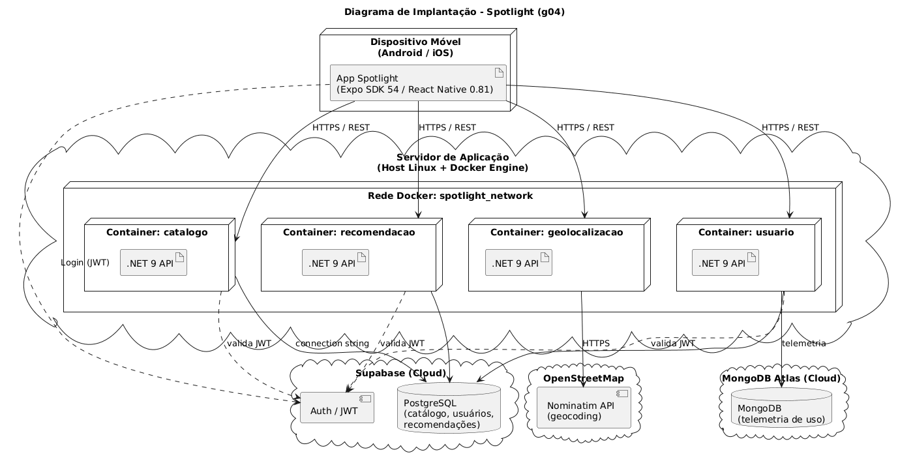<br>

  <sup>Source: Material produzido pelos autores, 2026.</sup>

</div>

### Nós, artefatos e integrações

| Nó / Ambiente | Artefato / Componente | Tecnologia | Comunicação |
|---|---|---|---|
| **Dispositivo Móvel** | App Spotlight | Expo SDK 54 / React Native 0.81 | HTTPS/REST com as APIs; login via JWT no Supabase Auth |
| **Container: catalogo** | API de Catálogo | .NET 9 API | PostgreSQL (connection string); valida JWT no Supabase Auth |
| **Container: recomendacao** | API de Recomendação | .NET 9 API | PostgreSQL (connection string); valida JWT no Supabase Auth |
| **Container: geolocalizacao** | API de Geolocalização | .NET 9 API | HTTPS para Nominatim (geocoding) |
| **Container: usuario** | API de Usuário | .NET 9 API | PostgreSQL; telemetria no MongoDB Atlas; valida JWT no Supabase Auth |
| **Supabase (Cloud)** | PostgreSQL + Auth/JWT | Supabase | Persistência relacional e provedor de identidade |
| **MongoDB Atlas (Cloud)** | MongoDB | MongoDB | Persistência de telemetria de uso |
| **OpenStreetMap** | Nominatim API | OpenStreetMap | Geocodificação de endereços |

Os quatro contêineres do backend são orquestrados no mesmo host pela rede Docker `spotlight_network`, o que permite isolamento de processos, padronização do ambiente de execução e comunicação interna entre serviços, enquanto a exposição externa ocorre por HTTPS para o aplicativo móvel.

### Código-fonte do diagrama (PlantUML)

O diagrama acima foi gerado a partir do seguinte código PlantUML, mantido versionado para permitir futuras atualizações da topologia:

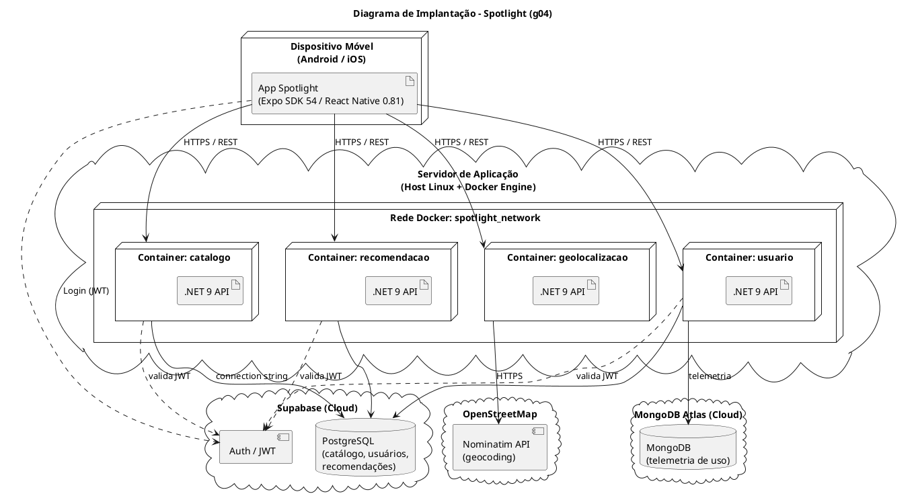

## 6.2 Justificativa das Escolhas de Implantação

As escolhas de implantação priorizam **padronização do ambiente**, **baixo custo operacional no MVP** e **clareza das fronteiras entre serviços**:

- **Contêineres Docker no host Linux:** cada microsserviço .NET 9 roda em um contêiner próprio na rede `spotlight_network`, garantindo isolamento, paridade entre ambientes de desenvolvimento e produção e facilidade de orquestração via `docker-compose`. Isso reduz o atrito de configuração e mantém a arquitetura SOA com fronteiras bem definidas.
- **Supabase (PostgreSQL + Auth):** concentra persistência relacional e identidade em uma plataforma gerenciada, eliminando a necessidade de manter servidores de banco e de autenticação próprios. O PostgreSQL padrão evita *vendor lock-in* e o Auth/JWT integra-se nativamente ao banco (ver Seção 6.3).
- **MongoDB Atlas para telemetria:** a telemetria de uso, de alto volume e escrita intensa, é segregada em um banco documental gerenciado na nuvem, preservando o desempenho do banco transacional e seguindo o princípio de persistência poliglota.
- **OpenStreetMap/Nominatim:** atende ao *geocoding* do serviço de geolocalização sem dependência de billing proprietário, adequando-se ao escopo e ao orçamento do MVP.
- **App móvel desacoplado:** o aplicativo comunica-se exclusivamente por HTTPS/REST com o backend e por JWT com o Supabase Auth, mantendo o cliente independente da infraestrutura interna e permitindo evolução dos serviços sem impacto na camada de apresentação.

## 6.3 Autenticação e Segurança

Esta seção apresenta uma análise detalhada sobre o Supabase Auth e sua integração de forma robusta e otimizada, abordando diretamente as preocupações sobre hospedagem, infraestrutura e comparação com o Auth0, serviço de autenticação anteriormente utilizado em outro projeto do Inteli.

---

### 6.3.1 Supabase Auth vs. Auth0

Abaixo está um comparativo focado em infraestrutura, custos e facilidade de deploy:

| Critério | Auth0 | Supabase Auth |
|---|---|---|
| **Limite Grátis (MAUs)** | Até 7.000 ou 10.000 usuários ativos mensais (varia conforme a política recente). | Até 50.000 usuários ativos mensais. |
| **Exigência de Domínio Pago** | Sim/Recomendado. Exige domínio customizado configurado (`auth.suaempresa.com`) para evitar bloqueio de cookies de terceiros e garantir callbacks estáveis. | Não. O Supabase fornece um subdomínio padrão gratuito (`https://xyz.supabase.co`) funcionando diretamente em produção. |
| **Uso em Mobile (React Native)** | Exige integração com WebViews ou Browser do sistema para login social e callbacks OIDC complexos. | Permite chamadas diretas via API REST ou SDK nativo sem obrigatoriedade de Browser pop-ups. |
| **Integração com Banco de Dados** | Dados residem nos servidores do Auth0. Sincronização exige Webhooks ou Actions. | Integração nativa com PostgreSQL. Usuários ficam na tabela `auth.users`. |
| **Vendor Lock-in** | Alto. Exportar hashes e credenciais é complexo. | Baixo. O banco é PostgreSQL padrão e pode ser migrado livremente. |
| **Row Level Security (RLS)** | Não possui suporte nativo. | Suporte nativo integrado ao PostgreSQL. |

---

### 6.3.2 Domínio no Supabase

No Auth0, a dependência de um domínio customizado ocorre principalmente devido a duas restrições:

#### Segurança e Cookies de Terceiros

Navegadores modernos bloqueiam cookies de sites diferentes do domínio principal do app.

Nesse cenário, os cookies podem ser tratados como cookies de terceiros e bloqueados.

#### Redirect URIs

O fluxo do Auth0 depende fortemente de redirecionamentos seguros entre domínios.

---

### 6.3.3 Por que no Supabase Auth + React Native isso não é um problema?

#### Mobile não usa cookies

Em aplicativos React Native (iOS/Android), não existe o conceito tradicional de cookies de terceiros como no navegador web.

A autenticação funciona via:

```http
Authorization: Bearer <TOKEN>
```

#### Endpoints Nativos

O SDK do Supabase no React Native realiza requisições HTTPS normais de autenticação para os endpoints REST do Supabase Auth. A URL base do serviço segue o padrão:

```text
https://<PROJECT_REF>.supabase.co/auth/v1
```

Os endpoints relevantes para o fluxo do Spotlight estão detalhados abaixo. Em chamadas públicas, o header `apikey` recebe a chave anônima do projeto (`SUPABASE_ANON_KEY`) e o header `Authorization` pode usar a mesma chave no formato `Bearer <SUPABASE_ANON_KEY>`. Em chamadas autenticadas, o header `Authorization` recebe o `access_token` do usuário no formato `Bearer <ACCESS_TOKEN>`.

| Operação | Método e endpoint | Headers principais | Body da requisição | Exemplo de resposta |
|---|---|---|---|---|
| Cadastro de usuário | `POST /signup` | `apikey: <SUPABASE_ANON_KEY>`<br>`Authorization: Bearer <SUPABASE_ANON_KEY>`<br>`Content-Type: application/json` | `{ "email": "ana@email.com", "password": "REDACTED_FOR_PUBLIC_RELEASE", "data": { "nome": "Ana" } }` | `{ "user": { "id": "uuid", "email": "ana@email.com" }, "session": { "access_token": "jwt", "refresh_token": "token" } }` |
| Login com e-mail e senha | `POST /token?grant_type=password` | `apikey: <SUPABASE_ANON_KEY>`<br>`Authorization: Bearer <SUPABASE_ANON_KEY>`<br>`Content-Type: application/json` | `{ "email": "ana@email.com", "password": "REDACTED_FOR_PUBLIC_RELEASE" }` | `{ "access_token": "jwt", "token_type": "bearer", "expires_in": 3600, "refresh_token": "token", "user": { "id": "uuid" } }` |
| Renovação de sessão | `POST /token?grant_type=refresh_token` | `apikey: <SUPABASE_ANON_KEY>`<br>`Authorization: Bearer <SUPABASE_ANON_KEY>`<br>`Content-Type: application/json` | `{ "refresh_token": "token" }` | `{ "access_token": "novo-jwt", "token_type": "bearer", "expires_in": 3600, "refresh_token": "novo-token" }` |
| Consulta do usuário autenticado | `GET /user` | `apikey: <SUPABASE_ANON_KEY>`<br>`Authorization: Bearer <ACCESS_TOKEN>` | Não possui body | `{ "id": "uuid", "email": "ana@email.com", "aud": "authenticated", "role": "authenticated" }` |
| Atualização de dados do usuário | `PUT /user` | `apikey: <SUPABASE_ANON_KEY>`<br>`Authorization: Bearer <ACCESS_TOKEN>`<br>`Content-Type: application/json` | `{ "data": { "nome": "Ana Clara" } }` | `{ "id": "uuid", "email": "ana@email.com", "user_metadata": { "nome": "Ana Clara" } }` |
| Logout | `POST /logout` | `apikey: <SUPABASE_ANON_KEY>`<br>`Authorization: Bearer <ACCESS_TOKEN>` | Não possui body | `{}` |

No backend do Spotlight, as rotas protegidas do API Gateway e dos serviços ASP.NET Core não recebem o `refresh_token`. Elas recebem apenas o JWT de acesso emitido pelo Supabase Auth:

```http
Authorization: Bearer <ACCESS_TOKEN>
```

Quando a sessão expira, o aplicativo React Native usa o `refresh_token` diretamente contra o Supabase Auth para obter um novo `access_token`, sem expor esse token de renovação aos serviços internos.

Isso funciona perfeitamente em produção, independentemente do ambiente utilizado:

- Aplicações publicadas na App Store
- Aplicações publicadas na Google Play
- Backend hospedado em VPS simples

---

#### Hospedagem Flexível

O Supabase fornece o endpoint HTTPS de forma totalmente gratuita e gerenciada na própria infraestrutura da plataforma.

Também é possível utilizar o Supabase em modo self-hosted, executando os serviços via Docker em uma VPS própria utilizando:

- IP público
- DuckDNS
- No-IP
- Outros serviços gratuitos de DNS dinâmico

Com isso, nenhum domínio próprio pago é necessário para colocar o sistema em produção.

---

### 6.3.4 Como funciona o Supabase Auth na prática?

O fluxo operacional no ecossistema do Spotlight funcionará conforme ilustrado abaixo.

<div align="center">

<sub>Figura 28 - Fluxo Supabase Auth</sub><br>

  <br>

  <sup>Source: Material produzido pelos autores, 2026.</sup>

</div>

---

### 6.3.5 Variáveis de Ambiente e Configuração

As variáveis de ambiente separam configuração de código-fonte e evitam que chaves sensíveis sejam versionadas no repositório. A tabela abaixo descreve quais variáveis são necessárias, onde cada uma é consumida e como configurá-las por camada.

| Variável | Camada que consome | Finalidade | Como configurar |
|---|---|---|---|
| `EXPO_PUBLIC_SUPABASE_URL` | React Native | URL pública do projeto Supabase, usada pelo SDK no app mobile. | Definir no `.env` do app Expo com o valor `https://<PROJECT_REF>.supabase.co`. |
| `EXPO_PUBLIC_SUPABASE_ANON_KEY` | React Native | Chave pública anônima usada para chamadas públicas ao Supabase Auth e para iniciar sessões. | Definir no `.env` do app Expo. Por ser pública, pode ir para o bundle mobile, mas deve ser combinada com RLS no banco. |
| `SUPABASE_URL` | API Gateway e serviços ASP.NET Core | URL do projeto Supabase para integrações server-side. | Definir como variável de ambiente do processo .NET ou em `appsettings.Development.json` apenas no ambiente local. |
| `SUPABASE_JWT_SECRET` | API Gateway ASP.NET Core | Chave usada para validar localmente a assinatura dos JWTs emitidos pelo Supabase Auth. | Definir somente no backend. Em produção, armazenar no provedor de secrets da hospedagem e nunca expor ao frontend. |
| `SUPABASE_SERVICE_ROLE_KEY` | Serviços ASP.NET Core autorizados | Chave administrativa para operações server-side que precisam ignorar RLS em rotinas internas controladas. | Definir apenas nos serviços que realmente precisam dessa permissão. Não usar no React Native. |
| `POSTGRES_CONNECTION_STRING` | Serviços ASP.NET Core e rotinas de migração | String de conexão com o PostgreSQL provisionado pelo Supabase. | Definir no formato `Host=<host>;Port=5432;Database=postgres;Username=<user>;Password=<password>;SSL Mode=Require;Trust Server Certificate=true`. |
| `POSTGRES_DB`, `POSTGRES_USER` e `POSTGRES_PASSWORD` | PostgreSQL local/self-hosted | Configuração do banco quando o Supabase é executado localmente ou via Docker. | Definir no arquivo `.env` usado pelo `docker compose` da infraestrutura local. |

Exemplo de configuração local do React Native:

```env
EXPO_PUBLIC_SUPABASE_URL=https://<PROJECT_REF>.supabase.co
EXPO_PUBLIC_SUPABASE_ANON_KEY=<supabase-anon-key>
```

Exemplo de configuração local do API Gateway em ASP.NET Core:

```env
SUPABASE_URL=https://<PROJECT_REF>.supabase.co
SUPABASE_JWT_SECRET=<supabase-jwt-secret>
SUPABASE_SERVICE_ROLE_KEY=<supabase-service-role-key>
POSTGRES_CONNECTION_STRING=Host=<host>;Port=5432;Database=postgres;Username=<user>;Password=<password>;SSL Mode=Require;Trust Server Certificate=true
```

Exemplo de configuração local do PostgreSQL em ambiente self-hosted:

```env
POSTGRES_DB=postgres
POSTGRES_USER=postgres
POSTGRES_PASSWORD=<senha-forte>
```

A configuração em produção deve seguir três regras: o frontend recebe apenas URL pública e chave anônima; o backend recebe segredos de autenticação e conexão por meio do ambiente de execução; e o PostgreSQL recebe credenciais apenas na infraestrutura, sem exposição ao aplicativo mobile.

---

### 6.3.6 Componentes Chave

#### Access Token (JWT)

Token de curta duração (geralmente 1 hora).

Contém informações codificadas e assinadas como:

- ID do usuário (`sub`)
- Email
- Permissões (`role`)

---

#### Refresh Token

Token de longa duração armazenado de forma segura no dispositivo.

Responsável por solicitar automaticamente um novo JWT sem exigir que o usuário faça login novamente.

---

#### Validação Local

O API Gateway em ASP.NET Core não precisa realizar requisições HTTP ao Supabase para verificar a validade do token.

O processo consiste apenas em:

- Decodificar o JWT
- Validar sua assinatura criptográfica utilizando a chave secreta compartilhada (`JWT Secret`)

#### Benefícios

- Validação instantânea
- Sem latência de rede
- Menor custo operacional

#### Row Level Security

O Supabase expõe funções especiais diretamente no PostgreSQL, como:

```sql
auth.uid()
```

Caso o backend realize consultas "em nome do usuário" utilizando o JWT na conexão, o próprio PostgreSQL aplica automaticamente as regras de acesso.

#### Benefícios do RLS

- O banco impede acessos indevidos automaticamente
- Segurança centralizada na camada de dados
- Redução de lógica manual no backend
- Melhor isolamento entre usuários

# 7. Projeto Visual da Solução

&emsp;As premissas desta seção governaram todas as decisões do projeto, da proporção dos campos de formulário à escolha do tipo de gráfico no dashboard:

## 7.1 Diretrizes de Design

### 7.1.1 Abordagem Mobile First

&emsp;O Mobile First define a hierarquia de conteúdo antes de qualquer decisão de layout. O que cabe em uma tela correspondente a dispositivos Android é, por definição, o que tem prioridade na interface.

Restrições adotadas ao longo de todo o projeto:

- Áreas de toque em destaque mínimas de 44 x 44px em todos os elementos interativos (alinhado às diretrizes HIG/Material Design).
- Espaçamento entre elements interativos de no mínimo 8dp para evitar toques acidentais.
- Scroll vertical como padrão de navegação estrutural. Scroll horizontal restrito a carrosséis de conteúdo secundário, nunca para navegação de seções.
- Barra de navegação inferior do Android (back/home/recents) preservada como referência em todos os frames, forçando o conteúdo a respeitar a safe area inferior.
- Contraste mínimo de 4,5:1 entre texto e fundo, conforme WCAG 2.1 AA.

### 7.1.2 Atomic Design

&emsp;A metodologia Atomic Design foi adotada para garantir consistência e reutilização de componentes. A hierarquia aplicada no contexto do Spotlight:

- **Átomos** - elementos indivisíveis: campo de texto (`input`), botão (`button`), ícone (`icon`), tag de gênero (`chip`), estrela de avaliação (`star`), indicador de carga (`spinner`), separador (`divider`).
- **Moléculas** - combinações funcionais de átomos: campo de formulário (label + input + estado de erro); card de espetáculo (imagem + título + categoria); chip de preferência com estado ativo/inativo; par de botões de ação.
- **Organismos** - seções completas com propósito específico: formulário de login; grade de espetáculos do catálogo; seção de recomendações ("Porque você gostou de X"); cabeçalho de espetáculo (imagem de destaque + título + avaliação); painel de métricas do dashboard.
- **Templates** - estrutura de cada tela sem conteúdo real: zonas de header, área de conteúdo principal, navegação inferior e safe areas.
- **Páginas** - templates com conteúdo aplicado: as oito telas documentadas abaixo.

## 7.2 Desenvolvimento de Wireframes


### Visão Geral do Fluxo de Navegação

&emsp;O wireframe navegável cobre o fluxo completo do usuário, do acesso ao portal até a visualização de detalhes de um espetáculo, além do fluxo de administrador com acesso ao dashboard. O diagrama abaixo registra as conexões entre telas e os pontos de decisão mapeados no Figma:

<div align="center">

<sub>Figura 29 - Fluxo Geral de Navegação - Wireframe</sub><br>

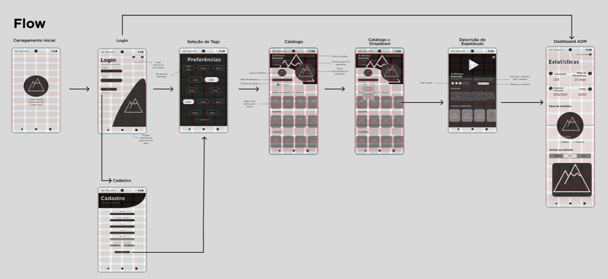

Fonte: Material produzido pelos autores (2026).

</div>

&emsp;O fluxo parte da tela de Intro e divide em dois caminhos no Login: novo usuário segue para Cadastro, depois Seleção de Preferências e então Catálogo; usuário recorrente vai direto do Login ao Catálogo. A partir do Catálogo, tap em card leva ao Catálogo por Afinidade e depois à Descrição do Espetáculo; acesso administrativo leva ao Dashboard. As setas no diagrama correspondem a interações de toque, tap em botão, card e ícone de administrador.

---

### Tela 1 - Intro (Splash)

<div align="center">

<sub>Figura 30 - Tela 1 - Intro (Splash)</sub><br>

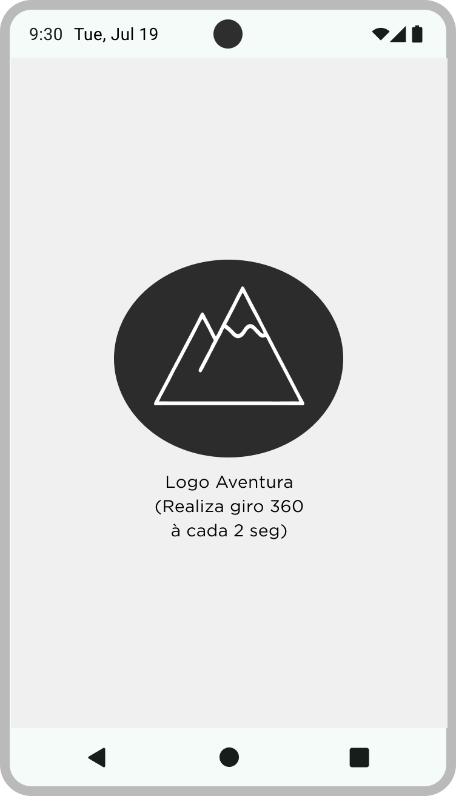

Fonte: Material produzido pelos autores (2026).

</div>

#### Descrição e Funcionalidade

&emsp;A tela de Intro é a primeira exibida ao abrir o aplicativo. Sua função é exclusivamente de identidade: apresentar a marca Aventura Teatros antes de qualquer interação. Não há input do usuário, a tela tem duração fixa de aproximadamente 2,5 segundos antes do redirecionamento automático ao Login por fade-out.

#### Estrutura e Componentes (Atomic Design)

**Átomo - Logotipo:** Ícone circular centralizado horizontalmente, ocupando cerca de 40% da largura da tela. Representa o símbolo de montanha/triângulo da Aventura. Posicionado no terço superior-médio da tela (aproximadamente 35% do eixo Y), respeitando a safe area superior do dispositivo.

**Template:** Fundo claro (branco no wireframe, por convenção de escala de cinza). Sem barra de navegação funcional da aplicação. Barra de sistema inferior do Android visível mas inativa.

#### Mobile First e Gestos

&emsp;Por ser uma tela passiva, não há área de toque intencional. O logotipo está no terço superior-médio, e não no centro geométrico exato, porque em smartphones acima de 5,5 polegadas o polegar não alcança com conforto o centro quando a mão está em posição de uso. A transição para o Login é por timeout com fade-out, sem exigir toque, eliminando fricção na abertura.

#### Decisões de Design

&emsp;A tela não exibe instrução alguma porque não precisa: o usuário não tem nada para fazer além de aguardar.

---

### Tela 2 - Login

<div align="center">

<sub>Figura 31 - Tela 2 - Login</sub><br>


Fonte: Material produzido pelos autores (2026).

</div>

#### Descrição e Funcionalidade

&emsp;A tela de Login é o ponto de entrada do usuário recorrente e o ponto de bifurcação para o novo usuário, via link para Cadastro. Cobre os RFs RF01 (cadastro) e RF02 (autenticação). Sem login, não há perfil; sem perfil, o motor de recomendação opera em cold start, por isso a tela precisa ter o menor atrito possível.

#### Estrutura e Componentes (Atomic Design)

**Átomo - Título "Login":** 24sp/bold, alinhamento à esquerda no bloco de formulário. Posicionado no terço superior da área de conteúdo, margem lateral de 24dp.

**Molécula - Ilustração de marca:** Forma orgânica com montanha estilizada, lado inferior-direito da tela, abaixo do título. Elemento decorativo sem área de toque. Ocupa aproximadamente 50% da largura e 30% da altura. O posicionamento à direita equilibra o formulário à esquerda sem competir com ele.

**Molécula - Campo de e-mail:** Label "E-mail" + input com borda inferior (estilo underline). Largura total menos margens de 24dp. Altura mínima de 48dp.

**Molécula - Campo de senha:** Mesma estrutura do campo de e-mail. Ícone de visibilidade (olho) no canto direito, com 44 x 44px de área de toque.

**Molécula - Botão primário "Entrar":** Largura total da área de conteúdo. Altura de 52dp. Base do bloco de formulário.

**Átomo - Link "Esqueceu a senha?":** 14sp, alinhado à direita abaixo do campo de senha. Área de toque de 44dp de altura por padding invisível.

**Átomo - Link "Cadastre-se":** Texto destacado, centralizado abaixo do botão. Leva à Tela 3.

**Template:** Barra de sistema superior visível. Sem header da aplicação (usuário não autenticado). Margem lateral de 24dp. Conteúdo centralizado verticalmente no espaço entre safe area superior e barra de sistema inferior.

#### Mobile First e Gestos

&emsp;O teclado virtual ocupa 40 a 50% da tela em dispositivos Android de tamanho médio. Os campos usam estilo underline com float label: reduz densidade visual em tela pequena sem perder a identificação do campo ao digitar. Não há gesto de swipe nesta tela.

#### Decisões de Design

&emsp;O botão "Entrar" ocupa a largura total por dois motivos: maximiza a área de toque sem exigir precisão e sinaliza claramente a ação principal. O link "Cadastre-se" está abaixo do botão primário, e não ao lado, para não disputar atenção visual com o CTA de login. Usuários recorrentes não precisarão enxergá-lo na maioria das visitas.

---

### Tela 3 - Cadastro

<div align="center">

<sub>Figura 32 - Tela 3 - Cadastro</sub><br>

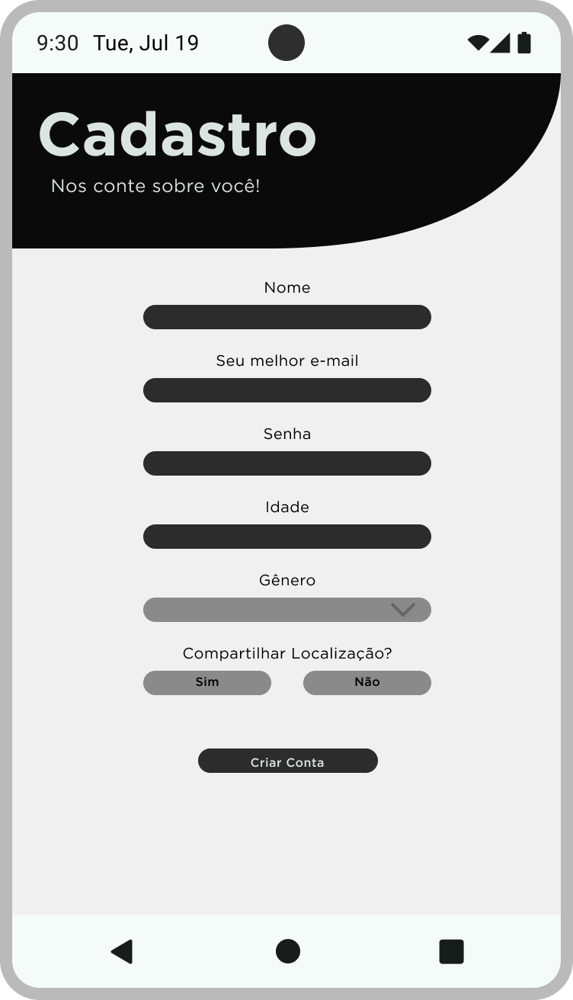

Fonte: Material produzido pelos autores (2026).

</div>

#### Descrição e Funcionalidade

&emsp;A tela de Cadastro coleta os dados mínimos para criação de conta (RF01). Inclui campos demográficos, gênero e idade, que alimentam o perfil inicial do motor de recomendação antes de qualquer histórico de navegação. É a resolução do cold start: o usuário fornece preferências já no ato do cadastro.

#### Estrutura e Componentes (Atomic Design)

**Átomo - Título "Cadastro":** 24sp/bold, alinhado à esquerda. Margem superior de 32dp após a safe area.

**Átomo - Subtítulo de instrução:** "Nos conte sobre você!", 14sp/regular, cinza médio. Define o contexto.

**Moléculas - Campos de formulário:** Login, Senha, Nome, Idade, Gênero, "Criar Conta". Cada campo: label + input underline.

**Template:** Botões de ação ao final do formulário, não fixados no rodapé da tela.

#### Mobile First e Gestos

&emsp;O formulário com scroll é o padrão mobile consolidado para cadastros com múltiplos campos.

#### Decisões de Design

&emsp;Os campos gênero e idade não estão no formulário por obrigatoriedade: eles existem porque são a estratégia de cold start documentada na Visão do Produto. Sem histórico, o motor precisa de algo para segmentar, e esses dois campos fornecem o mínimo para que a primeira sessão já entregue recomendações mais relevantes que a média geral.

---

### Tela 4 - Seleção de Preferências

<div align="center">

<sub>Figura 33 - Tela 4 - Seleção de Preferências</sub><br>

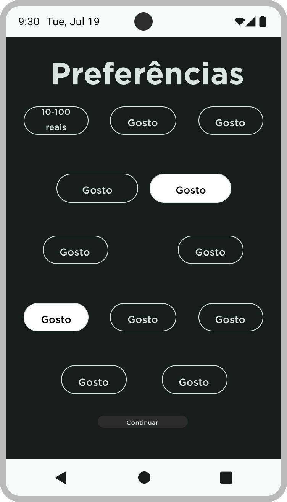

Fonte: Material produzido pelos autores (2026).

</div>

#### Descrição e Funcionalidade

&emsp;Exibida uma única vez após o primeiro cadastro, esta tela coleta gêneros artísticos de interesse por tags interativas. Os dados alimentam diretamente o perfil inicial do motor de ML, segundo pilar da estratégia anti-cold start, junto com os dados demográficos do cadastro. Corresponde ao RF03 (seleção de preferências) e ao RF12 (coleta de dados para recomendação).

#### Estrutura e Componentes (Atomic Design)

**Átomo - Título "Preferências":** 24sp/bold, centralizado.

**Átomo - Tag de preferência:** Elemento de 44dp de altura mínima, bordas arredondadas (border-radius ~20dp), texto de gênero centralizado (14sp). Dois estados: inativo (fundo branco, borda cinza) e ativo (fundo escuro, texto branco). Este é o átomo central da tela.

**Organismo - Grade de tags:** Tags em linhas flexíveis com wrapping. No wireframe, grupos de 2 por linha com variação por comprimento de label. Espaçamento de 8dp horizontal e 12dp vertical. A grade ocupa a maior parte da tela.

**Molécula - Botão "Continuar":** Largura total, fixado no rodapé (acima da safe area inferior), 52dp de altura. Disponível mesmo sem seleção de nenhuma tag.

**Template:** Safe area superior preservada. Barra de sistema do Android visível.

#### Mobile First e Gestos

&emsp;A tag tem 44dp de altura de área de toque, não é o tamanho visual do texto, é a área registrada pelo sistema. Tap alterna o estado (ativo/inativo) sem nenhuma outra ação necessária. A seleção múltipla é ilimitada. A grade com wrapping foi escolhida sobre a lista vertical para reduzir o comprimento de scroll: 12 gêneros em lista de um por linha resultariam em mais de 500dp de altura contra aproximadamente a metade na grade de 2 por linha. Todas as tags ficam alcançáveis com o polegar em dispositivos de até 6,5 polegadas porque a grade começa logo abaixo do cabeçalho.

#### Decisões de Design

&emsp;A versão inicial usava toggle switch em lista vertical. Dois problemas: a lista era longa demais e o toggle switch é semanticamente associado a configurações binárias persistentes (como notificações), não a seleções exploratórias de gosto. A revisão substituiu pela grade de tags, que comunica melhor a ideia de "escolher o que curto".

---

### Tela 5 - Catálogo

<div align="center">

<sub>Figura 34 - Tela 5 - Catálogo</sub><br>

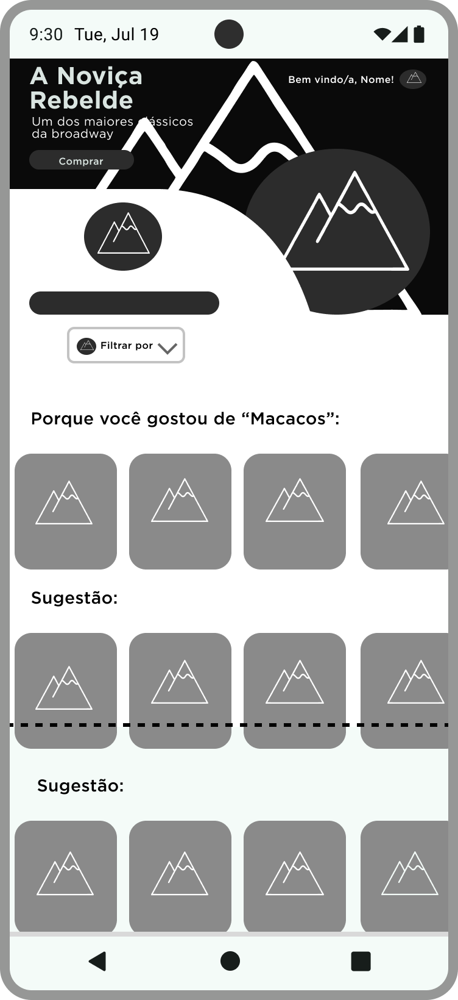

Fonte: Material produzido pelos autores (2026).

</div>

#### Descrição e Funcionalidade

&emsp;O Catálogo é a tela principal para o usuário final e onde o sistema de recomendação se torna visível. O usuário vê um espetáculo em destaque, uma seção baseada em histórico ("Porque você gostou de X") e seções de sugestões temáticas. Cobre RF04 (busca e filtragem), RF07 (conteúdo), RF13 (recomendação personalizada), RF14 (recomendação colaborativa) e RF15 (recomendação por popularidade).

#### Estrutura e Componentes (Atomic Design)

**Organismo - Banner de destaque:** Largura total, aproximadamente 35% da altura da viewport. Exibe o espetáculo em destaque com título sobreposto em 18sp/bold. Posicionado no topo por ser o primeiro ponto de atenção em scroll iniciado do zero.

**Molécula - Header de seção de recomendação:** "Porque você gostou de 'Macacos':" em 14sp/semibold, alinhado à esquerda, margem de 16dp. O nome entre aspas é dinâmico, reflete o último espetáculo com interação registrada. É o ponto onde a lógica do SVD se torna comunicável para o usuário.

**Organismo - Carrossel horizontal de cards:** Cards com scroll por swipe. Cada card mede aproximadamente 100 x 140dp (proporção 2:3 de cartaz teatral). Elementos: imagem de capa + título (máximo 2 linhas) + categoria. O primeiro card parcialmente visível à direita indica continuidade sem instrução textual.

**Organismo - Seções "Sugestão:":** Duas ou mais seções adicionais abaixo da personalizada, mesma estrutura de carrossel. Baseadas em popularidade ou categoria do portfólio da Aventura.

**Template:** Scroll vertical como navegação estrutural. Banner no topo. Sem bottom navigation bar própria nesta versão. Barra de sistema do Android preservada.

#### Mobile First e Gestos

&emsp;Dois gestos coexistem: scroll vertical entre seções e swipe horizontal dentro de cada carrossel. Essa combinação é o padrão de apps de conteúdo (Netflix, Spotify, Google Play). O card de 100 x 140dp define área de toque generosa: a imagem é o elemento primário e leva à Descrição do Espetáculo. O carrossel usa momentum scroll nativo. A affordance de continuidade vem do card parcialmente visível na borda direita, com cerca de 30% do próximo card aparente a 32dp da borda.

#### Decisões de Design

&emsp; Filtros ativos pressupõem intenção prévia de busca, o que completa a proposta do Catálogo: aqui o sistema guia, não o usuário procura. A seção "Porque você gostou de X" é o elemento central desta tela e cumpre a promessa declarada no problema identificado: o portal deixa de ser via de mão única quando mostra caminhos para outros espetáculos com justificativa explícita. Cada card visto gera um evento, que retroalimenta o SVD. O tempo de permanência por seção também é capturado.

---

### Tela 6 - Catálogo - Visão por Afinidade

<div align="center">

<sub>Figura 35 - Tela 6 - Catálogo - Visão por Afinidade</sub><br>

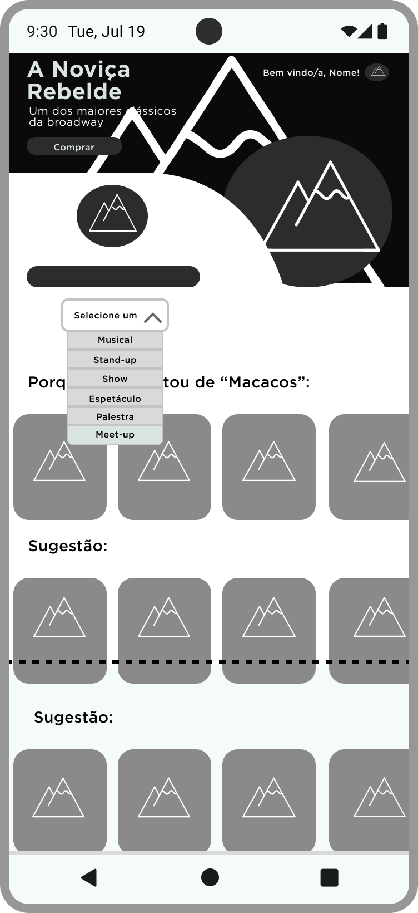

Fonte: Material produzido pelos autores (2026).

</div>

#### Descrição e Funcionalidade

&emsp;Variação do Catálogo exibida quando o usuário acessa a partir de um espetáculo específico ou quando o sistema ativa a visualização por afinidade com base em um item de referência recente. Cobre RF13, RF14 e complementa RF04.

#### Estrutura e Componentes (Atomic Design)

&emsp;A estrutura base é idêntica à Tela 5. Componentes adicionados:

**Template:** Idêntico à Tela 5. A mudança é semântica, não estrutural.

#### Mobile First e Gestos

&emsp; Todos os gestos da Tela 5 se aplicam: scroll vertical, swipe horizontal nos carrosséis, tap nos cards.

#### Decisões de Design

&emsp; Liberdade concedida ao usuário de filtrar eventos por suas preferências à partir de um click.

---

### Tela 7 - Descrição do Espetáculo

<div align="center">

<sub>Figura 36 - Tela 7 - Descrição do Espetáculo</sub><br>

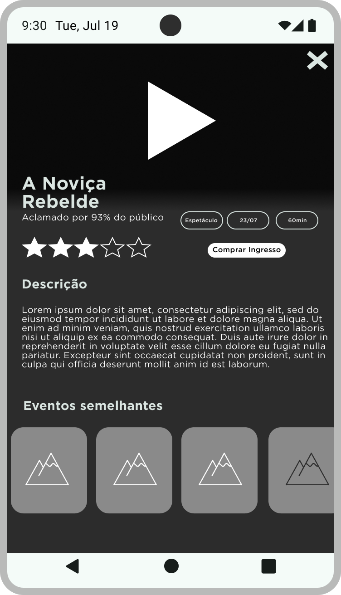

Fonte: Material produzido pelos autores (2026).

</div>

#### Descrição e Funcionalidade

&emsp;Tela de detalhe de um espetáculo, destino de qualquer tap em card de catálogo. Agrupa informações completas (nome, avaliação, descrição), conteúdo multimídia (player de vídeo de prévia) e seção de espetáculos semelhantes. Cobre RF07 (conteúdo), RF08 (avaliação geral), RF09 (avaliações de usuários) e RF13 (recomendações via "Eventos semelhantes"). É a tela onde o usuário decide se compra o ingresso.

#### Estrutura e Componentes (Atomic Design)

**Organismo - Player de vídeo:** Largura total, aproximadamente 40% da altura da viewport. Frame de prévia com ícone de play centralizado (56 x 56dp de área de toque). Botão de fechar (X) no canto superior direito com 44 x 44dp de área de toque. Tap no play inicia reprodução em fullscreen landscape.

**Átomo - Título do espetáculo:** "A Noviça Rebelde" no exemplo, 20sp/bold, alinhado à esquerda abaixo do player, margem lateral de 16dp.

**Molécula - Avaliação por estrelas:** Estrelas de 20 x 20dp com count numérico ao lado. Linha com 44dp de altura de área de toque.

**Organismo - Bloco de descrição:** Label "Descrição" (14sp/semibold) + sinopse em texto corrido (14sp/regular, alinhamento justificado).

**Organismo - Seção "Eventos semelhantes":** Label + carrossel horizontal de cards relacionados, mesmo padrão do Catálogo. Estende a recomendação para dentro da tela de detalhe.

**Template:** Scroll vertical. Player no topo ao abrir; ao rolar, sai da viewport e o conteúdo textual ocupa a área completa. Sem header fixo com título da tela.

#### Mobile First e Gestos

&emsp;O player é o elemento mobile mais complexo desta tela. Três gestos mapeados: tap no ícone de play (inicia reprodução fullscreen landscape); tap no X (retorna ao Catálogo); swipe-down sobre o player (dismiss). O botão X tem 44 x 44dp de área de toque mesmo sendo visualmente pequeno. A rotação para landscape ao iniciar o vídeo é automática, controlada pelo sistema operacional.

#### Decisões de Design

&emsp;O player no topo cria a sequência impacto-antes-de-informação: o usuário sente o espetáculo antes de ler sobre ele. Em um portal de cultura, a experiência sensorial precede a decisão racional - esse ordenamento foi deliberado. A seção "Eventos semelhantes" existe como rede de segurança: se o usuário decidir que este espetáculo não é para ele, há alternativas sem retroceder na navegação. Esta é a tela de maior densidade de eventos comportamentais por sessão: tempo de vídeo assistido, tap na avaliação e tap em "Eventos semelhantes" são todos registrados e retroalimentam o SVD.

---

### Tela 8 - Dashboard Administrativo

<div align="center">

<sub>Figura 37 - Tela 8 - Dashboard Administrativo (Estatísticas)</sub><br>

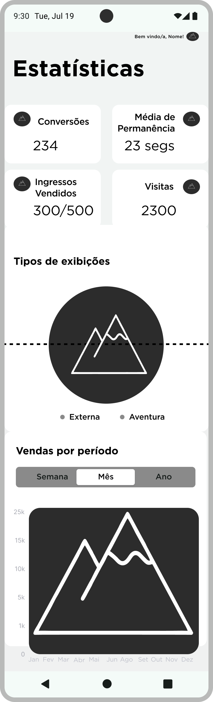

Fonte: Material produzido pelos autores (2026).

</div>

#### Descrição e Funcionalidade

&emsp;Tela exclusiva para usuários com perfil de administrador (RF16). Exibe métricas de desempenho do sistema de recomendação e do portal: conversões, tempo médio de permanência, ingressos vendidos versus capacidade, visitas, distribuição de tipos de exibição e evolução de vendas por período. Tela de leitura e análise, sem ação do usuário final.

#### Estrutura e Componentes (Atomic Design)

**Átomo - Título "Estatísticas":** 22sp/bold, alinhado à esquerda, padding de 16dp.

**Organismo - Painel de KPIs superiores:** Quatro métricas em duas colunas. Coluna esquerda: "Conversões" (234) e "Ingressos Vendidos" (300/500). Coluna direita: "Média de Permanência" (23 segs) e "Visitas" (2300). Cada KPI é molécula: label (12sp/regular, cinza) + valor (22sp/bold). A proporção 300/500 em Ingressos Vendidos inclui barra de progresso horizontal. Um divider horizontal separa os pares de métricas.

**Organismo - Gráfico de pizza "Tipos de exibições":** Donut centralizado horizontalmente. Duas categorias: "Externo" e "Aventura" (diferenciadas por tons de cinza no wireframe). Legenda abaixo. Dimensão: aproximadamente 120 x 120dp. Logotipo/triangulo da marca posicionado no centro vazio do donut.

**Organismo - Gráfico de barras "Vendas por período":** Abaixo do donut. Três tabs de filtro: "Semana", "Mês", "Ano" - chips de seleção única. O gráfico renderiza o período selecionado.

**Template:** Scroll vertical para expansão futura. KPIs superiores visíveis sem scroll (aproximadamente 25% da viewport). Divisão clara entre KPIs, donut e barras por espaçamento e separadores.

#### Mobile First e Gestos

&emsp;Um dashboard em mobile tem um desafio específico: gráficos legíveis em 1200px precisam funcionar em 360px. Decisões tomadas: barras verticais no gráfico de vendas são mais legíveis que linhas em viewport estreita com poucos pontos de dados; tabs de período em vez de seletor de data customizado reduzem a complexidade de interação. O tap nas tabs é o único gesto interativo desta tela. Cada tab tem 44dp de altura e cerca de 30% da largura da área de tabs, com 4dp entre elas.

#### Decisões de Design

&emsp;O dashboard responde diretamente à necessidade de validação das metas declaradas na Visão do Produto (20% de aumento no engajamento, 25% na descoberta, 30% na conversão). O KPI "Conversões" mede cliques em compra de ingresso a partir de recomendações - o indicador mais direto do valor gerado pelo Spotlight. A separação "Externo/Aventura" em Tipos de exibições reflete a dualidade da empresa como produtora e plataforma cultural: dado estratégico para decisões de portfólio. O donut foi escolhido sobre o pie chart porque o centro vazio permite alocar o logotipo sem reduzir a área legível do gráfico; no mockup, esse centro passa a exibir o total numérico de exibições, tornando o espaço ainda mais funcional.

---

## 7.3 Desenvolvimento de Mockups

### Visão Geral e Link de Acesso

&emsp;Os mockups navegáveis foram desenvolvidos no Figma sobre a mesma estrutura de frames dos wireframes.

&emsp;As transições entre telas usam Smart Animate e easing ease-in-out, simulando transições nativas do Android. Nenhum elemento estrutural foi adicionado ou removido em relação ao wireframe sem registro na subseção correspondente. As únicas divergências documentadas são intencionais.

<div align="center">

<sub>Figura 38 - Visão Geral do Fluxo - Mockup</sub><br>

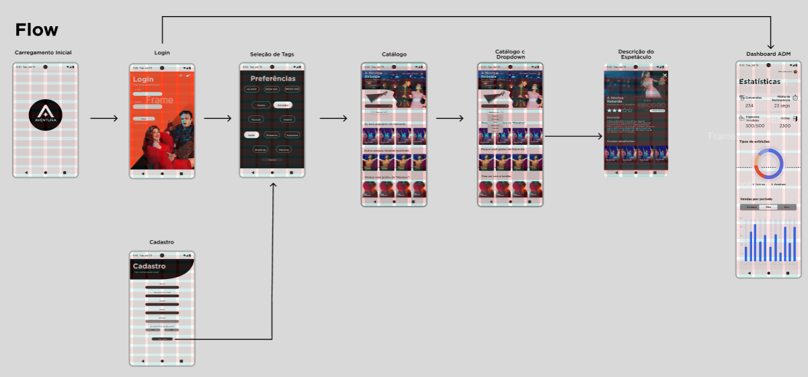

Fonte: Material produzido pelos autores (2026).

</div>

---

### Tela 1 - Intro (Splash)

<div align="center">

<sub>Figura 39 - Tela 1 - Intro (Splash) - Mockup</sub><br>

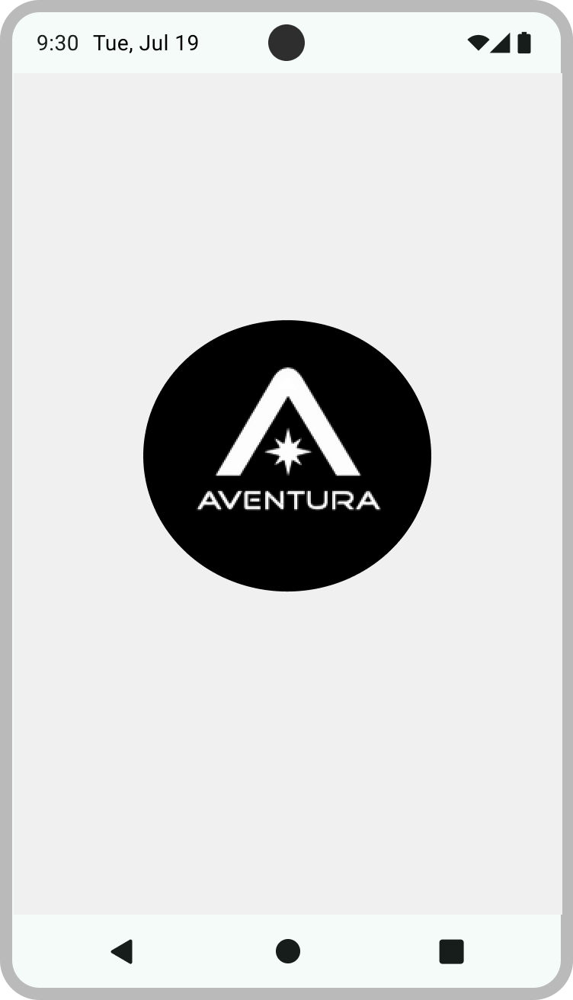

Fonte: Material produzido pelos autores (2026).

</div>

&emsp;Com a identidade Aventura aplicada, o fundo adota o Preto Aventura (`#0A0A0A`), cor de background principal do brand kit. O logotipo aparece na versão negativa: triângulo com contorno Branco (`#FFFFFF`) e círculo interno, acompanhado do wordmark "AVENTURA" em Gotham Bold 700, letter-spacing 4px, caixa alta, conforme especificação do brand kit. A animação de entrada é fade-in do logotipo em 500ms (opacity 0 a 1), pausa de 1,5 segundo e fade-out da tela inteira em 400ms antes da transição para o Login.

---

### Tela 2 - Login

<div align="center">

<sub>Figura 40 - Tela 2 - Login - Mockup</sub><br>

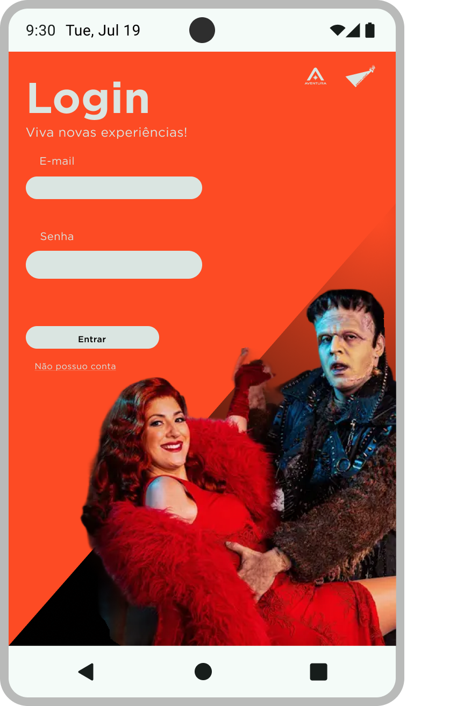

Fonte: Material produzido pelos autores (2026).

</div>

&emsp;Fundo em vermelho-alaranjado vibrante, cor de destaque aplicada ao fluxo de autenticação para diferenciar visualmente as telas de entrada do restante do aplicativo. O título "Login" usa Gotham Bold 700, caixa alta, em cor escura sobre o fundo colorido. A ilustração de elenco em destaque ocupa a metade inferior da tela, reforçando o contexto teatral antes mesmo do usuário acessar o catálogo.

&emsp;Os campos de e-mail e senha usam float label com borda inferior. O botão "Entrar" está posicionado na base do formulário com largura total, mantendo o padrão de CTA da estrutura definida no wireframe.

---

### Tela 3 - Cadastro

<div align="center">

<sub>Figura 41 - Tela 3 - Cadastro - Mockup</sub><br>

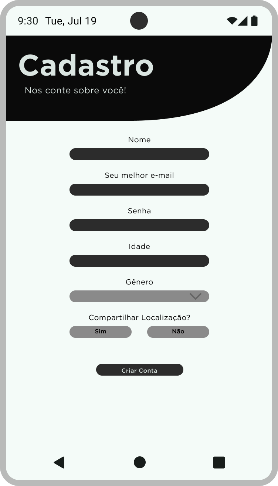

Fonte: Material produzido pelos autores (2026).

</div>

&emsp;Fundo em Preto Aventura (`#0A0A0A`) com área de formulário em superfície clara, criando separação visual entre o fundo da tela e o bloco de entrada de dados. Título "Cadastro" em Gotham Bold 700, caixa alta. Subtítulo "Nos conte sobre você!" em Gotham Book 300, Cinza Texto.

&emsp;Os campos exibidos são: Nome, Seu melhor e-mail, Senha, Idade, Gênero e Compartilhar Localização? Todos os campos seguem o padrão de float label, mantendo consistência com o Login. O botão de ação primário "Criar Conta" usa fundo Preto Aventura e texto Branco (`#FFFFFF`), seguido de link secundário "Criar Conta" em texto simples abaixo.

---

### Tela 4 - Seleção de Preferências

<div align="center">

<sub>Figura 42 - Tela 4 - Seleção de Preferências - Mockup</sub><br>

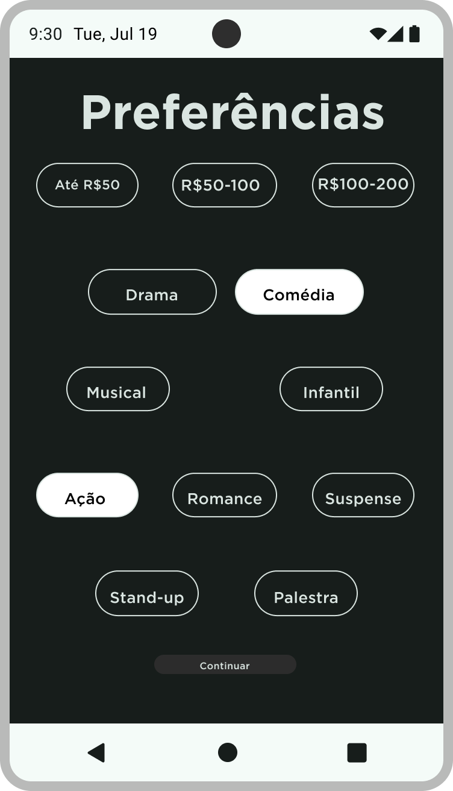

Fonte: Material produzido pelos autores (2026).

</div>

&emsp;Fundo em branco e cinza, antes da entrada no catálogo. Título "Preferências" em Gotham Bold 700, caixa alta.

&emsp;A tela exibe dois grupos de seleção: uma linha de tags de faixa de preço ("Até R$50", "R$50-100", "R$100-200") posicionada no topo da área de conteúdo, e abaixo a grade de chips de gênero artístico (Drama, Comédia, Musical, Infantil, Ação, Romance, Suspense, Stand-up, Palestra) em linhas flexíveis com wrapping. A adição da faixa de preço em relação ao wireframe é uma extensão do perfil de preferências, permitindo que o motor de recomendação filtre também por acessibilidade financeira. O botão "Continuar" está fixado no rodapé, com largura total.

&emsp;As tags têm dois estados com transição por Smart Animate (200ms, ease-out): inativo (fundo transparente, borda em tom escuro) e ativo (fundo escuro, texto branco). A micro-interação de mudança de estado ao tap confirma visualmente que o toque foi registrado.

---

### Tela 5 - Catálogo

<div align="center">

<sub>Figura 43 - Tela 5 - Catálogo - Mockup</sub><br>

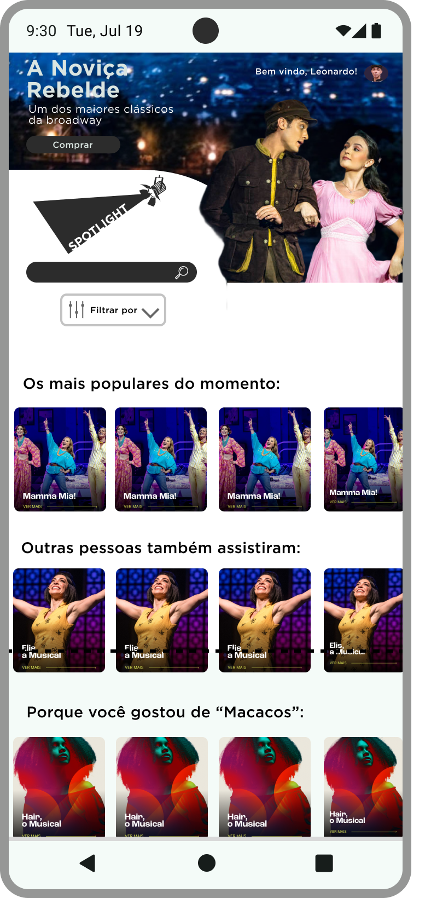

Fonte: Material produzido pelos autores (2026).

</div>

&emsp;Fundo em Preto Aventura (`#0A0A0A`). O banner de destaque usa imagem real do espetáculo com gradiente linear na base: de `rgba(10,10,10,0)` a `rgba(10,10,10,0.85)`, usando a mesma cor do fundo para que a transição seja imperceptível e o título em Branco mantenha contraste mínimo de 4,5:1 independentemente da cor dominante da fotografia. Um controle de filtro por gênero está visível abaixo do banner.

&emsp;A ordenação das seções no mockup prioriza o conteúdo de maior alcance antes do personalizado: "Os mais populares do momento:" aparece primeiro, seguida de "Outras pessoas também assistiram:" e, por último, "Porque você gostou de 'Macacos':". Essa sequência posiciona a recomendação personalizada como destaque final do scroll, após o usuário já ter sido exposto ao catálogo geral, estratégia que reduz a percepção de caixa preta do sistema para usuários com pouco histórico. Os cards de espetáculo nos carrosséis têm cantos arredondados (border-radius 8dp), imagem 2:3 na parte superior.

---

### Tela 6 - Catálogo - Visão por Afinidade

<div align="center">

<sub>Figura 44 - Tela 6 - Catálogo - Visão por Afinidade - Mockup</sub><br>

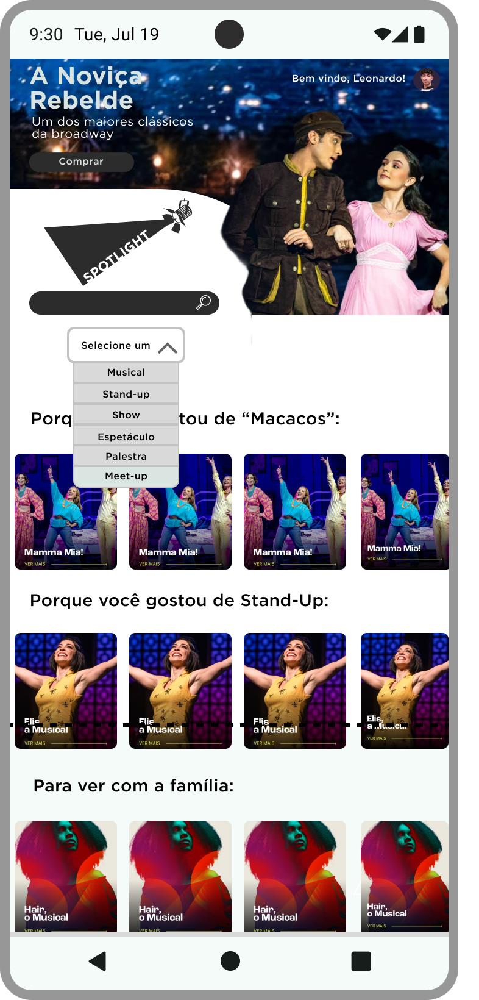

Fonte: Material produzido pelos autores (2026).

</div>

&emsp;Estrutura visual idêntica à Tela 5 em fundo e cards. As seções exibidas refletem o gênero selecionado: "Porque você gostou de 'Macacos':", "Porque você gostou de Stand-Up:" e "Para ver com a família:", cada uma agrupando recomendações por afinidade temática distinta. Essa abordagem torna a navegação por afinidade mais ativa e explorável do que a versão passiva do wireframe, sem alterar a estrutura de carrosseis horizontais.

---

### Tela 7 - Descrição do Espetáculo

<div align="center">

<sub>Figura 45 - Tela 7 - Descrição do Espetáculo - Mockup</sub><br>

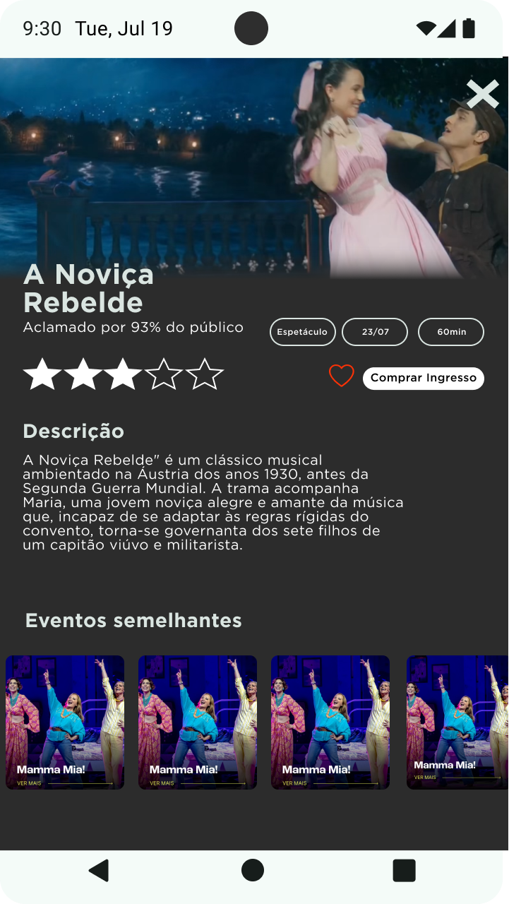

Fonte: Material produzido pelos autores (2026).

</div>

&emsp;A área de destaque no topo é implementada como player de vídeo. O botão de fechar (X) permanece no canto superior direito com área de toque de 44 x 44dp.

&emsp;O título do espetáculo usa Gotham Bold 700, caixa alta, 20sp, Branco. A avaliação exibe 3 estrelas preenchidas em Branco e vazias com contorno Cinza Escuro, com count numérico ao lado. O label "DESCRIÇÃO" usa Gotham Medium 500; o texto da sinopse usa Gotham Book 300, Cinza Texto (`#8A8A8A`). A seção "Eventos semelhantes" encerra a tela com carrossel horizontal de cards no padrão do Catálogo.

---

### Tela 8 - Dashboard Administrativo

<div align="center">

<sub>Figura 46 - Tela 8 - Dashboard Administrativo - Mockup</sub><br>

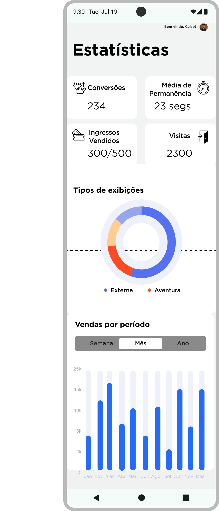

Fonte: Material produzido pelos autores (2026).

</div>

&emsp;Ao contrário das demais telas, o Dashboard adota fundo claro (Off-white `#F0F0F0`), diferenciando visualmente o ambiente administrativo do catálogo de usuário final. Título "Estatísticas" em Gotham Bold 700, caixa alta, em Preto Aventura (`#0A0A0A`). Os cards de KPI apresentam ícones ilustrativos ao lado de cada métrica: Conversões (234), Média de Permanência (23 segs), Ingressos Vendidos (300/500) e Visitas (2300), dispostos em grade de duas colunas. Labels em Gotham Book 300, 12sp; valores em Gotham Bold 700, 22sp.

&emsp;O donut chart de "Tipos de exibições" usa laranja/vermelho para o segmento "Externa" e azul para "Aventura", introduzindo cor funcional na única tela onde a distinção cromática entre categorias é necessária para leitura imediata do dado. O centro do donut exibe o total numérico de exibições, tornando o espaço funcional além de decorativo.

&emsp;O gráfico de barras de "Vendas por período" usa barras azuis sobre fundo claro. Os eixos e labels usam Cinza Texto (`#8A8A8A`). As tabs "SEMANA", "MÊS", "ANO" seguem o mesmo padrão de chip das preferências: ativo (fundo destacado, Gotham Bold) e inativo (sem fundo, texto Cinza Texto, Gotham Book).

---

### Ajustes Aplicados no Frontend

&emsp;Durante a implementação mobile, algumas decisões visuais foram ajustadas em relação aos mockups originais para manter consistência entre as telas conectadas ao backend e melhorar a legibilidade no dispositivo real. Esses ajustes não substituem os mockups documentados anteriormente; registram apenas a adaptação aplicada no frontend.

&emsp;No Login, a imagem `login-bg.png` passou a ocupar o fundo da tela com `resizeMode="cover"` e alinhamento ao topo. Para preservar a arte sem comprometer leitura, foi aplicado um gradiente vertical transparente no terço superior, escurecendo até preto quase opaco no rodapé. Os campos permanecem em padrão underline, sem caixas preenchidas, e o botão "Entrar" mantém 52px de altura como área de toque principal.

&emsp;No Cadastro, o fundo foi padronizado em Preto Aventura (`#0A0A0A`) e o cabeçalho passou a usar a cor de acento `#E8420A`. O espaçamento superior foi ampliado para respeitar a safe area em celulares, evitando que o título fique próximo demais dos elementos do sistema operacional. Os campos funcionais integrados ao backend foram preservados: Nome completo, E-mail, Data de nascimento, Senha, Gênero e Compartilhar localização.

&emsp;Na Seleção de Preferências, a tela foi alinhada ao mesmo sistema visual do Cadastro. As opções deixaram de usar chips arredondados e passaram a ser botões retangulares com raio de 6px, borda discreta e estado ativo em `#E8420A`. A distribuição em grade de duas colunas evita elementos isolados desalinhados e melhora a leitura do conjunto em telas estreitas.

&emsp;Também foi adicionado um acesso discreto de modo desenvolvimento na tela de Login. Esse acesso não altera o fluxo oficial de autenticação, mas permite que professores e avaliadores naveguem pelo protótipo caso o backend local, Supabase ou serviço de geolocalização estejam indisponíveis durante uma demonstração.


## 7.4 Guia Visual

&emsp;O wireframe opera em escala de cinza por convenção de prototipação, sem cor, problemas de hierarquia e espaçamento ficam expostos sem distração visual. Os mockups aplicam a identidade oficial da Aventura Teatros conforme o brand kit da marca:

**Paleta de cores:**

| Token | Hex | Uso principal |
|---|---|---|
| Preto Aventura | `#0A0A0A` | Fundo de telas, backgrounds de player |
| Grafite | `#1A1A1A` | Backgrounds de cards, superficies elevadas |
| Cinza Escuro | `#2C2C2C` | Bordas, separadores, estado inativo de componentes |
| Branco | `#FFFFFF` | Texto primário sobre fundos escuros, CTAs primários |
| Off-white | `#F0F0F0` | Superficies secundárias |
| Cinza Texto | `#8A8A8A` | Labels secundários, legendas, texto de apoio |

**Tipografia:**

| Peso | Uso | Caixa |
|---|---|---|
| Gotham Bold (700) | Títulos de tela, chamadas principais, CTAs | CAIXA ALTA obrigatória |
| Gotham Medium (500) | Subtítulos, destaques secundários | Caixa mista |
| Gotham Book (300) | Texto corrido, legendas, labels | Caixa mista |

&emsp;O brand kit define que títulos em Gotham Bold devem ser sempre em caixa alta. Isso foi aplicado nos mockups: nomes de tela, headers de seção e labels de CTA aparecem em maiúsculas. Texto corrido usa Gotham Book em caixa mista para não penalizar a legibilidade em leitura corrida.

# 8. Desenvolvimento do Projeto

Esta seção apresenta as etapas de desenvolvimento do projeto Spotlight, detalhando a arquitetura de codificação adotada, o modelo de recomendação implementado, a evolução das features ao longo das sprints e as coberturas de testes unitários e de integração.

## 8.1 Arquitetura de Codificação e Estrutura de Diretórios

&emsp;A solução foi organizada para separar a aplicação Expo do restante do ecossistema do projeto. A raiz concentra os arquivos de configuração do app móvel, a orquestração de containers e os ativos estáticos, enquanto `src/` reúne as camadas de código-fonte. Essa divisão atende a três objetivos: manter o frontend em uma estrutura MVVM clara; manter o backend como uma composição SOA explícita com contratos, serviços, motor de ML e testes separados por responsabilidade; e manter o ciclo de dados (datasets, scripts SQL, migrações, artefatos de modelo) isolado da aplicação que o consome.

### Estrutura de diretórios

&emsp;A árvore abaixo reflete o estado atual do repositório. Para manter a leitura objetiva, arquivos de build do .NET (`bin/`, `obj/`, `Properties/`) e dependências (`node_modules/`) não foram listados; nas pastas dos serviços, `Program.cs`, `*.csproj`, `Dockerfile` e `appsettings*.json` aparecem agrupados em comentários de linha.

```text
g04/
├─ App.js                       # entry-point do app Expo
├─ app.json                     # config do Expo
├─ babel.config.js              # transpiler
├─ tsconfig.json                # config TypeScript do frontend
├─ package.json                 # deps e scripts do frontend Expo
├─ docker-compose.yml           # orquestração local dos serviços backend (+ .dev/.prod)
├─ Dockerfile.frontend          # imagem do frontend para build/serve web
├─ deploy/nginx/                # configuração de proxy reverso (nginx) do deploy
├─ .env.example                 # variáveis de ambiente de referência
├─ .gitlab-ci.yml               # pipeline de CI (lint, build, testes)
├─ README.md                    # visão geral do repositório
├─ assets/                      # imagens, ícones e fontes do app
├─ documentos/                  # documentação do produto e do projeto
│  ├─ img/                      # imagens, diagramas, mockups e wireframes
│  ├─ evidencias/               # evidências de teste (TRX, saídas de execução)
│  ├─ Projeto.md
│  ├─ ProjetoVisual.md
│  ├─ GestaoProjeto.md
│  ├─ Gestao_Projeto_Configuracao.md
│  ├─ GuiaPadroesDesenvolvimento.md
│  ├─ Documentacao_soa.md
│  ├─ Manual-instalacao.md
│  └─ Index.md
└─ src/
   ├─ frontend/                 # app React Native + TypeScript (MVVM)
   │  ├─ screens/               # Views (telas) — *.tsx
   │  ├─ viewmodels/            # hooks de apresentação — use*ViewModel.ts
   │  ├─ models/                # entidades e tipos do domínio do app
   │  ├─ components/            # UI reutilizável (cards, hero, search...)
   │  ├─ repositories/          # acesso a APIs do backend
   │  ├─ hooks/                 # hooks transversais (ex.: telemetria)
   │  ├─ config/                # endpoints e mocks de assets
   │  └─ theme/                 # tokens (cores, tipografia, espaçamento)
   ├─ backend/                  # ecossistema SOA em .NET 9 / ASP.NET Core
   │  ├─ Spotlight.sln          # solution agrupando gateway + 4 serviços + 5 projetos de teste
   │  ├─ api-gateway/           # Spotlight.Gateway — YARP gateway (porta 5000)
   │  │  ├─ Controllers/        # endpoints expostos do gateway
   │  │  ├─ Middleware/         # auth JWT, rate limit, logging
   │  │  └─ *                   # Program.cs, .csproj, appsettings*.json
   │  ├─ contracts/             # contratos compartilhados entre serviços
   │  │  ├─ dtos/               # DTOs de fronteira
   │  │  ├─ events/             # esquemas de eventos
   │  │  ├─ openapi.json        # contrato OpenAPI consolidado
   │  │  ├─ api-contracts.md    # descrição dos contratos REST
   │  │  ├─ telemetria.md       # contrato dos eventos de telemetria
   │  │  └─ supabase-storage.md # contrato de armazenamento de mídia
   │  ├─ services/              # microsserviços de negócio (SOA)
   │  │  ├─ catalog/            # Spotlight.Catalog (5001) — ICatalog
   │  │  ├─ user/               # Spotlight.User (5002) — IUserPrefs + telemetria Mongo
   │  │  ├─ recommendation/     # Spotlight.Recommendation (5003) — IRecommendation (ML.NET)
   │  │  └─ geolocation/        # Spotlight.Geolocation (5004) — IGeolocation (Nominatim)
   │  ├─ ml-engine/             # motor de ML do backend
   │  │  ├─ data-preparation/   # reservado (placeholder)
   │  │  ├─ training/           # Spotlight.Recommendation.ModelTraining — treino ML.NET
   │  │  └─ inference/          # reservado (placeholder)
   │  ├─ scripts/               # scripts utilitários (ex.: E2E telemetria)
   │  └─ tests/                 # projetos de testes por serviço + RNF
   │     ├─ Spotlight.Catalog.Tests/
   │     ├─ Spotlight.Recommendation.Tests/
   │     ├─ Spotlight.User.Tests/
   │     ├─ Spotlight.Geolocation.Tests/
   │     ├─ Spotlight.Gateway.Tests/
   │     └─ non-functional/     # testes de requisitos não funcionais (rnf01..rnf12)
   ├─ database/                 # provisão e evolução do banco
   │  ├─ 00_supabase_compat.sql
   │  ├─ 01_create_database.sql
   │  ├─ 02_initial_data.sql
   │  ├─ 03_rollback.sql
   │  ├─ migrations/            # migrações incrementais + rollbacks
   │  ├─ load_test/pgbench/     # queries do teste de carga (pgbench)
   │  └─ README.md
   ├─ dataset/                  # dados de apoio e amostras
   │  ├─ itens_metadata.csv
   │  ├─ recomendacao.csv
   │  ├─ recomendacao_balanceado.csv
   │  └─ interacoes_mongo_exemplo.jsonl
   ├─ models/                   # experimentos e artefatos de ML (notebooks)
   │  ├─ artifacts/             # modelo serializado (.zip) e similaridades
   │  ├─ reports/               # métricas e exemplos do modelo
   │  ├─ sistema_recomendacao_knn.ipynb
   │  ├─ sistema_recomendacao_svd.ipynb
   │  └─ svd_model.pkl
   └─ aad/                      # análise exploratória de dados (notebooks)
      └─ tratamento-dados.ipynb
```

&emsp;Cada microsserviço em `src/backend/services/<dominio>/` segue a mesma decomposição em quatro camadas, que materializa os princípios de arquitetura limpa adotados pelo projeto:

```text
services/<dominio>/
├─ presentation/                # adapta entrada HTTP em casos de uso
│  ├─ controllers/              # endpoints REST do serviço
│  └─ middleware/               # auth, logging, tratamento de erro
├─ application/                 # orquestra casos de uso
│  ├─ usecases/                 # uma classe por operação do serviço
│  ├─ dtos/                     # objetos de entrada/saída dos casos de uso
│  └─ services/                 # serviços de aplicação (quando aplicável)
├─ domain/                      # núcleo do negócio
│  ├─ entities/                 # entidades e regras de domínio
│  └─ value-objects/            # valores imutáveis e validados
├─ infrastructure/              # adaptadores para o mundo externo
│  ├─ persistence/              # acesso ao Supabase/Postgres via Npgsql (SQL puro)
│  ├─ auth/                     # validação do JWT do Supabase
│  └─ ...                       # integrações específicas do domínio
├─ Program.cs                   # bootstrap do serviço ASP.NET Core
├─ Dockerfile                   # imagem do serviço
└─ appsettings*.json            # configuração por ambiente
```

### Representação visual da arquitetura

```mermaid
flowchart TB
  Root[Raiz do repositório] --> Expo[Configs do Expo<br/>App.js · app.json · babel.config.js · tsconfig.json · package.json]
  Root --> Infra[Infra local<br/>docker-compose.yml · .env.example · .gitlab-ci.yml]
  Root --> Assets[assets/<br/>recursos estáticos]
  Root --> Docs[documentos/<br/>documentação + img/]
  Root --> Src[src/]

  Src --> Frontend[frontend/<br/>App React Native em MVVM]
  Src --> Backend[backend/<br/>SOA · contratos · ML · testes]
  Src --> DB[database/<br/>scripts SQL, migrações e teste de carga]
  Src --> Dataset[dataset/<br/>amostras e dados de apoio]
  Src --> MLModels[models/<br/>treino ML.NET, notebooks e artefatos]
  Src --> Aad[aad/<br/>notebooks de análise exploratória]

  Frontend --> Screens[screens/<br/>Views]
  Frontend --> ViewModels[viewmodels/<br/>regra de apresentação]
  Frontend --> FrontendModels[models/<br/>entidades do app]
  Frontend --> Components[components/<br/>UI reutilizável]
  Frontend --> Repos[repositories/<br/>acesso ao backend]
  Frontend --> Hooks[hooks/<br/>comportamentos transversais]
  Frontend --> Config[config/<br/>endpoints e assets mockados]
  Frontend --> Theme[theme/<br/>tokens visuais]

  Backend --> Sln[Spotlight.sln<br/>solution .NET]
  Backend --> Gateway[api-gateway/<br/>YARP · porta única]
  Backend --> Contracts[contracts/<br/>DTOs, eventos e OpenAPI]
  Backend --> Services[services/<br/>microsserviços de negócio]
  Backend --> MLEngine[ml-engine/<br/>training: Spotlight.Recommendation.ModelTraining]
  Backend --> Scripts[scripts/<br/>utilitários operacionais]
  Backend --> Tests[tests/<br/>um projeto xUnit por serviço + RNF]

  Services --> Catalog[catalog/<br/>ICatalog]
  Services --> Recommendation[recommendation/<br/>IRecommendation]
  Services --> User[user/<br/>IUserPrefs · telemetria]
  Services --> Geo[geolocation/<br/>IGeolocation]

  Catalog --> Layers[presentation · application · domain · infrastructure]
  Recommendation --> Layers
  User --> Layers
  Geo --> Layers
```

### Critérios de organização

**Raiz do repositório**

- Os arquivos `App.js`, `app.json`, `babel.config.js`, `tsconfig.json` e `package.json` na raiz são exigidos pelo Expo e mantidos junto à raiz para que o app móvel seja executável sem configuração adicional.
- `docker-compose.yml` orquestra os serviços do backend, banco e Mongo em ambiente local, mantendo a infraestrutura de execução fora do código de aplicação.
- `.env.example` documenta o conjunto mínimo de variáveis de ambiente; `.gitlab-ci.yml` define o pipeline de CI (lint, build, testes e publicação de artefatos).
- `Dockerfile.frontend` e `deploy/nginx/` cobrem o empacotamento e o proxy reverso do frontend para os ambientes de deploy, mantendo a configuração de publicação fora do código de aplicação.
- `assets/` guarda imagens e ícones do app, separando conteúdo visual do código-fonte.
- `documentos/` centraliza a documentação do produto e do projeto, com `img/` para diagramas, mockups e wireframes e `evidencias/` para os artefatos de teste referenciados pelos `.md`.

**`src/frontend/` — padrão MVVM**

- `screens/` contém as Views (telas) com a renderização declarativa em React Native; cada arquivo é um componente final usado pelo navegador de telas.
- `viewmodels/` reúne hooks `use*ViewModel.ts` que concentram o estado e a regra de apresentação de cada tela, mantendo as Views simples e testáveis.
- `models/` define as entidades e tipos consumidos pelas Views e ViewModels (`CatalogItem`, `Preference`, `Usuario`, etc.).
- `components/` agrupa peças visuais reutilizáveis (`CatalogPosterCard`, `CatalogHero`, `SearchBar`, `Carousel`...), evitando duplicação entre telas.
- `repositories/` isola as chamadas HTTP ao backend; trocar endpoint ou adicionar mock não afeta a View.
- `hooks/` mantém comportamentos transversais — por exemplo, `useTelemetrySession.ts`, que dispara eventos de uso para o backend.
- `config/` concentra endpoints (`api.ts`) e mocks de assets (`catalogImages.ts`), o que evita constantes espalhadas pelo código.
- `theme/` agrupa tokens de design (cores, tipografia, espaçamento) para padronizar a identidade visual.

**`src/backend/` — composição SOA**

- `Spotlight.sln` na raiz do backend agrupa o Gateway, os quatro serviços e os cinco projetos de teste em uma única solution, facilitando build e debug pelo Visual Studio/Rider.
- `api-gateway/` é a porta única de entrada (`Spotlight.Gateway`, porta 5000): implementado com YARP, valida o JWT do Supabase, faz roteamento e expõe Swagger. `Controllers/` e `Middleware/` ficam internos ao próprio Gateway.
- `contracts/` materializa os contratos do backend. `dtos/` e `events/` ficam versionados como código; `openapi.json` consolida o contrato REST do sistema; `api-contracts.md`, `telemetria.md` e `supabase-storage.md` descrevem o uso dos contratos em prosa. Manter os contratos fora dos serviços evita acoplamento entre emissores e consumidores.
- `services/` contém quatro microsserviços, um por domínio, cada um expondo sua própria API ASP.NET Core com `Dockerfile` e `appsettings*.json` próprios: `catalog/` (`Spotlight.Catalog`, 5001), `user/` (`Spotlight.User`, 5002, com telemetria no MongoDB), `recommendation/` (`Spotlight.Recommendation`, 5003, com strategy ML.NET) e `geolocation/` (`Spotlight.Geolocation`, 5004, integrando OpenStreetMap/Nominatim). Todos seguem a mesma estrutura em quatro camadas (`presentation`, `application`, `domain`, `infrastructure`).
- `ml-engine/` concentra o motor de ML do backend nas três fases canônicas (`data-preparation/`, `training/`, `inference/`); hoje `training/` hospeda o projeto C# `Spotlight.Recommendation.ModelTraining`, que treina o modelo ML.NET consumido pelo `Serviço de Recomendação`, enquanto `data-preparation/` e `inference/` permanecem reservadas para evolução. Os artefatos gerados e os notebooks exploratórios ficam em `src/models/`.
- `scripts/` guarda utilitários operacionais auxiliares (por exemplo, `Test-TelemetriaAtlasE2E.ps1` para validar o fluxo de telemetria fim a fim).
- `tests/` mantém um projeto xUnit por serviço (`Spotlight.<Dominio>.Tests`), espelhando a fronteira de cada microsserviço, além de `non-functional/` com os testes de requisitos não funcionais (rnf01..rnf12); isso garante que cada serviço seja testado de forma isolada.

**Camadas internas de cada serviço**

- `presentation/controllers/` expõe os endpoints REST do serviço e adapta a requisição em chamadas a casos de uso. `presentation/middleware/` cuida de autenticação, logging e tratamento de erro.
- `application/usecases/` concentra a regra de aplicação — uma classe por operação do serviço — coordenando o domínio e a infraestrutura. `application/dtos/` define os formatos de entrada e saída dos casos de uso, protegendo o domínio de formatos externos.
- `domain/entities/` guarda as entidades e as regras críticas do negócio; `domain/value-objects/` mantém valores imutáveis e validados (ex.: identificadores, faixas de preço, coordenadas). Essa camada é independente de framework, banco ou interface.
- `infrastructure/persistence/` implementa o acesso a dados em Supabase/PostgreSQL via Npgsql (SQL puro, sem ORM). `infrastructure/auth/` valida o JWT do Supabase. Integrações específicas do domínio ficam em subpastas dedicadas (por exemplo, `user/infrastructure/geolocation/` quando o serviço de usuário consome `IGeolocation`). Trocar tecnologia de armazenamento ou provedor de identidade fica restrito a essa camada.

**Dados e modelos**

- `src/database/` torna o banco reproduzível: os scripts `00_*` a `03_*` na raiz fazem provisão inicial e rollback; `migrations/` versiona as mudanças incrementais com seus respectivos `*_rollback.sql`; `load_test/pgbench/` reúne as queries usadas no teste de carga descrito mais adiante.
- `src/dataset/` armazena amostras de dados (`itens_metadata.csv`, `recomendacao*.csv`, `interacoes_mongo_exemplo.jsonl`) que alimentam o ciclo de ML e demonstrações. Separar dado de código facilita versionamento e reprocessamento.
- `src/models/` guarda os experimentos e os artefatos do ciclo de modelagem, separados do código de aplicação. `artifacts/` guarda o modelo serializado (`recomendacao_incrementada_mlnet.zip`) e as similaridades pré-calculadas (`item_similarities.json`); `reports/` traz métricas e exemplos de saída. Os notebooks `sistema_recomendacao_knn.ipynb` e `sistema_recomendacao_svd.ipynb` e o `svd_model.pkl` preservam os experimentos exploratórios que precederam o modelo final. O projeto C# que efetivamente treina o modelo ML.NET vive em `src/backend/ml-engine/training/Spotlight.Recommendation.ModelTraining/`.
- `src/aad/` mantém os notebooks de Análise e Apoio a Decisão; manter essa pasta separada impede que código de estudo se confunda com a aplicação principal.

### Relação com a solução

&emsp;A estrutura espelha diretamente as decisões arquiteturais detalhadas em [5.2 Diagrama de Componentes UML](#52-diagrama-de-componentes-uml) e em [8.1.2 Arquitetura de Codificação — Spotlight](#812-arquitetura-de-codificação--spotlight): cada componente lógico do diagrama tem um diretório correspondente no código. O `Spotlight App` está em `src/frontend/`; o `API Gateway` em `src/backend/api-gateway/`; os serviços SOA `IUserPrefs`, `ICatalog`, `IRecommendation` e `IGeolocation` ficam em `src/backend/services/user/`, `catalog/`, `recommendation/` e `geolocation/`; o `ML Engine` em `src/backend/ml-engine/` (treino do modelo) e os artefatos e notebooks em `src/models/`; a camada de dados é provisionada por `src/database/`. Os contratos de comunicação descritos nas interfaces (`ISpotlightAPI`, `IUserPrefs`, `ICatalog`, `IRecommendation`, `IGeolocation`) são materializados em `src/backend/contracts/` e consumidos pelos `repositories/` do frontend.

### Justificativa da arquitetura

&emsp;A organização adotada favorece a evolução incremental da solução. No frontend, o padrão MVVM separa interface de regra de apresentação: as Views ficam declarativas, os ViewModels concentram comportamento e os Repositories isolam o acesso a dados — assim cada camada pode ser alterada sem afetar as demais. No backend, a abordagem SOA expõe serviços com fronteiras claras, contratos estáveis em `contracts/` e um motor de recomendação isolado em `ml-engine/`, permitindo que cada domínio (catálogo, usuário, recomendação, geolocalização) evolua de forma independente. A divisão em quatro camadas dentro de cada serviço impede que regra de negócio, regra de aplicação e detalhe de infraestrutura se misturem, o que reduz acoplamento, melhora a testabilidade — refletida no espelhamento da pasta `tests/` — e facilita a manutenção por sprint, pois cada parte do sistema pode evoluir sem exigir alterações em toda a base.

### 8.1.2 Arquitetura de Codificação — Spotlight

&emsp;Representação visual e descritiva da arquitetura de codificação da solução, evidenciando camadas, componentes principais, fluxo de dados e responsabilidades de cada parte do sistema.

<div align="center">

<sub>Figura 47 - Arquitetura de Codificação do Spotlight (versão final)</sub><br>

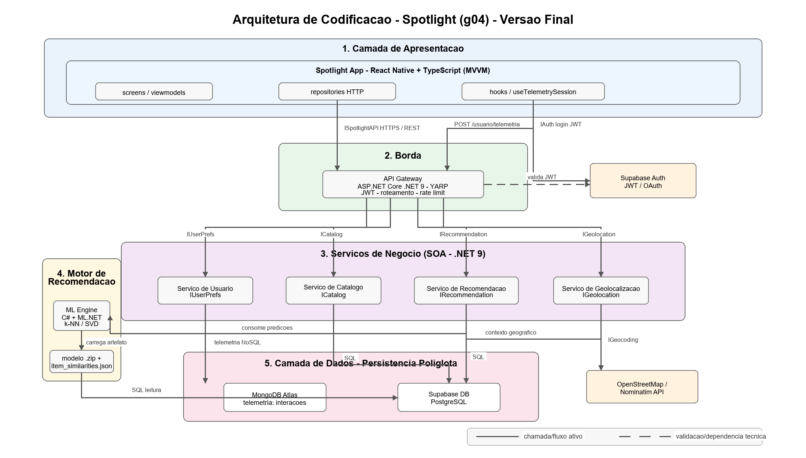

Fonte: Material produzido pelos autores (2026).

</div>

&emsp;O diagrama acima reflete a implementação final entregue ao longo das cinco sprints, com destaque para a **camada de recomendação** (Serviço de Recomendação orquestrando o ML Engine em ML.NET), a **telemetria comportamental persistida no MongoDB Atlas** (fluxo App → Gateway → Serviço de Usuário → coleção `interacoes`) e a **integração frontend-backend** mediada exclusivamente pelo API Gateway via `ISpotlightAPI` (HTTPS/REST). As linhas pontilhadas representam integrações de validação ou dependências técnicas, como a validação do JWT emitido pelo Supabase Auth.

#### Código-fonte do diagrama (PlantUML)

&emsp;O diagrama foi gerado a partir do código PlantUML abaixo, mantido versionado para permitir futuras atualizações da arquitetura:

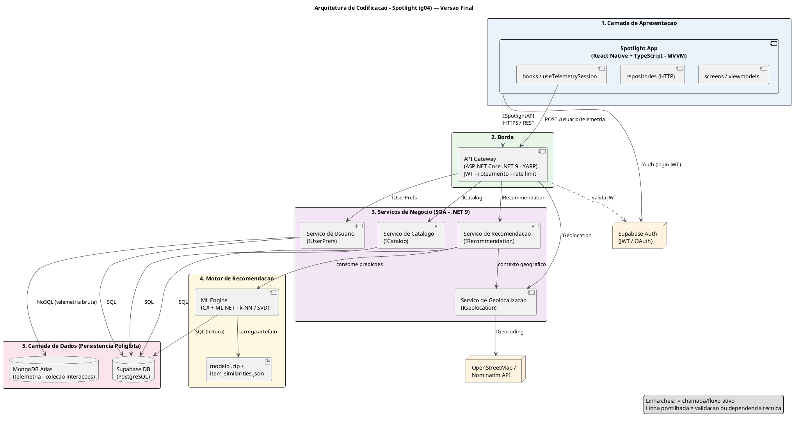

#### Descrição das Camadas

##### 1. Camada de Apresentação

&emsp;Contém o Spotlight App, responsável pela interface com o usuário final e pela captura contínua de interações (telemetria).

| Componente | Tecnologia | Responsabilidade |
|---|---|---|
| Spotlight App | React Native + TypeScript | Interface do usuário, onboarding de preferências, coleta de telemetria (cliques, tempo de tela, navegação) |

Regras desta camada:

- Toda comunicação com o backend passa exclusivamente pelo API Gateway via HTTPS.
- Tokens JWT armazenados de forma segura (Keychain no iOS, Keystore no Android).
- Estado local mínimo; dados persistentes vivem no backend.

##### 2. Serviços Externos

&emsp;Infraestrutura de identidade, inventário de ingressos e geolocalização, consumida pelo app, pelo Gateway e pelos serviços internos autorizados.

| Componente | Tecnologia | Responsabilidade |
|---|---|---|
| Supabase Auth | Supabase Auth | Provedor de identidade: autenticação, emissão e validação de tokens JWT, OAuth |
| API das Ticketeiras | API externa | Inventário de ingressos, emissão e validação |
| OpenStreetMap/Nominatim API | OpenStreetMap/Nominatim | Geocodificação, geocodificação reversa e normalização de localização para recomendações contextuais |

Interfaces: `IAuth` · `ITickets` · `IGeocoding`

##### 3. API Gateway

&emsp;Ponto único de entrada para todas as requisições do frontend. Nenhum serviço SOA é acessível diretamente pelo app.

| Componente | Tecnologia | Responsabilidade |
|---|---|---|
| API Gateway | ASP.NET Core (.NET 9) | BFF/Gateway: roteamento, terminação SSL, validação de JWT, rate limiting, orquestração de chamadas aos serviços SOA |

Interface exposta: `ISpotlightAPI`

Responsabilidades detalhadas:

- Valida o token emitido pelo Supabase Auth antes de rotear qualquer requisição.
- Roteia para o serviço SOA correto com base no recurso solicitado.

##### 4. Serviços de Negócio (SOA)

&emsp;Cada serviço encapsula um domínio de negócio isolado. Implementados como ASP.NET Core Web APIs.

**Serviço do Usuário (`IUserPrefs`)**

- Gestão de perfis de usuário.
- Preferências explícitas selecionadas na onboarding (tags e categorias).
- Histórico de consumo (espetáculos visualizados, avaliados, favoritados).
- Persiste dados transacionais no Supabase DB (PostgreSQL).
- Recebe telemetria comportamental pela rota `/telemetria` e grava os eventos na collection `interacoes` do MongoDB Atlas.

**Serviço do Catálogo (`ICatalog`)**

- Domínio de espetáculos: criação, edição, publicação e remoção.
- Gestão de teatros, gêneros e precificação.
- Persiste no Supabase DB (PostgreSQL).

**Serviço de Recomendação (`IRecommendation`)**

- Orquestra o fluxo de sugestões personalizadas para o usuário.
- Consulta dados relacionais e resultados pré-processados disponíveis no PostgreSQL.
- Consulta o Serviço de Geolocalização quando a recomendação utiliza contexto geográfico.
- Persiste resultados no Supabase DB (PostgreSQL).

**Serviço de Geolocalização (`IGeolocation`)**

- Normaliza dados de localização consentidos pelo usuário.
- Consulta OpenStreetMap/Nominatim via interface `IGeocoding`.
- Retorna informações de proximidade para apoiar recomendações contextuais e geográficas.

##### 5. Infraestrutura de Processamento

**ML Engine**

| Componente | Tecnologia | Responsabilidade |
|---|---|---|
| ML Engine | C# + ML.NET | Algoritmos de filtragem colaborativa (k-NN, SVD), geração de vetores de afinidade, predições pré-processadas consumidas pelo Serviço de Recomendação |

- Lê dados estruturados do Supabase DB (PostgreSQL) via interface SQL.
- Componente isolado — não exposto diretamente ao Gateway.

**Fila de eventos (planejada para Sprint 5)**

| Componente | Tecnologia | Responsabilidade |
|---|---|---|
| Fila de telemetria | RabbitMQ ou broker equivalente | Desacoplar a ingestão de eventos, permitir retry/dead-letter e reduzir perda de eventos quando MongoDB/Atlas estiver indisponível |

- Este componente ainda não faz parte da implementação corrente da Sprint 4.
- A escrita atual de telemetria é direta: App → Gateway → Serviço do Usuário → MongoDB Atlas.
- Na Sprint 5, a fila pode ser inserida entre o serviço do usuário e o MongoDB sem alterar o schema principal da collection `interacoes`.

##### 6. Camada de Dados (Persistência Poliglota)

&emsp;A arquitetura segue o princípio da persistência poliglota — tecnologia adequada ao perfil de carga de cada domínio.

| Componente | Tecnologia | Responsabilidade |
|---|---|---|
| Supabase DB | PostgreSQL via Supabase | Banco relacional principal: perfis, catálogo, recomendações, metadados transacionais |
| MongoDB | MongoDB | Repositório de alto volume: logs comportamentais brutos, telemetria, cliques, tempo de tela |

Supabase DB é utilizado por: Serviço do Usuário, Serviço do Catálogo, Serviço de Recomendação e rotinas/modelos de recomendação (leitura via SQL).

MongoDB é utilizado por: Serviço do Usuário para escrita de telemetria bruta. Na Sprint 5, esse papel pode ser movido para um consumer de fila.

#### Interfaces do Sistema

| Interface | Entre | Descrição |
|---|---|---|
| `ISpotlightAPI` | App → API Gateway | Contrato REST do frontend com o backend |
| `IAuth` | App → Supabase Auth | Autenticação e emissão de JWT |
| `ITickets` | Gateway → API Ticketeiras | Consulta e emissão de ingressos |
| `IGeocoding` | Serv. Geolocalização → OpenStreetMap/Nominatim | Consulta de geocodificação e geocodificação reversa |
| `IUserPrefs` | Gateway → Serv. Usuário | Perfis e preferências |
| `ICatalog` | Gateway → Serv. Catálogo | Espetáculos e metadados |
| `IRecommendation` | Gateway → Serv. Recomendação | Sugestões personalizadas |
| `IGeolocation` | Gateway / Serv. Recomendação → Serv. Geolocalização | Contexto geográfico e proximidade |
| `Telemetry HTTP` | App → Gateway → Serv. Usuário | Envio de eventos para `POST /usuario/telemetria` |
| `Worker` | Rotinas/modelos de recomendação → PostgreSQL/MongoDB | Processamento posterior de avaliações relacionais e telemetria comportamental |
| `SQL` | Serviços SOA + ML Engine → PostgreSQL | Leitura/escrita relacional |
| `NoSQL` | Serviço do Usuário → MongoDB Atlas | Ingestão de telemetria bruta |

#### Fluxo de Dados — Exemplos

**Busca de Recomendações**

```
1. Usuário abre tela de descoberta no Spotlight App
2. App → HTTPS GET /recomendacoes → API Gateway (ISpotlightAPI)
3. Gateway valida JWT com Supabase Auth
4. Gateway → Serviço de Recomendação (IRecommendation)
5. Serviço de Recomendação → ML Engine (Worker): solicita predições
6. Quando há localização consentida, Serviço de Recomendação → Serviço de Geolocalização (IGeolocation)
7. Serviço de Geolocalização → OpenStreetMap/Nominatim (IGeocoding): normaliza localização
8. ML Engine consulta PostgreSQL (vetores de afinidade pré-calculados)
9. Serviço de Recomendação combina afinidade e contexto geográfico
10. Serviço de Recomendação retorna lista ranqueada ao Gateway → App
11. App registra interação do usuário (clique, tempo de tela)
12. App envia `POST /usuario/telemetria` ao Gateway
13. Gateway roteia para o Serviço do Usuário
14. Serviço do Usuário valida o contrato e persiste o documento no MongoDB Atlas
```

**Consulta de Geolocalização**

<div align="center">

<sub>Figura 48 - Fluxo de Geolocalização com OpenStreetMap/Nominatim</sub><br>


Fonte: Material produzido pelos autores (2026).

</div>

```
1. Usuário autoriza compartilhamento de localização no Spotlight App
2. App → API Gateway com requisição protegida por JWT
3. Gateway → Serviço de Geolocalização (IGeolocation)
4. Serviço de Geolocalização → OpenStreetMap/Nominatim (IGeocoding)
5. OpenStreetMap/Nominatim retorna endereço normalizado e coordenadas
6. Serviço de Geolocalização normaliza o retorno
7. Serviço de Recomendação utiliza o contexto geográfico na ordenação das sugestões
8. Gateway retorna recomendações contextuais ao App
```

**Compra de Ingresso**

```
1. Usuário seleciona sessão e clica em "Comprar"
2. App → HTTPS POST /ingressos → API Gateway
3. Gateway valida JWT → roteia para Serviço do Catálogo
4. Serviço do Catálogo consulta disponibilidade no PostgreSQL
5. Serviço do Catálogo aciona API das Ticketeiras (ITickets)
6. Confirmação → ingresso gravado no PostgreSQL
7. App registra o clique de compra via `POST /usuario/telemetria`
8. Serviço do Usuário persiste o evento `purchase_clicked` no MongoDB Atlas
9. Resposta de sucesso retorna ao App
```

#### Padrões e Decisões de Projeto

| Decisão | Escolha | Justificativa |
|---|---|---|
| Protocolo cliente–backend | REST (HTTPS) | Simplicidade, compatibilidade com React Native |
| Autenticação | JWT + Supabase Auth | Stateless, escalável, OAuth integrado |
| Geolocalização | OpenStreetMap/Nominatim | Apoia recomendações contextuais no MVP sem dependência de billing proprietário, sem alterar a lógica principal do ML |
| Controle de acesso | RBAC (usuario, admin) | Separação clara entre perfis de uso |
| Banco relacional | PostgreSQL via Supabase | Dados estruturados, integridade referencial |
| Banco de telemetria | MongoDB | Alto volume, esquema flexível, sem onerar o relacional |
| Mensageria | RabbitMQ planejado para Sprint 5 | Desacoplamento futuro de eventos, retry e dead-letter sem alterar o schema MongoDB |
| Motor de ML | ML.NET | Ecossistema .NET, integração nativa com os serviços SOA |
| Containerização | Docker + Docker Compose | Portabilidade entre ambientes dev/prod |

### 8.1.3 Composição da Tela de Catálogo no Frontend

&emsp;A tela de catálogo é o principal exemplo de composição do frontend no MVP. Ela é montada em camadas para manter a responsabilidade de cada componente bem delimitada, facilitar testes visuais e permitir evolução incremental sem acoplamento entre a renderização e os dados.

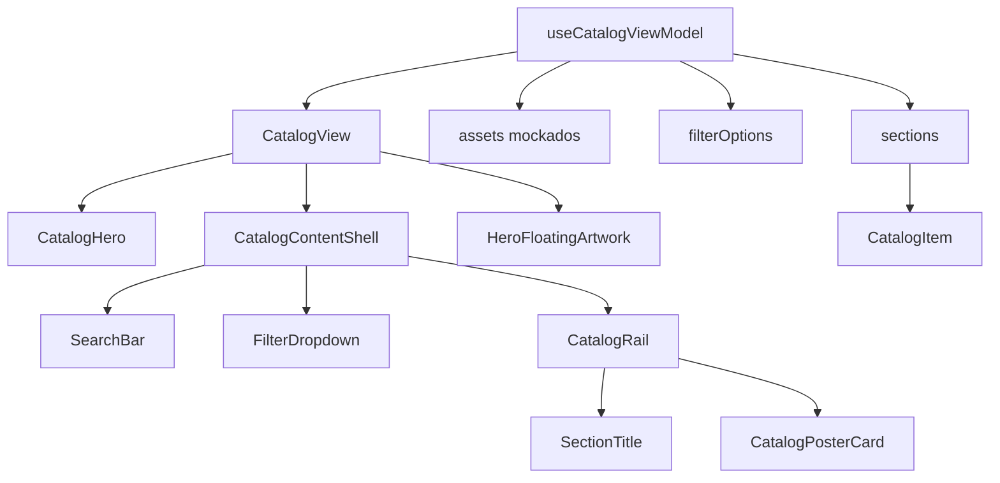

| Componente | Responsabilidade | Observação |
|---|---|---|
| `CatalogView` | Orquestra a tela e distribui os blocos visuais | Ponto de composição da página de catálogo |
| `useCatalogViewModel` | Fornece estado de tela, assets, filtros e seções | Mantém a tela desacoplada da origem dos dados |
| `CatalogHero` | Renderiza o topo do catálogo com imagem em destaque, saudação e CTA | Usa a imagem principal do espetáculo como foco visual |
| `HeroFloatingArtwork` | Exibe o elemento artístico sobreposto ao topo | Funciona como camada flutuante acima do shell |
| `CatalogContentShell` | Agrupa fundo branco, curva superior, logotipo e conteúdo | Define a área principal de leitura do catálogo |
| `SearchBar` | Entrada de busca rápida | Permite refinar o catálogo por texto |
| `FilterDropdown` | Filtro por categoria | Organiza a descoberta por tipo de espetáculo |
| `CatalogRail` | Renderiza cada seção com carrossel horizontal | Reutiliza a mesma estrutura para múltiplas trilhas |
| `SectionTitle` | Exibe o título de cada seção | Padroniza a hierarquia visual das seções |
| `CatalogPosterCard` | Exibe o card visual do espetáculo | Usa imagem, overlay e área clicável |

&emsp;Essa composição mantém a tela aderente ao padrão MVVM adotado no frontend: a View apenas orquestra componentes, o ViewModel fornece dados e a camada de apresentação mantém a lógica de exibição separada da origem das informações. Na Sprint 3, a implementação foi integrada com dados mockados, o que permitiu validar a experiência visual antes da integração definitiva com o backend.

## 8.2 Modelo de Recomendação

&emsp;Na Sprint 4, o modelo de recomendação evoluiu de uma prova de conceito em
notebooks para um pipeline executável e consumível pela API .NET. Na Sprint 3,
o grupo já havia validado abordagens de filtragem colaborativa com k-NN e Funk
SVD, usando o notebook `src/models/sistema_recomendacao_svd.ipynb` como
referência principal para lidar com matriz esparsa de usuários e espetáculos. A
evolução desta sprint foi transformar essa lógica em um artefato operacional:
um modelo ML.NET exportado em `.zip`, acompanhado de um arquivo auxiliar de
similaridade item-item em JSON.

&emsp;O objetivo do incremento não foi descartar o Funk SVD anterior, mas
complementá-lo com um classificador capaz de ser carregado diretamente pelo
backend C#. O Funk SVD continua documentado como referência histórica para
predição de rating em dados esparsos, com RMSE aproximado de `1,18` e MAE
aproximado de `0,97`. O modelo incrementado passa a responder a uma pergunta
mais próxima do fluxo da API: dado um par usuário-espetáculo, esse item deve
ser priorizado como recomendação?

### 8.2.1 Fontes de Dados Utilizadas

&emsp;O pipeline combina dados relacionais e comportamentais, refletindo a
arquitetura de persistência poliglota do projeto:

| Fonte | Arquivo de entrada | Papel no modelo |
|---|---|---|
| PostgreSQL | `src/dataset/recomendacao_balanceado.csv` | Base estruturada com usuários, itens, ratings e sinais derivados do catálogo |
| MongoDB | `src/dataset/interacoes_mongo_exemplo.jsonl` | Eventos comportamentais de telemetria usados como reforço de interesse |
| Notebook SVD | `src/models/sistema_recomendacao_svd.ipynb` | Referência técnica do modelo anterior baseado em Funk SVD |

&emsp;A execução registrada em `src/models/reports/recomendacao_mlnet_metrics.json`
utilizou `40.848` registros, com `32.678` exemplos para treino e `8.170` para
teste. A taxa positiva ficou em aproximadamente `40%`, o que evita um conjunto
excessivamente enviesado para uma única classe.

### 8.2.2 Pipeline do Modelo Incrementado

&emsp;O treinamento foi implementado em C# no projeto
`src/backend/ml-engine/training/Spotlight.Recomendacao.ModelTraining`. Essa
escolha reduz a distância entre experimentação e produção, porque o mesmo
ecossistema .NET usado pelos microsserviços também passa a gerar o artefato do
modelo.

&emsp;O fluxo de treinamento segue as etapas abaixo:

1. Leitura do CSV exportado do PostgreSQL.
2. Leitura do JSONL de interações vindo do MongoDB.
3. Agregação de sinais por usuário e por espetáculo.
4. Cálculo de similaridade item-item para apoiar recomendações do tipo k-NN.
5. Montagem de features como `score_implicito`, `mongo_interaction_score`,
   `user_rating_mean`, `item_rating_mean`, `user_interactions`,
   `item_interactions` e `item_similarity_score`.
6. Treinamento de um classificador binário ML.NET para priorizar itens
   recomendáveis.
7. Exportação dos artefatos consumidos pelo backend.

&emsp;A recomendação final usa uma abordagem híbrida: o histórico colaborativo
continua orientando a afinidade usuário-item, a similaridade item-item apoia a
descoberta de espetáculos semelhantes, e os eventos de telemetria do MongoDB
ajudam a reforçar sinais recentes de interesse.

### 8.2.3 Artefatos Gerados

| Artefato | Caminho | Finalidade |
|---|---|---|
| Modelo ML.NET | `src/models/artifacts/recomendacao_incrementada_mlnet.zip` | Modelo carregado pela API para ranquear candidatos |
| Similaridade item-item | `src/models/artifacts/item_similarities.json` | Apoio a recomendações similares/k-NN |
| Métricas | `src/models/reports/recomendacao_mlnet_metrics.json` | Evidência quantitativa do treinamento |
| Exemplos | `src/models/reports/recomendacao_mlnet_exemplos.csv` | Amostras de predição para validação funcional |
| Relatório técnico | `src/models/reports/README_modelo_classificacao_recomendacao.md` | Descrição curta do incremento e limitações |

&emsp;O executável de treinamento fica em `src/backend/ml-engine/training`,
alinhado à separação arquitetural do ciclo de ML. Os artefatos gerados continuam
versionados/publicados em `src/models/artifacts` e `src/models/reports`, pois
esses diretórios funcionam como saída do pipeline e são consumidos pela API e
pela CI. O serviço de recomendação consome os arquivos resultantes por
configuração, sem depender do notebook em tempo de execução.

### 8.2.4 Métricas Obtidas

&emsp;Como o incremento transforma o problema em classificação de itens
recomendáveis, as métricas principais passam a ser acurácia, precisão,
revocação, F1 e AUC. O resultado registrado foi:

| Modelo | Accuracy | Precision | Recall | F1 | ROC AUC |
|---|---:|---:|---:|---:|---:|
| ML.NET incrementado | 65,76% | 53,78% | 92,25% | 67,95% | 77,52% |

&emsp;Também foram calculadas métricas Top-K, mais aderentes ao uso real do
produto, pois o usuário recebe uma lista curta de espetáculos recomendados:

| Métrica | Valor |
|---|---:|
| Precision@10 | 80,89% |
| Recall@10 | 100,00% |
| Hit Rate@10 | 100,00% |

&emsp;Esses números indicam que o modelo tem boa capacidade de recuperar itens
relevantes no topo da lista. A precisão geral ainda pode evoluir com mais dados
reais de avaliação e telemetria, mas o pipeline já demonstra melhora funcional
em relação à Sprint 3: o modelo deixa de ser apenas exploratório e passa a
produzir artefatos integráveis ao backend.

### 8.2.5 Integração com a API de Recomendação

&emsp;No backend, o serviço `Spotlight.Recomendacao` carrega o modelo por meio do
cliente `MlNetModeloRecomendacaoClient`. A seleção do algoritmo foi desacoplada
com os padrões Strategy e Factory:

| Componente | Responsabilidade |
|---|---|
| `ModeloMlNetRecomendacaoStrategy` | Usa o modelo incrementado ML.NET e enriquece o resultado com dados do PostgreSQL |
| `PostgresPreProcessadoRecomendacaoStrategy` | Usa recomendações já persistidas nas tabelas relacionais como fallback |
| `RecomendacaoStrategyFactory` | Escolhe a estratégia ativa conforme `RecommendationModel:Enabled` e disponibilidade do modelo |

&emsp;Com isso, o fluxo de recomendação em produção fica:

1. O aplicativo chama o Gateway em `/recomendacao/me` ou rotas derivadas.
2. O Gateway encaminha a requisição ao serviço `Spotlight.Recomendacao`.
3. O use case chama `RecomendacaoService`.
4. A factory escolhe a estratégia ML.NET quando o modelo está habilitado.
5. O modelo ranqueia candidatos.
6. O repositório busca os dados completos dos espetáculos no PostgreSQL.
7. A API retorna JSON com espetáculo, score, algoritmo e motivo da recomendação.

&emsp;Caso o modelo esteja desabilitado, sem artefato local ou retorne uma lista
vazia, o serviço cai para a estratégia PostgreSQL. Esse fallback evita que uma
falha no artefato de ML quebre a experiência do usuário.

### 8.2.6 Persistência e Atualização dos Resultados

&emsp;As tabelas `recomendacao` e `similaridade_item` continuam sendo o ponto de
serving persistido do sistema. A migration
`src/database/migrations/11_seed_recomendacao_incremental.sql` popula
recomendações e similaridades iniciais com `UPSERT`, permitindo que o backend
sirva recomendações mesmo quando o modelo não estiver ativo.

&emsp;A pipeline de CI também executa o treinamento por meio do job
`train:model-artifacts` e publica os artefatos no bucket privado
`ml-artifacts` do Supabase Storage no job `publish:model-artifacts`, restrito à
branch `develop`. Assim, o caminho previsto para evolução é:

```text
PostgreSQL + MongoDB -> treino ML.NET -> artefatos .zip/.json -> Supabase Storage -> API de recomendação -> Frontend
```

### 8.2.7 Limitações Conhecidas

- O treinamento ainda usa exports offline do PostgreSQL e MongoDB; a coleta
  direta de dados vivos deve evoluir em uma etapa posterior de MLOps.
- O dataset histórico usa usuários numéricos, enquanto a API trabalha com UUID
  do Supabase; por isso, a integração precisa manter mapeamento consistente de
  usuário.
- A amostra de eventos MongoDB usada no treinamento ainda é pequena, então a
  telemetria deve ganhar peso conforme a aplicação acumular uso real.
- O `score_implicito` segue correlacionado com `rating`; as métricas de
  classificação validam o pipeline funcional, mas não substituem uma avaliação
  futura com dados reais de conversão.
- A similaridade item-item atual é uma aproximação baseada em agregados e pode
  ser substituída por k-NN sobre embeddings ou representações mais ricas dos
  espetáculos.

## 8.3 Desenvolvimento de Features

&emsp;O desenvolvimento das features foi conduzido de forma incremental, partindo
da arquitetura SOA entregue na Sprint 3 e avançando, na Sprint 4, para um fluxo
mais próximo do uso real pelo usuário final. A evolução concentrou-se em quatro
frentes: tornar o catálogo alimentado por dados reais, integrar recomendação ao
backend e ao frontend, registrar sinais comportamentais para retroalimentar o
modelo e consolidar a documentação técnica dos contratos e componentes.

&emsp;A organização por microsserviços permitiu evoluir cada domínio sem concentrar
responsabilidades em um único backend. O serviço de Catálogo ficou responsável
por espetáculos, mídias, sessões, avaliações e metadados; o serviço de Usuário
concentrou perfil, preferências, localização e telemetria; o serviço de
Recomendação passou a expor recomendações personalizadas e similares; e o
serviço de Geolocalização manteve a integração com OpenStreetMap/Nominatim.
Todas as chamadas do aplicativo passam pelo API Gateway, preservando uma
entrada única para o frontend.

### 8.3.1 Sprint 3

A Sprint 3 entregou o **esqueleto da arquitetura SOA** e as primeiras features
ponta-a-ponta do produto: o usuário consegue se cadastrar, escolher
preferências, navegar pelo catálogo, abrir os detalhes de um espetáculo,
consultar recomendações e, no painel administrativo, gerir o catálogo. O
backend foi estruturado em quatro microsserviços por trás de um API Gateway,
com contratos JSON consolidados em OpenAPI 3.0.3.

### Arquitetura entregue

- **API Gateway** (YARP, porta 5000): ponto único de entrada, configurado para
  encaminhar `/catalogo/*`, `/usuario/*`, `/recomendacao/*` e
  `/geolocalizacao/*` para os serviços de negócio.
- **Quatro serviços .NET 9 / ASP.NET Core** (portas 5001–5004), organizados em
  camadas `presentation` / `application` / `domain` / `infrastructure`.
- **PostgreSQL via Supabase**, acessado com **Npgsql (SQL puro)** — sem ORM,
  por decisão de transparência sobre o SQL executado e por aproveitar Row
  Level Security do Supabase Auth.
- **Autenticação JWT do Supabase** com três níveis (`visitante`, `cadastrado`,
  `administrador`) e checagem de permissão por rota.
- **Swagger UI** ativo em todos os serviços durante o ambiente de
  desenvolvimento; especificação consolidada em
  [`src/backend/contracts/openapi.json`](../src/backend/contracts/openapi.json)
  e descrita em
  [`src/backend/contracts/api-contracts.md`](../src/backend/contracts/api-contracts.md).
- **Health checks** em todos os serviços: `/health` (liveness) e
  `/health/ready` (readiness que testa a conexão com o Postgres).

### Features de backend

#### Serviço de Catálogo (11 rotas)

Espinha dorsal de leitura/escrita do catálogo. Implementa as operações
públicas de descoberta (espetáculos, categorias, teatros, sessões e
avaliações) e as operações de gestão restritas ao administrador.

| Método | Rota | Acesso |
|---|---|---|
| GET    | `/catalogo/espetaculos`                       | Público |
| GET    | `/catalogo/espetaculos/{id}`                  | Público |
| POST   | `/catalogo/espetaculos`                       | Administrador |
| PUT    | `/catalogo/espetaculos/{id}`                  | Administrador |
| DELETE | `/catalogo/espetaculos/{id}`                  | Administrador |
| GET    | `/catalogo/espetaculos/{id}/sessoes`          | Público |
| GET    | `/catalogo/espetaculos/{id}/avaliacoes`       | Público |
| POST   | `/catalogo/espetaculos/{id}/avaliacoes`       | Cadastrado |
| GET    | `/catalogo/categorias`                        | Público |
| GET    | `/catalogo/teatros`  · `GET /catalogo/teatros/{id}` | Público |

#### Serviço de Usuário (6 rotas)

Gestão do perfil próprio do usuário autenticado: dados básicos, preferências
declaradas (alimentadas pelo onboarding) e histórico de avaliações. Inclui a
rota de atualização de localização consentida, integrada à geolocalização.

| Método | Rota | Acesso |
|---|---|---|
| GET    | `/usuario/me`                | Cadastrado |
| PUT    | `/usuario/me`                | Cadastrado |
| PUT    | `/usuario/me/localizacao`    | Cadastrado |
| GET    | `/usuario/me/preferencias`   | Cadastrado |
| PUT    | `/usuario/me/preferencias`   | Cadastrado |
| GET    | `/usuario/me/avaliacoes`     | Cadastrado |

#### Serviço de Geolocalização (2 rotas)

Consome o **OpenStreetMap/Nominatim** para geocodificação direta e reversa.
Suporta o consentimento de localização do usuário (rota `PUT /usuario/me/localizacao`)
e habilita filtros geográficos sem dependência de billing proprietário.

| Método | Rota | Acesso |
|---|---|---|
| GET | `/geolocalizacao/geocoding`         | Público |
| GET | `/geolocalizacao/geocoding/reverse` | Público |

#### Serviço de Recomendação (2 rotas)

Lê predições pré-processadas pelo Motor de ML. A rota `/me` retorna
sugestões personalizadas do usuário autenticado (tabela `recomendacao`,
protegida por RLS), e a rota `/similares` retorna similaridade item-item
global a partir da tabela `similaridade_item` (leitura pública, populada em
batch pelo k-NN).

| Método | Rota | Acesso |
|---|---|---|
| GET | `/recomendacao/me`                                | Cadastrado |
| GET | `/recomendacao/espetaculos/{id}/similares`        | Público |

### Features de frontend (React Native)

O aplicativo foi estruturado seguindo **MVVM** (Model · View · ViewModel),
com os ViewModels expostos como hooks (`useXxxViewModel`).

| Tela | Arquivo | Estado |
|---|---|---|
| Login                          | `LoginView.tsx`                   | Integrada com `/usuario` |
| Cadastro                       | `CadastroView.tsx`                | Integrada com `/usuario` |
| Carregamento (splash)          | `CarregamentoView.tsx`            | Standalone |
| Seleção de preferências        | `PreferenceSelectionScreen.tsx`   | Integrada com `/usuario/me/preferencias` |
| Catálogo                       | `CatalogView.tsx`                 | Implementada (dados mockados) |
| Detalhes do espetáculo         | `DetalhesView.tsx`                | Integrada com `/catalogo/espetaculos/{id}` |
| Dashboard do administrador     | `AdminDashboardScreen.tsx`        | Integrada com `/catalogo` (admin) |

#### Entrega incremental da tela de catálogo

&emsp;A tela de catálogo foi implementada como uma composição de componentes reutilizáveis em React Native, organizada para manter o alinhamento com o padrão MVVM. O componente `CatalogView` atua como orquestrador da tela e consome os dados produzidos por `useCatalogViewModel`, que centraliza os assets mockados, as opções de filtro, os blocos de seções e o nome do usuário exibido no cabeçalho.

&emsp;O topo da tela é composto por `CatalogHero`, que exibe a imagem principal do espetáculo, a saudação com o perfil e o CTA de compra. Sobre ele, `HeroFloatingArtwork` mantém o elemento visual flutuante do banner. A área principal de conteúdo é encapsulada em `CatalogContentShell`, que organiza o fundo branco, a curva superior, o logotipo da marca e o restante da hierarquia da página.

&emsp;Abaixo do shell, a interface expõe `SearchBar` e `FilterDropdown` como controles de refinamento. As trilhas de conteúdo são apresentadas por `CatalogRail`, que reutiliza `SectionTitle` e `CatalogPosterCard` para cada conjunto de espetáculos. Esse arranjo reduz duplicação e facilita a expansão da tela para novas seções sem alterar a estrutura principal.

### Banco de dados

Schema relacional com **12 tabelas** (`usuario`, `espetaculo`, `categoria`,
`ator`, `teatro`, `sessao`, `avaliacao`, `recomendacao`,
`similaridade_item`, `espetaculo_categoria`, `espetaculo_ator` e
`auth.users` do Supabase). RLS habilitada em todas as tabelas com políticas
de leitura pública (catálogo) ou por dono (`auth.uid() = id_usuario`, para
`usuario` e `recomendacao`). Dataset semeado em `02_initial_data.sql` cobre
o catálogo completo do MVP, avaliações simuladas, recomendações e
similaridade item-item suficientes para validar as rotas de leitura.

### Desvios do plano (escopo migrado para a Sprint 4)

- **Integração da tela de catálogo com o backend:** o `CatalogView` já está
  roteado no `App.js` e renderiza os componentes finais, mas ainda consome
  dados do `useCatalogViewModel` em formato mockado. O consumo real das
  rotas `/catalogo/espetaculos` (com filtros e paginação) entra na Sprint 4.
- **Testes unitários por UseCase/Service:** a Sprint 3 entregou apenas
  testes de **integração do esqueleto** (`HealthEndpointsTests` em cada
  serviço, validando que sobem, respondem `/health` e tratam ausência de
  banco). A cobertura unitária dos UseCases — necessária para regressões
  finas — entra na Sprint 4.
- **Pipeline real de ML para popular `similaridade_item`:** a tabela e a
  rota `/similares` já estão funcionais lendo de seed estático; o batch
  k-NN do **Motor de ML** que repopulará a tabela em produção é entrega da
  Sprint 4.
- **Rate limiting e validação completa de JWT no Gateway:** o YARP está
  encaminhando, mas as políticas de limite por usuário e o cache de chaves
  públicas do Supabase ficam para a Sprint 4.

### Evidência de execução da aplicação

Como evidência do progresso incremental da Sprint 3, foi gravado um vídeo demonstrativo da aplicação em execução local, exibindo simultaneamente a interface mobile e o console do VSCode/PowerShell com os serviços do backend ativos.

O vídeo demonstra o fluxo principal implementado na sprint, incluindo autenticação, cadastro, seleção de preferências, navegação pelo catálogo e acesso à tela de detalhes, além da integração entre frontend, API Gateway e serviços backend.

Durante a gravação, o backend foi executado localmente por meio do script `src/backend/run-all.ps1`, que sobe o API Gateway e os microsserviços nas portas configuradas para desenvolvimento.

**Link do vídeo demonstrativo:** [https://drive.google.com/file/d/1M51U2qHbm24WcHvc9Xm5Hm_YnLadphNw/view?usp=sharing]

### 8.3.2 Sprint 4

&emsp;A Sprint 4 teve como foco transformar os fluxos validados com dados mockados
em features integradas com backend, banco de dados e modelo de recomendação. O
incremento mais importante foi fechar o caminho entre preferências, catálogo,
telemetria e recomendações, permitindo que o aplicativo apresente seções
personalizadas em vez de depender apenas de conteúdo estático.

### Features Implementadas ou Incrementadas

| Domínio | Feature | Evolução realizada |
|---|---|---|
| Catálogo | Listagem real de espetáculos | O frontend passou a consumir dados do backend, incluindo imagens, categorias, destaques e trilhas de navegação |
| Catálogo | Detalhes do espetáculo | A tela de detalhes passou a usar dados do espetáculo selecionado, com metadados, descrição, mídias e eventos semelhantes |
| Catálogo | Avaliação de espetáculo | O usuário autenticado pode registrar ou atualizar nota de 1 a 5, alimentando o banco relacional e o ciclo futuro de recomendação |
| Usuário | Preferências | O onboarding salva gêneros, categorias e faixa de preço no backend, evitando que usuários com preferências já registradas refaçam a etapa |
| Usuário | Localização consentida | A localização resolvida por geocoding pode ser persistida e usada para compor a seção "Perto de você" |
| Usuário | Telemetria | Cliques, visualizações e interações são enviados ao serviço de usuário e gravados no MongoDB Atlas |
| Recomendação | Recomendações personalizadas | O serviço de recomendação passou a integrar o modelo ML.NET e fallback PostgreSQL para montar a seção "Recomendados para você" |
| Recomendação | Similaridade item-item | O backend mantém `similaridade_item` para retornar eventos semelhantes ao espetáculo visualizado |
| Frontend | Tela inicial integrada | A home do app passou a montar trilhas como recomendados, populares, próximos e catálogo em cartaz a partir das respostas da API |

### Evidências da Evolução da Sprint 4

&emsp;A comparação entre `origin/main` e `origin/develop` evidencia que a Sprint 4 não foi apenas uma atualização visual: ela adicionou contratos, rotas, persistência, testes e integração no aplicativo. As principais evidências rastreáveis no repositório são:

| Frente | Evidência na diff `main..develop` | Progresso em relação à Sprint 3 |
|---|---|---|
| Integração do catálogo no app | [`CatalogRepository.ts`](../src/frontend/repositories/CatalogRepository.ts), [`useCatalogViewModel.ts`](../src/frontend/viewmodels/useCatalogViewModel.ts), [`CatalogView.tsx`](../src/frontend/screens/CatalogView.tsx) | A Sprint 3 validava a experiência com dados mockados; a Sprint 4 passou a buscar catálogo, destaques, populares e itens em cartaz pela API. |
| Detalhes, similares e avaliação | [`DetalhesView.tsx`](../src/frontend/screens/DetalhesView.tsx), [`DetalhesViewModels.ts`](../src/frontend/viewmodels/DetalhesViewModels.ts), [`RatingRepository.ts`](../src/frontend/repositories/RatingRepository.ts), [`RecommendationRepository.ts`](../src/frontend/repositories/RecommendationRepository.ts) | A tela de detalhes deixou de ser estática e passou a carregar dados reais, registrar nota e consultar similares do serviço de recomendação. |
| Recomendação personalizada | [`RecomendacaoService.cs`](../src/backend/services/recomendacao/application/services/RecomendacaoService.cs), [`RecomendacaoMeController.cs`](../src/backend/services/recomendacao/presentation/controllers/RecomendacaoMeController.cs), [`EspetaculosSimilaresController.cs`](../src/backend/services/recomendacao/presentation/controllers/EspetaculosSimilaresController.cs), [`MlNetModeloRecomendacaoClient.cs`](../src/backend/services/recomendacao/infrastructure/model/MlNetModeloRecomendacaoClient.cs) | O backend evoluiu de contrato e prova de conceito para serviço com rota autenticada, estratégia ML.NET e fallback PostgreSQL. |
| Modelo e artefatos de recomendação | [`Program.cs`](../src/backend/ml-engine/training/Spotlight.Recomendacao.ModelTraining/Program.cs), [`item_similarities.json`](../src/models/artifacts/item_similarities.json), [`recomendacao_mlnet_metrics.json`](../src/models/reports/recomendacao_mlnet_metrics.json), [`README_modelo_classificacao_recomendacao.md`](../src/models/reports/README_modelo_classificacao_recomendacao.md) | O modelo saiu do notebook exploratório e passou a ter pipeline de treinamento, métricas, artefatos versionados e consumo pela API. |
| Telemetria comportamental | [`TelemetriaController.cs`](../src/backend/services/usuario/presentation/controllers/TelemetriaController.cs), [`TelemetriaService.cs`](../src/backend/services/usuario/application/usecases/TelemetriaService.cs), [`MongoTelemetriaRepository.cs`](../src/backend/services/usuario/infrastructure/persistence/MongoTelemetriaRepository.cs), [`TelemetryRepository.ts`](../src/frontend/repositories/TelemetryRepository.ts), [`useTelemetrySession.ts`](../src/frontend/hooks/useTelemetrySession.ts) | A Sprint 3 não persistia eventos comportamentais; a Sprint 4 adicionou contrato, validação, envio pelo app e gravação no MongoDB Atlas. |
| Banco de dados e governança de acesso | [`06_indexes.sql`](../src/database/migrations/06_indexes.sql), [`09_espetaculo_midia.sql`](../src/database/migrations/09_espetaculo_midia.sql), [`11_seed_recomendacao_incremental.sql`](../src/database/migrations/11_seed_recomendacao_incremental.sql), [`12_controle_acesso_administrativo_catalogo.sql`](../src/database/migrations/12_controle_acesso_administrativo_catalogo.sql), [`13_rls_similaridade_item_avaliacao.sql`](../src/database/migrations/13_rls_similaridade_item_avaliacao.sql) | O banco ganhou índices, mídia de catálogo, seeds incrementais de recomendação, controle administrativo e policies RLS para tabelas novas ou sensíveis. |
| Contratos, Swagger e documentação técnica | [`api-contracts.md`](../src/backend/contracts/api-contracts.md), [`openapi.json`](../src/backend/contracts/openapi.json), [`telemetria.md`](../src/backend/contracts/telemetria.md), [`supabase-storage.md`](../src/backend/contracts/supabase-storage.md) | A documentação técnica passou a cobrir recomendação, similares, telemetria e storage, reduzindo divergência entre contrato e implementação. |
| Validação automatizada | [`RecomendacaoServiceTests.cs`](../src/backend/tests/Spotlight.Recomendacao.Tests/RecomendacaoServiceTests.cs), [`RecomendacaoBaseControllerTests.cs`](../src/backend/tests/Spotlight.Recomendacao.Tests/RecomendacaoBaseControllerTests.cs), [`MongoTelemetryIndexesTests.cs`](../src/backend/tests/Spotlight.Usuario.Tests/MongoTelemetryIndexesTests.cs), [`TelemetriaMongoIntegrationTests.cs`](../src/backend/tests/Spotlight.Usuario.Tests/TelemetriaMongoIntegrationTests.cs), [`Test-TelemetriaAtlasE2E.ps1`](../src/backend/scripts/Test-TelemetriaAtlasE2E.ps1) | A Sprint 4 ampliou a validação além do fluxo manual, cobrindo recomendação, health checks, índices MongoDB, integração Mongo opt-in e validação E2E com Atlas. |
| Execução e infraestrutura local | [`docker-compose.yml`](../docker-compose.yml), [`catalogo/Dockerfile`](../src/backend/services/catalogo/Dockerfile), [`recomendacao/Dockerfile`](../src/backend/services/recomendacao/Dockerfile), [`usuario/Dockerfile`](../src/backend/services/usuario/Dockerfile), [`.gitlab-ci.yml`](../.gitlab-ci.yml) | O ambiente ganhou suporte mais claro para execução dos serviços backend, variáveis centralizadas e pipeline de CI para reduzir regressões entre branches. |

### Fluxo Principal Entregue

&emsp;O fluxo principal da Sprint 4 pode ser descrito em etapas:

1. O usuário realiza login ou cadastro via Supabase Auth.
2. O aplicativo verifica se já existem preferências salvas.
3. Se necessário, o usuário escolhe tags e faixa de preço no onboarding.
4. O serviço de usuário persiste as preferências no PostgreSQL.
5. O app consulta catálogo, recomendações e localização por meio do Gateway.
6. O serviço de recomendação usa o modelo ML.NET quando habilitado ou recomendações persistidas como fallback.
7. O usuário interage com cards, abre detalhes e registra avaliações.
8. Eventos de navegação são enviados para telemetria no MongoDB.
9. Os dados relacionais e comportamentais passam a compor o ciclo de melhoria do modelo.

&emsp;Esse caminho atende ao objetivo do artefato de demonstrar progresso
incremental em relação à Sprint 3: a aplicação deixa de mostrar apenas telas
visuais com dados simulados e passa a operar com autenticação, serviços,
persistência, telemetria e recomendação integradas.

### API de Recomendação

&emsp;A API de recomendação foi formalizada nos contratos JSON e exposta pelo
serviço `Spotlight.Recomendacao`. A rota principal `GET /recomendacao/me`
retorna uma lista de espetáculos recomendados para o usuário autenticado,
incluindo score, algoritmo utilizado e motivo da recomendação. A rota
`GET /recomendacao/espetaculos/{id}/similares` retorna espetáculos similares a
partir de um item de origem, apoiando a seção de eventos semelhantes na tela de
detalhes.

&emsp;A integração com o modelo incrementado foi implementada com Strategy e
Factory. Quando `RecommendationModel:Enabled` está ativo e os artefatos estão
disponíveis, a API usa o modelo ML.NET. Caso contrário, retorna recomendações
pré-processadas no PostgreSQL. Essa decisão evita indisponibilidade da feature
quando o modelo ainda não foi sincronizado ou quando o ambiente local não tem os
artefatos publicados.

### Catálogo e Experiência no Frontend

&emsp;A tela inicial do aplicativo foi reorganizada para consumir seções reais do
backend. A experiência passou a incluir:

- destaque principal com chamada para compra;
- busca por texto;
- filtro por categoria;
- seção "Recomendados para você";
- seção "Perto de você";
- seção de populares;
- seção de catálogo em cartaz;
- navegação para detalhes do espetáculo;
- envio de eventos de telemetria durante a interação.

&emsp;A camada de frontend mantém o padrão MVVM: telas renderizam estado,
ViewModels coordenam carregamento e repositórios isolam chamadas HTTP. Essa
separação facilita evoluir a origem dos dados sem acoplar regra de negócio aos
componentes visuais.

### Dados e Persistência

&emsp;A Sprint 4 reforçou o uso de persistência poliglota:

| Banco | Uso na Sprint 4 |
|---|---|
| PostgreSQL/Supabase | Catálogo, usuários, preferências, localização, avaliações, recomendações e similaridades |
| MongoDB Atlas | Eventos de telemetria e interações comportamentais |
| Supabase Storage | Artefatos privados do modelo de recomendação e arquivos de mídia |

&emsp;As recomendações persistidas em `recomendacao` e `similaridade_item`
garantem que a API continue respondendo mesmo em ambientes nos quais o modelo
ML.NET esteja desabilitado. Já os eventos do MongoDB servem como base para
melhorar o treinamento nas próximas iterações.

### Limitações da Sprint 4

- A seção "Perto de você" ainda depende da qualidade dos dados de localização e
  da disponibilidade de coordenadas nos espetáculos.
- A telemetria já é capturada, mas o retreinamento contínuo com dados vivos
  ainda não é automático.
- A publicação dos artefatos do modelo depende do bucket privado `ml-artifacts`
  e das variáveis seguras de CI/CD.
- Alguns dados de catálogo ainda dependem da qualidade do seed e da
  padronização de mídias no banco.
- O fluxo completo está funcional localmente, mas a evidência em ambiente
  publicado no servidor Inteli deve ser registrada separadamente.

### Evidência de execução da aplicação

Como evidência do progresso incremental da Sprint 4, foi gravado um vídeo demonstrativo da aplicação.

**Link do vídeo demonstrativo:** [Vídeo Demonstrativo Sprint 4](https://drive.google.com/drive/folders/1Cwcd_nm-zFCijOIywWhobz_m0UwTmE5t?usp=sharing)

### 8.3.3 Sprint 5

O foco da Sprint 5 está na consolidação da qualidade e entrega final do Spotlight. As principais frentes de trabalho incluem a execução da rodada final de testes de usabilidade, de requisitos não-funcionais (RNFs) e de integração, a validação da implantação no servidor Inteli, a elaboração do manual de deploy e a preparação dos materiais para a apresentação final do projeto.

#### Features finalizadas na Sprint 5

Como parte da finalizacao das features pendentes, o aplicativo mobile foi revisado para reduzir dependencias de dados mockados, estabilizar a comunicacao com o backend em ambiente de rede local e consolidar os fluxos necessarios para demonstracao final. A entrega manteve a arquitetura ja adotada nas sprints anteriores: frontend React Native/Expo consumindo o API Gateway, servicos SOA em .NET e persistencia no PostgreSQL/Supabase e MongoDB.

| Frente | Implementacao realizada | Evidencia no codigo |
|---|---|---|
| Estabilidade mobile | Centralizacao de chamadas HTTP com timeout, retry curto e mensagens de erro com a URL do backend utilizada, reduzindo falhas silenciosas em dispositivos fisicos na mesma rede. | `src/frontend/repositories/http.ts`, `src/frontend/config/api.ts` |
| Safe area e experiencia mobile | Substituicao do uso legado de safe area por `react-native-safe-area-context`, eliminando alerta de depreciacao no Expo. | `App.js`, telas mobile principais |
| Recomendacao hibrida | Manutencao da fileira "Recomendados para voce" com estrategia hibrida e fallback controlado quando o modelo nao retorna itens suficientes. | `src/backend/services/recommendation/application/services/RecomendacaoService.cs` |
| Recomendacao user-based | Criacao de fallback colaborativo baseado em avaliacoes de usuarios com comportamento semelhante, usado na fileira de pessoas com gosto parecido. | `src/backend/services/recommendation/infrastructure/persistence/RecomendacaoRepository.cs` |
| Recomendacao item-based | Uso da rota de espetaculos similares para compor a fileira "Porque voce gostou de X", sem depender de dados fixos no frontend. | `src/frontend/viewmodels/useCatalogViewModel.ts`, `src/frontend/repositories/RecommendationRepository.ts` |
| Avaliacoes | Fluxo de avaliacao no detalhe do espetaculo integrado ao backend autenticado, com retorno de erro quando o usuario nao esta logado. | `src/frontend/repositories/RatingRepository.ts`, `src/frontend/viewmodels/DetailsViewModels.ts` |
| Dashboard administrativo | Remocao de dados visuais mockados e calculo real de metricas a partir do catalogo: total de espetaculos, sessoes, itens em cartaz, nota media e distribuicao por genero. | `src/frontend/repositories/AdminDashboardRepository.ts`, `src/frontend/screens/AdminDashboardScreen.tsx` |
| Gestao de administradores | Inclusao de rota administrativa para promover usuarios cadastrados a administradores e interface no dashboard para executar a operacao por e-mail. | `src/backend/services/user/presentation/controllers/AdminUsuariosController.cs`, `src/frontend/screens/AdminDashboardScreen.tsx` |
| Perfil e logout | Criacao de pop-up de perfil reutilizavel para usuario comum e administrador, com edicao de nome e logout. | `src/frontend/components/ProfileSheet.tsx`, `src/frontend/repositories/UserRepository.ts` |
| Alternancia de visao | Usuarios administradores podem alternar entre a navegacao normal do aplicativo e a visao administrativa sem novo login. | `App.js`, `src/frontend/screens/CatalogView.tsx`, `src/frontend/screens/AdminDashboardScreen.tsx` |
| Higiene de entrega | Remocao de logs de depuracao, botao de modo desenvolvedor, rotulos mockados no grafico de sessoes e mensagens auxiliares nao necessarias na interface final. | `App.js`, `src/frontend/screens/LoginView.tsx`, `src/frontend/screens/AdminDashboardScreen.tsx` |

#### Validacoes executadas

| Comando | Resultado |
|---|---|
| `npx tsc --noEmit` | Aprovado, sem erros de TypeScript. |
| `dotnet build src/backend/Spotlight.sln --configuration Release --no-restore` | Aprovado, sem erros ou avisos. |
| `docker compose -f docker-compose.dev.yml config --quiet` | Aprovado; a configuracao do ambiente de desenvolvimento e valida. |
| `docker compose -f docker-compose.prod.yml config --quiet` | Aprovado; a configuracao do ambiente de producao e valida. |

#### Limitacoes conhecidas apos a finalizacao

O aplicativo ainda nao persiste sessao local apos fechar e reabrir o app. Essa decisao evita armazenar tokens sensiveis no dispositivo sem uma camada dedicada de armazenamento seguro, como SecureStore, e mantem o login explicito como fluxo padrao desta versao. Alem disso, o dashboard administrativo permite promocao de administradores e consulta de indicadores reais, mas nao implementa uma interface completa de CRUD de espetaculos; as rotas administrativas de catalogo permanecem disponiveis no backend.

#### Revisao final do pipeline de CI

Na revisao final da Sprint 5, o pipeline do GitLab foi conferido para garantir que a versao consolidada do projeto continue validando build, testes automatizados, estrutura dos RNFs e artefatos do modelo de recomendacao antes da integracao em `develop`.

| Job | Objetivo | Resultado esperado |
|---|---|---|
| `build` | Restaurar pacotes NuGet e compilar `src/backend/Spotlight.sln` em Release | Build sem erros |
| `test:unit` | Executar testes automatizados .NET com filtro `Category!=Integration` | Testes unitarios executados e arquivo `.trx` preservado como artefato |
| `test:frontend-typecheck` | Instalar dependencias Node com `npm ci` e executar `npm run typecheck` | Frontend Expo/TypeScript sem erros de tipagem |
| `test:rnf-structure` | Validar a estrutura versionada dos testes de RNF | Relatorio `rnf-structure-validation.txt` preservado como artefato |
| `train:model-artifacts` | Treinar o modelo ML.NET e validar arquivos gerados | Artefatos `.zip`, `.json` e relatorios do modelo publicados no job |
| `publish:model-artifacts` | Publicar artefatos no bucket privado `ml-artifacts` apenas na branch `develop` | Execucao condicionada a variaveis seguras de CI/CD |

Tambem foram removidas mensagens de debug do job de publicacao e os resultados dos testes .NET passaram a ser preservados como arquivos `.trx` em `TestResults/`, reduzindo ruido no log e facilitando auditoria posterior do pipeline.

Validacoes locais executadas nesta revisao:

| Comando | Resultado |
|---|---|
| `npm run typecheck` | Aprovado, sem erros TypeScript |
| `dotnet build src/backend/Spotlight.sln --configuration Release --no-restore` | Aprovado, 0 erros e 0 avisos |
| `dotnet test src/backend/Spotlight.sln --configuration Release --filter "Category!=Integration" --results-directory TestResults --logger "trx;LogFilePrefix=results"` | Aprovado, 133 testes executados, 0 falhas e 0 ignorados |
| `powershell -ExecutionPolicy Bypass -File src/backend/tests/non-functional/scripts/validate-structure.ps1` | Aprovado, estrutura dos RNFs valida |

No GitLab, a verificacao equivalente de estrutura dos RNFs usa o script `.sh` em ambiente Linux, mantendo compatibilidade com o executor do pipeline.

## 8.4 Testes Unitários e de Integração

&emsp;Nas Sprints 4 e 5, a cobertura automatizada do backend foi ampliada com testes unitários focados nos Services/UseCases entregues nas iterações anteriores. A motivação principal foi proteger a lógica de negócio contra regressões sem depender de banco de dados, rede, variáveis de ambiente ou serviços externos. Essa decisão torna a execução mais rápida, reproduzível e adequada à abordagem TDD, pois cada regra pode ser validada de forma isolada antes de sua integração com infraestrutura real.

&emsp;A metodologia adotada segue o ciclo **red-green-refactor**: primeiro são definidos cenários positivos, negativos e de borda a partir dos RFs/RNFs; em seguida o teste automatizado é escrito ou ajustado para representar o comportamento esperado; depois a implementação é evoluída até a suíte ficar verde; por fim, o código é refatorado mantendo os testes passando. Na prática, esse fluxo foi aplicado principalmente nas regras de Catálogo, Usuário, Recomendação e Geolocalização, com responsável pela consolidação e documentação: **Mariana Reis**.

&emsp;A estratégia adotada foi isolar as dependências externas por meio de fakes locais para repositórios, contexto de usuário, `HttpMessageHandler` e cache em memória. Assim, os testes exercitam diretamente validações, normalização de parâmetros, mapeamento de DTOs, paginação, tratamento de erros e cenários de borda. Esse recorte é importante porque os UseCases concentram as regras de aplicação do backend; controllers e repositórios ficam em camadas diferentes e devem ser complementados por testes de integração.

&emsp;A suíte foi organizada por microserviço dentro de `src/backend/tests/`, mantendo um projeto de testes para cada service. O módulo de Catálogo cobre listagem, obtenção, criação, atualização e exclusão de espetáculos, avaliações, sessões, categorias e teatros, incluindo cenários positivos, negativos e de borda. O módulo de Usuário cobre perfil autenticado, preferências, histórico de avaliações e validações da atualização de localização. O módulo de Recomendação cobre normalização de limites e mapeamento de recomendações e similares. O módulo de Geolocalização cobre validação de endereço/coordenadas, uso de cache, resposta vazia, falha HTTP e conversão da resposta do Nominatim.

&emsp;Os testes usam xUnit e são executados pela solution .NET com o comando:

```bash
dotnet test src/backend/Spotlight.sln --configuration Release --filter "Category!=Integration"
```

&emsp;Para gerar métricas de cobertura, os projetos de teste foram configurados com `coverlet.collector`. A execução com coleta de cobertura é feita com:

```bash
dotnet test src/backend/Spotlight.sln --configuration Release --collect:"XPlat Code Coverage" --filter "Category!=Integration"
```

&emsp;Esse comando gera arquivos `coverage.cobertura.xml` dentro das pastas `TestResults/` de cada projeto de teste. A pasta `TestResults/` é ignorada pelo Git porque representa artefatos locais de execução, não código-fonte do produto.

&emsp;A última execução local da suíte, realizada em **23/06/2026**, resultou em **100 testes aprovados**, **0 falhas** e **5 testes ignorados**. Os testes ignorados pertencem aos cenários de integração MongoDB, que dependem de ambiente externo configurado e não entram na medição unitária da pipeline. A cobertura geral do backend ficou em **45,54% de linhas**, considerando todo o assembly medido pelo Coverlet. Esse percentual inclui `Program.cs`, controllers, middlewares, autenticação, repositórios SQL, DTOs e infraestrutura. Por isso, ele é útil como indicador global, mas não deve ser lido isoladamente como medida da qualidade dos testes unitários de regra de negócio.

| Projeto de teste | Cobertura de linhas geral | Cobertura de branches geral |
|---|---:|---:|
| `Spotlight.Catalogo.Tests` | 41,29% | 20,84% |
| `Spotlight.Usuario.Tests` | 56,67% | 41,62% |
| `Spotlight.Recomendacao.Tests` | 36,43% | 17,80% |
| `Spotlight.Geolocalizacao.Tests` | 40,55% | 53,70% |
| `Spotlight.Gateway.Tests` | 81,96% | 100,00% |
| **Total ponderado por linhas** | **45,54%** | - |

&emsp;O lado positivo das métricas aparece quando a análise é feita sobre o recorte correto para testes unitários: a camada `Application.UseCases`. Nessa camada, que concentra os Services e regras de aplicação desenvolvidos na Sprint 3, a cobertura de linhas é alta em todos os serviços.

| Camada analisada | Cobertura de linhas dos UseCases |
|---|---:|
| `Catalogo.Application.UseCases` | 91,08% |
| `Usuario.Application.UseCases` | 84,93% |
| `Recomendacao.Application.UseCases` | 100,00% |
| `Geolocalizacao.Application.UseCases` | 96,97% |

&emsp;Esses resultados indicam que os testes unitários cumprem bem o objetivo definido para os Services do backend: cobrem os fluxos principais, erros esperados e limites de entrada das regras de negócio. A diferença entre a cobertura geral e a cobertura dos UseCases é esperada, pois a suíte unitária substitui repositórios e integrações por fakes; consequentemente, código de infraestrutura, autenticação, controllers e persistência não são exercitados de forma significativa por esse tipo de teste.

&emsp;Para ampliar a cobertura da estrutura completa do backend, o próximo passo é complementar essa base com testes de integração para controllers, middlewares, autenticação e repositórios conectados a um banco controlado. Dessa forma, a cobertura unitária continua protegendo a lógica de negócio, enquanto os testes de integração passam a validar as fronteiras reais da aplicação.

## 8.5 Documentações automáticas (Swagger)

O backend expõe **documentação Swagger/OpenAPI 3.0** gerada automaticamente
a partir do código (anotações `[ProducesResponseType]`, contratos de DTO e
XML comments). A UI é interativa — permite executar requisições direto do
navegador com **"Try it out"** — e cobre todas as rotas implementadas
descritas na seção 8.3.

### Framework

Swashbuckle.AspNetCore 7.2.0 em todos os projetos `.NET 9` do backend (4
serviços + gateway). Cada `Spotlight.<Servico>.csproj` tem
`<GenerateDocumentationFile>true</GenerateDocumentationFile>`, e o
`Program.cs` faz `IncludeXmlComments(...)` no `AddSwaggerGen` para enriquecer
a UI com os `<summary>` das ações e DTOs.

### Documentação unificada (recomendado)

Subindo o backend localmente (`src/backend/run-all.ps1`), a UI agregada fica em:

> **http://localhost:5000/swagger**

O dropdown "Select a definition" no canto superior direito alterna entre:

| Definição | Fonte | Rotas |
|---|---|---|
| Gateway | gateway próprio | — |
| Catálogo | proxy YARP → `/catalogo/swagger/v1/swagger.json` | 11 |
| Usuário | proxy YARP → `/usuario/swagger/v1/swagger.json` | 6 |
| Recomendação | proxy YARP → `/recomendacao/swagger/v1/swagger.json` | 2 |
| Geolocalização | proxy YARP → `/geolocalizacao/swagger/v1/swagger.json` | 2 |

Como o gateway proxia os `swagger.json` dos serviços, **não há problemas de
CORS no navegador** — todas as requisições saem da mesma origem.

### Documentação por serviço (acesso direto)

Para depuração isolada (sem passar pelo gateway), cada serviço também expõe
sua própria UI:

| Serviço | URL local |
|---|---|
| Catálogo       | http://localhost:5001/swagger |
| Usuário        | http://localhost:5002/swagger |
| Recomendação   | http://localhost:5003/swagger |
| Geolocalização | http://localhost:5004/swagger |

### Como acessar

1. Subir o backend completo: `pwsh src/backend/run-all.ps1` (ou `dotnet run`
   em cada `Spotlight.<Servico>.csproj`).
2. Abrir **http://localhost:5000/swagger** no navegador.
3. Escolher o serviço no dropdown.
4. Clicar em uma rota → **"Try it out"** → preencher parâmetros → **"Execute"**.

> Para rotas que exigem JWT (`cadastrado` ou `administrador`), clique em
> **"Authorize"** no topo da UI e cole o token no formato
> `Bearer <token-jwt>`.

### Especificação OpenAPI escrita à mão

Em paralelo à documentação auto-gerada, o repositório versiona um contrato
**fonte da verdade** consolidado em
[`src/backend/contracts/openapi.json`](../src/backend/contracts/openapi.json)
(narrativa em
[`src/backend/contracts/api-contracts.md`](../src/backend/contracts/api-contracts.md)).
Esse arquivo serve para revisão humana, geração de clientes e validação de
divergências entre o contrato negociado e o que está implementado.

# 9. Planejamento e Execução de Testes

&emsp;O Spotlight é um sistema de recomendação de espetáculos para o Portal Aventura Teatros, construído sobre arquitetura SOA (API Gateway, serviços de catálogo, usuário, recomendação e geolocalização, MongoDB Atlas para telemetria e motor de ML) e aplicativo mobile first em React Native/Expo. A fila RabbitMQ permanece como evolução planejada para a Sprint 5. Diante desse desenho distribuído e de um público heterogêneo, incluindo personas com baixa familiaridade tecnológica, como **Carlos Nóbrega** (seção 2.4), a validação sistemática deixa de ser etapa opcional e passa a condicionar a confiança na solução: recomendações relevantes, autenticação segura, integrações externas estáveis e interface utilizável em smartphones devem ser verificadas de forma planejada, rastreável e complementar entre si.

&emsp;Esta seção consolida a estratégia geral de testes do ciclo de desenvolvimento. Ela orienta e justifica os esforços detalhados nas subseções 9.1 a 9.4, sem substituir seus planejamentos específicos. Os resultados de cada frente serão registrados nas respectivas subseções de resultados ao longo da execução.

### Tipos de teste adotados

&emsp;A estratégia organiza-se em cinco frentes complementares, cada uma respondendo a uma dimensão distinta de validação:

| Tipo | Papel no projeto | Seção de detalhamento |
|------|------------------|------------------------|
| **Testes funcionais (RFs)** | Verificam se o sistema realiza o comportamento especificado nos dezesseis requisitos funcionais (seção 3.1): cadastro, login, preferências, catálogo, busca, filtros, detalhes, avaliações e fluxos administrativos. | [9.1](#91-testes-funcionais) |
| **Testes automatizados de regras de negócio** | Validam regras críticas diretamente nos UseCases/Services do backend, cobrindo cenários positivos, negativos e casos de borda sem depender de banco real ou serviços externos. | [9.1.2](#912-resultados) |
| **Testes de RNFs** | Avaliam características de qualidade — desempenho, disponibilidade, segurança, escalabilidade, usabilidade mobile e manutenibilidade — conforme os doze RNFs da seção 3.2. | [9.2](#92-testes-de-rnfs) |
| **Testes de usabilidade** | Validam a experiência com usuários reais no aplicativo mobile, mensurando conclusão de tarefas, número de toques e percepção global via **System Usability Scale (SUS)**. | [9.3](#93-testes-de-usabilidade) |
| **Testes de APIs externas** | Exercitam contratos e respostas dos serviços terceiros integrados ao Spotlight — **Supabase Auth**, **API da Ticketeira** e, no escopo de geolocalização, **OpenStreetMap/Nominatim** (seções 5.3 e 8.1) — com cenários positivos e negativos de indisponibilidade, autenticação e formato de payload. | Integrados ao planejamento da seção [9.4](#94-testes-de-integração) (IT-02, IT-06 e fluxos de geocodificação) |
| **Testes de integração** | Validam interações entre componentes internos (Gateway, serviços SOA, PostgreSQL, MongoDB, motor de recomendação e, na Sprint 5, RabbitMQ) e fronteiras externas. Chamadas a Supabase Auth e Ticketeira utilizam obrigatoriamente o módulo **VHS** (*Virtual HTTP Server*) para cache determinístico de respostas HTTP em `tests/cassettes/`. | [9.4](#94-testes-de-integração) |

### Ferramentas por tipo de teste

&emsp;As ferramentas abaixo foram escolhidas com base na stack documentada (seções 5.3 e 8.1) e nos planejamentos já elaborados nas seções 9.2, 9.3 e 9.4:

| Tipo de teste | Ferramentas / artefatos | Observação |
|---------------|-------------------------|------------|
| Testes funcionais | `xUnit`, `Microsoft.AspNetCore.Mvc.Testing`, `Bogus` | Validação de comportamento via API e cenários derivados da tabela de RFs (seção 3.1); complementada por execução manual no app Expo |
| Testes automatizados de regras de negócio | `xUnit`, fakes de repositório, testes unitários de UseCases/Services | Cobrem validações de domínio, limites de entrada, tratamento de erros e decisões de fallback/ranking sem depender de infraestrutura externa |
| Testes de RNFs | Lighthouse (mobile), k6, UptimeRobot, OWASP ZAP, Postman, dispositivos físicos Android/iOS, inspeção manual de logs, scripts shell, pipeline CI/CD | Detalhamento por RNF na seção 9.2.1 |
| Testes de usabilidade | Roteiro estruturado (T01–T09), planilha de campo, questionário **SUS** | Detalhamento na seção 9.3.1; resultados subsidiam RNF10 |
| Testes de APIs externas | Módulo **VHS** (`VhsCachingHandler`), cassetes JSON em `tests/cassettes/supabase/` e `tests/cassettes/ticketeira/`, `xUnit` | Respostas gravadas garantem determinismo; modo `VHS_MODE=record` para geração inicial de cassetes |
| Testes de integração | `xUnit`, `Testcontainers` (PostgreSQL, MongoDB e, futuramente, RabbitMQ), `Microsoft.AspNetCore.Mvc.Testing`, `Respawn`, **VHS**, `docker compose` | Seis fronteiras IT-01 a IT-06 documentadas na seção 9.4.1 |

&emsp;A tabela abaixo justifica cada ferramenta em relação ao tipo de teste e à stack (seções 5.3 e 8.1) e distingue, com honestidade, o que já é **usado de fato** do que está **planejado/não versionado**. A situação reflete o estado descrito nas seções 8.3, 8.4 e 9.2.2.

| Ferramenta | Tipo de teste | Justificativa (amarração à stack) | Situação |
|---|---|---|---|
| `xUnit` | Unitário, funcional, integração | Framework de testes padrão do .NET 9, stack do backend SOA; base de toda a automação backend | **Usado** (60 testes verdes, seção 8.4) |
| `Microsoft.AspNetCore.Mvc.Testing` | Funcional, integração | Hospeda a API ASP.NET Core in-memory (`WebApplicationFactory`), exercitando middlewares, autorização e roteamento reais sem subir containers | **Usado** parcial (health endpoints) / expansão planejada |
| `FluentAssertions` | Funcional, integração | Asserções expressivas sobre respostas HTTP/BSON, legíveis na revisão dos contratos de API | Planejado nas suítes de integração |
| `Bogus` | Funcional | Geração de massa fictícia (usuários, tokens) para cenários de contrato sem dados reais | Planejado |
| `Respawn` | Integração (PostgreSQL) | Reset do banco entre testes garantindo isolamento sobre o PostgreSQL/Supabase | Planejado (IT-03) |
| `Testcontainers` | Integração (PostgreSQL, MongoDB, RabbitMQ) | Sobe instâncias efêmeras dos bancos da stack em Docker, dispensando ambiente compartilhado | Planejado (IT-03/IT-04; RabbitMQ na Sprint 5) |
| **VHS** (`VhsCachingHandler`) | APIs externas | Intercepta o `HttpClient` e grava/repete respostas de Supabase Auth e Ticketeira em cassetes, garantindo determinismo em CI | **Planejado** (mecanismo ainda a versionar — IT-02/IT-06) |
| `k6` | RNF06 (carga) | Gera carga HTTP scriptável contra a topologia SOA para medir latência/erro sob concorrência | Instrumentado; execução HTTP pendente (health check 503, seção 9.2.2) |
| Lighthouse (mobile) | RNF01, RNF02 | Audita FCP/TTI em emulação mobile, coerente com o alvo 4G do app React Native/Expo | Instrumentado; medição final pendente de app acessível |
| UptimeRobot | RNF03 | Monitor externo de disponibilidade com ping periódico aos endpoints do Gateway/serviços | Monitor implementado; janela de 30 dias pendente |
| OWASP ZAP | RNF05 (segurança) | Varredura passiva/ativa sobre os endpoints expostos para validar transporte e autenticação | Preparado; execução em homologação pendente |
| Newman/Postman | RNF05, APIs externas | Coleção executável de rotas protegidas (token válido/ inválido) via CLI Newman em CI | Preparado; execução pendente |
| SUS | Usabilidade (RNF10) | Instrumento padrão de percepção global (0–100), aplicado após o roteiro T01–T09 | **Usado** (média 79,5, seção 9.3.2) |
| Detox | Funcional E2E (mobile) | E2E em emulador/dispositivo para fluxos React Native (RF01–RF08) | **Planejado** (sem suíte no `package.json`) |
| Playwright | Funcional E2E (painel admin web) | E2E do painel administrativo web (RF16), fora do escopo do Detox mobile | **Planejado** |
| MSW | Componentes (frontend) | Mock de rede para testar componentes React Native isoladamente | **Planejado** |
| React Native Testing Library | Componentes (frontend) | Testes de componente/render no app React Native | **Planejado** |
| `coverlet` (collector) | Cobertura | Coleta cobertura de linhas/branches da solution .NET (`XPlat Code Coverage`) | **Usado** (43,16% geral, seção 8.4) |

### Organização dos arquivos de teste

&emsp;A estrutura de testes automatizados segue a organização do repositório descrita na seção 8.1, concentrando a automação backend em projetos `xUnit` espelhando os serviços SOA:

```text
g04/
└─ src/
   └─ backend/
      ├─ api-gateway/
      ├─ contracts/
      │  └─ vhs/                          # VhsCachingHandler e configuração VHS
      ├─ services/
      │  ├─ catalogo/
      │  ├─ recomendacao/
      │  ├─ usuario/
      │  └─ geolocalizacao/
      ├─ ml-engine/
      └─ tests/
         ├─ Spotlight.Gateway.Tests/      # Testes unitários e de integração do Gateway
         ├─ Spotlight.Catalogo.Tests/
         ├─ Spotlight.Usuario.Tests/
         └─ Spotlight.Recomendacao.Tests/
tests/
└─ cassettes/
   ├─ supabase/                          # Respostas gravadas do Supabase Auth (VHS)
   └─ ticketeira/                        # Respostas gravadas da API da Ticketeira (VHS)
```

&emsp;Cada projeto em `src/backend/tests/` referencia o serviço correspondente e utiliza `Microsoft.AspNetCore.Mvc.Testing` para hospedar a API em memória durante a execução. Os cassetes VHS permanecem na raiz `tests/cassettes/`, separados da lógica de produção. Testes de usabilidade e registros SUS permanecem em planilha externa (seção 9.3.1.10). O frontend React Native/Expo ainda não possui suíte automatizada configurada no `package.json`; a validação de interface concentra-se nos testes de usabilidade e nos critérios mobile dos RNFs RNF04, RNF10 e RNF11.

### Abordagem TDD

&emsp;O desenvolvimento incremental por sprints (seção 8.3) adota **Test-Driven Development (TDD)** nos componentes de maior criticidade e risco de regressão: casos de uso do serviço de recomendação, regras de catálogo e usuário, persistência de telemetria no MongoDB, validação JWT no API Gateway e fluxos de geolocalização via `IGeocoding`. A prática consiste em definir cenários de teste a partir dos RFs e RNFs associados, implementar ou ajustar o teste automatizado com `xUnit`, evoluir o código até a suíte ficar verde e refatorar mantendo o comportamento protegido. A seção 8.4 detalha a estratégia unitária, os comandos executados, o percentual de cobertura e a evidência de testes passando; o capítulo 9 operacionaliza essa visão no planejamento e na execução formal das rodadas.

&emsp;Como evidência do ciclo TDD, recomenda-se versionar o par **RED → GREEN** dos componentes críticos: o commit (ou trecho de log/print) com o teste falhando antes da implementação e o commit subsequente com o teste passando. Esse registro torna auditável a ordem "teste antes da implementação" e fica como evidência planejada nas respectivas subseções de resultados.

### Critérios de cobertura

&emsp;Os critérios mínimos de cobertura combinam rastreabilidade a requisitos e priorização de módulos críticos:

| Dimensão | Critério mínimo | Módulos prioritários |
|----------|-----------------|----------------------|
| Cobertura de RFs | Todos os dezesseis RFs devem possuir ao menos um cenário de teste funcional ou de integração documentado | Recomendação (RF04, RF12–RF15), autenticação (RF01–RF02), geolocalização e preferências (RF03) |
| Cobertura de RNFs | Os doze RNFs devem possuir planejamento formal com critério objetivo de aceitação (seção 9.2.1) | Desempenho (RNF01, RNF02), segurança (RNF05), usabilidade mobile (RNF04, RNF10) |
| Cobertura de integração | Mínimo de três cenários negativos por fronteira IT-01 a IT-06; meta documentada de **15/16 RFs** e **8/12 RNFs** cobertos diretamente pelos testes de integração (seção 9.4) | Gateway ↔ serviços SOA, Supabase Auth, MongoDB Atlas e fila de telemetria planejada |
| Cobertura de usabilidade | **≥ 85%** de conclusão por tarefa e **≤ 3 toques** nas execuções bem-sucedidas (RNF10); média SUS **≥ 68** (seção 9.3.1.8) | Fluxos de catálogo, busca, filtro e detalhes (RF04–RF07) |
| Cenários de falha | Mínimo de **22 cenários negativos** planejados nas fronteiras de integração, abrangendo indisponibilidade externa, tokens inválidos e violações de constraint (seção 9.4) | Autenticação, persistência PostgreSQL, fila de telemetria |

&emsp;Entre os módulos classificados como críticos, o motor de recomendação (`ml-engine` e serviço de recomendação), a autenticação (Gateway + Supabase Auth) e a geolocalização (serviço dedicado + Nominatim) concentram a expansão prioritária da suíte automatizada antes das demais camadas.

### Detalhamento da rodada final por tipo de teste

&emsp;Para a rodada final, os casos foram organizados por tipo de validação exigido pelo artefato. Cada grupo possui objetivo, escopo, cenário positivo, cenário negativo, ferramenta, evidência esperada e seção de rastreabilidade. Essa organização evita misturar planejamento com resultado de execução e permite que cada frente seja revisada de forma independente no MR.

| Tipo de teste | Escopo da rodada final | Casos detalhados | Evidência esperada | Seção de referência |
|---|---|---|---|---|
| Funcionais | RF01 a RF16, com foco nos fluxos de usuário, recomendação, avaliação e administração | Casos `TF-RFXX-P/N` com pré-condição, procedimento, resultado esperado e pós-condição | TRX dos testes backend, roteiro manual/E2E quando aplicável e tabela de lacunas | [9.1.1](#911-planejamento) e [9.1.2](#912-resultados) |
| Regras de negócio | UseCases/Services de catálogo, recomendação, usuário, geolocalização e telemetria | Casos `RN-XX-P/N/B` para regras positivas, negativas e borda | Saída `dotnet test`, métodos xUnit rastreados e cobertura por regra | [Casos de regras de negócio](#casos-de-regras-de-negócio-para-a-rodada-final) |
| Integração | Gateway, Supabase Auth, PostgreSQL/Supabase, MongoDB, ticketeira e geolocalização externa | Casos `IT-XX-P/N` por fronteira interna ou externa | Logs, TRX, cassetes quando houver VHS, consultas de verificação e status HTTP | [9.4.1](#941-planejamento) |
| RNFs | RNF01 a RNF12, exceto RNF09 quando declarado não aplicável | Cenários positivos e negativos por RNF, com limiar objetivo de aprovação | Relatórios Lighthouse/k6/ZAP/Newman, planilhas, logs e outputs dos scripts RNF | [9.2.1](#921-planejamento) |
| Usabilidade | Fluxo mobile de login, preferências, catálogo, busca, filtro, detalhes e compra | Tarefas T01 a T09, cenários CP/CN e SUS | Planilha de campo, número de toques, tempo, ajuda, comentários e SUS | [9.3.1](#931-planejamento) |

&emsp;A regra de entrada para executar a rodada é que cada caso listado tenha massa de teste definida, responsável pela execução, ambiente indicado e critério de aprovação explícito. A regra de saída é que cada tipo gere evidência revisável: resultado automatizado, planilha, relatório ou registro textual no `Projeto.md`.

### Casos de regras de negócio para a rodada final

&emsp;Os testes de regras de negócio exercitam decisões implementadas nos Services e UseCases, sem depender de UI, banco real ou serviços externos. O objetivo é garantir que validações, normalizações, fallbacks e limites sejam protegidos por testes rápidos e reprodutíveis no pipeline.

| ID | Regra validada | Cenário | Procedimento | Resultado esperado | Tipo |
|---|---|---|---|---|---|
| RN-CAT-01-P | Avaliação aceita nota válida no limite superior | Usuário avalia espetáculo com nota `5` e comentário nulo | Executar teste do use case de criação de avaliação com espetáculo existente | Avaliação é criada, nota `5` é preservada e comentário nulo não quebra o fluxo | Positivo |
| RN-CAT-02-N | Avaliação rejeita nota fora do intervalo | Usuário envia nota `null`, menor que `0` ou maior que `5` | Executar teoria xUnit com entradas inválidas | `ValidationException` é lançada antes de chamar o repositório de persistência | Negativo |
| RN-CAT-03-N | Avaliação não é criada para espetáculo inexistente | Usuário tenta avaliar `id_espetaculo` inexistente | Simular repositório retornando ausência do espetáculo | `NotFoundException` é lançada e nenhuma avaliação é persistida | Negativo |
| RN-CAT-04-B | Listagem de catálogo normaliza paginação | Requisição usa `page=0` ou `pageSize` acima do limite | Executar use case de listagem com parâmetros extremos | Página mínima vira `1`, tamanho máximo é limitado e resposta mantém DTO válido | Borda |
| RN-REC-01-P | Recomendação respeita limite solicitado | Modelo retorna mais itens que o limite da requisição | Executar serviço de recomendação com limite `2` e ranking maior | Resposta final contém apenas os 2 primeiros itens, preservando a ordem de ranking | Positivo |
| RN-REC-02-B | Limites inválidos de recomendação são normalizados | Requisição usa limite nulo, zero, negativo ou excessivo | Executar teorias de normalização do limite | Serviço aplica limite padrão/máximo e não lança erro indevido | Borda |
| RN-REC-03-N | Similaridade exige espetáculo origem existente | Solicitar similares para origem inexistente | Simular consulta de origem retornando nulo | `NotFoundException` ocorre antes da listagem de similaridades | Negativo |
| RN-USR-01-P | Preferências aceitam listas nulas como vazias | Usuário salva preferências sem listas preenchidas | Executar use case de atualização de preferências com listas nulas | Campos são normalizados para listas vazias e resposta permanece consistente | Positivo |
| RN-USR-02-N | Preferências rejeitam preço inválido | Usuário informa faixa de preço negativa | Executar use case com `faixaPrecoMax < 0` | `ValidationException` é lançada e o repositório não é chamado para salvar | Negativo |
| RN-USR-03-N | Localização rejeita coordenadas inválidas | Usuário envia latitude/longitude fora do intervalo permitido | Executar use case de atualização de localização | Erro de validação é retornado antes de persistir | Negativo |
| RN-TEL-01-P | Telemetria válida retorna aceite assíncrono | App envia evento comportamental com `event_id` e entidade válidos | Executar service/controller de telemetria | API retorna `202 Accepted` e evento é encaminhado ao repositório | Positivo |
| RN-TEL-02-N | Telemetria inválida não chega ao repositório | Evento vem sem campos obrigatórios ou com enum inválido | Executar validações do serviço de telemetria | API retorna erro de validação e nenhum documento é gravado | Negativo |
| RN-TEL-03-B | Reenvio de telemetria não duplica documento | Mesmo `event_id` é enviado duas vezes | Executar integração Mongo com índice único | Apenas um documento fica persistido para o `event_id` | Borda |
| RN-GEO-01-P | Geolocalização normaliza resposta válida | Nominatim retorna endereço e coordenadas | Executar serviço com `HttpMessageHandler` fake retornando payload válido | DTO final contém endereço formatado, latitude, longitude, `placeId` e provider | Positivo |
| RN-GEO-02-N | Geolocalização trata upstream indisponível | Nominatim retorna erro ou timeout | Executar serviço com handler simulando falha | Erro controlado é retornado, sem exceção não tratada nem dado parcial persistido | Negativo |

&emsp;A execução mínima desta frente usa o comando `dotnet test src/backend/Spotlight.sln --configuration Release --filter "Category!=Integration"`. Quando houver teste que dependa de MongoDB real via Testcontainers, a execução deve registrar explicitamente a variável de ambiente que libera os casos opt-in.

### Relação com os requisitos

&emsp;A estratégia de testes articula-se diretamente aos **dezesseis RFs** e **doze RNFs** definidos na seção 3 e correlacionados na seção 3.3. Os testes funcionais verificam *o que* o sistema faz; os testes de RNFs verificam *como* ele se comporta sob carga, em produção e em dispositivos mobile; os testes de usabilidade validam a experiência percebida por usuários reais, incluindo público idoso e com baixa familiaridade digital; os testes de APIs externas e de integração garantem que as fronteiras SOA, especialmente autenticação, ticketeira e persistência, operem de forma coerente e resiliente. Nenhuma frente isolada substitui as demais: a conformidade do Spotlight depende da convergência dos resultados registrados nas subseções 9.1 a 9.4 em relação aos critérios de aceitação da seção 3.

## 9.1 Testes Funcionais

&emsp;Os testes funcionais têm como objetivo verificar se cada funcionalidade do Spotlight se comporta conforme o especificado nos Requisitos Funcionais (RF01 a RF16) descritos na seção [3.1 Requisitos Funcionais](#31-requisitos-funcionais-rfs). Diferentemente dos testes de integração — que validam fronteiras entre componentes — e dos testes de RNFs — focados em qualidades transversais como desempenho, segurança e usabilidade —, os testes funcionais validam o **comportamento de cada caso de uso** sob a perspectiva do ator que o executa: o consumidor (Ana Clara, Mariana, Ronaldo, Pedro, Carlos), o administrador (Cintia) e o próprio Sistema de Recomendação.

&emsp;O planejamento desta seção evolui o esforço iniciado em sprints anteriores. Para cada requisito, são detalhados: propósito do teste, instruções de execução, pré-condições, cenários positivos, cenários negativos, pós-condições e, ao final da seção, uma discussão sobre a abrangência da bateria.

### 9.1.1 Planejamento

#### Estratégia Geral

&emsp;A estratégia de testes funcionais combina três abordagens complementares, distribuídas conforme a natureza do RF:

| Camada | Abordagem | Ferramentas | Quando se aplica |
|---|---|---|---|
| Backend (APIs SOA) | Testes automatizados de contrato e comportamento sobre `WebApplicationFactory`, exercitando o pipeline real de middlewares, autorização e persistência | `xUnit`, `Microsoft.AspNetCore.Mvc.Testing`, `FluentAssertions`, `Bogus`, `Respawn` (reset de DB entre testes) | RFs com lógica de negócio ou regras de domínio (RF01, RF02, RF03, RF09, RF10, RF11, RF12, RF13, RF14, RF15, RF16) |
| Frontend Mobile (React Native) | Testes E2E automatizados em emuladores/dispositivos físicos cobrindo o fluxo do usuário tela a tela | `Detox` (E2E), `React Native Testing Library` (componentes), `MSW` (mock de rede para componentes) | RFs com forte componente de interface (RF04, RF05, RF06, RF07, RF08) |
| Exploratório assistido | Roteiro manual por persona, executado por 2 avaliadores independentes em planilha estruturada | Roteiro em Google Sheets, gravação de tela via `scrcpy` (Android) e `QuickTime` (iOS) | RFs com critério subjetivo: relevância de recomendação (RF12, RF14, RF15), legibilidade de detalhes (RF07) |

&emsp;A bateria completa é executada em três momentos: (i) **localmente**, antes de cada *push* pelo autor da mudança; (ii) **automaticamente**, no pipeline de CI da GitLab para todo *merge request* tocando o backend ou frontend; (iii) **manualmente**, em sessão de QA semanal antes do encerramento da sprint, focando os roteiros exploratórios.

&emsp;Cada caso de teste possui código no formato **TF-RFXX-{P\|N}YY**, em que `TF` indica Teste Funcional, `RFXX` referencia o requisito funcional, `P` ou `N` distingue cenário positivo ou negativo, e `YY` é o número sequencial dentro do cenário.

#### Ambiente e Pré-condições Comuns

&emsp;As pré-condições abaixo são compartilhadas por toda a bateria e, portanto, não são repetidas em cada caso de teste:

- Containers Docker do stack provisionados via `docker compose up -d` para os serviços implementados; MongoDB Atlas configurado via variáveis de ambiente para telemetria; RabbitMQ fica reservado à Sprint 5
- Massa de dados seed carregada (script `dotnet run --project src/backend/seed`) garantindo: 20 espetáculos em 4+ categorias (drama, comédia, infantil, musical), 5 teatros em São Paulo, 50 sessões nos próximos 60 dias, 30 usuários sintéticos com histórico de interações
- Três usuários de teste cadastrados no Supabase Auth:
  - `usuario.comum@spotlighttest.com` — `tipo_usuario=comum`, com histórico de 10+ interações
  - `usuario.novo@spotlighttest.com` — `tipo_usuario=comum`, sem histórico (cenário cold start)
  - `admin.test@spotlighttest.com` — `tipo_usuario=admin`
- Aplicativo mobile instalado em pelo menos um dispositivo físico Android (≥ 10) e um iOS (≥ 15) ou em emuladores equivalentes
- Variáveis de ambiente `SUPABASE_URL`, `SUPABASE_ANON_KEY`, `SUPABASE_JWT_SECRET`, `POSTGRES_CONNECTION_STRING`, `MONGODB_CONNECTION_STRING`, `MONGODB_DATABASE` e `MONGODB_TELEMETRY_COLLECTION` definidas no arquivo `.env.test`

#### Instruções de Execução Globais

```bash
# Backend — bateria completa de testes funcionais
dotnet test src/backend.sln --filter "Category=Functional" \
  --logger "trx;LogFileName=tf-results.trx" \
  --collect:"XPlat Code Coverage"

# Frontend — testes E2E com Detox em Android
cd src/frontend
detox build --configuration android.emu.release
detox test --configuration android.emu.release --record-logs all

# Frontend — testes E2E em iOS
detox build --configuration ios.sim.release
detox test --configuration ios.sim.release

# Geração de relatório consolidado HTML
dotnet tool run reportgenerator \
  -reports:**/tf-results.trx \
  -targetdir:./TestReports/Functional \
  -reporttypes:Html
```

---

### Grupo 1 — Autenticação e Perfil (RF01, RF02, RF03)

#### TF-RF01 — Cadastro de Usuário

**Propósito:** Verificar que o fluxo de cadastro registra corretamente um novo usuário no Supabase Auth e dispara, via trigger, a criação da linha correspondente na tabela `usuario` do PostgreSQL. Cobrir validações de campos obrigatórios, formato de email, força de senha e proteção contra cadastros duplicados.

**Pré-condições específicas:**

- Aplicativo aberto na tela "Criar conta"
- Email `novo.usuario@spotlighttest.com` NÃO previamente cadastrado
- `AsyncStorage` do app limpo (`detox.cleanup` executado antes de cada caso)

**Instruções de execução:**
```bash
dotnet test src/backend/usuario-service --filter "Category=Functional&RF=RF01"
detox test --testNamePattern "RF01"
```

**Cenários Positivos:**

| ID | Cenário | Procedimento | Resultado Esperado | Pós-condição |
|---|---|---|---|---|
| TF-RF01-P01 | Cadastro com dados válidos | Preencher nome="Ana Costa", email="novo.usuario@spotlighttest.com", senha="Senh@Forte123" e confirmação idêntica; tocar "Cadastrar" | HTTP 201 do endpoint `POST /auth/signup`; tela de definição de preferências (RF03) é exibida; toast "Cadastro realizado" aparece por 3 s | Linha inserida em `auth.users` e replicada em `public.usuario` via trigger `on_auth_user_created` |
| TF-RF01-P02 | Senha com caracteres especiais aceita | Cadastrar com senha "P@ssw0rd!#$%" | HTTP 201; redirecionamento idêntico ao P01 | Hash bcrypt persistido com custo ≥ 10 conforme RNF05 |
| TF-RF01-P03 | Mensagem de erro some após correção | Submeter com email inválido, observar erro inline; corrigir e submeter | Mensagem some assim que o campo recebe valor válido; cadastro conclui com sucesso | Estado de erro do formulário é limpo |

**Cenários Negativos:**

| ID | Cenário | Procedimento | Resultado Esperado | Pós-condição |
|---|---|---|---|---|
| TF-RF01-N01 | Email malformado | Inserir email="naoemail"; submeter | Mensagem "Email inválido" abaixo do campo; botão "Cadastrar" desabilitado; nenhuma chamada de rede emitida | Nenhum registro criado |
| TF-RF01-N02 | Senha fraca (< 8 caracteres) | Inserir senha="abc123"; submeter | Mensagem "Senha deve ter pelo menos 8 caracteres" | Nenhum registro criado |
| TF-RF01-N03 | Senhas divergentes | Senha="Senh@Forte123", confirmação="Senh@Forte124" | Mensagem "Senhas não conferem"; foco volta ao campo de confirmação | Nenhum registro criado |
| TF-RF01-N04 | Email já cadastrado | Inserir email="usuario.comum@spotlighttest.com" | HTTP 422; mensagem "Email já cadastrado" exibida | Nenhum registro criado; tentativa registrada em log |
| TF-RF01-N05 | Campo obrigatório vazio | Submeter sem informar nome | Mensagem "Nome é obrigatório"; botão "Cadastrar" desabilitado | Nenhum registro criado |

**Pós-condições gerais:** Usuário cadastrado fica imediatamente apto a realizar login (RF02). Em falha, o formulário preserva os valores válidos preenchidos para evitar retrabalho.

**Ferramenta(s):** `xUnit` + `Microsoft.AspNetCore.Mvc.Testing` (contrato de API in-memory); `Detox` para o fluxo mobile (planejado). Justificativas na tabela de ferramentas (seção 9).

**Critério de aceitação:** todos os cenários TF-RF01-P/N listados produzem o resultado esperado da respectiva linha; nenhum cenário negativo cria registro em `auth.users`/`public.usuario`.

**Rastreabilidade:** RF01 (RNF05 quanto ao hash bcrypt).

**Status:** backend parcialmente executado (perfil pós-signup e contrato de DTO — ver 9.1.2); cenários de UI via Detox planejados / pendentes de execução.

---

#### TF-RF02 — Login

**Propósito:** Verificar que usuários previamente cadastrados conseguem autenticar-se com email e senha, recebem um `access_token` JWT válido (com `sub` igual ao `user.id` e expiração de 3600 s) e um `refresh_token`, e que tentativas inválidas são rejeitadas sem vazar informação sobre a existência do email.

**Pré-condições específicas:**

- Aplicativo aberto na tela "Entrar"
- Usuário `usuario.comum@spotlighttest.com` cadastrado com senha "Senh@Forte123"
- Nenhuma sessão ativa em `AsyncStorage`

**Instruções de execução:**
```bash
dotnet test src/backend/usuario-service --filter "Category=Functional&RF=RF02"
detox test --testNamePattern "RF02"
```

**Cenários Positivos:**

| ID | Cenário | Procedimento | Resultado Esperado | Pós-condição |
|---|---|---|---|---|
| TF-RF02-P01 | Login com credenciais corretas | Inserir email e senha válidos; tocar "Entrar" | HTTP 200; `access_token` e `refresh_token` armazenados em `SecureStore`; navegação para Home (RF04) | Sessão registrada em `auth.sessions`; última atividade atualizada |
| TF-RF02-P02 | Manter sessão entre aberturas do app | Fazer login, fechar o app, reabrir | App restaura sessão a partir do `refresh_token`; Home exibida sem nova solicitação de credenciais | Sessão renovada silenciosamente |
| TF-RF02-P03 | Logout encerra sessão | A partir do perfil, tocar "Sair" | Token removido de `SecureStore`; app retorna à tela de login | `auth.sessions` registra logout |

**Cenários Negativos:**

| ID | Cenário | Procedimento | Resultado Esperado | Pós-condição |
|---|---|---|---|---|
| TF-RF02-N01 | Senha incorreta | Inserir email válido, senha errada | HTTP 400; mensagem genérica "Email ou senha inválidos" (sem revelar qual está errado) | Sessão não criada; tentativa registrada |
| TF-RF02-N02 | Email não cadastrado | Inserir email="inexistente@spotlighttest.com" | HTTP 400; mesma mensagem genérica do N01 (evita user enumeration) | Nenhuma sessão criada |
| TF-RF02-N03 | Campos vazios | Tocar "Entrar" sem preencher | Mensagens "Email é obrigatório" e "Senha é obrigatória"; botão desabilitado | Nenhuma chamada emitida |
| TF-RF02-N04 | Após 5 tentativas falhas seguidas | Inserir senha errada 5x em < 1 minuto | A partir da 6ª tentativa, mensagem "Muitas tentativas, aguarde 60 s" | Bloqueio temporário em cache; demais usuários não afetados |

**Pós-condições gerais:** Após login bem-sucedido, todas as próximas chamadas ao API Gateway são enviadas com o header `Authorization: Bearer <access_token>`. Sessões expiradas disparam tela de login.

**Ferramenta(s):** `xUnit` + `Microsoft.AspNetCore.Mvc.Testing` (smoke do Gateway); contract test contra `auth/v1/token` e `Detox` (planejados).

**Critério de aceitação:** todos os cenários TF-RF02-P/N listados produzem o resultado esperado da respectiva linha; nenhuma sessão é criada nos cenários negativos.

**Rastreabilidade:** RF02 (RNF05 quanto a JWT/HTTPS).

**Status:** apenas smoke do Gateway executado (`/health`, `/api/ping` — ver 9.1.2); fluxo de autenticação (Supabase Auth) e UI planejados / pendentes de execução.

---

#### TF-RF03 — Definir Preferências de Perfil

**Propósito:** Verificar que o usuário consegue declarar suas preferências (gêneros, faixa de preço, localização), que as escolhas são persistidas em `usuario_preferencia` e que essas preferências passam a influenciar as recomendações (validado indiretamente em RF04 e RF12).

**Pré-condições específicas:**

- Usuário autenticado (RF02)
- Categorias cadastradas: drama, comédia, infantil, musical
- Localização: usuário em São Paulo/SP (com permissão de geolocalização concedida ou inserida manualmente)

**Instruções de execução:**
```bash
dotnet test src/backend/usuario-service --filter "Category=Functional&RF=RF03"
detox test --testNamePattern "RF03"
```

**Cenários Positivos:**

| ID | Cenário | Procedimento | Resultado Esperado | Pós-condição |
|---|---|---|---|---|
| TF-RF03-P01 | Selecionar múltiplos gêneros | Marcar "drama" e "musical"; faixa de preço R$ 50–R$ 150; cidade "São Paulo"; salvar | HTTP 200; mensagem "Preferências salvas" | Linhas em `usuario_preferencia` para cada categoria |
| TF-RF03-P02 | Editar preferências existentes | Em "Meu perfil", alterar gêneros para "comédia" apenas; salvar | HTTP 200; tela mostra apenas "comédia" marcada na próxima visita | Linhas antigas removidas, nova inserida |
| TF-RF03-P03 | Pular definição inicial (skip) | Tocar "Pular" na tela pós-cadastro | Usuário direcionado para Home; recomendações usam fallback de popularidade (RF15) | Nenhuma preferência registrada; `onboarding_completed=true` |

**Cenários Negativos:**

| ID | Cenário | Procedimento | Resultado Esperado | Pós-condição |
|---|---|---|---|---|
| TF-RF03-N01 | Faixa de preço inválida (mínimo > máximo) | Preço mínimo R$ 200, máximo R$ 50; salvar | Mensagem "Preço mínimo deve ser menor que o máximo" | Preferências não salvas |
| TF-RF03-N02 | Tentativa de salvar sem autenticação | Forjar chamada `PUT /api/usuario/preferencias` sem JWT | HTTP 401 | Nenhuma alteração |
| TF-RF03-N03 | Categoria inexistente | Forjar chamada com `categoria_id=99999` | HTTP 400; mensagem "Categoria inválida" | Nenhuma alteração |

**Pós-condições gerais:** Após salvar, as preferências ficam persistidas no PostgreSQL e disponíveis para o serviço de recomendação. A publicação assíncrona de eventos de preferência fica reservada à evolução com fila na Sprint 5.

**Ferramenta(s):** `xUnit` (UseCases de preferências/localização); `Detox` para a UI de onboarding (planejado).

**Critério de aceitação:** todos os cenários TF-RF03-P/N listados produzem o resultado esperado da respectiva linha; nenhum cenário negativo altera `usuario_preferencia`.

**Rastreabilidade:** RF03 (RNF04 quanto à experiência mobile).

**Status:** backend executado (gravação/edição de preferências e validação de localização — ver 9.1.2); cenários de UI (skip, categoria inexistente) planejados / pendentes de execução.

---

### Grupo 2 — Exploração e Navegação (RF04, RF05, RF06)

#### TF-RF04 — Visualizar Recomendações Personalizadas

**Propósito:** Verificar que a Home exibe ao menos 5 recomendações ordenadas por relevância, cada uma com título, categoria, data, miniatura e indicação de personalização (ex.: "baseado nas suas preferências"), e que a lista é distinta para usuários com históricos diferentes.

**Pré-condições específicas:**

- Usuário `usuario.comum@spotlighttest.com` autenticado com 10+ interações registradas
- ML Engine respondendo em `http://ml-engine:5000/api/recomendacao`

**Instruções de execução:**
```bash
dotnet test src/backend/recomendacao-service --filter "Category=Functional&RF=RF04"
detox test --testNamePattern "RF04"
```

**Cenários Positivos:**

| ID | Cenário | Procedimento | Resultado Esperado | Pós-condição |
|---|---|---|---|---|
| TF-RF04-P01 | Home exibe ≥ 5 recomendações | Acessar Home após login | Lista com 5+ cards visíveis; cada card contém título, categoria, data, preço, label "Recomendado para você" | Evento `home_view` registrado |
| TF-RF04-P02 | Personalização visível ao usuário | Acessar Home | Texto "Baseado nas suas preferências" presente em cabeçalho da seção | — |
| TF-RF04-P03 | Histórico distinto gera lista distinta | Login com 2 usuários diferentes em sequência | As listas exibidas têm interseção < 80 % | — |

**Cenários Negativos:**

| ID | Cenário | Procedimento | Resultado Esperado | Pós-condição |
|---|---|---|---|---|
| TF-RF04-N01 | ML Engine indisponível | Derrubar container `ml-engine`; acessar Home | Lista de fallback baseada em popularidade exibida (RF15); banner "Carregando recomendações personalizadas..." | Erro registrado em log; nenhuma quebra de interface |
| TF-RF04-N02 | Usuário sem preferências e sem histórico | Login com `usuario.novo@spotlighttest.com` | Lista de cold start (RF15); label "Mais populares" no lugar de "Recomendado para você" | — |
| TF-RF04-N03 | Resposta vazia do ML Engine | Forjar resposta vazia | Mensagem "Estamos preparando recomendações para você"; CTA "Explorar catálogo" | — |

**Pós-condições gerais:** O `id` de cada recomendação exibida é registrado em `recomendacao_exibida` para futura análise de CTR.

**Ferramenta(s):** `xUnit` (contrato da rota de recomendação); `Detox` para a Home (planejado).

**Critério de aceitação:** todos os cenários TF-RF04-P/N listados produzem o resultado esperado da respectiva linha; o fallback de cold start não quebra a interface.

**Rastreabilidade:** RF04 (RNF02 quanto ao tempo de recomendação).

**Status:** backend executado (lista ranqueada e fallback — ver 9.1.2); cenários de UI (labels, interseção de listas, banners) planejados / pendentes de execução.

---

#### TF-RF05 — Pesquisar Espetáculos

**Propósito:** Verificar que a busca textual retorna resultados consistentes com o termo, com matching case-insensitive, suporte a termos parciais e tratamento adequado para resultados vazios.

**Pré-condições específicas:**

- Catálogo com pelo menos os espetáculos: "Hamlet", "Hamlet em Cordel", "A Megera Domada", "Cinderela — o Musical"
- Usuário autenticado

**Instruções de execução:**
```bash
dotnet test src/backend/catalogo-service --filter "Category=Functional&RF=RF05"
detox test --testNamePattern "RF05"
```

**Cenários Positivos:**

| ID | Cenário | Procedimento | Resultado Esperado | Pós-condição |
|---|---|---|---|---|
| TF-RF05-P01 | Busca exata | Digitar "Hamlet"; aguardar | Lista exibe "Hamlet" e "Hamlet em Cordel" ordenados por relevância | Evento `search_executed` com `query=Hamlet` |
| TF-RF05-P02 | Busca case-insensitive | Digitar "hamlet" | Mesmo resultado de P01 | — |
| TF-RF05-P03 | Busca parcial | Digitar "Cind" | "Cinderela — o Musical" exibida | — |
| TF-RF05-P04 | Debounce reduz chamadas | Digitar "Hamlet" letra a letra rapidamente | Apenas 1 chamada de rede emitida após 300 ms de inatividade | — |

**Cenários Negativos:**

| ID | Cenário | Procedimento | Resultado Esperado | Pós-condição |
|---|---|---|---|---|
| TF-RF05-N01 | Termo sem resultados | Digitar "xyz123" | Mensagem "Nenhum resultado encontrado para 'xyz123'"; CTA "Limpar busca" | — |
| TF-RF05-N02 | Termo vazio | Limpar campo de busca | Lista volta ao estado inicial (catálogo sem filtro) | — |
| TF-RF05-N03 | SQL injection no termo | Digitar `' OR 1=1 --` | Busca textual segura; nenhum resultado anômalo; nenhum erro 500 | Nenhuma exposição de schema |

**Pós-condições gerais:** Cada busca é registrada em telemetria (RF11) para análise futura de termos mais buscados.

**Ferramenta(s):** `xUnit` (normalização/paginação da busca); `Detox` para a barra de busca (planejado).

**Critério de aceitação:** todos os cenários TF-RF05-P/N listados produzem o resultado esperado da respectiva linha; termos maliciosos não geram erro 500 nem expõem schema.

**Rastreabilidade:** RF05 (RNF01 quanto ao tempo de resposta).

**Status:** backend executado (normalização e paginação — ver 9.1.2); case-insensitive, debounce e injeção contra repositório real planejados / pendentes de execução.

---

#### TF-RF06 — Filtrar Espetáculos

**Propósito:** Verificar que filtros por categoria, data e faixa de preço atualizam corretamente a lista exibida, podem ser combinados e podem ser limpos individual ou totalmente.

**Pré-condições específicas:**

- Lista de espetáculos carregada
- Pelo menos 3 categorias com 5+ espetáculos cada
- Espetáculos com datas distribuídas em janelas de "Hoje", "Esta semana", "Este mês"

**Instruções de execução:**
```bash
dotnet test src/backend/catalogo-service --filter "Category=Functional&RF=RF06"
detox test --testNamePattern "RF06"
```

**Cenários Positivos:**

| ID | Cenário | Procedimento | Resultado Esperado | Pós-condição |
|---|---|---|---|---|
| TF-RF06-P01 | Filtro por categoria | Selecionar categoria "drama"; aplicar | Lista exibe apenas espetáculos com `categoria_id=drama` | URL/estado contém `?categoria=drama` |
| TF-RF06-P02 | Filtros combinados | "drama" + "Esta semana" + R$ 50–R$ 200; aplicar | Lista exibe apenas espetáculos que satisfazem as 3 condições simultaneamente | — |
| TF-RF06-P03 | Limpar filtros | Tocar "Limpar tudo" | Lista volta ao estado sem filtro; chips de filtros desaparecem | — |

**Cenários Negativos:**

| ID | Cenário | Procedimento | Resultado Esperado | Pós-condição |
|---|---|---|---|---|
| TF-RF06-N01 | Combinação sem resultados | Categoria "infantil" + preço R$ 0–R$ 5 | Mensagem "Nenhum espetáculo encontrado com esses filtros"; CTA "Limpar filtros" | — |
| TF-RF06-N02 | Faixa de preço inválida | Mínimo > máximo na UI | Slider impede inversão; valores trocam automaticamente | — |
| TF-RF06-N03 | Data passada selecionada | Selecionar data anterior a hoje | Date picker bloqueia datas no passado | — |

**Pós-condições gerais:** Filtros aplicados persistem ao navegar para detalhes e voltar (RF07). Eventos de filtro são telemetrados (RF11).

**Ferramenta(s):** `xUnit` (filtros/paginação e geocodificação Nominatim); `Detox` para os controles de filtro (planejado).

**Critério de aceitação:** todos os cenários TF-RF06-P/N listados produzem o resultado esperado da respectiva linha; combinações sem resultado exibem mensagem clara sem quebra.

**Rastreabilidade:** RF06 (RNF01).

**Status:** backend executado (filtros, listas e geocodificação por cidade — ver 9.1.2); cenários de UI (combinação, slider, date picker) planejados / pendentes de execução.

---

### Grupo 3 — Conteúdo (RF07, RF08)

#### TF-RF07 — Visualizar Detalhes do Espetáculo

**Propósito:** Verificar que a tela de detalhes apresenta informações completas e corretas do espetáculo (descrição, categoria, data, horário, preço, local, elenco) e que dados ausentes são tratados sem quebrar a interface.

**Pré-condições específicas:**

- Espetáculo "Hamlet" cadastrado com todos os campos preenchidos
- Espetáculo "Em Cartaz" cadastrado com `descricao=NULL` (campo opcional)

**Instruções de execução:**
```bash
dotnet test src/backend/catalogo-service --filter "Category=Functional&RF=RF07"
detox test --testNamePattern "RF07"
```

**Cenários Positivos:**

| ID | Cenário | Procedimento | Resultado Esperado | Pós-condição |
|---|---|---|---|---|
| TF-RF07-P01 | Detalhes completos | Tocar card "Hamlet" na Home | Tela exibe título, sinopse, categoria, próxima sessão, faixa de preço, teatro, mapa, elenco e CTA "Comprar" (coberto em IT-06 — testes de integração) | Evento `detail_view` registrado para o espetáculo |
| TF-RF07-P02 | Múltiplas sessões | Espetáculo com 3 sessões agendadas | Carrossel de sessões exibe todas com data/horário/disponibilidade | — |
| TF-RF07-P03 | Compartilhamento | Tocar ícone de compartilhar | Sheet nativa do SO abre com link `spotlight://espetaculo/<id>` | — |

**Cenários Negativos:**

| ID | Cenário | Procedimento | Resultado Esperado | Pós-condição |
|---|---|---|---|---|
| TF-RF07-N01 | Descrição ausente | Tocar card "Em Cartaz" | Tela carrega; bloco "Sinopse" é omitido sem quebrar layout | — |
| TF-RF07-N02 | Espetáculo inexistente | Acessar deep link `spotlight://espetaculo/00000000-0000-0000-0000-000000000000` | Tela "Espetáculo não encontrado" com CTA "Voltar à Home" | — |
| TF-RF07-N03 | Sem sessões futuras | Espetáculo com todas as sessões no passado | Bloco "Sessões" exibe mensagem "Sem sessões agendadas" e CTA "Avisar quando voltar" | — |

**Pós-condições gerais:** Toda visualização de detalhe é registrada em telemetria (RF11) e influencia recomendações futuras (RF13).

**Ferramenta(s):** `xUnit` (mapeamento do detalhe e sessões); `Detox` para a tela de detalhes (planejado).

**Critério de aceitação:** todos os cenários TF-RF07-P/N listados produzem o resultado esperado da respectiva linha; dados ausentes não quebram o layout.

**Rastreabilidade:** RF07 (RNF01, RNF04).

**Status:** backend executado (detalhe completo, sessões, id inexistente — ver 9.1.2); cenários de UI (compartilhamento, descrição nula, sem sessões) planejados / pendentes de execução.

---

#### TF-RF08 — Visualizar Avaliações de Outros Usuários

**Propósito:** Verificar que avaliações cadastradas para o espetáculo aparecem com nota, comentário, autor (com privacidade respeitada) e data, e que a média é calculada corretamente.

**Pré-condições específicas:**

- Espetáculo "Hamlet" com 5 avaliações de notas distintas (1, 3, 4, 5, 5)
- Espetáculo "Estreia" sem avaliações

**Instruções de execução:**
```bash
dotnet test src/backend/catalogo-service --filter "Category=Functional&RF=RF08"
detox test --testNamePattern "RF08"
```

**Cenários Positivos:**

| ID | Cenário | Procedimento | Resultado Esperado | Pós-condição |
|---|---|---|---|---|
| TF-RF08-P01 | Lista de avaliações | Acessar detalhes de "Hamlet"; rolar até "Avaliações" | 5 avaliações exibidas com nota (estrelas), nome do autor (primeiro nome + inicial do sobrenome), data e comentário; média 3,6 ★ visível | — |
| TF-RF08-P02 | Ordenação por data | Padrão é mais recente primeiro | Avaliações ordenadas por `data_avaliacao DESC` | — |
| TF-RF08-P03 | Paginação | Espetáculo com 30 avaliações | Primeiras 10 exibidas; CTA "Ver mais" carrega próximas 10 | — |

**Cenários Negativos:**

| ID | Cenário | Procedimento | Resultado Esperado | Pós-condição |
|---|---|---|---|---|
| TF-RF08-N01 | Espetáculo sem avaliações | Acessar detalhes de "Estreia" | Mensagem "Seja o primeiro a avaliar"; CTA leva a RF09 | — |
| TF-RF08-N02 | Avaliação reportada/moderada | Avaliação com `status=moderada` | Não aparece na lista; média recalculada sem ela | — |
| TF-RF08-N03 | Privacidade do autor | Avaliação de usuário com `perfil_publico=false` | Autor exibido como "Anônimo" | — |

**Pós-condições gerais:** Acesso à seção de avaliações é telemetrado (RF11).

**Ferramenta(s):** `xUnit` (listagem/paginação de avaliações); `Detox` para a seção de avaliações (planejado).

**Critério de aceitação:** todos os cenários TF-RF08-P/N listados produzem o resultado esperado da respectiva linha; avaliações moderadas/privadas respeitam as regras de visibilidade.

**Rastreabilidade:** RF08 (RNF04).

**Status:** backend parcialmente executado (listagem e ordenação — ver 9.1.2); regras de moderação e privacidade do autor planejadas / pendentes de execução.

---

### Grupo 4 — Engajamento (RF09, RF10)

#### TF-RF09 — Avaliar Espetáculo

**Propósito:** Verificar que usuários autenticados conseguem submeter uma nota (1 a 5 estrelas), que apenas uma avaliação por usuário por espetáculo é permitida (com edição posterior), e que a média do espetáculo atualiza imediatamente.

**Pré-condições específicas:**

- Usuário autenticado
- Espetáculo "Hamlet" disponível
- Usuário ainda NÃO avaliou "Hamlet"

**Instruções de execução:**
```bash
dotnet test src/backend/usuario-service --filter "Category=Functional&RF=RF09"
detox test --testNamePattern "RF09"
```

**Cenários Positivos:**

| ID | Cenário | Procedimento | Resultado Esperado | Pós-condição |
|---|---|---|---|---|
| TF-RF09-P01 | Submeter nota | Em detalhes de "Hamlet", tocar 4 estrelas; confirmar | HTTP 201; toast "Avaliação registrada"; estrelas exibidas como "Sua avaliação: 4 ★" | Linha em `avaliacao` com `usuario_id`, `espetaculo_id`, `nota=4` |
| TF-RF09-P02 | Editar avaliação | Após P01, voltar e alterar para 5 estrelas | HTTP 200; "Sua avaliação: 5 ★"; média recalculada | Linha atualizada (não duplicada) |
| TF-RF09-P03 | Avaliação atualiza média na hora | Submeter nota e verificar média | Média do espetáculo recalculada e exibida em ≤ 2 s | Linha relacional em `avaliacao` permanece como fonte canônica |

**Cenários Negativos:**

| ID | Cenário | Procedimento | Resultado Esperado | Pós-condição |
|---|---|---|---|---|
| TF-RF09-N01 | Nota fora do intervalo | Forjar chamada `POST /api/avaliacao` com `nota=6` | HTTP 400; mensagem "Nota deve estar entre 1 e 5" | Nenhuma alteração |
| TF-RF09-N02 | Sem autenticação | Forjar chamada sem JWT | HTTP 401 | Nenhuma alteração |
| TF-RF09-N03 | Espetáculo inexistente | `espetaculo_id` inválido | HTTP 404 | — |

**Pós-condições gerais:** Avaliação é considerada sinal forte para o ML Engine recalcular recomendações (RF13).

**Ferramenta(s):** `xUnit` (validação de nota e histórico); `Detox` para o fluxo de avaliação (planejado).

**Critério de aceitação:** todos os cenários TF-RF09-P/N listados produzem o resultado esperado da respectiva linha; notas fora de 1–5 e chamadas sem autenticação são rejeitadas sem persistir.

**Rastreabilidade:** RF09 (RNF05 quanto à autorização).

**Status:** backend executado (nota válida/inválida e histórico — ver 9.1.2); edição, recálculo de média e 401/404 via UI planejados / pendentes de execução.

---

#### TF-RF10 — Comentar Espetáculo

**Propósito:** Verificar que comentários são submetidos com sucesso, que conteúdo malicioso (XSS, HTML) é sanitizado, que tamanho máximo é respeitado e que o comentário aparece imediatamente na lista de avaliações (RF08).

**Pré-condições específicas:**

- Usuário autenticado
- Espetáculo "Hamlet" com tela de avaliações aberta

**Instruções de execução:**
```bash
dotnet test src/backend/usuario-service --filter "Category=Functional&RF=RF10"
detox test --testNamePattern "RF10"
```

**Cenários Positivos:**

| ID | Cenário | Procedimento | Resultado Esperado | Pós-condição |
|---|---|---|---|---|
| TF-RF10-P01 | Comentário simples | Digitar "Excelente atuação do elenco!" e enviar | HTTP 201; comentário aparece no topo da lista | Linha em `avaliacao` com `comentario` preenchido |
| TF-RF10-P02 | Comentário acompanha nota | P01 combinado com TF-RF09-P01 | Comentário e nota persistidos na mesma linha | — |
| TF-RF10-P03 | Editar próprio comentário | Tocar "Editar" em comentário próprio; alterar texto | HTTP 200; texto atualizado; selo "Editado" exibido | — |

**Cenários Negativos:**

| ID | Cenário | Procedimento | Resultado Esperado | Pós-condição |
|---|---|---|---|---|
| TF-RF10-N01 | Comentário vazio | Tocar enviar com campo vazio | Botão "Enviar" desabilitado | — |
| TF-RF10-N02 | Comentário excede 500 caracteres | Digitar 501 caracteres | Contador fica vermelho; envio bloqueado | — |
| TF-RF10-N03 | Tentativa de XSS | Digitar `<script>alert(1)</script>` | Comentário salvo, mas renderizado como texto literal; alert não dispara | Sanitização aplicada no backend |
| TF-RF10-N04 | Excluir comentário de outro usuário | Forjar chamada `DELETE /api/avaliacao/<id>` de outro usuário | HTTP 403 | Nenhuma alteração |

**Pós-condições gerais:** Comentários ficam imediatamente visíveis em RF08 e contam para o motor de recomendação como sinal de engajamento.

**Ferramenta(s):** `xUnit` (sanitização e limites do comentário); `Detox` para o campo de comentário (planejado).

**Critério de aceitação:** todos os cenários TF-RF10-P/N listados produzem o resultado esperado da respectiva linha; conteúdo malicioso é renderizado como texto literal e exclusão de terceiros retorna 403.

**Rastreabilidade:** RF10 (RNF05).

**Status:** planejado / pendente de execução (sanitização XSS, limite de 500 caracteres e edição ainda não cobertos por método versionado — ver 9.1.2).

---

### Grupo 5 — Coleta de Dados (RF11)

#### TF-RF11 — Registrar Interações do Usuário

**Propósito:** Verificar que interações comportamentais significativas (sessão, visualização de tela, clique em card, busca, visualização de detalhe, favorito e clique de compra) geram documentos na coleção `interacoes` do MongoDB com `event_id`, `event_type`, `source`, `session_id`, `user_id` ou `anonymous_id`, `entity`, `occurred_at`, `received_at` e `properties`. Avaliações explícitas permanecem na tabela relacional `avaliacao` e não são duplicadas como nota canônica no MongoDB.

**Pré-condições específicas:**

- Usuário autenticado
- MongoDB Atlas configurado por `MONGODB_CONNECTION_STRING`, `MONGODB_DATABASE` e `MONGODB_TELEMETRY_COLLECTION`
- Serviço de usuário e API Gateway em execução
- Coleção `interacoes` vazia ou com snapshot conhecido

**Instruções de execução:**
```bash
$env:RUN_MONGO_INTEGRATION_TESTS="true"
dotnet test src/backend/tests/Spotlight.Usuario.Tests/Spotlight.Usuario.Tests.csproj --filter "Mongo|Telemetria"
detox test --testNamePattern "RF11"
# Conferência manual
mongosh "$MONGODB_CONNECTION_STRING" --eval "db.getSiblingDB('$MONGODB_DATABASE').getCollection('$MONGODB_TELEMETRY_COLLECTION').find().sort({received_at:-1}).limit(20)"
```

**Cenários Positivos:**

| ID | Cenário | Procedimento | Resultado Esperado | Pós-condição |
|---|---|---|---|---|
| TF-RF11-P01 | Clique em card é registrado | Tocar um card de espetáculo no catálogo | Documento com `event_type:'show_card_clicked'`, `entity.type:'espetaculo'`, `entity.id` e `properties.origin` | — |
| TF-RF11-P02 | Busca é registrada | Executar busca por "Hamlet" | Documento com `event_type:'search_performed'`, `entity.type:'busca'`, `properties.query:'Hamlet'` e `properties.resultsCount` | — |
| TF-RF11-P03 | Visualização de detalhe é registrada | Acessar detalhes de espetáculo | Documento com `event_type:'show_viewed'` e entidade `espetaculo` | — |
| TF-RF11-P04 | Sessão é registrada | Abrir e encerrar o app | Documentos `session_started` e `session_ended` com o mesmo `session_id` | — |
| TF-RF11-P05 | Registro não bloqueia UX | Tocar card e observar tempo até abrir detalhes | Tempo de abertura idêntico ao de cenário sem telemetria (variação ≤ 50 ms) | RNF02 preservado |

**Cenários Negativos:**

| ID | Cenário | Procedimento | Resultado Esperado | Pós-condição |
|---|---|---|---|---|
| TF-RF11-N01 | MongoDB indisponível | Configurar connection string indisponível; gerar interação | API retorna `202 Accepted` após payload válido; falha é logada para não bloquear UX | Evento pode ser perdido enquanto a fila da Sprint 5 não existir |
| TF-RF11-N02 | Usuário anônimo sem `anonymousId` | Forjar evento sem JWT e sem `anonymousId` | HTTP 400 por ausência de identificador de usuário ou anônimo | Nenhum documento inserido |
| TF-RF11-N03 | Payload incompatível com evento | Enviar `search_performed` sem `query` ou com entidade diferente de `busca` | HTTP 400 por violação das regras do contrato | Nenhum documento inserido |

**Pós-condições gerais:** Documentos persistidos alimentam a base de dados comportamental que o ML Engine usa para recomputar recomendações (RF13, RF14).

**Ferramenta(s):** `xUnit` + `Testcontainers.MongoDb` (persistência de telemetria); `Detox` para gerar as interações na UI (planejado).

**Critério de aceitação:** todos os cenários TF-RF11-P/N listados produzem o resultado esperado da respectiva linha; payloads inválidos não geram documento e a UX não é bloqueada quando o MongoDB está indisponível.

**Rastreabilidade:** RF11 (RNF07 logs, RNF02 UX não bloqueada).

**Status:** integração MongoDB executada (ver 9.1.2 e IT-04); cenários disparados pela UI mobile planejados / pendentes de execução.

---

### Grupo 6 — Recomendação (RF12, RF13, RF14, RF15)

#### TF-RF12 — Gerar Recomendações Personalizadas

**Propósito:** Verificar que, dado um usuário com preferências e histórico, o ML Engine retorna uma lista ranqueada de espetáculos coerente com o perfil declarado, em ≤ 2 s (RNF02).

**Pré-condições específicas:**

- `usuario.comum@spotlighttest.com` com preferência por "drama" e histórico de 5+ interações com peças de drama
- ML Engine carregado com modelo treinado
- Catálogo com 15+ espetáculos em "drama" e 5+ em "comédia"

**Instruções de execução:**
```bash
dotnet test src/backend/recomendacao-service --filter "Category=Functional&RF=RF12"
# Validação subjetiva via roteiro exploratório
```

**Cenários Positivos:**

| ID | Cenário | Procedimento | Resultado Esperado | Pós-condição |
|---|---|---|---|---|
| TF-RF12-P01 | Lista ranqueada | `GET /api/recomendacao` para usuário | HTTP 200; lista com ≥ 5 itens; primeiros 3 são de "drama" | Tempo de resposta ≤ 2 s |
| TF-RF12-P02 | Coerência com preferência | Usuário declara "infantil"; gerar recomendação | Lista predominantemente "infantil" (≥ 60 %) | — |
| TF-RF12-P03 | Diversidade mínima | Lista de 10 itens | Pelo menos 2 categorias distintas representadas | Evita filter bubble |

**Cenários Negativos:**

| ID | Cenário | Procedimento | Resultado Esperado | Pós-condição |
|---|---|---|---|---|
| TF-RF12-N01 | Catálogo insuficiente | Catálogo com apenas 3 espetáculos | Lista contém todos os 3 + mensagem "Voltaremos com mais" | — |
| TF-RF12-N02 | Modelo de ML não carregado | Reiniciar ML Engine sem modelo | Fallback para popularidade (RF15); log de degradação registrado | Banner discreto "Recomendações em manutenção" |
| TF-RF12-N03 | Timeout do ML Engine | Forçar latência > 5 s | API Gateway responde com fallback de popularidade após 3 s | RNF02 não violado para o usuário final |

**Pós-condições gerais:** Itens recomendados são gravados em `recomendacao_exibida` para fechar o ciclo de feedback.

**Ferramenta(s):** `xUnit` (contrato/normalização da recomendação) + roteiro exploratório para relevância subjetiva; `Detox` (planejado).

**Critério de aceitação:** todos os cenários TF-RF12-P/N listados produzem o resultado esperado da respectiva linha; degradação/timeout recorrem ao fallback de popularidade sem violar o RNF02 para o usuário.

**Rastreabilidade:** RF12 (RNF02).

**Status:** backend executado (normalização de limite e mapeamento — ver 9.1.2); coerência subjetiva e cenários de degradação planejados / pendentes de execução.

---

#### TF-RF13 — Atualizar Recomendações Após Novas Interações

**Propósito:** Verificar que, após o usuário realizar novas interações relevantes (clique, avaliação, visualização longa), a próxima chamada de recomendação reflete essas mudanças.

**Pré-condições específicas:**

- Usuário com histórico inicial conhecido
- Snapshot da lista de recomendações atual armazenado (`L0`)

**Instruções de execução:**
```bash
dotnet test src/backend/recomendacao-service --filter "Category=Functional&RF=RF13"
```

**Cenários Positivos:**

| ID | Cenário | Procedimento | Resultado Esperado | Pós-condição |
|---|---|---|---|---|
| TF-RF13-P01 | Avaliação positiva ajusta lista | Avaliar com 5 ★ um espetáculo de "musical" (categoria pouco presente em `L0`); requisitar recomendação | Nova lista `L1` contém ≥ 2 espetáculos de "musical" a mais que `L0` | — |
| TF-RF13-P02 | Comportamento de longo prazo prevalece | Após P01, voltar a interagir com "drama" por 5 ciclos | Lista volta a priorizar "drama" sem ignorar o sinal recente de "musical" | — |
| TF-RF13-P03 | Atualização propaga em ≤ 1 min | Avaliar e requisitar recomendação após 60 s | Mudança refletida | Avaliação relacional considerada pelo fluxo de recomendação |

**Cenários Negativos:**

| ID | Cenário | Procedimento | Resultado Esperado | Pós-condição |
|---|---|---|---|---|
| TF-RF13-N01 | Interação irrelevante não distorce | Apenas scroll sem clique | `L1 ≈ L0` (Jaccard ≥ 0,8) | — |
| TF-RF13-N02 | Avaliação 1★ reduz exposição | Avaliar com 1★ um espetáculo presente em `L0` | Item removido da próxima `L1` | — |
| TF-RF13-N03 | Falha de telemetria | Simular indisponibilidade do MongoDB durante interação | Navegação não é bloqueada; recomendação continua usando avaliações e dados já persistidos | Perda de evento registrada como limitação até a Sprint 5 |

**Pós-condições gerais:** Recomputo é assíncrono e não impacta a latência da requisição original.

**Ferramenta(s):** `xUnit` (contrato da recomendação) + roteiro exploratório; medição de propagação depende de ambiente integrado.

**Critério de aceitação:** todos os cenários TF-RF13-P/N listados produzem o resultado esperado da respectiva linha; interações irrelevantes não distorcem a lista (Jaccard ≥ 0,8).

**Rastreabilidade:** RF13 (RNF02, RNF07).

**Status:** planejado / pendente de execução (exige histórico controlado e recomputo integrado, ainda não versionados como caso automatizado).

---

#### TF-RF14 — Recomendação por Filtragem Colaborativa

**Propósito:** Verificar que, para um usuário com perfil similar a outros usuários (medido por interações em comum), o sistema sugere itens que esses usuários similares avaliaram positivamente mas que o usuário-alvo ainda não consumiu (item-based / user-based CF).

**Pré-condições específicas:**

- Pelo menos 10 usuários no banco com matriz de interações que produza pelo menos 3 vizinhos com similaridade ≥ 0,6 com o usuário-alvo
- Modelo k-NN treinado

**Instruções de execução:**
```bash
dotnet test src/backend/recomendacao-service --filter "Category=Functional&RF=RF14"
```

**Cenários Positivos:**

| ID | Cenário | Procedimento | Resultado Esperado | Pós-condição |
|---|---|---|---|---|
| TF-RF14-P01 | Recomendação vinda de vizinhos | Solicitar recomendação para usuário-alvo | Lista contém ≥ 2 itens consumidos por vizinhos (similaridade ≥ 0,6) e não pelo usuário-alvo | Trace do ML Engine confirma origem CF |
| TF-RF14-P02 | Diversidade entre vizinhos | Solicitar recomendação para o usuário-alvo e inspecionar o trace do ML Engine para identificar os vizinhos de origem de cada item retornado | Itens vêm de ≥ 2 vizinhos distintos | Evita over-fit a um vizinho único |

**Cenários Negativos:**

| ID | Cenário | Procedimento | Resultado Esperado | Pós-condição |
|---|---|---|---|---|
| TF-RF14-N01 | Sem vizinhos suficientes | Usuário com perfil único | Fallback para conteúdo + popularidade (RF15) | Sem erro ao usuário |
| TF-RF14-N02 | Item já consumido pelo alvo | Verificar que itens com interação prévia do alvo não aparecem | Lista não contém itens já em `interacoes` do usuário | — |

**Pós-condições gerais:** Justificativa "Quem gostou disso também gostou de..." pode ser exibida (a critério da UX).

**Ferramenta(s):** `xUnit` (contrato da recomendação) + inspeção de trace do ML Engine (k-NN).

**Critério de aceitação:** todos os cenários TF-RF14-P/N listados produzem o resultado esperado da respectiva linha; itens já consumidos pelo alvo não aparecem e a ausência de vizinhos recorre ao fallback.

**Rastreabilidade:** RF14 (RNF02).

**Status:** planejado / pendente de execução (depende de matriz de interações com vizinhos e modelo k-NN treinado em ambiente integrado).

---

#### TF-RF15 — Recomendar Conteúdos Populares (Cold Start)

**Propósito:** Verificar que usuários novos ou com baixo histórico recebem recomendações baseadas em popularidade (espetáculos mais vistos, mais avaliados ou em alta nos últimos 7 dias).

**Pré-condições específicas:**

- `usuario.novo@spotlighttest.com` sem histórico
- Catálogo com métricas de popularidade calculadas (job batch executado)

**Instruções de execução:**
```bash
dotnet test src/backend/recomendacao-service --filter "Category=Functional&RF=RF15"
```

**Cenários Positivos:**

| ID | Cenário | Procedimento | Resultado Esperado | Pós-condição |
|---|---|---|---|---|
| TF-RF15-P01 | Cold start usa popularidade | Login com usuário novo; acessar Home | Lista exibida ordenada por `popularidade_score DESC` | Label "Mais populares" visível |
| TF-RF15-P02 | Preferência declarada filtra | Usuário novo declara "infantil" antes do primeiro uso | Lista de cold start filtrada por "infantil" | — |
| TF-RF15-P03 | Atualização semanal | Verificar refresh do ranking | Métrica calculada com janela móvel de 7 dias | — |

**Cenários Negativos:**

| ID | Cenário | Procedimento | Resultado Esperado | Pós-condição |
|---|---|---|---|---|
| TF-RF15-N01 | Catálogo vazio | Limpar catálogo | Mensagem "Em breve, novos espetáculos"; nenhuma quebra | — |
| TF-RF15-N02 | Job de popularidade não executado | Métricas com `updated_at` > 24 h | Fallback para `data_estreia DESC`; alerta gerado para SRE | — |

**Pós-condições gerais:** Assim que o usuário acumular ≥ 3 interações, a lógica passa para RF12 (personalizada) automaticamente.

**Ferramenta(s):** `xUnit` (ordenação por popularidade e fallback); `Detox` para a Home de cold start (planejado).

**Critério de aceitação:** todos os cenários TF-RF15-P/N listados produzem o resultado esperado da respectiva linha; catálogo vazio ou job desatualizado não quebram a interface e acionam o fallback previsto.

**Rastreabilidade:** RF15 (RNF02).

**Status:** planejado / pendente de execução (exige métricas de popularidade calculadas por job batch em ambiente integrado).

---

### Grupo 7 — Administração (RF16)

#### TF-RF16 — Gerenciar Conteúdos da Plataforma

**Propósito:** Verificar que administradores conseguem criar, editar e remover espetáculos, categorias e moderar avaliações, e que apenas usuários com `tipo_usuario=admin` têm acesso a essas operações.

**Pré-condições específicas:**

- `admin.test@spotlighttest.com` autenticado com `tipo_usuario=admin`
- `usuario.comum@spotlighttest.com` autenticado como controle negativo
- Painel administrativo (web) acessível em `https://admin.spotlight.local`

**Instruções de execução:**
```bash
dotnet test src/backend/admin-service --filter "Category=Functional&RF=RF16"
# Painel web — testes E2E
cd src/admin-web && npx playwright test --grep "RF16"
```

**Cenários Positivos:**

| ID | Cenário | Procedimento | Resultado Esperado | Pós-condição |
|---|---|---|---|---|
| TF-RF16-P01 | Criar espetáculo | Painel → "Novo espetáculo"; preencher campos obrigatórios; salvar | HTTP 201; espetáculo aparece no catálogo do app mobile em ≤ 30 s | Linha em `espetaculo`; publicação assíncrona de `catalog_updated` fica planejada para Sprint 5 |
| TF-RF16-P02 | Editar espetáculo | Alterar título e salvar | HTTP 200; mudança visível no catálogo após refresh | Histórico de alteração em `audit_log` |
| TF-RF16-P03 | Remover espetáculo | Excluir espetáculo sem sessões futuras | HTTP 204; espetáculo some do catálogo | Soft delete (`deleted_at` preenchido) |
| TF-RF16-P04 | Criar categoria | Adicionar "dança contemporânea" | HTTP 201; disponível como filtro (RF06) | — |
| TF-RF16-P05 | Moderar avaliação | Marcar avaliação ofensiva como `status=moderada` | HTTP 200; avaliação some da lista pública (RF08) | — |

**Cenários Negativos:**

| ID | Cenário | Procedimento | Resultado Esperado | Pós-condição |
|---|---|---|---|---|
| TF-RF16-N01 | Usuário comum tenta criar espetáculo | `POST /api/admin/espetaculo` com JWT comum | HTTP 403; mensagem "Permissão insuficiente" | Nenhuma alteração; tentativa registrada |
| TF-RF16-N02 | Remover espetáculo com sessões futuras | Tentar excluir espetáculo com sessões agendadas | HTTP 409; mensagem "Cancele as sessões antes de excluir" | Nenhuma alteração |
| TF-RF16-N03 | Criar espetáculo com campos obrigatórios faltando | Submeter sem título | HTTP 400; mensagem detalhando campos faltantes | Nenhuma alteração |
| TF-RF16-N04 | Duplicidade de categoria | Criar categoria com nome existente | HTTP 422; mensagem "Categoria já existe" | Nenhuma alteração |

**Pós-condições gerais:** Toda operação administrativa é registrada em `audit_log` com `admin_id`, `acao`, `entidade_id`, `payload_antes`, `payload_depois` e `timestamp`, atendendo ao RNF07.

**Ferramenta(s):** `xUnit` (regras do serviço admin) e **`Playwright`** para o E2E do painel administrativo web (planejado, fechando a lacuna funcional de UI declarada).

**Critério de aceitação:** todos os cenários TF-RF16-P/N listados produzem o resultado esperado da respectiva linha; apenas `tipo_usuario=admin` executa as operações e usuário comum recebe 403.

**Rastreabilidade:** RF16 (RNF05 autorização, RNF07 auditoria).

**Status:** planejado / pendente de execução (serviço admin e painel web Playwright ainda não versionados como suíte — ver 9.1.2).

---

### Discussão da Abrangência dos Testes Funcionais

#### O que está coberto

&emsp;A bateria descrita acima cobre integralmente os 16 RFs definidos na seção 3.1, em três dimensões complementares:

| Dimensão | Cobertura |
|---|---|
| **Cobertura por requisito** | 16 / 16 RFs com pelo menos 3 cenários positivos e 2 cenários negativos cada (média: 3,1 positivos e 3,4 negativos por RF, totalizando ≈ 104 casos de teste) |
| **Cobertura por persona** | Cada uma das 6 personas (seção 2.4) executa, no roteiro exploratório, ao menos um fluxo principal — Ana Clara/RF04+RF09, Mariana/RF06+RF07, Ronaldo/RF05+RF07, Pedro/RF03+RF15, Carlos/RF02+RF04 (com foco em acessibilidade), Cintia/RF16 |
| **Cobertura por caso de uso** | Os 16 casos de uso da seção 3.4.2 são exercitados ao menos uma vez na bateria positiva |
| **Cobertura por ator** | Os 3 atores (Usuário, Administrador, Sistema de Recomendação) têm cenários dedicados |
| **Cobertura por camada técnica** | Backend (xUnit), Frontend mobile (Detox), Painel admin web (Playwright) e exploratório manual |

#### O que NÃO está coberto e por quê

| Item fora de escopo | Justificativa |
|---|---|
| Conformidade visual pixel-perfect com o protótipo Figma | Coberto por testes de regressão visual separados (não funcional); RNF10 cobre a usabilidade efetiva |
| Acessibilidade total (WCAG 2.1 AA) | Será objeto de avaliação específica futura com `axe-core` e usuários com deficiência; cenário Carlos toca pontos críticos (contraste, tamanho de toque) mas não é exaustivo |
| Internacionalização (i18n) além de pt-BR | MVP atende apenas ao mercado brasileiro; testes em outros idiomas seriam prematuros |
| Compra efetiva de ingressos | O Spotlight redireciona para a API parceira (coberto em IT-06 nos testes de integração); o fluxo de checkout pertence à ticketeira |
| Modos offline completos | O MVP exige conexão; cenários de degradação parcial estão cobertos em RF04-N01 e RF11-N01, mas funcionalidade offline plena não é requisito |
| Migração de dados de produção | Não aplicável em sprints atuais; será coberto por playbook dedicado em fase de implantação |
| Recomendação baseada em deep learning (modelos avançados) | Fora do escopo do MVP; o motor atual usa k-NN + SVD conforme seção 5.2.4 |

#### Justificativa da abordagem positiva + negativa

&emsp;A separação explícita entre cenários positivos e negativos para cada RF deriva de três premissas:

1. **Sistemas reais falham mais do que sucedem.** Em produção, a maioria dos bugs reportados vêm de entradas inesperadas (campo vazio, formato errado, fila cheia, serviço indisponível). Por isso, cada RF tem pelo menos 2 cenários negativos cobrindo: (i) validação de entrada, (ii) autorização/autenticação e (iii) falha de infraestrutura adjacente.
2. **Cenários negativos validam mensagens de erro.** A qualidade percebida pelo usuário depende tanto do que funciona quanto da clareza das mensagens quando algo dá errado. Os cenários N validam textos, códigos HTTP e ausência de vazamento de informação sensível (ex.: TF-RF02-N02 contra user enumeration).
3. **Cobertura cruzada com RNFs.** Cenários como TF-RF11-N03 (volume burst) e TF-RF12-N03 (timeout) tocam diretamente os RNFs de desempenho e disponibilidade (RNF01, RNF02, RNF03, RNF09), economizando esforço de teste sem comprometer rigor.

#### Limitações conhecidas e plano de mitigação

| Limitação | Mitigação adotada |
|---|---|
| Cenários subjetivos de relevância (RF12, RF14) não têm pass/fail binário | Avaliação dupla por dois avaliadores independentes no roteiro exploratório, com critério "concordância ≥ 80 %"; métrica complementar de NDCG@5 calculada offline |
| Detox pode produzir flakiness em pipelines de CI | Política de retry x3 com quarentena automática de testes intermitentes; reporte semanal de flakiness |
| Massa de dados seed precisa ser determinística | Script `seed` aceita `--seed=<int>` para reprodutibilidade entre runs |
| Roteiro exploratório consome tempo manual | Limitado a 1 sessão por sprint, focado nos RFs com critério subjetivo (RF12, RF14, RF15, RF08); automatização adicional planejada conforme maturidade de bibliotecas de testes visuais |

### 9.1.2 Resultados

&emsp;Esta seção registra a execução real da bateria descrita em 9.1.1 sobre o código atualmente versionado em `src/backend/Spotlight.sln`. O recorte privilegia a camada **backend automatizada** (xUnit + `Microsoft.AspNetCore.Mvc.Testing` + `Testcontainers.MongoDb`), que é o que já está implementado. As camadas **mobile (Detox)** e **admin web (Playwright)** previstas em 9.1.1 ainda não possuem projetos versionados; entram aqui como lacuna consciente ao final da seção. O recorte adotado evita misturar planejamento e execução: nada nesta seção 9.1.2 descreve teste que **não tenha sido efetivamente rodado** nesta data.

### Ambiente de execução

| Item | Valor |
|---|---|
| Data/hora da execução | 2026-06-12, 18:48–19:15 BRT |
| Plataforma | Windows 11 + WSL2 (Ubuntu) chamando o SDK do host |
| Runtime | .NET SDK 9.0.314, xUnit 2.x via `Microsoft.NET.Test.Sdk` 17.x |
| Banco/serviços auxiliares | Postgres não exigido (use cases isolados com fakes); Mongo provisionado em container efêmero pelo `Testcontainers.MongoDb` durante `TelemetriaMongoIntegrationTests` |
| Docker Engine | Docker Desktop 4.77.0 (engine `29.5.3`), contexto `desktop-linux` |
| Comando consolidado | `dotnet test src/backend/Spotlight.sln -e RUN_MONGO_INTEGRATION_TESTS=true --logger "trx;LogFileName=tf-solution.trx"` |
| Comando por serviço | `dotnet test src/backend/tests/Spotlight.<Servico>.Tests/Spotlight.<Servico>.Tests.csproj -e RUN_MONGO_INTEGRATION_TESTS=true` |
| Scripts de reprodução | `documentos/evidencias/testes-funcionais/run-tests.bat` (solution) e `run-per-project.bat` (um trx por projeto) |

&emsp;A variável `RUN_MONGO_INTEGRATION_TESTS=true` é necessária para que o atributo `MongoIntegrationFactAttribute` libere os 5 testes de integração com Mongo; sem ela, esses casos ficam marcados como `Ignorado` para evitar falsos negativos em estações sem Docker. Nesta execução, o flag foi passado explicitamente via `-e` do `dotnet test`, que injeta a variável no processo do `vstest` (a forma "exportar no shell" não funcionou porque o runner roda em sessão Windows com bloco de environment próprio — comportamento registrado para consulta futura).

### Síntese quantitativa

<div align="center">

<sub>Tabela 17 - Resultado consolidado por projeto de teste</sub>

</div>

| Projeto | Total | Aprovados | Ignorados | Reprovados | Tempo |
|---|---:|---:|---:|---:|---:|
| Spotlight.Catalogo.Tests | 20 | 20 | 0 | 0 | 1,0 s |
| Spotlight.Gateway.Tests | 2 | 2 | 0 | 0 | 1,0 s |
| Spotlight.Geolocalizacao.Tests | 7 | 7 | 0 | 0 | 0,1 s |
| Spotlight.Recomendacao.Tests | 16 | 16 | 0 | 0 | 0,9 s |
| Spotlight.Usuario.Tests | 38 | 38 | 0 | 0 | 35 s |
| **Total** | **83** | **83** | **0** | **0** | **≈ 38 s** |

&emsp;A taxa de aprovação foi de **100 % (83 / 83)**, sem teste reprovado e sem teste ignorado. Os 35 s do projeto `Spotlight.Usuario.Tests` concentram o ciclo de provisionamento do container MongoDB efêmero (`mongo:7.0`) consumido pelos cinco testes de `TelemetriaMongoIntegrationTests`; os demais projetos rodam em < 2 s cada.

### Rastreabilidade RF ↔ Testes automatizados

&emsp;A tabela abaixo cita o **nome exato do método xUnit** que cobre cada RF e marca de forma explícita quais sub-cenários do plano (P/N de 9.1.1) ainda dependem da camada E2E mobile/web. A intenção é não inflar cobertura.

<div align="center">

<sub>Tabela 18 - Cobertura automatizada por requisito funcional</sub>

</div>

| RF | Sub-cenários cobertos nesta execução | Sub-cenários ainda dependentes de E2E ou ambiente externo | Métodos xUnit que rodaram |
|---|---|---|---|
| RF01 — Cadastro | Garantia de perfil pós-`auth.signup` no schema `public.usuario` (caminho do trigger `on_auth_user_created`) e contrato do DTO de update | TF-RF01-P01..P03 e N01..N05 — todos validam UI/Supabase Auth (Detox + provisionamento Supabase) | `ObterUsuarioMe_QuandoExiste_MapeiaPerfil`, `ObterUsuarioMe_QuandoNaoExiste_LancaNotFound`, `UsuarioUpdateDto_AceitaPayloadComLocalizacao_MasIgnoraOCampo` |
| RF02 — Login | Nenhuma cobertura backend direta nesta execução. O API Gateway sobe via `WebApplicationFactory` e responde smoke checks (`/health` e `/api/ping`), o que confirma a pré-condição de o serviço estar acessível para receber um JWT, mas o fluxo de autenticação em si vive no Supabase Auth | TF-RF02-P01..P03 e N01..N04: dependem do Supabase Auth e do app mobile (token em SecureStore, restauro de sessão, bloqueio após 5 tentativas) — todos planejados para Detox + contract test contra `auth/v1/token` | `Spotlight.Gateway.Tests.HealthEndpointsTests.Get_Health_Returns_200`, `Spotlight.Gateway.Tests.HealthEndpointsTests.Get_Ping_Returns_200` |
| RF03 — Preferências e localização | TF-RF03-P01 (gravar múltiplos gêneros), TF-RF03-P02 (editar preferência existente), TF-RF03-N01 (faixa de preço inválida no equivalente backend = preço negativo), TF-RF03-N02 (DTO ignora `localizacao` por canal incorreto), atualização de localização com validação de endereço e coordenadas | TF-RF03-P03 (botão "Pular" na UI) e N03 (categoria inexistente vinda da UI) | `ObterPreferencias_QuandoExiste_MapeiaPreferencias`, `AtualizarPreferencias_ComListasNulas_NormalizaParaListasVazias`, `AtualizarPreferencias_ComPrecoNegativo_LancaValidation`, `AtualizarPreferencias_QuandoUsuarioNaoExiste_LancaNotFound`, `UsuarioLocalizacao_ComEnderecoVazio_LancaValidationAntesDoBanco`, `UsuarioLocalizacao_ComCoordenadasInvalidas_LancaValidation`, `UsuarioLocalizacao_SemDataSourceConfigurado_LancaConflict` |
| RF04 — Recomendações na home | TF-RF04-P01 no contrato backend: lista ranqueada de itens, mapeamento dos campos do card e respeito ao limite. TF-RF04-N02 (cold start sem histórico) atendido pela rota de fallback Postgres pré-processado | TF-RF04-P02 (label "Baseado nas suas preferências"), P03 (interseção < 80 % entre usuários), N01 (ML Engine fora do ar — banner de degradação), N03 (resposta vazia → CTA) — todos dependem da UI | `ListarRecomendacoesMe_NormalizaLimiteEMapeiaResultado` (Theory com 5 inlines: `null`, `0`, `-5`, `20`, `999`) |
| RF05 — Pesquisa | Normalização do filtro de pesquisa, paginação (`page=0` → 1, `pageSize=500` → 100) e ordenação | TF-RF05-P02 (case-insensitive), P04 (debounce de 300 ms na UI), N03 (SQL injection no termo — depende do repositório PostgreSQL real) | `ListarEspetaculos_NormalizaFiltrosEPaginacao_MapeiaResultado` |
| RF06 — Filtros (categoria, data, preço, localização) | Filtros aplicados na listagem com mapeamento e paginação; geocodificação para o filtro por cidade/região (cache, validação de endereço vazio, coordenadas fora do intervalo, falha de upstream do Nominatim) | TF-RF06-P02 (combinação UI), N01 (mensagem "Nenhum resultado"), N02/N03 (limites do slider e date picker na UI) | `ListarEspetaculos_NormalizaFiltrosEPaginacao_MapeiaResultado`, `ListarCategoriasETeatros_MapeiamListasSimples`, `ObterTeatro_QuandoNaoExiste_LancaNotFound`, mais os 7 testes de `NominatimGeocodingServiceTests` |
| RF07 — Detalhes do espetáculo | TF-RF07-P01 (detalhe completo: título, sinopse, categoria, sessões com horário, teatro e link), TF-RF07-P02 (carrossel via lista de sessões), TF-RF07-N02 (id inexistente → `NotFoundException`) | TF-RF07-P03 (sheet de compartilhamento do SO), N01 (descrição nula com layout intacto), N03 (sem sessões futuras → CTA "Avisar") | `ObterEspetaculo_QuandoExiste_MapeiaDetalheCompleto`, `ObterEspetaculo_QuandoNaoExiste_LancaNotFound`, `ListarSessoes_QuandoEspetaculoExiste_MapeiaSessoes` |
| RF08 — Avaliações de outros usuários | TF-RF08-P01/P02 (lista com nota, comentário, autor e ordenação por data via paginação normalizada) e validação de espetáculo inexistente | TF-RF08-N02 (avaliação moderada some da lista), N03 (autor anônimo quando `perfil_publico=false`) — regras de visibilidade ainda não estão em código | `ListarAvaliacoes_NormalizaPaginacaoEMapeiaUsuario`, `ListarAvaliacoes_QuandoEspetaculoNaoExiste_LancaNotFound` |
| RF09 — Avaliar espetáculo | TF-RF09-P01 (submeter nota válida), TF-RF09-N01 (`null`, `-0,1`, `5,1` rejeitados pelo `ValidationException`), histórico de avaliações por usuário com paginação | TF-RF09-P02 (editar avaliação), P03 (média recalculada em ≤ 2 s — RNF02), N02 (sem auth → 401), N03 (espetáculo 404) | `CriarAvaliacao_ComNotaValida_RetornaAvaliacaoCriada`, `CriarAvaliacao_ComNotaInvalida_LancaValidation` (Theory 3 inlines), `ListarAvaliacoesUsuario_NormalizaPaginacaoEMapeiaResultado` |
| RF10 — Comentar espetáculo | TF-RF10-P01/P02 cobertos pelo mesmo DTO da avaliação (campo `comentario` chega ao repositório com `usuario_id` e `espetaculo_id` corretos) | TF-RF10-P03 (editar próprio comentário), N02 (limite de 500 caracteres na UI), N03 (sanitização de XSS pela camada de apresentação), N04 (`DELETE` por outro usuário → 403) | `CriarAvaliacao_ComNotaValida_RetornaAvaliacaoCriada` (campo `Comentario="Excelente"`) |
| RF11 — Telemetria | TF-RF11-P01..P04 cobertos fim-a-fim pelo `TelemetriaService` + `TelemetriaController` + persistência real no Mongo (5 testes em container), incluindo indexação `event_id` único e `received_at` TTL; TF-RF11-N01 (Mongo fora do ar → 202 best-effort) e N02/N03 (payload inválido rejeitado) | TF-RF11-P05 (latência percebida no app mobile — depende do dispositivo) | 9 testes `TelemetriaService_*` e 3 `TelemetriaController_*` (todos em `UsuarioUseCasesTests`), 2 de `MongoTelemetryIndexesTests`, 5 de `TelemetriaMongoIntegrationTests` (incluindo `PostTelemetria_ComPayloadValido_PersisteDocumentoNoMongo`, `Startup_ComMongoConfigurado_CriaIndicesOperacionais`, `PostTelemetria_ComPayloadInvalido_Retorna400ENaoGravaDocumento`, `PostTelemetria_ComEventIdDuplicado_Retorna202MasNaoDuplicaDocumento`, `PostTelemetria_ComMongoIndisponivel_Retorna202BestEffort`) |
| RF12 — Recomendação personalizada | TF-RF12-P01 (lista ranqueada respeita limite e mapeia campos), TF-RF12-N02 (modelo ML.NET desabilitado → fallback Postgres pré-processado) | TF-RF12-P02 (predominância "infantil" para perfil declarado), P03 (diversidade ≥ 2 categorias), N01 (catálogo insuficiente com mensagem CTA), N03 (timeout do ML Engine — exige perf real) | `ListarRecomendacoesMe_NormalizaLimiteEMapeiaResultado`, `ListarRecomendacoesMe_QuandoModeloHabilitado_UsaRankingDoModeloEEnriqueceNoPostgres`, `RecomendacaoStrategyFactory_QuandoModeloHabilitado_EscolheStrategyMlNet` |
| RF13 — Atualização contínua | TF-RF13 indireto: a `RecomendacaoStrategyFactory` consulta o estado do modelo a cada chamada e o teste prova que, com o flag habilitado, a próxima resposta vem do ranking ML.NET e não da rota de fallback | TF-RF13-P01 (avaliação 5★ ajusta lista observada), P02 (volta de longo prazo), N01..N03 (sinais reais em telemetria com janela temporal) | `RecomendacaoStrategyFactory_QuandoModeloHabilitado_EscolheStrategyMlNet`, `ListarRecomendacoesMe_QuandoModeloHabilitado_UsaRankingDoModeloEEnriqueceNoPostgres` |
| RF14 — Filtragem colaborativa | TF-RF14-P01 (origem existe → lista de similares vinda do k-NN é mapeada e respeita limite) e TF-RF14-N01 indireto (a `RecomendacaoStrategyFactory` escolhe a `PostgresPreProcessadoRecomendacaoStrategy` como fallback quando o motor k-NN/SVD não está disponível) | TF-RF14-P02 (≥ 2 vizinhos distintos no trace) e N02 (item já consumido pelo alvo — exige filtro explícito sobre a base de interações) | `ListarSimilares_QuandoOrigemExiste_NormalizaLimiteEMapeiaResultado` (Theory 4 inlines), `ListarSimilares_QuandoOrigemNaoExiste_LancaNotFoundENaoLista` (defensiva contra id inválido) |
| RF15 — Cold start (popularidade) | TF-RF15-P01 (estratégia padrão é a `PostgresPreProcessadoRecomendacaoStrategy` quando o modelo ML.NET não está habilitado) | TF-RF15-P02 (preferência declarada filtra cold start), P03 (refresh semanal do ranking), N01 (catálogo vazio com mensagem), N02 (job de popularidade atrasado → alerta SRE) | `ListarRecomendacoesMe_NormalizaLimiteEMapeiaResultado` com `PostgresPreProcessadoRecomendacaoStrategy` (variante sem flag ML.NET) |
| RF16 — Administração de conteúdo | TF-RF16-P01 (criar com payload válido), TF-RF16-P02 (atualizar — `NotFoundException` quando id inexistente), TF-RF16-P03 (excluir — `NotFoundException` quando id inexistente), TF-RF16-N03 (criar com campos faltando acumula erros), validação de título acima do limite | TF-RF16-P04 (criar categoria), P05 (moderar avaliação), N01 (usuário comum → 403), N02 (espetáculo com sessões futuras → 409), N04 (duplicidade de categoria → 422) — exigem painel admin ou rota dedicada ainda não implementada | `CriarEspetaculo_ComDadosValidos_CriaEBuscaDetalhe`, `CriarEspetaculo_ComCamposInvalidos_AcumulaErrosDeValidacao`, `AtualizarEspetaculo_QuandoRepositorioNaoAtualiza_LancaNotFound`, `AtualizarEspetaculo_ComTituloMuitoLongo_NaoChamaRepositorio`, `ExcluirEspetaculo_QuandoNaoExiste_LancaNotFound` |

&emsp;Como ancoragem transversal, as suítes `HealthEndpointsTests` de Catálogo, Recomendação e Usuário (3 testes cada) e do Gateway (2 testes) sobem cada serviço via `WebApplicationFactory` e validam `/health` (liveness), `/api/ping` (smoke) e, nos serviços com banco, `/health/ready` (readiness, retornando **HTTP 503** sem connection string — pré-condição transversal para o RNF03 e para qualquer dos 16 RFs).

### Cenários negativos validados em destaque

&emsp;A bateria preserva a premissa de "sistemas reais falham mais do que sucedem" descrita em 9.1.1. Os cenários negativos abaixo passaram nesta execução e merecem destaque:

- **Validação acumulando erros em um único retorno** (`CriarEspetaculo_ComCamposInvalidos_AcumulaErrosDeValidacao`): título em branco, duração zero, status inválido e ator sem `Papel` retornam um único `ValidationException` com todas as chaves preenchidas — evita o anti-padrão "uma chamada por erro".
- **Sanitização defensiva do pipeline de telemetria**: 6 testes (`TelemetriaService_ComPayloadInvalido_*`, `…ComEnumsInvalidos_*`, `…ComRegrasDoEventoInvalidas_*`, `…ComMetadadosAcimaDoLimite_*`, `…ComDataForaDaJanela_*`, `…ComDataFutura_*`) rejeitam payloads antes mesmo do repositório, atendendo a TF-RF11-N02/N03.
- **Falha não-blocante na persistência**: `TelemetriaService_QuandoRepositorioFalha_RetornaEventIdSemPropagarErro` reproduz TF-RF11-N01 (MongoDB indisponível) — a API responde **202 Accepted** e a navegação do usuário não é bloqueada; já com Mongo disponível, `PostTelemetria_ComMongoIndisponivel_Retorna202BestEffort` confirma o mesmo contrato no controller.
- **Erro precoce em recomendação inexistente** (`ListarSimilares_QuandoOrigemNaoExiste_LancaNotFoundENaoLista`): o `NotFoundException` é lançado **antes** de tocar o repositório de similaridades, evitando varredura desnecessária (TF-RF14-N01 / N02).
- **Readiness honesto sem banco**: `Get_HealthReady_Returns_503_SemBanco` em Catálogo, Usuário e Recomendação confirma que o serviço não se declara pronto enquanto o Postgres não responder — comportamento esperado pelo orquestrador para evitar tráfego prematuro (RNF03/RNF12).
- **DTO ignora campo desconhecido sem efeito colateral** (`UsuarioUpdateDto_AceitaPayloadComLocalizacao_MasIgnoraOCampo`): documenta que `PUT /me` com `{"localizacao":"São Paulo"}` desserializa sem erro mas não toca a coluna `localizacao` — atualizar localização exige o endpoint dedicado `PUT /me/localizacao` (TF-RF03-N02).
- **Idempotência em telemetria** (`PostTelemetria_ComEventIdDuplicado_Retorna202MasNaoDuplicaDocumento`): demonstra que reenvios do app com mesmo `event_id` não duplicam documentos no Mongo — pré-condição para retentativas seguras em redes móveis instáveis.

### Evidências e artefatos

&emsp;Todos os artefatos da execução estão versionados em [`documentos/evidencias/testes-funcionais/`](./evidencias/testes-funcionais/):

| Arquivo | Conteúdo |
|---|---|
| `README.md` | Comando único, comando por projeto, tabela-resumo e descrição dos demais arquivos |
| `run-tests.bat` | Script de reprodução da bateria consolidada (`Spotlight.sln`) — invoca o `dotnet test` com a env `RUN_MONGO_INTEGRATION_TESTS=true` |
| `run-per-project.bat` | Script de reprodução por projeto, gerando uma `*.trx` distinta para cada serviço |
| `saida-completa.txt` | Log integral do `dotnet test` da solution, com nome, duração e status de cada um dos 83 testes |
| `saida-por-projeto.txt` | Log do `dotnet test` em modo por projeto (linha-resumo `Aprovado!  – Com falha: 0…` por serviço) |
| `Spotlight.Catalogo.Tests.trx` | Resultado TRX (Visual Studio Test Results) — 20 testes |
| `Spotlight.Gateway.Tests.trx` | Resultado TRX — 2 testes |
| `Spotlight.Geolocalizacao.Tests.trx` | Resultado TRX — 7 testes |
| `Spotlight.Recomendacao.Tests.trx` | Resultado TRX — 16 testes |
| `Spotlight.Usuario.Tests.trx` | Resultado TRX — 38 testes (inclui os 5 de integração Mongo) |

&emsp;Cada TRX preserva `executionId`, `outcome`, `duration` e `startTime` de cada caso, viabilizando importação em ReportGenerator, Azure Test Plans e equivalentes sem reexecução. Conferência rápida: `grep -oE 'outcome="[^"]+"' *.trx | sort | uniq -c` totaliza **83 `Passed`** e nenhum outro estado.

### Lacunas conscientes e plano de cobertura

&emsp;A execução **não produziu nenhum teste reprovado e nenhum teste ignorado**. As lacunas abaixo são deliberadas — referem-se a cenários previstos em 9.1.1 que dependem de camadas (UI mobile, painel admin web, ambiente Supabase real) ainda não automatizadas e que, por isso, **não foram exercitadas nesta rodada**:

| Lacuna | Onde se manifesta | Caminho previsto |
|---|---|---|
| Camada E2E mobile (Detox) ainda não versionada | TF-RF01 e TF-RF02 (cadastro/login no app), TF-RF04-P02 (cabeçalho "Baseado nas suas preferências"), TF-RF05-P04 (debounce), TF-RF07-P03 (compartilhamento via sheet do SO), TF-RF09-P02 (edição de avaliação), TF-RF10-N03 (XSS no campo de comentário) | Subir esqueleto `src/frontend/e2e` (Detox + RNTL) com pelo menos um cenário por persona priorizada |
| Painel administrativo web (Playwright) ainda não versionado | TF-RF16-P04 (criar categoria), TF-RF16-P05 (moderar), TF-RF16-N01 (403 para usuário comum), N02 (409 com sessões futuras), N04 (422 duplicidade) | Subir `src/admin-web/tests` na sprint dedicada ao painel |
| Login real (TF-RF02) só foi validado por smoke do gateway | Login com credenciais válidas/erradas, rate limiting (TF-RF02-N04), restauração de sessão (TF-RF02-P02) | Adicionar contract test contra `auth/v1/token` em ambiente de homologação e cobertura Detox no fluxo "Entrar" |
| Cenários subjetivos de relevância de recomendação (RF12-P02/P03, RF14-P02) | Predominância por gênero declarado, diversidade ≥ 2 categorias, ≥ 2 vizinhos distintos | Sessão exploratória dupla (dois avaliadores independentes) prevista em 9.1.1 + métrica NDCG@5 offline |
| Latência percebida no mobile (RF11-P05, RF12-P01/N03) | Tempo card → detalhe, timeout de 3 s no Gateway | Será coberto pela bateria de RNFs (seção 9.2) com Lighthouse mobile e simulação de timeout no ML Engine |

&emsp;Em resumo: dos 16 RFs catalogados em 3.1, **14 têm pelo menos um sub-cenário validado nesta execução** (RF03 a RF16), **2 (RF01, RF02)** só foram exercitados nos contratos adjacentes (perfil/JWT) por não haver Detox versionado; nenhum teste planejado para esta rodada falhou. Os achados negativos da bateria são, por desenho, validações de mensagens de erro e códigos HTTP, e todos seguiram o contrato.

### Rodada complementar — regras de negócio (Sprint 5)

&emsp;Em complemento à bateria geral consolidada acima, na Sprint 5 foi executada uma rodada dedicada de testes automatizados de regras de negócio focada nos Services e UseCases do backend. O objetivo foi validar regras críticas em nível de aplicação, com cenários positivos, negativos e de borda, sem depender de banco real, autenticação externa ou serviços de terceiros. Essa abordagem complementa os testes funcionais planejados e reduz o risco de regressão em comportamentos centrais do sistema.

#### Escopo executado

| Serviço | Regra de negócio validada | Cenários cobertos |
|---|---|---|
| Catálogo | Avaliações de espetáculo devem aceitar notas dentro do intervalo permitido, rejeitar notas inválidas e não criar avaliação para espetáculo inexistente. | Nota limite `5`, comentário nulo, nota `null`, nota menor que `0`, nota maior que `5`, espetáculo inexistente. |
| Recomendação | A API deve respeitar o limite de recomendações solicitado mesmo quando o modelo ML.NET retorna mais predições do que o permitido. | Modelo retorna 3 predições; backend recebe limite `2`; resposta final preserva ranking e retorna apenas 2 itens. |

#### Casos adicionados ou reforçados

| Caso | Arquivo | Resultado esperado |
|---|---|---|
| `CriarAvaliacao_ComNotaLimiteEComentarioNulo_RepassaDadosParaRepositorio` | `src/backend/tests/Spotlight.Catalogo.Tests/CatalogoUseCasesTests.cs` | Nota `5` é aceita, comentário nulo é preservado e os dados corretos chegam ao repositório. |
| `CriarAvaliacao_ComNotaInvalida_LancaValidation` | `src/backend/tests/Spotlight.Catalogo.Tests/CatalogoUseCasesTests.cs` | Notas inválidas geram `ValidationException` antes de consultar espetáculo ou chamar o repositório de avaliação. |
| `CriarAvaliacao_QuandoEspetaculoNaoExiste_LancaNotFoundENaoCriaAvaliacao` | `src/backend/tests/Spotlight.Catalogo.Tests/CatalogoUseCasesTests.cs` | Espetáculo inexistente gera `NotFoundException` e nenhuma avaliação é persistida. |
| `ListarRecomendacoesMe_QuandoModeloRetornaMaisItensQueOLimite_CortaResultadoFinal` | `src/backend/tests/Spotlight.Recomendacao.Tests/RecomendacaoUseCasesTests.cs` | Resultado final respeita o limite normalizado e mantém a ordem de ranking do modelo. |

#### Evidência de execução

Os testes foram executados localmente em configuração `Release`, pois havia serviços do backend em execução usando os binários `Debug`.

```powershell
dotnet test src/backend/tests/Spotlight.Catalogo.Tests/Spotlight.Catalogo.Tests.csproj -c Release --no-restore
dotnet test src/backend/tests/Spotlight.Recomendacao.Tests/Spotlight.Recomendacao.Tests.csproj -c Release --no-restore
dotnet test src/backend/Spotlight.sln -c Release --no-restore
```

Resultado observado, já considerando os 4 testes novos somados à bateria registrada nas tabelas anteriores:

| Comando | Aprovados | Ignorados | Falhas |
|---|---:|---:|---:|
| `Spotlight.Catalogo.Tests` | 22 | 0 | 0 |
| `Spotlight.Recomendacao.Tests` | 39 | 0 | 0 |
| `Spotlight.sln` | 103 | 5 | 0 |

Os 5 testes ignorados pertencem aos testes de integração MongoDB condicionais do projeto `Spotlight.Usuario.Tests`, que dependem de configuração externa específica para execução (veja `RUN_MONGO_INTEGRATION_TESTS` na subseção "Ambiente de execução" acima). Eles não representam falha da suíte de regras de negócio executada nesta tarefa.

#### Abrangência e limitações

Os testes cobrem regras críticas de validação de avaliação e recomendação personalizada, incluindo tratamento de erro e limite de resposta. A camada de persistência real, policies RLS e integração com Supabase/PostgreSQL continuam sendo responsabilidade dos testes de integração e das validações de banco descritas nas demais seções deste capítulo.

## 9.2 Testes de RNFs

&emsp;Os testes de requisitos não funcionais (RNFs) do Spotlight complementam os testes funcionais e de usabilidade ao validar **como** o sistema se comporta em termos de desempenho, confiabilidade, segurança, escalabilidade e experiência mobile. No contexto do Portal Aventura Teatros, trata-se de um sistema de recomendação de espetáculos com arquitetura SOA, aplicativo mobile first (React Native/Expo) e integração com serviços externos (autenticação, catálogo, MongoDB Atlas para telemetria e ticketeira). A fila de eventos entra como evolução planejada para a Sprint 5. A validação sistemática desses aspectos de qualidade assegura que a descoberta cultural e o fluxo até a intenção de compra permaneçam utilizáveis sob carga, disponíveis em produção e adequados aos dispositivos-alvo.

&emsp;Cada RNF está especificado na seção 3.2 com pré-condição, procedimento e resultado esperado. Esta seção evolui essa base para um planejamento formal de execução, com cenários positivos e negativos, ferramentas definidas, critérios objetivos de aprovação e rastreabilidade aos RFs associados. Os resultados consolidados serão documentados em [9.2.2 Resultados](#922-resultados).

### 9.2.1 Planejamento

&emsp;O planejamento abrange os doze RNFs do projeto (RNF01 a RNF12), organizados por identificador. A execução ocorrerá preferencialmente em ambiente de homologação ou produção controlada, conforme a natureza de cada teste, com registro de evidências para análise posterior.

#### 9.2.1.1 Mapeamento com a ISO/IEC 25010

| RNF | Foco do requisito | Característica ISO/IEC 25010 | Justificativa |
|-----|-------------------|-------------------------------|---------------|
| RNF01 | Tempo de carregamento das telas | Eficiência de desempenho / comportamento temporal | Mede tempo percebido de carregamento nas telas principais. |
| RNF02 | Tempo de geração de recomendações | Eficiência de desempenho / comportamento temporal | Mede latência entre interação do usuário e exibição de recomendações. |
| RNF03 | Disponibilidade mensal | Confiabilidade / disponibilidade | Verifica se o sistema permanece acessível no período acordado. |
| RNF04 | Mobile first e áreas de toque | Usabilidade / operabilidade e acessibilidade | Avalia se a interface pode ser operada confortavelmente em smartphones. |
| RNF05 | JWT, bcrypt e HTTPS | Segurança / confidencialidade, integridade e autenticidade | Verifica proteção de credenciais, transporte seguro e controle de acesso. |
| RNF06 | Carga e usuários simultâneos | Eficiência de desempenho / capacidade | Avalia comportamento sob concorrência e volume de uso. |
| RNF07 | Logs estruturados | Manutenibilidade / analisabilidade | Garante evidências para diagnóstico e rastreabilidade operacional. |
| RNF08 | Deploy independente SOA | Manutenibilidade / modularidade | Verifica se um serviço pode evoluir sem paralisar todo o sistema. |
| RNF09 | Processamento assíncrono | Eficiência de desempenho / utilização de recursos | Avalia impacto da fila e do volume de eventos na experiência síncrona. |
| RNF10 | Toques e taxa de sucesso | Usabilidade / operabilidade | Mede facilidade de conclusão das ações principais por usuários reais. |
| RNF11 | Compatibilidade mobile | Compatibilidade / coexistência e adequação a plataformas | Verifica comportamento em Android e iOS nas versões-alvo. |
| RNF12 | Execução em containers | Portabilidade / instalabilidade e adaptabilidade | Avalia execução isolada, reprodutível e recuperável em Docker. |

#### 9.2.1.2 RNF01 — Tempo de carregamento das telas principais

**Identificador e nome:** RNF01 — Tempo de carregamento das telas em até 2 segundos (aspecto: Desempenho).

**Objetivo do teste:** Validar que as telas principais do aplicativo mobile (home, detalhes de espetáculo, categorias e calendário) atingem tempo de carregamento compatível com o uso em 4G, garantindo fluidez na navegação e no acesso às funcionalidades de catálogo e detalhes (RF04 a RF08).

**Ferramenta(s):** Lighthouse no modo mobile — audita FCP/TTI sob emulação mobile, coerente com o alvo 4G do app React Native/Expo (seção 5.3).

**Pré-condições:**

- Sistema disponível em produção ou ambiente equivalente, acessível por URL ou build instalável.
- Dispositivo mobile físico (Android ou iOS) com conexão 4G ativa (mínimo 20 Mbps de download), cenário de referência prioritário.
- Lista das telas principais definida e URLs ou rotas de acesso documentadas.
- Ferramenta Lighthouse configurada para emulação ou auditoria mobile conforme o canal de acesso (navegador WebView ou PWA, quando aplicável).

**Cenário positivo:** Cada tela principal será acessada em condições normais de rede 4G. Serão registrados FCP (First Contentful Paint) e TTI (Time to Interactive). O teste será repetido **5 vezes por tela**, em horários distintos.

**Cenário negativo:** Será aplicada limitação artificial de largura de banda (throttling) ou condição de rede degradada, de modo a simular conexão instável. Espera-se que o sistema sinalize carregamento ao usuário (indicador de progresso ou equivalente) e não apresente tela em branco indefinida; o desfecho será registrado como não conformidade de tempo quando o limite de 2 segundos for ultrapassado.

**Pós-condições:** Métricas de performance mobile consolidadas por tela e por execução. Evidências: `[INSERIR_RELATORIO_LIGHTHOUSE_RNF01]`.

**Critério de aceitação:** Todas as telas principais carregam completamente em até **2 segundos em 100% das execuções** no cenário mobile 4G.

**RFs associados (rastreabilidade):** RF04, RF05, RF06, RF07, RF08.

**Status:** planejado / pendente de execução (instrumentação concluída — seção 9.2.2).

---

#### 9.2.1.3 RNF02 — Tempo de geração de recomendações personalizadas

**Identificador e nome:** RNF02 — Geração e exibição de recomendações em até 2 segundos (aspecto: Desempenho).

**Objetivo do teste:** Validar que a atualização das recomendações após interação do usuário ocorre dentro do tempo máximo definido, assegurando responsividade do motor de recomendação no fluxo de descoberta (RF04, RF12 a RF15).

**Ferramenta(s):** Lighthouse no modo mobile (medição de tempo percebido na interface) e `k6` para disparar a interação e cronometrar a resposta do serviço de recomendação; complementarmente, registro de timestamps em logs do cliente ou backend quando disponível. As ferramentas cobrem o tempo percebido na UI mobile e a latência do motor de recomendação da stack (seção 5.3).

**Pré-condições:**

- Usuário autenticado com histórico e preferências configurados.
- Ambiente com serviço de recomendação e catálogo operacionais.
- Três perfis de usuário de teste definidos (variação de preferências e histórico).
- Dispositivo mobile com conexão 4G ativa.

**Cenário positivo:** Para cada perfil, será registrado o timestamp da interação que dispara atualização de recomendações e o timestamp da exibição do novo conteúdo na interface. O procedimento será repetido **10 vezes por perfil**.

**Cenário negativo:** Será simulada latência elevada no serviço de recomendação ou indisponibilidade momentânea de dependências de dados. Espera-se exibição de spinner ou feedback de carregamento em caso de atraso; tempos acima de 2 segundos serão registrados como não conformidade.

**Pós-condições:** Tempos registrados em planilha ou logs. Evidências: `[INSERIR_REGISTRO_TEMPOS_RNF02]`.

**Critério de aceitação:** Diferença entre timestamps ≤ **2 segundos em 100% das execuções**; spinner exibido em caso de atraso.

**RFs associados (rastreabilidade):** RF04, RF12, RF13, RF14, RF15.

**Status:** planejado / pendente de execução (cenário k6 com três perfis instrumentado — seção 9.2.2).

---

#### 9.2.1.4 RNF03 — Disponibilidade mensal do sistema

**Identificador e nome:** RNF03 — Disponibilidade mínima de 99% (aspecto: Confiabilidade).

**Objetivo do teste:** Verificar que o sistema permanece acessível aos usuários finais e aos serviços integrados dentro do limite mensal de indisponibilidade, condição necessária para login, catálogo e recomendações (RF01, RF02, RF04 a RF08).

**Ferramenta(s):** UptimeRobot — monitor externo de disponibilidade com ping periódico aos endpoints do Gateway e dos serviços SOA (seção 5.2).

**Pré-condições:**

- Sistema em produção ou ambiente de homologação exposto publicamente.
- Monitor configurado no UptimeRobot com intervalo de verificação de **5 minutos**.
- Endpoints críticos cadastrados (API Gateway, health checks dos serviços SOA e rota principal do app, conforme escopo acordado).

**Cenário positivo:** O monitoramento permanecerá ativo por **30 dias** consecutivos (ou período representativo acordado com a equipe). Cada verificação bem-sucedida incrementa a disponibilidade; incidentes detectados são documentados no relatório.

**Cenário negativo:** Será simulada indisponibilidade controlada (manutenção programada ou parada de um serviço) para validar detecção pelo monitor e registro de incidente. Espera-se alerta configurado e registro do intervalo de indisponibilidade no relatório, sem perda de dados de monitoramento.

**Pós-condições:** Relatório mensal de disponibilidade gerado pelo UptimeRobot. Evidências: `[INSERIR_RELATORIO_UPTIMEROBOT_RNF03]`.

**Critério de aceitação:** Disponibilidade ≥ **99%** (máximo **7h18min** de indisponibilidade mensal), com incidentes registrados.

**RFs associados (rastreabilidade):** RF01, RF02, RF04, RF05, RF06, RF07, RF08.

**Status:** planejado / pendente de janela de observação (monitor implementado; período mensal não concluído — seção 9.2.2).

---

#### 9.2.1.5 RNF04 — Abordagem mobile first

**Identificador e nome:** RNF04 — Abordagem mobile first com áreas de toque mínimas (aspecto: Usabilidade).

**Objetivo do teste:** Confirmar que a interface do aplicativo atende ao desenho mobile first, com elementos interativos dimensionados para toque confortável em smartphones, impactando preferências, navegação e interações (RF03 a RF10).

**Ferramenta(s):** Dispositivos físicos Android e iOS — únicos meios de verificar áreas de toque reais no app mobile first (RNF04/RNF11); complementados por auditoria estática das dimensões declaradas na UI React Native.

**Pré-condições:**

- Build do aplicativo instalado em pelo menos um dispositivo Android 10+ e um iOS 15+.
- Roteiro de telas principais definido (login, preferências, catálogo, busca, filtro, detalhes).
- Método de inspeção de dimensões documentado (ferramentas de desenvolvedor do sistema ou overlay de layout, quando disponível).

**Cenário positivo:** A interface será percorrida nos dispositivos físicos. Serão verificadas dimensões e funcionamento dos elementos interativos críticos (botões, links, cartazes, filtros).

**Cenário negativo:** Será identificado elemento abaixo do tamanho mínimo ou inacessível por toque (sobreposição, área morta). O achado será registrado com captura de tela e referência à tela, classificando-se como não conformidade até correção.

**Pós-condições:** Registro de validação da experiência mobile. Evidências: `[INSERIR_CHECKLIST_DIMENSOES_RNF04]`.

**Critério de aceitação:** **100%** dos elementos interativos com no mínimo **44×44 px** e funcionamento completo em mobile.

**RFs associados (rastreabilidade):** RF03, RF04, RF05, RF06, RF07, RF08, RF09, RF10.

**Status:** auditoria estática executada (não conforme: seis alvos abaixo de 44 px — seção 9.2.2); validação em dispositivo físico pendente.

---

#### 9.2.1.6 RNF05 — Segurança (JWT, bcrypt e HTTPS)

**Identificador e nome:** RNF05 — Segurança com JWT, bcrypt e HTTPS (aspecto: Segurança).

**Objetivo do teste:** Assegurar que autenticação, transporte e armazenamento de credenciais atendem aos controles definidos, protegendo cadastro, login e interações do usuário (RF01, RF02, RF09 a RF11).

**Ferramenta(s):** OWASP ZAP (varredura passiva/ativa de transporte e autenticação nos endpoints expostos) e Postman/Newman (coleção executável de rotas protegidas com tokens válidos e inválidos), aderentes ao API Gateway e ao Supabase Auth da stack (seções 5.3 e 6.3).

**Pré-condições:**

- Sistema com autenticação JWT implementada e endpoints de API acessíveis.
- OWASP ZAP configurado para varredura passiva/ativa no escopo acordado (homologação).
- Coleção Postman com rotas protegidas e credenciais de teste válidas e inválidas.
- Acesso ao repositório ou banco de dados de homologação apenas para verificação de hash de senha (ambiente controlado).

**Cenário positivo:** Requisições autenticadas via HTTPS com token JWT válido retornarão respostas esperadas. Senhas de usuários de teste serão verificadas quanto ao uso de bcrypt com custo ≥ **10**.

**Cenário negativo:** Serão enviadas requisições HTTP sem TLS, requisições sem token e com token expirado ou adulterado. Também será tentado acesso a rotas protegidas sem autenticação. Espera-se rejeição com **HTTP 401** (ou código adequado de não autorizado) e redirecionamento ou bloqueio de tráfego não criptografado.

**Pós-condições:** Relatório de varredura OWASP ZAP e registro de requisições Postman arquivados. Evidências: `[INSERIR_RELATORIO_ZAP_RNF05]`, `[INSERIR_EVIDENCIAS_POSTMAN_RNF05]`.

**Critério de aceitação:** **100%** das requisições via HTTPS; **0** senhas em texto plano; acesso inválido retorna **HTTP 401**.

**RFs associados (rastreabilidade):** RF01, RF02, RF09, RF10, RF11.

**Status:** planejado / pendente de execução (suíte ZAP/Newman/HTTPS preparada; exige homologação autorizada e segredos locais — seção 9.2.2).

---

#### 9.2.1.7 RNF06 — Carga e escalabilidade

**Identificador e nome:** RNF06 — Suporte a 200 usuários simultâneos (aspecto: Escalabilidade).

**Objetivo do teste:** Verificar que o sistema sustenta carga representativa de uso concorrente nas funcionalidades de navegação e recomendação, mantendo tempo de resposta e taxa de erro dentro dos limites (RF04 a RF07, RF12).

**Ferramenta(s):** k6 — gera carga HTTP scriptável contra a topologia SOA (Gateway + serviços) para medir latência e taxa de erro sob concorrência; complementado por `pgbench` na camada de persistência PostgreSQL.

**Pré-condições:**

- Ambiente de homologação ou staging com mesma topologia SOA da produção (API Gateway, serviços de catálogo, usuário e recomendação).
- Scripts k6 versionados no repositório, simulando fluxos de leitura de catálogo, busca e obtenção de recomendações.
- Ferramenta de carga autorizada a executar contra o ambiente alvo sem impacto em produção real de usuários.

**Cenário positivo:** Serão simulados **200 usuários simultâneos** por **10 minutos contínuos**, executando scripts que representam os fluxos principais.

**Cenário negativo:** Será aplicada carga acima de 200 usuários (ex.: 250) ou duração estendida para observar degradação. Espera-se aumento de latência e taxa de erro registrados; o sistema deve manter recuperação após redução da carga, sem corrupção de dados.

**Pós-condições:** Relatório de carga k6 com gráficos de latência, throughput e erros. Evidências: `[INSERIR_RELATORIO_K6_RNF06]`.

**Critério de aceitação:** Tempo médio ≤ **3 s**; taxa de erro ≤ **1%**; sem falhas críticas.

**RFs associados (rastreabilidade):** RF04, RF05, RF06, RF07, RF12.

**Status:** parcial — banco aprovado (242.011 transações no PostgreSQL, sem falhas); carga HTTP com 200 VUs instrumentada, mas bloqueada por health checks HTTP 503 no ambiente local (seção 9.2.2).

---

#### 9.2.1.8 RNF07 — Logs estruturados

**Identificador e nome:** RNF07 — Registro de logs estruturados (aspecto: Manutenibilidade).

**Objetivo do teste:** Validar que eventos relevantes do sistema geram logs estruturados no prazo e com campos obrigatórios, suportando rastreabilidade do algoritmo de recomendação e das interações (RF11 a RF13).

**Ferramenta(s):** Inspeção manual dos logs gerados (com apoio do Serilog configurado no backend .NET) — verifica presença, prazo e campos obrigatórios diretamente na saída de log dos serviços SOA.

**Pré-condições:**

- Sistema com logging configurado em todos os serviços SOA e no API Gateway.
- Acesso de leitura aos agregadores ou arquivos de log do ambiente de teste.
- Lista de ações disparadoras definida (login, busca, interação com recomendação e emissão de telemetria).

**Cenário positivo:** Serão executadas ações representativas no sistema. Para cada evento, será verificada a presença do log e seus campos: timestamp, nível, serviço, sessão e dispositivo.

**Cenário negativo:** Será provocada falha em um serviço ou requisição inválida. Espera-se log de erro estruturado com os mesmos campos obrigatórios; ausência de log ou atraso superior a 1 segundo será registrado como não conformidade.

**Pós-condições:** Amostra de logs arquivada com referência ao evento disparador. Evidências: `[INSERIR_AMOSTRA_LOGS_RNF07]`.

**Critério de aceitação:** **100%** dos logs registrados em até **1 s** com todos os campos obrigatórios.

**RFs associados (rastreabilidade):** RF11, RF12, RF13.

**Status:** parcialmente conforme — Serilog presente, sem comprovação de saída JSON e enriquecimento padronizado com os cinco campos obrigatórios (seção 9.2.2).

---

#### 9.2.1.9 RNF08 — Deploy independente de serviços SOA

**Identificador e nome:** RNF08 — Deploy independente com indisponibilidade limitada (aspecto: Manutenibilidade).

**Objetivo do teste:** Confirmar que a arquitetura SOA permite atualização de um serviço sem indisponibilizar o ecossistema completo, preservando catálogo, busca e recomendações durante deploys (RF04 a RF06, RF12).

**Ferramenta(s):** Scripts shell e pipeline CI/CD (GitLab) — automatizam deploy isolado por serviço e health checks, refletindo o fluxo de entrega da arquitetura SOA em containers (seção 8.1).

**Pré-condições:**

- Pipeline de CI/CD configurado para build e deploy por serviço (catálogo, usuário, recomendação, gateway).
- Scripts shell de deploy e health check versionados.
- Ambiente de homologação com monitoramento de disponibilidade dos demais serviços durante o deploy.

**Cenário positivo:** Será executado deploy de **um serviço isolado** (ex.: Serviço de Catálogo), medindo o intervalo de instabilidade apenas desse componente. Os demais serviços permanecerão sob verificação contínua durante o deploy.

**Cenário negativo:** Será simulada falha no script de deploy (rollback necessário). Espera-se acionamento de rollback pelo pipeline ou procedimento manual documentado; o tempo de indisponibilidade e o impacto nos demais serviços serão registrados.

**Pós-condições:** Serviço atualizado na versão alvo; registro de tempo de deploy e status dos health checks. Evidências: `[INSERIR_LOG_DEPLOY_RNF08]`.

**Critério de aceitação:** Instabilidade ≤ **5 minutos** por serviço; **100%** dos demais serviços operacionais durante o deploy.

**RFs associados (rastreabilidade):** RF04, RF05, RF06, RF12.

**Status:** planejado / pendente de deploy controlado (atualização isolada com `--no-deps`, monitoramento e rollback documentados; Gateway ainda fora do Compose atual — seção 9.2.2).

---

#### 9.2.1.10 RNF09 — Processamento assíncrono

**Status:** Não aplicável nesta versão.

O RNF09 não será executado porque a infraestrutura de processamento assíncrono prevista no planejamento, incluindo RabbitMQ ou mecanismo equivalente, não foi implementada no escopo atual do projeto.

Por esse motivo, não foram criados scripts, cenários de execução ou resultados simulados para este requisito. Caso a infraestrutura assíncrona seja implementada futuramente, o planejamento e os testes deste RNF deverão ser retomados.

---

#### 9.2.1.11 RNF10 — Usabilidade (toques e taxa de sucesso)

**Identificador e nome:** RNF10 — Usabilidade: máximo de 3 toques e taxa de sucesso ≥ 85% (aspecto: Usabilidade).

**Objetivo do teste:** Validar que as ações principais do aplicativo mobile podem ser concluídas com poucos toques e alta taxa de sucesso por usuários reais, requisito central para descoberta e navegação (RF04 a RF07).

**Ferramenta(s):** Resultados dos testes de usabilidade (seção [9.3](#93-testes-de-usabilidade)) — reaproveita a planilha de campo (toques/conclusão) e o SUS, evitando duplicar execução com métricas divergentes.

**Pré-condições:**

- Rodada de testes de usabilidade planejada e executada conforme seção 9.3.1.
- Mínimo de **5 participantes externos** ao grupo.
- Planilha de campo com tarefas T01 a T09 e métricas de toques e conclusão.

**Cenário positivo:** Os dados consolidados da seção 9.3 indicarão, por tarefa, percentual de conclusão sem auxílio que revele o caminho na interface e número de toques nas execuções bem-sucedidas.

**Cenário negativo:** Tarefas com taxa de sucesso inferior a 85% ou média de toques superior a 3 serão classificadas como não conformes, com problemas de usabilidade priorizados no backlog de interface.

**Pós-condições:** Relatório de usabilidade referenciado na seção 9.3.2. Evidências: `[INSERIR_REFERENCIA_RESULTADOS_USABILIDADE_RNF10]`.

**Critério de aceitação:** **≥ 85%** de sucesso e **≤ 3 toques** por tarefa nas execuções que atingiram o critério de conclusão.

**RFs associados (rastreabilidade):** RF04, RF05, RF06, RF07.

**Status:** planejado / pendente de sessões com usuários (instrumentos T01–T09 e analisador prontos; toques por tarefa e a vaga 60+ ficaram não conclusivos na rodada de 9.3.2 e devem ser registrados na próxima execução).

---

#### 9.2.1.12 RNF11 — Compatibilidade mobile (Android e iOS)

**Identificador e nome:** RNF11 — Compatibilidade com Android 10+ e iOS 15+ (aspecto: Compatibilidade).

**Objetivo do teste:** Assegurar que os fluxos principais do Spotlight operam corretamente nas plataformas mobile alvo, cobrindo todo o escopo funcional exposto no app (RF01 a RF10).

**Ferramenta(s):** Dispositivos físicos Android e iOS — execução do fluxo completo nas plataformas-alvo do app React Native/Expo, cobrindo comportamento real de renderização e gestos (RNF11).

**Pré-condições:**

- Build de homologação ou produção instalado.
- **2 dispositivos por plataforma** (Android 10+ e iOS 15+), com variação de fabricante ou versão quando possível.
- Roteiro de fluxo completo: splash, login, preferências, catálogo, busca, filtro, detalhes e ação de compra.

**Cenário positivo:** O fluxo completo será executado em cada dispositivo. Falhas serão contabilizadas em relação ao total de passos ou requisições do roteiro.

**Cenário negativo:** Serão registrados crashes, telas não renderizadas, gestos não reconhecidos ou erros de API exibidos ao usuário. Cada ocorrência incrementará a taxa de erro; padrões repetidos por plataforma serão sinalizados para correção específica (Android ou iOS).

**Pós-condições:** Matriz dispositivo × fluxo com status de aprovação. Evidências: `[INSERIR_MATRIZ_COMPATIBILIDADE_RNF11]`.

**Critério de aceitação:** Funcionalidades dos fluxos principais com taxa de erro ≤ **1%** em Android 10+ e iOS 15+.

**RFs associados (rastreabilidade):** RF01, RF02, RF04, RF05, RF06, RF07, RF08, RF09, RF10.

**Status:** planejado / pendente de execução (depende de build instalável e dois dispositivos por plataforma).

---

#### 9.2.1.13 RNF12 — Containers Docker e tempo de reinicialização

**Identificador e nome:** RNF12 — Execução em containers Docker (aspecto: Manutenibilidade).

**Objetivo do teste:** Validar que cada serviço SOA executa em container isolado e recupera-se dentro do tempo máximo após falha, garantindo resiliência da infraestrutura transversal ao projeto.

**Ferramenta(s):** Scripts shell e pipeline CI/CD — derrubam containers (`docker stop`/`kill`) e medem o tempo até health check positivo, validando a resiliência da infraestrutura Docker da stack (seção 4.4.6).

**Pré-condições:**

- Ambiente Docker configurado (compose ou orquestrador usado pelo grupo).
- Scripts shell para parada forçada de container (`docker stop` / `kill`) e medição de tempo até health check positivo.
- Health checks HTTP configurados por serviço.

**Cenário positivo:** O container de um serviço será derrubado e o tempo até retorno do health check será medido. O procedimento será repetido para cada serviço SOA.

**Cenário negativo:** Será simulada falha de imagem incorreta ou variável de ambiente ausente no deploy via pipeline. Espera-se falha detectada pelo CI/CD sem propagação para outros serviços; o tempo de recuperação após correção será registrado.

**Pós-condições:** Infraestrutura documentada com tempos de recuperação por serviço. Evidências: `[INSERIR_LOG_REINICIALIZACAO_RNF12]`.

**Critério de aceitação:** Reinicialização ≤ **30 s** após falha; **100%** dos serviços executando em containers isolados.

**RFs associados (rastreabilidade):** RF01 a RF16 (transversal).

**Status:** planejado / pendente de execução (depende de ambiente Docker com health checks por serviço).

&emsp;**Nota sobre a estrutura dos casos (9.2.x):** os cenários positivos e negativos descrevem apenas **o que é exercido**; o limiar mensurável de aprovação fica **exclusivamente** no campo **Critério de aceitação** de cada RNF, sem repetição dentro dos cenários.

---

#### 9.2.1.14 Tabela de rastreabilidade

| RNF | Ferramenta principal | Cenário positivo (resumo) | Cenário negativo (resumo) | Critério de aceitação | RFs associados |
|-----|----------------------|---------------------------|---------------------------|----------------------|----------------|
| RNF01 | Lighthouse (mobile) | Telas principais ≤ 2 s em 4G, 5 execuções/tela | Rede degradada; registro de não conformidade | 100% execuções ≤ 2 s | RF04–RF08 |
| RNF02 | Lighthouse (mobile) + timestamps | Recomendação ≤ 2 s, 10× por perfil (3 perfis) | Latência no serviço; spinner esperado | 100% execuções ≤ 2 s | RF04, RF12–RF15 |
| RNF03 | UptimeRobot | Monitoramento 5 min × 30 dias | Indisponibilidade controlada detectada | Disponibilidade ≥ 99% | RF01, RF02, RF04–RF08 |
| RNF04 | Dispositivos físicos | 100% elementos ≥ 44×44 px | Elemento subdimensionado registrado | 100% conformes | RF03–RF10 |
| RNF05 | OWASP ZAP, Postman | HTTPS, bcrypt, JWT válido | HTTP, sem token, token inválido → 401 | 100% HTTPS; 0 texto plano; 401 | RF01, RF02, RF09–RF11 |
| RNF06 | k6 | 200 VUs, 10 min | Carga acima do limite; degradação registrada | Média ≤ 3 s; erro ≤ 1% | RF04–RF07, RF12 |
| RNF07 | Inspeção manual de logs | Log em 1 s com 5 campos | Falha sem log ou atraso | 100% em 1 s | RF11–RF13 |
| RNF08 | Scripts shell, CI/CD | Deploy isolado ≤ 5 min | Rollback documentado | ≤ 5 min; demais OK | RF04–RF06, RF12 |
| RNF09 | k6 (eventos simultâneos) | 100 eventos/s; +≤ 500 ms latência | Consumidor pausado | ≤ 500 ms; ≥ 100 evt/s | RF11–RF14 |
| RNF10 | Seção 9.3 | ≥ 85% sucesso; ≤ 3 toques | Tarefas abaixo do limiar | ≥ 85%; ≤ 3 toques | RF04–RF07 |
| RNF11 | Dispositivos físicos | 2 disp./plataforma; erro ≤ 1% | Crashes e erros por plataforma | Erro ≤ 1% | RF01–RF10 |
| RNF12 | Scripts shell, CI/CD | Reinício ≤ 30 s | Deploy com imagem inválida | ≤ 30 s; containers isolados | Transversal |

---

#### 9.2.1.15 Discussão de abrangência e limitações

**Abrangência**

- Os doze RNFs definidos na seção 3.2 possuem planejamento formal com cenários positivos e negativos, ferramentas indicadas e critérios objetivos de aprovação.
- Aspectos de qualidade cobertos: desempenho (RNF01, RNF02, RNF09), confiabilidade (RNF03), usabilidade e mobile first (RNF04, RNF10), segurança (RNF05), escalabilidade (RNF06), manutenibilidade (RNF07, RNF08, RNF12) e compatibilidade (RNF11).
- Rastreabilidade aos RFs associados está documentada em cada subseção e consolidada na tabela 9.2.1.14.
- RNF10 integra-se explicitamente aos testes de usabilidade (9.3), evitando duplicação de execução com métricas divergentes.

**Dependências entre RNFs**

| Relação | RNFs | Impacto na validação |
|---------|------|----------------------|
| Desempenho percebido × backend | RNF01, RNF02, RNF06, RNF09 | Falha na futura fila ou carga elevada pode invalidar tempos de tela e recomendação |
| Disponibilidade × segurança | RNF03, RNF05 | Indisponibilidade do gateway impede testes de JWT; varreduras ZAP dependem de ambiente estável |
| Mobile × usabilidade | RNF04, RNF10, RNF11 | Compatibilidade e áreas de toque influenciam taxa de sucesso e número de toques |
| Infraestrutura × deploy | RNF08, RNF12 | Containers e pipeline CI/CD são pré-requisito para deploy independente |
| Observabilidade × recomendação | RNF07, RNF09, RNF02 | Logs e, na Sprint 5, fila sustentam diagnóstico de atraso em recomendações |

**Maior complexidade no contexto acadêmico**

- **RNF03** (30 dias de monitoramento contínuo) e **RNF06** (200 usuários por 10 minutos) exigem ambiente estável e janela prolongada, nem sempre disponível em infraestrutura institucional gratuita.
- **RNF05** (OWASP ZAP) demanda escopo bem delimitado para não impactar ambientes compartilhados.
- **RNF09** depende de fila e consumidores configurados de forma equivalente à produção, o que pode não estar completo em todas as fases do projeto.

**Limitações**

- Testes em homologação podem não reproduzir latência real de 4G em todos os cenários; RNF01 e RNF02 priorizam dispositivo físico, mas variabilidade de rede externa permanece.
- UptimeRobot monitora endpoints HTTP; não substitui validação de disponibilidade de push notifications ou de lojas de aplicativos.
- k6 simula carga na API; não substitui teste de bateria ou memória no dispositivo mobile.
- RNF04 e RNF11 com quatro dispositivos físicos cobrem amostra limitada de fabricantes e versões.
- Resultados quantitativos finais dependem da execução e preenchimento das evidências indicadas por placeholders nas seções acima e na seção 9.2.2.

&emsp;A consolidação dos vereditos por RNF (aprovado / reprovado / aprovado com ressalvas) será registrada na seção 9.2.2 após a execução da bateria de testes.

### 9.2.2 Resultados

 Esta subseção consolida os artefatos, auditorias e execuções relacionadas aos requisitos não funcionais do Spotlight. A análise foi estruturada para distinguir três situações: testes efetivamente executados com métricas disponíveis, auditorias estáticas baseadas no código e na infraestrutura versionada, e suítes automatizadas cuja execução integrada depende de ambiente, credenciais, dispositivos ou período de observação ainda não disponíveis. Dessa forma, o documento preserva a rastreabilidade sem confundir implementação da automação com aprovação do requisito.

 Os scripts e instrumentos foram centralizados em `src/backend/tests/non-functional`, com uma pasta por RNF. Os artefatos temporários produzidos em futuras execuções permanecem fora do versionamento, enquanto os arquivos `README.md` e `RESULTADOS.md` de cada pasta registram os critérios, comandos e limitações.

#### 9.2.2.1 Visão consolidada

| RNF   | Estado da execução                 | Evidência principal                                                                         | Resultado consolidado                                                                                                                               | Veredito                            |
| ----- | ---------------------------------- | ------------------------------------------------------------------------------------------- | --------------------------------------------------------------------------------------------------------------------------------------------------- | ----------------------------------- |
| RNF01 | Instrumentação concluída           | `src/backend/tests/non-functional/rnf01/`                                                   | Lighthouse mobile, planilha de cinco execuções por tela e analisador implementados; medições finais dependem da aplicação acessível                 | Pendente de execução integrada      |
| RNF02 | Execução integrada concluída       | `documentos/evidencias/desempenho/medicoes/20260625-211001/rnf02-recomendacao.summary.json` | 1.755 requisições autenticadas ao `/recomendacao/me`, 100% ≤ 2 s, p95 = 6,20 ms, latência média = 3,83 ms, taxa de erro 0,000%                       | Aprovado                            |
| RNF03 | Monitor implementado               | `src/backend/tests/non-functional/rnf03/`                                                   | Monitor HTTP, cálculo de disponibilidade e simulação de indisponibilidade entregues; período mensal não concluído                                   | Pendente de janela de observação    |
| RNF04 | Auditoria estática executada       | `src/backend/tests/non-functional/rnf04/RESULTADOS.md`                                      | Seis alvos interativos com altura declarada inferior a 44 foram identificados                                                                       | Não conforme na auditoria estática  |
| RNF05 | Suíte de segurança implementada    | `src/backend/tests/non-functional/rnf05/`                                                   | Newman, ZAP, inspeção estática, HTTPS e verificação agregada de bcrypt preparados; execução completa exige homologação autorizada e segredos locais | Pendente de execução integrada      |
| RNF06 | Banco e API executados             | `documentos/evidencias/desempenho/medicoes/20260625-211001/rnf06-carga.summary.json`        | 407.625 requisições com 200 VUs por 10 min, latência média 105,86 ms, p95 397,30 ms, 0,000% de erro; pgbench: 984 TPS leitura, 1.306 TPS escrita     | Aprovado                            |
| RNF07 | Auditoria estática executada       | `src/backend/tests/non-functional/rnf07/RESULTADOS.md`                                      | Serilog presente, porém sem comprovação de saída JSON e enriquecimento padronizado com os cinco campos obrigatórios                                 | Parcialmente conforme               |
| RNF08 | Automação concluída                | `src/backend/tests/non-functional/rnf08/`                                                   | Atualização isolada com `--no-deps`, monitoramento e rollback documentados; Gateway não integra o Compose atual                                     | Pendente de deploy controlado       |
| RNF09 | Não aplicável                      | Registro documental                                                                         | Infraestrutura assíncrona não implementada e removida do escopo de execução                                                                         | Não aplicável nesta versão          |
| RNF10 | Instrumentos concluídos            | `src/backend/tests/non-functional/rnf10/`                                                   | Roteiro T01–T09, planilha e analisador entregues; depende de cinco participantes externos                                                           | Pendente de sessões com usuários    |
| RNF11 | Matriz concluída                   | `src/backend/tests/non-functional/rnf11/`                                                   | Matriz com quatro dispositivos, dez fluxos e 200 execuções planejadas; depende de dispositivos físicos                                              | Pendente de validação física        |
| RNF12 | Auditoria estática executada       | `src/backend/tests/non-functional/rnf12/RESULTADOS.md`                                      | Quatro serviços possuem Dockerfile, health check, política de reinício e rede; Gateway não está containerizado no Compose                           | Parcialmente conforme               |

#### 9.2.2.2 RNF01 — Tempo de carregamento das telas

 Foi criada uma suíte para medir o carregamento das telas principais em até 2.000 ms. A estratégia combina Lighthouse em modo mobile para a versão Expo Web com uma planilha de medições percebidas em Android e iOS. O analisador calcula mínimo, média, máximo, percentil 95 e percentual de execuções aprovadas.

 O executor realiza cinco rodadas do Lighthouse, atendendo à quantidade de repetições prevista. Como o aplicativo utiliza navegação por estado, a entrada web pode ser auditada automaticamente, enquanto as demais telas exigem navegação real e preenchimento da planilha.

| Item verificado                        | Estado                              |
| -------------------------------------- | ----------------------------------- |
| Executor Lighthouse mobile             | Implementado                        |
| Cinco execuções por tela               | Suportadas pelo executor            |
| Registro mobile Android/iOS            | Modelo de planilha disponível       |
| Cálculo de média, mínimo, máximo e p95 | Implementado                        |
| Cenário de rede degradada              | Campo e procedimento documentados   |
| Métricas finais                        | Não coletadas em ambiente integrado |

**Critério:** 100% das cinco execuções de cada tela em até 2.000 ms, com feedback visual em condição degradada.

**Veredito:** pendente de execução com o frontend acessível e preenchimento das medições das telas.

**Evidências:**

* `src/backend/tests/non-functional/rnf01/run-rnf01.ps1`;
* `src/backend/tests/non-functional/rnf01/analyze-rnf01.py`;
* `src/backend/tests/non-functional/rnf01/measurements.template.csv`;
* `src/backend/tests/non-functional/rnf01/RESULTADOS.md`.

#### 9.2.2.3 RNF02 — Latência das recomendações

 Em 2026-06-25, o cenário focado em `GET /recomendacao/me?limite=10` foi executado contra a stack isolada em Docker (PostgreSQL 16 + serviços .NET em build `runtime`), com massa de carga representativa (~208 mil registros). A rampa do k6 alcançou 20 VUs simultâneos por 90 segundos e cobriu 24 UUIDs de seed como `sub` do JWT, totalizando 1.755 requisições HTTP autenticadas.

| Métrica                                 |       Medido | Critério         |
| --------------------------------------- | -----------: | ---------------- |
| Requisições autenticadas                |        1.755 | —                |
| Taxa de erro                            |       0,000% | —                |
| Latência média                          |      3,83 ms | —                |
| p95                                     |      6,20 ms | —                |
| Máximo                                  |     23,58 ms | —                |
| % de requisições ≤ 2.000 ms             | **100,000%** | **100%**         |

**Critério:** 100% das medições em até 2.000 ms, com feedback visual quando houver atraso.

**Veredito:** aprovado. A latência ficou três ordens de grandeza abaixo do limite, sem nenhuma falha em 1.755 requisições.

**Evidências:**

* `documentos/evidencias/desempenho/relatorio.md` (seção 3.2);
* `documentos/evidencias/desempenho/medicoes/20260625-211001/rnf02-recomendacao.summary.json`;
* `documentos/evidencias/desempenho/medicoes/20260625-211001/rnf02-recomendacao.stdout.log`;
* `tests/desempenho/k6/02-recomendacao-rnf02.js`.

#### 9.2.2.4 RNF03 — Disponibilidade

 Foi entregue um monitor HTTP configurável para os endpoints críticos, com registro de timestamp, código HTTP, latência e disponibilidade. O analisador calcula o percentual de uptime por endpoint e identifica incidentes com início, fim e duração. Também foi criado um script de indisponibilidade controlada para validar detecção e recuperação em homologação.

 O critério mensal de 99% exige janela de observação prolongada. Portanto, a existência do monitor e de uma execução curta não substitui o acompanhamento do período real. A documentação orienta que datas exatas sejam informadas e que o resultado seja classificado como parcial quando 30 dias não tiverem sido concluídos.

| Item verificado                | Estado                                 |
| ------------------------------ | -------------------------------------- |
| Monitor de endpoints           | Implementado                           |
| Intervalo configurável         | Implementado                           |
| Registro de incidentes         | Implementado                           |
| Simulação de indisponibilidade | Implementada com confirmação explícita |
| Cálculo de uptime              | Implementado                           |
| Período mensal completo        | Não concluído                          |

**Critério:** disponibilidade igual ou superior a 99%, equivalente a no máximo 7h18min de indisponibilidade em um mês de 30 dias.

**Veredito:** pendente de janela representativa de monitoramento.

**Evidências:**

* `src/backend/tests/non-functional/rnf03/run-rnf03.ps1`;
* `src/backend/tests/non-functional/rnf03/simulate-outage.ps1`;
* `src/backend/tests/non-functional/rnf03/analyze-rnf03.py`;
* `src/backend/tests/non-functional/rnf03/endpoints.example.json`.

#### 9.2.2.5 RNF04 — Mobile first e áreas de toque

 A auditoria estática identificou elementos interativos com altura explicitamente inferior ao mínimo de 44 unidades de layout. A existência da constante `spacing.touchMin = 44` e sua utilização em componentes como `Chip` não garante a conformidade integral da interface, pois outros estilos possuem dimensões menores.

| Local identificado                   | Dimensão declarada | Resultado    |
| ------------------------------------ | -----------------: | ------------ |
| `FilterDropdown.button`              |    `minHeight: 34` | Não conforme |
| `FilterDropdown.menuItem`            |    `minHeight: 30` | Não conforme |
| `CatalogHero.cta`                    |    `minHeight: 28` | Não conforme |
| ação secundária em `DetalhesView`    |    `minHeight: 36` | Não conforme |
| botão de confirmação em `App.js`     |    `minHeight: 36` | Não conforme |
| opção em `PreferenceSelectionScreen` |    `minHeight: 42` | Não conforme |

 Também foram entregues um checklist de componentes e um analisador para calcular a conformidade geral e por plataforma após validação física em Android e iOS.

**Critério:** 100% dos elementos interativos com largura e altura mínimas de 44 unidades e funcionamento por toque em Android e iOS.

**Veredito:** não conforme na auditoria estática; validação física ainda necessária para completar a cobertura.

**Evidências:**

* `src/backend/tests/non-functional/rnf04/run-static-touch-audit.ps1`;
* `src/backend/tests/non-functional/rnf04/touch-target-checklist.csv`;
* `src/backend/tests/non-functional/rnf04/analyze-rnf04.py`;
* `src/backend/tests/non-functional/rnf04/RESULTADOS.md`.

#### 9.2.2.6 RNF05 — Segurança

 Foi criada uma suíte reproduzível para autenticação JWT, autorização, transporte HTTPS, armazenamento de senha e varredura web. Os cenários HTTP são executados por Newman e produzem relatórios JSON e JUnit. A inspeção de transporte verifica se o acesso HTTP é bloqueado ou redirecionado para HTTPS. A consulta de senha trabalha apenas com métricas agregadas, sem exportar hashes. O OWASP ZAP Baseline foi configurado como verificação passiva, enquanto a análise ativa exige habilitação explícita e ambiente autorizado.

| Controle                                          | Evidência gerada                | Critério                                                       |
| ------------------------------------------------- | ------------------------------- | -------------------------------------------------------------- |
| Token ausente, malformado, adulterado ou expirado | Newman JSON/JUnit               | HTTP 401                                                       |
| Usuário sem papel necessário                      | Newman JSON/JUnit               | HTTP 403                                                       |
| Token válido                                      | Newman JSON/JUnit               | Não retornar 401/403                                           |
| Transporte                                        | `transport-results.json`        | HTTP bloqueado ou redirecionado para HTTPS                     |
| Armazenamento de senha                            | `password-storage-results.json` | 100% bcrypt, custo mínimo 10 e nenhuma suspeita de texto plano |
| Configuração JWT e segredos                       | `static-security-results.json`  | Assinatura e expiração configuradas; zero segredos confirmados |
| Vulnerabilidades web                              | Relatórios ZAP                  | Zero alerta alto sem tratamento                                |

 Tokens, credenciais e connection strings são recebidos apenas por variáveis do processo e não são versionados.

**Veredito:** suíte implementada; resultado integrado pendente de ambiente autorizado, URL HTTPS e credenciais locais válidas.

**Evidências:**

* `src/backend/tests/non-functional/rnf05/postman/RNF05-Seguranca.postman_collection.json`;
* `src/backend/tests/non-functional/rnf05/scripts/run-rnf05.ps1`;
* `src/backend/tests/non-functional/rnf05/scripts/run-static-security-check.ps1`;
* `src/backend/tests/non-functional/rnf05/scripts/run-transport-check.ps1`;
* `src/backend/tests/non-functional/rnf05/scripts/run-password-storage-check.ps1`;
* `src/backend/tests/non-functional/rnf05/scripts/run-zap.ps1`;
* `src/backend/tests/non-functional/rnf05/RESULTADOS.md`.

#### 9.2.2.7 RNF06 — Carga e escalabilidade

#### Evidência complementar da camada de persistência

 O teste de banco disponível no repositório foi executado em PostgreSQL 16 Alpine, em Docker local, utilizando aproximadamente 208 mil registros, 20 clientes, quatro threads e duração de 30 segundos por cenário. Essa execução é complementar e não substitui a carga HTTP completa das APIs.

| Cenário                            |  Transações | Falhas | Taxa de erro | Latência média |            Throughput |
| ---------------------------------- | ----------: | -----: | -----------: | -------------: | --------------------: |
| Leitura de catálogo e recomendação |      85.108 |      0 |       0,000% |       7,043 ms | 2.839,57 transações/s |
| Escrita de avaliação e auditoria   |     156.903 |      0 |       0,000% |       3,823 ms | 5.232,15 transações/s |
| **Total**                          | **242.011** |  **0** |   **0,000%** |              — |                     — |

 A execução também registrou 256.903 linhas na auditoria de avaliações, sem transações com falha. As duas latências médias ficaram muito abaixo do limite de 3.000 ms definido para o RNF06.

#### Automação HTTP

 Em 2026-06-25, o cenário k6 com 200 VUs e mix realista (60% navegação pública, 30% recomendação autenticada, 10% similares) foi executado por 10 minutos contínuos sobre o gateway YARP. A rampa de subida durou 1 minuto, o pico foi sustentado por 10 minutos e a descida levou 30 segundos.

| Métrica                                 |       Medido | Critério               |
| --------------------------------------- | -----------: | ---------------------- |
| VUs no pico                             |          200 | 200                    |
| Duração no pico                         |       10 min | 10 min                 |
| Requisições totais                      |      407.625 | —                      |
| Throughput médio                        | 590,55 req/s | —                      |
| Iterações concluídas                    |      145.470 | —                      |
| Taxa de erro                            |      0,0000% | ≤ 1%                   |
| **Latência média**                      |**105,86 ms** | **≤ 3.000 ms**         |
| p90                                     |    253,85 ms | —                      |
| p95                                     |    397,30 ms | —                      |
| Máximo                                  |  5.073,78 ms | —                      |

 Detalhamento por endpoint dentro do mesmo cenário: `GET /recomendacao/me` ficou em 51,76 ms de média e 176,24 ms de p95, enquanto o conjunto de rotas públicas do catálogo (lista, categorias, teatros e detalhe) registrou 114,43 ms de média e 427,31 ms de p95. O outlier máximo de 5,07 segundos foi observado em uma única requisição da rampa inicial, sem reprodução nos minutos subsequentes.

**Critério:** 200 usuários simultâneos por dez minutos, tempo médio inferior a 3.000 ms, taxa de erro inferior a 1% e ausência de queda crítica.

**Veredito:** aprovado. O tempo médio ficou 28× abaixo do limite (105,86 ms vs 3.000 ms), com zero falhas em 407.625 requisições. O snapshot pós-rodada do `pg_stat_database` registrou 1.785.101 commits, zero rollbacks e cache hit ratio de 99,86%. A camada de persistência permaneceu aprovada via pgbench (984 TPS leitura, 1.306 TPS escrita, ambos sem falhas).

**Evidências:**

* `documentos/evidencias/desempenho/relatorio.md` (seções 3.3 e 3.5);
* `documentos/evidencias/desempenho/medicoes/20260625-211001/rnf06-carga.summary.json`;
* `documentos/evidencias/desempenho/medicoes/20260625-211001/rnf06-carga.stdout.log`;
* `documentos/evidencias/desempenho/medicoes/20260625-211001/pgbench.txt`;
* `documentos/evidencias/desempenho/medicoes/20260625-211001/pg_stat_database.txt`;
* `tests/desempenho/k6/03-carga-rnf06.js`;
* `tests/desempenho/docker-compose.loadtest.yml`.

#### 9.2.2.8 RNF07 — Logs estruturados

 A auditoria do código identificou uso de Serilog e `UseSerilogRequestLogging` nos serviços. Entretanto, os arquivos de configuração analisados definem principalmente níveis mínimos e não comprovam saída JSON nem enriquecimento padronizado com timestamp, nível, serviço, sessão ou correlation ID e dispositivo.

 Foi implementado um executor que envia `X-Correlation-ID`, `X-Session-ID` e `X-Device-ID`, coleta os logs dos quatro containers e utiliza um validador para verificar os cinco campos obrigatórios, latência de emissão e possível exposição de dados sensíveis.

| Requisito                 | Resultado da auditoria                                                  |
| ------------------------- | ----------------------------------------------------------------------- |
| Infraestrutura de logging | Serilog presente                                                        |
| Timestamp e nível         | Disponíveis no formato atual, sujeitos à validação do registro coletado |
| Nome do serviço           | Não comprovado de forma padronizada                                     |
| Sessão ou correlation ID  | Não comprovado de forma padronizada                                     |
| Dispositivo               | Não comprovado de forma padronizada                                     |
| Saída JSON estruturada    | Não identificada explicitamente                                         |
| Busca por segredos        | Implementada no validador                                               |

**Critério:** 100% dos eventos registrados em até 1.000 ms, com timestamp, nível, serviço, sessão/correlation ID e dispositivo, sem segredos.

**Veredito:** parcialmente conforme; a infraestrutura existe, mas os campos obrigatórios e a saída estruturada precisam ser comprovados ou implementados.

**Evidências:**

* `src/backend/tests/non-functional/rnf07/run-rnf07.ps1`;
* `src/backend/tests/non-functional/rnf07/validate-logs.py`;
* `src/backend/tests/non-functional/rnf07/events.example.json`;
* `src/backend/tests/non-functional/rnf07/RESULTADOS.md`.

#### 9.2.2.9 RNF08 — Deploy independente

 Foi implementado um executor de deploy isolado que realiza o build do serviço alvo, aplica `docker compose up -d --no-deps`, monitora seu health check e confirma a continuidade dos demais serviços. O script inicia em modo seguro e somente executa a alteração real quando recebe confirmação explícita. Também registra o tempo até recuperação, falhas externas ao alvo e instrução de rollback.

 O Compose analisado contém catálogo, usuário, recomendação e geolocalização. O API Gateway possui projeto próprio, porém não integra o `docker-compose.yml` atual; por isso, não está coberto pelo deploy containerizado.

| Item verificado                 | Estado                       |
| ------------------------------- | ---------------------------- |
| Build isolado                   | Automatizado                 |
| Atualização sem dependências    | Automatizada com `--no-deps` |
| Monitoramento do alvo           | Automatizado                 |
| Verificação dos demais serviços | Automatizada                 |
| Limite de cinco minutos         | Configurado                  |
| Rollback                        | Documentado                  |
| Gateway no Compose              | Ausente                      |
| Deploy controlado executado     | Pendente                     |

**Critério:** serviço alvo recuperado em até 300 segundos e 100% dos demais serviços operacionais durante a atualização.

**Veredito:** automação concluída; resultado final pendente de execução em ambiente de deploy autorizado.

**Evidências:**

* `src/backend/tests/non-functional/rnf08/run-rnf08.ps1`;
* `src/backend/tests/non-functional/rnf08/services.json`;
* `src/backend/tests/non-functional/rnf08/RESULTADOS.md`.

#### 9.2.2.10 RNF09 — Processamento assíncrono

 O RNF09 foi classificado como **não aplicável nesta versão**. A infraestrutura de processamento assíncrono com RabbitMQ ou mecanismo equivalente não foi implementada e foi removida do escopo de execução dos testes. Não foram criados scripts, métricas ou evidências artificiais para esse requisito.

**Veredito:** não aplicável nesta versão.

#### 9.2.2.11 RNF10 — Usabilidade

 Foram preparados o roteiro T01–T09, a planilha de sessões e o analisador de resultados. A matriz prevê cinco participantes externos e 45 execuções, uma por participante e tarefa. O cálculo considera conclusão sem ajuda, quantidade de toques, tempo e observações qualitativas, identificando automaticamente tarefas abaixo de 85% de sucesso ou acima de três toques.

| Item verificado                             | Estado       |
| ------------------------------------------- | ------------ |
| Roteiro T01–T09                             | Implementado |
| Planilha de cinco participantes             | Implementada |
| Anonimização por identificadores como `P01` | Documentada  |
| Cálculo por tarefa e consolidado            | Implementado |
| Registro de toques e ajuda                  | Implementado |
| Sessões externas realizadas                 | Pendente     |

**Critério:** pelo menos 85% de sucesso sem ajuda e média de até três toques nas execuções bem-sucedidas.

**Veredito:** pendente de aplicação das sessões com participantes externos. Os resultados devem ser relacionados também à seção 9.3.2.

**Evidências:**

* `src/backend/tests/non-functional/rnf10/tasks.csv`;
* `src/backend/tests/non-functional/rnf10/sessions.template.csv`;
* `src/backend/tests/non-functional/rnf10/analyze-rnf10.py`;
* `src/backend/tests/non-functional/rnf10/RESULTADOS.md`.

#### 9.2.2.12 RNF11 — Compatibilidade Android e iOS

 Foi criada uma matriz para dois dispositivos Android 10+ e dois dispositivos iOS 15+, cobrindo dez fluxos e cinco repetições por fluxo e dispositivo. Isso totaliza 200 execuções, sendo 100 por plataforma, e permite calcular a taxa de erro em incrementos de 1%.

 O analisador consolida erros por plataforma, dispositivo e fluxo, incluindo crash, falha visual e comportamento funcional incorreto. A exigência de dispositivos físicos foi mantida; emuladores não substituem essa validação sem que a limitação seja declarada.

| Item verificado                        | Estado             |
| -------------------------------------- | ------------------ |
| Dois Android e dois iOS                | Matriz preparada   |
| Dez fluxos principais                  | Mapeados           |
| Cinco repetições por fluxo/dispositivo | Planejadas         |
| Total de 200 execuções                 | Planilha preparada |
| Cálculo de erro por plataforma         | Implementado       |
| Execução em dispositivos físicos       | Pendente           |

**Critério:** taxa de erro igual ou inferior a 1% em Android e iOS.

**Veredito:** pendente de validação nos quatro dispositivos físicos.

**Evidências:**

* `src/backend/tests/non-functional/rnf11/devices.template.csv`;
* `src/backend/tests/non-functional/rnf11/executions.template.csv`;
* `src/backend/tests/non-functional/rnf11/analyze-rnf11.py`;
* `src/backend/tests/non-functional/rnf11/RESULTADOS.md`.

#### 9.2.2.13 RNF12 — Containers e recuperação

 A auditoria estática do repositório identificou quatro serviços no Compose: catálogo, usuário, recomendação e geolocalização. Todos possuem Dockerfile, health check, política `restart: unless-stopped` e participação na rede `spotlight_network`. O API Gateway possui projeto .NET, porém não possui Dockerfile nem entrada no Compose analisado.

 Também foi criado um executor que reinicia cada serviço de forma controlada, mede o tempo até o health check positivo e verifica se os demais containers permanecem disponíveis. Operações destrutivas exigem o parâmetro explícito `-Execute`.

| Item verificado                | Resultado estático                   |
| ------------------------------ | ------------------------------------ |
| Catálogo containerizado        | Conforme                             |
| Usuário containerizado         | Conforme                             |
| Recomendação containerizada    | Conforme                             |
| Geolocalização containerizada  | Conforme                             |
| Health checks                  | Presentes nos quatro serviços        |
| Política de reinício           | `unless-stopped` nos quatro serviços |
| Rede isolada                   | `spotlight_network`                  |
| API Gateway containerizado     | Não conforme / fora do Compose       |
| Recuperação em até 30 segundos | Pendente de execução controlada      |

**Critério:** 100% dos serviços do escopo em containers isolados e retorno ao health check em até 30 segundos, sem indisponibilizar os demais.

**Veredito:** parcialmente conforme na auditoria estática; os quatro serviços do Compose atendem à estrutura prevista, mas o Gateway não está containerizado e a recuperação temporal depende de execução controlada.

**Evidências:**

* `src/backend/tests/non-functional/rnf12/audit-containers.ps1`;
* `src/backend/tests/non-functional/rnf12/run-rnf12.ps1`;
* `src/backend/tests/non-functional/rnf12/services.json`;
* `src/backend/tests/non-functional/rnf12/RESULTADOS.md`.

#### 9.2.2.14 Síntese dos achados

 A execução dos cards resultou em uma base reproduzível para todos os RNFs aplicáveis. A maior parte dos requisitos possui executor, modelo de evidência, critérios automatizados e relatório associado. As auditorias estáticas permitiram identificar não conformidades concretas antes das execuções externas: alvos de toque inferiores a 44 unidades no RNF04, ausência de comprovação de cinco campos estruturados no RNF07 e ausência do API Gateway no Compose nos RNF08 e RNF12.

 O RNF02 e o RNF06 passaram a ter execução integrada concluída em 2026-06-25, em stack Postgres + Mongo local com massa sintética de ~208 mil registros. O `/recomendacao/me` atendeu 100% das 1.755 requisições autenticadas em menos de 2 segundos (p95 = 6,20 ms). A carga de 200 VUs por 10 minutos contínuos no gateway YARP gerou 407.625 requisições com latência média de 105,86 ms e taxa de erro 0,000%, sustentando o critério do RNF06 com folga de cerca de 28×. A camada de persistência permaneceu estável no pgbench (984 TPS leitura, 1.306 TPS escrita, ambos sem falhas) e o cache hit ratio do Postgres ficou em 99,86%. Os RNFs dependentes de usuários, dispositivos, credenciais ou períodos prolongados foram mantidos como pendentes, com os instrumentos necessários para execução posterior.

 Como próximos passos técnicos, recomenda-se priorizar: correção dos alvos de toque subdimensionados; enriquecimento estruturado dos logs; inclusão do API Gateway na estratégia de containerização; estabilização das dependências para execução do k6; disponibilização de ambiente HTTPS de homologação; e realização das sessões com usuários e dispositivos físicos.

---

## 9.3 Testes de Usabilidade

&emsp;Os testes de usabilidade do Spotlight constituem etapa de validação sistemática da experiência do usuário no aplicativo mobile do Portal Aventura. A rodada avalia, com participantes externos em smartphones, a capacidade de descobrir espetáculos, empregar busca e filtros, visualizar detalhes e concluir ações principais com poucos toques e linguagem acessível. Os resultados subsidiam refinamentos de interface antes da integração definitiva com o backend e complementam os testes funcionais e de RNF previstos no capítulo 9.

&emsp;Esta seção apresenta o planejamento da rodada. A consolidação quantitativa e qualitativa dos achados será documentada em [9.3.2 Resultados](#932-resultados).

### 9.3.1 Planejamento

#### 9.3.1.1 Objetivo dos testes no contexto do projeto

&emsp;O Spotlight é um sistema de recomendação para o Portal Aventura Teatros, orientado à descoberta cultural e ao estímulo ao interesse em ingressos. No escopo desta rodada, o artefato avaliado concentra o fluxo do usuário final em dispositivo móvel: autenticação, definição de preferências, catálogo com recomendações, busca, filtros e página de detalhes do espetáculo.

&emsp;Os objetivos do planejamento são:

- Verificar se usuários externos conseguem executar, em smartphone, as tarefas centrais de navegação, busca, visualização de espetáculo e interação por toque, sem dependência de conhecimento técnico prévio.
- Mensurar a percepção global de facilidade de uso por meio do **System Usability Scale (SUS)**.
- Relacionar os achados aos requisitos funcionais de exploração e conteúdo (RF04 a RF07) e aos requisitos não funcionais de usabilidade mobile (RNF04, RNF10, RNF11), com atenção à persona **Carlos Nóbrega** e a participantes com 60 anos ou mais e baixa familiaridade tecnológica.
- Produzir evidências para priorização de ajustes de interface no protótipo mockado, antes da evolução para integração com serviços de backend.

&emsp;A rodada não substitui testes de performance (RNF01, RNF02), segurança (RNF05) nem validação do motor de recomendação (RF12 a RF15). O foco restringe-se à experiência de uso da interface no mobile.

#### 9.3.1.2 Pré-condições

&emsp;Para a realização da rodada, estabelecem-se as seguintes pré-condições:

| Categoria | Pré-condição |
|-----------|----------------|
| Artefato | Protótipo instalável do aplicativo Spotlight (build de demonstração ou equivalente), com fluxos de splash, login, preferências, catálogo, busca, filtro e detalhes disponíveis para execução |
| Dados de teste | Credenciais de acesso de teste definidas; espetáculo e categoria utilizados nos cenários T05 e T06 identificados no catálogo mockado |
| Participantes | Mínimo de cinco pessoas externas ao grupo de desenvolvimento, conforme perfil descrito na seção 9.3.1.4 |
| Dispositivo | Smartphone com Android 10+ ou iOS 15+ (RNF11), preferencialmente o aparelho habitual do participante |
| Ambiente | Local silencioso, iluminação adequada à leitura da tela, conexão estável quando o protótipo depender de rede |
| Equipe | Condução por membro do grupo treinado no roteiro; registro em planilha padronizada; consentimento do participante para observação e, se aplicável, gravação |
| Exclusões | Membros do grupo que implementaram a interface não atuam como usuários avaliados na mesma rodada |

&emsp;Antes de cada sessão, o estado inicial do aplicativo será padronizado (reinstalação ou limpeza de sessão, conforme script definido pelo grupo), de modo a garantir comparabilidade entre participantes.

#### 9.3.1.3 Cenários de teste

&emsp;Os cenários contemplam o percurso principal do usuário no mobile e combinam situações de uso esperadas (cenários positivos) com situações de dificuldade ou insucesso registrável (cenários negativos), quando aplicável ao protótipo disponível.

**Cenários positivos (fluxo esperado)**

| Cenário | Descrição | Tarefas relacionadas |
|---------|-----------|----------------------|
| CP01 | Acesso inicial e autenticação | T01, T02 |
| CP02 | Configuração de preferências no onboarding | T03 |
| CP03 | Descoberta de espetáculos por recomendações e carrosséis horizontais | T04, T08 |
| CP04 | Localização de espetáculo por busca textual | T05 |
| CP05 | Refinamento da lista por filtro de categoria | T06 |
| CP06 | Consulta de informações na página de detalhes e intenção de compra | T07, T09 |

**Cenários negativos ou de contingência (quando observados)**

| Cenário | Descrição | Registro esperado |
|---------|-----------|-------------------|
| CN01 | Termo de busca sem resultado correspondente no protótipo | Desfecho “não encontrou” em T05, sem classificação como falha de usabilidade se a interface comunicar ausência de resultados |
| CN02 | Filtro que não altera a lista percebida pelo participante | Desfecho registrado em T06; classificação posterior como limitação de protótipo ou problema de interface |
| CN03 | Credenciais de teste recusadas ou fluxo interrompido por erro | Falha em T02; evidência documentada para correção técnica |
| CN04 | Participante necessita de auxílio para concluir tarefa | `Precisou_Ajuda` = Sim; impacto na taxa de sucesso do RNF10 |
| CN05 | Elementos com área de toque reduzida ou texto de difícil leitura (perfil 60+) | Observações de acessibilidade na planilha de campo |

&emsp;Os enunciados das tarefas (seção 9.3.1.5) materializam os cenários em linguagem simples, apta à leitura em sessão moderada.

#### 9.3.1.4 Perfil dos participantes

&emsp;A amostra mínima compreende **cinco participantes externos** ao grupo de desenvolvimento, sem vínculo com a implementação da interface. A composição exata pode variar conforme disponibilidade de recrutamento, desde que o critério obrigatório abaixo seja atendido.

| Critério | Especificação |
|----------|----------------|
| Quantidade mínima | 5 participantes externos |
| Vínculo com o projeto | Externo ao grupo; não desenvolvedor da solução avaliada |
| Vaga obrigatória (60+ e baixa familiaridade) | **1 participante** com **60 anos ou mais**, que também representa **baixa familiaridade tecnológica** (uso cotidiano limitado a funções básicas do telefone, como mensagens e ligações). Este participante atende, em uma única pessoa, aos dois critérios de acessibilidade prioritários |
| Demais vagas (4 participantes) | Preenchimento **preferencial** por perfis mais jovens, com **variação de familiaridade tecnológica** entre baixa, média e alta, de modo a observar diferentes padrões de interação mobile |
| Dispositivo | Smartphone Android 10+ ou iOS 15+ (RNF11) |
| Familiaridade com teatro | Diversidade desejável; não constitui critério de exclusão |
| Personas de referência | Ana Clara Amaral, Mariana Lacerda Souza, Ronaldo Benito Soares, Pedro Henrique Lima, **Carlos Nóbrega** |

&emsp;A reserva de uma vaga para participante com 60 anos ou mais e baixa familiaridade tecnológica alinha a rodada ao requisito de acessibilidade mobile (RNF04) e à validação do público idoso previsto nas personas do projeto. Os demais participantes complementam a amostra com perfis predominantemente jovens, sem exigir duplicação artificial dos critérios de idade avançada e baixa alfabetização digital em pessoas distintas.

&emsp;Os dados de recrutamento serão registrados na planilha de anotações (seção 9.3.1.10), respeitando restrições de privacidade acordadas com cada pessoa.

#### 9.3.1.5 Metodologia SUS

&emsp;Após a execução das tarefas estruturadas, cada participante responderá ao questionário **SUS** em português, com escala Likert de 1 (discordo totalmente) a 5 (concordo totalmente). A pontuação individual será convertida para a escala padrão de 0 a 100; a média do grupo será confrontada com o limiar definido na seção 9.3.1.8.

&emsp;O cálculo segue a planilha SUS usada na rodada: para questões ímpares (1, 3, 5, 7 e 9), calcula-se `resposta - 1`; para questões pares (2, 4, 6, 8 e 10), calcula-se `5 - resposta`. A soma dos dez valores é multiplicada por `2,5`, resultando na nota final de cada participante em escala de 0 a 100. A interpretação adotada é: `68` como média de usabilidade, acima de `68` como acima da média, acima de `80,3` como classificação A e abaixo de `51` como classificação F.

&emsp;As dez perguntas fixas do SUS, sem alteração de redação, são:

| # | Pergunta |
|---|----------|
| 1 | Eu acho que gostaria de usar este sistema com frequência. |
| 2 | Eu achei o sistema desnecessariamente complexo. |
| 3 | Eu achei o sistema fácil de usar. |
| 4 | Eu acho que precisaria de ajuda de uma pessoa com conhecimentos técnicos para usar o sistema. |
| 5 | Eu achei que as funções do sistema estão bem integradas. |
| 6 | Eu achei que houve inconsistência no sistema. |
| 7 | Eu imagino que a maioria das pessoas aprenderia a usar este sistema rapidamente. |
| 8 | Eu achei o sistema muito complicado de usar. |
| 9 | Eu me senti confiante usando o sistema. |
| 10 | Eu precisei aprender muitas coisas antes de conseguir usar o sistema. |

&emsp;As respostas brutas (1 a 5) serão registradas na planilha de campo; o cálculo da nota SUS será realizado na etapa de análise, de forma a reduzir viés durante a sessão.

#### 9.3.1.6 Lista de tarefas estruturadas

&emsp;As tarefas abaixo constituem o roteiro verbal da sessão. Cada enunciado será apresentado ao participante em linguagem simples. A estrutura da tabela permite replicação direta na planilha de anotações de campo, com colunas sugeridas: `ID_Tarefa`, `Participante`, `Concluiu (S/N)`, `Toques`, `Tempo (s)`, `Precisou_Ajuda (S/N)`, `Observações`.

| ID | Descrição da tarefa (enunciado ao participante) | Critério de conclusão | RFs cobertos | RNFs cobertos |
|----|--------------------------------------------------|------------------------|--------------|---------------|
| T01 | Abra o aplicativo e espere a tela inicial terminar de carregar. Quando aparecer a tela para entrar com e-mail e senha, diga que está pronto. | Tela de login visível e compreensível, sem explicação prévia sobre a natureza da tela. | RF02 | RNF01, RNF04, RNF11 |
| T02 | Entre no aplicativo usando o e-mail e a senha que serão informados. Avise quando estiver logado. | Credenciais de teste aceitas; participante alcança tela posterior ao login (preferências ou catálogo). | RF02 | RNF10, RNF11 |
| T03 | Escolha pelo menos um tipo de espetáculo que você gosta e uma faixa de preço que faz sentido para você. Avance até concluir essa configuração. | Preferências selecionadas e fluxo de onboarding concluído sem erro bloqueante. | RF03 | RNF04, RNF10, RNF11 |
| T04 | Na tela principal, role a tela para baixo e diga quais espetáculos aparecem nas listas que deslizam para o lado. Toque em um cartaz que chame sua atenção. | Identificação de ao menos uma seção de recomendações e abertura ou indicação clara do cartaz selecionado. | RF04 | RNF04, RNF10, RNF11 |
| T05 | Use a barra de busca para encontrar um espetáculo disponível na plataforma. Avise quando achar o resultado. | Termo de busca aplicado; resultado esperado visível ou desfecho “não encontrou” registrado. | RF05 | RNF10, RNF11 |
| T06 | Limpe ou ignore a busca anterior. Use o filtro para mostrar apenas espetáculos de uma categoria disponível. Diga quando a lista estiver do jeito que pediu. | Filtro aplicado; lista percebida como refinada ou desfecho de não conclusão registrado. | RF06 | RNF10, RNF11 |
| T07 | Abra a página com informações completas de um espetáculo qualquer. Role até o final e diga o que entendeu sobre a peça (data, local ou resumo). | Tela de detalhes exibida; citação de ao menos um dado do espetáculo (título, descrição, data, preço ou local). | RF07 | RNF01, RNF04, RNF10, RNF11 |
| T08 | Volte para a tela principal. Deslize o dedo horizontalmente em uma das listas de espetáculos e abra outro espetáculo diferente do anterior. | Gesto horizontal executado; segundo espetáculo acessado ou tentativa registrada. | RF04, RF07 | RNF04, RNF10, RNF11 |
| T09 | Na página do espetáculo, encontre onde comprar ingresso ou seguir para compra. Toque nessa opção e diga o que aconteceu. | Botão ou link de compra localizado; ação executada (incluindo redirecionamento mockado, se houver). | RF07 | RNF10, RNF11 |

&emsp;Credenciais de teste, versão do build e enunciados permanecem idênticos para todos os participantes de uma mesma rodada, a fim de assegurar comparabilidade dos resultados.

#### 9.3.1.7 Registro de condução da sessão

&emsp;Cada sessão individual terá duração estimada entre **25 e 40 minutos**, em ambiente controlado, com o participante utilizando o smartphone na postura habitual (uso com uma mão ou apoiado).

**Momento preparatório**

&emsp;Nesta fase, obtém-se o consentimento do participante, configura-se o dispositivo com o build de teste, define-se brilho e conectividade adequados, estabelecem-se o espetáculo e a categoria de referência para as tarefas T05 e T06 e restabelece-se o estado inicial do aplicativo.

**Momento de execução das tarefas (T01 a T09)**

&emsp;Durante cada tarefa, serão registrados os comportamentos observados, incluindo dificuldades, número de toques, tempo até o critério de conclusão, caminho percorrido entre telas, hesitações, comentários espontâneos e necessidade de auxílio. O registro de auxílio distingue orientação genérica do sistema operacional de indicação do caminho na interface; apenas a segunda situação impacta a métrica de sucesso do RNF10.

| Dimensão observada | Registro na planilha |
|--------------------|----------------------|
| Compreensão do enunciado | Reformulação solicitada, repetição do enunciado |
| Caminho de navegação | Sequência de telas visitadas |
| Eficiência de interação | Número de toques, tempo em segundos |
| Erros e hesitações | Toques incorretos, scroll inadequado, leitura prolongada |
| Auxílio | Necessidade de ajuda (Sim/Não) e descrição resumida |
| Acessibilidade | Legibilidade, contraste, área de toque, insegurança na interação (ênfase no participante 60+) |
| Comentários espontâneos | Transcrição literal de falas relevantes |

**Momento de encerramento**

&emsp;Após as tarefas, aplica-se o questionário SUS (seção 9.3.1.5). Podem ser registradas, em campo livre, respostas a perguntas de encerramento sobre principais dificuldades e aspectos positivos percebidos.

&emsp;Quando houver observador adicional, este concentrar-se-á no registro quantitativo em planilha, enquanto o condutor conduz o diálogo com o participante.

#### 9.3.1.8 Critérios de avaliação

| Métrica | Critério de aceitação | Fonte no projeto |
|---------|----------------------|------------------|
| Pontuação SUS média | **≥ 68** (escala 0–100) | Benchmark de usabilidade aceitável |
| Taxa de conclusão por tarefa | **≥ 85%** dos participantes concluem cada tarefa T01–T09 sem auxílio que revele o caminho na interface | RNF10 |
| Toques por tarefa | **≤ 3 toques** na conclusão bem-sucedida, em **≥ 85%** das execuções que atingiram o critério de conclusão | RNF10 |
| Elementos de toque | Área mínima de **44×44 px** nos elementos interativos críticos, quando mensurável no protótipo | RNF04 |
| Compatibilidade | Execução em dispositivos Android 10+ e/ou iOS 15+ | RNF11 |

&emsp;Considera-se **conclusão bem-sucedida** o atendimento ao critério da tarefa (seção 9.3.1.6) sem auxílio verbal que indique o elemento correto da interface. Desvios serão classificados na análise (seção 9.3.2) como problema de usabilidade, defeito do protótipo ou limitação do escopo mockado.

&emsp;**Registro obrigatório (lacunas da rodada anterior).** Para que o veredito do RNF10 seja conclusivo, são de preenchimento obrigatório na planilha de campo (seção 9.3.1.10), por participante e por tarefa: (i) o **número de toques** em cada execução bem-sucedida, base do critério "≤ 3 toques em ≥ 85% das execuções"; e (ii) a **identificação do participante 60+ com baixa familiaridade tecnológica** (vaga obrigatória da seção 9.3.1.4), com suas observações de acessibilidade. Esses dois campos ficaram "não conclusivos" na rodada consolidada em 9.3.2 e devem ser capturados na próxima execução para fechar a rastreabilidade ao RNF10 e à persona Carlos Nóbrega.

#### 9.3.1.9 Pós-condições

&emsp;Ao término da rodada, espera-se dispor dos seguintes resultados:

| Resultado esperado | Descrição |
|--------------------|-----------|
| Planilha de campo completa | Registros por participante e por tarefa (T01–T09), com métricas de toques, tempo e auxílio |
| Respostas SUS | Dez respostas por participante e pontuação calculada na análise |
| Síntese por tarefa | Taxa de conclusão e percentual de execuções com até três toques, por tarefa |
| Veredito frente ao RNF10 | Indicação se a rodada atingiu ≥ 85% de sucesso e ≤ 3 toques nas tarefas avaliadas |
| Veredito SUS | Indicação se a média do grupo atingiu pontuação ≥ 68 |
| Lista priorizada de problemas | Problemas de usabilidade, bugs de protótipo e limitações de escopo, com rastreabilidade aos RFs/RNFs |
| Insumos para refinamento | Recomendações documentadas para ajustes de interface antes da integração com API e para eventual replicação da rodada |

&emsp;Os resultados consolidados alimentarão a seção 9.3.2 e poderão subsidiar o backlog de melhorias da interface mobile do Spotlight.

#### 9.3.1.10 Planilha de anotações

> Link da planilha de anotações e respostas SUS: [https://docs.google.com/spreadsheets/d/1LwK3aduFTjDxU4qhjU7b82aX2QDKCnXhXFzvBiHUFv8/edit?usp=sharing]

#### 9.3.1.11 Tabela de rastreabilidade

| Tarefa | RFs cobertos | RNFs cobertos | Critério de aceitação validado |
|--------|--------------|---------------|--------------------------------|
| T01 | RF02 | RNF01, RNF04, RNF11 | Splash/login compreensível; carregamento percebido como aceitável |
| T02 | RF02 | RNF10, RNF11 | Login concluído em ≤ 3 toques (85% dos participantes) |
| T03 | RF03 | RNF04, RNF10, RNF11 | Preferências salvas; conclusão em ≤ 3 toques (85%) |
| T04 | RF04 | RNF04, RNF10, RNF11 | Recomendações vistas; interação com cartaz; scroll horizontal |
| T05 | RF05 | RNF10, RNF11 | Busca por nome; resultado encontrado ou falha registrada |
| T06 | RF06 | RNF10, RNF11 | Filtro aplicado; lista refinada percebida |
| T07 | RF07 | RNF01, RNF04, RNF10, RNF11 | Detalhes completos compreendidos; ≤ 3 toques (85%) |
| T08 | RF04, RF07 | RNF04, RNF10, RNF11 | Segundo espetáculo via gesto horizontal |
| T09 | RF07 | RNF10, RNF11 | Ação de compra localizada e executada |
| SUS (pós-tarefas) | RF04, RF05, RF06, RF07 (transversal) | RNF04, RNF10 | Média SUS ≥ 68 |

#### 9.3.1.12 Discussão de abrangência e limitações

**Abrangência**

- Validação sistemática do fluxo principal do usuário final no mobile: entrada no aplicativo, login, preferências, catálogo com recomendações, busca, filtro, detalhes e intenção de compra.
- Explicitação de pré-condições, cenários positivos e negativos, tarefas mensuráveis e pós-condições esperadas.
- Rastreabilidade aos requisitos RF04 a RF07 e aos RNFs RNF04, RNF10 e RNF11.
- Inclusão obrigatória de um participante com 60 anos ou mais e baixa familiaridade tecnológica, alinhada à acessibilidade para idosos prevista no projeto.
- Estrutura apta à replicação em planilha de campo, sem retrabalho de formulação dos enunciados.

**Limitações**

- Protótipo com dados mockados: busca, filtro e recomendações podem não refletir o comportamento final integrado ao backend (RF12 a RF15 permanecem fora do escopo).
- Amostra mínima de cinco participantes: resultados indicativos, sem pretensão de generalização estatística à população de frequentadores de teatro.
- O SUS mensura percepção global e não substitui auditoria formal de acessibilidade (WCAG) nem testes de carga (RNF06).
- Funcionalidades não avaliadas nesta rodada: cadastro completo (RF01), avaliações e comentários (RF08 a RF10), painel administrativo (RF16), cold start algorítmico (RF15).
- O ambiente controlado de teste difere de uso em mobilidade urbana, sob luminosidade variável ou com interrupções; recomenda-se registrar condições de teste na planilha.
- Incompletudes do protótipo (ex.: busca sem efeito na lista) serão registradas como limitação de artefato na análise, distinguindo-se de falhas definitivas de desenho.

&emsp;Prevê-se a repetição da rodada após integração com API e incorporação dos ajustes prioritários identificados, preservando as mesmas tarefas quando possível para permitir comparação longitudinal.

### 9.3.2 Resultados

&emsp;Esta subseção consolida os resultados da rodada de testes de usabilidade realizada com cinco participantes, identificados como P1, P2, P3, P4 e P5. A análise combina os comportamentos observados durante a execução das tarefas com as pontuações obtidas por meio do System Usability Scale (SUS), permitindo avaliar a efetividade dos fluxos principais e a percepção global de facilidade de uso do aplicativo.

| Métrica | Resultado observado | Critério de aceitação | Veredito |
|---------|---------------------|-----------------------|----------|
| Quantidade de participantes externos | 5 participantes | Mínimo de 5 participantes | Atendido |
| Participante 60+ com baixa familiaridade tecnológica | Não informado nos dados consolidados | Pelo menos 1 participante | Não conclusivo |
| Média SUS | 79,5 | SUS médio ≥ 68 | Atendido |
| Taxa média de conclusão das tarefas | 100% | ≥ 85% | Atendido |
| Tarefas concluídas em até 3 toques | Não informado nos dados consolidados | ≥ 85% das execuções bem-sucedidas | Não conclusivo |
| Principais dificuldades observadas | Filtros, navegação horizontal, faixa de preço, destaque do botão de compra e ausência de sugestões na busca | Registro qualitativo | Registrado |
| Melhorias priorizadas | Refinar filtros, carrosséis, busca, faixa de preço e botão de compra | Backlog de ajustes | Definido |

&emsp;As evidências consideradas nesta análise são os registros de conclusão das tarefas, as dificuldades observadas durante as sessões e as pontuações individuais do questionário SUS. Não foram disponibilizados dados consolidados de tempo, número de toques ou perfil etário dos participantes; portanto, não é possível emitir veredito sobre esses critérios específicos sem extrapolar as informações coletadas.

#### 9.3.2.1 Resultados gerais dos testes

&emsp;A rodada foi efetivamente realizada com cinco participantes externos, e todos concluíram todas as tarefas propostas no roteiro, resultando em taxa observada de conclusão de 100%. Esse resultado supera o critério quantitativo de 85% definido no planejamento e comprova boa efetividade geral dos fluxos avaliados, uma vez que os participantes conseguiram alcançar os objetivos estabelecidos sem ocorrência de bloqueios. Entretanto, a conclusão integral não significa ausência de dificuldades: P4 necessitou de ajuda leve nas etapas de preferências e filtros, enquanto P5 apresentou maior dificuldade na seleção da faixa de preço, na utilização dos filtros e na navegação horizontal.

&emsp;Como o critério de sucesso do RNF10 também considera a conclusão sem auxílio verbal que revele o caminho na interface e a eficiência em até três toques, os dados disponíveis não permitem afirmar que todas as execuções atenderam integralmente a esse requisito. A natureza exata da ajuda fornecida a P4 não foi detalhada, e as quantidades de toques por tarefa não foram consolidadas. Assim, confirma-se o atendimento ao critério de conclusão, mas a eficiência por toques permanece não conclusiva. As dificuldades de P4 e P5 devem ser tratadas como prioridade de melhoria, pois indicam menor autonomia na interação com determinados componentes.

#### 9.3.2.2 Análise dos comportamentos observados

&emsp;Os comportamentos observados demonstram variação relevante entre os participantes. P3 apresentou o melhor desempenho geral e percorreu os fluxos sem dificuldades relevantes, indicando que a organização da interface é adequada para usuários capazes de reconhecer os padrões de interação adotados. P1 também apresentou bom desempenho, com pequena dificuldade apenas para perceber a possibilidade de deslocamento horizontal nos carrosséis de espetáculos.

&emsp;P2 esperava receber sugestões automáticas durante a busca, comportamento compatível com padrões recorrentes em aplicações digitais. Além disso, considerou os filtros e o botão de compra pouco destacados, o que evidencia limitações de visibilidade e hierarquia visual em elementos importantes para descoberta e conversão. P4 precisou de ajuda leve nas etapas de definição de preferências e aplicação de filtros, sugerindo que os controles dessas telas não comunicam de forma plenamente autônoma seu estado ou a ação necessária para prosseguir.

&emsp;P5 concentrou o maior número de dificuldades, especialmente na seleção da faixa de preço, no uso dos filtros e na navegação horizontal. A recorrência desses pontos em mais de um participante indica que não se trata apenas de uma dificuldade isolada. A navegação horizontal foi pouco percebida por P1 e P5, enquanto os filtros geraram observações para P2, P4 e P5. Esses padrões apontam para problemas de descobribilidade, destaque visual e clareza dos mecanismos de refinamento do catálogo. Embora não tenham impedido a conclusão das tarefas, as dificuldades de P4 e P5 reduziram a autonomia de uso e, por isso, representam os achados de maior prioridade para refinamento.

#### 9.3.2.3 Análise dos resultados SUS

| Participante | Pontuação SUS | Interpretação |
|--------------|--------------:|---------------|
| P1 | 85 | Acima da média e classificação A |
| P2 | 85 | Acima da média e classificação A |
| P3 | 85 | Acima da média e classificação A |
| P4 | 85 | Acima da média e classificação A |
| P5 | 57,5 | Abaixo da média de usabilidade |
| **Média** | **79,5** | **Acima da média de usabilidade** |

&emsp;A média SUS do grupo foi de 79,5 pontos, valor superior ao referencial de 68 pontos e, portanto, indicativo de usabilidade global acima da média. O resultado atende ao critério de aceitação estabelecido no planejamento. Contudo, a média permanece abaixo do limiar de 80,3 pontos adotado para a classificação A, não permitindo atribuir essa classificação ao resultado agregado da rodada.

&emsp;Individualmente, P1, P2, P3 e P4 obtiveram 85 pontos, superando tanto a média de 68 quanto o limiar de 80,3 para classificação A. P5 obteve 57,5 pontos, resultado abaixo da média de usabilidade. A diferença de 27,5 pontos entre P5 e os demais participantes demonstra que a percepção positiva predominante não foi uniforme. Esse resultado é coerente com as dificuldades observadas por P5 e reforça a necessidade de aprimorar os componentes de faixa de preço, filtros e navegação horizontal, de modo a reduzir a dependência de familiaridade prévia com padrões de interação mobile.

#### 9.3.2.4 Pontos positivos

- Conclusão de todas as tarefas por todos os participantes, sem ocorrência de bloqueios que impedissem o término dos fluxos.
- Média SUS de 79,5 pontos, superior ao referencial de 68 e compatível com usabilidade global acima da média.
- Pontuação SUS de 85 para quatro dos cinco participantes, correspondente à classificação A na interpretação adotada.
- Desempenho de P3 sem dificuldades relevantes, evidenciando que a interface permite navegação fluida quando seus padrões de interação são prontamente reconhecidos.
- Capacidade dos participantes de concluir os fluxos de preferências, catálogo, busca, filtros, detalhes e intenção de compra, ainda que com diferentes níveis de dificuldade.

#### 9.3.2.5 Problemas identificados

- Baixa percepção da navegação horizontal nos carrosséis, observada em P1 e P5.
- Ausência de sugestões automáticas na busca, recurso esperado por P2.
- Baixo destaque visual dos filtros, apontado por P2 e associado às dificuldades de P4 e P5.
- Baixo destaque do botão de compra, reduzindo a visibilidade da principal ação de conversão para P2.
- Dificuldade de P5 na seleção da faixa de preço.
- Necessidade de ajuda leve para P4 nas etapas de preferências e filtros.
- Experiência menos satisfatória para P5, refletida tanto nas dificuldades observadas quanto na pontuação SUS de 57,5.

#### 9.3.2.6 Recomendações de melhoria

&emsp;Recomenda-se tornar os carrosséis horizontais mais descobríveis por meio da exibição parcial do próximo card, de indicadores visuais de continuidade ou de orientação breve no primeiro contato, sem alterar a simplicidade do catálogo. Para a busca, recomenda-se avaliar a inclusão de sugestões automáticas relacionadas aos espetáculos disponíveis, mantendo comunicação clara quando não houver correspondências.

&emsp;Os filtros devem receber maior destaque na hierarquia visual e apresentar estados de seleção mais evidentes, incluindo retorno perceptível após a aplicação. A seleção de faixa de preço deve ser revisada quanto à clareza dos rótulos, área de toque e representação do valor escolhido. Também se recomenda reforçar visualmente o botão de compra, assegurando contraste, posicionamento e identificação compatíveis com sua relevância no fluxo.

&emsp;Após a implementação dos ajustes, recomenda-se repetir as tarefas T03, T05, T06, T08 e T09 com o mesmo roteiro, pois elas abrangem os elementos que concentraram as dificuldades observadas. Uma nova aplicação do SUS permitirá verificar se as alterações reduzem a diferença entre participantes e elevam a média do grupo acima do limiar de 80,3 pontos.

#### 9.3.2.7 Conclusão

&emsp;Os resultados indicam que o Spotlight atendeu aos critérios de aceitação relativos à pontuação SUS e à conclusão das tarefas. A média SUS de 79,5 superou o critério mínimo de 68 pontos, e a taxa de conclusão de 100% superou o limiar de 85%. O resultado agregado permanece abaixo de 80,3 e, portanto, não recebe classificação A. Além disso, não é possível concluir o atendimento ao critério de eficiência em até três toques nem confirmar a participação do perfil 60+ com baixa familiaridade tecnológica, pois essas informações não constam nos dados consolidados.

&emsp;Conclui-se que a solução possui uma base de interação funcional e compreensível. Os pontos críticos identificados não impediram o uso, mas afetaram a descobribilidade, a hierarquia visual e a autonomia em componentes de busca, filtros, faixa de preço, carrosséis e compra. Após a implementação dos ajustes, recomenda-se realizar nova rodada de validação com ênfase nas tarefas T03, T05, T06, T08 e T09, preservando o roteiro sempre que possível para permitir a comparação dos resultados.

## 9.4 Testes de Integração

&emsp;Os testes de integração têm como objetivo validar as interações entre os componentes internos do Spotlight e os sistemas externos com os quais ele se comunica. Enquanto os testes unitários verificam o comportamento isolado de cada módulo, os testes de integração verificam que as fronteiras entre serviços, bancos de dados, filas de mensagens e APIs externas funcionam corretamente em conjunto.

&emsp;A arquitetura SOA do Spotlight introduz múltiplos pontos de integração críticos: o API Gateway valida tokens com o Supabase Auth, os serviços de negócio persistem dados no PostgreSQL e no MongoDB, e o aplicativo mobile redireciona o usuário para a API da ticketeira parceira. A fila de telemetria com RabbitMQ é uma fronteira planejada para a Sprint 5. Cada uma dessas fronteiras é um ponto potencial de falha e, portanto, deve ser coberta por cenários de teste positivos e negativos.

### 9.4.1 Planejamento

#### Módulo VHS — Mecanismo planejado de caching de respostas de API externa

&emsp;Todos os testes de integração que envolvem chamadas a sistemas externos (Supabase Auth e API da Ticketeira) devem utilizar o módulo **VHS** (*Virtual HTTP Server*) quando esses cenários forem materializados no repositório. Nesta revisão, o VHS permanece como mecanismo planejado para interceptar chamadas HTTP realizadas pelo `HttpClient`, armazenar a resposta real em memória ou em arquivo `.json` no diretório `tests/cassettes/`, e repeti-la nas execuções seguintes até que o TTL expire ou o cassete seja invalidado manualmente. Essa redação evita tratar como implementado aquilo que ainda precisa ser criado e evidenciado nas próximas execuções.

**Funcionamento do VHS:**

```
Primeira execução:                         Execuções subsequentes (TTL válido):
┌────────────────┐   HTTP real    ┌──────────────────┐     ┌────────────────┐   cache hit    ┌──────────────────┐
│  Serviço .NET  │ ─────────────► │  API Externa     │     │  Serviço .NET  │ ─────────────► │  VHS Cache Layer │
│                │ ◄───────────── │  (Supabase Auth  │     │                │ ◄───────────── │  (resposta       │
│                │  resposta real │   / Ticketeira)  │     │                │  cached JSON   │   armazenada)    │
└────────────────┘                └──────────────────┘     └────────────────┘                └──────────────────┘
         │                                                                                            │
         └──────────────────── armazena em tests/cassettes/<nome_do_teste>.json ────────────────────►┘
```

**Implementação como `DelegatingHandler` no ASP.NET Core:**

```csharp
// src/backend/contracts/vhs/VhsCachingHandler.cs
public class VhsCachingHandler : DelegatingHandler
{
    private readonly IMemoryCache _cache;
    private readonly VhsOptions _options;

    public VhsCachingHandler(IMemoryCache cache, VhsOptions options)
    {
        _cache = cache;
        _options = options;
    }

    protected override async Task<HttpResponseMessage> SendAsync(
        HttpRequestMessage request, CancellationToken cancellationToken)
    {
        var cacheKey = $"vhs:{request.Method}:{request.RequestUri}";

        if (_cache.TryGetValue(cacheKey, out string cachedBody))
        {
            var cachedResponse = new HttpResponseMessage(HttpStatusCode.OK)
            {
                Content = new StringContent(cachedBody, Encoding.UTF8, "application/json")
            };
            return cachedResponse;
        }

        var response = await base.SendAsync(request, cancellationToken);
        var body = await response.Content.ReadAsStringAsync(cancellationToken);

        _cache.Set(cacheKey, body, TimeSpan.FromSeconds(_options.TtlSeconds));

        return response;
    }
}

public class VhsOptions
{
    public int TtlSeconds { get; set; } = 300; // 5 minutos por padrão
    public string CassettesDirectory { get; set; } = "tests/cassettes";
}
```

**Registro no `Program.cs` dos serviços:**

```csharp
builder.Services.AddMemoryCache();
builder.Services.AddSingleton(new VhsOptions { TtlSeconds = 300 });
builder.Services.AddTransient<VhsCachingHandler>();

builder.Services.AddHttpClient("supabase-auth")
    .AddHttpMessageHandler<VhsCachingHandler>();

builder.Services.AddHttpClient("ticketeira")
    .AddHttpMessageHandler<VhsCachingHandler>();
```

**Configuração do TTL por ambiente:**

| Ambiente | TTL padrão | Observação |
|---|---|---|
| `Development` | 300 s (5 min) | Permite iteração rápida sem chamar a API real |
| `Testing` | 0 s (desabilitado) | Cassetes pré-gravados são usados via arquivo |
| `Production` | Não usar | VHS não deve ser ativado em produção |

---

#### Escopo dos Testes de Integração

Os testes cobrem seis fronteiras de integração definidas pela arquitetura do Spotlight:

| ID | Fronteira | Tipo | Usa VHS |
|---|---|---|---|
| IT-01 | App Mobile → API Gateway (autenticação JWT) | Interno | Não |
| IT-02 | API Gateway → Supabase Auth (validação de token) | Externo | **Sim** |
| IT-03 | Serviços SOA → Supabase PostgreSQL | Interno | Não |
| IT-04 | Serviços SOA → MongoDB (telemetria) | Interno | Não |
| IT-05 | Serviço do Usuário → Fila de Telemetria → MongoDB/Motor de Recomendação (Sprint 5) | Interno | Não |
| IT-06 | App Mobile → API Ticketeira (link de compra) | Externo | **Sim** |
| IT-07 | Serviço de Geolocalização → OpenStreetMap/Nominatim (contrato) | Externo | Não (contrato real em sandbox; complementa o fake unitário) |

&emsp;As fronteiras IT-01 a IT-06 compõem o núcleo arquitetural do MVP; o **IT-07** é uma fronteira complementar planejada para validar o contrato de geocodificação contra o serviço real, além do `HttpMessageHandler` fake já usado nos testes unitários (seção 8.4).

---

#### IT-01 — API Gateway: Validação de JWT e Roteamento para Serviços SOA

**Descrição:** Valida que o API Gateway aceita requisições com JWT válido, rejeita requisições inválidas e roteia corretamente para os três serviços internos (catálogo, usuário e recomendação).

**Ferramentas utilizadas:**
- `xUnit` — framework de testes do .NET
- `Microsoft.AspNetCore.Mvc.Testing` — servidor de teste integrado (`WebApplicationFactory`)
- `Bogus` — geração de dados fictícios para usuários e tokens

**Instruções de execução:**
```bash
# a partir da raiz do repositório
dotnet test src/backend/api-gateway --filter "Category=Integration" --logger "console;verbosity=detailed"
```

---

**Pré-condições:**

- Ambiente Docker em execução com todos os containers (`docker compose up -d`)
- Variáveis de ambiente configuradas: `SUPABASE_JWT_SECRET`, `SUPABASE_URL`, `POSTGRES_CONNECTION_STRING`
- Pelo menos um usuário registrado no Supabase Auth com `tipo_usuario=comum`
- Pelo menos um usuário administrador com `tipo_usuario=admin`
- Os três serviços internos (catálogo, usuário, recomendação) estão em execução e respondendo em suas portas configuradas
- Nenhum rate-limit ativo que possa interferir nas chamadas sequenciais dos testes

---

**Cenários Positivos:**

| ID | Cenário | Procedimento | Resultado Esperado | Pós-condição |
|---|---|---|---|---|
| IT-01-P01 | Requisição autenticada roteia para Serviço de Catálogo | Enviar `GET /api/catalogo/espetaculos` com header `Authorization: Bearer <JWT_VALIDO>` | HTTP 200 com lista de espetáculos; header `X-Routed-To: catalogo` presente na resposta | Nenhuma alteração de estado; log de acesso registrado |
| IT-01-P02 | Requisição autenticada roteia para Serviço de Usuário | Enviar `GET /api/usuario/perfil` com header `Authorization: Bearer <JWT_VALIDO>` | HTTP 200 com dados do perfil do usuário autenticado | Nenhuma alteração de estado |
| IT-01-P03 | Requisição autenticada roteia para Serviço de Recomendação | Enviar `GET /api/recomendacao` com header `Authorization: Bearer <JWT_VALIDO>` | HTTP 200 com lista de recomendações | Nenhuma alteração de estado |
| IT-01-P04 | Administrador acessa rota protegida por papel | Enviar `POST /api/admin/espetaculos` com JWT de usuário `tipo_usuario=admin` e body JSON válido | HTTP 201 com espetáculo criado; campo `id` presente no body de resposta | Espetáculo persiste no banco PostgreSQL |
| IT-01-P05 | Token renovado (refresh) é aceito normalmente | Obter novo `access_token` via `POST /auth/token?grant_type=refresh_token`; usar o novo token em `GET /api/catalogo/espetaculos` | HTTP 200; novo token aceito sem erros | Sessão permanece ativa |

**Cenários Negativos:**

| ID | Cenário | Procedimento | Resultado Esperado | Pós-condição |
|---|---|---|---|---|
| IT-01-N01 | Requisição sem header de autorização | Enviar `GET /api/catalogo/espetaculos` sem header `Authorization` | HTTP 401; body `{ "error": "token_missing" }` | Nenhuma alteração de estado; log de erro registrado |
| IT-01-N02 | JWT com assinatura inválida | Enviar `GET /api/usuario/perfil` com token adulterado (último caractere alterado) | HTTP 401; body `{ "error": "invalid_token" }` | Nenhuma alteração de estado |
| IT-01-N03 | JWT expirado | Gerar JWT com `exp` definido no passado (ex: `DateTimeOffset.UtcNow.AddHours(-1).ToUnixTimeSeconds()`) assinado com `SUPABASE_JWT_SECRET`; enviar em `GET /api/usuario/perfil` | HTTP 401; body `{ "error": "token_expired" }` | Nenhuma alteração de estado |
| IT-01-N04 | Usuário comum acessa rota exclusiva de administrador | Enviar `POST /api/admin/espetaculos` com JWT de `tipo_usuario=comum` | HTTP 403; body `{ "error": "insufficient_permissions" }` | Nenhuma alteração de estado |
| IT-01-N05 | Serviço interno indisponível | Derrubar o container do Serviço de Catálogo e enviar `GET /api/catalogo/espetaculos` com JWT válido | HTTP 503; body `{ "error": "service_unavailable", "service": "catalogo" }` | Gateway registra erro em log; outros serviços permanecem funcionais |

**Pós-condições gerais:** Todos os acessos — bem-sucedidos e rejeitados — são registrados nos logs estruturados do API Gateway com os cinco campos obrigatórios definidos no RNF07 (timestamp, nível, serviço, sessão, dispositivo).

**Método de validação dos resultados:**
1. Verificar código HTTP retornado contra o esperado
2. Validar estrutura do body de resposta via `JsonSchema`
3. Inspecionar logs do container do API Gateway com `docker logs api-gateway | grep ERROR`
4. Confirmar que nenhum token inválido passou para os serviços internos via análise dos logs dos serviços

**Critério de aceitação:** o caso é aprovado quando todos os cenários IT-01-P/N produzem o resultado esperado da respectiva linha e nenhuma requisição rejeitada altera estado nos serviços internos.

**Rastreabilidade:** RF01, RF02, RF04, RF05, RF06, RF07, RF16 · RNF05 (segurança JWT), RNF08 (deploy independente).

**Status:** planejado / pendente de execução (o Gateway sobe via `WebApplicationFactory` para smoke checks; os cenários de roteamento autenticado ainda não estão versionados como suíte de integração).

---

#### IT-02 — API Gateway ↔ Supabase Auth: Validação de Token (com VHS)

**Descrição:** Valida a integração entre o API Gateway e o Supabase Auth para os fluxos de cadastro, login e renovação de sessão. O módulo VHS é ativado para armazenar as respostas do Supabase Auth, evitando dependência de conectividade com o serviço remoto durante a bateria de testes.

**Ferramentas utilizadas:**
- `xUnit` com `Microsoft.AspNetCore.Mvc.Testing`
- **Módulo VHS** com TTL de 300 segundos e cassetes pré-gravados em `tests/cassettes/supabase/`
- `Supabase.Client` — SDK oficial para chamadas diretas quando necessário gravar novos cassetes
- `FluentAssertions` — validação expressiva de respostas HTTP

**Instruções de execução:**
```bash
# Gravar cassetes novos (requer conectividade com Supabase):
VHS_MODE=record dotnet test src/backend/api-gateway --filter "Category=Integration&Tag=Supabase"

# Executar com cassetes gravados (modo padrão, sem conectividade):
dotnet test src/backend/api-gateway --filter "Category=Integration&Tag=Supabase"

# Inspecionar cassetes gerados:
ls tests/cassettes/supabase/
```

---

**Pré-condições:**

- Módulo VHS configurado no pipeline do `HttpClient` para o cliente nomeado `"supabase-auth"` (conforme código em `VhsCachingHandler.cs`)
- Cassetes pré-gravados em `tests/cassettes/supabase/` para cada cenário (gerados com `VHS_MODE=record` em ambiente com conectividade)
- Variável `SUPABASE_JWT_SECRET` definida no ambiente de teste para validação local de assinatura
- Email `ana.test@spotlighttest.com` disponível no projeto Supabase (não cadastrado previamente)
- Email `usuario.existente@spotlighttest.com` cadastrado previamente no projeto Supabase

---

**Cenários Positivos:**

| ID | Cenário | Procedimento | Resultado Esperado | Pós-condição |
|---|---|---|---|---|
| IT-02-P01 | Cadastro de novo usuário com dados válidos | Enviar `POST /auth/signup` com `{ "email": "ana.test@spotlighttest.com", "password": "Senh@Forte123", "data": { "nome": "Ana Teste" } }`; VHS retorna cassete `signup_success.json` | HTTP 200; body contém `user.id` (UUID), `session.access_token` e `session.refresh_token`; `access_token` é JWT válido com `sub` igual ao `user.id` | VHS registra resposta em cache com TTL de 300 s; usuário persiste no Supabase (ou cassete simula isso) |
| IT-02-P02 | Login com credenciais válidas | Enviar `POST /auth/token?grant_type=password` com `{ "email": "usuario.existente@spotlighttest.com", "password": "Senh@Forte123" }`; VHS retorna cassete `login_success.json` | HTTP 200; `access_token` presente e assinado com `SUPABASE_JWT_SECRET`; `expires_in` = 3600 | Token em cache no VHS por 300 s; log de autenticação bem-sucedida registrado |
| IT-02-P03 | Renovação de sessão com refresh_token válido | Enviar `POST /auth/token?grant_type=refresh_token` com `{ "refresh_token": "<TOKEN_VALIDO>" }`; VHS retorna cassete `refresh_success.json` | HTTP 200; novo `access_token` gerado; `refresh_token` atualizado; TTL do novo token = 3600 s | VHS invalida cache anterior e armazena nova resposta |
| IT-02-P04 | Cache VHS é utilizado na segunda chamada idêntica | Realizar `POST /auth/token?grant_type=password` duas vezes com os mesmos dados dentro do TTL | Segunda chamada não gera tráfego real para o Supabase; resposta idêntica à primeira; latência < 5 ms na segunda chamada | Contador de cache hit incrementado; log VHS registra `cache_hit=true` |

**Cenários Negativos:**

| ID | Cenário | Procedimento | Resultado Esperado | Pós-condição |
|---|---|---|---|---|
| IT-02-N01 | Login com senha incorreta | Enviar `POST /auth/token?grant_type=password` com senha errada; VHS retorna cassete `login_wrong_password.json` | HTTP 400; body `{ "error": "invalid_grant", "error_description": "Invalid login credentials" }` | VHS armazena resposta de erro em cache; nenhuma sessão criada |
| IT-02-N02 | Cadastro com email já registrado | Enviar `POST /auth/signup` com email `usuario.existente@spotlighttest.com`; VHS retorna cassete `signup_duplicate.json` | HTTP 422; body `{ "error": "User already registered" }` | Nenhuma alteração de estado; erro registrado em log |
| IT-02-N03 | Cadastro com senha fraca (menos de 8 caracteres) | Enviar `POST /auth/signup` com `"password": "abc"` | HTTP 422; body contém mensagem de validação de senha | Nenhum usuário criado |
| IT-02-N04 | Renovação com refresh_token expirado | Enviar `POST /auth/token?grant_type=refresh_token` com token expirado; VHS retorna cassete `refresh_expired.json` | HTTP 400; body `{ "error": "invalid_grant" }` | Cache VHS invalidado; usuário deve fazer login novamente |
| IT-02-N05 | Supabase Auth indisponível e VHS cache expirado | Definir `VhsOptions.TtlSeconds=0` e simular indisponibilidade do Supabase; enviar `POST /auth/token?grant_type=password` | HTTP 503; body `{ "error": "auth_service_unavailable" }`; fallback de retry não excede 3 tentativas com backoff exponencial | Erro crítico registrado em log estruturado; nenhum dado sensível exposto na resposta |

**Pós-condições gerais:** O VHS persiste cassetes em `tests/cassettes/supabase/` somente quando `VHS_MODE=record`; em modo padrão, nenhuma chamada real é feita ao Supabase durante a execução dos testes.

**Método de validação dos resultados:**
1. Verificar se `VhsCachingHandler` foi invocado inspecionando logs com `[VHS]` no prefixo
2. Confirmar que `cache_hit=true` aparece nos logs da segunda requisição idêntica (IT-02-P04)
3. Validar assinatura do JWT retornado com `jose-jwt` ou `System.IdentityModel.Tokens.Jwt`
4. Comparar body de resposta com o cassete JSON armazenado usando `DeepEqual`

**Critério de aceitação:** o caso é aprovado quando todos os cenários IT-02-P/N produzem o resultado esperado da respectiva linha, a segunda chamada idêntica é servida do cache VHS (`cache_hit=true`) e nenhuma chamada real ao Supabase ocorre fora de `VHS_MODE=record`.

**Rastreabilidade:** RF01, RF02 · RNF05 (JWT, HTTPS), RNF03 (disponibilidade).

**Status:** planejado / pendente de execução — depende do módulo **VHS** (mecanismo ainda a versionar) e de cassetes pré-gravados em `tests/cassettes/supabase/`. A §9.4.2 será preenchida na execução.

---

#### IT-03 — Serviços SOA ↔ Supabase PostgreSQL: Persistência e Leitura

**Descrição:** Valida que os três serviços de negócio (catálogo, usuário e recomendação) leem e escrevem corretamente no banco PostgreSQL provisionado via Supabase, respeitando as constraints definidas no modelo físico.

**Ferramentas utilizadas:**
- `xUnit` com `Testcontainers.PostgreSql` — instância isolada do PostgreSQL em container Docker para testes
- `Entity Framework Core` — ORM utilizado pelos serviços
- `Respawn` — reset do banco entre os testes para garantir isolamento
- Scripts SQL de criação de schema: `src/database/01_create_database.sql` e `src/database/02_initial_data.sql`

**Instruções de execução:**
```bash
# Requer Docker em execução
dotnet test src/backend/services --filter "Category=Integration&Tag=PostgreSQL" \
  --logger "trx;LogFileName=integration-postgres.trx"
```

---

**Pré-condições:**

- Docker disponível no ambiente de execução para criação do container PostgreSQL via `Testcontainers`
- Scripts SQL `01_create_database.sql` e `02_initial_data.sql` executados com sucesso no banco de teste
- Variáveis de ambiente de teste isoladas (`POSTGRES_CONNECTION_STRING` apontando para o container efêmero do `Testcontainers`)
- Dados de seed carregados: mínimo de 5 espetáculos, 3 usuários, 2 categorias e 1 teatro

---

**Cenários Positivos:**

| ID | Cenário | Procedimento | Resultado Esperado | Pós-condição |
|---|---|---|---|---|
| IT-03-P01 | Cadastro de espetáculo persiste no banco | Chamar `POST /api/catalogo/espetaculos` com payload completo e válido | Registro inserido na tabela `espetaculo` com `id` gerado; `status='em_cartaz'`; `popularidade=0.0`; `nota_media=0.0` | Linha verificada via `SELECT` direto no banco de teste |
| IT-03-P02 | Atualização de preferências do usuário | Chamar `PUT /api/usuario/preferencias` com array de categorias e faixa de preço | Campo `perfil_preferencias` do usuário atualizado no PostgreSQL com as novas preferências em JSON | Campo verificado via query `SELECT perfil_preferencias FROM usuario WHERE id=$1` |
| IT-03-P03 | Geração de recomendação persiste resultado | Executar caso de uso do serviço de recomendação com usuário e catálogo previamente semeados | Registro na tabela `recomendacao` com `score_recomendacao > 0`, `tipo_algoritmo` preenchido e vínculo com usuário/espetáculo | Linha verificada via `SELECT` com JOIN em `usuario` e `espetaculo` |
| IT-03-P04 | Avaliação registrada permanece relacional | Inserir avaliação com nota 4.5; verificar tabela `avaliacao` e campos derivados do espetáculo antes e depois | Avaliação gravada no PostgreSQL como fonte canônica de feedback explícito; nenhuma nota é duplicada como evento canônico no MongoDB | Campo verificado na tabela `avaliacao`; atualização de agregados deve seguir a regra implementada no serviço relacional |
| IT-03-P05 | Consulta com filtros retorna subset correto | Chamar `GET /api/catalogo/espetaculos?categoria=musical&preco_max=100` | Apenas espetáculos da categoria "musical" com `preco_minimo ≤ 100` são retornados; nenhum espetáculo fora do filtro presente na lista | Nenhuma alteração de estado no banco |

**Cenários Negativos:**

| ID | Cenário | Procedimento | Resultado Esperado | Pós-condição |
|---|---|---|---|---|
| IT-03-N01 | Violação de constraint NOT NULL | Tentar inserir espetáculo sem campo obrigatório `titulo` | HTTP 400; body `{ "error": "validation_failed", "field": "titulo" }`; nenhum registro inserido | Banco permanece consistente; rollback confirmado |
| IT-03-N02 | Violação de chave estrangeira | Tentar inserir sessão com `espetaculo_id` inexistente | HTTP 400; body `{ "error": "foreign_key_violation" }`; nenhum registro inserido | Banco permanece consistente |
| IT-03-N03 | Consulta com ID inexistente | Chamar `GET /api/catalogo/espetaculos/99999999` | HTTP 404; body `{ "error": "not_found", "resource": "espetaculo" }` | Nenhuma alteração de estado |
| IT-03-N04 | Falha de conexão com banco | Forçar queda do container PostgreSQL e executar `GET /api/catalogo/espetaculos` | HTTP 503; mensagem de erro genérica (sem detalhes de infraestrutura); log interno com detalhe completo da exceção | Serviço tenta reconectar após 5 s; demais serviços permanecem operacionais |
| IT-03-N05 | Inserção duplicada com email já cadastrado | Tentar registrar usuário com `email` já existente no banco | HTTP 409; body `{ "error": "conflict", "field": "email" }` | Nenhum registro duplicado inserido; constraint UNIQUE mantida |

**Pós-condições gerais:** `Respawn` reseta todas as tabelas após cada teste; o container `Testcontainers` é destruído ao final da suite, sem resíduos em disco.

**Método de validação dos resultados:**
1. Verificar retorno HTTP e estrutura do body
2. Executar `SELECT` direto no banco de teste via conexão de inspeção do `Testcontainers`
3. Validar que constraints do banco (NOT NULL, FK, UNIQUE) foram aplicadas corretamente
4. Conferir que nenhum dado de teste persiste após `Respawn`

**Critério de aceitação:** o caso é aprovado quando todos os cenários IT-03-P/N produzem o resultado esperado da respectiva linha, as constraints (NOT NULL, FK, UNIQUE) são aplicadas e nenhum dado persiste após o `Respawn`.

**Rastreabilidade:** RF03, RF04, RF07, RF08, RF09, RF10, RF12, RF16 · RNF01 (tempo de carregamento), RNF06 (carga).

**Status:** planejado / pendente de execução (`Testcontainers.PostgreSql` + `Respawn` ainda não versionados como suíte de integração).

---

#### IT-04 — Serviços SOA ↔ MongoDB: Registro de Telemetria Comportamental

**Descrição:** Valida que os eventos de comportamento do usuário são recebidos pelo serviço de usuário, validados conforme o contrato `POST /usuario/telemetria` e registrados corretamente no MongoDB. Esta fronteira cobre a persistência da telemetria bruta; o consumo pelo motor de recomendação é tratado como etapa posterior de integração de dados.

**Ferramentas utilizadas:**
- `xUnit` com `Testcontainers.MongoDb` — instância isolada do MongoDB em container Docker
- `MongoDB.Driver` — driver oficial C# para verificações diretas na coleção
- `FluentAssertions` — validações expressivas em documentos BSON

**Instruções de execução:**
```bash
$env:RUN_MONGO_INTEGRATION_TESTS="true"
dotnet test src/backend/tests/Spotlight.Usuario.Tests/Spotlight.Usuario.Tests.csproj --filter "Mongo|Telemetria"
```

---

**Pré-condições:**

- Docker disponível para instanciar o container MongoDB via `Testcontainers`
- Variável `RUN_MONGO_INTEGRATION_TESTS=true` definida para habilitar os testes marcados com `MongoIntegrationFact`
- Coleção `interacoes` vazia no banco de teste (garantido por `IAsyncLifetime.InitializeAsync`)
- Variáveis `MONGODB_CONNECTION_STRING`, `MONGODB_DATABASE` e `MONGODB_TELEMETRY_COLLECTION` configuradas dinamicamente pelo teste
- Eventos usando o catálogo atual: `session_started`, `screen_viewed`, `show_card_clicked`, `show_viewed`, `search_performed`, `favorite_toggled`, `purchase_clicked` e `session_ended`

---

**Cenários Positivos:**

| ID | Cenário | Procedimento | Resultado Esperado | Pós-condição |
|---|---|---|---|---|
| IT-04-P01 | Evento de visualização é persistido corretamente | Enviar payload `show_viewed` para `/telemetria` com entidade `espetaculo` | Documento inserido na coleção `interacoes` com `event_id`, `event_type`, `source`, `session_id`, `anonymous_id`, `entity`, `occurred_at` e `received_at` | Documento verificado via `collection.Find(filter)` |
| IT-04-P02 | Índices operacionais são criados | Subir o serviço com MongoDB configurado no Testcontainers | Collection contém `_id_`, `ux_event_id`, `ix_user_time`, `ix_anonymous_time`, `ix_entity_time`, `ix_event_type_time` e `ix_session_time` | Índices listados via `collection.Indexes.ListAsync()` |
| IT-04-P03 | Duplicidade por `event_id` não gera documentos repetidos | Enviar duas vezes o mesmo payload com `eventId` fixo | API retorna `202 Accepted` nas duas chamadas por ser best-effort; MongoDB mantém apenas um documento por causa do índice único | Count por `event_id` igual a 1 |
| IT-04-P04 | Escrita anônima via rota HTTP funciona | Enviar evento sem JWT e com `anonymousId` | API retorna `202 Accepted` e grava documento associado ao identificador anônimo | Documento consultado por `event_id` |

**Cenários Negativos:**

| ID | Cenário | Procedimento | Resultado Esperado | Pós-condição |
|---|---|---|---|---|
| IT-04-N01 | Payload inválido não é gravado | Enviar `search_performed` sem `query`/`resultsCount` e com entidade incompatível | API retorna `400 Bad Request` e nenhum documento novo é inserido | Count da collection permanece igual ao valor anterior |
| IT-04-N02 | MongoDB indisponível durante escrita | Configurar connection string indisponível e enviar evento válido | API retorna `202 Accepted` para não bloquear UX; falha é registrada em log | Evento pode ser perdido enquanto a fila da Sprint 5 não existir |
| IT-04-N03 | MongoDB não configurado | Subir serviço sem `MONGODB_CONNECTION_STRING`, `MONGODB_DATABASE` ou `MONGODB_TELEMETRY_COLLECTION` | Endpoint retorna `503 Service Unavailable` com `Telemetria nao configurada.` | Readiness indica falha de configuração |

**Pós-condições gerais:** Container MongoDB destruído ao final da suite via `IAsyncLifetime.DisposeAsync`.

**Método de validação dos resultados:**
1. Verificar documentos inseridos via filtro exato por `event_id`
2. Listar índices da coleção e comparar com os nomes esperados
3. Confirmar que payloads inválidos não chegam à coleção MongoDB
4. Confirmar que duplicidades por `event_id` não geram documentos repetidos

**Critério de aceitação:** o caso é aprovado quando todos os cenários IT-04-P/N produzem o resultado esperado da respectiva linha, os índices esperados existem, payloads inválidos não geram documento e duplicidades por `event_id` mantêm count = 1.

**Rastreabilidade:** RF11, RF12, RF13, RF14 · RNF07 (logs), RNF02 (UX não bloqueada).

**Status:** executado — cinco testes de integração MongoDB via `Testcontainers.MongoDb` (`TelemetriaMongoIntegrationTests`) verdes nesta data (ver 9.1.2).

---

#### IT-05 — Fila de Telemetria ↔ MongoDB ↔ Motor de Recomendação (Planejado para Sprint 5)

**Descrição:** Valida o fluxo futuro de publicação e consumo de eventos de telemetria via fila. Este cenário não faz parte da implementação corrente da Sprint 4. A meta da Sprint 5 é inserir uma fila entre o Serviço do Usuário e o MongoDB, mantendo o schema atual da collection `interacoes`, adicionando retry/dead-letter e preparando o consumo posterior dos sinais comportamentais pelo motor de recomendação.

**Ferramentas utilizadas:**
- `xUnit` com `Testcontainers.RabbitMq` — instância isolada do RabbitMQ em container Docker
- `RabbitMQ.Client` — SDK oficial para verificações diretas nas filas
- `MassTransit.Testing` — utilitários de teste para publicação e consumo de mensagens
- Pausa estratégica com `Task.Delay` para aguardar processamento assíncrono (máx. 5 s)

**Instruções de execução:**
```bash
dotnet test src/backend/tests --filter "Category=Integration&Tag=RabbitMQ"
```

---

**Pré-condições:**

- Docker disponível para instanciar o container RabbitMQ via `Testcontainers`
- Publisher no Serviço do Usuário implementado para publicar eventos validados
- Consumer implementado para ler eventos da fila e chamar o repositório MongoDB
- Exchange `spotlight.telemetry`, fila `q.telemetria` e DLQ `q.telemetria.dlq` criadas no broker de teste
- Banco MongoDB de teste disponível para persistência dos documentos
- Índice único `ux_event_id` ativo para idempotência em reentregas

---

**Cenários Positivos:**

| ID | Cenário | Procedimento | Resultado Esperado | Pós-condição |
|---|---|---|---|---|
| IT-05-P01 | Evento validado é publicado na fila | Enviar payload válido para `POST /usuario/telemetria` | Serviço retorna `202 Accepted` e publica mensagem com o mesmo `event_id` na fila | Mensagem presente em `q.telemetria` |
| IT-05-P02 | Consumer grava no MongoDB | Publicar mensagem válida em `q.telemetria` e aguardar o consumer | Documento inserido na collection `interacoes` com o mesmo schema da Sprint 4 | Mensagem removida da fila após ack |
| IT-05-P03 | Reentrega não duplica documento | Publicar duas mensagens com o mesmo `event_id` | Consumer trata duplicidade como idempotente; collection mantém apenas um documento | Count por `event_id` igual a 1 |
| IT-05-P04 | Burst de eventos é processado | Publicar 50 eventos válidos em sequência | Todos os eventos são consumidos e persistidos sem erro | Fila esvaziada; contagem no MongoDB = 50 |

**Cenários Negativos:**

| ID | Cenário | Procedimento | Resultado Esperado | Pós-condição |
|---|---|---|---|---|
| IT-05-N01 | Broker indisponível durante publicação | Derrubar RabbitMQ e enviar evento válido | Serviço registra falha operacional; decisão de retorno deve ser documentada antes da implementação (`202` com perda controlada ou `503`) | Nenhum bloqueio indefinido no endpoint |
| IT-05-N02 | Mensagem inválida no consumer | Publicar mensagem sem campos obrigatórios | Consumer rejeita e move para DLQ após política de retry | DLQ contém a mensagem inválida com motivo registrável |
| IT-05-N03 | MongoDB indisponível no consumer | Parar MongoDB e publicar eventos válidos | Mensagens permanecem pendentes ou são reencaminhadas conforme política de retry | Eventos não são perdidos sem passar por DLQ |

**Pós-condições gerais:** Containers RabbitMQ e MongoDB destruídos ao final da suite; nenhuma fila, binding ou documento de teste persiste entre execuções.

**Método de validação dos resultados:**
1. Verificar mensagens remanescentes na fila via RabbitMQ Management API
2. Confirmar documentos no MongoDB via `CountDocumentsAsync`
3. Confirmar idempotência via consulta por `event_id`
4. Verificar DLQ após cenários negativos

**Critério de aceitação:** o caso é aprovado quando todos os cenários IT-05-P/N produzem o resultado esperado da respectiva linha, reentregas mantêm idempotência (count por `event_id` = 1) e mensagens inválidas vão para a DLQ.

**Rastreabilidade:** RF12, RF13, RF14, RF15 · RNF09 (100 eventos/s), RNF02 (recomendações em 2 s).

**Status:** planejado para a Sprint 5 — a fila RabbitMQ e os consumidores não fazem parte da implementação corrente da Sprint 4.

---

#### IT-06 — App Mobile ↔ API Ticketeira: Redirecionamento para Compra de Ingressos (com VHS)

**Descrição:** Valida que o link de compra de ingressos (`link_compra`) retornado pelo Serviço de Catálogo é válido, acessível e redireciona corretamente para a plataforma parceira de ticketing. O módulo VHS armazena as respostas da API da ticketeira para evitar chamadas reais durante os testes.

**Ferramentas utilizadas:**
- `xUnit` com `Microsoft.AspNetCore.Mvc.Testing`
- **Módulo VHS** com cassetes em `tests/cassettes/ticketeira/`
- `HttpClient` com seguimento de redirecionamentos desabilitado (`AllowAutoRedirect=false`) para verificar o `Location` header
- `FluentAssertions` para validação de URLs e códigos HTTP

**Instruções de execução:**
```bash
# Gravar cassetes (requer conectividade com a ticketeira):
VHS_MODE=record dotnet test src/backend/services/catalogo \
  --filter "Category=Integration&Tag=Ticketeira"

# Executar com cassetes:
dotnet test src/backend/services/catalogo \
  --filter "Category=Integration&Tag=Ticketeira"
```

---

**Pré-condições:**

- Módulo VHS configurado no cliente HTTP nomeado `"ticketeira"` com TTL de 300 s
- Cassete `ticketeira_sessao_disponivel.json` pré-gravado com resposta de disponibilidade válida
- Cassete `ticketeira_sessao_indisponivel.json` pré-gravado com resposta de esgotamento
- Espetáculo com sessão ativa e `link_compra` preenchido disponível no banco de teste
- Espetáculo com sessão sem ingressos (`disponibilidade=0`) disponível no banco de teste

---

**Cenários Positivos:**

| ID | Cenário | Procedimento | Resultado Esperado | Pós-condição |
|---|---|---|---|---|
| IT-06-P01 | Link de compra retornado é URL válida e acessível | Chamar `GET /api/catalogo/espetaculos/{id}/sessoes` e obter `link_compra`; fazer `HEAD` na URL com `AllowAutoRedirect=false`; VHS retorna cassete `ticketeira_sessao_disponivel.json` | HTTP 301 ou 302 no `HEAD`; header `Location` aponta para domínio da ticketeira parceira; URL bem formada (https, sem espaços) | VHS armazena resposta por 300 s; log `[VHS] cache_miss, storing response` registrado na primeira chamada |
| IT-06-P02 | Campo `disponibilidade` reflete dados da ticketeira | Consultar disponibilidade via VHS cassete; verificar campo `disponibilidade` na resposta do catálogo | Campo `disponibilidade` > 0 quando cassete indica ingressos disponíveis; campo = 0 quando cassete indica esgotamento | Nenhuma alteração de estado no banco |
| IT-06-P03 | VHS serve resposta em cache na segunda chamada idêntica | Chamar `GET /api/catalogo/espetaculos/{id}/sessoes` duas vezes com mesmo ID dentro do TTL | Segunda chamada usa cache VHS; log `[VHS] cache_hit=true` na segunda chamada; latência < 5 ms na segunda chamada | Cache válido por TTL restante |

**Cenários Negativos:**

| ID | Cenário | Procedimento | Resultado Esperado | Pós-condição |
|---|---|---|---|---|
| IT-06-N01 | API da Ticketeira retorna erro 500 | VHS retorna cassete `ticketeira_error_500.json` com resposta de falha interna | Serviço de Catálogo retorna HTTP 200 para o frontend com `disponibilidade=null` e `link_compra` preservado (não invalida o link pelo erro da ticketeira); log de warning registrado | Nenhuma alteração no catálogo; usuário pode tentar acessar o link diretamente |
| IT-06-N02 | TTL do VHS expira e API da Ticketeira está indisponível | Configurar `VhsOptions.TtlSeconds=1`; aguardar expiração; ticketeira simulada como indisponível; nova chamada | HTTP 503; body `{ "error": "ticketeira_unavailable" }`; log de erro registrado | Nenhuma alteração no catálogo; erro exposto apenas no log interno, não ao usuário final |
| IT-06-N03 | `link_compra` ausente no banco para uma sessão | Consultar sessão onde `link_compra IS NULL` no banco | HTTP 200 com campo `link_compra: null` na resposta; frontend deve exibir mensagem "venda não disponível online" | Nenhuma chamada à API da Ticketeira realizada; VHS não invocado |

**Pós-condições gerais:** Cassetes VHS não são sobrescritos em modo padrão (apenas com `VHS_MODE=record`); nenhuma chamada real à API da ticketeira é feita durante a execução padrão.

**Método de validação dos resultados:**
1. Verificar se logs contêm `[VHS] cache_hit=true` na segunda chamada idêntica (IT-06-P03)
2. Confirmar que URL no campo `link_compra` passa na validação de formato `Uri.IsWellFormedUriString`
3. Verificar header `Location` no `HEAD` da URL com regex `^https://[a-zA-Z0-9.-]+\.(sympla|blueticket|ingresso)\.com\.br`
4. Confirmar que nenhuma chamada HTTP real foi gerada para a ticketeira nos logs de rede (exceto quando `VHS_MODE=record`)

**Critério de aceitação:** o caso é aprovado quando todos os cenários IT-06-P/N produzem o resultado esperado da respectiva linha, a segunda chamada idêntica é servida do cache VHS (`cache_hit=true`) e o erro da ticketeira não invalida o `link_compra` preservado.

**Rastreabilidade:** RF07 · RNF01, RNF03.

**Status:** planejado / pendente de execução — depende do módulo **VHS** (a versionar) e de cassetes em `tests/cassettes/ticketeira/`. A §9.4.2 será preenchida na execução.

---

#### IT-07 — Serviço de Geolocalização ↔ OpenStreetMap/Nominatim: Contrato de Geocodificação (planejado)

**Descrição:** Valida o contrato real entre o Serviço de Geolocalização e a API OpenStreetMap/Nominatim (`IGeocoding`), confirmando que o payload de resposta mantém o formato esperado e é corretamente normalizado para o objeto JSONB `localizacao` (`formattedAddress`, `latitude`, `longitude`, `placeId`, `provider`). Este caso **complementa** os testes unitários atuais, que isolam a integração com um `HttpMessageHandler` fake (seção 8.4): aqui o objetivo é exercer o contrato contra o serviço real em ambiente de sandbox, detectando mudanças de formato que o fake não captura.

**Ferramentas utilizadas:**
- `xUnit` com `Microsoft.AspNetCore.Mvc.Testing`
- `HttpClient` real apontando para a instância pública/sandbox do Nominatim, respeitando `NOMINATIM_BASE_URL` e o cabeçalho obrigatório `NOMINATIM_USER_AGENT`
- `FluentAssertions` para validação do shape da resposta e do mapeamento

**Pré-condições:**

- Conectividade com a instância Nominatim de sandbox e `NOMINATIM_USER_AGENT` definido (política de uso do OpenStreetMap exige User-Agent identificável e ~1 req/s).
- Endereço de referência conhecido em São Paulo/SP para geocodificação direta e par de coordenadas conhecido para geocodificação reversa.
- Teste marcado para execução opt-in (ex.: variável `RUN_NOMINATIM_CONTRACT_TESTS=true`) para não acoplar a suíte padrão à rede externa.

**Cenários Positivos:**

| ID | Cenário exercitado | Procedimento (passos) | Observável esperado | Pós-condição |
|---|---|---|---|---|
| IT-07-P01 | Geocodificação direta de endereço válido | Consultar endereço de referência via `IGeocoding` | Resposta contém endereço normalizado e coordenadas; mapeamento preenche as 5 chaves do JSONB `localizacao` com `provider="openstreetmap_nominatim"` | Nenhuma alteração de estado |
| IT-07-P02 | Geocodificação reversa de coordenadas válidas | Consultar par de coordenadas conhecido | Resposta retorna `formattedAddress` coerente com a região consultada | Nenhuma alteração de estado |

**Cenários Negativos:**

| ID | Cenário exercitado | Procedimento (passos) | Observável esperado | Pós-condição |
|---|---|---|---|---|
| IT-07-N01 | Endereço sem correspondência | Consultar string sem resultado | Serviço trata resposta vazia e retorna resultado vazio sem exceção não tratada | Nenhuma alteração de estado |
| IT-07-N02 | Upstream indisponível ou timeout | Simular indisponibilidade/timeout do Nominatim | Serviço retorna erro controlado (sem vazar detalhe de infraestrutura) e registra log | Nenhuma alteração de estado |

**Critério de aceitação:** `[DEFINIR]` — não há limiar mensurável versionado hoje. Em nível de contrato, o caso é aprovado quando todos os cenários IT-07-P/N produzem o observável esperado e o mapeamento para o JSONB `localizacao` permanece íntegro; tolerância de coordenadas e tempo de resposta devem ser definidos antes da execução.

**Rastreabilidade:** RF03, RF06 · RNF01 (tempo de resposta da geocodificação).

**Status:** planejado / pendente de execução — complementa o `HttpMessageHandler` fake atual (seção 8.4) com contrato real em sandbox; ainda não versionado.

---

#### Abrangência dos Testes de Integração

##### O que está coberto

&emsp;O planejamento cobre as **seis fronteiras de integração críticas** da arquitetura do Spotlight, escolhidas com base na análise de risco e no mapeamento dos componentes definidos no Diagrama de Componentes UML (seção 5.2). A tabela abaixo correlaciona cada fronteira com os Requisitos Funcionais e Não Funcionais que ela valida diretamente:

| Fronteira | RFs Cobertos | RNFs Cobertos | Justificativa |
|---|---|---|---|
| IT-01: API Gateway ↔ Serviços SOA | RF01, RF02, RF04, RF05, RF06, RF07, RF16 | RNF05 (segurança JWT), RNF08 (deploy independente) | Toda a comunicação do app passa pelo Gateway; falha aqui interrompe 100% das funcionalidades |
| IT-02: API Gateway ↔ Supabase Auth | RF01, RF02 | RNF05 (JWT, HTTPS), RNF03 (disponibilidade) | Autenticação é pré-requisito para todas as funcionalidades personalizadas; VHS garante isolamento do teste |
| IT-03: Serviços SOA ↔ PostgreSQL | RF03, RF04, RF07, RF08, RF09, RF10, RF12, RF16 | RNF01 (tempo de carregamento), RNF06 (200 usuários) | Banco relacional é a fonte de verdade para catálogo, usuários e recomendações |
| IT-04: Serviços SOA ↔ MongoDB | RF11, RF12, RF13, RF14 | RNF07 (logs), RNF02 (UX não bloqueada) | Telemetria comportamental alimenta o motor de ML; perda de eventos degrada a qualidade das recomendações ao longo do tempo |
| IT-05: Fila de Telemetria ↔ MongoDB/Motor de Recomendação (Sprint 5) | RF12, RF13, RF14, RF15 | RNF09 (100 eventos/s), RNF02 (recomendações em 2 s) | Desacoplamento assíncrono será o pilar de resiliência futura; falha aqui pode reduzir atualização de sinais comportamentais |
| IT-06: Serviço de Catálogo ↔ Ticketeira | RF07 | RNF01, RNF03 | Redirecionamento para compra é o ponto final da conversão; VHS isola a dependência externa |

&emsp;Em termos de **cobertura de requisitos**, os testes de integração planejados cobrem diretamente 15 dos 16 Requisitos Funcionais (RF01–RF15 integralmente; RF16 parcialmente via IT-01-P04) e 8 dos 12 Requisitos Não Funcionais (RNF01, RNF02, RNF03, RNF05, RNF06, RNF07, RNF08, RNF09).

&emsp;Em termos de **cobertura de cenários de falha**, cada fronteira possui pelo menos 3 cenários negativos, totalizando 22 cenários de falha planejados, endereçando as categorias: indisponibilidade de serviço externo, dados inválidos, violações de constraint, tokens expirados/adulterados e expiração de cache VHS.

---

##### O que não está coberto e por quê

| Exclusão | Justificativa |
|---|---|
| Testes de integração ponta a ponta (E2E) com o app mobile | Cobertos pelos Testes Funcionais (seção 9.1), que já validam o fluxo completo da UI ao banco |
| Performance sob carga das integrações (stress/soak) | Cobertos pelos Testes de RNFs (seção 9.2), especificamente RNF06 e RNF09, com ferramentas dedicadas (k6, JMeter) |
| Integração com o Supabase Storage (imagens dos espetáculos) | Fora do escopo do MVP: leitura de assets estáticos não representa risco de falha sistêmica para as recomendações |
| Integração com sistemas de analytics externos | Não implementado no MVP; planejado para fase posterior |
| Validação da interface gráfica nas integrações | Responsabilidade dos Testes de Usabilidade (seção 9.3) |
| Integração entre frontend React Native e API Gateway em dispositivos físicos | Validado pelos Testes Funcionais (seção 9.1) e Testes de Compatibilidade (RNF11) |

---

##### Justificativa do uso do módulo VHS

&emsp;O VHS é obrigatório nas fronteiras IT-02 e IT-06 por três razões técnicas:

1. **Determinismo:** Chamadas reais ao Supabase Auth ou à API da Ticketeira retornam dados não determinísticos (tokens com `exp` variável, disponibilidade de ingressos dinâmica). O VHS garante que o mesmo cassete produza o mesmo resultado em toda execução, tornando os testes reproduzíveis em CI/CD.

2. **Isolamento:** A suite de integração não deve depender de conectividade externa ou de estado de serviços de terceiros. Um teste que falha por instabilidade da rede não é um teste de integração — é um teste de infraestrutura. O VHS elimina essa dependência.

3. **Velocidade:** Chamadas reais ao Supabase Auth levam entre 200 ms e 800 ms por requisição. Com o VHS em cache-hit, a latência cai para menos de 5 ms, permitindo executar a suite completa em CI em menos de 60 segundos.

&emsp;Para as fronteiras internas (IT-01, IT-03, IT-04, IT-05), o VHS não é utilizado porque os serviços são instanciados via `Testcontainers` no próprio ambiente de teste, garantindo isolamento e determinismo sem a necessidade de interceptar chamadas HTTP externas.

---

# 10. Procedimentos de Implantação

&emsp;Esta seção descreve o procedimento utilizado para executar a solução em ambiente local de desenvolvimento e demonstração. Na Sprint 3, o backend foi validado localmente por meio do API Gateway e dos serviços independentes, enquanto o aplicativo mobile foi executado via Expo Go em dispositivo físico. O ambiente Docker existente no projeto ainda é utilizado principalmente para apoio ao banco local; a containerização completa dos serviços backend permanece como evolução planejada para implantação.

## 10.1 Implantação e Configuração do Banco de Dados

&emsp;O banco principal da solução utiliza PostgreSQL/Supabase. Para execução local integrada ao ambiente remoto do Supabase, as variáveis sensíveis devem ser configuradas no arquivo `.env` da raiz do projeto. Esse arquivo não deve ser versionado.

Variáveis utilizadas no ambiente local:

```env
EXPO_PUBLIC_SUPABASE_URL=https://SEU_PROJETO.supabase.co
EXPO_PUBLIC_SUPABASE_ANON_KEY=SUA_CHAVE_PUBLICA
EXPO_PUBLIC_API_BASE_URL=http://IP_DO_COMPUTADOR:5000
EXPO_PUBLIC_AUTH_REDIRECT_URL=exp://IP_DO_COMPUTADOR:8081/--/email-confirmado
DATABASE_CONNECTION_STRING="Host=HOST;Port=5432;Database=postgres;Username=USUARIO;Password=SENHA;SSL Mode=Require;Trust Server Certificate=true"
SUPABASE_JWT_SECRET=SEU_LEGACY_JWT_SECRET
NOMINATIM_BASE_URL=https://nominatim.openstreetmap.org
NOMINATIM_USER_AGENT=spotlight-inteli-g04/1.0
```

&emsp;O campo `EXPO_PUBLIC_API_BASE_URL` deve apontar para o IP local da máquina que executa o backend, pois o aplicativo mobile roda em outro dispositivo. No Windows, o IP pode ser localizado com:

```powershell
ipconfig
```

&emsp;Deve-se utilizar o valor de `Endereço IPv4` da rede em que o celular e o computador estejam conectados. Sempre que o IP mudar, o `.env` deve ser atualizado e o Expo reiniciado.

&emsp;Os scripts de schema e seed do banco permanecem documentados na seção 4.4.2, com execução via SQL Editor do Supabase ou `psql`. Para a Sprint 3, a coluna `localizacao` foi padronizada como `JSONB`, permitindo armazenar endereço formatado, latitude, longitude, identificador do local e provedor de geocodificação.

## 10.2 Implantação do Protótipo para uso por equipe de desenvolvimento

&emsp;Para executar o backend localmente, deve-se abrir um terminal na pasta `src/backend` e executar:

```powershell
cd C:\Users\MarianaReis\OneDrive\Documentos\GitLab\g04\src\backend
.\run-all.ps1
```

&emsp;O script inicializa os serviços em janelas separadas do PowerShell:

| Serviço | Porta | Finalidade |
|---|---:|---|
| API Gateway | 5000 | Entrada única do frontend para os serviços backend |
| Catálogo | 5001 | Consulta de espetáculos e dados de catálogo |
| Usuário | 5002 | Perfil, preferências, autenticação autorizada e localização do usuário |
| Recomendação | 5003 | Serviços relacionados ao motor de recomendação |
| Geolocalização | 5004 | Geocodificação e geocodificação reversa via OpenStreetMap/Nominatim |

&emsp;A verificação básica do backend é feita pelo gateway:

```txt
http://localhost:5000/usuario/health
http://localhost:5000/geolocalizacao/health
```

&emsp;O retorno esperado para serviços saudáveis é:

```txt
Healthy
```

&emsp;Com o backend ativo, o aplicativo mobile deve ser executado em outro terminal, na raiz do projeto:

```powershell
cd C:\Users\MarianaReis\OneDrive\Documentos\GitLab\g04
npx expo start --lan --clear
```

&emsp;O QR Code gerado pelo Expo deve ser aberto no Expo Go, com o celular conectado à mesma rede do computador. O fluxo esperado para validação é:

1. Abrir o aplicativo.
2. Realizar login ou acessar cadastro.
3. Concluir cadastro ou autenticação.
4. Selecionar preferências.
5. Acessar o catálogo.
6. Tocar em um card para abrir detalhes do espetáculo.

### 10.2.1 Modo de desenvolvimento para demonstração

&emsp;A tela de Login possui um botão discreto de **Modo dev**. Esse acesso foi incluído apenas como apoio de demonstração, permitindo que professores e avaliadores naveguem pelo protótipo caso alguma dependência local esteja indisponível no momento da apresentação, como backend, Supabase, rede do celular ou serviço de geolocalização.

&emsp;O modo de desenvolvimento não substitui o fluxo oficial de autenticação e não deve ser usado para validar integração com banco, login real ou persistência de dados. Sua função é reduzir risco operacional durante demonstrações presenciais, mantendo o protótipo navegável mesmo diante de instabilidade de ambiente.

### 10.2.2 Problemas comuns em execução local

| Erro | Causa provável | Ação recomendada |
|---|---|---|
| `Network request failed` | IP incorreto no `.env`, celular em outra rede ou gateway desligado | Conferir `EXPO_PUBLIC_API_BASE_URL`, executar `ipconfig` e reiniciar o Expo |
| `HTTP ERROR 502` | Gateway ativo, mas serviço interno fora do ar | Conferir se as portas 5001, 5002, 5003 e 5004 estão abertas |
| `JSON Parse error: Unexpected end of input` | Resposta vazia ou erro intermediário em rota local | Verificar `/usuario/health` e `/geolocalizacao/health` pelo gateway |
| Falha ao resolver localização | Serviço de geolocalização indisponível ou bloqueio de rede externa | Prosseguir com o fluxo; a localização é tratada como recurso opcional na demonstração |

&emsp;Na Sprint 3, a geolocalização foi implementada como integração adicional via OpenStreetMap/Nominatim. Para evitar que instabilidades externas ou bloqueios locais interrompam o fluxo principal de autenticação, a aplicação mobile trata a localização como recurso opcional: quando ela falha, o erro é registrado em console, mas login e cadastro continuam funcionando.

## 10.3 Execução containerizada com Docker Compose

&emsp;Além da execução manual via `run-all.ps1` e Expo, o projeto possui uma estratégia de execução containerizada separando desenvolvimento e produção. Essa separação evita misturar hot reload, volumes e portas de debug com uma configuração mais restrita de produção.

### 10.3.1 Preparação do ambiente

&emsp;O arquivo `.env.example` deve ser copiado para `.env` e preenchido com os valores reais do ambiente. O `.env` não deve ser versionado, pois contém connection strings e segredos.

```powershell
Copy-Item .env.example .env
```

&emsp;As variáveis mínimas para o funcionamento integrado são:

```env
DATABASE_CONNECTION_STRING=
SUPABASE_JWT_SECRET=
SUPABASE_URL=
SUPABASE_ANON_KEY=
SUPABASE_SERVICE_ROLE_KEY=
EXPO_PUBLIC_SUPABASE_URL=
EXPO_PUBLIC_SUPABASE_ANON_KEY=
EXPO_PUBLIC_API_BASE_URL=http://localhost:5000
PROD_EXPO_PUBLIC_API_BASE_URL=/api
MONGODB_CONNECTION_STRING=
MONGODB_DATABASE=spotlight_telemetry
MONGODB_TELEMETRY_COLLECTION=interacoes
NOMINATIM_BASE_URL=https://nominatim.openstreetmap.org
NOMINATIM_USER_AGENT=spotlight-inteli-g04/1.0
```

### 10.3.2 Desenvolvimento com hot reload

&emsp;Para desenvolvimento, o Compose monta volumes do código fonte, preserva `node_modules` e pacotes NuGet em volumes Docker e executa os serviços .NET com `dotnet watch`. O frontend roda pelo Expo/Metro.

```powershell
docker compose -f docker-compose.dev.yml up --build
```

&emsp;Portas locais esperadas:

| Serviço | Porta local | URL |
|---|---:|---|
| Frontend Expo Web | 8081 | `http://localhost:8081` |
| API Gateway | 5000 | `http://localhost:5000` |
| Catálogo | 5001 | `http://localhost:5001` |
| Usuário | 5002 | `http://localhost:5002` |
| Recomendação | 5003 | `http://localhost:5003` |
| Geolocalização | 5004 | `http://localhost:5004` |

### 10.3.3 Produção local ou VPS

&emsp;Para produção, o Compose publica apenas o frontend. O frontend servido por Nginx encaminha `/api/*` para o gateway interno, e o gateway distribui as requisições aos serviços `catalogo`, `usuario`, `recomendacao` e `geolocalizacao`.

```powershell
docker compose -f docker-compose.prod.yml up --build -d
```

&emsp;Comandos de verificação:

```powershell
docker compose -f docker-compose.prod.yml ps
docker compose -f docker-compose.prod.yml logs -f gateway
docker compose -f docker-compose.prod.yml logs -f frontend
```

&emsp;A aplicação web fica disponível em:

```txt
http://localhost:8080
```

&emsp;Em um servidor, a porta `8080` pode ser colocada atrás de um proxy reverso com TLS, como Caddy, Traefik ou Nginx. Para um deploy simples em VPS, o desenho recomendado é:

1. Proxy reverso externo nas portas 80/443.
2. Serviço `frontend` acessível apenas pelo proxy ou pela porta local configurada.
3. API Gateway e microsserviços sem portas públicas.
4. Supabase e MongoDB Atlas com allowlist do IP do servidor.

### 10.3.4 Builds manuais

&emsp;Quando necessário, as imagens podem ser construídas individualmente:

```powershell
docker build -f Dockerfile.frontend --target runtime -t spotlight-frontend:local .
docker build -t spotlight-gateway:local src/backend/api-gateway
docker build -t spotlight-catalogo:local src/backend/services/catalogo
docker build -t spotlight-usuario:local src/backend/services/usuario
docker build -t spotlight-recomendacao:local src/backend/services/recomendacao
docker build -t spotlight-geolocalizacao:local src/backend/services/geolocalizacao
```

### 10.3.5 Estratégias de deploy

&emsp;Para o estágio atual do projeto, a alternativa mais direta é uma VPS com Docker Compose, pois o repositório já contém a orquestração completa e depende de serviços gerenciados externos para banco relacional, autenticação, storage e telemetria. Em ambientes com maior exigência operacional, as imagens podem ser publicadas em registry e executadas em Render, Railway, Fly.io ou AWS ECS/Fargate. Em qualquer cenário, segredos devem ser configurados no provedor e não no repositório.
