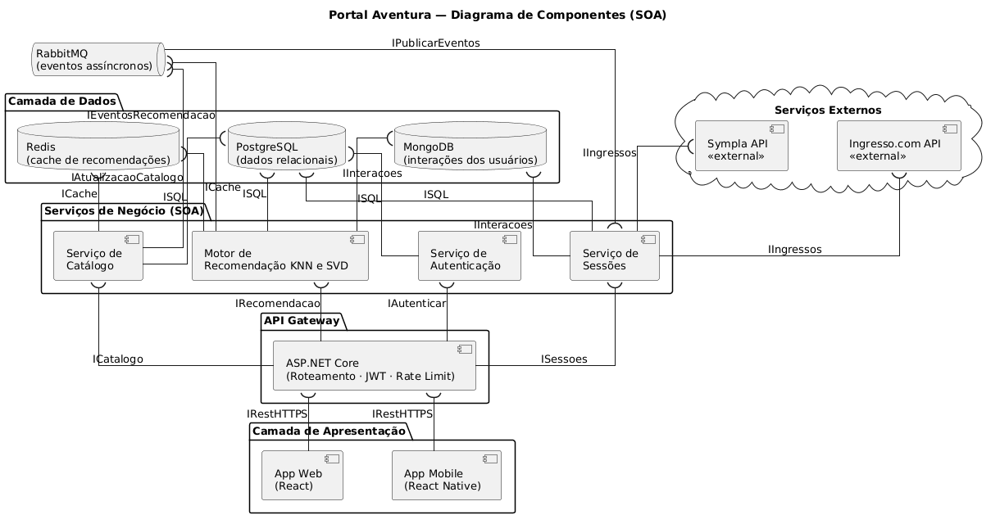
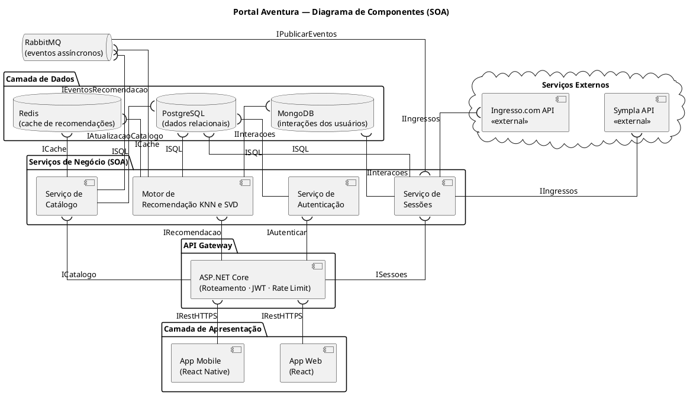
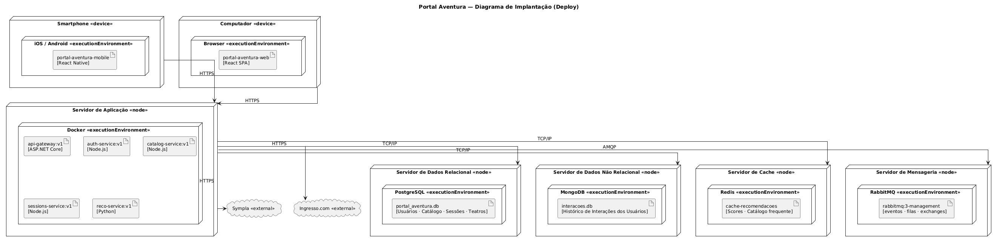
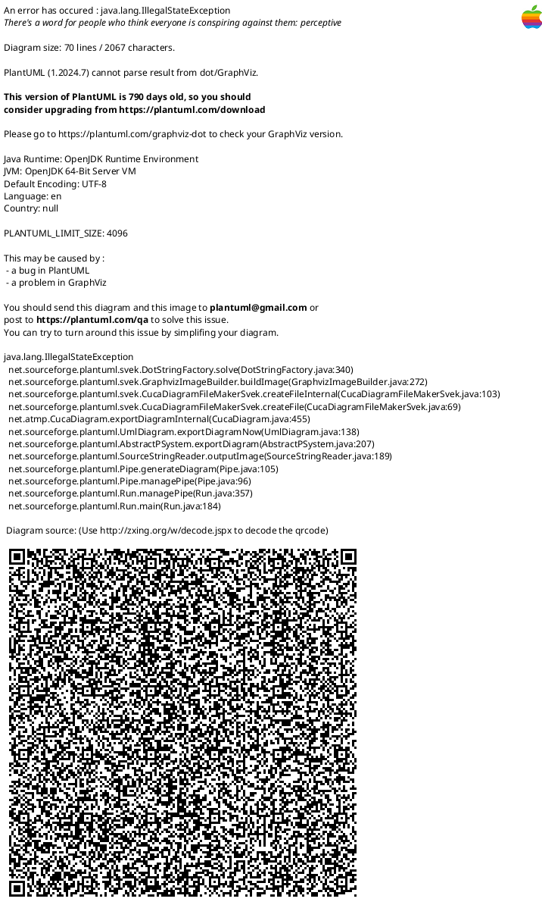

# Ponderada sala / Arquitetura SOA e Requisitos Não Funcionais

**Projeto:** Aventura Teatros  
**Disciplina:** Arquitetura de Software  
**Norma de referência:** ISO/IEC 25010  

---

# 1. Introdução

O Portal Aventura é uma plataforma digital voltada para recomendação e descoberta de espetáculos teatrais da Aventura Teatros. O sistema possui funcionalidades relacionadas à autenticação de usuários, catálogo de espetáculos, gerenciamento de sessões, integração com plataformas externas de ingressos e recomendação personalizada baseada em comportamento dos usuários.

A arquitetura foi desenvolvida seguindo os princípios de SOA (Service-Oriented Architecture), utilizando serviços desacoplados, comunicação via APIs REST e separação de responsabilidades entre os componentes do sistema.

A solução também utiliza uma estratégia híbrida de persistência de dados:
- PostgreSQL para dados relacionais;
- MongoDB para interações dos usuários;
- Redis para cache de recomendações;
- RabbitMQ para mensageria assíncrona.

---

# 2. Justificativa Arquitetural

A arquitetura do Portal Aventura foi projetada utilizando o modelo SOA (Service-Oriented Architecture), no qual o sistema é dividido em serviços independentes organizados por responsabilidade de negócio. Essa abordagem reduz acoplamento entre componentes, facilita manutenção evolutiva e permite escalabilidade seletiva dos módulos mais críticos da aplicação.

A solução foi organizada em seis grandes blocos arquiteturais:
- camada de apresentação;
- API Gateway;
- serviços de negócio;
- camada de dados;
- mensageria assíncrona;
- integrações externas.

A camada de apresentação é composta por aplicações Web e Mobile, responsáveis exclusivamente pela interface com o usuário. Essas aplicações não acessam diretamente bancos de dados nem regras internas de negócio, comunicando-se apenas com o API Gateway via HTTPS. Essa separação reduz dependências entre frontend e backend e permite evolução independente das interfaces.

O API Gateway atua como ponto central de entrada da aplicação. Ele é responsável por:
- roteamento das requisições;
- autenticação baseada em JWT;
- controle de rate limiting;
- centralização das políticas de segurança;
- abstração dos serviços internos.

Essa camada impede que os clientes acessem diretamente os serviços internos da arquitetura, reduzindo exposição da infraestrutura e simplificando controle de acesso e versionamento das APIs.

Os serviços de negócio foram separados de acordo com as capacidades funcionais do domínio da aplicação:
- Serviço de Autenticação;
- Serviço de Catálogo;
- Serviço de Sessões;
- Motor de Recomendação KNN e SVD.

O Serviço de Autenticação encapsula regras relacionadas a login, usuários, permissões e validação de credenciais. Já o Serviço de Catálogo concentra informações de espetáculos, categorias e dados descritivos utilizados pela plataforma.

O Serviço de Sessões é responsável pelo gerenciamento das sessões teatrais e pela integração com plataformas externas de venda de ingressos, como Sympla e Ingresso.com. Essa decisão segue o princípio de isolamento de integrações externas, no qual mudanças em APIs terceiras afetam apenas um serviço específico, sem impactar o restante da arquitetura.

O Motor de Recomendação KNN e SVD foi mantido como componente interno do conjunto de serviços de negócio, e não como infraestrutura externa separada, porque ele depende diretamente da lógica operacional da plataforma e do consumo contínuo dos dados internos da aplicação. O motor utiliza:
- interações dos usuários armazenadas no MongoDB;
- dados relacionais do catálogo presentes no PostgreSQL;
- cache de recomendações armazenado no Redis;
- eventos assíncronos recebidos via RabbitMQ.

Seu funcionamento está diretamente conectado ao fluxo de negócio principal do sistema, pois o algoritmo precisa constantemente recalcular similaridades, rankings e sugestões de espetáculos com base no comportamento dos usuários. Por esse motivo, ele foi modelado como um serviço especializado da arquitetura SOA, e não como um componente externo isolado.

Além disso, o motor possui responsabilidade computacional distinta dos demais serviços, concentrando processamento analítico relacionado aos algoritmos KNN (k-Nearest Neighbors) e SVD (Singular Value Decomposition). Essa separação facilita futuras evoluções da solução, permitindo:
- substituição do algoritmo sem alterar frontend ou gateway;
- inclusão futura de modelos de machine learning;
- treinamento offline;
- escalabilidade independente do processamento analítico;
- execução assíncrona baseada em eventos.

A camada de dados utiliza uma abordagem híbrida de persistência, na qual diferentes bancos são utilizados conforme a natureza dos dados armazenados.

O PostgreSQL foi escolhido para armazenar dados relacionais estruturados, como:
- usuários;
- espetáculos;
- teatros;
- sessões;
- permissões;
- catálogos.

Esse tipo de informação exige integridade referencial, consistência transacional e relacionamentos bem definidos.

O MongoDB foi adotado para armazenar interações dos usuários, incluindo:
- visualizações;
- curtidas;
- cliques;
- histórico de navegação;
- comportamento de consumo.

Esses dados possuem grande volume e estrutura variável, tornando bancos NoSQL mais adequados para armazenamento e leitura escalável.

O Redis foi utilizado como camada de cache de alta performance. Sua função é reduzir latência das recomendações e evitar reprocessamento excessivo do motor KNN e SVD em cenários de pico de acesso.

O RabbitMQ adiciona comunicação assíncrona orientada a eventos à arquitetura. Isso permite desacoplamento temporal entre serviços e reduz chamadas síncronas excessivas. Eventos como:
- atualização de catálogo;
- nova interação do usuário;
- alteração de sessão;
- atualização de recomendações

podem ser processados sem bloquear o fluxo principal da aplicação.

No diagrama de implantação, os componentes foram distribuídos em diferentes nós de infraestrutura, representando ambientes de execução independentes. Essa organização demonstra separação física entre:
- aplicação;
- bancos;
- cache;
- mensageria;
- serviços externos.

A utilização de Docker como execution environment permite portabilidade e padronização da infraestrutura, facilitando deploy e escalabilidade horizontal.

A arquitetura proposta atende diretamente aos princípios de SOA descritos por Thomas Erl:
- Loose Coupling;
- Service Contract;
- Autonomy;
- Statelessness;
- Reusability;
- Composability;
- Discoverability;
- Abstraction.

Como resultado, o Portal Aventura obtém uma arquitetura modular, desacoplada e preparada para evolução incremental, suportando crescimento futuro da plataforma sem necessidade de reestruturação completa da solução.

---

# 3. Diagrama de Componentes

## 3.1 Diagrama Renderizado

---

## 3.2 Código PlantUML — Diagrama de Componentes

---

# 4. Diagrama de Implantação

## 4.1 Diagrama Renderizado

---

## 4.2 Código PlantUML — Diagrama de Implantação

---

# 5. Requisitos Não Funcionais

## 5.1 Tabela de RNFs

| Código | Nome | Categoria ISO/IEC 25010 | SLA Mensurável | Justificativa | Componente Responsável |
|---|---|---|---|---|---|
| RNF-01 | Tempo de resposta das recomendações | **Performance Efficiency** | 95% das requisições à rota `/recomendacoes` devem responder em até 1,5s sob carga de 300 usuários simultâneos, medido via k6. | O motor de recomendação é uma das funcionalidades centrais do sistema. O uso de Redis reduz a necessidade de recalcular recomendações por KNN e SVD a cada requisição. | **Motor de Recomendação KNN e SVD** + **Redis** |
| RNF-02 | Disponibilidade dos serviços essenciais | **Reliability** | Disponibilidade mínima de 99,5% entre 10h e 23h, monitorada via UptimeRobot com verificação a cada 60s. | O Portal Aventura impacta diretamente a venda de ingressos. A separação SOA reduz falhas em cascata entre os serviços. | **API Gateway** + **Serviços SOA** |
| RNF-03 | Proteção dos dados dos usuários | **Security** | 100% das rotas privadas devem utilizar JWT com expiração máxima de 1h; senhas armazenadas com bcrypt custo ≥ 12; comunicação via HTTPS/TLS 1.2+. | O sistema armazena dados sensíveis relacionados às preferências e interações dos usuários. | **API Gateway** + **Serviço de Autenticação** |
| RNF-04 | Integração com plataformas externas | **Compatibility** | Todas as integrações com Sympla e Ingresso.com devem utilizar REST/JSON documentado; timeout máximo de 3s por chamada externa. | O sistema depende de plataformas externas para venda de ingressos e consulta de sessões. | **Serviço de Sessões** |
| RNF-05 | Evolução independente dos serviços | **Maintainability** | Cada serviço deve possuir pelo menos 70% de cobertura de testes automatizados e deploy independente. | O motor de recomendação poderá evoluir futuramente com novos modelos de machine learning sem impactar os demais serviços. | **Todos os Serviços SOA** |

---

# 6. Relação entre RNFs e Arquitetura

Os requisitos não funcionais definidos estão diretamente relacionados aos componentes da arquitetura SOA proposta. A eficiência de desempenho é sustentada pelo Redis e pelo motor de recomendação KNN e SVD. A confiabilidade é fortalecida pelo desacoplamento entre os serviços. A segurança é centralizada no Serviço de Autenticação e no API Gateway. A compatibilidade é garantida pelo Serviço de Sessões através da integração padronizada com APIs externas. Já a manutenibilidade é favorecida pela separação modular dos serviços e pela possibilidade de evolução independente.
