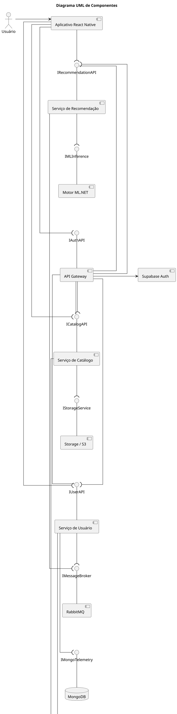
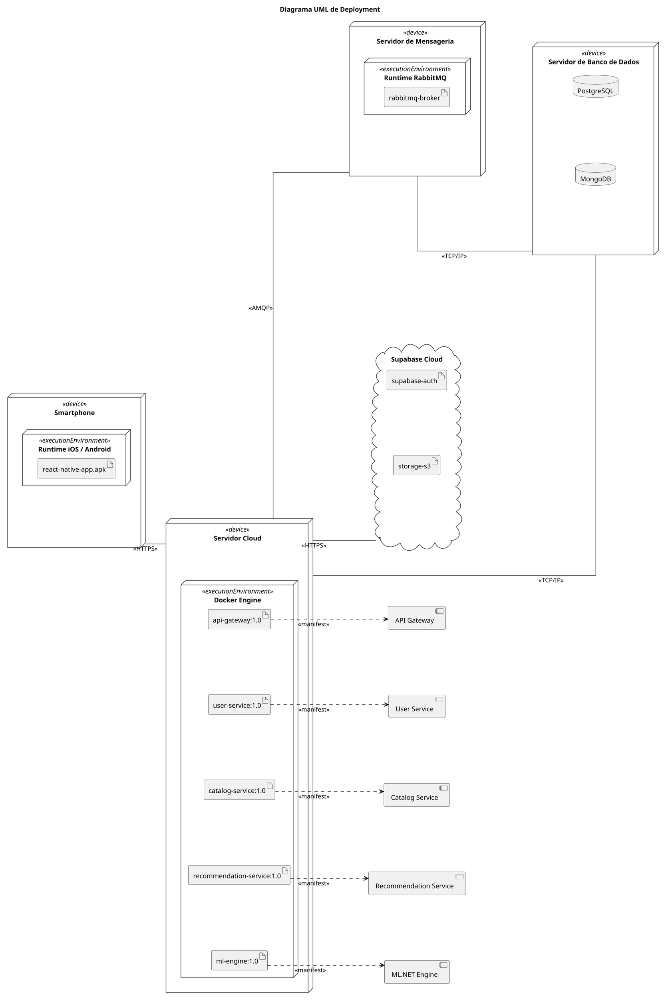

# Arquitetura SOA e Requisitos Não Funcionais

# 1. Diagrama UML de Componentes

## 1.1 Código PlantUML — Component Diagram

---

# 2. Diagrama UML de Deployment

## 2.1 Código PlantUML — Deployment Diagram

---

# 3. Justificativa Arquitetural

A arquitetura produzida segue o modelo SOA, separando responsabilidades em serviços independentes responsáveis pelo catálogo, usuários e recomendações personalizadas. A seguinte abordagem visa reduzir o acoplamento entre módulos: O API Gateway concentra a autenticação, roteamento e controle de acesso, estabelecendo a comunicação entre frontend e serviços internos. O uso de RabbitMQ isola o processamento de eventos do fluxo principal, permitindo que interações dos usuários sejam processadas de forma assíncrona pelo motor de ML sem degradar a experiência de navegação.

O armazenamento híbrido foi adotado para abranger à tipos variados de inputs: o PostgreSQL armazena dados relacionais, enquanto MongoDB é utilizado para o alto volume de eventos comportamentais. O motor de recomendação implementado em ML.NET opera como serviço independente, consumindo datasets armazenados em S3/Supabase e permitindo atualização contínua dos modelos através do pipeline MLOps.

A arquitetura em serviços também facilita o deploy independente aos processos e tolerância a falhas, fatores essenciais para suportar picos de acesso e futuras integrações.

---

# 4. Requisitos Não Funcionais (ISO/IEC 25010)

## 4.1 Tabela de RNFs

| RNF   | Categoria ISO/IEC 25010 | Requisito Não Funcional                                                                                                                                                      | Componentes Responsáveis               |
| ----- | ----------------------- | ---------------------------------------------------------------------------------------------------------------------------------------------------------------------------- | -------------------------------------- |
| RNF01 | Compatibilidade         | O sistema deve manter compatibilidade entre versões da API sem interromper o funcionamento de versões anteriores do aplicativo durante pelo menos 2 versões consecutivas. | API Gateway · Serviços SOA             |
| RNF02 | Portabilidade           | O sistema deve permitir implantação completa em ambiente Docker em no máximo 15 minutos utilizando containers independentes.                                                 | Docker Containers · Serviços SOA       |
| RNF03 | Adequação Funcional     | O sistema deve apresentar recomendações coerentes com as preferências do usuário com taxa mínima de relevância percebida de 80% em testes de validação.                      | Recommendation Service · ML.NET Engine |
| RNF04 | Usabilidade             | O usuário deve concluir o fluxo “Login -> Catálogo -> Descrição do espetáculo” em no máximo 1 minuto sem suporte externo.                                                      | React Native App · API Gateway         |
| RNF05 | Segurança               | O sistema deve registrar tentativas inválidas de autenticação e bloquear acessos suspeitos após 5 tentativas consecutivas em menos de 10 minutos.                            | API Gateway · Supabase Auth            |

---

## 4.2 Justificativa dos RNFs

### RNF01 — Compatibilidade

A compatibilidade entre versões da API é necessária para evitar que atualizações backend interrompam versões anteriores do aplicativo mobile. Neste contexto, Gateway da API une o versionamento e roteamento, permitindo a evolução gradual dos serviços sem a quebra de comunicação entre os protocolos utilizados.

### RNF02 — Portabilidade

A utilização de containers Docker permite utilização padronizada da infraestrutura em diferentes ambientes, reduzindo dependências locais e simplificando processos de manutenção.

### RNF03 — Adequação Funcional

O principal objetivo do sistema é fornecer recomendações relevantes ao usuário: O motor ML.NET utiliza dados comportamentais e preferências explícitas para aumentar a precisão das recomendações exibidas.

### RNF04 — Usabilidade

Como o sistema possui abordagem mobile first, a navegação deve ser simples, objetiva e intuitiva. A estrutura do frontend em React Native reduz complexidade de interação (sendo um framework otimizado ao uso de tal ambiente) e melhora a experiência do usuário.

### RNF05 — Segurança

O sistema manipula autenticação e dados personalizados dos usuários, exigindo mecanismos de proteção contra acessos indevidos. O Gateway da API centraliza a validação de autenticação e o Auth do Supabase gerencia os tokens JWT utilizados no HTTPS.
