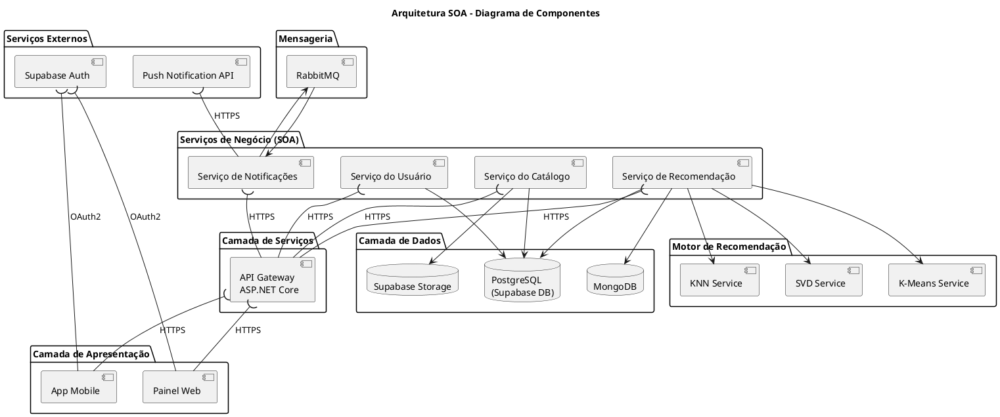
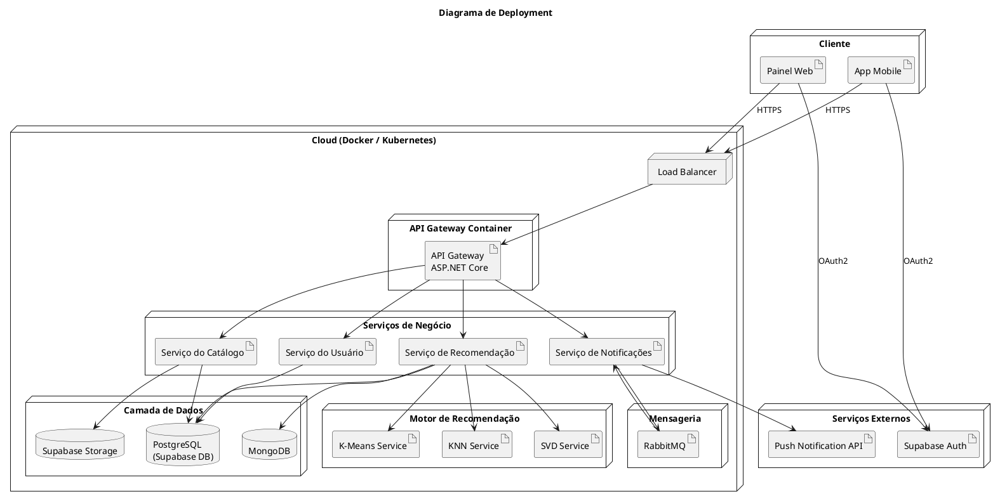

# Ponderada — Arquitetura SOA e Requisitos Não Funcionais

---

## 1. Arquitetura SOA

### 1.1 Diagrama de Componentes

---

### 1.2 Justificativa da Arquitetura de Componentes

A arquitetura foi desenvolvida utilizando o padrão **SOA (Service-Oriented Architecture)**, separando o sistema em serviços independentes e especializados com interfaces bem definidas. Essa abordagem reduz o acoplamento entre os módulos e facilita manutenção, escalabilidade horizontal e integração com sistemas externos — alinhando diretamente com as necessidades de crescimento do parceiro.

O **frontend** foi dividido entre aplicação web e mobile, ambos consumindo os mesmos serviços de backend através do API Gateway. Essa separação permite que diferentes canais de acesso evoluam de forma independente sem alteração nos contratos de serviço.

O **API Gateway** (ASP.NET Core) centraliza o recebimento de requisições, aplica autenticação e realiza roteamento para os serviços corretos, funcionando como ponto único de entrada. Isso simplifica o gerenciamento de segurança e observabilidade.

Cada serviço de negócio possui responsabilidade única e bem delimitada:

- **Serviço do Usuário** — gerencia perfis e dados pessoais, isolando regras de negócio de usuário do restante do sistema;
- **Serviço do Catálogo** — controla produtos e mídias, com acesso direto ao Supabase Storage para arquivos estáticos;
- **Serviço de Recomendação** — executa algoritmos de ML (KNN, SVD, K-Means) sobre dados do MongoDB, separado do banco transacional para não disputar recursos com operações críticas;
- **Serviço de Notificações** — processa envios assíncronos via RabbitMQ, desacoplando o fluxo principal da aplicação de operações lentas de I/O.

A **separação em serviços independentes** habilita escalabilidade granular. Em cenários de pico — como promoções ou eventos de alto acesso simultâneo do parceiro — apenas os serviços mais demandados (ex.: Recomendação, Catálogo) podem receber novos recursos computacionais, sem a necessidade de replicar toda a aplicação. Isso reduz custo operacional e aumenta disponibilidade de forma seletiva.

A arquitetura também facilita **integração com APIs terceiras e sistemas legados** do parceiro. O uso de interfaces padronizadas (REST/JSON via lollipop-socket no diagrama) permite substituição futura de provedores — como trocar o provedor de push notifications ou o gateway de autenticação — sem impacto nos demais componentes.

---

### 1.3 Diagrama de Deployment

---

### 1.4 Justificativa do Deployment

O deployment foi estruturado utilizando **containers independentes** para cada serviço do backend, orquestrados via Docker/Kubernetes, permitindo escalabilidade horizontal e isolamento completo entre os componentes.

O **Load Balancer** distribui as requisições recebidas entre as réplicas disponíveis dos serviços, evitando sobrecarga em instâncias únicas. Essa abordagem aumenta disponibilidade e tolerância a falhas — se uma instância falhar, o tráfego é redirecionado automaticamente para as demais.

Os **bancos de dados foram separados por função**: o PostgreSQL (Supabase DB) armazena operações transacionais críticas — usuários, catálogo, pedidos — enquanto o MongoDB é utilizado pelo Motor de Recomendação para dados não-relacionais e consultas analíticas pesadas, evitando que cargas de leitura intensiva impactem as operações principais.

Os **serviços externos** (Supabase Auth, Push Notification API) permanecem desacoplados da aplicação principal. A autenticação é delegada ao Supabase Auth via OAuth2, removendo essa responsabilidade do código interno e simplificando conformidade com segurança.

A utilização de **containers Docker** melhora portabilidade e padronização entre ambientes de desenvolvimento, homologação e produção, alinhando a arquitetura ao princípio 12-factor e facilitando migração entre provedores de nuvem — diretamente relacionado aos atributos de **Portabilidade e Manutenibilidade** da ISO 25010.

---

## 2. Requisitos Não Funcionais (RNFs)

| RNF | Categoria ISO 25010 | SLA / Métrica | Justificativa | Componentes Responsáveis |
|-----|---------------------|---------------|---------------|--------------------------|
| O sistema deve responder recomendações em tempo real | Performance Efficiency | p99 da rota `/recommendation` < 300 ms com 200 req/s | Como o sistema trabalha com recomendações durante a navegação do usuário, alta latência impacta diretamente a experiência e a taxa de conversão. A arquitetura SOA permite escalar apenas o Serviço de Recomendação em momentos de pico sem afetar os demais serviços. | Serviço de Recomendação, MongoDB, KNN/SVD/K-Means |
| O sistema deve possuir disponibilidade mínima de 99,9% | Reliability | Uptime ≥ 99,9% ao ano (downtime máximo ~8,7 h/ano) | O parceiro necessita que a plataforma permaneça operacional continuamente para evitar perda de vendas. O desacoplamento entre serviços via SOA reduz o impacto de falhas isoladas — a queda de um serviço não derruba os demais. | API Gateway, Load Balancer, todos os serviços de negócio |
| O sistema deve garantir autenticação segura e proteção de dados | Security | 100% das senhas com hash bcrypt; mitigação OWASP Top 10; tokens JWT com expiração ≤ 1 h | O sistema armazena dados sensíveis dos usuários e integra APIs externas. A centralização da autenticação em um serviço independente (Supabase Auth) melhora controle de segurança, auditoria e manutenção sem acoplar essa lógica aos serviços de negócio. | Supabase Auth, API Gateway, Serviço do Usuário |
| O sistema deve ser compatível com APIs externas e sistemas legados | Compatibility | APIs REST padronizadas em JSON seguindo OpenAPI 3.0; contratos versionados (`/v1/`, `/v2/`) | O parceiro poderá integrar novos serviços futuramente, como gateways de pagamento ou ERPs legados. A arquitetura SOA facilita substituição e integração de provedores sem alterar os demais módulos. | API Gateway, Serviço do Catálogo, Push Notification API |
| O sistema deve possuir interface responsiva e acessível | Usability | Compatibilidade com viewports ≥ 320 px; conformidade WCAG 2.1 nível AA; SUS ≥ 75 | A plataforma será utilizada em dispositivos móveis e desktops por diferentes perfis de usuários do parceiro, exigindo boa experiência e acessibilidade para maximizar adoção. | App Mobile, Painel Web |
| O sistema deve possuir arquitetura modular e testável | Maintainability | Cobertura de testes automatizados ≥ 80% por serviço; tempo médio de correção de bug crítico ≤ 4 h | Como o sistema possui múltiplos serviços independentes, a modularização SOA permite testar, corrigir e fazer deploy de cada serviço isoladamente sem parar os demais. Reduz risco em atualizações e acelera ciclos de entrega. | Todos os serviços de negócio, Motor de Recomendação |
| O sistema deve ser implantável em diferentes ambientes | Portability | Deploy via Docker seguindo padrão 12-factor; tempo de setup em novo ambiente ≤ 30 min | O parceiro poderá migrar entre provedores de nuvem futuramente. Containers garantem paridade entre ambientes de desenvolvimento, homologação e produção, eliminando inconsistências de configuração. | Todos os serviços do backend, Camada de Dados |
| O sistema deve garantir cobertura funcional das operações principais | Functional Suitability | Cobertura ≥ 95% dos casos de uso críticos (login, catálogo, recomendação, notificação); zero regressões em deploy | O sistema precisa executar corretamente as funcionalidades essenciais do parceiro. A separação em serviços SOA com contratos bem definidos garante que cada serviço entregue sua função sem dependências ocultas. | Frontend, todos os serviços de negócio, Camada de Dados |

